# Konzept 25 · Technische Architektur

> **Kurz gesagt.** Zwei neue Pakete tragen die Funktion: `internal/seerr` spricht HTTP mit Seerr und
> kennt keine Datenbank, `internal/wishes` führt die Wünsche, die Zuordnung und den Abgleich auf eigenen
> Tabellen. Ob ein Titel in der Bibliothek steht und ob ein Profil ihn sehen darf, beantwortet weiter nur
> `visibility`; den Anstoss «Titel zugeordnet» gibt `metadata` an der Stelle des heutigen `WithRelink`-Hakens.
> Slouchcat legt Wünsche mit `X-Api-Key` und `X-API-User` im Namen des zugeordneten Seerr-Benutzers an,
> speichert sie zuerst lokal (Ausgangsfach) und gleicht alle 5 Minuten ab. «Verfügbar» meldet Slouchcat erst,
> wenn die eigene Bibliothek den Titel für das Profil abspielen kann, nie allein auf Grund von Seerr.
> Neu in Fassung 3: Jedes Konto bekommt in Seerr einen eigenen Benutzer mit demselben Login; Slouchcat
> gibt das Passwort nur in den drei Momenten weiter, in denen der Server es ohnehin sieht, und speichert es nie.
> Slouchcat schreibt das Limit je Konto in diesen Benutzer, Seerr zählt. Ein kleines Paket `internal/arr`
> spricht Radarr und Sonarr für genau zwei Dinge an: den Profil-Tag setzen und für den Download-Fortschritt die
> Warteschlange und den Dateistand der gewünschten Titel lesen. Die Webhooks von Radarr und Sonarr bleiben, wie sie sind. Der Bereich «Wünsche» liest
> Entdecken, Filme, Serien und Suche über Seerr mit einem Zwischenspeicher. Startseite und Spotlight-Liste
> zeigen weiter nur Titel der Bibliothek (S-4); das Spotlight erkennt vorhandene Serien neu auch über TVDB und
> IMDb. Serien gleicht Slouchcat TVDB zuerst ab.

Stand: Fassung 3 vom 17. November 2026 mit allen drei Rückmeldungen von Marco an diesem Tag (E-1 bis E-11,
[Anhang H](anhang/H-nachtrag-17-november.md)), `main` `ba6efe31`, Vertrag 1.40.0, letzte Migration 00065.
Grundlage ist [Anhang F](anhang/F-entscheid-blatt.md) (Abschnitte 1 bis 10) und Anhang H (Regeln N-1 bis N-98;
Abschnitt 10 geht den Abschnitten 4 bis 9 vor, Abschnitt 8 den Abschnitten 4 bis 7); Belege `pfad:zeile` stammen aus den Anhängen A bis D
und H oder sind im Worktree nachgesehen. Seerr-Belege beziehen sich auf Seerr v3.5.2 (`GH:` = `github.com/seerr-team/seerr/blob/v3.5.2/`).
Was über Anhang F hinausgeht, ist als **Vorschlag** gekennzeichnet. Datenmodell und Vertrag im Einzelnen:
`08-datenmodell-api.md`; Bauschritte: `09-umsetzungsplan.md`; Benachrichtigungen: `06-benachrichtigungen.md`.

## 1. Überblick und Grundsätze

| Nr. | Grundsatz | Herkunft |
|---|---|---|
| G-1 | Seerr bleibt die Wunschverwaltung. Die API von Radarr und Sonarr nutzt Slouchcat für genau zwei Dinge: den Profil-Tag (Tag anlegen und an den Titel hängen, Abschnitt 20) und das Lesen des Download-Fortschritts (Warteschlange und Dateistand der gewünschten Titel: `queue`, `movie?tmdbId`, `series?tvdbId`; Abschnitt 22). Sonst nie. Die Webhooks von Radarr und Sonarr bleiben, wie sie sind (Abschnitt 10). | Anhang F 2.1; Anhang H N-22 (Marco, E-2), N-80, N-81 (Marco, E-6, E-7) |
| G-2 | Ausgehend nur zur eingetragenen Adresse, ohne Weiterleitung, mit Zeitlimit und Rate-Limit. Für Radarr und Sonarr: nur die Adresse aus Seerr oder die eigene Adresse des Administrators (Abschnitt 20.2). | Anhang F 2.2; Anhang H N-23 |
| G-3 | Jeder Wunsch läuft im Namen eines Seerr-Benutzers (`X-API-User`), nie mit `userId` im Body. | Anhang F 2.3, F-3 |
| G-4 | Kein Aufruf an Seerr im Seitenaufbau der übrigen Zuschauerseiten; sie lesen nur lokale Tabellen. Ausnahmen: die Seiten «Entdecken», «Filme», «Serien», «Suche» und die Staffelliste im Dialog «Anfordern», beide über einen Zwischenspeicher (Abschnitte 6.2 und 21). Radarr und Sonarr ruft kein Seitenaufbau auf; der Fortschritt kommt aus dem Zwischenspeicher (Abschnitt 22). | Anhang F 2.9, 2.10; Anhang H N-54, N-63, N-84 |
| G-5 | «Verfügbar» = in Slouchcat für das Profil abspielbar. | Anhang F 2.8, F-13 |
| G-6 | Regel 2 bleibt: Titel-SQL nur in den erlaubten Paketen; nicht sichtbar heisst 404. | CLAUDE.md Regel 2 |
| G-7 | Der Server entscheidet Wunschrecht und Altersgrenze; der Client zeigt nur an. | Regel 12, Anhang F 2.6 |
| G-8 | Jeder Job-Handler ist idempotent; ein abgebrochener Lauf darf beliebig oft neu starten. | ADR 0002, `server/internal/jobs/queue.go:1-7` |
| G-9 | Das Passwort eines Kontos speichert Slouchcat nie im Klartext und schreibt es nie ins Protokoll. Es geht nur in den drei Momenten an Seerr, in denen der Server es ohnehin sieht: Einladung annehmen, Passwort ändern, Anmeldung (Abschnitt 18). | Anhang H N-3, N-12 |
| G-10 | Das Limit hat genau einen Ort: Slouchcat stellt es ein und schreibt es in den Seerr-Benutzer, Seerr zählt und setzt durch (Abschnitt 19). | Anhang H N-31, N-32 (Marco, E-3), N-37 |
| G-11 | Startseite (Bühne und Posterreihe) und Spotlight-Liste zeigen nur Titel der Bibliothek, wie heute; S-4 gilt ohne Ausnahme. Fehlende Einträge der Trakt-Liste sieht nur der Administrator unter Verwaltung › Spotlight (Abschnitt 5.1). | Anhang H N-70, N-71 (Marco, E-5) |

## 2. Komponenten

### 2.1 Bestehende Komponenten, die sich ändern

| Paket oder Datei | Änderung | Stufe |
|---|---|---|
| `internal/admin` (`settings.go`) | Einstellungen `seerr.*`, `wishes.*` und `arr.*` (Limit ab Werk, Schalter, Präfix des Profil-Tags, eigene Adressen von Radarr und Sonarr); API-Schlüssel über `settingsWriter.setSecret` (`server/internal/admin/settings.go:630-640`) | 1, 4, 5 |
| `internal/auth` (Profile, Konten, Einladungen) | Felder `can_request` an Konto, Profil und Einladung schreiben; neuer Haken «Passwort gesehen» an drei Stellen (Abschnitt 18.3) und Abschluss beim Löschen eines Kontos (Abschnitt 18.4) | 1 |
| `internal/api` | neue Handler (strict server), Bild-Handler für fehlende Titel (`scoped` für Zuschauer, eigene Admin-Route für die Verwaltung), Sitzung mit `wishes`, Limit und Seiten des Bereichs «Wünsche»; Vertragstest | 1 bis 5 |
| `internal/visibility` | neue Funktionen: Titel zu externen IDs, «fehlt für dieses Profil», Altersprüfung fehlender Titel, sichtbare Staffeln; Spotlight-Abfrage erkennt Bibliothekstitel auch über TVDB und IMDb (Abschnitt 5.1) | 2, 3, 4 |
| `internal/metadata` | neuer Haken `WithMatched` neben `WithRelink` (`server/internal/metadata/metadata.go:344-349`, `match.go:312-330`); TMDB-Abruf für `external_titles` und `series_catalog`; Trakt-Abruf liest `tvdb` und `imdb` (`server/internal/trakt/trakt.go:270-273`) | 2, 3, 4 |
| `internal/notify` | neue Eingangsarten und Kanal-Ereignisse; neuer Leseweg für Einträge ohne `item_id` über `wish_id` (Details in `06-benachrichtigungen.md`, Abschnitte 8 und 11) | 2, 4 |
| `internal/integrations` | `receiveWebhook` kennt die Art `jellyseerr` als reinen Anstoss; der Empfang von Radarr und Sonarr bleibt unverändert (Abschnitt 10); der Sofort-Import (Abschnitt 10.1, Marco, E-11) liest neu Dateipfad und Kennung aus der Meldung, nur wenn die Messung einen Gewinn zeigt | 4, 6a |
| `internal/discover` | Reihe `wishes` «Erfüllte Wünsche»: nur Wünsche des Profils, die in den letzten 14 Tagen erfüllt wurden, also Bibliothekstitel als `ItemRef` (N-74, N-97; Marco, E-10). Die Titel-IDs der erfüllten Wünsche liefert der Dienst `wishes` (nur er liest die Wunsch-Tabellen); ob das Profil sie sieht, prüft `discover` über `visibility` (Regel 2; Redaktionsentscheid zu K-16). Das Spotlight mischt nichts ein und zeigt weiter nur Bibliothekstitel | 3 |
| `internal/logging` | neue Schlüsselnamen in der Redaction-Liste und im Test (Regel 10; Abschnitt 4.3) | 1, 4 |
| `cmd/slouchcat/main.go` | Verdrahtung von `seerr`, `arr`, `wishes`, Haken und Jobarten (`main.go:418-443`; heutige Haken von `auth` an `main.go:292`) | 1 bis 5 |
| `web/src` | neue Seiten und Bauteile (`02-funktionskonzept.md`, `05-spotlight-integration.md`, `07-administration.md`), dazu die Reiter «Entdecken», «Filme», «Serien», «Suche» und der Hinweis auf der Seite `/invite/$token` (`web/src/app/router.tsx:237`) | 1 bis 5 |

### 2.2 Neues Paket `internal/seerr`

Ein reiner HTTP-Client nach dem Vorbild `internal/trakt` (ohne DB, mit Rate-Limiter und Schutz vor
Weiterleitungen; [Anhang A](anhang/A-spotlight-startseite.md), Anknüpfungspunkte).

| Merkmal | Festlegung | Begründung |
|---|---|---|
| Ziel | nur die vom Administrator eingetragene Basisadresse, Pfade immer `/api/v1/…` | Anhang F 2.2; Seerr bindet `/api/v1` (`GH:server/index.ts` Z. 264) |
| Schemata | nur `http` und `https` | Muster `fetch` (`server/internal/fetch/fetch.go:1-57`) |
| LAN | **ausdrücklich erlaubt**: eigener `http.Client` ohne `netguard.RefuseLocal` | `netguard` sperrt 192.168/16 (`server/internal/netguard/netguard.go:29-54`); Seerr steht im Heimnetz |
| Weiterleitungen | keine: `CheckRedirect` liefert `http.ErrUseLastResponse`; eine 3xx-Antwort gilt als Fehler `seerr_redirect` | Muster Updater-Begleiter (`server/internal/admin/update_install.go:107-113`): der Schlüssel darf nicht weiterwandern |
| Zeitlimit | 10 s je Aufruf; der Sofortversuch von `createWish` 3 s | Anhang F 2.2, 2.10 |
| Rate-Limit | `ratelimit.Limiter` 5 Anfragen/s, Burst 5, je Instanz | Anhang F 2.2; Muster `server/internal/ratelimit/ratelimit.go:1-30` |
| Antwortgrösse | **Vorschlag:** höchstens 4 MiB je Antwort, sonst Fehler | Schutz bei falscher Adresse |
| Fehlertexte | nennen nur Schema und Host (`netguard.Clean`/`Site`), nie Pfad mit Schlüssel | `server/internal/netguard/netguard.go:130-150` |
| Fehlerklassen | Sentinels `ErrUnreachable`, `ErrKeyInvalid`, `ErrForbidden` (mit Meldung), `ErrDuplicate`, `ErrNoSeasons`, `ErrNotFound`, `ErrServer`, `ErrCSRF`; neu **Vorschlag** `ErrUserExists` (409 bei `POST /user`), `ErrQuota` (403 `… Quota exceeded.`) | Muster `model.ErrTMDBUnreachable` (`server/internal/metadata/tmdb.go:80-84`) |
| Inhalt im Protokoll | nie ein Body, nie ein Header; ein Body mit Passwort (`POST /user`, `…/settings/password`) erscheint auch in Fehlertexten nicht | `CLAUDE.md` Regel 10; Anhang H N-12 |
| Wiederholung | keine im Client; die Job-Queue wiederholt | [Anhang C](anhang/C-integrationen-jobs-regeln.md), Abschnitt 3 |

**Aufrufe nach Gruppen** (Einzelheiten und Fallstricke: `08-datenmodell-api.md`, Abschnitt 5):

| Gruppe | Aufrufe | Stufe |
|---|---|---|
| Verbindung | `GET /status`, `GET /auth/me`, `GET /service/radarr`, `GET /service/sonarr` | 1 |
| Benutzer | `GET /user`, `GET /user?q=<E-Mail>`, `POST /user`, `GET` und `POST /user/{id}/settings/main`, `POST /user/{id}/settings/password`, `POST /user/{id}/settings/permissions` (Anhang H 3.1) | 1 |
| Limit | `GET /user/{id}/quota`; Requests des Benutzers für «nächster Platz frei» (Abschnitt 19.3) | 1 |
| Einstellungen | `GET /settings/public` (`localLogin`), `GET /settings/metadatas` (Staffelquelle), `GET /settings/radarr`, `GET /settings/sonarr` (Adresse, Schlüssel, «Tag Requests»; Anhang H 3.1, 3.4, 3.5) | 1, 4 |
| Wünsche | `POST /request`, `GET /request`, `GET /request/{id}`, `DELETE /request/{id}`, `POST /request/{id}/approve|decline|retry`, `GET /movie/{tmdbId}`, `GET /tv/{tmdbId}` | 2, 4 |
| Entdecken und Suche | `GET /discover/trending`, `/discover/movies`, `/discover/movies/upcoming`, `/discover/tv`, `/discover/tv/upcoming`, `/discover/genreslider/movie`, `/discover/genreslider/tv`, `/discover/movies/genre/{id}`, `/discover/tv/genre/{id}`, `GET /search` (Anhang H 3.3) | 5 |

Der Client bildet die Antworten auf schmale Go-Typen ab (`Request`, `Media`, `User`, `Quota`, `Status`, neu
`UserSettings`, `PublicSettings`, `DVRServer`, `DiscoverPage`).
Er liest Statuswerte als Zahlen, nicht als Namen: `BLACKLISTED` und `BLOCKLISTED` haben beide den Wert 6
([Anhang D](anhang/D-jellyseerr-api.md), Abschnitt 5). Die Spec von Seerr ist an mehreren Stellen falsch (D, Abschnitt 1); der Client
folgt dem Code.

### 2.3 Neues Paket `internal/wishes`

Der Dienst für alles, was Wünsche betrifft.

| Teil | Aufgabe |
|---|---|
| `Service.Create` | Wunschrecht prüfen, lokal anlegen (`queued`), Sofortversuch, sonst `wishes.submit` |
| `Service.Withdraw` | zurückziehen: lokal `withdrawn` mit Merker «in Seerr noch zu löschen», dann Job `wishes.withdraw` (Abschnitt 6.6, F-17) |
| `Service.Submit` | Handler `wishes.submit`: ab dem zweiten Versuch Vorprüfung in Seerr, Senden, Antwort auswerten |
| `Service.Sync` | Handler `wishes.sync`: Requests abgleichen, Zustände ableiten; auch der Erstabgleich (Abschnitt 7.2) |
| `Service.Import` | Handler `wishes.import`: bestehende Requests eines zugeordneten Benutzers übernehmen (Abschnitt 7.3, F-21) |
| `Service.Reconcile` | Handler `wishes.reconcile` und Haken `WithMatched`: Verfügbarkeit in der eigenen Bibliothek |
| `Service.RefreshUsers` | Handler `seerr.users`: Benutzerliste, Rechte, Limit-Stand, Fingerabdruck der Instanz (Abschnitt 7.4) |
| `Service.Provision` | Handler `seerr.provision`: Seerr-Benutzer eines Kontos eröffnen oder über die E-Mail verknüpfen, Rechte und Limit schreiben (Abschnitt 18) |
| `Service.PasswordSeen` | Haken aus `auth`: Passwort im Speicher an Seerr weitergeben, wenn der Zustand es verlangt (Abschnitt 18.3) |
| `Quota` | Limit je Konto auflösen, Stand aus dem Zwischenspeicher, Vorprüfung beim Anfordern, «nächster Platz frei» (Abschnitt 19) |
| `Service.Tag` | Handler `wishes.tag`: Profil-Tag über `internal/arr` setzen und nachholen (Abschnitt 20) |
| `Service.Progress` | Handler `wishes.progress`: Warteschlange und Dateistand der gewünschten Titel in Radarr und Sonarr über `internal/arr` lesen, Einträge den Wünschen zuordnen, Zwischenspeicher `wish_progress` schreiben (Abschnitt 22) |
| `Discover` | Leseweg der Seiten «Entdecken», «Filme», «Serien», «Suche» und Handler `wishes.discover` (Abschnitt 21) |
| `Mapping` | Seerr-Benutzer je Konto (eröffnet, verknüpft, von Hand), Ausnahme je Profil (F-27) |
| `Rights` | `canRequest` und Grund je Sitzung, je Titel, je Medienart, je Stelle |

SQL liegt in einem eigenen Abfrageordner, nur für dieses Paket (**Vorschlag:** `server/queries/wishes/` →
`store/wishq`, eine depguard-Regel nach dem Muster `certq` in `server/.golangci.yml`). Das Paket fragt nur
die Wunsch-Tabellen (`wishes`, `wish_seasons`, `wish_requesters`, `wish_events`, `seerr_users`,
`wish_account_map`, `wish_profile_map`, `seerr_log`, neu `wish_account_limits`, `wish_profile_tags`, `wish_tags`,
`wish_progress`, `wish_discover_pages`) und lesend `accounts`/`profiles` ab, nie `items`, `media_files` oder `tracks`, und
importiert `store/systemq` nicht. Ob ein Treffer aus Entdecken oder Suche in der Bibliothek steht, fragt es
`visibility` (Abschnitt 21.3).

### 2.4 Wer welche Daten besitzt

| Daten | schreibt | liest | Grund |
|---|---|---|---|
| Wunsch-Tabellen, `seerr_users`, Zuordnung | `wishes` | `wishes`, `admin` über den Dienst | eigenes Fach |
| `external_titles`, `external_title_texts`, `external_title_images`, `series_catalog` | `metadata` (TMDB-Client liegt dort, `server/internal/metadata/tmdb.go`) | `visibility` | TMDB-Abruf und Freigabeland-Logik liegen in `metadata` |
| `spotlight_entries` (+ `tvdb_id`, `imdb_id`) | `metadata` (`server/internal/metadata/trakt.go:291-298`) | `visibility`, `admin` | wie heute |
| `notifications`, `deliveries` | `notify` | `notify` | wie heute |
| `accounts.can_request`, `profiles.can_request` | `auth`, `admin` | `wishes` (lesend), `api` (Sitzung) | Kontodeckel nur über `updateAccountAccess` (`docs/adr/0014-benutzerverwaltung.md:87`) |
| `settings` `seerr.*`, `wishes.*`, `arr.*` | `admin` | `wishes`, `seerr`, `arr` (Konfiguration beim Aufruf) | ein Ort je Einstellung |
| `wish_account_limits` (Limit je Konto), `wish_profile_tags` (Name des Profil-Tags) | `wishes` über `admin` | `wishes` | Limit und Tag-Name gehören zum Wunschfach; die Felder stehen auf den Seiten Konten bzw. Seerr-Benutzer |
| `wish_tags`, `wish_discover_pages` | `wishes` | `wishes` | Zustand der Tags; Zwischenspeicher der Listen |
| `wish_progress` (Download-Fortschritt je Wunsch, **Vorschlag**) | `wishes` (Job `wishes.progress`) | `wishes` (für `listWishes`, `getExternalTitle`, `listAdminWishes`) | Zwischenspeicher; kein Aufruf an Radarr oder Sonarr im Seitenaufbau (N-84) |
| Schlüssel von Radarr und Sonarr | niemand (nur im Speicher von `arr`) | `arr` | aus `GET /settings/radarr|sonarr` gelesen, nie gespeichert (N-23) |

### 2.5 Diagramm (a): Komponentenübersicht

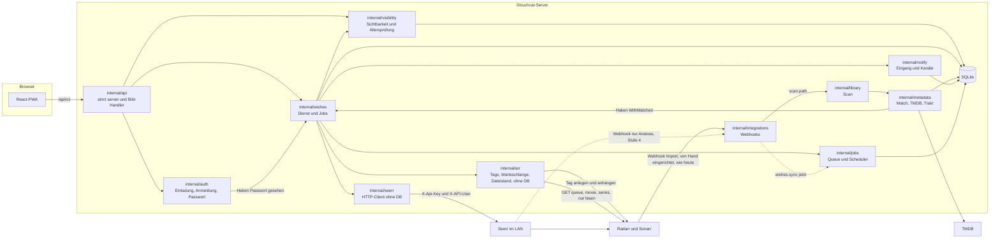

### 2.6 Neues Paket `internal/arr` (Profil-Tag und Download-Fortschritt, Stufe 4)

**Vorschlag** für Name und Schnitt. Ein reiner HTTP-Client für Radarr und Sonarr (API v3), ohne Datenbank, nach
dem Muster von `internal/seerr`. Er kennt genau zwei Dinge (Anhang H N-81, Marco, E-6 und E-7): Tags (Titel
finden, Tag sicherstellen, Tag anhängen; N-22) und das **Lesen** der Warteschlange und des Dateistands der
gewünschten Titel für den Download-Fortschritt (`queue`, `movie?tmdbId`, `series?tvdbId`; Abschnitt 22, K-5). Webhooks richtet er nicht ein; `GET /api/v3/notification` ruft er nicht auf (N-80).

| Merkmal | Festlegung | Begründung |
|---|---|---|
| Aufrufe für den Tag | `GET /api/v3/tag`, `POST /api/v3/tag {label}`; Radarr `GET /api/v3/movie?tmdbId=`, `PUT /api/v3/movie/editor {movieIds, tags, applyTags: "add"}`; Sonarr `GET /api/v3/series?tvdbId=`, `PUT /api/v3/series/editor {seriesIds, tags, applyTags: "add"}` | lesende Aufrufe gegen Radarr 6.4.4.10685 und Sonarr 4.0.20.3014 geprüft; die drei schreibenden **nicht geprüft** (Anhang H 8.3) |
| Aufrufe für den Fortschritt | `GET /api/v3/queue` je Dienst; zum Zuordnen `GET /api/v3/movie?tmdbId=` (Radarr) bzw. `GET /api/v3/series?tvdbId=` (Sonarr), dieselben Aufrufe wie beim Tag | geprüft gegen Marcos Instanzen, ausser den Sonarr-Feldern `seriesId`, `episodeId`, `seasonNumber` der Warteschlange (Anhang H 8.3) |
| Nicht im Paket | Titel hinzufügen, löschen, suchen, Qualität, Einträge der Warteschlange ändern oder entfernen, Tags entfernen, Webhooks (`/api/v3/notification`) anlegen oder ändern | N-22, N-26, N-80; Spec `:69` bleibt |
| Ziel | Standardserver ohne 4K aus `GET /settings/radarr` bzw. `/settings/sonarr` (`hostname`, `port`, `useSsl`, `baseUrl`), oder die eigene Adresse des Administrators (Abschnitt 20.2) | N-23, F-30 |
| Schlüssel | `apiKey` aus derselben Antwort, nur im Speicher, dort 10 Minuten gültig; neu gelesen nach Ablauf oder nach einer Antwort 401; geht nur an den Host, den der Administrator bestätigt hat (Abschnitt 20.2) | N-23, K-23 |
| LAN | erlaubt wie bei `seerr`: eigener `http.Client` ohne `netguard.RefuseLocal` (`server/internal/netguard/netguard.go:73`) | Radarr und Sonarr stehen im Heimnetz |
| Weiterleitungen | keine (`CheckRedirect` liefert `http.ErrUseLastResponse`) | der Schlüssel darf nicht weiterwandern |
| Zeitlimit, Rate-Limit | **Vorschlag:** 10 s, 2 Anfragen/s je Dienst | Tags sind selten; die Warteschlange liest `wishes.progress` höchstens einmal je Minute und Dienst |
| Antwortgrösse | **Vorschlag:** höchstens 4 MiB je Antwort wie `seerr` | die Warteschlange kann viele Einträge tragen |
| `os/exec` | keins (Regel 3) | – |
| Tag-Namen | nur `a–z`, `0–9`, `-` (Radarr und Sonarr, Anhang H 3.5); `arr` prüft den Namen vor dem Senden | N-21 |

Sonarr kennt Tags nur an der Serie, nicht an der Staffel (Anhang H 3.5). Ein Staffelwunsch bekommt darum den Tag
an der ganzen Serie.

## 3. Regel 2: Titelabfragen nur über `visibility`

`wishes` steht nicht in der Liste der Pakete, die `store/systemq` importieren dürfen
(`server/.golangci.yml`, Regel `systemq`). Jede Frage an die Bibliothek geht darum an `visibility`:

| Frage | Funktion in `visibility` (Vorschlag für Namen) | Stufe |
|---|---|---|
| Welcher Bibliothekstitel gehört zu diesen externen IDs (Film: TMDB, dann IMDb; Serie: TVDB, dann TMDB, dann IMDb, Abschnitt 5)? | `TitleByExternalIDs(kind, tmdb, tvdb, imdb) (itemID, bool)` (ohne Profil, nur intern) | 2 |
| Welche Treffer einer Liste aus Entdecken oder Suche stehen in der Bibliothek, und welche davon sieht das Profil? | **Vorschlag:** `MatchExternalTitles(profile, refs) []Match` (gebündelt je Seite; Treffer mit `itemID` und «sichtbar») | 5 |
| Darf das Profil diesen Bibliothekstitel sehen? | bestehend `Visible(profile, itemID)` (`server/internal/visibility/playback.go:18-25`) | 2 |
| Ist dieser TMDB-Titel für das Profil ein «fehlender Titel»? (kein Bibliothekseintrag, auch kein unsichtbarer; Freigabe ≤ min(Profil, Konto)) | `MissingTitle(profile, media, tmdbID)` | 2 |
| Welche Staffeln einer Serie sind für das Profil abspielbar, mit wie vielen Folgen? | `VisibleSeasons(profile, itemID) map[int]int` (Staffel → Zahl abspielbarer, sichtbarer Folgen) | 2 |
| Welche Spotlight-Einträge stehen sichtbar in der Bibliothek (über TMDB, TVDB oder IMDb)? | bestehende scoped Abfrage `ListSpotlightRow` (`server/queries/scoped/spotlight.sql:8-16`), erweitert: heute nur `i.tmdb_id = e.tmdb_id` (Z. 10), neu auch über `tvdb_id` und `imdb_id` (Abschnitt 5.1) | 3 |
| Welche Spotlight-Einträge fehlen in der Bibliothek, mit welchem Zustand? | **Vorschlag:** Abfrage ohne Profil für die Verwaltung (`admin` liest über `visibility`, wie heute die Einträge der Liste) | 3 |

Wichtig: Ein Titel, der in der Bibliothek steht, für das Profil aber zu hoch eingestuft ist, gilt **nicht**
als fehlend. Sonst sähe ein Kinderprofil ihn als «Noch nicht in der Bibliothek» und könnte ihn anfordern.
Für dieses Profil existiert er nicht (404), auch nicht als Vorschauseite (Anhang F 2.7).

Die Altersprüfung fehlender Titel liest die TMDB-Freigaben in `external_titles` in der Länderreihenfolge nach
ADR 0034: gewähltes Freigabeland, dann DE, AT, CH, GB, US; das erste Land mit bekanntem Wert gilt
(`docs/adr/0034-freigabelaender-und-altersstufen-je-land.md:32`). Innerhalb eines Lands gilt der strengste
Wert über die Anbieter; bei fehlenden Titeln ist TMDB der einzige Anbieter. `metadata` rechnet den Wert mit
derselben Funktion wie für Bibliothekstitel (`ageFromCertifications`, `server/internal/metadata/ratings.go:113-125`)
und speichert ihn als `external_titles.min_age`. Unbekannt zählt als 18. Massgeblich ist min(`profiles.max_rating`,
`accounts.max_rating`), wie in `visible_items` (`server/migrations/00063_minimum_age_accounts.sql:92`).

**Sehen nur mit Anfordern (F-9).** Ein fehlender Titel erscheint einem Profil nur, wenn `wishes.Rights` für
dieses Profil, diese Medienart und diese Stelle `canRequest` liefert und `visibility.MissingTitle` die Freigabe
bestätigt. Jede scoped Operation, die fehlende Titel liefert (Suche, Vorschauseite, Bilder, Serienseite, die
Seiten «Entdecken», «Filme», «Serien», «Suche» des Bereichs «Wünsche»), prüft beides; sonst 404
bzw. kein Eintrag. Den Bereich selbst sieht nur ein Profil, das anfordern kann; alle anderen sehen höchstens
«Meine Wünsche» (Anhang H N-56). Ausnahme: Hat das Profil selbst einen Wunsch zu
diesem Titel (Zeile in `wish_requesters`, jeder Zustand), liefern Vorschauseite, Bilder und «Meine Wünsche»
den Titel auch ohne `canRequest`. Gründe, die nur vorübergehend sind (Seerr nicht erreichbar, Schlüssel
abgelehnt), nehmen `canRequest` nicht weg; die Wünsche warten im Ausgangsfach. Startseite und Spotlight-Liste
liefern nie einen fehlenden Titel, auch nicht für Profile, die anfordern können (G-11, N-70).

## 4. Authentifizierung und Geheimnisse

### 4.1 Gegenüber Seerr

| Header | Wert | Wann |
|---|---|---|
| `X-Api-Key` | der Admin-Schlüssel der Instanz | jeder Aufruf |
| `X-API-User` | `seerr_id` des zugeordneten Seerr-Benutzers | jeder Aufruf **im Namen eines Benutzers**: `POST /request`, `DELETE /request/{id}`, Vorprüfung `GET /movie|tv/{tmdbId}` beim Senden und beim Zurückziehen; die Listen von Entdecken und `GET /search` (N-54) |
| (kein `X-API-User`) | handelt als Benutzer 1 (Eigentümer, `ADMIN`) | Verwaltungsaufrufe: `GET /status`, `GET /auth/me`, `GET /user`, `GET /user/{id}/quota`, `GET /request` im Abgleich, `GET /request?requestedBy=<id>` in der Übernahme (braucht `MANAGE_REQUESTS`, Anhang D 6.1), `GET /request/{id}`, `GET /service/radarr|sonarr`, `POST /request/{id}/retry`; neu die Benutzerpflege `POST /user`, `…/settings/main`, `…/settings/password`, `…/settings/permissions` (braucht `MANAGE_USERS`, Benutzer 1 hat `ADMIN`), die Einstellungen `GET /settings/public|metadatas|radarr|sonarr` und die Staffelliste `GET /tv/{tmdbId}` für den Dialog |

**Folge für das Passwort (belegt, Anhang H 3.1):** Ruft ein Aufrufer mit `MANAGE_USERS` die Passwort-Route für
einen **anderen** Benutzer auf, setzt Seerr das Passwort ohne das alte. Weil der Schlüssel ohne `X-API-User`
als Benutzer 1 handelt, kann Slouchcat das Passwort jedes Benutzers setzen, **ausser das von Benutzer 1**: Dafür
verlangt Seerr das alte Passwort (`GH:server/routes/user/usersettings.ts` Z. 222–261). Das Passwort eines
anderen Administrators dürfte Benutzer 1 setzen; Slouchcat gleicht es trotzdem nicht ab, und auch nicht das von
Benutzer 1 (N-6, «bleibt in Seerr»).

Belegt in `GH:server/middleware/auth.ts` Z. 9–34: Stimmt der Schlüssel, nimmt Seerr Benutzer 1 oder die
ID aus `X-API-User`. Eine unbekannte ID lässt den Benutzer leer, jede geschützte Route antwortet dann 403.

**Warum nicht `userId` im Body.** Die Auto-Freigabe prüft Seerr am **Aufrufer**, nicht am Zielbenutzer
(`GH:server/entity/MediaRequest.ts` Z. 340–353, 455–468). Mit Schlüssel ohne `X-API-User` ist der Aufrufer
Benutzer 1 mit `ADMIN`: Jeder Wunsch wäre sofort freigegeben, das Limit des Zielbenutzers würde zwar
geprüft, die Freigabe-Schleife in Seerr fiele aber weg. Mit `X-API-User` ist der Aufrufer der
Zielbenutzer selbst; es gelten seine Rechte, sein Limit und seine Auto-Freigabe (Anhang F 2.3, F-3).

`X-API-User` ist undokumentiert (Anhang D 2.1), aber in Jellyseerr 2.7.3 und Seerr 3.5.2 byte-gleich
(`middleware/auth.ts`). Der Verbindungstest prüft es: `GET /auth/me` mit `X-API-User: <id>` muss genau diese
`id` zurückgeben. **Vorschlag:** Getestet wird mit einem zugeordneten Benutzer ≠ 1; gibt es noch keinen, mit
dem ersten Benutzer ≠ 1 aus `GET /user`; gibt es nur Benutzer 1, zeigt der Test «Nicht prüfbar».

### 4.2 Speicherung in Slouchcat

| Gegenstand | Ort | Behandlung |
|---|---|---|
| API-Schlüssel | `settings` Schlüssel `seerr.api_key`, verschlüsselt (Paket `secrets`, AES-256-GCM, `v1:`-Format; `server/internal/secrets/secrets.go:115-141`) | write-only, nie in Antworten; Hinweis nur die letzten vier Zeichen (`minHintKeyLength`, `settings.go:56,192-212`); im Vertrag `writeOnly` |
| Umgebung | **Vorschlag:** `SLOUCHCAT_SEERR_API_KEY` und `SLOUCHCAT_SEERR_URL` gewinnen wie die anderen Anbieter (`server/internal/admin/admin.go:36-58`, `EnvWinsError`) | Felder gesperrt mit Hinweis «In deploy/.env gesetzt» |
| Basisadresse | `settings` `seerr.url`, Klartext | kann Zugangsdaten tragen (`http://user:pw@…`): **Vorschlag:** Benutzerangaben in der Adresse werden abgewiesen (`validation_failed`) |
| Webhook-Token (Stufe 4) | `webhook_integrations` wie Radarr/Sonarr: nur SHA-256 und `token_tail` (`server/internal/integrations/integrations.go:262-275`) | einmal anzeigen |
| Passwort eines Kontos | **nirgends** im Klartext; in Slouchcat nur der Argon2id-Hash wie heute (`server/internal/auth/password.go:36`) | geht nur im Speicher von `auth` an `wishes` und von dort im Body an Seerr (Abschnitt 18.3); nie in einer Job-Nutzlast, weil die Queue Nutzlasten in der Datenbank speichert (ADR 0002) |
| Zufallspasswort für Seerr (N-4, N-10) | nirgends | im Speicher erzeugt, gesendet, verworfen; niemand kennt es |
| Schlüssel von Radarr und Sonarr | nirgends | aus `GET /settings/radarr|sonarr` beim Lauf gelesen, nur im Speicher von `arr` (N-23); nie in Antworten, nie in `seerr_log` |
| Eigene Adressen von Radarr und Sonarr | `settings` `arr.radarr_url`, `arr.sonarr_url`, Klartext, ohne Benutzerangaben | wie `seerr.url` |

### 4.3 Redaction (Regel 10)

`apikey` deckt `X-Api-Key` und `apiKey` schon ab (`server/internal/logging/logging.go:43-56`, Kommentar Z. 44).
Die Liste vergleicht Endungen nach Kleinschreibung und ohne `-` und `_` (`logging.go:42-43`, Liste Z. 53–55,
Prüfung `isSensitiveKey` Z. 186). Neu in Liste **und** Test (Regel 10 verlangt beides, auch wo eine Endung sie
schon deckt): `seerrapikey` (aus `seerr.api_key`), `newpassword` (Body von `…/settings/password`, Anhang H N-12;
`password` steht schon in der Liste), `radarrapikey`, `sonarrapikey` (Schlüssel aus `/settings/radarr|sonarr`).
`X-API-User` ist **kein** Geheimnis (nur eine Benutzernummer) und bleibt lesbar. **Vorschlag:** Die Clients
`seerr` und `arr` loggen je Aufruf nur Methode, Pfad ohne Query, Status, Dauer, nie Header und nie einen Body.
Das Protokoll im Band «Protokoll» (Anhang F 4) speichert dieselben Felder; `GET /settings/radarr|sonarr`
erscheint dort ohne Antwortinhalt.

## 5. Medienidentifikation über externe IDs

| Medienart | Schlüssel zu Seerr | Abgleich mit der Bibliothek | Quelle der IDs |
|---|---|---|---|
| Film | `mediaId` = TMDB-ID | TMDB-ID, sonst IMDb-ID | TMDB-Suche, `spotlight_entries`, `external_titles` |
| Serie | `mediaId` = TMDB-ID, **dazu `tvdbId`** | **TVDB-ID zuerst**, dann TMDB-ID, dann IMDb-ID (in dieser Reihenfolge, Treffer genügt) | Trakt `ids` (liefert alle drei), sonst TMDB `external_ids` (`metadata/tmdb.go`) |

Gründe und Lücken:

- **TVDB zuerst, wie die Bibliothek.** Die Bibliothek ordnet Serien TVDB-zuerst zu; eine Serie mit TVDB als
  erstem Anbieter bekommt keine `tmdb_id` (`server/internal/metadata/tvdb.go:430-434`, Anhang A 8). Ein reiner
  TMDB-Abgleich hielte sie für fehlend und böte sie zum Anfordern an. Darum gleicht Slouchcat Serien in derselben
  Reihenfolge ab wie die Bibliothek: TVDB, TMDB, IMDb. Die Reihenfolge ist Redaktion (Anhang H N-61) auf Marcos
  Wunsch, es solle «konsistent» sein; Fassung 2 nannte TMDB zuerst. Filme bleiben bei TMDB, dann IMDb.
- **Was Seerr mit TVDB macht (Antwort auf Marcos Frage, Anhang H 4.6).** Seerr führt jeden Titel über
  die TMDB-ID. Die TVDB-ID einer Serie nimmt es aus TMDB und gibt sie an Sonarr weiter; Sonarr arbeitet mit ihr.
  Mit der Einstellung «Metadaten-Anbieter» = `tvdb` lädt Seerr die Serie weiter über die TMDB-ID, ersetzt aber
  die **Staffelliste** durch die von TVDB (`GH:server/api/tvdb/index.ts` Z. 136–260, 550–552;
  `GH:server/lib/settings/index.ts` Z. 111–118). Der Schlüssel zu Seerr bleibt also immer die TMDB-ID; was
  abweichen kann, ist die Staffelzählung (Abschnitt 6.2, F-29).
- **Nur TVDB-ID bekannt.** Liefert Trakt zu einem Spotlight-Eintrag nur die TVDB-ID, löst `metadata` sie über
  TMDB «find by external id» auf. Gelingt das nicht, gilt der Eintrag nicht als fehlend (er wäre nicht
  anforderbar) und steht in der Verwaltung unter den nicht zuordenbaren Einträgen (Anhang H N-62). Steht die
  Serie über die TVDB-ID in der Bibliothek, erscheint sie im Spotlight wie jeder Bibliothekstitel.
- **Trakt-IDs mitnehmen.** Der Trakt-Client liest heute nur `ids.tmdb` (`server/internal/trakt/trakt.go:270-273`).
  Ab Stufe 3 liest er `ids.tvdb` und `ids.imdb` mit und speichert sie in `spotlight_entries` (Anhang F 2.13).
- **TVDB-ID beim Senden.** Fehlt sie bei TMDB und in Seerr, löscht Seerr Media und Request beim Senden
  an Sonarr (`GH:server/subscriber/MediaRequestSubscriber.ts` Z. 618–625). **Vorschlag:** Slouchcat schickt
  `tvdbId` immer mit; eine Serie ohne TVDB-ID in `external_titles` ist nicht anforderbar
  (`canRequest = false`, Grund `tvdb_id_missing`, Hinweis auf der Vorschauseite).
- **Index.** `items_tmdb` ist nicht eindeutig und ohne `kind` (`00003_libraries_items.sql:81`). Die Abfrage in
  `visibility` filtert darum immer zusätzlich nach `kind` (`movie` bzw. `series`) und `deleted_at IS NULL`. Für
  TVDB und IMDb gibt es `items_tvdb` (`00008_library_complete.sql:32`) und `items_imdb`
  (`00003_libraries_items.sql:82`).

### 5.1 Spotlight: was bleibt

Marco will im Spotlight nicht sehen, was fehlt; nur vorhandene Filme und Serien sollen auf der Startseite stehen,
und die Verwaltung ist «gut so» (Anhang H 8.1, E-5 «Nein, nirgends»). Daraus folgt (N-70 bis N-73):

| Teil | Festlegung | Stufe |
|---|---|---|
| Startseite (Bühne, Posterreihe) und `/lists/spotlight` | nur Titel der Bibliothek, wie heute; kein Schalter, keine Höchstzahl, keine Mischregel. Prepaint und Vorladen (`server/internal/api/preload.go`) bleiben unberührt | – |
| Erkennen vorhandener Titel | `ListSpotlightRow` vergleicht heute nur `items.tmdb_id = spotlight_entries.tmdb_id` (`server/queries/scoped/spotlight.sql:10`). Neu: Filme über TMDB, dann IMDb; Serien über TVDB, dann TMDB, dann IMDb (Abschnitt 5). Dafür speichert `metadata` aus Trakt neu `tvdb_id` und `imdb_id` in `spotlight_entries` (`08-datenmodell-api.md`, Abschnitt 2.11). Folge: TVDB-zuerst-Serien ohne `tmdb_id` fehlen heute im Spotlight, obwohl sie in der Bibliothek stehen, und erscheinen danach (N-73) | 3 |
| Verwaltung › Spotlight | liest alle Einträge der Liste, auch die fehlenden, mit Poster, Zustand («Noch nicht in der Bibliothek», «Angefordert · In Beschaffung», «Nicht zuordenbar»), den drei IDs und «Anfordern» (N-71). Bilder über `getAdminExternalTitleImage`; Zustand aus `wishes` | 3 |
| Fehlende Einträge in der Zuschauer-App | nirgends, auch nicht als Reihe unter «Entdecken» (N-70) | – |

Ein Titel ausserhalb der Bibliothek erscheint damit nur im Bereich «Wünsche», im Abschnitt «Noch nicht in der
Bibliothek» der Suche, auf der Vorschauseite und als fehlende Staffel einer vorhandenen Serie (N-75, ADR 0038).

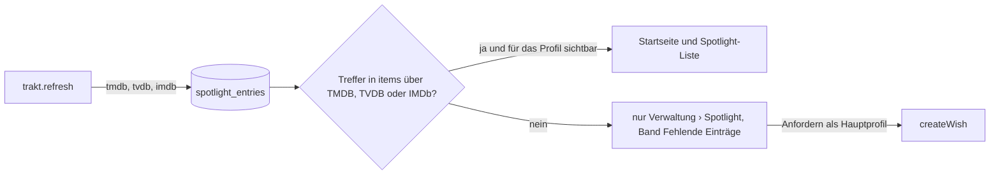

## 6. Anfordern

### 6.1 Film

1. `createWish {media: movie, tmdbId}` (scoped). `wishes` prüft das Wunschrecht (Anhang F 2.6) und fragt
   `visibility.MissingTitle`. Steht der Titel schon sichtbar in der Bibliothek: 409 `already_available` mit
   `ItemRef`. Nicht sichtbar oder zu hoch eingestuft: 404.
2. Offener Wunsch für (`movie`, `tmdbId`) vorhanden: das Profil wird Mitwünscher, Antwort 200 mit dem
   bestehenden Wunsch, **kein** Aufruf an Seerr (Anhang F 2.11, F-7). Ein Mitwunsch zählt nicht zum Limit
   und geht auch, wenn das Limit erreicht ist (Anhang H N-33, N-36).
3. **Limit prüfen** (Abschnitt 19.2): Reicht der freie Platz des Kontos nicht (Film: 1, Serie: die Zahl der
   gewählten Staffeln ohne Mitwunsch-Staffeln), antwortet `createWish` mit 409 `quota_exceeded` und dem Zeitpunkt,
   an dem der nächste Platz frei wird; es entsteht kein Wunsch. Ohne bekannten Stand (Seerr nie erreicht)
   prüft Slouchcat nicht vor; dann entscheidet Seerr beim Senden.
4. Sonst: eine Transaktion legt `wishes` (`queued`), `wish_requesters` (`owner`) und `wish_events` (`created`) an.
   Legen zwei Profile denselben Titel gleichzeitig an, verletzt der zweite INSERT den Teilindex
   `wishes_open_movie`. Der Dienst wiederholt dann die ganze Transaktion; beim zweiten Durchlauf greift
   Schritt 2 (Mitwunsch).
5. Sofortversuch mit Zeitlimit 3 s (Abschnitt 6.3), **ohne** Vorprüfung: Beim ersten Versuch meldet Seerr
   ein Doppel selbst mit 409 oder 202. Gelingt er, ist der Zustand `pending` oder `processing`, Antwort 201.
   Gelingt er nicht (Zeitlimit, nicht erreichbar, 5xx): Zustand bleibt `queued`, Job `wishes.submit` wird
   eingereiht, Antwort 201 mit `queued`. Die Oberfläche zeigt «Wird übermittelt, sobald Seerr erreichbar
   ist» (Anhang F 3).
6. Endgültige Abweisung im Sofortversuch (403 Limit, Sperrliste, kein Recht): Zustand `failed` mit
   Klartext, Antwort 201 mit dem Wunsch im Zustand `failed`. **Vorschlag:** kein HTTP-Fehler, weil der Wunsch
   angelegt und protokolliert ist; der Dialog zeigt den Grund. 403 Limit kommt trotz Vorprüfung vor, wenn
   jemand inzwischen direkt in Seerr angefordert hat (E-3: Seerr zählt alles).
7. Nach jedem gesendeten Wunsch liest Slouchcat den Stand des Limits neu (`GET /user/{id}/quota`, N-35).

### 6.2 Serie mit Staffeln

- **Staffelliste aus Seerr (Anhang H N-63).** Der Dialog bietet genau die Staffeln an, die Seerr
  bestellen kann. Das gilt für eine fehlende Serie (Vorschauseite) und ebenso für eine Serie der Bibliothek mit
  fehlenden Staffeln, wenn `getItem` `canRequestSeasons` meldet; beide lesen über `getWishSeasons`
  (`08-datenmodell-api.md`, Abschnitt 4.5, Redaktionsentscheid zu K-4). Beim Öffnen des Dialogs liest der Server `GET /tv/{tmdbId}` (ohne `X-API-User`, Zeitlimit 3 s)
  und hält das Ergebnis je Serie 1 Stunde im Speicher (**Vorschlag**). Steht Seerr auf TVDB-Staffeln
  (Abschnitt 5), ist das die TVDB-Zählung wie in Sonarr. **Vorschlag:** Ist Seerr nicht erreichbar, zeigt der
  Dialog die Staffeln aus `external_titles` bzw. `series_catalog` mit dem Hinweis «Staffeln laut TMDB, Seerr
  nicht erreichbar»; der Wunsch geht ins Ausgangsfach wie jeder andere.
- Der Dialog sendet `seasons: "all"` («Alle fehlenden Staffeln») oder eine Liste. Der Server rechnet die
  Liste selbst aus: Staffeln aus der Liste von Seerr ohne Staffel 0 und ohne Staffeln mit 0 Folgen (wie
  Seerr, `MediaRequest.ts` Z. 383–391), abzüglich der für das Profil schon abspielbaren.
- **Staffelzählung.** Die abspielbaren Staffeln liefert `visibility.VisibleSeasons` nach den Staffelnummern der
  Bibliothek; die Bibliothek ordnet Serien TVDB-zuerst zu. Zählt Seerr nach TMDB und teilt TMDB eine Serie
  anders auf als TVDB, können die Nummern auseinanderlaufen. Darum empfiehlt Fassung 3, Seerr auf TVDB-Staffeln
  zu stellen; der Verbindungstest zeigt sonst einen Hinweis (N-64, F-29). Slouchcat rechnet keine Nummern um.
- **Mitwunsch je Staffel.** Staffeln, die ein anderes Profil schon offen gewünscht hat, zeigt der Dialog als
  «Bereits angefordert» und lässt sie wählen. Für sie wird das Profil Mitwünscher des bestehenden Wunsches,
  ohne Aufruf an Seerr. Nur die übrigen Staffeln bilden einen neuen Wunsch mit eigener
  `wish_seasons`-Liste. Seerr legt für weitere Staffeln ohnehin einen eigenen Request an (Anhang D 4).
  **Vorschlag:** Antwort 201 mit dem neuen Wunsch und Feld `joined` mit den Wünschen, an die sich das Profil
  gehängt hat; sind alle gewählten Staffeln schon gewünscht, Antwort 200 nur mit `joined`.
- **Request-ID je Staffel.** Ein Serienwunsch kann in Seerr auf mehrere Requests verteilt sein: Seerr
  filtert schon angefragte Staffeln still heraus und legt für den Rest einen eigenen Request an (Anhang D 4).
  Darum trägt jede Zeile in `wish_seasons` ihre eigene `seerr_request_id`; `wishes.seerr_request_id` gilt nur
  für Filme (`08-datenmodell-api.md`, Abschnitte 2.4 und 2.5). Abgleich, Zurückziehen und Freigeben arbeiten
  bei Serien je Staffel bzw. je Request.
- Slouchcat sendet `seasons` immer als **Zahlenliste**, nie `"all"`, damit Slouchcat und Seerr dieselben
  Staffeln meinen.
- Einzelne Folgen gehen nicht (Anhang F 2.15, F-12).

### 6.3 Ausgangsfach und Übermittlung (`wishes.submit`)

```text
Submit(wish):
  0. Sperre je Wunsch nehmen (Abschnitt 6.6); Fingerabdruck der Instanz prüfen (7.4), bei Abweichung fertig.
  1. Wunsch laden; nicht mehr queued -> fertig (idempotent).
  2. Nur ab dem zweiten Versuch (attempts > 0): Vorprüfung GET /movie|tv/{tmdbId} mit X-API-User.
       Film: mediaInfo.requests enthält einen offenen Request (Status 1 oder 2) -> anhängen:
         seerr_request_id setzen, Zustand ableiten, fertig.
       Serie: mediaInfo.requests[].seasons lesen. Staffeln in einem offenen Request bekommen dessen ID
         (eigener Request: der verlorene erste POST; fremder Request: lokal wie ein Mitwunsch, kein POST).
         Bleibt keine Staffel übrig -> fertig.
       mediaInfo.status 6 (Sperrliste) -> failed «Sperrliste», fertig.
  3. POST /request {mediaType, mediaId, tvdbId?, seasons? (nur die übrigen)} mit X-API-User, ohne userId.
  4. Antwort auswerten (Tabelle 6.4).
  5. Nach dem POST in derselben Transaktion prüfen, ob der Wunsch noch queued ist. Wurde er inzwischen
     zurückgezogen: Request-ID trotzdem speichern und wishes.withdraw einreihen (6.6).
  6. Nicht erreichbar oder 5xx: attempts+1, next_attempt_at nach Leiter; nach 24 h seit created_at -> failed
     und Ereignis errors an Administratoren. Die Frist ruht, solange «Seerr verwenden» aus ist
     (Vorschlag, T-2).
```

Wiederholungsleiter (**Vorschlag**): 1, 2, 5, 10, 15, 30 min, danach stündlich. Die Fälligkeit steht in
`wishes.next_attempt_at`; `wishes.sync` reiht fällige Wünsche ein und, nach einem gelungenen Verbindungstest,
alle `queued`. So hängt die 24-h-Regel nicht an den fünf Versuchen der Queue (Backoff 10 s·2^(n−1),
`server/internal/jobs/queue.go`), die nach rund fünf Minuten erschöpft wären.

**Warum die Vorprüfung erst ab dem zweiten Versuch.** Vorprüfung und POST lösen in Seerr beide einen
TMDB-Abruf aus (Anhang D 3.5, 6.2). Zwei Aufrufe in 3 s liessen das Zeitlimit oft reissen. Beim ersten Versuch
ist die Vorprüfung unnötig, weil Seerr ein Doppel selbst mit 409 oder 202 meldet. Ab dem zweiten Versuch
ist sie nötig, weil der erste POST angekommen sein kann, obwohl die Antwort verloren ging.

**Serien nach 201.** Die Antwort trägt `seasons[]` des neuen Requests. Fehlen darin gewünschte Staffeln (still
herausgefiltert, weil schon angefragt), sucht der Job sie mit `GET /tv/{tmdbId}` (ohne `X-API-User`) in
`mediaInfo.requests[].seasons` und setzt je Staffel die gefundene Request-ID.

### 6.4 Antworten von `POST /request` (Anhang D 3.4)

| Antwort | Bedeutung | Verhalten in Slouchcat |
|---|---|---|
| 201 | angelegt | Film: `seerr_request_id`, `seerr_media_id`, `seerr_updated_at` am Wunsch setzen. Serie: dieselben Werte je Staffel in `wish_seasons`; fehlende Staffeln wie oben suchen. Request-Status 1 → `pending`, 2 → `processing` |
| 409 `Request for this media already exists.` | jemand anders hat ihn in Seerr schon angefordert (Duplikate sind global) | **Erfolg**: `GET /movie|tv/{tmdbId}` (ohne `X-API-User`), offenen Request suchen, anhängen; Zustand daraus |
| 409 `Auto-request for this media and user already exists.` | gleich | gleich |
| 202 `No seasons available to request` | alle Staffeln sind in Seerr schon angefragt oder vorhanden | `GET /tv/{tmdbId}`: je Staffel den Request suchen und seine ID in `wish_seasons` setzen; sind die Staffeln in Seerr schon «verfügbar», Zustand `processing` mit Zusatz «wird eingelesen» |
| 403 `Movie Quota exceeded.` / `Series Quota exceeded.` | Limit erreicht (Seerr zählt auch Wünsche, die direkt dort gestellt wurden) | `failed`, `fail_reason = quota`; Stand des Limits neu lesen (Abschnitt 19) |
| 403 `This media is blocklisted.` / `…blacklisted.` | Sperrliste (3.x / 2.x) | `failed`, `fail_reason = blocklisted` |
| 403 `You do not have permission to make … requests.` | Benutzer darf das nicht | `failed`, `fail_reason = no_permission`; Warnung auf der Seite Seerr-Benutzer |
| 403 ohne bekannte Meldung (auch «You do not have permission to access this endpoint») | Schlüssel ungültig **oder** `X-API-User` unbekannt; Seerr meldet beides gleich (Anhang D 2.1) | `GET /auth/me` ohne Header. Antwortet es 200, ist der Schlüssel gut und der Benutzer fehlt: `failed`, `fail_reason = seerr_user_gone` (wie Abschnitt 14 und `04-benutzer-profilmapping.md`, Abschnitt 8.1). Sonst ist der Schlüssel ungültig: Wunsch bleibt `queued`, Verbindung «Schlüssel ungültig» |
| 401 `You must be logged in…` | Schlüssel ungültig | bleibt `queued`, Zustand der Verbindung |
| 500 | meist TMDB-Fehler in Seerr (`MediaRequest.ts` Z. 169–172) | wie nicht erreichbar: später erneut |
| 3xx | Weiterleitung | wie nicht erreichbar; Diagnose «Adresse leitet weiter» |

Die Meldung unterscheidet Slouchcat am Text, weil Seerr alle 403 gleich kodiert
(`{"message": …}`, `GH:server/index.ts` Z. 282–285). **Vorschlag:** Unbekannte 403-Texte, bei denen
`GET /auth/me` den Schlüssel bestätigt und der Benutzer noch besteht, gelten als `no_permission` mit dem
Originaltext in `state_detail` (nur für die Verwaltung).

### 6.5 Idempotenz und Schutz vor Doppelbestellungen

| Schicht | Schutz |
|---|---|
| Datenbank | höchstens ein offener Wunsch je (`media`, `tmdb_id`) bei Filmen; höchstens eine offene `wish_seasons`-Zeile je (`tmdb_id`, `season_number`); Teilindizes (`08-datenmodell-api.md`). Verletzung beim gleichzeitigen Anlegen: Transaktion wiederholen, dann Mitwunsch (6.1) |
| `createWish` | zweiter Aufruf desselben Profils liefert 200 mit dem bestehenden Wunsch |
| Job | Idempotenz-Schlüssel `wishes.submit:<wishId>`; ein zweites Einreihen liefert den aktiven Job (ADR 0002) |
| Handler | Schritte 1 und 2 von 6.3: ein Wunsch mit `seerr_request_id` (bei Serien: eine Staffel mit Request-ID) wird nie erneut gesendet; ab dem zweiten Versuch vor jedem Senden die Vorprüfung in Seerr. Das deckt den Fall, dass der erste POST ankam, die Antwort aber im Zeitlimit verloren ging |
| Seerr | 409 und 202 zählen als Erfolg |

### 6.6 Zurückziehen

Ziel: Nach einem Zurückziehen bleibt in Seerr kein Request zurück, von dem Slouchcat nichts weiss
(Geisterbestellung). Der Sofortversuch kann nach 3 s abbrechen, obwohl Seerr den Request angelegt hat,
und ein laufender POST lässt sich nicht abbrechen. Darum:

1. `withdrawWish` (Zustand `queued` oder `pending`) setzt den Wunsch lokal sofort auf `withdrawn` und den
   Merker `withdraw_pending` («in Seerr noch zu löschen»), dann reiht es `wishes.withdraw:<wishId>` ein.
2. **Sperre je Wunsch.** Läuft gerade `wishes.submit` für diesen Wunsch, wartet `wishes.withdraw` auf dessen
   Ende (der Job reiht sich mit kurzer Verzögerung neu ein). `wishes.submit` prüft nach dem POST, ob der Wunsch
   noch `queued` ist (6.3, Schritt 5).
3. `wishes.withdraw` liest `GET /movie|tv/{tmdbId}` mit `X-API-User` und sucht in `mediaInfo.requests` einen
   eigenen Request des eingefrorenen Benutzers (`requestedBy.id = seerr_user_id`), auch wenn Slouchcat keine
   Request-ID kennt. Bei Serien gilt das je Staffel bzw. je Request.
4. Kein eigener Request: Merker löschen, fertig.
5. Eigener Request im Status `PENDING`: `DELETE /request/{id}` mit `X-API-User`
   (`GH:server/routes/request.ts` Z. 719–752). 204 oder 404 → Merker löschen, fertig.
6. Request schon freigegeben (`APPROVED` oder später) oder er gehört einem anderen Benutzer: Er bleibt in
   Seerr stehen. Der Wunsch wird wieder geöffnet; sein Zustand folgt dem Request (`pending`, solange der
   Request noch auf Freigabe wartet, sonst `processing`; Redaktionsentscheid zu K-21). Der Verlauf schreibt `reopened`, und das
   Profil bekommt den Hinweis «War schon freigegeben» (in «Meine Wünsche» und am Bildschirm).
7. Fehler auf `DELETE`:

| Antwort | Bedeutung | Verhalten |
|---|---|---|
| 401 `You do not have permission to delete this request.` | nicht mehr `PENDING` oder nicht eigener Request (Anhang D 8) | Zustand mit `GET /request/{id}` neu lesen; weiter wie Schritt 6 |
| 403 | Schlüssel ungültig oder Benutzer fehlt | wie 6.4 mit `GET /auth/me` unterscheiden; Merker bleibt, der Job wiederholt nach der Leiter; Benutzer fehlt → Seerr hat seine Requests mitgelöscht, Merker löschen |
| 404 | Request schon weg | Merker löschen, fertig |
| nicht erreichbar, 5xx | – | Merker bleibt, Wiederholung nach der Leiter (6.3); keine 24-h-Grenze, der Merker bleibt bis zum Erfolg |

- Ab `processing`: nicht möglich (Anhang F 1, F-17).
- **Vorschlag:** Ein Mitwünscher zieht nur sich selbst zurück (Zeile in `wish_requesters` löschen, kein Aufruf).
  Zieht der Besitzer zurück, während andere mitwünschen, geht die Besitzerrolle an den ältesten Mitwünscher;
  der Request in Seerr bleibt.

## 7. Abgleich bestehender Anfragen (`wishes.sync`)

### 7.1 Ablauf

Seerr hat keinen Änderungs-Feed und keinen Filter nach TMDB-ID; unbekannte Query-Parameter weist der
Validator ab (Anhang D 2.5, 6.3). Darum blättert der Abgleich nach `updatedAt` absteigend. Ein Durchgang deckt
die Spanne von «jetzt» bis zum letzten Zeiger. Er speichert seinen Stand **nach jeder Seite**, damit ein
Abbruch keinen Fortschritt kostet.

```text
Sync():
  Fingerabdruck der Instanz prüfen (7.4); weicht er ab -> fertig, nichts lesen, nichts senden.
  Zustand «Schlüssel ungültig» -> nur GET /auth/me; gelingt es, weiter, sonst fertig.
  Kein Zeiger seerr.last_sync -> Erstabgleich einreihen (7.2), fertig.
  Durchgang = gespeicherter offener Durchgang oder neu: {oben := jetzt, bis := seerr.last_sync,
              erreicht := oben, seite := 0}
  Offener Durchgang vorhanden -> zuerst ein neuer Kopf-Durchgang von «jetzt» bis «oben» des alten,
                                 danach der alte ab seiner gespeicherten Seite.
  Seite für Seite: GET /request?sort=modified&sortDirection=desc&take=50&skip=n   (ohne filter)
    je Request:
      updatedAt < bis - 2 min    -> Durchgang fertig (alles Ältere ist bekannt)
      updatedAt >= erreicht und schon verarbeitet -> überspringen (Wiederaufnahme)
      seerr_request_id bekannt (am Wunsch oder an einer Staffel) -> Zustand ableiten (Abschnitt 8)
      unbekannt -> ab Stufe 4: Benutzer zugeordnet -> übernehmen wie wishes.import (7.3);
                   nicht zugeordnet -> als «nicht zuordenbar» führen (7.3)
                   vor Stufe 4: nur zählen
    nach jeder Seite in einer Transaktion: Ergebnisse schreiben und Stand speichern
      (seerr.sync_pass = {oben, bis, erreicht := updatedAt des letzten Eintrags, seite})
    höchstens 40 Seiten je Lauf (Vorschlag); dann endet der Lauf, der Stand bleibt gespeichert
  Durchgang fertig -> seerr.last_sync := oben; seerr.sync_pass löschen
  danach: GET /request/{id} für offene Wünsche ohne Änderung seit 24 h, deren checked_at älter als 24 h ist
          (höchstens 50 je Lauf, Vorschlag); checked_at := jetzt
  danach: fällige queued-Wünsche als wishes.submit einreihen, offene withdraw_pending als wishes.withdraw
```

| Punkt | Festlegung | Grund |
|---|---|---|
| Sortierung | `sort=modified` sortiert nach `request.updatedAt`, Standard absteigend | `GH:server/routes/request.ts` Z. 38–311 (Spec nennt `added`: falsch) |
| Filter | **kein** Parameter `filter`; ohne ihn liefert Seerr alle Requests | Anhang D 6.1 nennt nur «Standard alle»; unbekannte Werte weist der Validator ab (Anhang D 2.5) |
| Seitengrösse | **Vorschlag:** `take=50` | jeder Aufruf fragt alle Radarr/Sonarr nach Profilen (Z. 196–224): wenige, grosse Seiten |
| Sicherheitsabstand | **Vorschlag:** 2 min vor `bis` | Uhren von Slouchcat und Seerr laufen nicht gleich |
| Einzelprüfung | `GET /request/{id}` höchstens einmal je 24 h je Wunsch (`wishes.checked_at`), höchstens 50 je Lauf | ein Wunsch, der wochenlang auf Freigabe wartet, würde sonst alle 5 min geprüft |
| Sperrliste | Medien mit Status 6 erscheinen in `/request` nie (Z. 101–109) | darum die Einzelprüfung `GET /request/{id}` |
| Gelöschte Requests | erscheinen nicht mehr | Einzelprüfung liefert 404 → `failed`, `seerr_request_gone` (Abschnitt 8.1) |
| Medienstatus | steht im Request unter `media.status` und `media.seasons[]` | **nicht verifiziert:** Anhang D belegt `media {…, seasons[]}` in den Ergebnissen von `GET /request` nicht ausdrücklich; der Bau prüft es gegen eine Instanz. Fehlt es, liest die Einzelprüfung den Medienstatus |

### 7.2 Wiederaufnahme und Erstabgleich

- **Der Zeiger rückt seitenweise vor.** Nach jeder verarbeiteten Seite speichert Slouchcat, bis zu welchem
  `updatedAt` und welcher Seite der laufende Durchgang gekommen ist (`seerr.sync_pass`). Bricht ein Lauf ab
  (Neustart, Lease abgelaufen, Seerr weg, Seitengrenze), setzt der nächste dort fort. Was seither neu
  geändert wurde, liest er zuerst als kurzen Kopf-Durchgang. Ein Request, der sich während eines Durchgangs
  ändert, wandert nach oben und kommt im Kopf-Durchgang dran. So fährt sich der Abgleich nicht fest, auch nicht
  bei mehr als 2000 Requests (40 × 50) oder nach einem langen Ausfall.
- Doppelte Verarbeitung ist harmlos: Jeder Schritt schreibt nur, wenn sich `seerr_updated_at` oder der
  abgeleitete Zustand ändert, und Benachrichtigungen tragen einen eindeutigen Schlüssel (Abschnitt 12).
- **Erstabgleich.** Der allererste Abgleich und der Abgleich nach einem bestätigten Instanzwechsel (7.4) laufen
  als eigener Erstabgleich: derselbe Handler im Modus «Erst», Idempotenz-Schlüssel `wishes.sync:initial`,
  **ohne** Seitengrenze, im Hintergrund mit Fortschritt unter Hintergrundjobs («Seite 12 von 60», Muster
  `docs/adr/0017-scheduler-fortschritt-pause-abbruch.md:112-115`). Er liest alle Requests einmal, setzt danach
  `seerr.last_sync`, und erst dann übernimmt der regelmässige Abgleich. Auch der Erstabgleich speichert seinen
  Stand je Seite.
- Die Queue gibt den Job nach abgelaufener Lease (5 min, Heartbeat 60 s; `docs/adr/0002-job-queue.md:54-85`)
  einem anderen Arbeiter. Die Idempotenz-Schlüssel `wishes.sync` und `wishes.sync:initial` verhindern zwei
  gleichzeitige Läufe derselben Art; läuft der Erstabgleich, endet ein regelmässiger Lauf sofort.
- Jede Seite wird in einer eigenen Transaktion geschrieben (höchstens 500 Zeilen, `queue.go:6-7`).

### 7.3 Übernahme bestehender Anfragen (`wishes.import`, F-21, Stufe 4)

Der inkrementelle Abgleich sieht alte Requests eines **neu** zugeordneten Benutzers nie, weil er beim ersten
älteren `updatedAt` abbricht. Darum gibt es einen eigenen Job.

- **Auslöser:** Verknüpfen über die E-Mail, Setzen oder Ändern einer Zuordnung (Konto oder Ausnahme des Profils) und von Hand («Anfragen übernehmen» auf
  der Seite Seerr-Benutzer; auch nach dem Verknüpfen über die E-Mail, Abschnitt 18.2). Schlüssel `wishes.import:<seerrUserId>`.
- **Abruf:** `GET /request?requestedBy=<seerrUserId>&take=50&skip=n` seitenweise, ohne `X-API-User`, also als
  Benutzer 1. Der Filter `requestedBy` braucht beim Aufrufer `MANAGE_REQUESTS` oder `REQUEST_VIEW` (Anhang D
  6.1); Benutzer 1 hat `ADMIN`. Der Job speichert seinen Stand je Seite wie der Abgleich.
- **Zahl für die Rückfrage:** Vor dem Speichern einer Zuordnung zählt die Verwaltung mit demselben Aufruf und
  `take=1` (`pageInfo.results`) und nennt die Zahl: «3 Anfragen von grosseltern werden übernommen».
- **Regeln** (wie `04-benutzer-profilmapping.md`, Abschnitt 8.2):
  - Request eines **zugeordneten** Seerr-Benutzers ohne lokalen Wunsch: neuer Wunsch mit `origin =
    jellyseerr`, Besitzer ist das Profil mit eigener Zuordnung zu diesem Benutzer, sonst das Hauptprofil des
    Kontos. Kennzeichen «In Seerr angelegt» (F-21). **Vorschlag:** Haben mehrere Profile desselben Kontos
    denselben eigenen Benutzer, gewinnt das Hauptprofil, sonst das älteste dieser Profile.
  - Schon geführter Wunsch **ohne** Zeile in `wish_requesters` («nicht zuordenbar»): bekommt das Zielprofil als
    Besitzer; Zustand und Verlauf bleiben.
  - **Vorschlag:** Übernommen werden nur offene und in den letzten 30 Tagen verfügbar gewordene Requests; für
    übernommene, schon verfügbare Titel kommt keine Benachrichtigung.
- Request eines **nicht zugeordneten** Benutzers (Beispiel `wohnzimmer-tv`, Anhang F 11), gefunden vom Abgleich
  oder Erstabgleich: **Vorschlag:** Wunsch mit `origin = jellyseerr` ohne Zeile in `wish_requesters`, nur in der
  Verwaltung sichtbar (Filter «Nicht zuordenbar»). Er sperrt wie in Seerr den Titel für Doppelbestellungen;
  fordert ein Profil denselben Titel an, wird es Mitwünscher. Er löst keine Benachrichtigung aus.
- Vor Stufe 4 aktualisiert der Abgleich nur bekannte Wünsche; unbekannte Requests zählt er nur.

### 7.4 Instanzwechsel erkennen

Die Zuordnung hängt an `seerr_id`, Wünsche an `seerr_request_id` und `seerr_media_id`. Diese Nummern gelten
nur in **einer** Seerr-Instanz. Zeigt der Administrator auf eine andere oder neu aufgesetzte Instanz,
sendete Slouchcat sonst mit `X-API-User: 3` an eine ganz andere Person.

- **Fingerabdruck (Vorschlag):** Beim ersten erfolgreichen Verbindungstest speichert Slouchcat
  `seerr.instance`: E-Mail und Anlagedatum (`createdAt`) von Benutzer 1 aus `GET /auth/me` ohne Header, dazu
  das Anlagedatum jedes bekannten Benutzers in `seerr_users.created_at`. Welche Angaben wirklich unveränderlich
  sind, prüft der Bau gegen eine Instanz. Neu angelegte Benutzer ändern den Fingerabdruck nicht.
- **Prüfung:** bei jedem Verbindungstest, bei jedem Lauf von `seerr.users` und am Anfang von `wishes.sync`,
  `wishes.submit`, `wishes.withdraw` und `wishes.import`. Ändert eine bekannte `seerr_id` beim Laden ihr
  Anlagedatum, gilt das ebenfalls als Abweichung.
- **Bei Abweichung** hält Slouchcat Übermittlung und Abgleich an (kein Aufruf ausser dem Test), zeigt in der
  Verwaltung «Andere Seerr-Instanz erkannt» (Übersicht und Integrationen › Seerr) und verlangt, die
  Zuordnung zu bestätigen oder zu löschen (`07-administration.md`, Abschnitt 4.1). Neue Wünsche warten als
  `queued`.
- **Bestätigen** übernimmt den neuen Fingerabdruck; die Zuordnungen bleiben, und ein Erstabgleich (7.2) läuft.
  **Löschen** entfernt alle Zuordnungen und die Request-IDs offener Wünsche (sie wandern in den Verlauf); die
  offenen Wünsche bleiben `queued` und gehen nach einer neuen Zuordnung neu an Seerr. **Vorschlag:** Nach dem
  Löschen eröffnet `seerr.provision` die Konten in der neuen Instanz neu (verknüpft bei gleicher E-Mail, N-2,
  N-90); die Passwörter folgen bei der nächsten Anmeldung.
- Einzelheiten aus Sicht der Zuordnung: `04-benutzer-profilmapping.md`, Abschnitt 8.4.

## 8. Zustandsverwaltung

### 8.1 Abbildung der Seerr-Werte

Request-Status (`MediaRequestStatus`) und Medienstatus (`MediaStatus`) aus `GH:server/constants/media.ts`
Z. 1–22. Die eigene Bibliothek hat Vorrang vor beiden.

| Request | Media | Zustand in Slouchcat (ohne Treffer in der eigenen Bibliothek) |
|---|---|---|
| 1 PENDING | beliebig | `pending` |
| 2 APPROVED | 3 PROCESSING, 1, 2 | `processing` |
| 2 APPROVED | 4 PARTIALLY_AVAILABLE, 5 AVAILABLE | `processing`, Zusatz «wird eingelesen» |
| 3 DECLINED | beliebig | `declined` (ohne Grund: Seerr kennt keinen, Anhang D 8) |
| 4 FAILED | beliebig | `failed`, `fail_reason = arr_failed` |
| 5 COMPLETED | 4, 5 | `processing`, Zusatz «wird eingelesen» |
| 5 COMPLETED | 7 DELETED | **Vorschlag:** `failed`, `fail_reason = seerr_media_deleted` |
| beliebig | 6 BLOCKLISTED | `failed`, `fail_reason = blocklisted` |
| Request 404 | – | `failed`, `fail_reason = seerr_request_gone` (Request in Seerr gelöscht, auch durch Löschen des Benutzers) |

Bei Serien gilt die Tabelle je Staffel mit der `seerr_request_id` dieser Staffel; der Wunsch nimmt den
«schwächsten» offenen Zustand seiner Staffeln.

**Mit Treffer in der eigenen Bibliothek** (Abschnitt 11):

- **Film:** `available` mit der ersten abspielbaren Datei, die das Profil sehen darf.
- **Staffel:** verfügbar erst, wenn sie **vollständig** ist (Regel von `06-benachrichtigungen.md`, Abschnitt
  3.3): Slouchcat kann Folgen der Staffel abspielen **und** die Zahl der abspielbaren Folgen erreicht die
  Folgenzahl laut `series_catalog` (bis Stufe 4, solange es für die Serie noch keinen `series_catalog` gibt:
  laut `external_titles.seasons` des Wunsches; beide stammen aus TMDB). Bei einer laufenden Staffel zählen nur
  die bisher ausgestrahlten Folgen (**Vorschlag:** aus `last_episode` von TMDB, `08-datenmodell-api.md`,
  Abschnitte 2.9 und 2.10). Der Zustand in Seerr ist dafür keine Bedingung.
- **Serie:** `partial`, sobald mindestens eine gewünschte Staffel so verfügbar ist; `available`, wenn alle.

Das gilt in jedem Zustand ausser `withdrawn`: Auch ein `failed`- oder `declined`-Wunsch wird `available`, wenn
der Titel auf anderem Weg kommt (**Vorschlag**, der Zuschauer will den Titel, nicht den Request).

Offen sind `queued`, `pending`, `processing`, `partial`. Abgeschlossen sind `available`, `declined`, `failed`,
`withdrawn`. Ein abgelehnter, fehlgeschlagener oder zurückgezogener Wunsch ist **geschlossen**: Der Titel gilt
wieder als fehlend, und «Film anfordern» bzw. «Erneut anfordern» («Meine Wünsche») legt einen **neuen** Wunsch
an; der alte bleibt im Verlauf, und die Vorschauseite nennt ihn mit Datum und Grund.

**Ausnahme `arr_failed`:** Ein Request im Status FAILED sperrt den Titel in Seerr weiter; nur DECLINED und
COMPLETED geben ihn frei (Anhang D 3.5). Ein neuer POST bekäme 409, Slouchcat hinge sich an den FAILED-Request,
und der Wunsch stünde wieder auf `failed`. Darum fehlt bei `fail_reason = arr_failed` «Erneut anfordern»; der
Zuschauer liest «Ein Administrator kann den Wunsch wiederholen», und `retryWish` ruft
`POST /request/{id}/retry`.

**Wieder geöffnet:** Ein zurückgezogener Wunsch, dessen Request in Seerr schon freigegeben war oder einem
anderen gehört, wird wieder `processing` (Abschnitt 6.6).

**Konto gelöscht:** Wünsche mit Mitwünschern anderer Konten gehen an den ältesten Mitwünscher. Die übrigen
Wünsche des Kontos werden geschlossen: Offene bekommen `failed` mit `fail_reason = account_deleted`, alle
bekommen `closed_at`, und ihre Request-IDs wandern in den Verlauf. Slouchcat verfolgt sie nicht weiter; in
Seerr bleiben die Requests und erscheinen ab Stufe 4 als «nicht zuordenbar» (`04-benutzer-profilmapping.md`,
Abschnitt 10).

### 8.2 Diagramm (d): Zustandsautomat


`partial` gibt es nur bei Serien. Der Rückweg `failed → processing` gilt für `retryWish` in der Verwaltung:
bei Request-Status 4 über `POST /request/{id}/retry`, bei Übermittlungsfehlern über ein neues `wishes.submit`
(dann `failed → queued`, im Diagramm der Übersicht halber nicht gezeichnet). Jeder Übergang schreibt eine Zeile
in `wish_events`.

### 8.3 Zustand je Profil

`wishes.state` ist der Zustand des Wunsches. Ob er **für ein Profil** als verfügbar gilt, entscheidet die
Sichtbarkeit für dieses Profil. **Vorschlag** für eine Lücke in Anhang F: Kommt der Titel in die Bibliothek, ist
für einen Mitwünscher aber zu hoch eingestuft, zeigt «Meine Wünsche» diesem Profil «In Beschaffung · wird eingelesen», bis die Freigabe
passt; nach 7 Tagen schliesst Slouchcat den Wunsch für dieses Profil als «Fehlgeschlagen» mit dem Text «Für
dieses Profil nicht freigegeben». Der Titel selbst bleibt für das Profil 404. Fehlende Titel und
Bibliothekstitel lesen die TMDB-Freigabe mit derselben Funktion (Abschnitt 3). Der Fall bleibt trotzdem
möglich, weil die Bibliothek strengere Quellen kennt: NFO, TVDB, eine Freigabe von Hand oder die
Standardstufe der Bibliothek.

## 9. Diagramme der Abläufe

### 9.1 Diagramm (b): Film anfordern, auch wenn Seerr nicht erreichbar ist

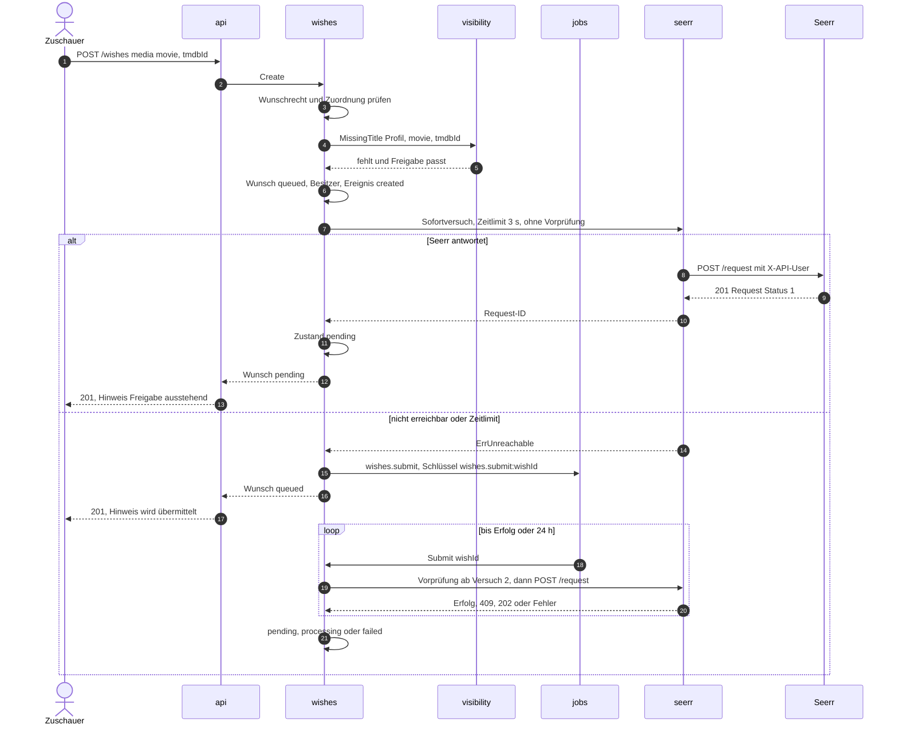

### 9.2 Diagramm (c): Abgleich und Verfügbar-Meldung

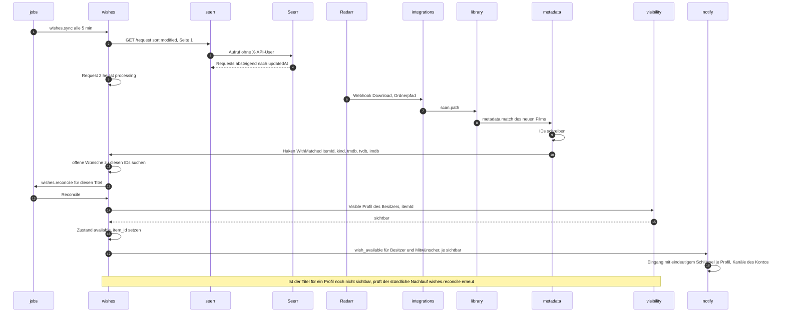

### 9.3 Diagramm (e): Serie, Staffeln anfordern und teilweise verfügbar

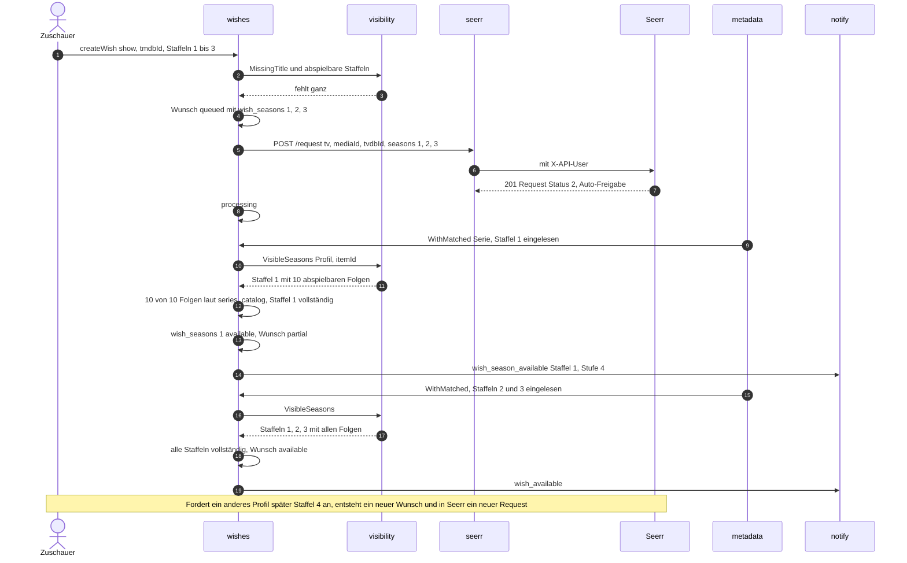

Neue Folgen einer schon zugeordneten Serie lösen heute keinen Match der Serie aus, nur `metadata.match` der
Folge (`server/internal/library/doc.go:21-42`). Darum ruft der Haken **auch nach dem Match einer Folge** die
Serie auf (**Vorschlag**: `WithMatched` meldet bei Folgen die `itemID` der Serie), und der stündliche Nachlauf
fängt den Rest.

## 10. Radarr/Sonarr-Webhooks und Seerr-Webhook

- **Radarr/Sonarr-Webhooks bleiben, wie sie heute sind** (Marco, E-6 «Webhooks wie heute»; N-80). Der
  Administrator richtet sie weiter von Hand ein; die Seite «Webhooks von Radarr und Sonarr» und der eingehende
  Teil von ADR 0010 ändern sich nicht. Slouchcat trägt in Radarr und Sonarr keinen Webhook ein. Der Empfang
  (`server/internal/integrations/receive.go:41-93`) löst `scan.path` aus und beschleunigt damit genau den Weg, der
  zur Verfügbarkeit führt. Er liest weiterhin nur `eventType` und den Ordner (`server/internal/model/integrations.go:45-51`,
  `server/internal/api/webhook_handlers.go:21-32`). Ausgehend ruft Slouchcat Radarr und Sonarr über
  `internal/arr` nur für zwei Dinge auf (G-1, Abschnitte 20 und 22): Warteschlange und Dateistand der gewünschten
  Titel lesen (`queue`, `movie?tmdbId`, `series?tvdbId`) und den Profil-Tag setzen. Beides hat mit den Webhooks
  nichts zu tun. Der Import in die Bibliothek kommt weiter über den Webhook; Slouchcat liest in Radarr und Sonarr
  nur für die Anzeige am Wunsch (Redaktionsentscheid zu K-5).
- **Verworfen (E-6):** «API und Webhook» (Slouchcat trägt den Webhook selbst ein und holt Verpasstes über
  `GET /api/v3/history/since` nach) und «Nur API, ohne Webhook» (Abfragen im Takt, langsamer als die Sofortmeldung,
  dauernde Grundlast). Marco hat beide nicht gewählt (Anhang H 8.2, 8.4).
- **Seerr-Webhook (Stufe 4, F-18):** reiner Anstoss. Jede gültige Meldung reiht `wishes.sync` mit
  Priorität 7 ein (oder hebt einen wartenden an, `RaiseQueuedPriority`). Der Inhalt wird nicht ausgewertet: Er
  hat keine Benutzer-ID, keinen Request-Status, keine Signatur und keine Wiederholung (Anhang D 9.2, 9.3).
  Seerr kennt nur **ein** Webhook-Ziel (Anhang D 9.4): Slouchcat richtet es nicht selbst ein, sondern zeigt
  Adresse und JSON-Vorlage zum Kopieren (Anhang F 4, Band «Sofortmeldung»).
- Die Webhook-Route `POST /webhooks/{token}` hat schon die CSRF-Ausnahme (`server/internal/api/webhook_handlers.go:45-54`);
  ein neuer Wert `jellyseerr` in `webhook_integrations.kind` braucht einen Tabellenneubau (CHECK, `server/migrations/00017_integrations.sql:24`).
  Ratenbegrenzung 10/s je Integration gilt weiter (`receive.go:17-19`).

### 10.1 Sofort-Import über Pfad und Kennung aus der Webhook-Meldung (E-11, nach Messung)

**Entschieden von Marco (E-11, N-98): «Ja, nach Messung».** Marco will, dass ein neuer Film oder eine neue Serie
«rasendschnell» in Slouchcat ankommt (Anhang H 8.1). Der Sofort-Import nutzt dafür die Meldung, die heute schon
kommt: Slouchcat liest Dateipfad und Kennung aus der Webhook-Meldung, liest nur diese Datei mit Vorrang ein und
ordnet sie über die Kennung zu (N-88). Er ist ein eigener Schritt im Bauplan (`09-umsetzungsplan.md`, Schritt 6a).
Die Webhooks selbst bleiben, wie sie sind (N-80): keine neue Anbindung, keine Abfrage im Takt.

**Heute (nachgesehen im Worktree):**

- Die aufgezeichneten Meldungen tragen bei Radarr `movie.tmdbId`, `movie.imdbId`, `movie.folderPath` und
  `movieFile.path` (`testdata/webhooks/radarr-6.4.4.10685-download.json:20, 39, 48, 77`), bei Sonarr
  `series.tvdbId`, `series.tmdbId`, `series.imdbId`, `series.path`, `episodeFile.path` und `episodes[]`
  (`testdata/webhooks/sonarr-4.0.20.3014-download.json:77, 127-138`; Anhang H 8.3).
- `model.WebhookPayload` hat nur `Event`, `MoviePath`, `SeriesPath` (`server/internal/model/integrations.go:45-51`);
  der Handler kopiert nur `eventType`, `movie.folderPath` und `series.path` (`server/internal/api/webhook_handlers.go:21-32`);
  der Vertrag sagt «Only `eventType` and the directory are read» (`api/openapi.yaml:19214`).
- `Receive` reiht genau einen `scan.path` für den Ordner ein (`receive.go:88`, `library.RequestPathScan` in
  `server/internal/library/service.go:789`): Schlüssel `scan:<id>:path`, Priorität 6, Entprellung 2 s; der Scan
  liest die genannten Ordner ohne Unterordner (`server/internal/library/doc.go:88-100`). Bei Sonarr ist das der
  Serienordner (`series.path`), nicht der Staffelordner der neuen Folge.

**Was sich mit dem Schritt ändert:**

| Ort | Änderung |
|---|---|
| Vertrag `receiveWebhook` | liest zusätzlich `movieFile.path`, `episodeFile.path`, `movie.tmdbId`, `movie.imdbId`, `series.tvdbId`, `series.tmdbId`, `series.imdbId`; `additionalProperties: true` bleibt, die Operation bleibt `public` |
| `model.WebhookPayload`, Handler | neue Felder für Dateipfad und Kennungen |
| `integrations.Receive` | setzt den Dateipfad wie heute den Ordner um (Pfad-Umsetzung, Wurzeln über `paths`, sonst `outside_roots`) und reicht Datei und Kennungen an `library` weiter; fehlt die Datei (Ereignis `rename`, Löschen), bleibt alles wie heute |
| `library` | neuer Auftrag «nur diese Datei einlesen» mit höherer Priorität als `scan.path` (**Vorschlag** 7), mit derselben Entprellung; die Datei wird über die Kennung zugeordnet (Film über TMDB bzw. IMDb, Serie über TVDB) statt über die Titelsuche; Regel 2 bleibt, denn `library` darf `items` lesen |
| `wishes` | prüft danach sofort die offenen Wünsche zu diesen Kennungen (`wishes.reconcile:item:<itemId>`), statt auf den Haken nach dem Match oder den stündlichen Nachlauf zu warten |
| Webhook-Protokoll | zeigt zusätzlich «Datei» und «Kennung» |

**Zuerst messen (E-11).** Wo heute die Zeit zwischen Import in Radarr und «Verfügbar» in Slouchcat bleibt
(Entprellung, Ordner-Scan, Probe, Match, Haken), ist nicht gemessen. Vor dem Bau steht deshalb eine Messung in
`docs/perf/`. Zeigt sie keinen Gewinn, entfällt der Schritt, und der Empfang bleibt, wie er ist (N-98). Was als
Gewinn zählt, legt die Messung fest (`09-umsetzungsplan.md`, Schritt 6a).

## 11. Erkennung der tatsächlichen Verfügbarkeit

| Auslöser | Wann | Was geschieht |
|---|---|---|
| Haken `WithMatched` in `metadata` | nach `metadata.match`, wenn die Anbieter-IDs geschrieben sind: der Match ruft ihn nach `relinkQueued`, wenn kein Zwilling gemeldet wurde, auch bei `relink = false`; bei Serien erst nach `matchSeasons` (`server/internal/metadata/match.go:191`, `:300-303`, `:312-330`). Bei einem Zwilling endet der Match dort, und der Haken kommt mit dem Match des Zwillings | `metadata` übergibt `itemID`, Art und IDs (TMDB, TVDB, IMDb); `wishes` sucht offene Wünsche mit diesen IDs (eigene Tabelle) und reiht `wishes.reconcile:item:<itemID>` ein |
| `wishes.reconcile` stündlich | Zeitplan 1 h | für alle offenen Wünsche: `visibility.TitleByExternalIDs`, dann je Profil `Visible` bzw. `VisibleSeasons` mit der Folgenzahl (Abschnitt 8.1) |
| `wishes.sync` | nach jeder Zustandsänderung zu «wird eingelesen» | reiht den Nachlauf für diesen Wunsch ein |

Warum nach dem Match und nicht nach dem Scan:

- Der Scan-Haken `WithNewEpisodes` feuert **vor** dem Match, die IDs können noch leer sein, und er kennt nur
  Folgen (`server/internal/library/service.go:227-232`; Anhang C 6).
- Ein neuer Film hat bis zum Match keine Freigabe; `visible_items` zählt sie als 18
  (`COALESCE(effective_rating, 18)`, `00063_minimum_age_accounts.sql:92`). Für ein Profil unter 18 ist der
  Titel also erst nach dem Match sichtbar. Prüfte Slouchcat früher, fiele die Meldung für das Kinderprofil still
  weg ([Anhang B](anhang/B-konten-benachrichtigungen.md), Folgen 8). Der stündliche Nachlauf deckt Fälle, in denen die Freigabe erst mit `metadata.fill`
  kommt.
- Kein Match (falsche oder fehlende ID): Der Titel wird nie «verfügbar» gemeldet. **Vorschlag:** Meldet
  Seerr seit 48 h «verfügbar» und findet Slouchcat keinen Treffer, erscheint der Wunsch in der Verwaltung
  mit der Diagnose «In Seerr verfügbar, in Slouchcat nicht gefunden» und dem Link zur Pflege. Eine Meldung
  an den Zuschauer gibt es nicht (Anhang F 2.8).

Seerr setzt «AVAILABLE» auch über den Radarr- und Sonarr-Scan, ohne Medienserver (Anhang D 11.1). Das
ändert nichts: Slouchcat nutzt den Wert nur für den Zusatz «wird eingelesen».

## 12. Benachrichtigungen (kurz)

`wishes` erzeugt keine Nachrichten selbst. Es ruft `notify` mit Wunsch, Profil und Art auf; `notify` prüft
die Sichtbarkeit je Empfänger, schreibt den Eingang mit eindeutigem Schlüssel (`wish:<id>:available`,
`wish:<id>:season:<n>` …) und reiht die Kanäle ein (Anhang F 2.16, 2.17). Massgeblich gegen doppelte Meldungen
ist `wish_requesters.notified_at` (bei Staffeln `wish_seasons.notified_at`); der Schlüssel schützt nur gegen
gleichzeitige Läufe, denn gelesene Eingangseinträge räumt Slouchcat nach 90 Tagen weg. Eingangseinträge ohne
`item_id` (abgelehnt, fehlgeschlagen, freigegeben zu einem noch fehlenden Titel) liest `notify` über den Wunsch
(`wish_id`): sichtbar, wenn das Profil Anforderer oder Mitwünscher ist. Empfänger, Texte, PIN-Regel (F-15),
Leseweg und Kanalvorgaben (F-14): `06-benachrichtigungen.md`.

## 13. Hintergrundjobs

Alle Jobarten registrieren sich über `RegisterTypes` (Anhang C 5). Prioritäten sind ein **Vorschlag**, eingeordnet
in die Leiter von `server/internal/jobs/queue.go:11-29` (9 hoch … 0 tief).

| Jobart | Gruppe, Pool | Auslöser | Takt | Priorität | Idempotenz-Schlüssel | Wiederholung |
|---|---|---|---|---|---|---|
| `wishes.submit` | `delivery`, `general` | Ereignis: `createWish`, Fälligkeit aus `wishes.sync`, `retryWish` | – | 7 (ein Mensch wartet) | `wishes.submit:<wishId>` | eigene Leiter über `next_attempt_at` (6.3); Queue-Versuche nur für unerwartete Fehler |
| `wishes.withdraw` | `delivery`, `general` | Ereignis: `withdrawWish`; offene Merker aus `wishes.sync` | – | 7 | `wishes.withdraw:<wishId>` | wartet auf ein laufendes `wishes.submit` desselben Wunsches (Sperre je Wunsch, 6.6); eigene Leiter wie 6.3 |
| `wishes.sync` | `system`, `general` | Zeitplan; «Jetzt abgleichen»; Seerr-Webhook | 5 min (einstellbar, `MinEvery` 5 min) | 5, manuell und Webhook 7 | `wishes.sync`; Erstabgleich `wishes.sync:initial` (ohne Seitengrenze, mit Fortschritt, 7.2) | Queue-Backoff; Seerr nicht erreichbar → Lauf endet ohne Fehler, Zustand «Nicht erreichbar»; Zustand «Schlüssel ungültig» → nur `GET /auth/me` |
| `wishes.import` | `system`, `general` | Ereignis: Seerr-Benutzer verknüpft, von Hand gesetzt oder geändert; von Hand («Anfragen übernehmen») | – | 5, von Hand 7 | `wishes.import:<seerrUserId>` | Queue-Backoff; Stand je Seite (7.3); ab Stufe 4 |
| `wishes.reconcile` | `system`, `general` | Zeitplan; Haken `WithMatched`; Sync | 1 h | 5 | `wishes.reconcile` (alle) bzw. `wishes.reconcile:item:<itemId>` | Queue-Backoff |
| `seerr.users` | `system`, `general` | Zeitplan; «Benutzerliste neu laden»; nach Speichern der Verbindung | 24 h | 4, manuell 7 | `seerr.users` | Queue-Backoff |
| `seerr.provision` | `system`, `general` | Ereignis: Einladung angenommen (wenn der Versuch direkt danach scheiterte), «In Seerr eröffnen», «Alle eröffnen», Wunschrecht oder Limit des Kontos geändert, Konto gelöscht; `wishes.sync` für Konten im Zustand «wartet» | – | 7 (ein Mensch wartet), aus dem Abgleich 5 | `seerr.provision:<accountId>` | Queue-Backoff; Seerr nicht erreichbar → Zustand bleibt «wartet». Die Nutzlast trägt **nie** ein Passwort (18.3) |
| `wishes.tag` | `system`, `general` | nach jedem Lauf von `wishes.sync`; Ereignis: Wunsch wird `processing`, Mitwunsch kommt dazu; «Profil-Tag setzen» | mit dem Abgleich | 4, manuell 7 | `wishes.tag` | Queue-Backoff; einzelne Fehler stehen in `wish_tags` und werden beim nächsten Lauf nachgeholt (20.3) |
| `wishes.discover` | `metadata`, `general` | Zeitplan; Wechsel der Seiten an | 1 h | 4 | `wishes.discover` | Queue-Backoff; wärmt den Zwischenspeicher vor (21.2) |
| `wishes.progress` | `system`, `general` | Zeitplan; läuft nur, solange es Wünsche «In Beschaffung» gibt und «Download-Fortschritt zeigen» an ist | 1 min | 4 | `wishes.progress` | keine Wiederholung über die Queue (der nächste Lauf kommt in 1 min); Fehler je Dienst in `wish_progress` (22.4) |
| `titles.refresh` | `metadata`, `general` | Zeitplan nach `trakt.refresh`; offene Wünsche | 24 h | 7 (täglicher Lauf über den Massensprossen) | `titles.refresh` | Queue-Backoff, TMDB-Limiter |
| `series.catalog` | `metadata`, `general` | Ereignis nach Match einer Serie; Zeitplan | 7 d | Zeitplanlauf 7, Ereignisläufe 4 | `series.catalog:<itemId>` bzw. `series.catalog` | Queue-Backoff |

Die Leiter in `server/internal/jobs/queue.go:11-29` verlangt, dass ein täglicher kurzer Job über den
Massensprossen (6 und tiefer) steht: Ein Bibliotheksimport reiht zehntausende Jobs auf 1 und 2 ein. Darum stehen
`titles.refresh` und der Zeitplanlauf von `series.catalog` auf 7, die Ereignisläufe von `series.catalog` auf 4
wie `metadata.match` von Serien. Der Bau führt die Liste in `queue.go` nach (`09-umsetzungsplan.md`, Schritte 2.2
und 4.1).

Texte `admin.jobs.types.*` in `de`, `en`, `de-DE`; die Zeile in `job_schedules` legt die Registry beim Start an
(`docs/adr/0017-scheduler-fortschritt-pause-abbruch.md:112-115`). «Jetzt ausführen», Pause und Zeitfenster gibt
es damit ohne Zusatzarbeit.

## 14. Fehlerbehandlung und Wiederholungen

| Fehlerbild | Erkennung | Verhalten | Anzeige |
|---|---|---|---|
| Seerr nicht erreichbar | Netzfehler, Zeitlimit, 5xx, 3xx | Wünsche bleiben `queued`, Leiter 6.3; Sync endet ohne Fehler; nach 24 h `failed` + `errors` an Administratoren; fehlende Titel bleiben für Zuschauer sichtbar | Verbindung «Nicht erreichbar»; Übersicht «Seerr nicht erreichbar» |
| Schlüssel ungültig | 401 oder 403 bei `GET /auth/me` ohne `X-API-User` | jeder Lauf von `wishes.sync` ruft nur `GET /auth/me`, sonst nichts; Wünsche bleiben `queued`; fehlende Titel bleiben sichtbar | «Schlüssel ungültig»; `errors` einmal je 60 min (Dedupe `notify`, Anhang B 5.3) |
| «Seerr verwenden» aus | Einstellung `seerr.enabled = 0` | kein Aufruf; Wünsche bleiben gespeichert; die 24-h-Frist der `queued`-Wünsche ruht (**Vorschlag**, T-2); Zuschauer sehen keine fehlenden Titel (`07-administration.md`, Abschnitt 4.6) | Zustand «Ausgeschaltet» |
| Andere Seerr-Instanz | Fingerabdruck weicht ab (7.4) | Übermittlung und Abgleich halten an; neue Wünsche bleiben `queued` | «Andere Seerr-Instanz erkannt»; Zuordnung bestätigen oder löschen |
| 403 Limit | Text `Movie Quota exceeded.` / `Series Quota exceeded.` | `failed`, `quota`; Stand neu lesen | Klartext im Dialog und in «Meine Wünsche»; Übersicht «Limit erreicht» |
| 403 Sperrliste | `This media is blocklisted.` / `blacklisted.` | `failed`, `blocklisted` | «In Seerr gesperrt» |
| 403 kein Recht | `You do not have permission to make … requests.` | `failed`, `no_permission`; Seite Seerr-Benutzer warnt | Klartext; Seerr-Benutzer «darf nicht anfordern» |
| 409 Duplikat | Text | Erfolg, anhängen (6.4) | normaler Zustand |
| 202 keine Staffeln | Status 202 | anhängen bzw. «wird eingelesen» (6.4) | normaler Zustand |
| 500 TMDB in Seerr | 500 | wie nicht erreichbar, Diagnose mit Text | Verwaltung: Diagnose |
| CSRF-Schutz in Seerr an | schreibende Aufrufe scheitern (Anhang D 2.4) | Verbindungstest prüft es (15.1); Wünsche bleiben `queued` | Test «CSRF-Schutz aus: nein» mit Hinweis |
| Benutzer in Seerr gelöscht | `seerr.users` findet ihn nicht mehr; `X-API-User` liefert 403 und `GET /auth/me` ohne Header 200 (6.4) | `seerr_users.gone_at` setzen; Zuordnung bleibt, Profile verlieren `canRequest` (Grund `seerr_user_gone`); seine Requests löscht Seerr mit (CASCADE, Anhang D 7.2) → offene Wünsche über 404 `failed`, `seerr_request_gone`; noch nicht übermittelte Wünsche `failed`, `seerr_user_gone` (`04-benutzer-profilmapping.md`, Abschnitt 8.1) | Seerr-Benutzer «Benutzer in Seerr gelöscht» |
| Request in Seerr gelöscht | Einzelprüfung `GET /request/{id}` liefert 404 | `failed`, `fail_reason = seerr_request_gone`; der Wunsch ist geschlossen, das Profil kann erneut anfordern | Zustand «Fehlgeschlagen» mit Grund |
| `DELETE /request/{id}` beim Zurückziehen scheitert | 401, 403, 404 | Tabelle in 6.6 | Hinweis «War schon freigegeben» bei 401 |
| TVDB-ID fehlt | `external_titles.tvdb_id` leer | Serie nicht anforderbar | Vorschauseite: Hinweis |
| Radarr/Sonarr in Seerr nicht eingerichtet | `GET /service/radarr|sonarr` leer | Wünsche bleiben nach der Freigabe `processing` (Anhang D 10) | Verbindungstest warnt; Verwaltung: Hinweis am Wunsch |
| TMDB in Slouchcat nicht erreichbar | `ErrTMDBUnreachable` | Vorschauseite aus dem Cache; ohne Cache 503 `tmdb_unreachable` | Seite mit Fehlerhinweis |
| Seerr nicht erreichbar beim Annehmen einer Einladung | Netzfehler, Zeitlimit beim Versuch direkt nach dem Annehmen | Konto ist in Slouchcat angelegt wie heute; Zustand des Seerr-Benutzers «wartet»; `seerr.provision` eröffnet ihn später mit Zufallspasswort und `password_state = next_login`; das Passwort folgt bei der nächsten Anmeldung (N-4). Findet der spätere Lauf eine gleiche Adresse, verknüpft er sofort (N-90, `linked_by = invite`) | Seerr-Benutzer «wartet»; Übersicht «n Konten ohne Seerr-Benutzer» |
| Gleiche E-Mail beim Annehmen einer Einladung oder nach einer E-Mail-Änderung des Kontos | `GET /user?q=<E-Mail>` trifft | sofort verknüpfen (N-90, N-95), `linked_by` = `invite` bzw. `email_change`; Passwort an den Benutzer, ausser N-6 (N-91); Eintrag im Protokoll. Die Antwort an das Konto ist dieselbe wie ohne Treffer (N-94) | Seerr-Benutzer «Verknüpft»; Übersicht sieben Tage «Neu verknüpft: …» (N-93). Zuschauer: nichts |
| `POST /user` antwortet 409 | `User already exists with submitted email.` (Anhang D 7.2) | wie ein Treffer bei gleicher E-Mail: neu lesen und verknüpfen (N-2, N-90), Herkunft `linked`, `linked_by` nach Auslöser | «Verknüpft» |
| E-Mail-Änderung, Adresse in Seerr vergeben | Konto hat schon einen Seerr-Benutzer; `POST …/settings/main` mit der neuen E-Mail wird abgewiesen | Benutzer bleibt, wie er ist; keine zweite Verknüpfung (N-95) | Verwaltung: Hinweis am Konto (Seite Seerr-Benutzer) |
| Passwort-Route weist ab | Ziel ist Benutzer 1 oder ein Administrator, oder Seerr antwortet 403 | kein Abgleich; `password_state = admin`; das Passwort bleibt in Seerr (N-6) | «Passwort bleibt in Seerr (Administrator)» |
| Passwortabgleich scheitert sonst | Netzfehler, 5xx bei `…/settings/password` | `password_state = next_login`; nächster Versuch bei der nächsten Anmeldung (N-4, N-5) | «folgt bei der nächsten Anmeldung» |
| «Lokale Anmeldung» in Seerr aus | `GET /settings/public` liefert `localLogin: false` | eröffnen geht weiter; Anmelden in Seerr geht erst, wenn sie an ist (N-11) | Verbindungstest warnt (15.1) |
| Limit von Seerr abgelehnt | 403 `… Quota exceeded.` beim Senden | `failed`, `fail_reason = quota`; Stand neu lesen (19.3) | Klartext; Übersicht «Limit erreicht» |
| Limit-Felder nicht geschrieben | Zielbenutzer hat `MANAGE_USERS` (Seerr nimmt die Felder nicht an, Anhang H 3.1) | nichts schreiben; der Benutzer hat ohnehin kein Limit (N-34) | «Kein Limit (Administrator)» |
| Radarr oder Sonarr nicht erreichbar | Netzfehler, Zeitlimit, 401 von `arr` | Tag später: `wish_tags.state = failed`, der nächste Lauf von `wishes.tag` versucht es erneut; der Wunsch ändert sich nicht (N-25) | «Tag noch nicht gesetzt»; Übersicht |
| Titel noch nicht in Radarr oder Sonarr | `GET /api/v3/movie?tmdbId=` bzw. `series?tvdbId=` leer | `wish_tags.state` bleibt `pending`, neuer Versuch mit dem nächsten Abgleich; **Vorschlag:** nach 7 Tagen `failed` mit «Titel nicht in Radarr gefunden» | «Tag noch nicht gesetzt» |
| Adresse von Radarr oder Sonarr aus Seerr nicht erreichbar | etwa Docker-interne Namen | Administrator trägt eine eigene Adresse ein (N-23, F-30) | Band «Radarr und Sonarr (Profil-Tags und Fortschritt)» |
| Fortschritt: Radarr oder Sonarr nicht erreichbar | Netzfehler, Zeitlimit, 401 bei `GET /api/v3/queue` | `wish_progress` dieses Dienstes bekommt `error = unreachable`; die letzte Anzeige verfällt nach 5 min (**Vorschlag**); der Wunsch bleibt «In Beschaffung» ohne Zusatz (N-85, N-87) | Zuschauer: nichts Zusätzliches; Verwaltung: «Fortschritt nicht lesbar» |
| Fortschritt: Titel in Radarr oder Sonarr nicht gefunden | `GET /api/v3/movie?tmdbId=` bzw. `series?tvdbId=` leer | keine Zeile in `wish_progress`; der Wunsch bleibt «In Beschaffung» ohne Zusatz; der Abgleich mit Seerr läuft unverändert | Verwaltung: «In Radarr noch nicht gefunden» |
| Fortschritt: Feld der Warteschlange fehlt | `size`, `sizeleft` oder bei Sonarr `seriesId`, `episodeId` fehlen (Sonarr-Felder nicht geprüft, Anhang H 8.3) | Eintrag ohne Zuordnung wird übergangen; ohne `size`/`sizeleft` «Wird heruntergeladen» ohne Prozent, ohne `timeleft` ohne Restzeit | Verwaltung: «Fortschritt unvollständig» in der Diagnose |
| Seite des Bereichs «Wünsche» ohne Seerr | Netzfehler, Zeitlimit beim Laden einer Liste | Liste aus dem Zwischenspeicher, auch wenn älter als 1 h; ohne Eintrag Hinweis statt Liste (21.2) | «Seerr ist gerade nicht erreichbar. Stand von {{Zeit}}.» |

## 15. Sicherheit und Berechtigungen

### 15.1 Verbindungstest (`testSeerrConnection`)

| Prüfpunkt | Aufruf | Erfolgsbedingung |
|---|---|---|
| erreichbar | `GET /status` (ohne Anmeldung, Anhang D 10) | 200 mit `version` |
| Version | gleiche Antwort | Seerr ≥ 2.7 bzw. Seerr ≥ 3.0; ältere Versionen gelten als «nicht geprüft» (Warnung, kein Fehler), weil `X-API-User` nur für 2.7.3 und 3.5.2 belegt ist (Anhang D 1) |
| Schlüssel gültig | `GET /auth/me` ohne `X-API-User` | 200, `id = 1` |
| Handeln im Namen | `GET /auth/me` mit `X-API-User` (4.1) | `id` wie gesendet |
| Instanz | `GET /auth/me` ohne Header: E-Mail und `createdAt` von Benutzer 1 | beim ersten Erfolg Fingerabdruck speichern, danach gleich (7.4) |
| CSRF-Schutz aus | **Vorschlag:** `POST /request` mit leerem Body `{}` | 400 vom Validator heisst aus; 403 mit CSRF-Text heisst an. Abgeleitet: `csurf` läuft vor dem Validator (`GH:server/index.ts` Z. 195–214 vor Z. 239–244); nicht gegen eine Instanz geprüft |
| Radarr und Sonarr | `GET /service/radarr`, `GET /service/sonarr` | je mindestens ein Eintrag (Warnung, kein Fehler) |
| Benutzer anlegen und ändern (neu) | `GET /auth/me` ohne Header: Rechte von Benutzer 1; `GET /user` | `ADMIN` oder `MANAGE_USERS` (Benutzer 1 hat `ADMIN`); sonst Fehler, weil Eröffnen, Passwort, Rechte und Limit scheitern |
| Lokale Anmeldung in Seerr (neu) | `GET /settings/public` | `localLogin = true`; sonst **Warnung**: eröffnete Benutzer können sich in Seerr nicht anmelden (N-11) |
| Staffeln aus TVDB (neu) | `GET /settings/metadatas` | Anbieter für Serien `tvdb`; bei `tmdb` **Warnung** mit Hinweis (N-64). **Nicht verifiziert:** Feldname in der Antwort |
| Radarr für Profil-Tags und Fortschritt (neu, Stufe 4) | `GET /settings/radarr` (Standardserver ohne 4K), dann über `arr` `GET /api/v3/tag` und `GET /api/v3/queue` an diese oder die eigene Adresse | erreichbar, Schlüssel gültig, Warteschlange lesbar; dazu der Wert «Tag Requests» (`tagRequests`, N-28). Sonst **Warnung** |
| Sonarr für Profil-Tags und Fortschritt (neu, Stufe 4) | wie Radarr mit `/settings/sonarr` | wie Radarr |
| Passwort unverschlüsselt (neu) | Schema und Host von `seerr.url`, `netguard.LocalHost` (`server/internal/netguard/netguard.go:58`) | `https` oder eine Adresse im eigenen Netz; sonst **Warnung** «Passwörter gingen unverschlüsselt ins Internet» (N-12) |

Eine **Warnung** lässt den Test nicht scheitern: Er gilt als gelungen, wenn kein Prüfpunkt rot ist. Für T-1 zählen
nur «erreichbar», «Schlüssel gültig» und «Handeln im Namen von Benutzern».

### 15.2 Sichtbarkeitsstufen

| Stufe | Operationen | Begründung |
|---|---|---|
| `scoped` | `listWishes`, `createWish`, `withdrawWish`, `getExternalTitle`, `searchExternalTitles`, `getExternalTitleImage`, erweitert `getHome`, `listHomeRow`, `getItem`; neu `getWishQuota`, `getWishDiscover`, `listWishDiscoverRow`, `listWishTitles`, `searchWishTitles`, `getWishSeasons` | Wunsch, Limit und Altersprüfung gehören zum Profil; Antworten mit `ItemRef` (Bibliothekstreffer auf den Wunsch-Seiten) sind immer `scoped` (`CLAUDE.md` Regel 7, `docs/adr/0005-profilwahl-sitzung.md:31`) |
| `public` mit Seiteneffekt | `acceptInvitation`, `login` (Antwort unverändert; eröffnen bzw. Passwort übernehmen im Hintergrund, Abschnitt 18) | wie heute |
| `account` mit Seiteneffekt | `updateAccount` (Passwort und E-Mail gehen an Seerr) | wie heute |
| `scoped`, zusätzlich Hauptprofil | `listAccountWishes` (Muster `requirePrimary`, `server/internal/auth/profiles.go:40`; sonst 403 `primary_profile_required`) | Übersicht des Kontos; die Antwort trägt `ItemRef` und darum nie `account` (`account`: keine Item-IDs, `docs/adr/0005-profilwahl-sitzung.md:40-42`) |
| `account` | erweitert `getSession` (`SessionInfo.wishes` ohne Titel) | Sitzung |
| `admin` | alle `/admin/seerr…` und `/admin/wishes…`, dazu die Bildroute `getAdminExternalTitleImage` (`/admin/titles/{media}/{tmdbId}/images/…`, `http.Handler`) | Verwaltung. Verwaltungsantworten tragen keine `ItemRef` und keine scoped Adresse (Muster `adminCurationAnswer`, `server/internal/api/contract_curation_test.go:30-43`): `AdminWish` nennt Titel, Jahr, IDs und eine Admin-Bildadresse; vorhandene Titel nutzen `getAdminItemImage` |
| `public` | `receiveWebhook` (Token-geschützt) | wie Radarr/Sonarr |

Ein Titel, den das Profil nicht sehen darf, antwortet 404, nie 403; das gilt auch für `withdrawWish` auf einen
fremden Wunsch und für die Bilder. 403 `wish_not_allowed` gibt es nur für das fehlende **Recht** zu wünschen,
nie für das Alter.

### 15.3 SSRF und LAN-Ausnahme

Die LAN-Ausnahme ist vertretbar, weil die Adresse **nur der Administrator** setzt (Muster Podcast-Feed des
Administrators, `server/internal/netguard/netguard.go:113-128`, und SMTP). Gegenmassnahmen:

- Kein Wert aus einer Antwort von Seerr wird je als Adresse aufgerufen (Poster-Pfade von Seerr nutzt
  Slouchcat nicht; Bilder kommen von TMDB über den eigenen Bildspeicher). **Einzige Ausnahme** sind die Adressen von
  Radarr und Sonarr aus `GET /settings/radarr|sonarr` (N-23). Dafür gilt Abschnitt 20.2: Slouchcat setzt die
  Adresse nur aus `hostname`, `port`, `useSsl` und `baseUrl` zusammen, nur `http`/`https`, ohne Weiterleitung, und
  nutzt sie erst, nachdem der Administrator sie einmal mit «Testen» bestätigt hat (**Vorschlag**). Meldet
  Seerr später einen anderen Host, halten `wishes.tag` und `wishes.progress` an, bis der Administrator erneut bestätigt; der Schlüssel
  geht nie an einen unbestätigten Host.
- Keine Weiterleitungen, nur `http`/`https`, keine Benutzerangaben in der Adresse.
- Die Adresse ändert nur `updateSeerrSettings` (`admin`, mit Hauptprofil); der Test läuft nur gegen die
  gespeicherte oder gerade eingegebene Adresse.
- **Kein gespeicherter Schlüssel an eine neue Adresse.** Weicht der Host der eingegebenen Adresse vom
  gespeicherten ab, verlangt der Test den Schlüssel neu; ein leeres Schlüsselfeld sendet den gespeicherten
  Schlüssel dann nicht. Bei `http` zu einer Adresse ausserhalb des Heimnetzes warnt die Prüfliste («Schlüssel
  ginge unverschlüsselt ins Internet»).
- Die Antwort des Tests nennt nur Prüfpunkte und Version, nie Antwortinhalte (kein Port-Scanner).
- Entscheid gehört in ADR 0037 (Gegenbeispiel Radio, `server/internal/radio/own.go:31-37`).

### 15.4 Weitere Punkte

- CSRF in Slouchcat: `createWish` und `withdrawWish` brauchen `X-Requested-With: Slouchcat` wie jede Mutation
  (`api/openapi.yaml:33-35`).
- Rate-Limit je Profil für `createWish`: **Vorschlag:** 20 neue Wünsche je Stunde, Burst 5; darüber 429
  `too_many_attempts` mit `Retry-After` (wie im Vertrag, `api/openapi.yaml:261`). Mitwünsche zählen mit,
  idempotente Wiederholungen nicht.
- `searchExternalTitles` und `searchWishTitles`: **Vorschlag:** 30 Suchen je Minute und Profil, dazu der
  TMDB-Limiter bzw. der Limiter von `seerr`.
- Das Passwort im Body an Seerr: nur über die eingetragene Adresse, nie über eine Weiterleitung; bei `http`
  ausserhalb des eigenen Netzes warnt der Test (15.1). Antworten von `acceptInvitation`, `login` und
  `updateAccount` sagen nie, ob es einen Benutzer mit dieser E-Mail in Seerr gibt.
- **Bekannte Grenze: Übernahme eines fremden Seerr-Benutzers (Marco, E-8; N-92).** Eine E-Mail, die das Konto
  selbst eingetippt hat (Einladung, eigene E-Mail geändert), verknüpft sofort mit dem Seerr-Benutzer dieser
  Adresse und setzt ihm das Passwort (N-90, N-91, N-95). Wer eine fremde Adresse eintippt, bekommt diesen
  Benutzer samt seinen Anfragen. Marco kennt das Risiko und hat es so gewählt. Es begrenzen:
  - Einladungen stellt nur ein Administrator aus (N-92).
  - Benutzer 1, andere Administratoren von Seerr und Benutzer mit Anmeldung über Jellyfin, Emby oder Plex
    bekommen kein Passwort (N-6, N-91); ein Administrator von Seerr lässt sich so nicht übernehmen.
  - Die Übersicht zeigt jede solche Verknüpfung sieben Tage lang als «Neu verknüpft», mit Link auf
    «Seerr-Benutzer», wo sie sich lösen lässt; das Protokoll hält sie fest (N-93, Empfehlung der Redaktion).
  - Das Konto erfährt nicht, ob Seerr die Adresse kannte (N-94).
- Keine Secrets in Logs (Abschnitt 4.3). Fehlertexte an den Client nennen keinen Host und keinen Schlüssel.
- Zuschauer sehen nie, wer sonst gewünscht hat (Anhang F 2.11); die Antwort `createWish` mit 200 sagt nur «schon
  gewünscht», nicht von wem.

## 16. Performance und Caching

| Punkt | Festlegung |
|---|---|
| Seitenaufbau | Startseite, Spotlight, Vorschauseite, «Meine Wünsche», Serienseite lesen nur lokale Tabellen; kein Aufruf an Seerr, nie ein Aufruf an Radarr oder Sonarr. Ausnahmen für Seerr (G-4): die Seiten «Entdecken», «Filme», «Serien», «Suche» (Zwischenspeicher 1 h, Abschnitt 21.2) und die Staffelliste im Dialog (1 h je Serie, Abschnitt 6.2) |
| Download-Fortschritt | aus `wish_progress`, geschrieben von `wishes.progress` (1 min); je Lauf ein `GET /api/v3/queue` je Dienst, dazu `GET /api/v3/movie?tmdbId=` bzw. `series?tvdbId=` nur für Wünsche ohne bekannte Radarr- bzw. Sonarr-ID (in `wish_tags.arr_title_id` oder `wish_progress.arr_title_id`). Ruht ohne Wünsche in Beschaffung (Abschnitt 22) |
| Limit | Stand aus `seerr_users` (zuletzt gelesen bei jedem Abgleich und nach jedem Wunsch); die Anzeige im Dialog und auf «Meine Wünsche» ruft Seerr nicht auf (19.3) |
| Entdecken für Profile mit Altersgrenze | Seerr filtert mit `certificationLte`; Slouchcat prüft jeden Treffer nach. Für Treffer ohne Eintrag in `external_titles` holt der Server die Details wie bei der Suche (höchstens 20 je Seite, Zeitlimit 3 s); was nicht kam, fehlt diesen Profilen (21.4) |
| Wunschzustand am Titel | ein Teilindex auf offene Wünsche je (`media`, `tmdb_id`); Abfrage je Seite gebündelt |
| Spotlight | nur Bibliothekstitel wie heute; der Abgleich über `tvdb_id` und `imdb_id` braucht Indizes auf `spotlight_entries` (`08-datenmodell-api.md`, Abschnitt 2.11), sonst nichts. Prepaint und Vorladen bleiben unverändert (`server/internal/api/preload.go`) |
| TMDB-Abrufe | über den bestehenden TMDB-Limiter (≤ 20/s, `docs/planning/03-plan-v1.md:115`); `titles.refresh` holt höchstens die fehlenden Einträge des Spotlights (für die Verwaltung) und offene Wünsche; **Vorschlag:** Vorschauseite ohne Cache-Eintrag holt einmal synchron (Zeitlimit 5 s) und speichert; Einträge älter als 7 Tage frischt der Job auf |
| Suche | TMDB-Suche live; **Vorschlag:** rohe TMDB-Treffer 10 min im Speicher je (Begriff, Sprache); der Filter nach Bibliothek, Recht und Alter läuft danach je Profil. Die Suchantwort von TMDB trägt keine Freigaben. Für Profile unter 18 holt der Server je Treffer ohne Eintrag in `external_titles` die Details (höchstens die ersten 20 Treffer, parallel unter dem TMDB-Limiter, Zeitlimit 3 s) und speichert sie in `external_titles`. Was im Zeitlimit nicht kam oder keine bekannte Freigabe hat, gilt als 18 und fehlt diesen Profilen. Für Profile ab 18 genügt die Suchantwort |
| Bilder | eigene Route `/titles/{media}/{tmdbId}/images/{kind}/{size}` (`scoped`) und für die Verwaltung `/admin/titles/{media}/{tmdbId}/images/{kind}/{size}` (`admin`); Bild beim ersten Abruf von TMDB in den Bildspeicher, danach lokal; `Cache-Control` wie Titelbilder. **Vorschlag:** Service Worker nimmt die neue Route in den Bild-Cache auf (`web/vite.config.ts:141-156`) |
| Abgleich | ein `GET /request`-Aufruf mit 50 Einträgen deckt im Haushalt fast immer alles; Seerr fragt dabei Radarr/Sonarr ab, darum nicht öfter als alle 5 min |
| Messgrössen | in `10-abnahmekriterien.md` (Abschnitt Performance) |

`/api` bleibt `NetworkOnly` (`web/vite.config.ts:157-161`): Wünsche gibt es offline nicht (Anhang F 2.20).

## 17. Kompatibilität

| Thema | Jellyseerr 2.x (geprüft 2.7.3) | Seerr 3.x (geprüft 3.5.2) | Folge für Slouchcat |
|---|---|---|---|
| Pfade | `/api/v1` | `/api/v1` | gleich |
| `X-API-User` | `middleware/auth.ts` | byte-gleich | gleich |
| Medienstatus 6 | `BLACKLISTED` | `BLOCKLISTED` | nur Zahlen auswerten |
| Fehlertext Sperrliste | `This media is blacklisted.` | `This media is blocklisted.` | beide erkennen |
| Approve/Decline | auch ausserhalb PENDING | nur PENDING, sonst 409 | 409 als «schon entschieden» behandeln, Zustand neu lesen |
| `ignoreQuota` | gibt es nicht | gibt es | nicht verwenden |
| Sperrliste-Route | `/blacklist` | `/blocklist`, `/blacklist` veraltet | nicht verwenden |
| Webhook-Variablen | `…discordId` | `…discordIds`, neu `media_imdbid` | Inhalt wird nicht ausgewertet |
| Overseerr | archiviert (Anhang D 1) | – | nicht unterstützt; der Test meldet die Version |
| Benutzerpflege, Limit, Discover, Suche (Anhang H 3.1 bis 3.3) | nicht nachgelesen | belegt | gegen 2.7.3 nicht geprüft; der Bau prüft gegen eine Instanz |
| Metadaten-Anbieter für Serien | gibt es nicht | `tmdb` oder `tvdb` (seit 3.x, Anhang H 3.4) | ohne die Einstellung zeigt der Test «nicht prüfbar» (Warnung) |

Migration in Slouchcat: alle Änderungen nach Vorlage und nur vorwärts (Regel 5); Neubauten von `notifications`,
`deliveries`, `accounts`, `profiles`, `home_rows`, `webhook_integrations`, dazu einfache Spalten an
`invitations`, `spotlight_entries`, `wish_account_map` und `seerr_users` sowie die neuen
Tabellen `wish_account_limits`, `wish_profile_tags`, `wish_tags`, `wish_progress`, `wish_discover_pages`; Reihenfolge je Stufe in
`08-datenmodell-api.md`. Bestehende Daten bleiben gültig; ab Werk ist alles aus, für Zuschauer ändert sich
nichts, bis der Administrator Seerr einrichtet und «Wünsche aktiv» einschaltet.

## 18. Seerr-Benutzer der Konten: eröffnen, verknüpfen, Passwort (Stufe 1)

### 18.1 Was gilt

Marco will, dass der Hauptbenutzer eines eingeladenen Kontos in Seerr mit denselben Login-Daten eröffnet
wird; Profile brauchen kein Login (Anhang H 1, E-1). Gibt es in Seerr schon einen Benutzer mit derselben
E-Mail, verknüpft Slouchcat ihn (E-4). Die Regeln N-1 bis N-12 stehen in Anhang H 4.1, N-90 bis N-95 in
Anhang H 10.2; hier der technische Weg. Was dort nicht als Marco markiert ist, ist Empfehlung der Redaktion.

**Sofort verknüpfen, auch bei der Einladung (Marco, E-8; N-90).** Gibt es in Seerr schon einen Benutzer mit
derselben E-Mail, verknüpft Slouchcat ihn sofort, gleich wer den Ablauf auslöst: ein Administrator («In Seerr
eröffnen», «Alle eröffnen») oder das Konto selbst (Einladung angenommen, eigene E-Mail geändert, N-95). Mit der
Verknüpfung geht das Passwort an den bestehenden Benutzer wie bei jedem anderen (N-91), nie an Benutzer 1, andere
Administratoren von Seerr und Benutzer mit Anmeldung über Jellyfin, Emby oder Plex (N-6). Die frühere Regel N-2a
(Verknüpfung erst nach Bestätigung durch einen Administrator, Redaktionsentscheid zu K-1) ist zurückgezogen.

**Bekannte Grenze (Marco, E-8; N-92).** Die E-Mail beim Annehmen einer Einladung und beim Ändern des eigenen
Kontos tippt das Konto frei ein; niemand prüft sie. Wer eine Einladung hat und eine fremde Adresse eintippt,
bekommt den Seerr-Benutzer dieser Person samt ihren Anfragen. Marco kennt das Risiko und hat es so gewählt.
Was es begrenzt, steht in Abschnitt 15.4.

| Zustand am Konto | Bedeutung | Spalten (`08-datenmodell-api.md`, Abschnitt 2.2) |
|---|---|---|
| eröffnet | Slouchcat hat den Benutzer mit `POST /user` angelegt; Slouchcat führt seine Rechte (N-9) | `origin = created`, `state = ready` |
| verknüpft | es gab ihn schon (gleiche E-Mail oder 409), sofort verknüpft, gleich ob ein Administrator gehandelt oder das Konto die Adresse eingetippt hat (N-90, N-95); Rechte fasst Slouchcat nicht an | `origin = linked`, `state = ready`; Auslöser in `linked_by` (`admin`, `invite`, `email_change`), Zeit in `linked_at` (**Vorschlag** für N-93) |
| von Hand | der Administrator hat ihn auf der Seite Seerr-Benutzer gewählt | `origin = manual`, `state = ready` |
| wartet | Eröffnen ist ausgelöst, Seerr war nicht erreichbar | `state = waiting`, `seerr_user_id` leer |
| nicht eröffnet | keine Zeile; nur Anzeige | – |

Stand des Passworts (`password_state`): `synced` (gleich wie in Slouchcat, Zeit in `password_synced_at`),
`next_login` (folgt bei der nächsten Anmeldung), `off` (Abgleich für dieses Konto aus), `admin` (Benutzer 1 oder
Administrator in Seerr, «bleibt in Seerr», N-6), `external` (Benutzer meldet sich über Jellyfin, Emby oder
Plex an, `user_type` ≠ 2, N-6).

### 18.2 Ablauf der Eröffnung (`seerr.provision`)

Ausgelöst durch die Einladung, durch «In Seerr eröffnen» bzw. «Alle eröffnen» und durch den Abgleich für
wartende Konten (Anhang H 4.1). Die Schalter «Neue Konten in Seerr eröffnen» und «Passwort abgleichen»
stehen in Wünsche › Einstellungen, beide ab Werk an, sobald Seerr eingerichtet ist (N-8).

1. `GET /user?q=<E-Mail>`; exakter Treffer ohne Gross-/Kleinschreibung → sofort verknüpfen (N-2, N-90), gleich
   wer auslöst; weiter bei 4. `linked_by` hält den Auslöser fest: `admin` («In Seerr eröffnen», «Alle eröffnen»),
   `invite` (Einladung angenommen, auch wenn der Lauf später für ein wartendes Konto kommt), `email_change`
   (eigene E-Mail geändert, N-95).
   Das Passwort geht an den verknüpften Benutzer (N-91): sofort, wenn es im Speicher ist (Einladung, 18.3), sonst
   bei der nächsten Anmeldung (`password_state = next_login`). Dass dies auch für Konten gilt, die ein
   Administrator nachträglich eröffnet oder verknüpft, bleibt Empfehlung zu F-24 (K-11). Nie bei Benutzer 1,
   anderen Administratoren und Anmeldung über Jellyfin, Emby oder Plex (N-6): Verknüpft wird auch dann, das
   Passwort bleibt in Seerr (`password_state = admin` bzw. `external`).
2. Sonst `POST /user {email, username, password}`; `username` = Teil der E-Mail vor dem @ (N-1). Passwort: das
   echte, wenn es gerade im Speicher ist (18.3), sonst ein Zufallspasswort und `password_state = next_login` (N-4).
   409 → wie ein Treffer: neu lesen (`GET /user?q=<E-Mail>`) und verknüpfen.
3. `POST /user/{id}/settings/permissions`: mit Wunschrecht des Kontos `REQUEST` (32), ohne `0` (N-9). Nur für
   `origin = created`.
4. `GET /user/{id}/settings/main`, dann `POST /user/{id}/settings/main` mit allen gelesenen Feldern unverändert und
   den vier Limit-Feldern (Abschnitt 19). Seerr schreibt **alle** Felder aus dem Body und leert fehlende
   (Anhang H 3.1, `usersettings.ts` Z. 77–150). Nur für Benutzer ohne `MANAGE_USERS`.
5. Zustand am Konto speichern; `wishes.import` für den Benutzer einreihen, wenn er verknüpft wurde (Stufe 4, 7.3).
6. Bei `linked_by` = `invite` oder `email_change`: Eintrag im Protokoll (Konto-ID, Seerr-ID, Auslöser; nie E-Mail
   oder Passwort) und Hinweis in der Übersicht der Verwaltung, sieben Tage ab `linked_at`: «Neu verknüpft:
   {{Konto}} mit dem bestehenden Seerr-Benutzer {{Name}}», Link auf «Seerr-Benutzer», wo sich die Verknüpfung
   lösen lässt (N-93, Empfehlung der Redaktion; `07-administration.md`, M-20).

**Antwort an das Konto (N-94, Empfehlung der Redaktion).** Die Antwort auf `acceptInvitation` und
`updateAccount` ist in allen Fällen gleich; sie verrät nie, ob Seerr die Adresse schon kannte. Nach dem Annehmen
sagt die Seite in beiden Fällen «In Seerr hast du jetzt ein Konto mit derselben E-Mail-Adresse.»

Ein Profil bekommt nie einen eigenen Benutzer, ausser über die zugeklappte Ausnahme (N-41, F-27).

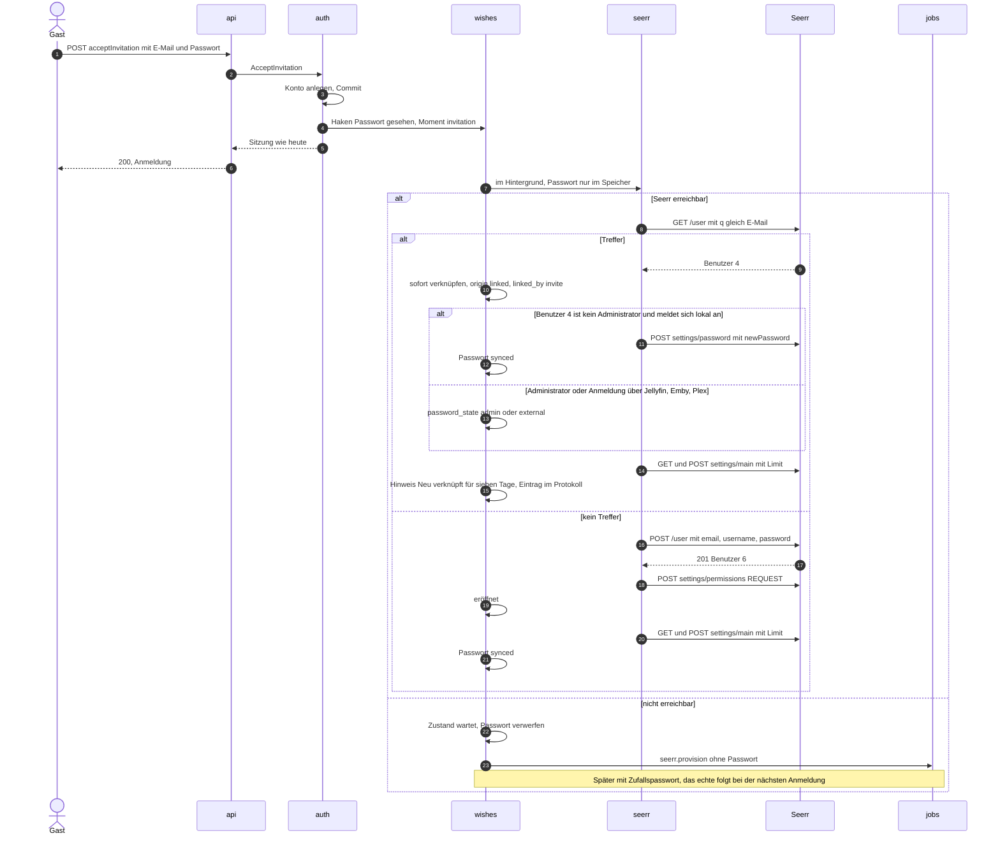

### 18.3 Das Passwort in den drei Momenten

Slouchcat sieht das Passwort im Klartext nur beim Annehmen der Einladung, beim Ändern des eigenen Passworts und
bei jeder Anmeldung (Anhang H 3.6). Nur dann gibt es es weiter (N-3). Eine Funktion «Passwort zurücksetzen» gibt
es heute nicht (`server/internal/auth/` kennt nur `UpdateAccount`); kommt sie, gilt für sie dasselbe wie für das
Ändern.

| Moment | Heute im Code | Wirkung in Seerr |
|---|---|---|
| Einladung annehmen | `Service.AcceptInvitation` (`server/internal/auth/invitations.go:250`), Commit Z. 337, heutige Haken Z. 341–346; Handler `server/internal/api/invitation_handlers.go:61` | eröffnen (18.2) mit dem echten Passwort; gibt es die Adresse schon, sofort verknüpfen und das Passwort setzen (N-90, N-91; nicht bei N-6) |
| Passwort oder E-Mail ändern | `Service.UpdateAccount` (`server/internal/auth/account.go:19`), neues Passwort Z. 68–73, E-Mail Z. 87–88, Commit Z. 112; Handler `server/internal/api/account_handlers.go:44` | mit Benutzer: `POST /user/{id}/settings/password {newPassword}` sofort; E-Mail über `…/settings/main` (N-5). Schlägt es fehl: `next_login`. Ohne Benutzer (wartet): die neue Adresse prüft Slouchcat wie beim Annehmen; Treffer → sofort verknüpfen, `linked_by = email_change`, Passwort wie bei der Einladung (N-95). Mit Benutzer, und Seerr lehnt die neue Adresse ab, weil sie vergeben ist: Slouchcat meldet das und lässt den Benutzer, wie er ist (N-95) |
| Anmeldung | `Service.Login` (`server/internal/auth/auth.go:273`), Passwort geprüft vor `StartSession` Z. 335; Handler `server/internal/api/auth_handlers.go:190` | nur wenn `password_state = next_login` und `state = ready`: Passwort setzen, dann `synced` |

**Haken (Vorschlag).** `auth` bekommt nach dem Muster von `WithAccountCreated` und `WithInvitationAccepted`
(`server/internal/auth/auth.go:109-123`, verdrahtet in `server/cmd/slouchcat/main.go:292`) einen Haken
`WithPasswordSeen(fn func(ctx, accountID int64, email, password, moment string))`. `auth` ruft ihn **nach** dem
Commit bzw. nach der gelungenen Prüfung auf. Er gibt das Passwort an `wishes`, das es in einer Goroutine mit
Zeitlimit 10 s weiterreicht und danach verwirft. Die Antwort an den Browser wartet darauf nicht und ändert sich
nicht. Das Passwort steht nie in einer Job-Nutzlast, in `wish_events`, in `seerr_log` oder im Protokoll. Ein
Fehler im Haken wird wie heute nur mit Konto-ID protokolliert (Muster `auth.go:126-133`).

Slouchcat verlangt mindestens 10 Zeichen (`server/internal/auth/auth.go:40`), Seerr 8; jedes
Slouchcat-Passwort passt (Anhang H 3.1).

**Kein Abgleich (N-6):** Benutzer 1 und andere Administratoren von Seerr (`password_state = admin`) und
Benutzer, die sich über Jellyfin, Emby oder Plex anmelden (`external`). Ändert jemand das Passwort direkt in
Seerr, bemerkt Slouchcat das nicht (N-7, Marco kannte die Folge); die Verwaltung bietet «Passwort bei der
nächsten Anmeldung neu übernehmen» (`next_login`).

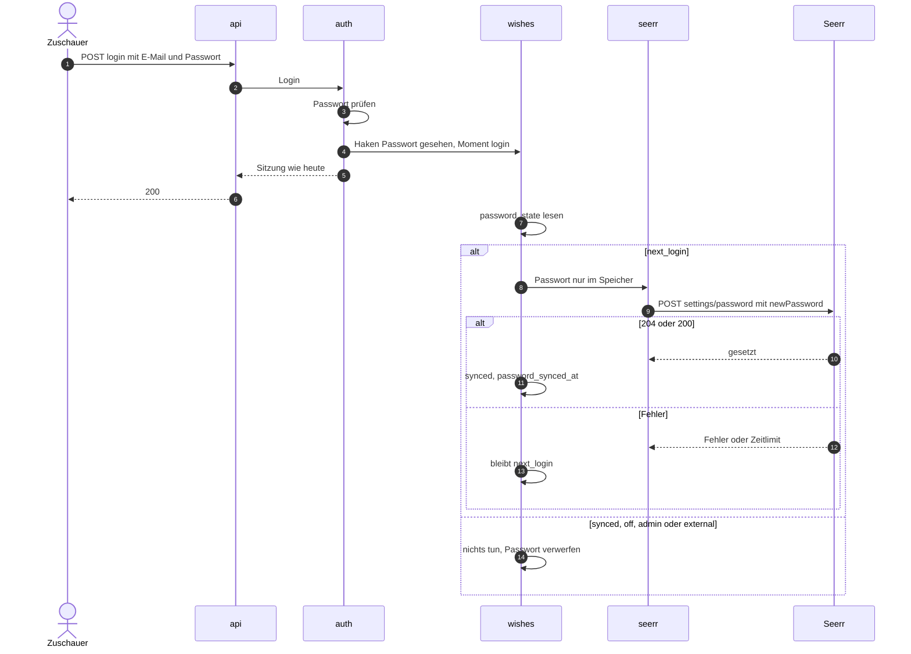

### 18.4 Rechte, Löschen, Ausschalten

- **Rechte folgen dem Wunschrecht (N-9).** Ändert der Administrator `accounts.can_request` über
  `updateAccountAccess` (`server/internal/auth/accounts.go:20`), reiht `wishes` `seerr.provision` ein, das die
  Rechte nachzieht. Nur für `origin = created`.
- **Konto löschen (N-10, F-31).** `DeleteAccount` (`server/internal/auth/accounts.go:113`) ruft heute einen
  Abschluss `end` auf. Darüber nimmt `wishes` nur einem Benutzer, den Slouchcat eröffnet hat (`origin = created`),
  die Rechte (`permissions = 0`) und setzt ein Zufallspasswort. Verknüpfte (`linked`) und von Hand gewählte
  (`manual`) Benutzer bleiben unverändert, wie bei N-9 (Redaktionsentscheid zu K-2). Der Benutzer bleibt in jedem
  Fall bestehen, weil mit ihm seine Requests gelöscht würden (Anhang D 7.2). Die Rückfrage vor dem Löschen nennt, was mit dem Benutzer geschieht.
- **Ausgeschaltet.** Mit «Neue Konten in Seerr eröffnen» aus eröffnet die Einladung nichts; mit «Passwort
  abgleichen» aus geht kein Passwort weiter (`password_state = off` für alle). Für ein Konto ohne
  Seerr-Benutzer gilt F-4.

## 19. Limit je Konto (Stufe 1, Vorprüfung ab Stufe 2)

### 19.1 Was gilt

Marco will je Konto ein Limit, etwa 10 Filme und 5 Staffeln je Woche rollierend; es gilt für alle Profile
gemeinsam, und Seerr zählt alles, auch direkt dort gestellte Wünsche (Anhang H 1, E-3). Abgelehnte Wünsche
und Mitwünsche zählen nicht (E-3). Regeln N-30 bis N-38 in Anhang H 4.3. Was dort nicht als Marco markiert ist, ist Empfehlung der Redaktion.

| Punkt | Festlegung |
|---|---|
| Einstellen | Vorgabe in Wünsche › Einstellungen; je Konto unter Konten «Standard», «Eigenes» oder «Unbegrenzt» (N-31) |
| Vorgabe ab Werk | 10 Filme in 7 Tagen, 5 Staffeln in 7 Tagen (Marcos Beispiel); 0 heisst ohne Limit (N-31, F-26) |
| Schreiben | Slouchcat schreibt die vier Felder `movieQuotaLimit`, `movieQuotaDays`, `tvQuotaLimit`, `tvQuotaDays` in den Seerr-Benutzer (18.2, Schritt 4), bei jeder Änderung und beim Eröffnen; für einen verknüpften Benutzer überschreibt es den Wert, der dort stand (N-37) |
| «Unbegrenzt» | **Vorschlag:** Limit 0 schreiben. **Nicht verifiziert**, dass Seerr 0 als unbegrenzt liest; Anhang H 3.2 belegt nur, dass ein fehlendes Feld die Vorgabe der Seerr-Einstellungen übernimmt. Der Bau prüft es gegen eine Instanz |
| Zählen | Seerr: rollierend, Requests mit `createdAt` in den letzten `…Days` Tagen; Filme nach Anzahl, Serien nach Summe der Staffeln; `DECLINED` zählt nicht, `FAILED` zählt (Anhang H 3.2) |
| Ausgenommen | Benutzer mit `MANAGE_USERS` (also auch Administratoren) haben in Seerr kein Limit; Seerr nimmt die Felder für sie auch nicht an (N-34) |
| Je Profil | kein Teil-Limit (N-38); ein Profil mit Ausnahme-Benutzer (F-27) hat das Limit dieses Benutzers |

### 19.2 Vorprüfung beim Anfordern

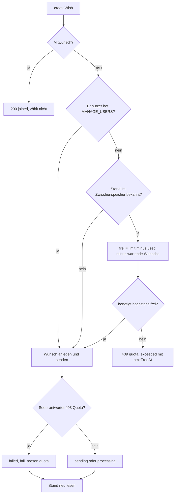

- «benötigt» ist 1 bei einem Film und die Zahl der gewählten Staffeln ohne die Staffeln, für die das Profil
  Mitwünscher wird (N-36).
- «wartende Wünsche» sind Wünsche des Kontos (bzw. des Ausnahme-Benutzers) im Zustand `queued`: Seerr kennt
  sie noch nicht (N-35).
- Der Dialog zeigt vorher, wie viel frei ist, und sperrt den Knopf mit dem Zeitpunkt, an dem der nächste Platz
  frei wird (N-36). Der Titel bleibt sichtbar; Mitwünschen geht weiter.
- **Vorschlag:** 409 statt 403, weil das Recht besteht und nur der Stand nicht reicht; 422 bleibt für falsche
  Eingaben (`08-datenmodell-api.md`, Abschnitt 4.4).

### 19.3 Stand lesen und «nächster Platz frei»

- `GET /user/{id}/quota` (ohne `X-API-User`, braucht `MANAGE_USERS` und `MANAGE_REQUESTS`, Anhang D 7.2) bei jedem
  Lauf von `seerr.users` und `wishes.sync` für Benutzer mit offenen oder neuen Wünschen und nach jedem gesendeten
  Wunsch. Speichern in `seerr_users` (`…_quota_limit`, `…_quota_days`, `…_quota_used`, `quota_at`).
- **Nächster Platz frei (N-35):** ältester zählender Request im Zeitraum + Tage. **Vorschlag:** gelesen mit
  `GET /request?requestedBy=<id>&sort=added&sortDirection=asc&take=50` (Anhang D 6.1: `added` sortiert nach
  `createdAt`), nur bei erreichtem oder fast erreichtem Limit. Bei Serien zählt jede Staffel; frei wird der Platz
  des ältesten Requests mit seiner Staffelzahl. **Nicht geprüft** gegen eine Instanz.
- Die Verwaltung zeigt den Stand je Konto «7 von 10 Filmen in 7 Tagen», inklusive der direkt in Seerr
  gestellten Wünsche (E-3).

## 20. Profil-Tag in Radarr und Sonarr (Stufe 4)

### 20.1 Was gilt

Marco will sehen, welches Profil einen Titel angefordert hat, und hat dafür «Auch in Radarr/Sonarr» gewählt, als
Tag; er wusste, dass das die heutige Regel bricht (Anhang H 2, E-2). Regeln N-20 bis N-28 in Anhang H 4.2. Was dort nicht als Marco markiert ist, ist Empfehlung der Redaktion.

| Punkt | Festlegung |
|---|---|
| Profile | kein eigener Seerr-Benutzer, kein Login; das Profil steht am Wunsch und als Tag (N-20, N-40) |
| Name | Präfix + Profilname in Kleinbuchstaben, nur `a–z`, `0–9`, `-`; Präfix ab Werk `sc-`, einstellbar; haben zwei Profile denselben Namen, behält das erste den einfachen Namen (`sc-kinder`) und das später angelegte bekommt den Kontonamen dazu (`sc-kinder-grosseltern`), weil Tags nie umbenannt werden (N-21, Redaktionsentscheid zu K-18); je Profil überschreibbar (F-25) |
| Zeitpunkt | sobald der Wunsch «In Beschaffung» ist, also Seerr den Titel an Radarr oder Sonarr übergeben hat; ein Mitwunsch bekommt seinen Tag nachträglich (N-24) |
| Fehler | ändern nichts am Wunsch; «Tag noch nicht gesetzt», der nächste Lauf holt es nach (N-25) |
| Entfernen | nie, auch nicht beim Zurückziehen oder Löschen (N-26) |
| Direkt in Seerr gestellt | kein Profil-Tag, auch wenn `wishes.import` den Wunsch später einem Profil zuordnet; massgeblich ist `origin` = `jellyseerr` (N-27, Redaktionsentscheid) |
| Tag des Kontos | ergänzend empfohlen: «Tag Requests» in Seerr; dann trägt jeder Titel auch `<Benutzer-ID>-<Anzeigename>` des Kontos. Der Test zeigt, ob es an ist (N-28) |
| Verworfen | `tags` im Body von `POST /request`: braucht `REQUEST_ADVANCED` für jeden Benutzer, ersetzt die Standard-Tags, kann einem Mitwunsch nichts nachreichen, und Seerr legt keine Tags an (Anhang H 3.5, 4.2) |

### 20.2 Zugang zu Radarr und Sonarr

- Adresse und Schlüssel liest `arr` aus `GET /settings/radarr` bzw. `/settings/sonarr`, Standardserver
  ohne 4K (`isDefault`, `is4k`; Anhang H 3.5). Der Administrator tippt keinen Schlüssel ein; die Schlüssel stehen
  nur im Speicher (N-23). Dort hält `arr` sie 10 Minuten und liest sie erst nach Ablauf oder nach einer Antwort
  401 von Radarr bzw. Sonarr neu aus Seerr, nicht bei jedem Lauf von `wishes.progress` (Redaktionsentscheid zu
  K-23).
- Erreicht Slouchcat die Adresse nicht (etwa Docker-interne Namen), trägt der Administrator eine eigene Adresse
  ein (`arr.radarr_url`, `arr.sonarr_url`); der Schlüssel kommt weiter aus Seerr (F-30).
- **Vorschlag (Sicherheit, 15.3):** Slouchcat nutzt eine Adresse aus Seerr erst, wenn der Administrator sie im
  Band «Radarr und Sonarr (Profil-Tags und Fortschritt)» einmal mit «Testen» bestätigt hat; der bestätigte Host
  steht in `arr.radarr_host` bzw. `arr.sonarr_host`. Weicht der Host später ab, halten `wishes.tag` und
  `wishes.progress` an.

### 20.3 Ablauf (`wishes.tag`)

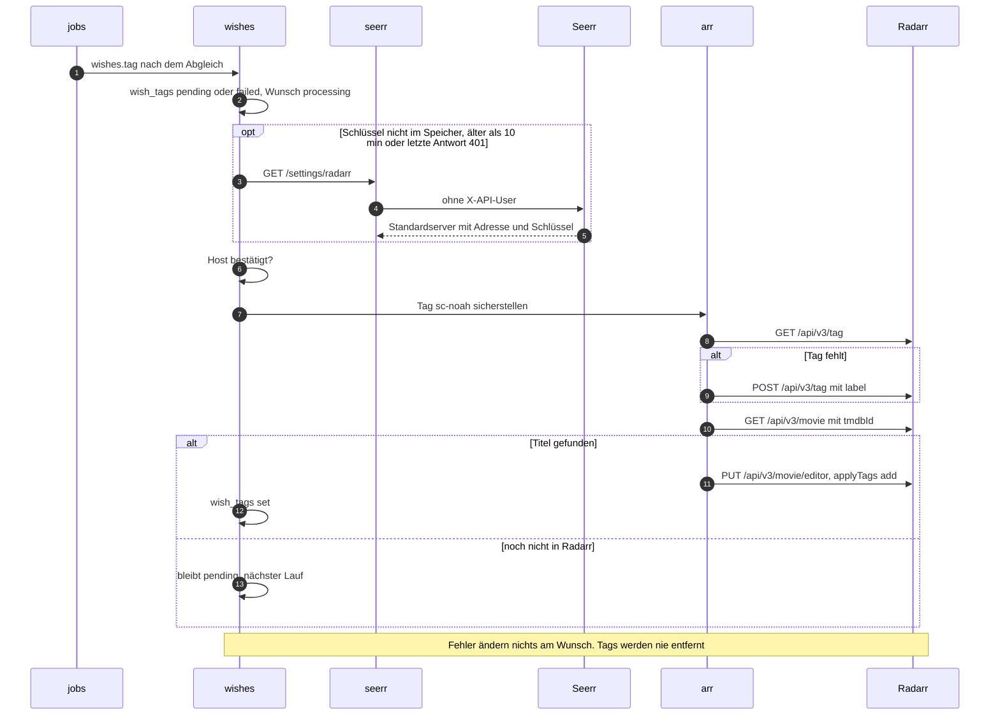

Für Serien gilt dasselbe mit Sonarr, `GET /api/v3/series?tvdbId=` und `PUT /api/v3/series/editor`. Je Wunsch und
Profil eine Zeile in `wish_tags`; Besitzer und Mitwünscher bekommen je ihren Tag.

## 21. Bereich «Wünsche»: Entdecken, Filme, Serien, Suche (Stufe 5)

### 21.1 Was gilt

Marco will eine Seite für Wünsche wie die Startseite von Seerr, mit Discover, Movies, Series und Search
(Anhang H 1). Der Eintrag «Wünsche» der Seitenleiste führt in einen Bereich mit den Reitern «Entdecken», «Filme»,
«Serien», «Suche» und «Meine Wünsche» (N-50; «Meine Wünsche» als fünfter Reiter ist Redaktion). Reihen, Filter
und Suche: N-51 bis N-53, F-28. Schalter «Seiten Entdecken, Filme, Serien und Suche» in Wünsche › Einstellungen
(N-57). Was in Anhang H nicht als Marco
markiert ist, ist Empfehlung der Redaktion.

### 21.2 Leseweg und Zwischenspeicher

- Die Daten holt der Server über die Discover- und Suchrouten von Seerr (Anhang H 3.3), mit `X-API-User` des
  Benutzers, als den das Profil anfordert (N-54). Der Client spricht nie mit Seerr oder TMDB.
- **Zwischenspeicher:** 1 Stunde je Liste, Seite, Sprache und Altersstufe (N-54), in `wish_discover_pages`
  (`08-datenmodell-api.md`, Abschnitt 2.15). Gespeichert wird nur die Reihenfolge der Treffer und ihre Grunddaten;
  Freigaben und Details liegen wie bisher in `external_titles`. Die Suche speichert **Vorschlag** 10 min im
  Speicher wie `searchExternalTitles`.
- Der Job `wishes.discover` (1 h) lädt die erste Seite jeder Reihe für jede Sprache und Altersstufe vor, die ein
  Profil mit Wunschrecht hat. Ein Treffer, der fehlt, wird beim Seitenaufbau mit Zeitlimit 5 s geholt
  (**Vorschlag**); ist Seerr nicht erreichbar, gilt der ältere Eintrag, sonst der Hinweis (Abschnitt 14).
- `mediaInfo` aus Seerr nutzt Slouchcat nur für den Zustand in Seerr («angefragt»), nie für «in der
  Bibliothek» (N-55).

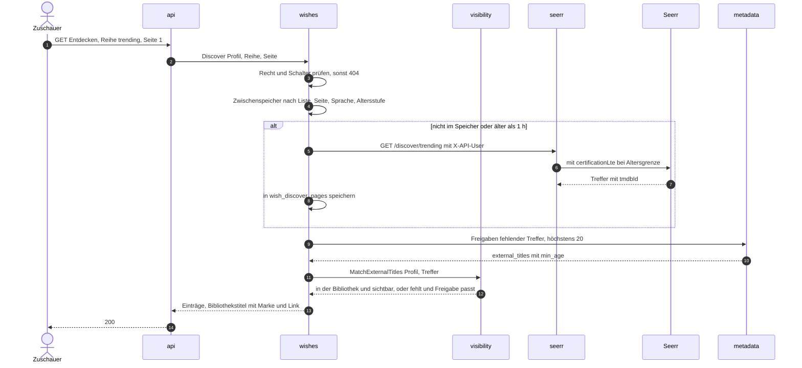

### 21.3 Bibliothekstitel

Titel, die in der Bibliothek stehen, erscheinen auch, mit Marke und Link zur Detailseite (N-55). Massgeblich ist
der Abgleich von Slouchcat über `visibility` in der Reihenfolge von Abschnitt 5 (Serien TVDB zuerst). Für eine
Serie ohne bekannte TVDB-ID holt `metadata` die `external_ids` von TMDB nach (in `external_titles`); bis dahin
gleicht Slouchcat über TMDB ab. Ein Bibliothekstitel, den das Profil nicht sehen darf, erscheint gar nicht (404-Regel,
Abschnitt 3). «Vorhandene ausblenden» (N-52) entfernt die Bibliothekstitel aus der Liste.

### 21.4 Wer den Bereich sieht, Altersstufe

- Den Bereich sieht nur ein Profil, das anfordern kann (F-9, N-56); alle anderen sehen höchstens «Meine Wünsche».
- Die Altersstufe gilt für jeden Titel; unbekannt zählt als 18. Für Profile mit Altersgrenze fragt der Server
  Seerr mit `certificationLte` (und `certificationCountry` nach dem Freigabeland, **Vorschlag**) und prüft
  jeden Treffer selbst mit `visibility.MissingTitle` nach (N-56). `certificationLte` ist nur ein Vorfilter.
- Für `GET /discover/trending` nennt Anhang H 3.3 keinen Freigabe-Parameter (die Liste dort ist eine Auswahl;
  **nicht verifiziert**, ob es einen gibt). Ohne Vorfilter wird die Reihe «Im Trend» für Profile mit Altersgrenze
  stärker ausgedünnt (**Vorschlag:** bis zu drei Seiten lesen, um eine Reihe zu füllen).

### 21.5 Kein Verstoss gegen Nicht-Ziele

Die Listen sind öffentliche TMDB-Ranglisten, für alle gleich; das ist keine algorithmische Empfehlung (N-58).
S-4 gilt für die Startseite ohne Ausnahme (N-70): Die neuen Seiten liegen unter «Wünsche», nicht auf der
Startseite. Die fehlenden Einträge der Trakt-Liste erscheinen auch hier nicht als eigene Reihe (E-5).

## 22. Download-Fortschritt aus Radarr und Sonarr (Stufe 4)

### 22.1 Was gilt

Marco will bei Wünschen den Download-Fortschritt aus Radarr und Sonarr sehen, «unter «Meine Wünsche» und in der
Verwaltung» (Anhang H 8.2, E-7 «Ja, bei Wünschen»). Die API von Radarr und Sonarr dient damit zwei Dingen, dem
Profil-Tag und dem Lesen des Fortschritts (E-6, E-7, N-81). Regeln N-82 bis N-87 in Anhang H 8.4; was dort nicht
als Marco markiert ist, ist Empfehlung der Redaktion.

| Punkt | Festlegung |
|---|---|
| Wo | beim Wunsch: «Meine Wünsche», Wunschkarte der Vorschauseite, Verwaltung › Wünsche › Anfragen. Nicht an Titeln der Bibliothek, nicht in Reihen, nicht in der Suche, nicht auf der Startseite (N-82) |
| Wann | nur solange der Wunsch «In Beschaffung» ist (`processing`; bei Serien auch `partial` für die noch offenen Staffeln) |
| Wirkung | nur Anzeige; die Zustände des Wunsches ändern sich nicht, «verfügbar» heisst weiter: Slouchcat kann den Titel abspielen (N-87, F-13) |
| Schalter | «Download-Fortschritt zeigen» in Wünsche › Einstellungen, ab Werk an (N-86); aus: `wishes.progress` ruht, `wish_progress` wird geleert, keine Anzeige |
| Zugang | derselbe wie für den Profil-Tag: Adresse und Schlüssel aus Seerr oder eigene Adresse, Host bestätigt (Abschnitt 20.2) |

### 22.2 Vier Anzeigen und wie sie entstehen (N-83)

Die Felder der Warteschlange sind gegen Radarr 6.4.4.10685 geprüft; bei Sonarr war die Warteschlange beim Test
leer, `seriesId`, `episodeId` und `seasonNumber` sind **nicht geprüft** (Anhang H 8.3).

| Anzeige (Zuschauer) | `stage` in `wish_progress` | abgeleitet aus |
|---|---|---|
| «Wird gesucht» | `search` | Titel in Radarr bzw. Sonarr gefunden, kein Eintrag in der Warteschlange, keine Datei (`hasFile = false` bzw. die gewünschten Folgen fehlen laut `statistics` bzw. `seasons`) |
| «Wird heruntergeladen · 45 % · noch 12 min» | `download` | Eintrag in der Warteschlange: Prozent = (`size` − `sizeleft`) / `size`; Restzeit aus `timeleft` (sonst aus `estimatedCompletionTime`); bei Serien die Summe über die Einträge der gewünschten Staffeln |
| «Wird eingelesen» | `import` | Radarr meldet `hasFile = true` bzw. Sonarr hat die Folgen der gewünschten Staffeln, Slouchcat hat den Wunsch aber noch nicht erfüllt; gleich wie der Zusatz «wird eingelesen» aus Seerr (Abschnitt 8.1) |
| «Download verzögert» | `stalled` | `trackedDownloadStatus` = `warning` oder `error` an einem Eintrag des Wunsches; die Meldung (`errorMessage`, `statusMessages`) speichert Slouchcat nur für die Verwaltung |

Bei Serien steht dazu «x von y Folgen da»: vorhandene Folgen der gewünschten Staffeln gegen ihre Folgenzahl laut
`series_catalog` bzw. `external_titles`. `statistics` (`episodeFileCount`, `episodeCount`) gilt für die ganze Serie
und ist geprüft; die Zahlen je Staffel stehen in `seasons`, deren Felder Anhang H 8.3 **nicht** nennt. Der Bau prüft
sie gegen Marcos Sonarr; fehlen sie, zählt Slouchcat die Folgen nur für Wünsche über alle Staffeln. Gibt es mehrere Einträge, gewinnt `stalled` vor
`download` vor `import` vor `search` (**Vorschlag**).

Die Zuschauer-App zeigt nur diese Worte und Zahlen. `errorMessage`, `statusMessages`, `downloadClient` und der
Dienst sieht nur die Verwaltung (N-83).

### 22.3 Zuordnung der Warteschlange zu Wünschen

| Dienst | Weg | Quelle |
|---|---|---|
| Radarr | Wunsch → `GET /api/v3/movie?tmdbId=<tmdb_id>` → `id` (Radarr-ID); Eintrag der Warteschlange mit `movieId` = diese ID | `movieId` geprüft (Anhang H 8.3) |
| Sonarr | Wunsch → `GET /api/v3/series?tvdbId=<tvdb_id>` → `id`; Einträge mit `seriesId` = diese ID und `seasonNumber` in den gewünschten Staffeln | `seriesId`, `seasonNumber` **nicht geprüft**; fehlen sie, ordnet Slouchcat Sonarr-Einträge nicht zu (Abschnitt 14) |

Die Radarr- bzw. Sonarr-ID merkt sich Slouchcat in `wish_progress.arr_title_id` (dieselbe ID wie
`wish_tags.arr_title_id`); gesucht wird nur, solange sie fehlt. Ein Eintrag ohne passenden Wunsch wird nicht
gespeichert: Slouchcat zeigt nie den Fortschritt eines Titels, den niemand über Slouchcat gewünscht hat (Spec
`:67` bleibt dort Nicht-Ziel).

### 22.4 Ablauf (`wishes.progress`) und Zwischenspeicher

- **Takt:** jede Minute, nur solange es Wünsche «In Beschaffung» gibt und der Schalter an ist (N-84). Ohne solche
  Wünsche reiht der Zeitplan den Lauf nicht ein bzw. der Lauf endet sofort ohne Aufruf.
- **Je Lauf:** die Warteschlange je Dienst, für den es Wünsche gibt; dazu die Suchaufrufe aus 22.3 nur für
  Wünsche ohne gemerkte ID. **Vorschlag:** `GET /api/v3/movie?tmdbId=` bzw. `series?tvdbId=` für `hasFile` und
  `statistics` höchstens alle 5 min je Wunsch.
- **Seiten der Warteschlange (Redaktionsentscheid zu K-8):** `GET /api/v3/queue` liefert Seiten. `arr` liest alle
  Seiten (`page`, `totalRecords`) oder setzt `pageSize` gross genug; ein Eintrag auf Seite 2 darf nicht fehlen.
  Welcher Weg bei Marcos Instanzen gilt und wie gross `pageSize` sein darf, prüft der Bau vorher gegen die
  Instanz (**nicht geprüft**).
- **Schlüssel:** wie in 20.2 aus dem Speicher von `arr`, 10 Minuten gültig; neu gelesen aus Seerr erst nach
  Ablauf oder nach einer Antwort 401 (Redaktionsentscheid zu K-23). Ein Lauf je Minute ruft Seerr damit
  höchstens alle 10 Minuten auf.
- **Zwischenspeicher:** Tabelle `wish_progress` (`08-datenmodell-api.md`, Abschnitt 2.16), je Wunsch eine Zeile mit
  `stage`, Prozent, Restzeit, Folgen, Meldung für die Verwaltung, Dienst, `read_at`. Ein Seitenaufbau liest nur
  diese Tabelle; **kein Aufruf an Radarr oder Sonarr im Seitenaufbau** (N-84).
- **Veralten:** Eine Zeile mit `read_at` älter als 5 min gilt als veraltet (**Vorschlag**); die Zuschauer-App zeigt
  dann nichts Zusätzliches, die Verwaltung «Fortschritt nicht lesbar» mit Zeit (N-85).
- **Aufräumen:** Wird der Wunsch `available`, `declined`, `failed` oder `withdrawn`, löscht `wishes` die Zeile.
- **Kein Protokoll von Inhalten:** Antworten von Radarr und Sonarr erscheinen nur als Methode, Pfad, Status und
  Dauer im Protokoll; Pfade aus der Warteschlange oder aus `movieFile.path` liest und speichert Slouchcat nicht.

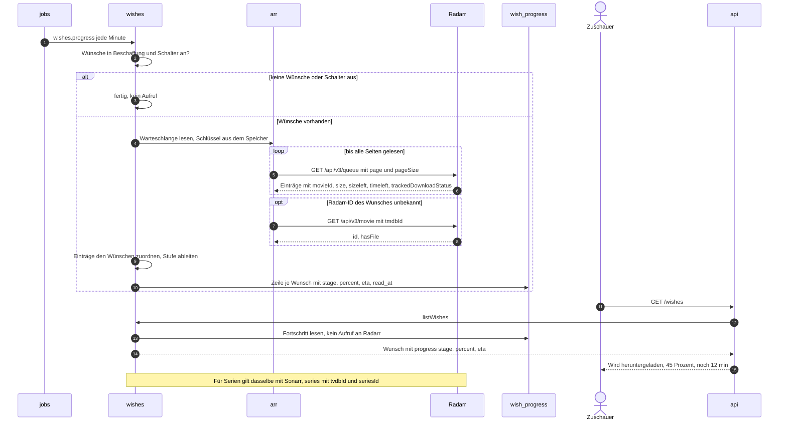

### 22.5 Was Zuschauer und was Administratoren sehen

| | Zuschauer («Meine Wünsche», Wunschkarte der Vorschauseite) | Verwaltung (Anfragen) |
|---|---|---|
| Anzeige | eine der vier Anzeigen, bei Serien «x von y Folgen da» | dieselbe Anzeige je Wunsch, dazu Dienst |
| Meldung von Radarr oder Sonarr | nie | in der Aufklappzeile «Diagnose» (`errorMessage`, `statusMessages`, Download-Programm), ohne Pfade |
| Radarr oder Sonarr nicht erreichbar | nichts Zusätzliches; der Wunsch bleibt «In Beschaffung» (N-85) | «Fortschritt nicht lesbar» mit Zeit des letzten Lesens |
| Schalter aus | keine Anzeige | keine Anzeige; Hinweis im Band «Radarr und Sonarr (Profil-Tags und Fortschritt)» |
