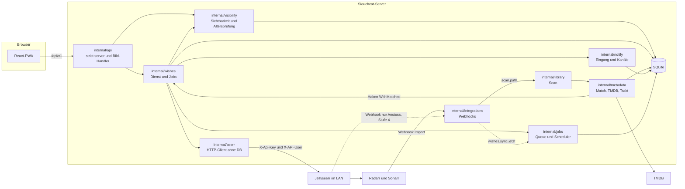
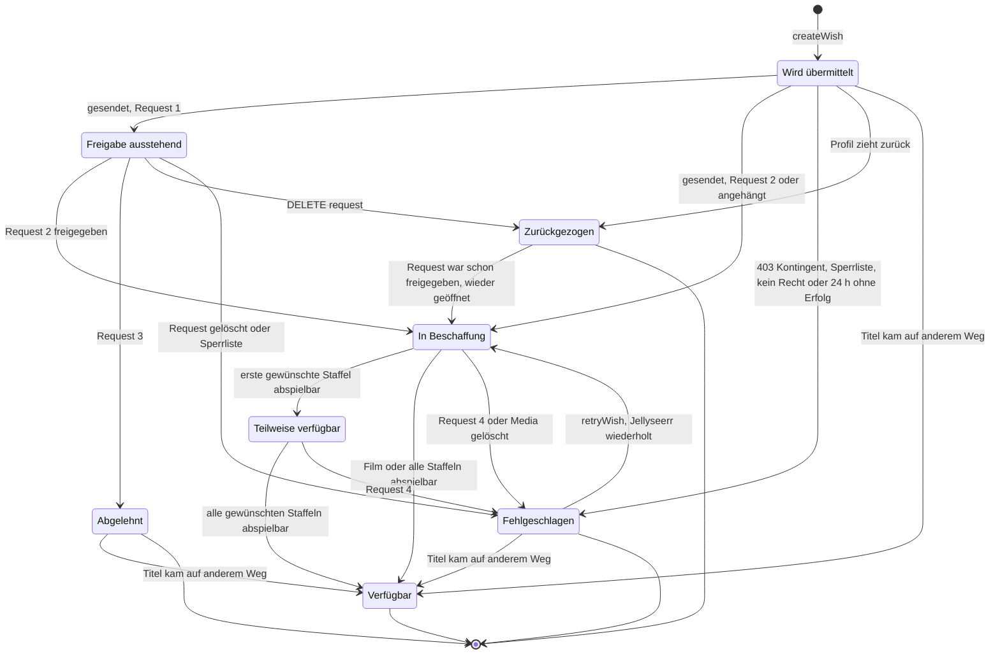
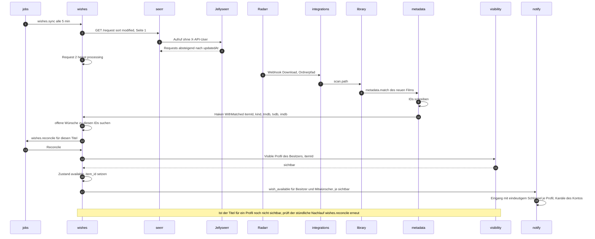
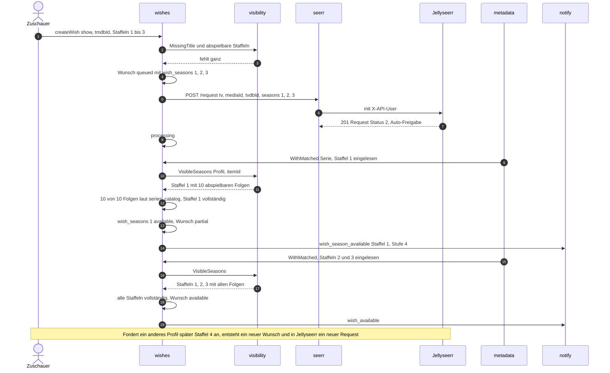

# Konzept 25 · Technische Architektur

> **Kurz gesagt.** Zwei neue Pakete tragen die Funktion: `internal/seerr` spricht HTTP mit Jellyseerr und
> kennt keine Datenbank, `internal/wishes` führt die Wünsche, die Zuordnung und den Abgleich auf eigenen
> Tabellen. Ob ein Titel in der Bibliothek steht und ob ein Profil ihn sehen darf, beantwortet weiter nur
> `visibility`; den Anstoss «Titel zugeordnet» gibt `metadata` an der Stelle des heutigen `WithRelink`-Hakens.
> Slouchcat legt Wünsche mit `X-Api-Key` und `X-API-User` im Namen des zugeordneten Jellyseerr-Benutzers an,
> speichert sie zuerst lokal (Ausgangsfach) und gleicht alle 5 Minuten ab. «Verfügbar» meldet Slouchcat erst,
> wenn die eigene Bibliothek den Titel für das Profil abspielen kann, nie allein auf Grund von Jellyseerr.

Stand: `main` `ba6efe31`, Vertrag 1.40.0, letzte Migration 00065. Grundlage ist [Anhang F](anhang/F-entscheid-blatt.md)
(Abschnitte 1 bis 10); Belege `pfad:zeile` stammen aus den Anhängen A bis D oder sind im Worktree
nachgesehen. Jellyseerr-Belege beziehen sich auf Seerr v3.5.2 (`GH:` = `github.com/seerr-team/seerr/blob/v3.5.2/`).
Was über Anhang F hinausgeht, ist als **Vorschlag** gekennzeichnet. Datenmodell und Vertrag im Einzelnen:
`08-datenmodell-api.md`; Bauschritte: `09-umsetzungsplan.md`; Benachrichtigungen: `06-benachrichtigungen.md`.

## 1. Überblick und Grundsätze

| Nr. | Grundsatz | Herkunft |
|---|---|---|
| G-1 | Jellyseerr bleibt die Wunschverwaltung. Slouchcat spricht nie Radarr oder Sonarr an. | Anhang F 2.1 |
| G-2 | Ausgehend nur zur eingetragenen Adresse, ohne Weiterleitung, mit Zeitlimit und Rate-Limit. | Anhang F 2.2 |
| G-3 | Jeder Wunsch läuft im Namen eines Jellyseerr-Benutzers (`X-API-User`), nie mit `userId` im Body. | Anhang F 2.3, F-3 |
| G-4 | Kein Aufruf an Jellyseerr im Seitenaufbau. Zuschauerseiten lesen nur lokale Tabellen. | Anhang F 2.9, 2.10 |
| G-5 | «Verfügbar» = in Slouchcat für das Profil abspielbar. | Anhang F 2.8, F-13 |
| G-6 | Regel 2 bleibt: Titel-SQL nur in den erlaubten Paketen; nicht sichtbar heisst 404. | CLAUDE.md Regel 2 |
| G-7 | Der Server entscheidet Wunschrecht und Altersgrenze; der Client zeigt nur an. | Regel 12, Anhang F 2.6 |
| G-8 | Jeder Job-Handler ist idempotent; ein abgebrochener Lauf darf beliebig oft neu starten. | ADR 0002, `server/internal/jobs/queue.go:1-7` |

## 2. Komponenten

### 2.1 Bestehende Komponenten, die sich ändern

| Paket oder Datei | Änderung | Stufe |
|---|---|---|
| `internal/admin` (`settings.go`) | Einstellungen `seerr.*` und `wishes.*`; API-Schlüssel über `settingsWriter.setSecret` (`server/internal/admin/settings.go:630-640`) | 1 |
| `internal/auth` (Profile, Konten, Einladungen) | Felder `can_request` an Konto, Profil und Einladung schreiben | 1 |
| `internal/api` | neue Handler (strict server), Bild-Handler für fehlende Titel (`scoped` für Zuschauer, eigene Admin-Route für die Verwaltung), Sitzung mit `wishes`; Vertragstest | 1 bis 4 |
| `internal/visibility` | neue Funktionen: Titel zu externen IDs, «fehlt für dieses Profil», Altersprüfung fehlender Titel, sichtbare Staffeln | 2, 3, 4 |
| `internal/metadata` | neuer Haken `WithMatched` neben `WithRelink` (`server/internal/metadata/metadata.go:344-349`, `match.go:312-330`); TMDB-Abruf für `external_titles` und `series_catalog`; Trakt-Abruf liest `tvdb` und `imdb` (`server/internal/trakt/trakt.go:270-273`) | 2, 3, 4 |
| `internal/notify` | neue Eingangsarten und Kanal-Ereignisse; neuer Leseweg für Einträge ohne `item_id` über `wish_id` (Details in `06-benachrichtigungen.md`, Abschnitte 8 und 11) | 2, 4 |
| `internal/integrations` | `receiveWebhook` kennt die Art `jellyseerr` als reinen Anstoss | 4 |
| `internal/discover` | Spotlight mischt fehlende Titel ein, Reihe `wishes` | 3 |
| `internal/logging` | neue Schlüsselnamen in der Redaction-Liste und im Test (Regel 10) | 1 |
| `cmd/slouchcat/main.go` | Verdrahtung von `seerr`, `wishes`, Haken und Jobarten (`main.go:418-443`) | 1 bis 4 |
| `web/src` | neue Seiten und Bauteile (`02-funktionskonzept.md`, `05-spotlight-integration.md`, `07-administration.md`) | 1 bis 4 |

### 2.2 Neues Paket `internal/seerr`

Ein reiner HTTP-Client nach dem Vorbild `internal/trakt` (ohne DB, mit Rate-Limiter und Schutz vor
Weiterleitungen; [Anhang A](anhang/A-spotlight-startseite.md), Anknüpfungspunkte).

| Merkmal | Festlegung | Begründung |
|---|---|---|
| Ziel | nur die vom Administrator eingetragene Basisadresse, Pfade immer `/api/v1/…` | Anhang F 2.2; Seerr bindet `/api/v1` (`GH:server/index.ts` Z. 264) |
| Schemata | nur `http` und `https` | Muster `fetch` (`server/internal/fetch/fetch.go:1-57`) |
| LAN | **ausdrücklich erlaubt**: eigener `http.Client` ohne `netguard.RefuseLocal` | `netguard` sperrt 192.168/16 (`server/internal/netguard/netguard.go:29-54`); Jellyseerr steht im Heimnetz |
| Weiterleitungen | keine: `CheckRedirect` liefert `http.ErrUseLastResponse`; eine 3xx-Antwort gilt als Fehler `seerr_redirect` | Muster Updater-Begleiter (`server/internal/admin/update_install.go:107-113`): der Schlüssel darf nicht weiterwandern |
| Zeitlimit | 10 s je Aufruf; der Sofortversuch von `createWish` 3 s | Anhang F 2.2, 2.10 |
| Rate-Limit | `ratelimit.Limiter` 5 Anfragen/s, Burst 5, je Instanz | Anhang F 2.2; Muster `server/internal/ratelimit/ratelimit.go:1-30` |
| Antwortgrösse | **Vorschlag:** höchstens 4 MiB je Antwort, sonst Fehler | Schutz bei falscher Adresse |
| Fehlertexte | nennen nur Schema und Host (`netguard.Clean`/`Site`), nie Pfad mit Schlüssel | `server/internal/netguard/netguard.go:130-150` |
| Fehlerklassen | Sentinels `ErrUnreachable`, `ErrKeyInvalid`, `ErrForbidden` (mit Meldung), `ErrDuplicate`, `ErrNoSeasons`, `ErrNotFound`, `ErrServer`, `ErrCSRF` | Muster `model.ErrTMDBUnreachable` (`server/internal/metadata/tmdb.go:80-84`) |
| Wiederholung | keine im Client; die Job-Queue wiederholt | [Anhang C](anhang/C-integrationen-jobs-regeln.md), Abschnitt 3 |

Der Client bildet die Antworten auf schmale Go-Typen ab (`Request`, `Media`, `User`, `Quota`, `Status`).
Er liest Statuswerte als Zahlen, nicht als Namen: `BLACKLISTED` und `BLOCKLISTED` haben beide den Wert 6
([Anhang D](anhang/D-jellyseerr-api.md), Abschnitt 5). Die Spec von Jellyseerr ist an mehreren Stellen falsch (D, Abschnitt 1); der Client
folgt dem Code.

### 2.3 Neues Paket `internal/wishes`

Der Dienst für alles, was Wünsche betrifft.

| Teil | Aufgabe |
|---|---|
| `Service.Create` | Wunschrecht prüfen, lokal anlegen (`queued`), Sofortversuch, sonst `wishes.submit` |
| `Service.Withdraw` | zurückziehen: lokal `withdrawn` mit Merker «in Jellyseerr noch zu löschen», dann Job `wishes.withdraw` (Abschnitt 6.6, F-17) |
| `Service.Submit` | Handler `wishes.submit`: ab dem zweiten Versuch Vorprüfung in Jellyseerr, Senden, Antwort auswerten |
| `Service.Sync` | Handler `wishes.sync`: Requests abgleichen, Zustände ableiten; auch der Erstabgleich (Abschnitt 7.2) |
| `Service.Import` | Handler `wishes.import`: bestehende Requests eines zugeordneten Benutzers übernehmen (Abschnitt 7.3, F-21) |
| `Service.Reconcile` | Handler `wishes.reconcile` und Haken `WithMatched`: Verfügbarkeit in der eigenen Bibliothek |
| `Service.RefreshUsers` | Handler `seerr.users`: Benutzerliste, Rechte, Kontingente, Fingerabdruck der Instanz (Abschnitt 7.4) |
| `Mapping` | Zuordnung Konto und Profil zu Jellyseerr-Benutzer, Vorschläge bei gleicher E-Mail |
| `Rights` | `canRequest` und Grund je Sitzung, je Titel, je Medienart, je Stelle |

SQL liegt in einem eigenen Abfrageordner, nur für dieses Paket (**Vorschlag:** `server/queries/wishes/` →
`store/wishq`, eine depguard-Regel nach dem Muster `certq` in `server/.golangci.yml`). Das Paket fragt nur
die Wunsch-Tabellen (`wishes`, `wish_seasons`, `wish_requesters`, `wish_events`, `seerr_users`,
`wish_account_map`, `wish_profile_map`, `seerr_log`) und lesend `accounts`/`profiles` ab, nie `items`,
`media_files` oder `tracks`, und importiert `store/systemq` nicht.

### 2.4 Wer welche Daten besitzt

| Daten | schreibt | liest | Grund |
|---|---|---|---|
| Wunsch-Tabellen, `seerr_users`, Zuordnung | `wishes` | `wishes`, `admin` über den Dienst | eigenes Fach |
| `external_titles`, `external_title_texts`, `external_title_images`, `series_catalog` | `metadata` (TMDB-Client liegt dort, `server/internal/metadata/tmdb.go`) | `visibility` | TMDB-Abruf und Freigabeland-Logik liegen in `metadata` |
| `spotlight_entries` (+ `tvdb_id`, `imdb_id`) | `metadata` (`server/internal/metadata/trakt.go:291-298`) | `visibility`, `admin` | wie heute |
| `notifications`, `deliveries` | `notify` | `notify` | wie heute |
| `accounts.can_request`, `profiles.can_request` | `auth`, `admin` | `wishes` (lesend), `api` (Sitzung) | Kontodeckel nur über `updateAccountAccess` (`docs/adr/0014-benutzerverwaltung.md:87`) |
| `settings` `seerr.*`, `wishes.*` | `admin` | `wishes`, `seerr` (Konfiguration beim Aufruf) | ein Ort je Einstellung |

### 2.5 Diagramm (a): Komponentenübersicht



## 3. Regel 2: Titelabfragen nur über `visibility`

`wishes` steht nicht in der Liste der Pakete, die `store/systemq` importieren dürfen
(`server/.golangci.yml`, Regel `systemq`). Jede Frage an die Bibliothek geht darum an `visibility`:

| Frage | Funktion in `visibility` (Vorschlag für Namen) | Stufe |
|---|---|---|
| Welcher Bibliothekstitel gehört zu diesen externen IDs (Film: TMDB, dann IMDb; Serie: TMDB, TVDB, IMDb)? | `TitleByExternalIDs(kind, tmdb, tvdb, imdb) (itemID, bool)` (ohne Profil, nur intern) | 2 |
| Darf das Profil diesen Bibliothekstitel sehen? | bestehend `Visible(profile, itemID)` (`server/internal/visibility/playback.go:18-25`) | 2 |
| Ist dieser TMDB-Titel für das Profil ein «fehlender Titel»? (kein Bibliothekseintrag, auch kein unsichtbarer; Freigabe ≤ min(Profil, Konto)) | `MissingTitle(profile, media, tmdbID)` | 2 |
| Welche Staffeln einer Serie sind für das Profil abspielbar, mit wie vielen Folgen? | `VisibleSeasons(profile, itemID) map[int]int` (Staffel → Zahl abspielbarer, sichtbarer Folgen) | 2 |
| Welche Spotlight-Einträge fehlen für das Profil? | scoped Abfrage neben `ListSpotlightRow` (`server/queries/scoped/spotlight.sql`) | 3 |

Wichtig: Ein Titel, der in der Bibliothek steht, für das Profil aber zu hoch eingestuft ist, gilt **nicht**
als fehlend. Sonst sähe ein Kinderprofil ihn als «Noch nicht in der Bibliothek» und könnte ihn anfordern.
Für dieses Profil existiert er nicht (404), auch nicht als Vorschauseite (Anhang F 2.7).

Die Altersprüfung fehlender Titel liest die TMDB-Freigaben in `external_titles` in der Länderreihenfolge nach
ADR 0034: gewähltes Freigabeland, dann DE, AT, CH, GB, US; das erste Land mit bekanntem Wert gilt
(`docs/adr/0034-freigabelaender-und-altersstufen-je-land.md:32`). Innerhalb eines Lands gilt der strengste
Wert über die Anbieter; bei fehlenden Titeln ist TMDB der einzige Anbieter. `metadata` rechnet den Wert mit
derselben Funktion wie für Bibliothekstitel (`ageFromCertifications`, `server/internal/metadata/ratings.go:113-125`)
und speichert ihn als `external_titles.min_age`. Unbekannt zählt als 18. Massgeblich ist min(`profiles.max_rating`,
`accounts.max_rating`), wie in `visible_items` (`server/migrations/00063_minimum_age_accounts.sql:92`).

**Sehen nur mit Anfordern (F-9).** Ein fehlender Titel erscheint einem Profil nur, wenn `wishes.Rights` für
dieses Profil, diese Medienart und diese Stelle `canRequest` liefert und `visibility.MissingTitle` die Freigabe
bestätigt. Jede scoped Operation, die fehlende Titel liefert (Startseite, Suche, Vorschauseite, Bilder,
Serienseite), prüft beides; sonst 404 bzw. kein Eintrag. Ausnahme: Hat das Profil selbst einen Wunsch zu
diesem Titel (Zeile in `wish_requesters`, jeder Zustand), liefern Vorschauseite, Bilder und «Meine Wünsche»
den Titel auch ohne `canRequest`. Gründe, die nur vorübergehend sind (Jellyseerr nicht erreichbar, Schlüssel
abgelehnt), nehmen `canRequest` nicht weg; die Wünsche warten im Ausgangsfach.

## 4. Authentifizierung und Geheimnisse

### 4.1 Gegenüber Jellyseerr

| Header | Wert | Wann |
|---|---|---|
| `X-Api-Key` | der Admin-Schlüssel der Instanz | jeder Aufruf |
| `X-API-User` | `seerr_id` des zugeordneten Jellyseerr-Benutzers | jeder Aufruf **im Namen eines Benutzers**: `POST /request`, `DELETE /request/{id}`, Vorprüfung `GET /movie|tv/{tmdbId}` beim Senden und beim Zurückziehen |
| (kein `X-API-User`) | handelt als Benutzer 1 (Eigentümer, `ADMIN`) | Verwaltungsaufrufe: `GET /status`, `GET /auth/me`, `GET /user`, `GET /user/{id}/quota`, `GET /request` im Abgleich, `GET /request?requestedBy=<id>` in der Übernahme (braucht `MANAGE_REQUESTS`, Anhang D 6.1), `GET /request/{id}`, `GET /service/radarr|sonarr`, `POST /request/{id}/retry` |

Belegt in `GH:server/middleware/auth.ts` Z. 9–34: Stimmt der Schlüssel, nimmt Jellyseerr Benutzer 1 oder die
ID aus `X-API-User`. Eine unbekannte ID lässt den Benutzer leer, jede geschützte Route antwortet dann 403.

**Warum nicht `userId` im Body.** Die Auto-Freigabe prüft Jellyseerr am **Aufrufer**, nicht am Zielbenutzer
(`GH:server/entity/MediaRequest.ts` Z. 340–353, 455–468). Mit Schlüssel ohne `X-API-User` ist der Aufrufer
Benutzer 1 mit `ADMIN`: Jeder Wunsch wäre sofort freigegeben, das Kontingent des Zielbenutzers würde zwar
geprüft, die Freigabe-Schleife in Jellyseerr fiele aber weg. Mit `X-API-User` ist der Aufrufer der
Zielbenutzer selbst; es gelten seine Rechte, sein Kontingent und seine Auto-Freigabe (Anhang F 2.3, F-3).

`X-API-User` ist undokumentiert (Anhang D 2.1), aber in Jellyseerr 2.7.3 und Seerr 3.5.2 byte-gleich
(`middleware/auth.ts`). Der Verbindungstest prüft es: `GET /auth/me` mit `X-API-User: <id>` muss genau diese
`id` zurückgeben. **Vorschlag:** Getestet wird mit einem zugeordneten Benutzer ≠ 1; gibt es noch keinen, mit
dem ersten Benutzer ≠ 1 aus `GET /user`; gibt es nur Benutzer 1, zeigt der Test «Nicht prüfbar».

### 4.2 Speicherung in Slouchcat

| Gegenstand | Ort | Behandlung |
|---|---|---|
| API-Schlüssel | `settings` Schlüssel `seerr.api_key`, verschlüsselt (Paket `secrets`, AES-256-GCM, `v1:`-Format; `server/internal/secrets/secrets.go:115-141`) | write-only, nie in Antworten; Hinweis nur die letzten vier Zeichen (`minHintKeyLength`, `settings.go:56,192-212`); im Vertrag `writeOnly` |
| Umgebung | **Vorschlag:** `SLOUCHCAT_SEERR_API_KEY` und `SLOUCHCAT_SEERR_URL` gewinnen wie die anderen Anbieter (`server/internal/admin/admin.go:36-58`, `EnvWinsError`) | Felder gesperrt mit Hinweis «In deploy/.env gesetzt» |
| Basisadresse | `settings` `seerr.url`, Klartext | kann Zugangsdaten tragen (`http://user:pw@…`): **Vorschlag:** Benutzerangaben in der Adresse werden abgewiesen (`validation_failed`) |
| Webhook-Token (Stufe 4) | `webhook_integrations` wie Radarr/Sonarr: nur SHA-256 und `token_tail` (`server/internal/integrations/integrations.go:262-275`) | einmal anzeigen |

### 4.3 Redaction (Regel 10)

`apikey` deckt `X-Api-Key` und `apiKey` schon ab (`server/internal/logging/logging.go:43-56`, Kommentar Z. 44).
Neu in Liste **und** Test: `seerrapikey` (aus `seerr.api_key`). `X-API-User` ist **kein** Geheimnis (nur eine
Benutzernummer) und bleibt lesbar. **Vorschlag:** Der Client loggt je Aufruf nur Methode, Pfad ohne Query, Status, Dauer, nie
Header. Das Protokoll im Band «Protokoll» (Anhang F 4) speichert dieselben Felder.

## 5. Medienidentifikation über externe IDs

| Medienart | Schlüssel zu Jellyseerr | Abgleich mit der Bibliothek | Quelle der IDs |
|---|---|---|---|
| Film | `mediaId` = TMDB-ID | TMDB-ID, sonst IMDb-ID | TMDB-Suche, `spotlight_entries`, `external_titles` |
| Serie | `mediaId` = TMDB-ID, **dazu `tvdbId`** | TMDB-ID, TVDB-ID, IMDb-ID (in dieser Reihenfolge, Treffer genügt) | TMDB `external_ids` (`metadata/tmdb.go`), Trakt `ids` |

Gründe und Lücken:

- **TVDB-zuerst-Serien.** Eine Serie, die TVDB als ersten Anbieter hat, bekommt keine `tmdb_id`
  (`server/internal/metadata/tvdb.go:430-434`, Anhang A 8). Ein reiner TMDB-Abgleich hielte sie für fehlend und
  böte sie zum Anfordern an. Darum gleicht Slouchcat Serien auch über TVDB- und IMDb-ID ab.
- **Trakt-IDs mitnehmen.** Der Trakt-Client liest heute nur `ids.tmdb` (`server/internal/trakt/trakt.go:270-273`).
  Ab Stufe 3 liest er `ids.tvdb` und `ids.imdb` mit und speichert sie in `spotlight_entries` (Anhang F 2.13).
- **TVDB-ID beim Senden.** Fehlt sie bei TMDB und in Jellyseerr, löscht Jellyseerr Media und Request beim Senden
  an Sonarr (`GH:server/subscriber/MediaRequestSubscriber.ts` Z. 618–625). **Vorschlag:** Slouchcat schickt
  `tvdbId` immer mit; eine Serie ohne TVDB-ID in `external_titles` ist nicht anforderbar
  (`canRequest = false`, Grund `tvdb_id_missing`, Hinweis auf der Vorschauseite).
- **Index.** `items_tmdb` ist nicht eindeutig und ohne `kind` (`00003_libraries_items.sql:81`). Die Abfrage in
  `visibility` filtert darum immer zusätzlich nach `kind` (`movie` bzw. `series`) und `deleted_at IS NULL`.

## 6. Anfordern

### 6.1 Film

1. `createWish {media: movie, tmdbId}` (scoped). `wishes` prüft das Wunschrecht (Anhang F 2.6) und fragt
   `visibility.MissingTitle`. Steht der Titel schon sichtbar in der Bibliothek: 409 `already_available` mit
   `ItemRef`. Nicht sichtbar oder zu hoch eingestuft: 404.
2. Offener Wunsch für (`movie`, `tmdbId`) vorhanden: das Profil wird Mitwünscher, Antwort 200 mit dem
   bestehenden Wunsch, **kein** Aufruf an Jellyseerr (Anhang F 2.11, F-7).
3. Sonst: eine Transaktion legt `wishes` (`queued`), `wish_requesters` (`owner`) und `wish_events` (`created`) an.
   Legen zwei Profile denselben Titel gleichzeitig an, verletzt der zweite INSERT den Teilindex
   `wishes_open_movie`. Der Dienst wiederholt dann die ganze Transaktion; beim zweiten Durchlauf greift
   Schritt 2 (Mitwunsch).
4. Sofortversuch mit Zeitlimit 3 s (Abschnitt 6.3), **ohne** Vorprüfung: Beim ersten Versuch meldet Jellyseerr
   ein Doppel selbst mit 409 oder 202. Gelingt er, ist der Zustand `pending` oder `processing`, Antwort 201.
   Gelingt er nicht (Zeitlimit, nicht erreichbar, 5xx): Zustand bleibt `queued`, Job `wishes.submit` wird
   eingereiht, Antwort 201 mit `queued`. Die Oberfläche zeigt «Wird übermittelt, sobald Jellyseerr erreichbar
   ist» (Anhang F 3).
5. Endgültige Abweisung im Sofortversuch (403 Kontingent, Sperrliste, kein Recht): Zustand `failed` mit
   Klartext, Antwort 201 mit dem Wunsch im Zustand `failed`. **Vorschlag:** kein HTTP-Fehler, weil der Wunsch
   angelegt und protokolliert ist; der Dialog zeigt den Grund.

### 6.2 Serie mit Staffeln

- Der Dialog sendet `seasons: "all"` («Alle fehlenden Staffeln») oder eine Liste. Der Server rechnet die
  Liste selbst aus: Staffeln aus `external_titles` bzw. `series_catalog` ohne Staffel 0 und ohne Staffeln mit
  0 Folgen (wie Jellyseerr, `MediaRequest.ts` Z. 383–391), abzüglich der für das Profil schon abspielbaren.
- **Mitwunsch je Staffel.** Staffeln, die ein anderes Profil schon offen gewünscht hat, zeigt der Dialog als
  «Bereits angefordert» und lässt sie wählen. Für sie wird das Profil Mitwünscher des bestehenden Wunsches,
  ohne Aufruf an Jellyseerr. Nur die übrigen Staffeln bilden einen neuen Wunsch mit eigener
  `wish_seasons`-Liste. Jellyseerr legt für weitere Staffeln ohnehin einen eigenen Request an (Anhang D 4).
  **Vorschlag:** Antwort 201 mit dem neuen Wunsch und Feld `joined` mit den Wünschen, an die sich das Profil
  gehängt hat; sind alle gewählten Staffeln schon gewünscht, Antwort 200 nur mit `joined`.
- **Request-ID je Staffel.** Ein Serienwunsch kann in Jellyseerr auf mehrere Requests verteilt sein: Jellyseerr
  filtert schon angefragte Staffeln still heraus und legt für den Rest einen eigenen Request an (Anhang D 4).
  Darum trägt jede Zeile in `wish_seasons` ihre eigene `seerr_request_id`; `wishes.seerr_request_id` gilt nur
  für Filme (`08-datenmodell-api.md`, Abschnitte 2.4 und 2.5). Abgleich, Zurückziehen und Freigeben arbeiten
  bei Serien je Staffel bzw. je Request.
- Slouchcat sendet `seasons` immer als **Zahlenliste**, nie `"all"`, damit Slouchcat und Jellyseerr dieselben
  Staffeln meinen.
- Einzelne Folgen gehen nicht (Anhang F 2.15, F-12).

### 6.3 Ausgangsfach und Übermittlung (`wishes.submit`)

```text
Submit(wish):
  0. Sperre je Wunsch nehmen (Abschnitt 6.6); Fingerabdruck der Instanz prüfen (7.4), bei Abweichung fertig.
  1. Wunsch laden; nicht mehr queued -> fertig (idempotent).
  2. Nur ab dem zweiten Versuch (attempts > 0): Vorprüfung GET /movie|tv/{tmdbId} mit X-API-User.
       Film: mediaInfo.requests enthält einen offenen Request (Status 1 oder 2) -> anhängen:
         seerr_request_id setzen, Zustand ableiten, fertig.
       Serie: mediaInfo.requests[].seasons lesen. Staffeln in einem offenen Request bekommen dessen ID
         (eigener Request: der verlorene erste POST; fremder Request: lokal wie ein Mitwunsch, kein POST).
         Bleibt keine Staffel übrig -> fertig.
       mediaInfo.status 6 (Sperrliste) -> failed «Sperrliste», fertig.
  3. POST /request {mediaType, mediaId, tvdbId?, seasons? (nur die übrigen)} mit X-API-User, ohne userId.
  4. Antwort auswerten (Tabelle 6.4).
  5. Nach dem POST in derselben Transaktion prüfen, ob der Wunsch noch queued ist. Wurde er inzwischen
     zurückgezogen: Request-ID trotzdem speichern und wishes.withdraw einreihen (6.6).
  6. Nicht erreichbar oder 5xx: attempts+1, next_attempt_at nach Leiter; nach 24 h seit created_at -> failed
     und Ereignis errors an Administratoren. Die Frist ruht, solange «Jellyseerr verwenden» aus ist
     (Vorschlag, T-2).
```

Wiederholungsleiter (**Vorschlag**): 1, 2, 5, 10, 15, 30 min, danach stündlich. Die Fälligkeit steht in
`wishes.next_attempt_at`; `wishes.sync` reiht fällige Wünsche ein und, nach einem gelungenen Verbindungstest,
alle `queued`. So hängt die 24-h-Regel nicht an den fünf Versuchen der Queue (Backoff 10 s·2^(n−1),
`server/internal/jobs/queue.go`), die nach rund fünf Minuten erschöpft wären.

**Warum die Vorprüfung erst ab dem zweiten Versuch.** Vorprüfung und POST lösen in Jellyseerr beide einen
TMDB-Abruf aus (Anhang D 3.5, 6.2). Zwei Aufrufe in 3 s liessen das Zeitlimit oft reissen. Beim ersten Versuch
ist die Vorprüfung unnötig, weil Jellyseerr ein Doppel selbst mit 409 oder 202 meldet. Ab dem zweiten Versuch
ist sie nötig, weil der erste POST angekommen sein kann, obwohl die Antwort verloren ging.

**Serien nach 201.** Die Antwort trägt `seasons[]` des neuen Requests. Fehlen darin gewünschte Staffeln (still
herausgefiltert, weil schon angefragt), sucht der Job sie mit `GET /tv/{tmdbId}` (ohne `X-API-User`) in
`mediaInfo.requests[].seasons` und setzt je Staffel die gefundene Request-ID.

### 6.4 Antworten von `POST /request` (Anhang D 3.4)

| Antwort | Bedeutung | Verhalten in Slouchcat |
|---|---|---|
| 201 | angelegt | Film: `seerr_request_id`, `seerr_media_id`, `seerr_updated_at` am Wunsch setzen. Serie: dieselben Werte je Staffel in `wish_seasons`; fehlende Staffeln wie oben suchen. Request-Status 1 → `pending`, 2 → `processing` |
| 409 `Request for this media already exists.` | jemand anders hat ihn in Jellyseerr schon angefordert (Duplikate sind global) | **Erfolg**: `GET /movie|tv/{tmdbId}` (ohne `X-API-User`), offenen Request suchen, anhängen; Zustand daraus |
| 409 `Auto-request for this media and user already exists.` | gleich | gleich |
| 202 `No seasons available to request` | alle Staffeln sind in Jellyseerr schon angefragt oder vorhanden | `GET /tv/{tmdbId}`: je Staffel den Request suchen und seine ID in `wish_seasons` setzen; sind die Staffeln in Jellyseerr schon «verfügbar», Zustand `processing` mit Zusatz «wird eingelesen» |
| 403 `Movie Quota exceeded.` / `Series Quota exceeded.` | Kontingent erschöpft | `failed`, `fail_reason = quota` |
| 403 `This media is blocklisted.` / `…blacklisted.` | Sperrliste (3.x / 2.x) | `failed`, `fail_reason = blocklisted` |
| 403 `You do not have permission to make … requests.` | Benutzer darf das nicht | `failed`, `fail_reason = no_permission`; Warnung in der Zuordnung |
| 403 ohne bekannte Meldung (auch «You do not have permission to access this endpoint») | Schlüssel ungültig **oder** `X-API-User` unbekannt; Jellyseerr meldet beides gleich (Anhang D 2.1) | `GET /auth/me` ohne Header. Antwortet es 200, ist der Schlüssel gut und der Benutzer fehlt: `failed`, `fail_reason = seerr_user_gone` (wie Abschnitt 14 und `04-benutzer-profilmapping.md`, Abschnitt 8.1). Sonst ist der Schlüssel ungültig: Wunsch bleibt `queued`, Verbindung «Schlüssel ungültig» |
| 401 `You must be logged in…` | Schlüssel ungültig | bleibt `queued`, Zustand der Verbindung |
| 500 | meist TMDB-Fehler in Jellyseerr (`MediaRequest.ts` Z. 169–172) | wie nicht erreichbar: später erneut |
| 3xx | Weiterleitung | wie nicht erreichbar; Diagnose «Adresse leitet weiter» |

Die Meldung unterscheidet Slouchcat am Text, weil Jellyseerr alle 403 gleich kodiert
(`{"message": …}`, `GH:server/index.ts` Z. 282–285). **Vorschlag:** Unbekannte 403-Texte, bei denen
`GET /auth/me` den Schlüssel bestätigt und der Benutzer noch besteht, gelten als `no_permission` mit dem
Originaltext in `state_detail` (nur für die Verwaltung).

### 6.5 Idempotenz und Schutz vor Doppelbestellungen

| Schicht | Schutz |
|---|---|
| Datenbank | höchstens ein offener Wunsch je (`media`, `tmdb_id`) bei Filmen; höchstens eine offene `wish_seasons`-Zeile je (`tmdb_id`, `season_number`); Teilindizes (`08-datenmodell-api.md`). Verletzung beim gleichzeitigen Anlegen: Transaktion wiederholen, dann Mitwunsch (6.1) |
| `createWish` | zweiter Aufruf desselben Profils liefert 200 mit dem bestehenden Wunsch |
| Job | Idempotenz-Schlüssel `wishes.submit:<wishId>`; ein zweites Einreihen liefert den aktiven Job (ADR 0002) |
| Handler | Schritte 1 und 2 von 6.3: ein Wunsch mit `seerr_request_id` (bei Serien: eine Staffel mit Request-ID) wird nie erneut gesendet; ab dem zweiten Versuch vor jedem Senden die Vorprüfung in Jellyseerr. Das deckt den Fall, dass der erste POST ankam, die Antwort aber im Zeitlimit verloren ging |
| Jellyseerr | 409 und 202 zählen als Erfolg |

### 6.6 Zurückziehen

Ziel: Nach einem Zurückziehen bleibt in Jellyseerr kein Request zurück, von dem Slouchcat nichts weiss
(Geisterbestellung). Der Sofortversuch kann nach 3 s abbrechen, obwohl Jellyseerr den Request angelegt hat,
und ein laufender POST lässt sich nicht abbrechen. Darum:

1. `withdrawWish` (Zustand `queued` oder `pending`) setzt den Wunsch lokal sofort auf `withdrawn` und den
   Merker `withdraw_pending` («in Jellyseerr noch zu löschen»), dann reiht es `wishes.withdraw:<wishId>` ein.
2. **Sperre je Wunsch.** Läuft gerade `wishes.submit` für diesen Wunsch, wartet `wishes.withdraw` auf dessen
   Ende (der Job reiht sich mit kurzer Verzögerung neu ein). `wishes.submit` prüft nach dem POST, ob der Wunsch
   noch `queued` ist (6.3, Schritt 5).
3. `wishes.withdraw` liest `GET /movie|tv/{tmdbId}` mit `X-API-User` und sucht in `mediaInfo.requests` einen
   eigenen Request des eingefrorenen Benutzers (`requestedBy.id = seerr_user_id`), auch wenn Slouchcat keine
   Request-ID kennt. Bei Serien gilt das je Staffel bzw. je Request.
4. Kein eigener Request: Merker löschen, fertig.
5. Eigener Request im Status `PENDING`: `DELETE /request/{id}` mit `X-API-User`
   (`GH:server/routes/request.ts` Z. 719–752). 204 oder 404 → Merker löschen, fertig.
6. Request schon freigegeben (`APPROVED` oder später) oder er gehört einem anderen Benutzer: Er bleibt in
   Jellyseerr stehen. Der Wunsch wird wieder geöffnet (`processing`), der Verlauf schreibt `reopened`, und das
   Profil bekommt den Hinweis «War schon freigegeben» (in «Meine Wünsche» und am Bildschirm).
7. Fehler auf `DELETE`:

| Antwort | Bedeutung | Verhalten |
|---|---|---|
| 401 `You do not have permission to delete this request.` | nicht mehr `PENDING` oder nicht eigener Request (Anhang D 8) | Zustand mit `GET /request/{id}` neu lesen; weiter wie Schritt 6 |
| 403 | Schlüssel ungültig oder Benutzer fehlt | wie 6.4 mit `GET /auth/me` unterscheiden; Merker bleibt, der Job wiederholt nach der Leiter; Benutzer fehlt → Jellyseerr hat seine Requests mitgelöscht, Merker löschen |
| 404 | Request schon weg | Merker löschen, fertig |
| nicht erreichbar, 5xx | – | Merker bleibt, Wiederholung nach der Leiter (6.3); keine 24-h-Grenze, der Merker bleibt bis zum Erfolg |

- Ab `processing`: nicht möglich (Anhang F 1, F-17).
- **Vorschlag:** Ein Mitwünscher zieht nur sich selbst zurück (Zeile in `wish_requesters` löschen, kein Aufruf).
  Zieht der Besitzer zurück, während andere mitwünschen, geht die Besitzerrolle an den ältesten Mitwünscher;
  der Request in Jellyseerr bleibt.

## 7. Abgleich bestehender Anfragen (`wishes.sync`)

### 7.1 Ablauf

Jellyseerr hat keinen Änderungs-Feed und keinen Filter nach TMDB-ID; unbekannte Query-Parameter weist der
Validator ab (Anhang D 2.5, 6.3). Darum blättert der Abgleich nach `updatedAt` absteigend. Ein Durchgang deckt
die Spanne von «jetzt» bis zum letzten Zeiger. Er speichert seinen Stand **nach jeder Seite**, damit ein
Abbruch keinen Fortschritt kostet.

```text
Sync():
  Fingerabdruck der Instanz prüfen (7.4); weicht er ab -> fertig, nichts lesen, nichts senden.
  Zustand «Schlüssel ungültig» -> nur GET /auth/me; gelingt es, weiter, sonst fertig.
  Kein Zeiger seerr.last_sync -> Erstabgleich einreihen (7.2), fertig.
  Durchgang = gespeicherter offener Durchgang oder neu: {oben := jetzt, bis := seerr.last_sync,
              erreicht := oben, seite := 0}
  Offener Durchgang vorhanden -> zuerst ein neuer Kopf-Durchgang von «jetzt» bis «oben» des alten,
                                 danach der alte ab seiner gespeicherten Seite.
  Seite für Seite: GET /request?sort=modified&sortDirection=desc&take=50&skip=n   (ohne filter)
    je Request:
      updatedAt < bis - 2 min    -> Durchgang fertig (alles Ältere ist bekannt)
      updatedAt >= erreicht und schon verarbeitet -> überspringen (Wiederaufnahme)
      seerr_request_id bekannt (am Wunsch oder an einer Staffel) -> Zustand ableiten (Abschnitt 8)
      unbekannt -> ab Stufe 4: Benutzer zugeordnet -> übernehmen wie wishes.import (7.3);
                   nicht zugeordnet -> als «nicht zuordenbar» führen (7.3)
                   vor Stufe 4: nur zählen
    nach jeder Seite in einer Transaktion: Ergebnisse schreiben und Stand speichern
      (seerr.sync_pass = {oben, bis, erreicht := updatedAt des letzten Eintrags, seite})
    höchstens 40 Seiten je Lauf (Vorschlag); dann endet der Lauf, der Stand bleibt gespeichert
  Durchgang fertig -> seerr.last_sync := oben; seerr.sync_pass löschen
  danach: GET /request/{id} für offene Wünsche ohne Änderung seit 24 h, deren checked_at älter als 24 h ist
          (höchstens 50 je Lauf, Vorschlag); checked_at := jetzt
  danach: fällige queued-Wünsche als wishes.submit einreihen, offene withdraw_pending als wishes.withdraw
```

| Punkt | Festlegung | Grund |
|---|---|---|
| Sortierung | `sort=modified` sortiert nach `request.updatedAt`, Standard absteigend | `GH:server/routes/request.ts` Z. 38–311 (Spec nennt `added`: falsch) |
| Filter | **kein** Parameter `filter`; ohne ihn liefert Jellyseerr alle Requests | Anhang D 6.1 nennt nur «Standard alle»; unbekannte Werte weist der Validator ab (Anhang D 2.5) |
| Seitengrösse | **Vorschlag:** `take=50` | jeder Aufruf fragt alle Radarr/Sonarr nach Profilen (Z. 196–224): wenige, grosse Seiten |
| Sicherheitsabstand | **Vorschlag:** 2 min vor `bis` | Uhren von Slouchcat und Jellyseerr laufen nicht gleich |
| Einzelprüfung | `GET /request/{id}` höchstens einmal je 24 h je Wunsch (`wishes.checked_at`), höchstens 50 je Lauf | ein Wunsch, der wochenlang auf Freigabe wartet, würde sonst alle 5 min geprüft |
| Sperrliste | Medien mit Status 6 erscheinen in `/request` nie (Z. 101–109) | darum die Einzelprüfung `GET /request/{id}` |
| Gelöschte Requests | erscheinen nicht mehr | Einzelprüfung liefert 404 → `failed`, `seerr_request_gone` (Abschnitt 8.1) |
| Medienstatus | steht im Request unter `media.status` und `media.seasons[]` | **nicht verifiziert:** Anhang D belegt `media {…, seasons[]}` in den Ergebnissen von `GET /request` nicht ausdrücklich; der Bau prüft es gegen eine Instanz. Fehlt es, liest die Einzelprüfung den Medienstatus |

### 7.2 Wiederaufnahme und Erstabgleich

- **Der Zeiger rückt seitenweise vor.** Nach jeder verarbeiteten Seite speichert Slouchcat, bis zu welchem
  `updatedAt` und welcher Seite der laufende Durchgang gekommen ist (`seerr.sync_pass`). Bricht ein Lauf ab
  (Neustart, Lease abgelaufen, Jellyseerr weg, Seitengrenze), setzt der nächste dort fort. Was seither neu
  geändert wurde, liest er zuerst als kurzen Kopf-Durchgang. Ein Request, der sich während eines Durchgangs
  ändert, wandert nach oben und kommt im Kopf-Durchgang dran. So fährt sich der Abgleich nicht fest, auch nicht
  bei mehr als 2000 Requests (40 × 50) oder nach einem langen Ausfall.
- Doppelte Verarbeitung ist harmlos: Jeder Schritt schreibt nur, wenn sich `seerr_updated_at` oder der
  abgeleitete Zustand ändert, und Benachrichtigungen tragen einen eindeutigen Schlüssel (Abschnitt 12).
- **Erstabgleich.** Der allererste Abgleich und der Abgleich nach einem bestätigten Instanzwechsel (7.4) laufen
  als eigener Erstabgleich: derselbe Handler im Modus «Erst», Idempotenz-Schlüssel `wishes.sync:initial`,
  **ohne** Seitengrenze, im Hintergrund mit Fortschritt unter Hintergrundjobs («Seite 12 von 60», Muster
  `docs/adr/0017-scheduler-fortschritt-pause-abbruch.md:112-115`). Er liest alle Requests einmal, setzt danach
  `seerr.last_sync`, und erst dann übernimmt der regelmässige Abgleich. Auch der Erstabgleich speichert seinen
  Stand je Seite.
- Die Queue gibt den Job nach abgelaufener Lease (5 min, Heartbeat 60 s; `docs/adr/0002-job-queue.md:54-85`)
  einem anderen Arbeiter. Die Idempotenz-Schlüssel `wishes.sync` und `wishes.sync:initial` verhindern zwei
  gleichzeitige Läufe derselben Art; läuft der Erstabgleich, endet ein regelmässiger Lauf sofort.
- Jede Seite wird in einer eigenen Transaktion geschrieben (höchstens 500 Zeilen, `queue.go:6-7`).

### 7.3 Übernahme bestehender Anfragen (`wishes.import`, F-21, Stufe 4)

Der inkrementelle Abgleich sieht alte Requests eines **neu** zugeordneten Benutzers nie, weil er beim ersten
älteren `updatedAt` abbricht. Darum gibt es einen eigenen Job.

- **Auslöser:** Setzen oder Ändern einer Zuordnung (Konto oder Profil) und von Hand («Anfragen übernehmen» auf
  der Seite Zuordnung). Schlüssel `wishes.import:<seerrUserId>`.
- **Abruf:** `GET /request?requestedBy=<seerrUserId>&take=50&skip=n` seitenweise, ohne `X-API-User`, also als
  Benutzer 1. Der Filter `requestedBy` braucht beim Aufrufer `MANAGE_REQUESTS` oder `REQUEST_VIEW` (Anhang D
  6.1); Benutzer 1 hat `ADMIN`. Der Job speichert seinen Stand je Seite wie der Abgleich.
- **Zahl für die Rückfrage:** Vor dem Speichern einer Zuordnung zählt die Verwaltung mit demselben Aufruf und
  `take=1` (`pageInfo.results`) und nennt die Zahl: «3 Anfragen von grosseltern werden übernommen».
- **Regeln** (wie `04-benutzer-profilmapping.md`, Abschnitt 8.2):
  - Request eines **zugeordneten** Jellyseerr-Benutzers ohne lokalen Wunsch: neuer Wunsch mit `origin =
    jellyseerr`, Besitzer ist das Profil mit eigener Zuordnung zu diesem Benutzer, sonst das Hauptprofil des
    Kontos. Kennzeichen «In Jellyseerr angelegt» (F-21). **Vorschlag:** Haben mehrere Profile desselben Kontos
    denselben eigenen Benutzer, gewinnt das Hauptprofil, sonst das älteste dieser Profile.
  - Schon geführter Wunsch **ohne** Zeile in `wish_requesters` («nicht zuordenbar»): bekommt das Zielprofil als
    Besitzer; Zustand und Verlauf bleiben.
  - **Vorschlag:** Übernommen werden nur offene und in den letzten 30 Tagen verfügbar gewordene Requests; für
    übernommene, schon verfügbare Titel kommt keine Benachrichtigung.
- Request eines **nicht zugeordneten** Benutzers (Beispiel `wohnzimmer-tv`, Anhang F 11), gefunden vom Abgleich
  oder Erstabgleich: **Vorschlag:** Wunsch mit `origin = jellyseerr` ohne Zeile in `wish_requesters`, nur in der
  Verwaltung sichtbar (Filter «Nicht zuordenbar»). Er sperrt wie in Jellyseerr den Titel für Doppelbestellungen;
  fordert ein Profil denselben Titel an, wird es Mitwünscher. Er löst keine Benachrichtigung aus.
- Vor Stufe 4 aktualisiert der Abgleich nur bekannte Wünsche; unbekannte Requests zählt er nur.

### 7.4 Instanzwechsel erkennen

Die Zuordnung hängt an `seerr_id`, Wünsche an `seerr_request_id` und `seerr_media_id`. Diese Nummern gelten
nur in **einer** Jellyseerr-Instanz. Zeigt der Administrator auf eine andere oder neu aufgesetzte Instanz,
sendete Slouchcat sonst mit `X-API-User: 3` an eine ganz andere Person.

- **Fingerabdruck (Vorschlag):** Beim ersten erfolgreichen Verbindungstest speichert Slouchcat
  `seerr.instance`: E-Mail und Anlagedatum (`createdAt`) von Benutzer 1 aus `GET /auth/me` ohne Header, dazu
  das Anlagedatum jedes bekannten Benutzers in `seerr_users.created_at`. Welche Angaben wirklich unveränderlich
  sind, prüft der Bau gegen eine Instanz. Neu angelegte Benutzer ändern den Fingerabdruck nicht.
- **Prüfung:** bei jedem Verbindungstest, bei jedem Lauf von `seerr.users` und am Anfang von `wishes.sync`,
  `wishes.submit`, `wishes.withdraw` und `wishes.import`. Ändert eine bekannte `seerr_id` beim Laden ihr
  Anlagedatum, gilt das ebenfalls als Abweichung.
- **Bei Abweichung** hält Slouchcat Übermittlung und Abgleich an (kein Aufruf ausser dem Test), zeigt in der
  Verwaltung «Andere Jellyseerr-Instanz erkannt» (Übersicht und Integrationen › Jellyseerr) und verlangt, die
  Zuordnung zu bestätigen oder zu löschen (`07-administration.md`, Abschnitt 4.1). Neue Wünsche warten als
  `queued`.
- **Bestätigen** übernimmt den neuen Fingerabdruck; die Zuordnungen bleiben, und ein Erstabgleich (7.2) läuft.
  **Löschen** entfernt alle Zuordnungen und die Request-IDs offener Wünsche (sie wandern in den Verlauf); die
  offenen Wünsche bleiben `queued` und gehen nach einer neuen Zuordnung neu an Jellyseerr.
- Einzelheiten aus Sicht der Zuordnung: `04-benutzer-profilmapping.md`, Abschnitt 8.4.

## 8. Zustandsverwaltung

### 8.1 Abbildung der Jellyseerr-Werte

Request-Status (`MediaRequestStatus`) und Medienstatus (`MediaStatus`) aus `GH:server/constants/media.ts`
Z. 1–22. Die eigene Bibliothek hat Vorrang vor beiden.

| Request | Media | Zustand in Slouchcat (ohne Treffer in der eigenen Bibliothek) |
|---|---|---|
| 1 PENDING | beliebig | `pending` |
| 2 APPROVED | 3 PROCESSING, 1, 2 | `processing` |
| 2 APPROVED | 4 PARTIALLY_AVAILABLE, 5 AVAILABLE | `processing`, Zusatz «wird eingelesen» |
| 3 DECLINED | beliebig | `declined` (ohne Grund: Jellyseerr kennt keinen, Anhang D 8) |
| 4 FAILED | beliebig | `failed`, `fail_reason = arr_failed` |
| 5 COMPLETED | 4, 5 | `processing`, Zusatz «wird eingelesen» |
| 5 COMPLETED | 7 DELETED | **Vorschlag:** `failed`, `fail_reason = seerr_media_deleted` |
| beliebig | 6 BLOCKLISTED | `failed`, `fail_reason = blocklisted` |
| Request 404 | – | `failed`, `fail_reason = seerr_request_gone` (Request in Jellyseerr gelöscht, auch durch Löschen des Benutzers) |

Bei Serien gilt die Tabelle je Staffel mit der `seerr_request_id` dieser Staffel; der Wunsch nimmt den
«schwächsten» offenen Zustand seiner Staffeln.

**Mit Treffer in der eigenen Bibliothek** (Abschnitt 11):

- **Film:** `available` mit der ersten abspielbaren Datei, die das Profil sehen darf.
- **Staffel:** verfügbar erst, wenn sie **vollständig** ist (Regel von `06-benachrichtigungen.md`, Abschnitt
  3.3): Slouchcat kann Folgen der Staffel abspielen **und** die Zahl der abspielbaren Folgen erreicht die
  Folgenzahl laut `series_catalog` (bis Stufe 4, solange es für die Serie noch keinen `series_catalog` gibt:
  laut `external_titles.seasons` des Wunsches; beide stammen aus TMDB). Bei einer laufenden Staffel zählen nur
  die bisher ausgestrahlten Folgen (**Vorschlag:** aus `last_episode` von TMDB, `08-datenmodell-api.md`,
  Abschnitte 2.9 und 2.10). Der Zustand in Jellyseerr ist dafür keine Bedingung.
- **Serie:** `partial`, sobald mindestens eine gewünschte Staffel so verfügbar ist; `available`, wenn alle.

Das gilt in jedem Zustand ausser `withdrawn`: Auch ein `failed`- oder `declined`-Wunsch wird `available`, wenn
der Titel auf anderem Weg kommt (**Vorschlag**, der Zuschauer will den Titel, nicht den Request).

Offen sind `queued`, `pending`, `processing`, `partial`. Abgeschlossen sind `available`, `declined`, `failed`,
`withdrawn`. Ein abgelehnter, fehlgeschlagener oder zurückgezogener Wunsch ist **geschlossen**: Der Titel gilt
wieder als fehlend, und «Film anfordern» bzw. «Erneut anfordern» («Meine Wünsche») legt einen **neuen** Wunsch
an; der alte bleibt im Verlauf, und die Vorschauseite nennt ihn mit Datum und Grund.

**Ausnahme `arr_failed`:** Ein Request im Status FAILED sperrt den Titel in Jellyseerr weiter; nur DECLINED und
COMPLETED geben ihn frei (Anhang D 3.5). Ein neuer POST bekäme 409, Slouchcat hinge sich an den FAILED-Request,
und der Wunsch stünde wieder auf `failed`. Darum fehlt bei `fail_reason = arr_failed` «Erneut anfordern»; der
Zuschauer liest «Ein Administrator kann den Wunsch wiederholen», und `retryWish` ruft
`POST /request/{id}/retry`.

**Wieder geöffnet:** Ein zurückgezogener Wunsch, dessen Request in Jellyseerr schon freigegeben war oder einem
anderen gehört, wird wieder `processing` (Abschnitt 6.6).

**Konto gelöscht:** Wünsche mit Mitwünschern anderer Konten gehen an den ältesten Mitwünscher. Die übrigen
Wünsche des Kontos werden geschlossen: Offene bekommen `failed` mit `fail_reason = account_deleted`, alle
bekommen `closed_at`, und ihre Request-IDs wandern in den Verlauf. Slouchcat verfolgt sie nicht weiter; in
Jellyseerr bleiben die Requests und erscheinen ab Stufe 4 als «nicht zuordenbar» (`04-benutzer-profilmapping.md`,
Abschnitt 10).

### 8.2 Diagramm (d): Zustandsautomat



`partial` gibt es nur bei Serien. Der Rückweg `failed → processing` gilt für `retryWish` in der Verwaltung:
bei Request-Status 4 über `POST /request/{id}/retry`, bei Übermittlungsfehlern über ein neues `wishes.submit`
(dann `failed → queued`, im Diagramm der Übersicht halber nicht gezeichnet). Jeder Übergang schreibt eine Zeile
in `wish_events`.

### 8.3 Zustand je Profil

`wishes.state` ist der Zustand des Wunsches. Ob er **für ein Profil** als verfügbar gilt, entscheidet die
Sichtbarkeit für dieses Profil. **Vorschlag** für eine Lücke in Anhang F: Kommt der Titel in die Bibliothek, ist
für einen Mitwünscher aber zu hoch eingestuft, zeigt «Meine Wünsche» diesem Profil «In Beschaffung · wird eingelesen», bis die Freigabe
passt; nach 7 Tagen schliesst Slouchcat den Wunsch für dieses Profil als «Fehlgeschlagen» mit dem Text «Für
dieses Profil nicht freigegeben». Der Titel selbst bleibt für das Profil 404. Fehlende Titel und
Bibliothekstitel lesen die TMDB-Freigabe mit derselben Funktion (Abschnitt 3). Der Fall bleibt trotzdem
möglich, weil die Bibliothek strengere Quellen kennt: NFO, TVDB, eine Freigabe von Hand oder die
Standardstufe der Bibliothek.

## 9. Diagramme der Abläufe

### 9.1 Diagramm (b): Film anfordern, auch wenn Jellyseerr nicht erreichbar ist


### 9.2 Diagramm (c): Abgleich und Verfügbar-Meldung



### 9.3 Diagramm (e): Serie, Staffeln anfordern und teilweise verfügbar



Neue Folgen einer schon zugeordneten Serie lösen heute keinen Match der Serie aus, nur `metadata.match` der
Folge (`server/internal/library/doc.go:21-42`). Darum ruft der Haken **auch nach dem Match einer Folge** die
Serie auf (**Vorschlag**: `WithMatched` meldet bei Folgen die `itemID` der Serie), und der stündliche Nachlauf
fängt den Rest.

## 10. Radarr/Sonarr-Webhooks und Jellyseerr-Webhook

- **Radarr/Sonarr-Webhooks bleiben unverändert** (ADR 0010; `server/internal/integrations/receive.go:41-93`). Sie
  lösen `scan.path` aus und beschleunigen damit genau den Weg, der zur Verfügbarkeit führt. Sie lesen weiterhin
  keine IDs (`server/internal/model/integrations.go:45-51`). Slouchcat ruft Radarr und Sonarr nie auf (G-1).
- **Jellyseerr-Webhook (Stufe 4, F-18):** reiner Anstoss. Jede gültige Meldung reiht `wishes.sync` mit
  Priorität 7 ein (oder hebt einen wartenden an, `RaiseQueuedPriority`). Der Inhalt wird nicht ausgewertet: Er
  hat keine Benutzer-ID, keinen Request-Status, keine Signatur und keine Wiederholung (Anhang D 9.2, 9.3).
  Jellyseerr kennt nur **ein** Webhook-Ziel (Anhang D 9.4): Slouchcat richtet es nicht selbst ein, sondern zeigt
  Adresse und JSON-Vorlage zum Kopieren (Anhang F 4, Band «Sofortmeldung»).
- Die Webhook-Route `POST /webhooks/{token}` hat schon die CSRF-Ausnahme (`server/internal/api/webhook_handlers.go:45-54`);
  ein neuer Wert `jellyseerr` in `webhook_integrations.kind` braucht einen Tabellenneubau (CHECK, `server/migrations/00017_integrations.sql:24`).
  Ratenbegrenzung 10/s je Integration gilt weiter (`receive.go:17-19`).

## 11. Erkennung der tatsächlichen Verfügbarkeit

| Auslöser | Wann | Was geschieht |
|---|---|---|
| Haken `WithMatched` in `metadata` | nach `metadata.match`, wenn die Anbieter-IDs geschrieben sind: der Match ruft ihn nach `relinkQueued`, wenn kein Zwilling gemeldet wurde, auch bei `relink = false`; bei Serien erst nach `matchSeasons` (`server/internal/metadata/match.go:191`, `:300-303`, `:312-330`). Bei einem Zwilling endet der Match dort, und der Haken kommt mit dem Match des Zwillings | `metadata` übergibt `itemID`, Art und IDs (TMDB, TVDB, IMDb); `wishes` sucht offene Wünsche mit diesen IDs (eigene Tabelle) und reiht `wishes.reconcile:item:<itemID>` ein |
| `wishes.reconcile` stündlich | Zeitplan 1 h | für alle offenen Wünsche: `visibility.TitleByExternalIDs`, dann je Profil `Visible` bzw. `VisibleSeasons` mit der Folgenzahl (Abschnitt 8.1) |
| `wishes.sync` | nach jeder Zustandsänderung zu «wird eingelesen» | reiht den Nachlauf für diesen Wunsch ein |

Warum nach dem Match und nicht nach dem Scan:

- Der Scan-Haken `WithNewEpisodes` feuert **vor** dem Match, die IDs können noch leer sein, und er kennt nur
  Folgen (`server/internal/library/service.go:227-232`; Anhang C 6).
- Ein neuer Film hat bis zum Match keine Freigabe; `visible_items` zählt sie als 18
  (`COALESCE(effective_rating, 18)`, `00063_minimum_age_accounts.sql:92`). Für ein Profil unter 18 ist der
  Titel also erst nach dem Match sichtbar. Prüfte Slouchcat früher, fiele die Meldung für das Kinderprofil still
  weg ([Anhang B](anhang/B-konten-benachrichtigungen.md), Folgen 8). Der stündliche Nachlauf deckt Fälle, in denen die Freigabe erst mit `metadata.fill`
  kommt.
- Kein Match (falsche oder fehlende ID): Der Titel wird nie «verfügbar» gemeldet. **Vorschlag:** Meldet
  Jellyseerr seit 48 h «verfügbar» und findet Slouchcat keinen Treffer, erscheint der Wunsch in der Verwaltung
  mit der Diagnose «In Jellyseerr verfügbar, in Slouchcat nicht gefunden» und dem Link zur Pflege. Eine Meldung
  an den Zuschauer gibt es nicht (Anhang F 2.8).

Jellyseerr setzt «AVAILABLE» auch über den Radarr- und Sonarr-Scan, ohne Medienserver (Anhang D 11.1). Das
ändert nichts: Slouchcat nutzt den Wert nur für den Zusatz «wird eingelesen».

## 12. Benachrichtigungen (kurz)

`wishes` erzeugt keine Nachrichten selbst. Es ruft `notify` mit Wunsch, Profil und Art auf; `notify` prüft
die Sichtbarkeit je Empfänger, schreibt den Eingang mit eindeutigem Schlüssel (`wish:<id>:available`,
`wish:<id>:season:<n>` …) und reiht die Kanäle ein (Anhang F 2.16, 2.17). Massgeblich gegen doppelte Meldungen
ist `wish_requesters.notified_at` (bei Staffeln `wish_seasons.notified_at`); der Schlüssel schützt nur gegen
gleichzeitige Läufe, denn gelesene Eingangseinträge räumt Slouchcat nach 90 Tagen weg. Eingangseinträge ohne
`item_id` (abgelehnt, fehlgeschlagen, freigegeben zu einem noch fehlenden Titel) liest `notify` über den Wunsch
(`wish_id`): sichtbar, wenn das Profil Anforderer oder Mitwünscher ist. Empfänger, Texte, PIN-Regel (F-15),
Leseweg und Kanalvorgaben (F-14): `06-benachrichtigungen.md`.

## 13. Hintergrundjobs

Alle Jobarten registrieren sich über `RegisterTypes` (Anhang C 5). Prioritäten sind ein **Vorschlag**, eingeordnet
in die Leiter von `server/internal/jobs/queue.go:11-29` (9 hoch … 0 tief).

| Jobart | Gruppe, Pool | Auslöser | Takt | Priorität | Idempotenz-Schlüssel | Wiederholung |
|---|---|---|---|---|---|---|
| `wishes.submit` | `delivery`, `general` | Ereignis: `createWish`, Fälligkeit aus `wishes.sync`, `retryWish` | – | 7 (ein Mensch wartet) | `wishes.submit:<wishId>` | eigene Leiter über `next_attempt_at` (6.3); Queue-Versuche nur für unerwartete Fehler |
| `wishes.withdraw` | `delivery`, `general` | Ereignis: `withdrawWish`; offene Merker aus `wishes.sync` | – | 7 | `wishes.withdraw:<wishId>` | wartet auf ein laufendes `wishes.submit` desselben Wunsches (Sperre je Wunsch, 6.6); eigene Leiter wie 6.3 |
| `wishes.sync` | `system`, `general` | Zeitplan; «Jetzt abgleichen»; Jellyseerr-Webhook | 5 min (einstellbar, `MinEvery` 5 min) | 5, manuell und Webhook 7 | `wishes.sync`; Erstabgleich `wishes.sync:initial` (ohne Seitengrenze, mit Fortschritt, 7.2) | Queue-Backoff; Jellyseerr nicht erreichbar → Lauf endet ohne Fehler, Zustand «Nicht erreichbar»; Zustand «Schlüssel ungültig» → nur `GET /auth/me` |
| `wishes.import` | `system`, `general` | Ereignis: Zuordnung gesetzt oder geändert; von Hand («Anfragen übernehmen») | – | 5, von Hand 7 | `wishes.import:<seerrUserId>` | Queue-Backoff; Stand je Seite (7.3); ab Stufe 4 |
| `wishes.reconcile` | `system`, `general` | Zeitplan; Haken `WithMatched`; Sync | 1 h | 5 | `wishes.reconcile` (alle) bzw. `wishes.reconcile:item:<itemId>` | Queue-Backoff |
| `seerr.users` | `system`, `general` | Zeitplan; «Benutzerliste neu laden»; nach Speichern der Verbindung | 24 h | 4, manuell 7 | `seerr.users` | Queue-Backoff |
| `titles.refresh` | `metadata`, `general` | Zeitplan nach `trakt.refresh`; offene Wünsche | 24 h | 7 (täglicher Lauf über den Massensprossen) | `titles.refresh` | Queue-Backoff, TMDB-Limiter |
| `series.catalog` | `metadata`, `general` | Ereignis nach Match einer Serie; Zeitplan | 7 d | Zeitplanlauf 7, Ereignisläufe 4 | `series.catalog:<itemId>` bzw. `series.catalog` | Queue-Backoff |

Die Leiter in `server/internal/jobs/queue.go:11-29` verlangt, dass ein täglicher kurzer Job über den
Massensprossen (6 und tiefer) steht: Ein Bibliotheksimport reiht zehntausende Jobs auf 1 und 2 ein. Darum stehen
`titles.refresh` und der Zeitplanlauf von `series.catalog` auf 7, die Ereignisläufe von `series.catalog` auf 4
wie `metadata.match` von Serien. Der Bau führt die Liste in `queue.go` nach (`09-umsetzungsplan.md`, Schritte 2.2
und 4.1).

Texte `admin.jobs.types.*` in `de`, `en`, `de-DE`; die Zeile in `job_schedules` legt die Registry beim Start an
(`docs/adr/0017-scheduler-fortschritt-pause-abbruch.md:112-115`). «Jetzt ausführen», Pause und Zeitfenster gibt
es damit ohne Zusatzarbeit.

## 14. Fehlerbehandlung und Wiederholungen

| Fehlerbild | Erkennung | Verhalten | Anzeige |
|---|---|---|---|
| Jellyseerr nicht erreichbar | Netzfehler, Zeitlimit, 5xx, 3xx | Wünsche bleiben `queued`, Leiter 6.3; Sync endet ohne Fehler; nach 24 h `failed` + `errors` an Administratoren; fehlende Titel bleiben für Zuschauer sichtbar | Verbindung «Nicht erreichbar»; Übersicht «Jellyseerr nicht erreichbar» |
| Schlüssel ungültig | 401 oder 403 bei `GET /auth/me` ohne `X-API-User` | jeder Lauf von `wishes.sync` ruft nur `GET /auth/me`, sonst nichts; Wünsche bleiben `queued`; fehlende Titel bleiben sichtbar | «Schlüssel ungültig»; `errors` einmal je 60 min (Dedupe `notify`, Anhang B 5.3) |
| «Jellyseerr verwenden» aus | Einstellung `seerr.enabled = 0` | kein Aufruf; Wünsche bleiben gespeichert; die 24-h-Frist der `queued`-Wünsche ruht (**Vorschlag**, T-2); Zuschauer sehen keine fehlenden Titel (`07-administration.md`, Abschnitt 4.6) | Zustand «Ausgeschaltet» |
| Andere Jellyseerr-Instanz | Fingerabdruck weicht ab (7.4) | Übermittlung und Abgleich halten an; neue Wünsche bleiben `queued` | «Andere Jellyseerr-Instanz erkannt»; Zuordnung bestätigen oder löschen |
| 403 Kontingent | Text `Movie Quota exceeded.` / `Series Quota exceeded.` | `failed`, `quota` | Klartext im Dialog und in «Meine Wünsche» |
| 403 Sperrliste | `This media is blocklisted.` / `blacklisted.` | `failed`, `blocklisted` | «In Jellyseerr gesperrt» |
| 403 kein Recht | `You do not have permission to make … requests.` | `failed`, `no_permission`; Zuordnung warnt | Klartext; Zuordnung «darf nicht anfordern» |
| 409 Duplikat | Text | Erfolg, anhängen (6.4) | normaler Zustand |
| 202 keine Staffeln | Status 202 | anhängen bzw. «wird eingelesen» (6.4) | normaler Zustand |
| 500 TMDB in Jellyseerr | 500 | wie nicht erreichbar, Diagnose mit Text | Verwaltung: Diagnose |
| CSRF-Schutz in Jellyseerr an | schreibende Aufrufe scheitern (Anhang D 2.4) | Verbindungstest prüft es (15.1); Wünsche bleiben `queued` | Test «CSRF-Schutz aus: nein» mit Hinweis |
| Benutzer in Jellyseerr gelöscht | `seerr.users` findet ihn nicht mehr; `X-API-User` liefert 403 und `GET /auth/me` ohne Header 200 (6.4) | `seerr_users.gone_at` setzen; Zuordnung bleibt, Profile verlieren `canRequest` (Grund `seerr_user_gone`); seine Requests löscht Jellyseerr mit (CASCADE, Anhang D 7.2) → offene Wünsche über 404 `failed`, `seerr_request_gone`; noch nicht übermittelte Wünsche `failed`, `seerr_user_gone` (`04-benutzer-profilmapping.md`, Abschnitt 8.1) | Zuordnung «Benutzer in Jellyseerr gelöscht» |
| Request in Jellyseerr gelöscht | Einzelprüfung `GET /request/{id}` liefert 404 | `failed`, `fail_reason = seerr_request_gone`; der Wunsch ist geschlossen, das Profil kann erneut anfordern | Zustand «Fehlgeschlagen» mit Grund |
| `DELETE /request/{id}` beim Zurückziehen scheitert | 401, 403, 404 | Tabelle in 6.6 | Hinweis «War schon freigegeben» bei 401 |
| TVDB-ID fehlt | `external_titles.tvdb_id` leer | Serie nicht anforderbar | Vorschauseite: Hinweis |
| Radarr/Sonarr in Jellyseerr nicht eingerichtet | `GET /service/radarr|sonarr` leer | Wünsche bleiben nach der Freigabe `processing` (Anhang D 10) | Verbindungstest warnt; Verwaltung: Hinweis am Wunsch |
| TMDB in Slouchcat nicht erreichbar | `ErrTMDBUnreachable` | Vorschauseite aus dem Cache; ohne Cache 503 `tmdb_unreachable` | Seite mit Fehlerhinweis |

## 15. Sicherheit und Berechtigungen

### 15.1 Verbindungstest (`testSeerrConnection`)

| Prüfpunkt | Aufruf | Erfolgsbedingung |
|---|---|---|
| erreichbar | `GET /status` (ohne Anmeldung, Anhang D 10) | 200 mit `version` |
| Version | gleiche Antwort | Jellyseerr ≥ 2.7 bzw. Seerr ≥ 3.0; ältere Versionen gelten als «nicht geprüft» (Warnung, kein Fehler), weil `X-API-User` nur für 2.7.3 und 3.5.2 belegt ist (Anhang D 1) |
| Schlüssel gültig | `GET /auth/me` ohne `X-API-User` | 200, `id = 1` |
| Handeln im Namen | `GET /auth/me` mit `X-API-User` (4.1) | `id` wie gesendet |
| Instanz | `GET /auth/me` ohne Header: E-Mail und `createdAt` von Benutzer 1 | beim ersten Erfolg Fingerabdruck speichern, danach gleich (7.4) |
| CSRF-Schutz aus | **Vorschlag:** `POST /request` mit leerem Body `{}` | 400 vom Validator heisst aus; 403 mit CSRF-Text heisst an. Abgeleitet: `csurf` läuft vor dem Validator (`GH:server/index.ts` Z. 195–214 vor Z. 239–244); nicht gegen eine Instanz geprüft |
| Radarr und Sonarr | `GET /service/radarr`, `GET /service/sonarr` | je mindestens ein Eintrag (Warnung, kein Fehler) |

### 15.2 Sichtbarkeitsstufen

| Stufe | Operationen | Begründung |
|---|---|---|
| `scoped` | `listWishes`, `createWish`, `withdrawWish`, `getExternalTitle`, `searchExternalTitles`, `getExternalTitleImage`, erweitert `getHome`, `listHomeRow`, `getItem` | Wunsch und Altersprüfung gehören zum Profil; Antworten mit `ItemRef` sind immer `scoped` (`CLAUDE.md` Regel 7, `docs/adr/0005-profilwahl-sitzung.md:31`) |
| `scoped`, zusätzlich Hauptprofil | `listAccountWishes` (Muster `requirePrimary`, `server/internal/auth/profiles.go:40`; sonst 403 `primary_profile_required`) | Übersicht des Kontos; die Antwort trägt `ItemRef` und darum nie `account` (`account`: keine Item-IDs, `docs/adr/0005-profilwahl-sitzung.md:40-42`) |
| `account` | erweitert `getSession` (`SessionInfo.wishes` ohne Titel) | Sitzung |
| `admin` | alle `/admin/seerr…` und `/admin/wishes…`, dazu die Bildroute `getAdminExternalTitleImage` (`/admin/titles/{media}/{tmdbId}/images/…`, `http.Handler`) | Verwaltung. Verwaltungsantworten tragen keine `ItemRef` und keine scoped Adresse (Muster `adminCurationAnswer`, `server/internal/api/contract_curation_test.go:30-43`): `AdminWish` nennt Titel, Jahr, IDs und eine Admin-Bildadresse; vorhandene Titel nutzen `getAdminItemImage` |
| `public` | `receiveWebhook` (Token-geschützt) | wie Radarr/Sonarr |

Ein Titel, den das Profil nicht sehen darf, antwortet 404, nie 403; das gilt auch für `withdrawWish` auf einen
fremden Wunsch und für die Bilder. 403 `wish_not_allowed` gibt es nur für das fehlende **Recht** zu wünschen,
nie für das Alter.

### 15.3 SSRF und LAN-Ausnahme

Die LAN-Ausnahme ist vertretbar, weil die Adresse **nur der Administrator** setzt (Muster Podcast-Feed des
Administrators, `server/internal/netguard/netguard.go:113-128`, und SMTP). Gegenmassnahmen:

- Kein Wert aus einer Antwort von Jellyseerr wird je als Adresse aufgerufen (Poster-Pfade von Jellyseerr nutzt
  Slouchcat nicht; Bilder kommen von TMDB über den eigenen Bildspeicher).
- Keine Weiterleitungen, nur `http`/`https`, keine Benutzerangaben in der Adresse.
- Die Adresse ändert nur `updateSeerrSettings` (`admin`, mit Hauptprofil); der Test läuft nur gegen die
  gespeicherte oder gerade eingegebene Adresse.
- **Kein gespeicherter Schlüssel an eine neue Adresse.** Weicht der Host der eingegebenen Adresse vom
  gespeicherten ab, verlangt der Test den Schlüssel neu; ein leeres Schlüsselfeld sendet den gespeicherten
  Schlüssel dann nicht. Bei `http` zu einer Adresse ausserhalb des Heimnetzes warnt die Prüfliste («Schlüssel
  ginge unverschlüsselt ins Internet»).
- Die Antwort des Tests nennt nur Prüfpunkte und Version, nie Antwortinhalte (kein Port-Scanner).
- Entscheid gehört in ADR 0037 (Gegenbeispiel Radio, `server/internal/radio/own.go:31-37`).

### 15.4 Weitere Punkte

- CSRF in Slouchcat: `createWish` und `withdrawWish` brauchen `X-Requested-With: Slouchcat` wie jede Mutation
  (`api/openapi.yaml:33-35`).
- Rate-Limit je Profil für `createWish`: **Vorschlag:** 20 neue Wünsche je Stunde, Burst 5; darüber 429
  `too_many_attempts` mit `Retry-After` (wie im Vertrag, `api/openapi.yaml:261`). Mitwünsche zählen mit,
  idempotente Wiederholungen nicht.
- `searchExternalTitles`: **Vorschlag:** 30 Suchen je Minute und Profil, dazu der TMDB-Limiter.
- Keine Secrets in Logs (Abschnitt 4.3). Fehlertexte an den Client nennen keinen Host und keinen Schlüssel.
- Zuschauer sehen nie, wer sonst gewünscht hat (Anhang F 2.11); die Antwort `createWish` mit 200 sagt nur «schon
  gewünscht», nicht von wem.

## 16. Performance und Caching

| Punkt | Festlegung |
|---|---|
| Seitenaufbau | Startseite, Spotlight, Vorschauseite, «Meine Wünsche», Serienseite lesen nur lokale Tabellen; kein Aufruf an Jellyseerr |
| Wunschzustand am Titel | ein Teilindex auf offene Wünsche je (`media`, `tmdb_id`); Abfrage je Seite gebündelt |
| Spotlight | fehlende Titel kommen aus `spotlight_entries` + `external_titles` (lokal); die erste Folie bleibt ein vorhandener Titel, Prepaint und Vorladen bleiben unverändert (`server/internal/api/preload.go`; Anhang F 2.13) |
| TMDB-Abrufe | über den bestehenden TMDB-Limiter (≤ 20/s, `docs/planning/03-plan-v1.md:115`); `titles.refresh` holt höchstens die Spotlight-Kandidaten und offene Wünsche; **Vorschlag:** Vorschauseite ohne Cache-Eintrag holt einmal synchron (Zeitlimit 5 s) und speichert; Einträge älter als 7 Tage frischt der Job auf |
| Suche | TMDB-Suche live; **Vorschlag:** rohe TMDB-Treffer 10 min im Speicher je (Begriff, Sprache); der Filter nach Bibliothek, Recht und Alter läuft danach je Profil. Die Suchantwort von TMDB trägt keine Freigaben. Für Profile unter 18 holt der Server je Treffer ohne Eintrag in `external_titles` die Details (höchstens die ersten 20 Treffer, parallel unter dem TMDB-Limiter, Zeitlimit 3 s) und speichert sie in `external_titles`. Was im Zeitlimit nicht kam oder keine bekannte Freigabe hat, gilt als 18 und fehlt diesen Profilen. Für Profile ab 18 genügt die Suchantwort |
| Bilder | eigene Route `/titles/{media}/{tmdbId}/images/{kind}/{size}` (`scoped`) und für die Verwaltung `/admin/titles/{media}/{tmdbId}/images/{kind}/{size}` (`admin`); Bild beim ersten Abruf von TMDB in den Bildspeicher, danach lokal; `Cache-Control` wie Titelbilder. **Vorschlag:** Service Worker nimmt die neue Route in den Bild-Cache auf (`web/vite.config.ts:141-156`) |
| Abgleich | ein `GET /request`-Aufruf mit 50 Einträgen deckt im Haushalt fast immer alles; Jellyseerr fragt dabei Radarr/Sonarr ab, darum nicht öfter als alle 5 min |
| Messgrössen | in `10-abnahmekriterien.md` (Abschnitt Performance) |

`/api` bleibt `NetworkOnly` (`web/vite.config.ts:157-161`): Wünsche gibt es offline nicht (Anhang F 2.20).

## 17. Kompatibilität

| Thema | Jellyseerr 2.x (geprüft 2.7.3) | Seerr 3.x (geprüft 3.5.2) | Folge für Slouchcat |
|---|---|---|---|
| Pfade | `/api/v1` | `/api/v1` | gleich |
| `X-API-User` | `middleware/auth.ts` | byte-gleich | gleich |
| Medienstatus 6 | `BLACKLISTED` | `BLOCKLISTED` | nur Zahlen auswerten |
| Fehlertext Sperrliste | `This media is blacklisted.` | `This media is blocklisted.` | beide erkennen |
| Approve/Decline | auch ausserhalb PENDING | nur PENDING, sonst 409 | 409 als «schon entschieden» behandeln, Zustand neu lesen |
| `ignoreQuota` | gibt es nicht | gibt es | nicht verwenden |
| Sperrliste-Route | `/blacklist` | `/blocklist`, `/blacklist` veraltet | nicht verwenden |
| Webhook-Variablen | `…discordId` | `…discordIds`, neu `media_imdbid` | Inhalt wird nicht ausgewertet |
| Overseerr | archiviert (Anhang D 1) | – | nicht unterstützt; der Test meldet die Version |

Migration in Slouchcat: alle Änderungen nach Vorlage und nur vorwärts (Regel 5); Neubauten von `notifications`,
`deliveries`, `accounts`, `profiles`, `home_rows`, `webhook_integrations`, dazu einfache Spalten an
`invitations`, `spotlight_entries` und `spotlight_config`; Reihenfolge je Stufe in
`08-datenmodell-api.md`. Bestehende Daten bleiben gültig; ab Werk ist alles aus, für Zuschauer ändert sich
nichts, bis der Administrator Jellyseerr einrichtet und «Wünsche aktiv» einschaltet.
