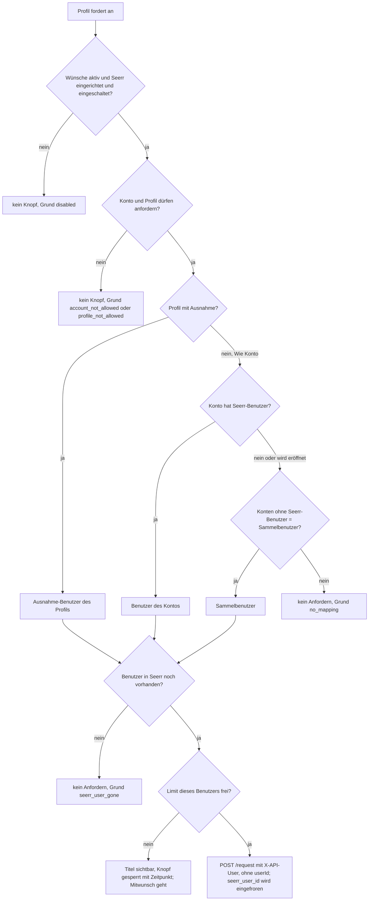
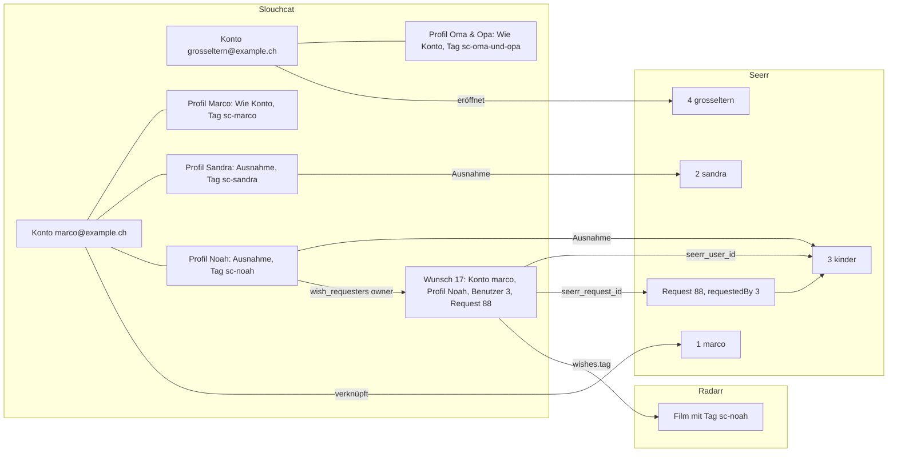

# Konzept 25 · Seerr-Benutzer, Profile und Limit

> **Kurz gesagt.** Jedes Konto hat in Seerr einen eigenen Benutzer mit demselben Login. Slouchcat
> eröffnet ihn, sobald jemand eine Einladung annimmt, und verknüpft einen Benutzer, den es in Seerr mit
> derselben E-Mail schon gibt (Marco, 17. November 2026, E-1 und E-4). Das gilt sofort, auch wenn das Konto
> die Adresse beim Annehmen einer Einladung selbst eingetippt hat (Marco, E-8); das ist eine bekannte Grenze
> (Abschnitt 12.5). Profile bekommen in Seerr kein
> Login. Slouchcat merkt sich je Wunsch das Profil und hängt einen **Profil-Tag** wie `sc-noah` an den Film in
> Radarr oder die Serie in Sonarr, damit man auch dort sieht, wer was gewünscht hat (Marco, E-2). Über denselben
> Zugang liest Slouchcat den Download-Fortschritt; die Webhooks von Radarr und Sonarr bleiben wie heute
> (Marco, E-6, E-7). Je Konto gilt
> ein **Limit** für Filme und Staffeln, rollierend, für alle Profile gemeinsam; Slouchcat stellt es ein,
> Seerr zählt, auch was direkt dort gewünscht wird (Marco, E-3). Gesendet wird mit `X-API-User`, damit
> Rechte, Limit und Auto-Freigabe des Benutzers gelten (F-3). Ein Profil, das als anderer Seerr-Benutzer
> sendet, bleibt nur als zugeklappte Ausnahme (Empfehlung, F-27).

Grundlage sind [Anhang F](anhang/F-entscheid-blatt.md) (Abschnitte 2.3 bis 2.6, 5, 11) und
[Anhang H](anhang/H-nachtrag-17-november.md) (Marcos drei Runden, Regeln N-1 bis N-41, N-80, N-81 und N-90 bis N-95,
neue Fakten). Belege zu
Seerr stammen aus dem Quellcode von Seerr 3.5.2 und Jellyseerr 2.7.3 ([Anhang D](anhang/D-jellyseerr-api.md)
und Anhang H 3, Pfade mit `GH:`), Belege zu Slouchcat aus dem Anker `ba6efe31`. Abläufe aus Sicht des
Zuschauers stehen in `02-funktionskonzept.md`, die Verwaltungsseiten in `07-administration.md`, die
Benachrichtigungen in `06-benachrichtigungen.md`, Tabellen und Operationen in `08-datenmodell-api.md`.

**Kennzeichnung.** «Marco (E-1)» bis «Marco (E-11)» und «Marcos Nachricht» stehen für das, was Marco am
17. November 2026 in zwei Nachrichten geschrieben und auf elf Rückfragen geantwortet hat (Anhang H,
Abschnitte 1, 2, 8.1, 8.2 und 10.1). Alles andere ist **Empfehlung** der Redaktion und steht mit den Fragen F-1 bis
F-34 zur Freigabe. Abschnitte mit
**Vorschlag** gehen über Anhang F und Anhang H hinaus.

**Aufbau.** Die Abschnitte 1 bis 11 behalten ihre Nummern aus Fassung 2, damit Verweise aus den anderen Papieren
gültig bleiben; ihr Inhalt ist für Fassung 3 nachgeführt. Neu sind die Abschnitte 12 bis 18: Eröffnen, Passwort,
Rechte, Konto löschen, Profil-Tag, Limit und die Ausnahme je Profil.

## 1. Die Fragen je Wunsch und wo die Antwort steht

| Frage | Antwort | Gespeichert in | Wann festgelegt |
|---|---|---|---|
| Welcher Slouchcat-Benutzer? | das **Konto** der Sitzung | `wish_requesters.account_id` | beim Anfordern, aus der Sitzung (`model.Session`) |
| Welches Profil? | das **aktive Profil** der Sitzung | `wish_requesters.profile_id`, `role` = `owner` (Anforderer) oder `joined` (Mitwunsch) | beim Anfordern bzw. beim Mitwunsch |
| Welcher Seerr-Benutzer? | der Benutzer des **Kontos**; nur bei einer Ausnahme der des Profils (Abschnitt 18) | `wishes.seerr_user_id`; die Verknüpfung selbst in `wish_account_map`, Ausnahmen in `wish_profile_map` | beim Anfordern, danach **eingefroren** (Abschnitt 8) |
| Wo sieht man das Profil ausserhalb von Slouchcat? | am **Profil-Tag** am Film in Radarr oder an der Serie in Sonarr (Abschnitt 16) | Zustand des Tags je Wunsch und Profil | sobald der Wunsch «In Beschaffung» ist |
| Welches Limit gilt? | das Limit des Kontos, gezählt von Seerr am Benutzer des Kontos (Abschnitt 17) | Einstellung am Konto; Stand aus `GET /user/{id}/quota` | beim Eröffnen und nach jeder Änderung in Slouchcat in den Seerr-Benutzer geschrieben |
| Wer wird benachrichtigt? | das anfordernde Profil und alle Mitwünscher, je erst wenn der Titel für **dieses** Profil sichtbar ist; extern die Kanäle ihrer Konten | `wish_requesters` (Empfänger), `account_channels` (Kanäle) | beim Ereignis, je Profil neu geprüft |

Dazu speichert Slouchcat je Wunsch die Kennungen in Seerr: `seerr_media_id` und die Request-ID, bei
Filmen am Wunsch (`wishes.seerr_request_id`), bei Serien je Staffel (`wish_seasons.seerr_request_id`), weil
ein Serienwunsch in Seerr auf mehrere Requests verteilt sein kann (`03-architektur.md`, Abschnitt 6.2).
Die Benutzerliste von Seerr liegt als Abbild in `seerr_users` (`seerr_id`, `display_name`, `email`,
`user_type`, `permissions`, Limit-Felder, `created_at`, `fetched_at`, `gone_at`); der Job `seerr.users` lädt
sie alle 24 Stunden und auf Knopfdruck neu und prüft dabei den Fingerabdruck der Instanz (Abschnitt 8.4).

## 2. Technische Prüfung: was Seerr kann und was nicht

### 2.1 Feststellungen

| Feststellung | Folge für Slouchcat | Beleg |
|---|---|---|
| Seerr kennt keine Profile. Ein Benutzer ist eine Person mit E-Mail, Rechten und Limit. | Das Profil eines Wunsches kennt nur Slouchcat; nach aussen zeigt es der Profil-Tag in Radarr und Sonarr. | `GH:server/entity/User.ts` Z. 56–161 |
| Kein Feld für eine fremde Kennung, weder am Benutzer noch am Request. `tags` sind Radarr/Sonarr-Tag-IDs, `UserSettings` hält nur Sprache, Regionen, Benachrichtigungskennungen. | Slouchcat führt eine eigene Verknüpfungstabelle. Ein Notizfeld zweckfremd zu nutzen (etwa `telegramChatId`) ist verworfen. | Anhang D 7.4; `GH:server/entity/UserSettings.ts` Z. 37–146; `MediaRequest.ts` Z. 518–618 |
| `profileId` im Request-Body ist das **Qualitätsprofil** von Radarr/Sonarr, kein Wiedergabeprofil. | Slouchcat schickt `profileId` nie mit (keine Qualitätsprofile, Anhang F 2.1). | `GH:server/interfaces/api/requestInterfaces.ts` Z. 16–30 |
| Es gibt genau **einen** API-Schlüssel je Instanz (`settings.main.apiKey`), keinen je Benutzer. | Slouchcat speichert einen Schlüssel; wer gerade handelt, sagt ein Header. | `GH:server/middleware/auth.ts` Z. 9–34 |
| Ohne `X-API-User` handelt jeder Aufruf als **Benutzer 1** (Eigentümer mit `ADMIN`). Mit `X-API-User: <id>` handelt er vollständig als dieser Benutzer. Eine unbekannte ID ergibt 403. | Slouchcat setzt den Header bei jedem Aufruf im Namen eines Benutzers. Verwaltungsaufrufe (Benutzer anlegen, Passwort, Rechte, Limit) laufen ohne Header als Benutzer 1. | ebenda, Z. 43–56 |
| `X-API-User` steht nicht in der OpenAPI-Datei und nicht in den Docs, aber unverändert im Code von 2.7.3 und 3.5.2 (`auth.ts` byte-gleich). | Der Verbindungstest prüft es bei jeder Einrichtung (Abschnitt 2.3). | Anhang D 1 und 2.1 |
| `POST /user {email, username, password}` legt einen lokalen Benutzer an. Mit `password` braucht Seerr kein SMTP. `permissions` im Body wird ignoriert; es gelten die Standardrechte. Gleiche E-Mail ergibt 409. Neue Benutzer sind immer `LOCAL`. | Slouchcat kann für jedes Konto einen Benutzer eröffnen und setzt die Rechte mit einem zweiten Aufruf (Abschnitt 12). | Anhang D 7.2; Anhang H 3.1 |
| `POST /user/{id}/settings/password {newPassword}`, mindestens 8 Zeichen. Wer `MANAGE_USERS` hat, setzt das Passwort eines **anderen** Benutzers ohne das alte. Das Passwort von Benutzer 1 ändert nur Benutzer 1 selbst, das eines Administrators nur er selbst oder Benutzer 1. | Slouchcat kann das Passwort jedes Benutzers setzen, **ausser das von Benutzer 1** (Abschnitt 13). Slouchcat verlangt 10 Zeichen, jedes Slouchcat-Passwort passt also. | `GH:server/routes/user/usersettings.ts` Z. 222–261; `server/internal/auth/auth.go:40`; Anhang H 3.1 |
| `POST /user/{id}/settings/main` schreibt `username`, `email`, Sprache, Regionen und die vier Limit-Felder **immer alle** aus dem Body; was fehlt, wird geleert. Die Limit-Felder nimmt Seerr nur an, wenn der Zielbenutzer **nicht** `MANAGE_USERS` hat. | Slouchcat liest vorher `GET /user/{id}/settings/main` und schickt die übrigen Felder unverändert zurück. Administratoren bekommen kein Limit (Abschnitt 17). | `usersettings.ts` Z. 77–150; Anhang H 3.1 |
| Doppelte Wünsche sind **global** gesperrt: Ein zweiter Benutzer bekommt für denselben Film 409; Staffeln, die schon angefragt sind, filtert Seerr still heraus. | Ein zweites Profil wird in Slouchcat Mitwünscher, ohne Aufruf (Anhang F 2.11). Ein Mitwunsch kostet kein Limit. | `MediaRequest.ts` Z. 218–246, 396–439 |
| Löscht man einen Benutzer, löscht Seerr seine Requests mit (`onDelete: 'CASCADE'`). | Slouchcat löscht in Seerr nie Benutzer, auch nicht beim Löschen eines Kontos (Abschnitt 15). | `MediaRequest.ts` Z. 532–537; `GH:server/routes/user/index.ts` Z. 619–680 |
| `tags` im Request übernimmt Seerr nur, wenn der anfordernde Benutzer `MANAGE_REQUESTS` oder `REQUEST_ADVANCED` hat, und sie **ersetzen** dann die Standard-Tags des Servers. Eine Route, um Tags anzulegen, gibt es nicht. | Den Profil-Tag setzt Slouchcat direkt in Radarr und Sonarr (Abschnitt 16). | `MediaRequest.ts` Z. 265–294; `GH:server/subscriber/MediaRequestSubscriber.ts` Z. 299–302, 706–707; `GH:server/routes/service.ts` Z. 32–162; Anhang H 3.5 |
| Der Webhook liefert keine Seerr-Benutzer-ID des Anfragenden, nur Name, E-Mail, Avatar. | Slouchcat ordnet Wünsche über die Request-ID zu, nie über den Webhook. | Anhang D 9.2 |

Alles aus Anhang H 3 ist im Quellcode nachgelesen, aber **nicht gegen eine laufende Instanz geprüft**. Das
holt der Bau in Stufe 1 nach.

### 2.2 `X-API-User` gegen `userId`: wessen Regeln gelten

Seerr prüft einen Teil der Regeln am **Zielbenutzer** (`requestUser`), einen Teil am **Aufrufer**
(`user`, also dem, als den der Schlüssel gerade handelt). Tabelle aus Anhang D 3.3,
`GH:server/entity/MediaRequest.ts`:

| Prüfung | gilt für | Stelle |
|---|---|---|
| Darf Filme/Serien anfragen (`REQUEST`, `REQUEST_MOVIE`, `REQUEST_TV`, 4K-Varianten) | Zielbenutzer | Z. 107–139 |
| Limit (Quota) | Zielbenutzer | Z. 141–167, 440–446 |
| Limit umgehen (`ignoreQuota`) | nur wenn der Aufrufer `MANAGE_REQUESTS` hat | Z. 143–155 |
| Auto-Freigabe (Status `APPROVED` statt `PENDING`) | **Aufrufer** | Z. 340–353, 455–468, 493–506 |
| `modifiedBy` | Aufrufer, wenn automatisch freigegeben | Z. 354–367 |
| Server, Qualitätsprofil, Zielordner, Tags übernehmen | nur wenn der Aufrufer `MANAGE_REQUESTS` oder `REQUEST_ADVANCED` hat | Z. 265–294 |
| Override-Regeln | Zielbenutzer | Z. 296–303 |

| Weg | Aufrufer | Zielbenutzer | Ergebnis |
|---|---|---|---|
| **`X-API-User: <id>`, ohne `userId`** (empfohlen, F-3) | der Benutzer des Kontos | derselbe | genau wie ein Klick des Benutzers in Seerr: seine Rechte, sein Limit, seine Auto-Freigabe |
| Schlüssel ohne Header, mit `userId` im Body | Benutzer 1 (`ADMIN`) | der Benutzer des Kontos | Recht und Limit des Zielbenutzers, aber **jeder Wunsch sofort freigegeben**, weil die Auto-Freigabe am Aufrufer hängt. Die Freigabe-Schleife in Seerr fiele weg. |

Darum sendet Slouchcat jeden Wunsch mit `X-API-User` und ohne `userId` (Anhang F 2.3). Auch das Zurückziehen
(`DELETE /request/{id}`) läuft mit `X-API-User`. Als Benutzer 1 laufen nur Verwaltungsaufrufe: Abgleich
(`GET /request`), Übernahme (`GET /request?requestedBy=<id>`, braucht `MANAGE_REQUESTS`, Anhang D 6.1),
Benutzerliste (`GET /user`), Limit lesen (`GET /user/{id}/quota`), Benutzer eröffnen und pflegen (`POST /user`,
`/settings/password`, `/settings/permissions`, `/settings/main`, Anhang H 3.1), Zugang zu Radarr und Sonarr lesen
(`GET /settings/radarr`, `/settings/sonarr`) und ab Stufe 4 Wiederholen (`POST /request/{id}/retry`).
**Freigeben und Ablehnen** (Stufe 4, F-16) laufen mit `X-API-User` des Seerr-Benutzers des handelnden
Administratorkontos, wenn er `MANAGE_REQUESTS` oder `ADMIN` hat; sonst ohne Header als Benutzer 1. So führt
Seerr `modifiedBy` richtig (`08-datenmodell-api.md`, Abschnitt 4.5).

### 2.3 Prüfung von `X-API-User` im Verbindungstest

Der Test ruft `GET /api/v1/auth/me` zweimal: ohne Header (Antwort muss Benutzer 1 sein, sonst ist der
Schlüssel falsch) und mit `X-API-User` eines anderen Benutzers aus `GET /user` (Antwort muss dessen ID
tragen). Stimmt die zweite Antwort nicht, zeigt die Prüfliste «Handeln im Namen von Benutzern: wirkt
nicht», und «Wünsche aktiv» lässt sich nicht einschalten (**Vorschlag**, Teilfrage T-1 in
`11-entscheide-und-adr.md`; Anhang F verlangt nur, dass der Test es meldet). Gibt es in Seerr nur Benutzer 1, steht
dort «nicht prüfbar, es gibt nur einen Benutzer» (**Vorschlag**). Weitere Prüfungen für Fassung 3: «Lokale
Anmeldung» (Abschnitt 12.4), Verbindung über `http://` ausserhalb des eigenen Netzes (Abschnitt 13.5), Zugang zu
Radarr und Sonarr und «Tag Requests» (Abschnitt 16). Einzelheiten der Prüfliste: `07-administration.md`,
Abschnitt 4.

## 3. Drei Varianten

- **A, ein Seerr-Benutzer je Konto.** Alle Profile eines Kontos senden als derselbe Benutzer.
- **B, ein Seerr-Benutzer je Profil.** Jedes Profil hat seinen eigenen Benutzer.
- **C, gemischt.** Jedes Konto hat einen Benutzer als Standard; einzelne Profile können einen eigenen
  bekommen («Eigener Benutzer» statt «Wie Konto»).

## 4. Bewertung und Ergebnis

Die Bewertung aus Fassung 2 bleibt als Analyse stehen:

| Gesichtspunkt | A je Konto | B je Profil | C gemischt |
|---|---|---|---|
| Technische Machbarkeit | einfach: ein Benutzer je Konto, `X-API-User` je Konto | machbar, aber je Profil ein Benutzer in Seerr nötig | einfach; zwei kleine Tabellen, Auflösung in einer Regel |
| Sicherheit (wer bekommt was ohne Freigabe) | schwach bei Familien: das Kinderprofil erbt die Auto-Freigabe der Eltern | stark: jedes Profil hat eigene Rechte | stark, wo nötig: das Kinderprofil bekommt einen eigenen Benutzer ohne Auto-Freigabe |
| Administrationsaufwand | gering: ein Benutzer je Konto, den Slouchcat selbst eröffnet | hoch: je Profil ein Benutzer anlegen, pflegen, Rechte setzen | gering im Normalfall, mehr nur für die Profile, die es brauchen |
| Benutzerfreundlichkeit | passt für Gäste und Paare; mit dem Profil-Tag sieht man das Profil auch in Radarr und Sonarr | Anfragen in Seerr sind pro Profil lesbar | passt für alle; Seerr zeigt Personen, nicht Profile, wo es egal ist |
| Duplikate (in Seerr global gesperrt) | Wunsch hängt in Seerr am Konto; Profile über Mitwunsch | Wunsch hängt am ersten Profil; ein zweites Profil kann in Seerr nicht nachziehen | wie A; der Mitwunsch läuft in Slouchcat |
| Löschen (Seerr löscht Requests mit dem Benutzer) | selten: Konten werden selten gelöscht | häufig: jedes gelöschte Profil müsste seinen Benutzer und damit seine Requests mitnehmen | wie A; ein Profilbenutzer wird nie automatisch gelöscht |
| E-Mail-Adressen | die Adresse des Kontos passt | je Profil eine eindeutige Adresse nötig (`POST /user` meldet sonst 409) → **künstliche Adressen** wie `noah+profil@example.ch` | nur für Ausnahme-Benutzer, und diese legt der Administrator in Seerr an |
| Limit | gilt für den ganzen Haushalt eines Kontos | je Profil | je Konto, ausser für Profile mit eigenem Benutzer |

**Ergebnis für Fassung 3.** Marcos Nachricht und seine Antworten E-1 und E-4 legen den Normalfall fest: Das
Konto bekommt einen Seerr-Benutzer mit gleichem Login, Profile «benötigen kein Login sondern lediglich
eine Tag oder ähnlich». Das ist Variante A, ergänzt um den Profil-Tag (E-2) und das Limit je Konto (E-3). Variante B ist
damit verworfen. F-2 ist **in der Sache durch Marcos Rückmeldung entschieden**: Benutzer je Konto, Profile mit
Tag. Offen bleibt nur, ob die Ausnahme je Profil aus Variante C bleibt (F-27).

Die Schwäche von A bleibt: Ein Kinderprofil sendet als Benutzer des Kontos und erbt dessen Auto-Freigabe und
dessen Limit. Im Konto des Administrators heisst das: ohne Freigabe und ohne Limit, weil Seerr Benutzer
mit `MANAGE_USERS` vom Limit ausnimmt (Anhang H 3.2). **Empfehlung:** Die Zuordnung «Profil sendet als anderer
Seerr-Benutzer» aus Fassung 2 bleibt darum als zugeklappte Ausnahme (Abschnitt 18, N-41, F-27). Anhang D 12
beschreibt unter «Hybrid» übrigens genau den neuen Normalfall: Seerr kennt nur Konten, Slouchcat merkt sich
das Profil.

## 5. Was Slouchcat speichert

Die Spalten legt `08-datenmodell-api.md` fest. Inhaltlich braucht es:

| Ort | Inhalt | Regel |
|---|---|---|
| `seerr_users` | Abbild der Seerr-Benutzer, mit `created_at` für den Fingerabdruck (Abschnitt 8.4) | `gone_at` gesetzt, wenn der Benutzer beim letzten Laden fehlte |
| `wish_account_map` | `account_id` PK (CASCADE), `seerr_user_id` UNIQUE, `set_at`, `set_by`; neu der Zustand (eröffnet, verknüpft, von Hand, wartet) und der Stand des Passworts mit Zeitpunkt; `set_at` trägt auch den Hinweis «Neu verknüpft» (Abschnitt 12.5) | ein Benutzer je Konto, ein Konto je Benutzer |
| `wish_profile_map` | `profile_id` PK (CASCADE), `seerr_user_id`, `set_at` | nur Ausnahmen; fehlt die Zeile, gilt «Wie Konto» |
| Konto | Limit: «Standard», «Eigenes» mit Anzahl und Tagen je Art, «Unbegrenzt» | Vorgabe in den Einstellungen der Wünsche |
| Profil | überschriebener Name des Profil-Tags | leer heisst Präfix plus Profilname |
| je Wunsch und Profil | Zustand des Profil-Tags (gesetzt, noch nicht gesetzt) | nie entfernt |
| `wishes.seerr_user_id` | der Benutzer, als der gesendet wurde | eingefroren |
| `wish_requesters` | (`wish_id`, `profile_id`) PK, `account_id`, `role`, `created_at`, `notified_at` | Empfänger der Meldungen; `notified_at` verhindert eine zweite Meldung «verfügbar» |

Das Passwort speichert Slouchcat nirgends im Klartext; der Vermerk «bei der nächsten Anmeldung übernehmen» ist
nur ein Zustand (N-3).

Die Regel «ein Seerr-Benutzer höchstens bei einem Konto» reicht über beide Tabellen: Ein Benutzer in
`wish_profile_map` darf in keinem anderen Konto vorkommen, weder als Benutzer des Kontos noch als Ausnahme. Die
UNIQUE-Bedingung deckt nur `wish_account_map`; den Rest prüft der Dienst in derselben Transaktion
(**Vorschlag**: Fehlercode `seerr_user_taken` mit dem Konto, dem der Benutzer gehört).

## 6. Regeln

1. **Benutzer des Kontos.** Jedes Konto hat höchstens einen Seerr-Benutzer. Slouchcat eröffnet ihn selbst
   (Abschnitt 12). Er gilt für alle Profile des Kontos, die «Wie Konto» stehen.
2. **Profile.** Profile haben kein Login und keinen eigenen Benutzer; sie tragen einen Profil-Tag
   (Abschnitt 16). Ein Profil kann als zugeklappte Ausnahme als anderer Benutzer senden (Abschnitt 18).
3. **Höchstens ein Konto.** Ein Seerr-Benutzer gehört höchstens zu einem Konto. In der Auswahl stehen nur
   Benutzer, die zu keinem Konto gehören.
4. **Verknüpfen über gleiche E-Mail.** Stimmt die E-Mail eines Kontos (ohne Gross/Klein) mit der eines freien
   Benutzers überein, verknüpft Slouchcat ihn sofort (Abschnitt 7, Marco E-4), auch wenn das Konto die Adresse
   selbst eingetippt hat (Einladung angenommen, eigene E-Mail geändert; Marco E-8, Abschnitt 12.5). Profile
   haben keine E-Mail und werden nie verknüpft.
5. **Von Hand.** «Anderen Benutzer wählen» ersetzt den Benutzer eines Kontos. Die Änderung wirkt sofort und
   bestätigt sich mit einer Meldung. Betrifft sie offene Wünsche oder bestehende Anfragen, nennt die Meldung die
   Folgen: «2 offene Wünsche bleiben bei kinder.» bzw. ab Stufe 4 «3 Anfragen von grosseltern werden
   übernommen.» (Abschnitt 8).
6. **«Alle eröffnen».** Ein Knopf eröffnet alle Konten ohne Benutzer auf einmal: verknüpft, wo die E-Mail
   passt, und legt für die übrigen einen neuen an.
7. **Verknüpfung lösen.** Entfernt die Zeile. Die Wünsche bleiben in Seerr und in Slouchcat erhalten; das
   Konto kann danach nicht mehr anfordern.
8. **Sammelbenutzer (F-4, ab Werk aus).** Steht «Konten ohne Seerr-Benutzer» auf «Sammelbenutzer», gilt für Konten
   ohne Benutzer der gewählte Sammelbenutzer. **Vorschlag:** Er darf keinem Konto als Benutzer gehören; die
   Auswahl sperrt das gegenseitig. Mit der Eröffnung betrifft F-4 nur noch Konten, die nicht eröffnet sind
   (Schalter aus, Seerr nicht erreichbar).

### 6.1 Mit welchem Seerr-Benutzer wird gesendet?

### 6.2 Übersicht

## 7. Bestehende Konten und Seerr-Benutzer

Marco hat am 17. November 2026 entschieden (E-4): Gibt es in Seerr schon einen Benutzer mit derselben
E-Mail, verknüpft Slouchcat ihn, statt einen zweiten anzulegen. Für Konten ohne Treffer gibt es den Knopf «In
Seerr eröffnen». Die Wahl «Immer von Hand zuordnen» hat er nicht genommen. Mit E-8 gilt das auch für Adressen,
die das Konto selbst eintippt (Einladung angenommen; Abschnitt 12.5).

- **Vergleich** der E-Mail ohne Gross-/Kleinschreibung, nur mit Benutzern, die zu keinem Konto gehören (N-2).
  Die Seite zeigt vorher den Hinweis «In Seerr gibt es schon «gast»»; «In Seerr eröffnen» verknüpft
  dann diesen Benutzer.
- **Wann:** bei bestehenden Konten, wenn ein Administrator «In Seerr eröffnen» oder «Alle eröffnen» drückt
  (E-4); beim Annehmen einer Einladung sofort, auch mit einer selbst eingetippten Adresse (E-8). Ändert ein
  Konto ohne Benutzer seine E-Mail, gilt dasselbe wie bei der Einladung (Empfehlung N-95). Die Grenze dazu steht
  in Abschnitt 12.5.
- **Von Hand:** «Anderen Benutzer wählen» bleibt für alle Fälle, in denen die E-Mail nicht passt. Zur Wahl
  stehen Benutzer, die zu keinem Konto gehören.
- **Rechte** eines Benutzers, den es schon gab, fasst Slouchcat nicht an (N-9).
- **Limit:** Slouchcat überschreibt das Limit, das dort stand, mit dem Limit des Kontos, ausser der Benutzer
  hat `MANAGE_USERS` (N-37; Abschnitt 17).
- **Passwort:** beim Annehmen einer Einladung sofort, wie bei jedem anderen Benutzer (N-91, folgt aus E-1 und
  E-8); bei bestehenden Konten bei der nächsten Anmeldung (Empfehlung F-24). Ausgenommen sind Administratoren und
  Benutzer mit Anmeldung über Jellyfin, Emby oder Plex (N-6; Abschnitt 13).
- **Bestehende Anfragen:** Mit der Verknüpfung übernimmt der Job `wishes.import` ab Stufe 4 die Anfragen dieses
  Benutzers (F-21, Abschnitt 8.2). Ein von Slouchcat neu angelegter Benutzer hat keine.
- **«Verknüpfung lösen»** entfernt nur die Verknüpfung. Der Benutzer bleibt in Seerr; das Konto kann danach
  nicht mehr anfordern, bis es wieder einen Benutzer hat.

## 8. Schutz vor falscher Zuweisung (F-21)

### 8.1 Eingefrorene Zuordnung je Wunsch

`createWish` löst den Benutzer nach Abschnitt 6.1 auf und schreibt ihn in `wishes.seerr_user_id`. Danach
ändert ihn keine Änderung am Konto oder an einer Ausnahme mehr. Gründe: Der Request gehört in Seerr diesem
Benutzer, sein Limit ist belastet, und Umhängen ginge in Seerr nur für `PENDING` über `PUT /request/{id}`
mit `userId` (Anhang D 8). Slouchcat hängt nie um.

| Änderung | Wirkung |
|---|---|
| Konto oder Profil bekommt einen anderen Benutzer | gilt für neue Wünsche; offene Wünsche bleiben beim alten Benutzer. Die Meldung nach der Änderung nennt sie: «2 offene Wünsche bleiben bei kinder.» |
| Wunsch steht noch `queued` (nicht übermittelt) | **Vorschlag:** bleibt beim eingefrorenen Benutzer. Ist dieser beim Senden in Seerr verschwunden (403, `GET /auth/me` bestätigt den Schlüssel, `03-architektur.md`, Abschnitt 6.4), wird der Wunsch `failed` mit Grund «Seerr-Benutzer fehlt» (`seerr_user_gone`); «Erneut übermitteln» in der Verwaltung löst den Benutzer neu auf. |
| Verknüpfung gelöst | offene Wünsche laufen weiter und werden weiter abgeglichen; neue gehen nicht. |

### 8.2 Bestehende Anfragen übernehmen (Stufe 4)

Seerr enthält oft schon Anfragen, die Personen dort selbst gestellt haben. Mit F-21 übernimmt der eigene
Job `wishes.import` die Anfragen von Benutzern, die zu einem Konto gehören, als Wünsche mit `origin` =
`jellyseerr`. Der regelmässige Abgleich kann das nicht: Er bricht beim ersten `updatedAt` vor dem Zeiger ab und
sieht alte Anfragen eines neu verknüpften Benutzers nie (`03-architektur.md`, Abschnitt 7.3).

1. Gehört der Benutzer einem Konto, wird der Wunsch dem **Hauptprofil** dieses Kontos zugeordnet.
2. Ist der Benutzer genau einem Profil als Ausnahme zugeordnet, bekommt dieses Profil den Wunsch.
3. **Vorschlag:** Teilen sich mehrere Profile desselben Kontos den Ausnahme-Benutzer, gewinnt das Hauptprofil,
   wenn es dabei ist, sonst das älteste dieser Profile (wie `03-architektur.md`, Abschnitt 7.3). Dürfte das
   Zielprofil den Titel nach der Jugendschutzregel nicht sehen, geht der Wunsch an das Hauptprofil.
4. Der Wunsch trägt die Kennzeichnung «In Seerr angelegt» in «Meine Wünsche» und in der Verwaltung.
   Übernommene Wünsche bekommen keinen Profil-Tag, auch nicht, wenn sie hier einem Profil zugeordnet werden (N-27;
   Redaktionsentscheid, `mockup-abdeckung.md` Abschnitt 10.2, Nr. 10).
5. **Wann:** `wishes.import:<seerrUserId>` läuft, sobald ein bestehender Benutzer verknüpft, von Hand gewählt
   oder als Ausnahme gesetzt wird, und von Hand («Anfragen übernehmen» auf der Seite «Seerr-Benutzer»). Er
   liest `GET /request?requestedBy=<Benutzer>&take=50` seitenweise, ohne `X-API-User`, also als Benutzer 1 mit
   `MANAGE_REQUESTS` (Anhang D 6.1). Danach hält der regelmässige Abgleich die übernommenen Wünsche aktuell.
6. Die Meldung nach dem Ändern nennt die Zahl, die derselbe Aufruf mit `take=1` liefert (`pageInfo.results`):
   «3 Anfragen von grosseltern in Seerr werden übernommen (Profil Oma & Opa).»
7. Ein schon geführter «nicht zuordenbarer» Wunsch dieses Benutzers (Abschnitt 8.3) bekommt das Zielprofil als
   Besitzer; er wird nicht doppelt angelegt.
8. **Vorschlag:** Übernommen werden nur offene und in den letzten 30 Tagen verfügbar gewordene Anfragen, damit
   kein Konto mit alten Meldungen überschwemmt wird; für übernommene Anfragen, die schon verfügbar sind, kommt
   keine Benachrichtigung.

### 8.3 Nicht zuordenbare Anfragen

Anfragen von Seerr-Benutzern, die zu keinem Konto gehören (Beispiel «wohnzimmer-tv»), gehören keinem
Profil. **Vorschlag** (wie `03-architektur.md`, Abschnitt 7.3): Slouchcat führt sie als Wunsch mit `origin` =
`jellyseerr` und `seerr_user_id` = «wohnzimmer-tv», aber ohne Zeile in `wish_requesters`. Die Verwaltung zeigt
sie unter «Anfragen» mit dem Filter «Nicht zuordenbar» und auf der Seite «Seerr-Benutzer» im Band
«Seerr-Benutzer ohne Konto» als Zähler beim Benutzer. Zuschauer sehen sie nie, und sie lösen keine
Benachrichtigung aus. Fordert ein Profil denselben Titel an, wird es Mitwünscher dieses Wunsches; Seerr
wird nicht aufgerufen, weil es dort ohnehin 409 meldete (Anhang F 2.10, 2.11). Ein Request des Sammelbenutzers,
der in Seerr selbst entstand, gilt ebenfalls als nicht zuordenbar (**Vorschlag**), weil unklar ist, welches
Konto ihn stellte. Gehört der Benutzer später zu einem Konto, gilt Abschnitt 8.2.

### 8.4 Instanz wechselt

Alle Nummern aus Seerr (`seerr_id`, Request-ID, Media-ID) gelten nur in **einer** Instanz. Zeigt der
Administrator auf eine andere oder neu aufgesetzte Instanz, gehörte `X-API-User: 3` dort womöglich einer ganz
anderen Person. Das verletzt die Anforderung «nie falsch zuweisen». Darum:

- **Fingerabdruck (Vorschlag):** Beim ersten erfolgreichen Verbindungstest speichert Slouchcat einen
  Fingerabdruck der Instanz aus Angaben, die sich nicht ändern: E-Mail und Anlagedatum von Benutzer 1
  (`GET /auth/me` ohne Header) und das Anlagedatum jedes bekannten Benutzers (`seerr_users.created_at`). Neue
  Benutzer, auch von Slouchcat eröffnete, ändern ihn nicht. Welche Angaben wirklich unveränderlich sind, prüft der
  Bau gegen eine Instanz.
- **Abweichung:** Weicht er später ab (Test, `seerr.users`, Beginn jedes Jobs), hält Slouchcat Übermittlung,
  Abgleich, Eröffnung, Profil-Tags und das Lesen des Download-Fortschritts an. Die Verwaltung zeigt «Andere Seerr-Instanz erkannt» und verlangt,
  die Verknüpfungen zu **bestätigen** oder zu **löschen** (`07-administration.md`, Abschnitt 4.1). Bis dahin
  bleiben neue Wünsche `queued`; offene Wünsche laufen nicht weiter.
- **Bestätigen:** Der neue Fingerabdruck gilt, die Verknüpfungen bleiben, und ein Erstabgleich läuft.
  **Löschen:** Alle Verknüpfungen und Ausnahmen fallen weg, die Request-IDs offener Wünsche wandern in den
  Verlauf; die Wünsche bleiben `queued` und gehen neu an Seerr, sobald die Konten neu eröffnet sind.
- Technik: `03-architektur.md`, Abschnitt 7.4.

## 9. Wunschrecht

| Schalter | Wer setzt | Wo | Vorgabe | Rolle |
|---|---|---|---|---|
| `accounts.can_request` | Administrator | Konten, Formular «Zugriff» (bei Administratorkonten Block «Wünsche»); Dialog «Konto einladen» | Besitzerkonto an, neue Konten aus («Neue Konten dürfen anfordern», F-5) | Deckel für alle Profile des Kontos; steuert auch die Rechte eines eröffneten Benutzers in Seerr (Abschnitt 14) |
| `profiles.can_request` | Hauptprofil des Kontos | Profildialog (`/settings/profiles`, eigenes Konto «Meine Profile») | Hauptprofil an, weitere Profile aus | Feinwahl je Profil |

- Wirksam ist das Recht nur, wenn beide Schalter an sind, «Wünsche aktiv» an ist und ein Seerr-Benutzer
  nach Abschnitt 6.1 bestimmt werden kann.
- Ist das Konto aus, zeigt der Profildialog den Schalter gesperrt mit «Das Konto darf keine Titel anfordern.»
  (Muster «Das Konto begrenzt dieses Profil»). Kein Profil hebt so den Deckel seines Kontos an (ADR 0014,
  `docs/adr/0014-benutzerverwaltung.md:87`, «Niemand hebt seine eigenen Grenzen an»).
- Der Server liefert in der Sitzung `wishes {enabled, canRequest, reason}`; die App entscheidet nichts
  (Regel 12). **Vorschlag** für die Gründe: `disabled` (Wünsche aus, Seerr nicht eingerichtet
  oder ausgeschaltet), `account_not_allowed`, `profile_not_allowed`, `no_mapping` (kein Seerr-Benutzer),
  `seerr_user_gone`. Ist Seerr nur vorübergehend nicht erreichbar, lehnt es den Schlüssel ab oder wartet
  eine erkannte andere Instanz auf die Bestätigung, bleibt `canRequest` wahr; der Wunsch wartet als `queued`. Je
  fehlendem Titel kommen Medienart («Filme erlauben», «Serien erlauben»), Stelle, Altersstufe und der Stand des
  Limits dazu. Ein erreichtes Limit macht `canRequest` nicht falsch; es sperrt nur den Knopf im Dialog
  (Abschnitt 17.6).
- **Eine Regel für das Sehen (F-9):** Fehlende Titel sieht ein Profil nur, wenn es sie auch anfordern kann:
  Wünsche aktiv, Seerr eingerichtet und eingeschaltet, Konto und Profil haben das Recht, ein
  Seerr-Benutzer ist vorhanden (des Kontos, eine Ausnahme oder der Sammelbenutzer), die Art ist erlaubt, die
  Altersstufe passt. Sonst existieren sie für das Profil nicht (404), auch nicht mit einem Hinweis statt des
  Knopfs. Einzige Ausnahme: Titel, zu denen das Profil selbst einen Wunsch hat (jeder Zustand), bleiben auf der
  Vorschauseite und unter «Meine Wünsche» sichtbar (`02-funktionskonzept.md`, Abschnitt 3). Dieselbe Regel gilt
  für den Bereich «Wünsche» mit «Entdecken», «Filme», «Serien» und «Suche» (N-56).
- Ein Konto mit Recht, aber ohne Seerr-Benutzer bemerkt der Administrator in der Verwaltung: Übersicht
  «n Konten ohne Seerr-Benutzer», Seite «Seerr-Benutzer» und Chip «Kein Seerr-Benutzer» bzw.
  «Wird in Seerr eröffnet» auf «Konten» (`07-administration.md`). Der Zuschauer sieht keinen Hinweis.
- **Rückfüllung bestehender Daten (Vorschlag):** Besitzerkonto an, alle anderen Konten aus, alle
  Hauptprofile an, alle weiteren Profile aus. Ohne Seerr-Benutzer bleibt das Recht damit ohne Wirkung.
- **Administratorkonten:** Sie haben heute kein Formular «Zugriff» (dort steht nur der Hinweis «immer ab 18 und
  alle Bibliotheken»). Für Administratorkonten, auch das eigene, zeigt das Aufklappfeld der Seite Konten darum
  den Block «Wünsche» mit dem Schalter «Darf Titel anfordern» und der Zeile «Seerr-Benutzer»
  (Redaktionsentscheid vom 17. November 2026, Lücke in Anhang F). Die Ernennung zum Administrator ändert den
  Schalter nicht.
- Kinderprofile dürfen mit Recht anfordern; ob ein Wunsch eine Freigabe braucht, entscheidet die
  Auto-Freigabe ihres Seerr-Benutzers (F-6). Im Konto des Administrators braucht es dafür die Ausnahme
  (Abschnitt 18). Eine eigene Freigabe in Slouchcat gibt es nicht.

## 10. Sonderfälle

| Fall | Erkennung | Verhalten |
|---|---|---|
| Benutzer in Seerr gelöscht | `seerr.users` findet ihn nicht mehr → `gone_at` | Verknüpfung bleibt, Warnung «Benutzer in Seerr gelöscht» auf «Seerr-Benutzer» und in der Übersicht; Grund `seerr_user_gone`, kein Anfordern. Seine Requests hat Seerr mitgelöscht. Offene Wünsche, deren Request beim Abgleich 404 meldet, werden `failed` mit Grund «In Seerr gelöscht» (`seerr_request_gone`); der Wunsch ist geschlossen. **Vorschlag:** «Verknüpfung lösen» und danach «In Seerr eröffnen» legt einen neuen Benutzer an. |
| Benutzer darf in Seerr keine Serien (oder keine Filme) anfordern | Bits in `seerr_users.permissions` (`REQUEST` 32, `REQUEST_MOVIE` 262144, `REQUEST_TV` 524288; `ADMIN` 2 erlaubt alles) | Warnung «darf keine Serien anfordern» auf «Seerr-Benutzer». Sendet Slouchcat trotzdem, antwortet Seerr 403 «You do not have permission to make series requests.» → `failed` mit Klartext. **Vorschlag:** Zeigt das Abbild klar kein Recht für diese Medienart, fehlt der Knopf schon vorher. |
| Limit erreicht | Stand aus `GET /user/{id}/quota` (Abschnitt 17.5) | Titel bleibt sichtbar, Knopf im Dialog gesperrt mit Zeitpunkt; Mitwunsch geht. Lehnt Seerr trotzdem mit 403 `Movie Quota exceeded.` / `Series Quota exceeded.` ab: `failed` mit Grund `quota`, Klartext «Limit erreicht: Seerr hat den Wunsch nicht angenommen.» (für Filme und Staffeln derselbe Satz). Das Limit gilt für alle Profile des Kontos. |
| Konto wird eröffnet, Seerr nicht erreichbar | Job `seerr.provision` scheitert | Zustand «Wird eröffnet, sobald Seerr erreichbar ist»; Grund `no_mapping` bis zur Eröffnung; nach 24 h Fehlerereignis `errors` an die Administratoren (Abschnitt 12.2) |
| Konto tippt eine Adresse ein, die Seerr schon kennt | Treffer in Schritt 1 oder 409 in Schritt 2 eines Jobs, den die Einladung oder eine E-Mail-Änderung des Kontos ausgelöst hat | Slouchcat verknüpft sofort (Marco, E-8) und setzt das Passwort, ausser bei Administratoren und Anmeldung über Jellyfin, Emby oder Plex (N-91). Übersicht sieben Tage mit «Neu verknüpft» (Empfehlung N-93). Das Konto bekommt dieselbe Meldung wie bei einem neuen Benutzer (N-94). Bekannte Grenze: Abschnitt 12.5. |
| Passwort in Seerr direkt geändert | nicht erkennbar | zwei verschiedene Passwörter, bis der Administrator «Passwort bei der nächsten Anmeldung neu übernehmen» wählt (Abschnitt 13.5) |
| Profil-Tag nicht gesetzt | Radarr oder Sonarr nicht erreichbar oder lehnt ab | Wunsch unverändert; «Tag noch nicht gesetzt» in der Verwaltung; nächster Abgleich holt es nach (Abschnitt 16.5) |
| Profil gelöscht | `wish_profile_map` fällt mit CASCADE | Seine Wünsche gehen an das Hauptprofil des Kontos (Verlauf «von gelöschtem Profil übernommen»); das Löschen in `auth` ruft dafür vorher `wishes` auf. Mitwünsche des Profils fallen weg. In Seerr ändert sich nichts; der Profil-Tag bleibt in Radarr und Sonarr. |
| Konto gelöscht | `wish_account_map` und `wish_profile_map` fallen mit CASCADE | Der Seerr-Benutzer bleibt. Hat Slouchcat ihn eröffnet, verliert er die Rechte und bekommt ein Zufallspasswort; verknüpfte und von Hand gewählte Benutzer bleiben unverändert (Abschnitt 15). Wünsche mit Mitwünschern anderer Konten gehen an den ältesten dieser Mitwünscher. Die übrigen Wünsche des Kontos werden geschlossen: Offene bekommen `failed` mit Grund `account_deleted`, alle `closed_at`; ihre Request-IDs wandern in den Verlauf, damit sie den Titel nicht mehr sperren. In Seerr bleiben die Requests und erscheinen ab Stufe 4 als «nicht zuordenbar». Der Bestätigungstext «Konto entfernen» sagt: «Der Benutzer und seine Wünsche bleiben in Seerr bestehen.» |
| Profilwechsel während offener Wünsche | – | Ein Wunsch gehört dem Profil, das ihn stellte. Nach dem Wechsel sieht das neue Profil nur seine eigenen Wünsche; das Hauptprofil sieht alle Wünsche des Kontos (`listAccountWishes`, `scoped` mit Hauptprofil), weil es das Konto verwaltet. Nichts wird umgehängt. |
| Ausnahme eines Profils gesetzt oder entfernt | – | gilt ab dem nächsten Wunsch (Abschnitt 8.1). |
| Konto ohne Seerr-Benutzer | keine Zeile in `wish_account_map`, Profil «Wie Konto», kein Sammelbenutzer | Grund `no_mapping`; die Profile sehen keine fehlenden Titel (Abschnitt 9). Der Administrator sieht den Chip auf «Konten», den Eintrag auf «Seerr-Benutzer» und in der Übersicht «n Konten ohne Seerr-Benutzer». |
| Andere Seerr-Instanz | Fingerabdruck weicht ab | Übermittlung, Abgleich, Eröffnung und Profil-Tags halten an, bis der Administrator die Verknüpfungen bestätigt oder löscht (Abschnitt 8.4). |
| Sammelbenutzer (F-4) | «Konten ohne Seerr-Benutzer» = «Sammelbenutzer» | Alle betroffenen Konten teilen Limit und Auto-Freigabe dieses Benutzers; in Seerr erscheinen ihre Anfragen unter einem Namen. Darum ab Werk aus. |
| Seerr-Benutzer ist Benutzer 1 (Eigentümer) | `seerr_id` = 1 | erlaubt (Beispiel: Konto marco). `X-API-User: 1` entspricht dem Aufruf ohne Header. Kein Passwortabgleich, kein Limit. |
| Zwei Konten mit derselben E-Mail wie ein Benutzer | geht nicht: `accounts.email` ist eindeutig | – |

## 11. Beispiel aus den Mockup-Daten

Seerr-Benutzer: 1 marco (Administrator, Auto-Freigabe), 2 sandra (Auto-Freigabe), 3 kinder (keine
Auto-Freigabe, eigenes Limit 5 Filme und 2 Staffeln je 7 Tage, in Seerr eingestellt), 4 grosseltern (von
Slouchcat eröffnet, keine Auto-Freigabe), 5 wohnzimmer-tv (Anmeldung über Jellyfin, gehört zu keinem Konto, hat
eigene Anfragen), 6 gast (lokal, gleiche E-Mail wie das Konto `gast@example.ch`).

| Konto | Seerr-Benutzer | Passwort | Limit |
|---|---|---|---|
| `marco@example.ch` (Besitzer, Administrator) | «Verknüpft über gleiche E-Mail» → 1 marco | «Bleibt in Seerr (Administrator)» | keines (Administrator) |
| `grosseltern@example.ch` | «Von Slouchcat eröffnet» → 4 grosseltern | «Gleich wie in Slouchcat» | Standard: 10 Filme und 5 Staffeln je 7 Tage. Zwei Filme («Der Pate», «Casablanca») und zwei Staffeln («Der Bergdoktor», Staffeln 17 und 18) wurden direkt in Seerr gewünscht und zählen mit: noch 8 Filme und 3 Staffeln frei |
| `gast@example.ch` | «Nicht eröffnet»; Hinweis «In Seerr gibt es schon «gast»». «In Seerr eröffnen» verknüpft 6 gast | folgt bei der nächsten Anmeldung | Standard, sobald verknüpft |
| offene Einladung «Für Tante Ruth» | wird beim Annehmen eröffnet (M-35); kennt Seerr die eingetippte Adresse schon, wird der bestehende Benutzer sofort verknüpft (Abschnitt 12.5) | gleich wie in Slouchcat, auch beim verknüpften Benutzer (ausser Administrator oder Anmeldung über Jellyfin, Emby oder Plex) | aus der Einladung |

| Konto | Profil (Alter) | Recht Konto / Profil | Gesendet als | Profil-Tag | Wirkung |
|---|---|---|---|---|---|
| `marco@example.ch` | Marco (Hauptprofil, 18) | an / an | Wie Konto → 1 marco | `sc-marco` | «Wird sofort beschafft», kein Limit |
| | Sandra (18, PIN) | an / an | Ausnahme → 2 sandra | `sc-sandra` | «Wird sofort beschafft»; externe Nachrichten ohne Titel (F-15) |
| | Noah (12) | an / an | Ausnahme → 3 kinder | `sc-noah` | «Braucht eine Freigabe»; Limit von kinder: 5 Filme und 2 Staffeln je 7 Tage |
| | Mia (6) | an / aus | – | `sc-mia` | darf nicht anfordern, sieht keine fehlenden Titel |
| `grosseltern@example.ch` | Oma & Opa (16, Hauptprofil) | an / an | Wie Konto → 4 grosseltern | `sc-oma-und-opa` | «Braucht eine Freigabe»; Limit des Kontos |
| `gast@example.ch` | Gast (16, Hauptprofil) | aus / an | – | `sc-gast` | sieht keine fehlenden Titel; nach der Verknüpfung bleiben die Rechte von «gast» in Seerr unverändert (Abschnitt 14) |
| – | – | – | 5 wohnzimmer-tv ohne Konto | – | seine Anfragen erscheinen als «nicht zuordenbar» |

Ohne die Ausnahme sendete Noah als «marco»: Sein Wunsch wäre sofort freigegeben und ohne Limit. Das ist der
Grund für die Empfehlung F-27. Wird Noahs Wunsch «In Beschaffung», hängt `wishes.tag` den Tag `sc-noah` an den
Film in Radarr; wünscht Marco denselben Film mit, kommt `sc-marco` dazu. Das Konto marco nutzt damit drei
Seerr-Benutzer (1, 2, 3). Das ist erlaubt: Die Regel «höchstens ein Konto» gilt je Seerr-Benutzer,
nicht je Konto.

## 12. Den Seerr-Benutzer eröffnen

**Eröffnen** heisst: Slouchcat sorgt dafür, dass ein Konto einen Benutzer in Seerr hat. Gibt es dort schon
einen mit derselben E-Mail, **verknüpft** Slouchcat ihn sofort, auch wenn das Konto die Adresse selbst
eingetippt hat (Marco, E-8; Grenze in Abschnitt 12.5). Sonst legt es einen neuen an.

### 12.1 Wann

| Auslöser | Was geschieht | Von |
|---|---|---|
| Jemand nimmt eine Einladung an (Seite M-35, Operation `acceptInvitation`) | Slouchcat eröffnet den Benutzer im selben Zug: gleiche E-Mail, gleiches Passwort, `username` = Teil der E-Mail vor dem @ (N-1). Die Seite sagt vorher «Dein Login gilt auch für Seerr». Kennt Seerr die Adresse schon, verknüpft Slouchcat den bestehenden Benutzer sofort und setzt ihm das Passwort (N-91, Abschnitt 12.5). | Marco (Nachricht, E-1, E-8) |
| Ein Konto ohne Seerr-Benutzer ändert seine E-Mail, und Seerr kennt die neue Adresse | sofort verknüpfen, wie bei der Einladung (Abschnitt 12.5) | Redaktion (N-95, folgt E-8) |
| Konto ohne Benutzer, Knopf «In Seerr eröffnen» (einzeln) oder «Alle eröffnen» auf der Seite «Seerr-Benutzer» (M-24) | wie oben, nur ohne Passwort zur Hand (Abschnitt 13.3) | Marco (E-4), Knöpfe nach N-2 |
| Seerr war beim ersten Versuch nicht erreichbar | Das Konto steht auf «Wird eröffnet, sobald Seerr erreichbar ist»; der nächste Abgleich versucht es wieder | Empfehlung (N-4) |

**Empfehlung (F-23):** Jedes Konto bekommt einen Benutzer, auch ein Konto ohne Wunschrecht; dieses bekommt in
Seerr keine Rechte (Abschnitt 14). Von selbst eröffnet aber nur das Annehmen einer Einladung. Das Einrichten
von Seerr eröffnet bestehende Konten **nicht** von selbst: Der Administrator eröffnet sie mit «Alle
eröffnen» oder einzeln, wie in E-4 beschrieben (Redaktionsentscheid, K-15). Der Schalter «Neue Konten in
Seerr eröffnen» unter Wünsche › Einstellungen ist ab Werk an, sobald Seerr eingerichtet ist (N-8). Ist
er aus, eröffnet der Administrator auch neue Konten von Hand.

### 12.2 Ablauf

Der Job `seerr.provision` (ausgelöst durch die Einladung, durch den Knopf oder durch den Abgleich) läuft in fünf
Schritten (Anhang H 4.1):

1. `GET /user?q=<E-Mail>`. Gibt es einen exakten Treffer (ohne Gross-/Kleinschreibung), verknüpft Slouchcat
   ihn sofort, gleich wer den Job ausgelöst hat (Abschnitt 7, Marco E-8). Hat das Konto den Job ausgelöst und ist
   das Passwort zur Hand (Einladung angenommen), setzt Slouchcat es mit `POST /user/{id}/settings/password`
   (N-91), ausser bei Administratoren und Anmeldung über Jellyfin, Emby oder Plex (Abschnitt 13.3). Sonst trägt
   das Konto den Vermerk «bei der nächsten Anmeldung übernehmen» (Abschnitt 13.2). Danach geht es bei Schritt 4
   weiter; die Rechte fasst Slouchcat nicht an (N-9).
2. Sonst `POST /user {email, username, password}`. Meldet Seerr 409 (E-Mail schon vergeben), behandelt
   Slouchcat das wie einen Treffer.
3. `POST /user/{id}/settings/permissions` setzt die Rechte (Abschnitt 14).
4. `GET` und danach `POST /user/{id}/settings/main` mit dem Limit des Kontos (Abschnitt 17), nur für Benutzer
   ohne `MANAGE_USERS`. Die übrigen Felder schickt Slouchcat unverändert zurück.
5. Slouchcat speichert am Konto den Zustand und den Stand des Passworts (Abschnitte 12.3 und 13.4).

Schlägt ein Schritt fehl, wiederholt die Queue den Job. Ist ein Konto nach 24 Stunden noch nicht eröffnet,
bekommen die Administratoren das bestehende Fehlerereignis `errors` (`06-benachrichtigungen.md`, Abschnitt 2;
Empfehlung).

### 12.3 Zustände am Konto

| Zustand (Anzeige) | Bedeutung |
|---|---|
| «Von Slouchcat eröffnet» | Slouchcat hat den Benutzer angelegt |
| «Verknüpft über gleiche E-Mail» | den Benutzer gab es schon; Slouchcat hat ihn verknüpft, auf Knopf des Administrators oder sofort beim Annehmen einer Einladung (E-4, E-8) |
| «Von Hand zugeordnet» | der Administrator hat mit «Anderen Benutzer wählen» einen Benutzer gewählt |
| «Wird eröffnet, sobald Seerr erreichbar ist» | der Job wartet auf Seerr |
| «Nicht eröffnet» | kein Benutzer; auf «Konten» trägt das Konto den Chip «Kein Seerr-Benutzer» |

Solange ein Konto keinen Benutzer hat (auch «wird eröffnet»), kann es nicht
anfordern (Grund `no_mapping`, Abschnitt 9), ausser der Sammelbenutzer greift (F-4). Sobald der Benutzer
besteht, geht das Anfordern. Das Passwort spielt dafür keine Rolle: Slouchcat sendet mit `X-API-User`, nicht mit
dem Login des Benutzers.

### 12.4 Voraussetzungen

- **Recht `MANAGE_USERS`:** Der Schlüssel handelt ohne Header als Benutzer 1 mit `ADMIN`, das genügt
  (Anhang D 7.2).
- **«Lokale Anmeldung» in Seerr** ist ab Werk an (`localLogin: true`) und steht in `GET /settings/public`.
  Ist sie aus, kann sich ein lokaler Benutzer nicht anmelden. Der Verbindungstest prüft sie und warnt (N-11;
  Anhang H 3.1).
- **Haushalte mit Anmeldung über Jellyfin, Emby oder Plex:** Ein neu angelegter Benutzer ist immer `LOCAL`.
  Hat die Person in Seerr schon einen Jellyfin- oder Plex-Benutzer mit derselben E-Mail, verknüpft
  Slouchcat diesen (Abschnitt 7). Mit einer anderen E-Mail entstünde ein zweiter Benutzer; dann wählt der
  Administrator den richtigen von Hand.

### 12.5 Bekannte Grenze: Verknüpfen ohne Prüfung der E-Mail

Marco hat am 17. November 2026 entschieden (E-8): Gibt es in Seerr schon einen Benutzer mit derselben E-Mail,
verknüpft Slouchcat ihn sofort, auch wenn das Konto die Adresse beim Annehmen einer Einladung selbst eingetippt
hat. Der frühere Redaktionsentscheid N-2a («Verknüpfung vorgeschlagen», Bestätigung durch einen Administrator)
ist damit zurückgezogen (Anhang H, Abschnitt 10, N-90).

- **Die Grenze:** Niemand prüft die eingetippte Adresse. Wer eine Einladung hat und eine fremde Adresse
  eintippt, bekommt den Seerr-Benutzer dieser Person samt ihren Anfragen. Marco kennt das Risiko und hat es so
  gewählt (E-8, N-92). Einladungen stellt nur ein Administrator aus.
- **Schutz für Administratoren:** Mit der Verknüpfung geht das Passwort an den bestehenden Benutzer, wie bei
  jedem anderen (N-91, Abschnitt 13.1). Ausgenommen bleiben Benutzer 1, andere Administratoren von Seerr und
  Benutzer mit Anmeldung über Jellyfin, Emby oder Plex (N-6, Abschnitt 13.3). Ein Administrator von Seerr
  lässt sich so nicht übernehmen.
- **Hinweis an die Administratoren (Empfehlung, N-93):** Die Übersicht der Verwaltung zeigt sieben Tage lang
  «Neu verknüpft: {{Konto}} mit dem bestehenden Seerr-Benutzer {{Name}}», mit Link auf «Seerr-Benutzer». Dort
  lässt sich die Verknüpfung lösen (Abschnitt 6, Regel 7). Das Protokoll hält jede Verknüpfung fest.
- **Was das Konto erfährt (Empfehlung, N-94):** Die Meldung nach dem Annehmen ist in beiden Fällen dieselbe:
  «In Seerr hast du jetzt ein Konto mit derselben E-Mail-Adresse.» Das Konto erfährt nicht, ob
  Seerr die Adresse schon kannte (`02-funktionskonzept.md`, Ablauf 4.9).
- **Eigene E-Mail geändert (Empfehlung, N-95):** Ändert ein Konto ohne Seerr-Benutzer seine E-Mail auf eine
  Adresse, die Seerr kennt, gilt dasselbe: sofort verknüpfen. Hat das Konto schon einen Seerr-Benutzer, ändert
  Slouchcat dessen E-Mail; lehnt Seerr ab, weil die Adresse vergeben ist, meldet Slouchcat das und lässt den
  Benutzer, wie er ist.

## 13. Passwort

Marco hat am 17. November 2026 entschieden (E-1), dass eingeladene Benutzer sich mit E-Mail und Passwort von
Slouchcat auch direkt bei Seerr anmelden können. Er kannte dabei die Folgen: Das Passwort geht einmal im
Klartext an Seerr, und wer es direkt in Seerr ändert, hat danach zwei verschiedene Passwörter. Wie
Slouchcat das umsetzt, ist Empfehlung (N-3 bis N-8, N-12).

### 13.1 Wann Slouchcat das Passwort weitergibt

Slouchcat speichert das Passwort **nie im Klartext** (N-3). Es gibt es nur in den drei Momenten weiter, in
denen der Server es ohnehin im Klartext sieht (Anhang H 3.6):

| Moment | Operation heute | Aufruf an Seerr |
|---|---|---|
| Einladung annehmen | `acceptInvitation` (`api/openapi.yaml:1168 ff.`, Seite `/invite/$token`) | `POST /user` mit `password` (Abschnitt 12.2); gibt es den Benutzer schon, verknüpft Slouchcat ihn und setzt das Passwort mit `POST /user/{id}/settings/password` (N-91, Abschnitt 12.5) |
| Passwort ändern oder zurücksetzen | `updateAccount` (eigenes Konto, `OwnAccountForm.tsx`) und das Zurücksetzen | sofort `POST /user/{id}/settings/password` (N-5) |
| Anmeldung | Anmeldung in Slouchcat | nur wenn das Konto den Vermerk «bei der nächsten Anmeldung übernehmen» trägt (Abschnitt 13.2) |

Ändert jemand in Slouchcat seine E-Mail, ändert Slouchcat sie auch in Seerr (über
`POST /user/{id}/settings/main`, Marco E-1, Ablauf Empfehlung). Lehnt Seerr ab, weil die Adresse vergeben ist,
meldet Slouchcat das und lässt den Benutzer, wie er ist. Hat das Konto noch keinen Benutzer und kennt Seerr die
neue Adresse, verknüpft Slouchcat sofort (N-95, Abschnitt 12.5).

### 13.2 «Bei der nächsten Anmeldung übernehmen»

Kann Slouchcat das Passwort nicht sofort weitergeben, bekommt der Benutzer in Seerr zuerst ein
**Zufallspasswort** und am Konto den Vermerk «bei der nächsten Anmeldung übernehmen» (N-4). Bei der nächsten
Anmeldung in Slouchcat setzt Slouchcat das Passwort in Seerr. Das gilt, wenn:

- Seerr beim Annehmen der Einladung oder beim Ändern des Passworts nicht erreichbar war,
- das Konto schon bestand, als es eröffnet wurde (Knopf «In Seerr eröffnen», «Alle eröffnen»),
- ein bestehender Benutzer auf Knopf des Administrators verknüpft oder von Hand zugeordnet wurde
  (Empfehlung F-24, Abschnitt 7). Beim Annehmen einer Einladung setzt Slouchcat das Passwort sofort (N-91).

### 13.3 Wer ausgenommen ist

Kein Abgleich gibt es bei (N-6):

- **Benutzer 1 und anderen Administratoren von Seerr.** Das Passwort von Benutzer 1 kann Slouchcat nicht
  setzen, weil der Schlüssel selbst als Benutzer 1 handelt und Seerr dafür das alte Passwort verlangt
  (Abschnitt 2.1). Das Passwort anderer Administratoren könnte Slouchcat als Benutzer 1 setzen; die Empfehlung
  lässt es trotzdem in Seerr, damit Slouchcat kein Administratorkonto von Seerr verändert. Die Seite
  zeigt «Bleibt in Seerr (Administrator)».
- **Benutzern, die sich über Jellyfin, Emby oder Plex anmelden.** Sie haben kein eigenes Passwort in
  Seerr. Die Seite zeigt «Anmeldung über Jellyfin oder Plex».

Der Schalter «Passwort abgleichen» unter Wünsche › Einstellungen ist ab Werk an (N-8). Ist er aus, gibt
Slouchcat kein Passwort weiter; neue Benutzer behalten ihr Zufallspasswort.

### 13.4 Stand des Passworts je Konto

| Anzeige | Bedeutung |
|---|---|
| «Gleich wie in Slouchcat» | zuletzt abgeglichen am … |
| «Wird bei der nächsten Anmeldung in Slouchcat übernommen» | Vermerk gesetzt (Abschnitt 13.2) |
| «Wird nicht abgeglichen» | Abgleich für dieses Konto oder überall aus |
| «Bleibt in Seerr (Administrator)» | ausgenommen (Abschnitt 13.3) |
| «Anmeldung über Jellyfin oder Plex» | ausgenommen (Abschnitt 13.3) |

### 13.5 Auseinanderlaufen und Schutz

- Ändert jemand das Passwort direkt in Seerr, bemerkt Slouchcat das nicht (N-7). Die Seite
  «Seerr-Benutzer» bietet je Konto «Passwort bei der nächsten Anmeldung neu übernehmen» und «Passwort nicht
  abgleichen».
- Das Passwort geht im Body an Seerr. Läuft die Verbindung über `http://` ausserhalb des eigenen Netzes,
  warnt der Verbindungstest (N-12).
- Body und Passwort stehen nie im Protokoll. Die neuen Schlüssel `password` und `newPassword` kommen in die
  Redaction-Liste und in den Test (`CLAUDE.md` Regel 10; N-12).
- Slouchcat verlangt 10 Zeichen, Seerr 8: Jedes Slouchcat-Passwort passt (Anhang H 3.1).

### 13.6 Bekannte Grenze: ein Login für alle Profile

Redaktionsentscheid nach der Kritik an Fassung 3 (Anhang H, Abschnitt 9, K-19):

- Alle Profile eines Kontos teilen den Seerr-Benutzer des Kontos. Wer sich mit dem Login des Kontos in
  Seerr anmeldet, sieht dort die Wünsche **aller** Profile des Kontos, auch die eines Profils mit PIN.
  Die PIN schützt nur Slouchcat, nicht Seerr.
- Seerr verschickt eigene E-Mails und andere Benachrichtigungen, die den Titel nennen. Damit umgehen sie
  die Regel für PIN-Profile (F-15, `06-benachrichtigungen.md`, Abschnitt 8).
- **Empfehlung:** In Seerr die eigenen Benachrichtigungen für die eröffneten Benutzer ausgeschaltet lassen.
  Die Verwaltung zeigt dazu einen Hinweis unter Wünsche › Einstellungen (`07-administration.md`).
- Wer ein Profil in Seerr wirklich trennen will, nutzt die Ausnahme mit eigenem Benutzer (Abschnitt 18).

## 14. Rechte in Seerr

Empfehlung (N-9):

| Fall | Rechte des Benutzers in Seerr |
|---|---|
| eröffnet, Konto mit Wunschrecht | `REQUEST` (32) |
| eröffnet, Konto ohne Wunschrecht | keine (`permissions = 0`) |
| Administrator schaltet das Wunschrecht des Kontos um | Slouchcat zieht die Rechte nach (`POST /user/{id}/settings/permissions`) |
| Benutzer bestand schon (verknüpft, auch beim Annehmen einer Einladung, oder von Hand zugeordnet) | Slouchcat fasst die Rechte nicht an |

Auto-Freigabe bekommt ein eröffneter Benutzer nicht; `REQUEST` allein heisst «braucht eine Freigabe». Wer
Auto-Freigabe geben will, stellt sie in Seerr ein. Die Seite «Seerr-Benutzer» zeigt die Rechte je
Benutzer («darf Filme anfordern», «darf Serien anfordern», «Auto-Freigabe»).

## 15. Konto löschen

Löscht der Administrator ein Konto in Slouchcat, **bleibt der Seerr-Benutzer**, denn mit ihm würden seine
Requests gelöscht (Anhang D 7.2). Was Slouchcat sonst tut, hängt davon ab, woher der Benutzer kommt
(Empfehlung N-10, F-31; Redaktionsentscheid nach der Kritik an Fassung 3, K-2):

- **Von Slouchcat eröffnet:** Slouchcat nimmt ihm die Rechte (`permissions = 0`) und setzt ein Zufallspasswort.
- **Verknüpft oder von Hand gewählt:** Den Benutzer gab es schon. Slouchcat lässt ihn unverändert, Rechte und
  Passwort eingeschlossen (N-9).

**Vorschlag:** Bei Benutzer 1 und anderen Administratoren von Seerr ändert Slouchcat in keinem Fall etwas;
sie verwaltet der Administrator in Seerr (wie beim Passwort, Abschnitt 13.3). Was mit den Wünschen
geschieht, steht in Abschnitt 10.

## 16. Profil-Tag und Download-Fortschritt in Radarr und Sonarr

Marco hat am 17. November 2026 entschieden (E-2), dass man auch in Radarr und Sonarr sieht, welches Profil
einen Titel angefordert hat, als Tag am Film oder an der Serie. Er wusste, dass Slouchcat dafür Radarr und
Sonarr direkt ansprechen muss und dass das die heutige Regel bricht (ADR 0010: «Slouchcat never calls Radarr or
Sonarr and registers nothing there», Anhang C 1). Die Umsetzung ist Empfehlung (N-20 bis N-28).

### 16.1 Was Slouchcat tut und was nicht

- Profile bekommen in Seerr keinen Benutzer und kein Login. Slouchcat merkt sich je Wunsch das Profil
  (wie in Fassung 2) und setzt zusätzlich einen Tag (N-20).
- Slouchcat spricht Radarr und Sonarr **nur** für zwei Dinge an (Marco, E-6 und E-7; N-81): den Profil-Tag und
  das Lesen des Download-Fortschritts (Abschnitt 16.8). Gelesen werden dafür die Warteschlange und der
  Dateistand der gewünschten Titel (`queue`, `movie?tmdbId`, `series?tvdbId`), mehr nicht (Umfang des Lesens
  Redaktion, K-5). Für den Tag heisst das: Tag anlegen
  (`POST /api/v3/tag {label}`) und Tag an den Titel hängen (`PUT /api/v3/movie/editor` bzw. `/series/editor` mit
  `applyTags: "add"`). Es fügt nichts hinzu, löscht nichts, sucht nichts und ändert keine Qualität (N-22).
- Die lesenden Aufrufe (`GET /api/v3/tag`, `/movie?tmdbId=`, `/series?tvdbId=`) sind gegen Marcos Radarr
  6.4.4.10685 und Sonarr 4.0.20.3014 geprüft. Die schreibenden (Tag anlegen, Tag anhängen) stammen aus der
  öffentlichen Dokumentation und sind **nicht geprüft** (Anhang H 3.5 und 8.3).
- Sonarr kennt Tags nur an der Serie, nicht an der Staffel. Ein Serienwunsch markiert also die ganze Serie.
- Slouchcat entfernt Tags nie (N-26), auch nicht beim Zurückziehen oder Löschen eines Profils.

### 16.2 Name des Tags

- Präfix plus Profilname in Kleinbuchstaben, nur a–z, 0–9 und Bindestrich. Präfix ab Werk `sc-`, einstellbar
  (N-21). Beispiele: `sc-noah`, `sc-oma-und-opa` («&» wird zu «und»).
- Haben zwei Profile denselben Namen, behält das erste den einfachen Namen (`sc-kinder`); ein später angelegtes
  Profil mit gleichem Namen bekommt den Kontonamen dazu (`sc-kinder-grosseltern`). Tags werden nie umbenannt
  (N-21, Redaktionsentscheid K-18).
- Je Profil lässt sich der Name überschreiben.
- Empfehlung F-25.

### 16.3 Wann

- Sobald der Wunsch «In Beschaffung» ist, also Seerr den Titel an Radarr oder Sonarr übergeben hat. Der Job
  `wishes.tag` läuft mit dem Abgleich (N-24). Slouchcat findet den Titel über `GET /api/v3/movie?tmdbId=` bzw.
  `GET /api/v3/series?tvdbId=`.
- Ein Mitwünscher bekommt seinen Tag nachträglich.
- Wünsche, die direkt in Seerr gestellt wurden, bekommen keinen Profil-Tag (N-27). Das gilt auch, wenn
  `wishes.import` sie später einem Profil zuordnet (Abschnitt 8.2; Redaktionsentscheid, `mockup-abdeckung.md`
  Abschnitt 10.2, Nr. 10). Massgeblich ist die Herkunft `origin` = `jellyseerr`, nicht das Profil.

### 16.4 Zugang zu Radarr und Sonarr

Adresse und Schlüssel liest Slouchcat aus Seerr: `GET /settings/radarr` und `/settings/sonarr` geben die
Servereinträge vollständig zurück, mit `hostname`, `port`, `useSsl`, `baseUrl`, `apiKey` (Anhang H 3.5).
Slouchcat nimmt den Standardserver ohne 4K. Der Administrator tippt keinen Schlüssel ein. Erreicht Slouchcat die
Adresse nicht (etwa Docker-interne Namen wie `http://radarr:7878`), trägt er eine eigene Adresse ein. Die
Schlüssel hält Slouchcat nur im Speicher (N-23, Empfehlung F-30), je 10 Minuten; neu gelesen werden sie erst
nach Ablauf oder nach einer Antwort 401 (Redaktionsentscheid K-23).

### 16.5 Fehler

Schlägt das Setzen fehl, ändert das nichts am Wunsch. Die Verwaltung zeigt «Tag noch nicht gesetzt», der
nächste Abgleich holt es nach (N-25). Eine Benachrichtigung gibt es dafür nicht (`06-benachrichtigungen.md`).

### 16.6 Ergänzend: «Tag Requests» in Seerr

Seerr kann selbst taggen: Mit «Tag Requests» am Radarr- oder Sonarr-Server legt es je anforderndem
Benutzer den Tag `<Benutzer-ID>-<Anzeigename>` an, etwa `4-grosseltern`. Das ist der Benutzer des **Kontos**,
nicht das Profil (Anhang H 3.5). **Empfehlung:** einschalten. Dann trägt jeder Titel Konto und Profil. Der
Verbindungstest zeigt, ob es an ist (N-28).

### 16.7 Verworfen: Tags über den Request

Seerr nimmt im `POST /request` auch `tags` an. Der Weg ist verworfen (Anhang H 4.2): Er braucht für jeden
Benutzer das Recht `REQUEST_ADVANCED`, ersetzt die Standard-Tags des Servers, kann einem Mitwunsch keinen Tag
nachreichen, und der Tag müsste in Radarr und Sonarr schon bestehen, weil Seerr keine Tags anlegt.

### 16.8 Derselbe Zugang: Download-Fortschritt, Webhooks wie heute

- **Download-Fortschritt:** Mit demselben Zugang (Abschnitt 16.4) liest Slouchcat die Warteschlange
  (`GET /api/v3/queue`) und den Dateistand der gewünschten Titel (`GET /api/v3/movie?tmdbId=`,
  `/series?tvdbId=`), solange es Wünsche in Beschaffung gibt (Marco, E-7; N-81). Den Dateistand braucht es für
  «Wird gesucht» und «Wird eingelesen». Die Warteschlange liefert Seiten: Slouchcat liest alle Seiten oder setzt
  `pageSize` (K-8, gegen eine Instanz nicht geprüft). Gelesen wird nur für die Anzeige am Wunsch; der Import in
  die Bibliothek kommt weiter über den Webhook. Was der Zuschauer davon
  sieht, steht in `02-funktionskonzept.md`, Abschnitt 5.3. Ist Radarr oder Sonarr nicht erreichbar, bleibt der
  Wunsch «In Beschaffung», und die Verwaltung zeigt «Fortschritt nicht lesbar» (N-85).
- **Webhooks wie heute:** Die Webhooks von Radarr und Sonarr bleiben, wie sie sind: von Hand eingerichtet, auf
  der Seite «Webhooks von Radarr und Sonarr» unverändert. Slouchcat trägt in Radarr und Sonarr keinen Webhook ein
  (Marco, E-6; N-80). Eine direkte Anbindung, die selbst Webhooks einträgt oder statt des Webhooks im Takt
  abfragt, hat Marco nicht gewählt.
- Für `X-API-User` und die Seerr-Benutzer ändert sich dadurch nichts: Radarr und Sonarr kennen weder
  Konten noch Profile; das Profil zeigt dort nur der Tag.

## 17. Limit je Konto

Marco hat am 17. November 2026 ein Limit je Konto verlangt, «z.B. max 10 Filme pro Woche rollierend und 5
Staffeln pro Woche rollierend» (Nachricht), und entschieden (E-3), dass alles zählt und Seerr zählt. Die
Umsetzung ist Empfehlung (N-30 bis N-38).

### 17.1 Was gilt

- Je Konto ein Limit für Filme und eines für Staffeln, je mit Anzahl und Zeitraum in Tagen, rollierend. Es
  gilt für alle Profile des Kontos gemeinsam (N-30).
- Eingestellt wird in Slouchcat: die Vorgabe unter Wünsche › Einstellungen, abweichend je Konto unter «Konten»
  mit «Standard», «Eigenes» oder «Unbegrenzt». Vorgabe ab Werk ist Marcos Beispiel: 10 Filme in 7 Tagen,
  5 Staffeln in 7 Tagen. 0 heisst ohne Limit (N-31, Empfehlung F-26). Die Einladung trägt das Limit mit.
- Kein Teil-Limit je Profil (N-38).

### 17.2 Wer zählt

Slouchcat schreibt das Limit in den Seerr-Benutzer des Kontos (`movieQuotaLimit`, `movieQuotaDays`,
`tvQuotaLimit`, `tvQuotaDays` über `POST /user/{id}/settings/main`). **Seerr zählt** und setzt durch
(N-32). Seerr zählt Requests des Benutzers mit `createdAt` in den letzten Tagen des Zeitraums: bei Filmen
die Zahl der Requests, bei Serien die **Summe der Staffeln** (Anhang H 3.2). Darum zählen auch Wünsche, die
jemand direkt in Seerr stellt.

Es gibt genau einen Ort, an dem das Limit eingestellt wird: Für einen verknüpften Benutzer überschreibt
Slouchcat, was in Seerr stand (N-37).

### 17.3 Was zählt

| Fall | zählt? | Von |
|---|---|---|
| Wunsch über Slouchcat (Film: 1; Serie: jede gewählte Staffel) | ja | Marco (E-3) |
| Wunsch direkt in Seerr | ja | Marco (E-3) |
| Wunsch, der noch auf die Übermittlung wartet (`queued`) | ja, Slouchcat rechnet ihn dazu | Empfehlung (N-35) |
| abgelehnter Wunsch | nein | Marco (E-3) |
| Mitwunsch (erzeugt keinen Request) | nein | Marco (E-3) |
| zurückgezogener Wunsch (der Request wird in Seerr gelöscht) | nein | folgt aus Anhang H 3.2 |
| fehlgeschlagener Request | ja | folgt aus Anhang H 3.2 |

### 17.4 Administratoren

Seerr nimmt Benutzer mit `MANAGE_USERS` vom Limit aus, also auch Administratoren, und nimmt für sie keine
Limit-Felder an (Anhang H 3.1, 3.2). Ein Konto, dessen Benutzer Administrator ist, hat darum kein Limit; die
Oberfläche sagt «keines (Administrator)» (N-34).

### 17.5 Stand lesen und anzeigen

- Slouchcat liest den Stand bei jedem Abgleich und nach jedem Wunsch (`GET /user/{id}/quota`, je Art `days`,
  `limit`, `used`, `remaining`, `restricted`) und rechnet Wünsche dazu, die noch auf die Übermittlung warten.
  Wann der nächste Platz frei wird, errechnet Slouchcat aus den Requests des Benutzers: ältester im Zeitraum
  plus Tage (N-35).
- Die Seiten unter «Wünsche» zeigen das Limit des Kontos («2 / 10 in 7 Tagen»); der Dialog «Anfordern» zeigt,
  wie viel frei ist (`02-funktionskonzept.md`).

### 17.6 Limit erreicht

- Der Titel bleibt sichtbar. Der Dialog «Anfordern» sperrt den Knopf und nennt den Zeitpunkt, an dem der
  nächste Platz frei wird: «Das Limit ist erreicht: 10 Filme in 7 Tagen. Der nächste Platz wird am … frei.»
  (N-36).
- Bei Serien zählt jede gewählte Staffel. Sind weniger Staffeln frei als gewählt, sagt der Dialog «Noch 2 von 5
  Staffeln frei. Wähle höchstens 2 Staffeln.»
- Mitwünschen geht weiter, weil ein Mitwunsch nichts kostet.
- Lehnt Seerr einen Wunsch trotz der Vorprüfung mit 403 `Movie Quota exceeded.` oder `Series Quota
  exceeded.` ab (etwa weil jemand zur gleichen Zeit direkt in Seerr gewünscht hat), wird der Wunsch
  `failed` mit Grund `quota` («Limit erreicht: Seerr hat den Wunsch nicht angenommen.»).
- Die Übersicht der Verwaltung zeigt «Limit erreicht: grosseltern@example.ch».

### 17.7 Ausnahme-Benutzer

Ein Profil mit Ausnahme (Abschnitt 18) sendet als anderer Benutzer. Für dieses Profil gilt das Limit **dieses**
Benutzers, nicht das des Kontos (N-41). Ein Ausnahme-Benutzer gehört keinem Konto als Benutzer; Slouchcat
schreibt darum kein Limit in ihn, es gilt, was in Seerr eingestellt ist (Redaktionsentscheid für dieses
Papier, siehe auch das Beispiel in Abschnitt 11).

## 18. Ausnahme: Profil sendet als anderer Seerr-Benutzer

Der Normalfall ist neu: Alle Profile senden als Benutzer des Kontos; das Profil steht am Wunsch und als Tag
(N-40, Marcos Nachricht). **Empfehlung (F-27):** Die Zuordnung «Profil sendet als anderer Seerr-Benutzer»
aus Fassung 2 bleibt als zugeklappte Ausnahme. Grund: Nur so braucht der Wunsch eines Kinderprofils eine
Freigabe, wenn das Konto selbst automatisch freigegeben wird, etwa das Konto des Administrators (N-41). Ohne
die Ausnahme wären Kinderprofile im Konto des Administrators ohne Freigabe und ohne Limit.

- Ein Profil steht auf «Wie Konto» (Vorgabe) oder auf «Anderer Benutzer» mit einer Auswahl. Die Auswahl liegt
  zugeklappt beim Profil auf der Seite «Seerr-Benutzer».
- Für so ein Profil gelten Rechte, Freigabe und Limit des Ausnahme-Benutzers.
- Profile desselben Kontos dürfen denselben Ausnahme-Benutzer teilen (Beispiel: Noah und ein Geschwister auf
  «kinder»).
- Den Ausnahme-Benutzer legt der Administrator in Seerr selbst an; Slouchcat eröffnet ihn nicht und
  gleicht kein Passwort ab.
- Der Profil-Tag bleibt der des Profils (`sc-noah`).
- Die Meldung nach einer Änderung sagt: «Ausnahme gesetzt: Profil Noah sendet als kinder. Es gelten Rechte,
  Limit und Freigabe dieses Benutzers.»

## 19. Offene Entscheide in diesem Papier

| Nr. | Frage | Stand oder Empfehlung |
|---|---|---|
| F-2 | Variante A, B oder C? | in der Sache durch Marcos Rückmeldung entschieden: Benutzer je Konto, Profile mit Tag (E-1, E-2, E-4); offen bleibt die Ausnahme (F-27) |
| F-3 | `X-API-User` oder `userId`? | `X-API-User` |
| F-4 | Konten ohne Seerr-Benutzer: nicht erlauben oder Sammelbenutzer? | Nicht erlauben; Sammelbenutzer als Wahl |
| F-5 | Wunschrecht je Konto und je Profil mit den Vorgaben aus Abschnitt 9? | Ja |
| F-6 | Kinderprofile mit Recht, Freigabe in Seerr? | Ja |
| F-21 | Bestehende Anfragen übernehmen? | Ja, ab Stufe 4 |
| F-23 | Für wen eröffnet Slouchcat einen Seerr-Benutzer? | Für jedes Konto, ohne Wunschrecht ohne Rechte; von selbst nur beim Annehmen einer Einladung, bestehende Konten mit «Alle eröffnen» oder einzeln |
| F-24 | Passwort bei verknüpften, schon bestehenden Benutzern übernehmen? | Die Verknüpfung bei der Einladung ist durch E-8 entschieden: sofort, mit Passwort (N-91). Offen als Empfehlung: Passwort auch bei nachträglich eröffneten und verknüpften Konten bei der nächsten Anmeldung übernehmen, ausser bei Administratoren und Anmeldung über Jellyfin, Emby oder Plex; Hinweis «Neu verknüpft» an die Administratoren (N-93, Abschnitt 12.5) |
| F-25 | Name des Profil-Tags | `sc-<profilname>`, Präfix einstellbar, je Profil überschreibbar; Tags werden nie entfernt |
| F-26 | Vorgabe des Limits ab Werk | 10 Filme in 7 Tagen, 5 Staffeln in 7 Tagen; Administratoren ohne Limit |
| F-27 | Ausnahme «Profil sendet als anderer Seerr-Benutzer» behalten? | Ja, zugeklappt |
| F-30 | Zugang zu Radarr und Sonarr aus Seerr lesen oder eigene Felder? | Aus Seerr lesen, eigene Adresse nur als Ausweg |
| F-31 | Was geschieht mit dem Seerr-Benutzer, wenn das Konto gelöscht wird? | Bleibt. Von Slouchcat eröffnet: ohne Rechte, mit Zufallspasswort; verknüpft oder von Hand gewählt: unverändert |

Begründungen und Folgen anderer Wahl: `11-entscheide-und-adr.md`, Abschnitt 1.
