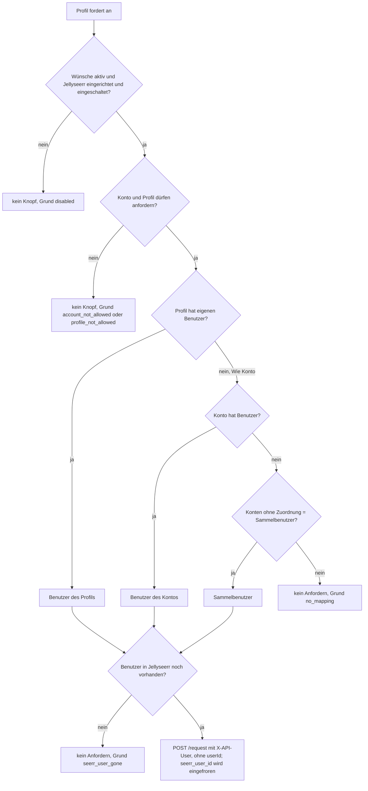
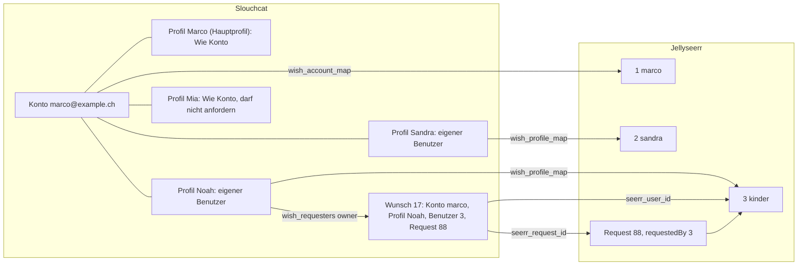

# Konzept 25 · Benutzer- und Profilzuordnung

> **Kurz gesagt.** Jeder Wunsch beantwortet vier Fragen: welches Konto, welches Profil, welcher
> Jellyseerr-Benutzer und wer benachrichtigt wird. Jellyseerr kennt keine Slouchcat-Profile und hat kein
> Feld für fremde Kennungen; darum speichert Slouchcat alle vier Antworten selbst, je Wunsch. Empfohlen ist
> Variante C (F-2): Jedes Konto bekommt einen Jellyseerr-Benutzer, einzelne Profile können einen eigenen
> bekommen. Der Administrator ordnet zu; Slouchcat schlägt bei gleicher E-Mail-Adresse vor, übernimmt aber
> nie von selbst. Gesendet wird mit `X-API-User`, damit in Jellyseerr Rechte, Kontingent und Auto-Freigabe
> des zugeordneten Benutzers gelten (F-3).

Grundlage ist [Anhang F](anhang/F-entscheid-blatt.md) (Abschnitte 2.3 bis 2.6, 5, 11). Belege zu Jellyseerr stammen aus
dem Quellcode von Seerr 3.5.2 und Jellyseerr 2.7.3 ([Anhang D](anhang/D-jellyseerr-api.md), Pfade mit `GH:`), Belege zu
Slouchcat aus dem Anker `ba6efe31`. Abläufe aus Sicht des Zuschauers stehen in `02-funktionskonzept.md`,
die Verwaltungsseiten in `07-administration.md`, die Benachrichtigungen in `06-benachrichtigungen.md`, Tabellen und
Operationen in `08-datenmodell-api.md`.
Abschnitte mit **Vorschlag** gehen über Anhang F hinaus und brauchen Marcos Ja.

## 1. Die vier Fragen und wo die Antwort steht

| Frage | Antwort | Gespeichert in | Wann festgelegt |
|---|---|---|---|
| Welcher Slouchcat-Benutzer? | das **Konto** der Sitzung | `wish_requesters.account_id` | beim Anfordern, aus der Sitzung (`model.Session`) |
| Welches Profil? | das **aktive Profil** der Sitzung | `wish_requesters.profile_id`, `role` = `owner` (Anforderer) oder `joined` (Mitwunsch) | beim Anfordern bzw. beim Mitwunsch |
| Welcher Jellyseerr-Benutzer? | eigene Zuordnung des Profils, sonst die des Kontos (Abschnitt 6) | `wishes.seerr_user_id`; die Zuordnung selbst in `wish_account_map` und `wish_profile_map` | beim Anfordern, danach **eingefroren** (Abschnitt 8) |
| Wer wird benachrichtigt? | das anfordernde Profil und alle Mitwünscher, je erst wenn der Titel für **dieses** Profil sichtbar ist; extern die Kanäle ihrer Konten | `wish_requesters` (Empfänger), `account_channels` (Kanäle) | beim Ereignis, je Profil neu geprüft |

Dazu speichert Slouchcat je Wunsch die Kennungen in Jellyseerr: `seerr_media_id` und die Request-ID, bei
Filmen am Wunsch (`wishes.seerr_request_id`), bei Serien je Staffel (`wish_seasons.seerr_request_id`), weil
ein Serienwunsch in Jellyseerr auf mehrere Requests verteilt sein kann (`03-architektur.md`, Abschnitt 6.2).
Die Benutzerliste von Jellyseerr liegt als Abbild in `seerr_users` (`seerr_id`, `display_name`, `email`,
`user_type`, `permissions`, Kontingente, `created_at`, `fetched_at`, `gone_at`); der Job `seerr.users` lädt sie
alle 24 Stunden und auf Knopfdruck neu und prüft dabei den Fingerabdruck der Instanz (Abschnitt 8.4).

## 2. Technische Prüfung: was Jellyseerr kann und was nicht

### 2.1 Feststellungen

| Feststellung | Folge für Slouchcat | Beleg |
|---|---|---|
| Jellyseerr kennt keine Profile. Ein Benutzer ist eine Person mit E-Mail, Rechten und Kontingent. | Das Profil eines Wunsches kennt nur Slouchcat. | `GH:server/entity/User.ts` Z. 56–161 |
| Kein Feld für eine fremde Kennung, weder am Benutzer noch am Request. `tags` sind Radarr/Sonarr-Tag-IDs, `UserSettings` hält nur Sprache, Regionen, Benachrichtigungskennungen. | Slouchcat führt eine eigene Zuordnungstabelle. Ein Notizfeld zweckfremd zu nutzen (etwa `telegramChatId`) ist verworfen. | Anhang D 7.4; `GH:server/entity/UserSettings.ts` Z. 37–146; `MediaRequest.ts` Z. 518–618 |
| `profileId` im Request-Body ist das **Qualitätsprofil** von Radarr/Sonarr, kein Wiedergabeprofil. | Slouchcat schickt `profileId` nie mit (keine Qualitätsprofile, Anhang F 2.1). | `GH:server/interfaces/api/requestInterfaces.ts` Z. 16–30 |
| Es gibt genau **einen** API-Schlüssel je Instanz (`settings.main.apiKey`), keinen je Benutzer. | Slouchcat speichert einen Schlüssel; wer gerade handelt, sagt ein Header. | `GH:server/middleware/auth.ts` Z. 9–34 |
| Ohne `X-API-User` handelt jeder Aufruf als **Benutzer 1** (Eigentümer mit `ADMIN`). Mit `X-API-User: <id>` handelt er vollständig als dieser Benutzer. Eine unbekannte ID ergibt 403. | Slouchcat setzt den Header bei jedem Aufruf im Namen eines Benutzers. | ebenda, Z. 43–56 |
| `X-API-User` steht nicht in der OpenAPI-Datei und nicht in den Docs, aber unverändert im Code von 2.7.3 und 3.5.2 (`auth.ts` byte-gleich). | Der Verbindungstest prüft es bei jeder Einrichtung (Abschnitt 2.3). | Anhang D 1 und 2.1 |
| Doppelte Wünsche sind **global** gesperrt: Ein zweiter Benutzer bekommt für denselben Film 409; Staffeln, die schon angefragt sind, filtert Jellyseerr still heraus. | Ein zweites Profil wird in Slouchcat Mitwünscher, ohne Aufruf (Anhang F 2.11). | `MediaRequest.ts` Z. 218–246, 396–439 |
| Löscht man einen Benutzer, löscht Jellyseerr seine Requests mit (`onDelete: 'CASCADE'`). | Slouchcat löscht in Jellyseerr nie Benutzer; ein dort gelöschter Benutzer ist ein Sonderfall (Abschnitt 10). | `MediaRequest.ts` Z. 532–537; `GH:server/routes/user/index.ts` Z. 619–680 |
| Der Webhook liefert keine Jellyseerr-Benutzer-ID des Anfragenden, nur Name, E-Mail, Avatar. | Slouchcat ordnet Wünsche über die Request-ID zu, nie über den Webhook. | Anhang D 9.2 |

### 2.2 `X-API-User` gegen `userId`: wessen Regeln gelten

Jellyseerr prüft einen Teil der Regeln am **Zielbenutzer** (`requestUser`), einen Teil am **Aufrufer**
(`user`, also dem, als den der Schlüssel gerade handelt). Tabelle aus Anhang D 3.3,
`GH:server/entity/MediaRequest.ts`:

| Prüfung | gilt für | Stelle |
|---|---|---|
| Darf Filme/Serien anfragen (`REQUEST`, `REQUEST_MOVIE`, `REQUEST_TV`, 4K-Varianten) | Zielbenutzer | Z. 107–139 |
| Kontingent (Quota) | Zielbenutzer | Z. 141–167, 440–446 |
| Kontingent umgehen (`ignoreQuota`) | nur wenn der Aufrufer `MANAGE_REQUESTS` hat | Z. 143–155 |
| Auto-Freigabe (Status `APPROVED` statt `PENDING`) | **Aufrufer** | Z. 340–353, 455–468, 493–506 |
| `modifiedBy` | Aufrufer, wenn automatisch freigegeben | Z. 354–367 |
| Server, Qualitätsprofil, Zielordner, Tags übernehmen | nur wenn der Aufrufer `MANAGE_REQUESTS` oder `REQUEST_ADVANCED` hat | Z. 265–294 |
| Override-Regeln | Zielbenutzer | Z. 296–303 |

| Weg | Aufrufer | Zielbenutzer | Ergebnis |
|---|---|---|---|
| **`X-API-User: <id>`, ohne `userId`** (empfohlen, F-3) | der zugeordnete Benutzer | derselbe | genau wie ein Klick des Benutzers in Jellyseerr: seine Rechte, sein Kontingent, seine Auto-Freigabe |
| Schlüssel ohne Header, mit `userId` im Body | Benutzer 1 (`ADMIN`) | der zugeordnete Benutzer | Recht und Kontingent des Zielbenutzers, aber **jeder Wunsch sofort freigegeben**, weil die Auto-Freigabe am Aufrufer hängt. Die Freigabe-Schleife in Jellyseerr fiele weg. |

Darum sendet Slouchcat jeden Wunsch mit `X-API-User` und ohne `userId` (Anhang F 2.3). Auch das Zurückziehen
(`DELETE /request/{id}`) läuft mit `X-API-User`. Als Benutzer 1 laufen nur Verwaltungsaufrufe: Abgleich
(`GET /request`), Übernahme (`GET /request?requestedBy=<id>`, braucht `MANAGE_REQUESTS`, Anhang D 6.1),
Benutzerliste (`GET /user`), Kontingent lesen (`GET /user/{id}/quota`) und ab Stufe 4 Wiederholen
(`POST /request/{id}/retry`). **Freigeben und Ablehnen** (Stufe 4, F-16) laufen mit `X-API-User` des
Jellyseerr-Benutzers, der dem handelnden Administratorkonto zugeordnet ist, wenn er `MANAGE_REQUESTS` oder
`ADMIN` hat; sonst ohne Header als Benutzer 1. So führt Jellyseerr `modifiedBy` richtig
(`08-datenmodell-api.md`, Abschnitt 4.5).

### 2.3 Prüfung von `X-API-User` im Verbindungstest

Der Test ruft `GET /api/v1/auth/me` zweimal: ohne Header (Antwort muss Benutzer 1 sein, sonst ist der
Schlüssel falsch) und mit `X-API-User` eines anderen Benutzers aus `GET /user` (Antwort muss dessen ID
tragen). Stimmt die zweite Antwort nicht, zeigt die Prüfliste «Handeln im Namen von Benutzern: wirkt
nicht», und «Wünsche aktiv» lässt sich nicht einschalten (**Vorschlag**, Teilfrage T-1 in
`11-entscheide-und-adr.md`; Anhang F verlangt nur, dass der Test es meldet). Gibt es in Jellyseerr nur Benutzer 1, steht
dort «nicht prüfbar, es gibt nur einen Benutzer» (**Vorschlag**). Einzelheiten der Prüfliste:
`07-administration.md`, Abschnitt 4.

## 3. Drei Varianten

- **A, ein Jellyseerr-Benutzer je Konto.** Alle Profile eines Kontos senden als derselbe Benutzer.
- **B, ein Jellyseerr-Benutzer je Profil.** Jedes Profil hat seinen eigenen Benutzer.
- **C, hybrid.** Jedes Konto hat einen Benutzer als Standard; einzelne Profile können einen eigenen
  bekommen («Eigener Benutzer» statt «Wie Konto»).

## 4. Bewertung

| Gesichtspunkt | A je Konto | B je Profil | C hybrid |
|---|---|---|---|
| Technische Machbarkeit | einfach: eine Zuordnung je Konto, `X-API-User` je Konto | machbar, aber je Profil ein Benutzer in Jellyseerr nötig | einfach; zwei kleine Tabellen, Auflösung in einer Regel |
| Sicherheit (wer bekommt was ohne Freigabe) | schwach bei Familien: das Kinderprofil erbt die Auto-Freigabe der Eltern | stark: jedes Profil hat eigene Rechte | stark, wo nötig: das Kinderprofil bekommt einen eigenen Benutzer ohne Auto-Freigabe |
| Administrationsaufwand | gering: ein Eintrag je Konto | hoch: je Profil ein Benutzer anlegen, pflegen, Rechte setzen | gering im Normalfall, mehr nur für die Profile, die es brauchen |
| Benutzerfreundlichkeit | passt für Gäste und Paare | Anfragen in Jellyseerr sind pro Profil lesbar | passt für alle; Jellyseerr zeigt Personen, nicht Profile, wo es egal ist |
| Duplikate (in Jellyseerr global gesperrt) | Wunsch hängt in Jellyseerr am Konto; Profile über Mitwunsch | Wunsch hängt am ersten Profil; ein zweites Profil kann in Jellyseerr nicht nachziehen | wie A; der Mitwunsch läuft in Slouchcat |
| Löschen (Jellyseerr löscht Requests mit dem Benutzer) | selten: Konten werden selten gelöscht | häufig: jedes gelöschte Profil müsste seinen Benutzer und damit seine Requests mitnehmen | wie A; ein Profilbenutzer wird nie automatisch gelöscht |
| E-Mail-Adressen | die Adresse des Kontos passt | je Profil eine eindeutige Adresse nötig (`POST /user` meldet sonst 409) → **künstliche Adressen** wie `noah+profil@example.ch` | nur für eigene Profilbenutzer, und diese legt der Administrator ohnehin in Jellyseerr an |
| Kontingent | gilt für den ganzen Haushalt eines Kontos | je Profil | je Konto, ausser für Profile mit eigenem Benutzer |

**Empfehlung: C (F-2).** A ist für eine Familie zu grob: Ein Kind bekäme die Auto-Freigabe der Eltern,
weil Jellyseerr sie am Aufrufer prüft. B macht jede Profiländerung zu einer Arbeit in Jellyseerr,
braucht künstliche E-Mail-Adressen und verliert beim Löschen eines Profils dessen Anfragen. C nimmt von A
die geringe Arbeit und von B die getrennten Rechte, genau dort, wo sie zählen. Anhang D 12 kommt zum
selben Schluss («am wenigsten reibungsvoll»).

## 5. Datenmodell der Zuordnung

| Tabelle | Inhalt | Regel |
|---|---|---|
| `seerr_users` | Abbild der Jellyseerr-Benutzer, mit `created_at` für den Fingerabdruck (Abschnitt 8.4) | `gone_at` gesetzt, wenn der Benutzer beim letzten Laden fehlte |
| `wish_account_map` | `account_id` PK (CASCADE), `seerr_user_id` UNIQUE, `set_at`, `set_by` | ein Benutzer je Konto, ein Konto je Benutzer |
| `wish_profile_map` | `profile_id` PK (CASCADE), `seerr_user_id`, `set_at` | fehlt die Zeile, gilt «Wie Konto» |
| `wishes.seerr_user_id` | der Benutzer, als der gesendet wurde | eingefroren |
| `wish_requesters` | (`wish_id`, `profile_id`) PK, `account_id`, `role`, `created_at`, `notified_at` | Empfänger der Meldungen; `notified_at` verhindert eine zweite Meldung «verfügbar» |

Die Regel «ein Jellyseerr-Benutzer höchstens bei einem Konto» reicht über beide Tabellen: Ein Benutzer in
`wish_profile_map` darf in keinem anderen Konto vorkommen, weder als Konto- noch als Profilzuordnung. Die
UNIQUE-Bedingung deckt nur `wish_account_map`; den Rest prüft der Dienst in derselben Transaktion
(**Vorschlag**: Fehlercode `seerr_user_taken` mit dem Konto, dem der Benutzer gehört).

## 6. Regeln der Zuordnung

1. **Konto-Standard.** Jedes Konto hat höchstens einen Jellyseerr-Benutzer. Er gilt für alle Profile des
   Kontos, die «Wie Konto» stehen.
2. **Profil.** Ein Profil steht auf «Wie Konto» (Vorgabe) oder auf «Eigener Benutzer» mit einer Auswahl.
   Profile desselben Kontos dürfen denselben Benutzer teilen (Beispiel: Noah und ein Geschwister auf
   «kinder»).
3. **Höchstens ein Konto.** Ein Jellyseerr-Benutzer gehört höchstens zu einem Konto. In der Auswahl sind
   belegte Benutzer gesperrt, mit dem Hinweis, zu welchem Konto sie gehören.
4. **Nie automatisch.** Slouchcat ordnet nie von selbst zu, auch nicht bei gleicher E-Mail-Adresse, auch
   nicht beim Einladen eines Kontos.
5. **Vorschlag bei gleicher E-Mail.** Stimmt die E-Mail eines Kontos (ohne Gross/Klein) mit der eines freien
   Jellyseerr-Benutzers überein, zeigt die Seite «Zuordnung» den Chip «Vorschlag: grosseltern» und den Knopf
   «Übernehmen». Profile bekommen keine Vorschläge, weil sie keine E-Mail haben.
6. **Ändern direkt in der Liste.** Die Seite «Zuordnung» hat je Konto und je Profil ein Auswahlfeld. Eine
   Änderung wirkt sofort und bestätigt sich mit der Meldung «Zuordnung geändert». Betrifft sie offene Wünsche
   oder bestehende Anfragen, nennt die Meldung die Folgen: «Zuordnung geändert. 2 offene Wünsche bleiben bei
   kinder.» bzw. ab Stufe 4 «3 Anfragen von grosseltern werden übernommen.» (Abschnitt 8). «Übernehmen» an
   einem Vorschlag wirkt ebenso sofort.
7. **«Alle Vorschläge übernehmen».** Ein Knopf übernimmt alle offenen Vorschläge auf einmal, nach einer
   Bestätigung mit der Liste der Paare («marco@example.ch → marco, grosseltern@example.ch → grosseltern»).
8. **Löschen der Zuordnung.** «Keine Zuordnung» entfernt die Zeile. Die Wünsche bleiben in Jellyseerr und in
   Slouchcat erhalten; das Konto kann danach nicht mehr anfordern.
9. **Sammelbenutzer (F-4, ab Werk aus).** Steht «Konten ohne Zuordnung» auf «Sammelbenutzer», gilt für
   Konten ohne eigenen Benutzer der gewählte Sammelbenutzer. **Vorschlag:** Er darf keinem Konto als
   eigener Benutzer zugeordnet sein; die Auswahl sperrt das gegenseitig.

### 6.1 Mit welchem Jellyseerr-Benutzer wird gesendet?

### 6.2 Übersicht der Zuordnung

## 7. Bestehende Jellyseerr-Benutzer zuordnen

- **Manuell.** Die Seite «Zuordnung» (M-24) listet je Konto eine Auswahl aller Jellyseerr-Benutzer aus
  `seerr_users`, mit Anzeigename, E-Mail und Art (Plex, lokal, Jellyfin, Emby). Daneben stehen die Fakten des
  gewählten Benutzers: darf Filme anfordern, darf Serien anfordern, Auto-Freigabe Filme/Serien, Kontingent.
- **Vorschlag bei gleicher E-Mail** wie in Abschnitt 6, Punkt 5.
- **Benutzer in Jellyseerr anlegen** (`POST /user`) ist **keine** Funktion von Stufe 1 bis 4, nur eine
  spätere Möglichkeit. Die Hürden aus Anhang D 7.2:

| Hürde | Beleg |
|---|---|
| Braucht das Recht `MANAGE_USERS` (Benutzer 1 hat es). | `user/index.ts` Z. 170–226 |
| Ohne Passwort verlangt Jellyseerr aktive E-Mail-Benachrichtigungen, sonst 500 «Email notifications must be enabled». Mit Passwort müsste Slouchcat ein Passwort erzeugen und verwalten. | ebenda |
| `permissions` im Body wird ignoriert; der neue Benutzer bekommt die Vorgabe der Instanz (`REQUEST` = 32). Rechte setzt ein zweiter Aufruf. | `settings/index.ts` Z. 415; `usersettings.ts` Z. 763–769 |
| Doppelte E-Mail ergibt 409; Profile hätten keine eigene Adresse. | `user/index.ts` Z. 170–226 |
| Neue Benutzer sind immer `LOCAL`; ein Haushalt mit Jellyfin- oder Plex-Anmeldung bekäme Doppelkonten. | ebenda |

Slouchcat würde damit Benutzer und Rechte in Jellyseerr verwalten. Das grenzt an «Steuerung von
Arr/Seerr» und bleibt bis zu einer eigenen Frage ausgeschlossen.

## 8. Schutz vor falscher Zuweisung (F-21)

### 8.1 Eingefrorene Zuordnung je Wunsch

`createWish` löst den Benutzer nach Abschnitt 6.1 auf und schreibt ihn in `wishes.seerr_user_id`. Danach
ändert ihn keine Zuordnungsänderung mehr. Gründe: Der Request gehört in Jellyseerr diesem Benutzer, sein
Kontingent ist belastet, und Umhängen ginge in Jellyseerr nur für `PENDING` über `PUT /request/{id}` mit
`userId` (Anhang D 8). Slouchcat hängt nie um.

| Änderung der Zuordnung | Wirkung |
|---|---|
| Konto oder Profil bekommt einen anderen Benutzer | gilt für neue Wünsche; offene Wünsche bleiben beim alten Benutzer. Die Meldung nach der Änderung nennt sie: «2 offene Wünsche bleiben bei kinder.» |
| Wunsch steht noch `queued` (nicht übermittelt) | **Vorschlag:** bleibt beim eingefrorenen Benutzer. Ist dieser beim Senden in Jellyseerr verschwunden (403, `GET /auth/me` bestätigt den Schlüssel, `03-architektur.md`, Abschnitt 6.4), wird der Wunsch `failed` mit Grund «Jellyseerr-Benutzer fehlt» (`seerr_user_gone`); «Erneut übermitteln» in der Verwaltung löst die Zuordnung neu auf. |
| Zuordnung entfernt | offene Wünsche laufen weiter und werden weiter abgeglichen; neue gehen nicht. |

### 8.2 Bestehende Anfragen übernehmen (Stufe 4)

Jellyseerr enthält oft schon Anfragen, die Personen dort selbst gestellt haben. Mit F-21 übernimmt der eigene
Job `wishes.import` die Anfragen **zugeordneter** Benutzer als Wünsche mit `origin` = `jellyseerr`. Der
regelmässige Abgleich kann das nicht: Er bricht beim ersten `updatedAt` vor dem Zeiger ab und sieht alte
Anfragen eines neu zugeordneten Benutzers nie (`03-architektur.md`, Abschnitt 7.3).

1. Gehört der Benutzer einem Konto als Standard, wird der Wunsch dem **Hauptprofil** dieses Kontos
   zugeordnet.
2. Ist der Benutzer genau einem Profil als eigener Benutzer zugeordnet, bekommt dieses Profil den Wunsch.
3. **Vorschlag:** Teilen sich mehrere Profile desselben Kontos den Benutzer, gewinnt das Hauptprofil, wenn es
   dabei ist, sonst das älteste dieser Profile (wie `03-architektur.md`, Abschnitt 7.3). Dürfte das Zielprofil
   den Titel nach der Jugendschutzregel nicht sehen, geht der Wunsch an das Hauptprofil.
4. Der Wunsch trägt die Kennzeichnung «In Jellyseerr angelegt» in «Meine Wünsche» und in der Verwaltung.
5. **Wann:** `wishes.import:<seerrUserId>` läuft, sobald eine Zuordnung gesetzt oder geändert wird, und von
   Hand («Anfragen übernehmen» auf der Seite Zuordnung). Er liest `GET /request?requestedBy=<Benutzer>&take=50`
   seitenweise, ohne `X-API-User`, also als Benutzer 1 mit `MANAGE_REQUESTS` (Anhang D 6.1). Danach hält der
   regelmässige Abgleich die übernommenen Wünsche aktuell.
6. Die Meldung nach dem Ändern nennt die Zahl, die derselbe Aufruf mit `take=1` liefert (`pageInfo.results`):
   «3 Anfragen von grosseltern in Jellyseerr werden übernommen (Profil Oma & Opa).»
7. Ein schon geführter «nicht zuordenbarer» Wunsch dieses Benutzers (Abschnitt 8.3) bekommt das Zielprofil als
   Besitzer; er wird nicht doppelt angelegt.
8. **Vorschlag:** Übernommen werden nur offene und in den letzten 30 Tagen verfügbar gewordene Anfragen, damit
   kein Konto mit alten Meldungen überschwemmt wird; für übernommene Anfragen, die schon verfügbar sind, kommt
   keine Benachrichtigung.

### 8.3 Nicht zuordenbare Anfragen

Anfragen von Jellyseerr-Benutzern ohne Zuordnung (Beispiel «wohnzimmer-tv») gehören keinem Profil.
**Vorschlag** (wie `03-architektur.md`, Abschnitt 7.3): Slouchcat führt sie als Wunsch mit `origin` =
`jellyseerr` und `seerr_user_id` = «wohnzimmer-tv», aber ohne Zeile in `wish_requesters`. Die Verwaltung zeigt
sie unter «Anfragen» mit dem Filter «Nicht zuordenbar» und unter «Zuordnung» als Zähler beim Benutzer.
Zuschauer sehen sie nie, und sie lösen keine Benachrichtigung aus. Fordert ein Profil denselben Titel an, wird
es Mitwünscher dieses Wunsches; Jellyseerr wird nicht aufgerufen, weil es dort ohnehin 409 meldete
(Anhang F 2.10, 2.11). Ein Request des Sammelbenutzers, der in Jellyseerr selbst entstand, gilt ebenfalls
als nicht zuordenbar (**Vorschlag**), weil unklar ist, welches Konto ihn stellte. Ordnet der Administrator
den Benutzer später einem Konto zu, gilt Abschnitt 8.2.

### 8.4 Instanz wechselt

Alle Nummern aus Jellyseerr (`seerr_id`, Request-ID, Media-ID) gelten nur in **einer** Instanz. Zeigt der
Administrator auf eine andere oder neu aufgesetzte Instanz, gehörte `X-API-User: 3` dort womöglich einer ganz
anderen Person. Das verletzt die Anforderung «nie falsch zuweisen». Darum:

- **Fingerabdruck (Vorschlag):** Beim ersten erfolgreichen Verbindungstest speichert Slouchcat einen
  Fingerabdruck der Instanz aus Angaben, die sich nicht ändern: E-Mail und Anlagedatum von Benutzer 1
  (`GET /auth/me` ohne Header) und das Anlagedatum jedes bekannten Benutzers (`seerr_users.created_at`). Neue
  Benutzer ändern ihn nicht. Welche Angaben wirklich unveränderlich sind, prüft der Bau gegen eine Instanz.
- **Abweichung:** Weicht er später ab (Test, `seerr.users`, Beginn jedes Jobs), hält Slouchcat Übermittlung und
  Abgleich an. Die Verwaltung zeigt «Andere Jellyseerr-Instanz erkannt» und verlangt, die Zuordnung zu
  **bestätigen** oder zu **löschen** (`07-administration.md`, Abschnitt 4.1). Bis dahin bleiben neue Wünsche
  `queued`; offene Wünsche laufen nicht weiter.
- **Bestätigen:** Der neue Fingerabdruck gilt, die Zuordnungen bleiben, und ein Erstabgleich läuft.
  **Löschen:** Alle Zuordnungen fallen weg, die Request-IDs offener Wünsche wandern in den Verlauf; die Wünsche
  bleiben `queued` und gehen nach einer neuen Zuordnung neu an Jellyseerr.
- Technik: `03-architektur.md`, Abschnitt 7.4.

## 9. Wunschrecht

| Schalter | Wer setzt | Wo | Vorgabe | Rolle |
|---|---|---|---|---|
| `accounts.can_request` | Administrator | Konten, Formular «Zugriff» (bei Administratorkonten Block «Wünsche»); Dialog «Konto einladen» | Besitzerkonto an, neue Konten aus («Neue Konten dürfen anfordern», F-5) | Deckel für alle Profile des Kontos |
| `profiles.can_request` | Hauptprofil des Kontos | Profildialog (`/settings/profiles`, eigenes Konto «Meine Profile») | Hauptprofil an, weitere Profile aus | Feinwahl je Profil |

- Wirksam ist das Recht nur, wenn beide Schalter an sind, «Wünsche aktiv» an ist und ein Jellyseerr-Benutzer
  nach Abschnitt 6.1 bestimmt werden kann.
- Ist das Konto aus, zeigt der Profildialog den Schalter gesperrt mit «Das Konto darf keine Titel anfordern.»
  (Muster «Das Konto begrenzt dieses Profil»). Kein Profil hebt so den Deckel seines Kontos an (ADR 0014,
  `docs/adr/0014-benutzerverwaltung.md:87`, «Niemand hebt seine eigenen Grenzen an»).
- Der Server liefert in der Sitzung `wishes {enabled, canRequest, reason}`; die App entscheidet nichts
  (Regel 12). **Vorschlag** für die Gründe: `disabled` (Wünsche aus, Jellyseerr nicht eingerichtet
  oder ausgeschaltet), `account_not_allowed`, `profile_not_allowed`, `no_mapping`, `seerr_user_gone`. Ist
  Jellyseerr nur vorübergehend nicht erreichbar, lehnt es den Schlüssel ab oder wartet eine erkannte andere
  Instanz auf die Bestätigung, bleibt `canRequest` wahr; der Wunsch wartet als `queued`. Je fehlendem Titel
  kommen Medienart («Filme erlauben», «Serien erlauben»), Stelle und Altersstufe dazu.
- **Eine Regel für das Sehen (F-9):** Fehlende Titel sieht ein Profil nur, wenn es sie auch anfordern kann:
  Wünsche aktiv, Jellyseerr eingerichtet und eingeschaltet, Konto und Profil haben das Recht, eine Zuordnung
  ist vorhanden (eigene, des Kontos oder der Sammelbenutzer), die Art ist erlaubt, die Altersstufe passt. Sonst
  existieren sie für das Profil nicht (404), auch nicht mit einem Hinweis statt des Knopfs. Einzige Ausnahme:
  Titel, zu denen das Profil selbst einen Wunsch hat (jeder Zustand), bleiben auf der Vorschauseite und unter
  «Meine Wünsche» sichtbar (`02-funktionskonzept.md`, Abschnitt 3).
- Ein Konto mit Recht, aber ohne Zuordnung bemerkt der Administrator in der Verwaltung: Übersicht «n Konten ohne
  Zuordnung», Seite Zuordnung und Chip «Zuordnung fehlt» auf «Konten» (`07-administration.md`, Abschnitte 2, 6
  und 8). Der Zuschauer sieht keinen Hinweis.
- **Rückfüllung bestehender Daten (Vorschlag):** Besitzerkonto an, alle anderen Konten aus, alle
  Hauptprofile an, alle weiteren Profile aus. Ohne Zuordnung bleibt das Recht damit ohne Wirkung.
- **Administratorkonten:** Sie haben heute kein Formular «Zugriff» (dort steht nur der Hinweis «immer ab 18 und
  alle Bibliotheken»). Für Administratorkonten, auch das eigene, zeigt das Aufklappfeld der Seite Konten darum
  den Block «Wünsche» mit dem Schalter «Darf Titel anfordern» und der Zeile «Jellyseerr-Benutzer» (Redaktionsentscheid vom 17. November 2026, Lücke in Anhang F). Die Ernennung zum Administrator ändert den Schalter nicht.
- Kinderprofile dürfen mit Recht anfordern; ob ein Wunsch eine Freigabe braucht, entscheidet die
  Auto-Freigabe ihres Jellyseerr-Benutzers (F-6). Eine eigene Freigabe in Slouchcat gibt es nicht.

## 10. Sonderfälle

| Fall | Erkennung | Verhalten |
|---|---|---|
| Benutzer in Jellyseerr gelöscht | `seerr.users` findet ihn nicht mehr → `gone_at` | Zuordnung bleibt, Warnung «Benutzer in Jellyseerr gelöscht» auf «Zuordnung» und in der Übersicht; Grund `seerr_user_gone`, kein Anfordern. Seine Requests hat Jellyseerr mitgelöscht. Offene Wünsche, deren Request beim Abgleich 404 meldet, werden `failed` mit Grund «In Jellyseerr gelöscht» (`seerr_request_gone`); der Wunsch ist geschlossen, und der Zuschauer kann erneut anfordern, sobald eine gültige Zuordnung besteht. |
| Benutzer darf in Jellyseerr keine Serien (oder keine Filme) anfordern | Bits in `seerr_users.permissions` (`REQUEST` 32, `REQUEST_MOVIE` 262144, `REQUEST_TV` 524288; `ADMIN` 2 erlaubt alles) | Warnung «darf keine Serien anfordern» auf «Zuordnung». Sendet Slouchcat trotzdem, antwortet Jellyseerr 403 «You do not have permission to make series requests.» → `failed` mit Klartext. **Vorschlag:** Zeigt das Abbild klar kein Recht für diese Medienart, fehlt der Knopf schon vorher. |
| Kontingent erschöpft | 403 «Movie Quota exceeded.» / «Series Quota exceeded.» | `failed` mit Klartext «Kontingent für Filme erschöpft». Das Kontingent gilt für alle Profile, die denselben Benutzer nutzen. **Vorschlag:** Der Dialog zeigt den Rest aus `GET /user/{id}/quota` («Noch 2 von 5 Filmen in 7 Tagen»). |
| Profil gelöscht | `wish_profile_map` fällt mit CASCADE | Seine Wünsche gehen an das Hauptprofil des Kontos (Verlauf «von gelöschtem Profil übernommen»); das Löschen in `auth` ruft dafür vorher `wishes` auf. Mitwünsche des Profils fallen weg. In Jellyseerr ändert sich nichts. |
| Konto gelöscht | `wish_account_map` und `wish_profile_map` fallen mit CASCADE | Wünsche mit Mitwünschern anderer Konten gehen an den ältesten dieser Mitwünscher. Die übrigen Wünsche des Kontos werden geschlossen: Offene bekommen `failed` mit Grund `account_deleted`, alle `closed_at`; ihre Request-IDs wandern in den Verlauf, damit sie den Titel nicht mehr sperren. In Jellyseerr bleiben die Requests und erscheinen ab Stufe 4 als «nicht zuordenbar». Der Bestätigungstext «Konto entfernen» sagt: «Wünsche bleiben in Jellyseerr bestehen.» |
| Profilwechsel während offener Wünsche | – | Ein Wunsch gehört dem Profil, das ihn stellte. Nach dem Wechsel sieht das neue Profil nur seine eigenen Wünsche; das Hauptprofil sieht alle Wünsche des Kontos (`listAccountWishes`, `scoped` mit Hauptprofil), weil es das Konto verwaltet. Nichts wird umgehängt. |
| Zuordnung eines Profils wechselt von «Wie Konto» auf eigenen Benutzer | – | gilt ab dem nächsten Wunsch (Abschnitt 8.1). |
| Konto ohne Zuordnung | keine Zeile in `wish_account_map`, Profil «Wie Konto», kein Sammelbenutzer | Grund `no_mapping`; die Profile sehen keine fehlenden Titel (Abschnitt 9). Der Administrator sieht Chip «Zuordnung fehlt» auf «Konten», den Eintrag auf «Zuordnung» und in der Übersicht «n Konten ohne Zuordnung» (nur Konten mit Wunschrecht). |
| Andere Jellyseerr-Instanz | Fingerabdruck weicht ab | Übermittlung und Abgleich halten an, bis der Administrator die Zuordnung bestätigt oder löscht (Abschnitt 8.4). |
| Sammelbenutzer (F-4) | «Konten ohne Zuordnung» = «Sammelbenutzer» | Alle betroffenen Konten teilen Kontingent und Auto-Freigabe dieses Benutzers; in Jellyseerr erscheinen ihre Anfragen unter einem Namen. Darum ab Werk aus. |
| Jellyseerr-Benutzer ist Benutzer 1 (Eigentümer) | `seerr_id` = 1 | erlaubt (Beispiel: Konto marco). `X-API-User: 1` entspricht dem Aufruf ohne Header. |
| Zwei Konten mit derselben E-Mail wie ein Benutzer | geht nicht: `accounts.email` ist eindeutig | – |

## 11. Beispiel aus den Mockup-Daten

Jellyseerr-Benutzer: 1 marco (Administrator, Auto-Freigabe), 2 sandra (Auto-Freigabe), 3 kinder (keine
Auto-Freigabe, Kontingent 5 Filme je 7 Tage), 4 grosseltern (keine Auto-Freigabe, gleiche E-Mail wie das
Konto), 5 wohnzimmer-tv (keinem Konto zugeordnet, hat eigene Anfragen).

| Konto | Profil (Alter) | Recht Konto / Profil | Zuordnung | Gesendet als | Wirkung |
|---|---|---|---|---|---|
| `marco@example.ch` (Besitzer) | Marco (Hauptprofil, 18) | an / an | Wie Konto → 1 marco | 1 marco | «Wird sofort beschafft» |
| | Sandra (18, PIN) | an / an | eigener Benutzer → 2 sandra | 2 sandra | «Wird sofort beschafft»; externe Nachrichten ohne Titel (F-15) |
| | Noah (12) | an / an | eigener Benutzer → 3 kinder | 3 kinder | «Braucht eine Freigabe»; Kontingent 5 Filme je 7 Tage |
| | Mia (6) | an / aus | Wie Konto | – | darf nicht anfordern, sieht keine fehlenden Titel |
| `grosseltern@example.ch` | Oma & Opa (16, Hauptprofil) | an (Annahme für das Beispiel) / an | keine; Vorschlag «grosseltern» offen | – | Grund `no_mapping`, sieht keine fehlenden Titel; in der Verwaltung Chip «Zuordnung fehlt» bis «Übernehmen» |
| `gast@example.ch` | Gast (16, Hauptprofil) | aus / an | keine | – | sieht keine fehlenden Titel; in der Verwaltung Chip «Nicht erlaubt» |
| – | – | – | 5 wohnzimmer-tv ohne Konto | – | seine Anfragen erscheinen als «nicht zuordenbar» |

Das Konto marco nutzt damit drei Jellyseerr-Benutzer (1, 2, 3). Das ist erlaubt: Die Regel «höchstens ein
Konto» gilt je Jellyseerr-Benutzer, nicht je Konto. Übernimmt Marco den Vorschlag für grosseltern, holt der Job
`wishes.import` (Stufe 4) die offenen Anfragen von Benutzer 4 als Wünsche von «Oma & Opa», gekennzeichnet
«In Jellyseerr angelegt».

## 12. Offene Entscheide in diesem Papier

| Nr. | Frage | Empfehlung |
|---|---|---|
| F-2 | Zuordnung A, B oder C? | C |
| F-3 | `X-API-User` oder `userId`? | `X-API-User` |
| F-4 | Konten ohne Zuordnung: nicht erlauben oder Sammelbenutzer? | Nicht erlauben; Sammelbenutzer als Wahl |
| F-5 | Wunschrecht je Konto und je Profil mit den Vorgaben aus Abschnitt 9? | Ja |
| F-6 | Kinderprofile mit Recht, Freigabe in Jellyseerr? | Ja |
| F-21 | Bestehende Anfragen zugeordneter Benutzer übernehmen? | Ja |

Begründungen und Folgen anderer Wahl: `11-entscheide-und-adr.md`, Abschnitt 1.
