# Konzept 25 · Spotlight: nur Titel der Bibliothek, Abgleich auch über TVDB

> **Kurz gesagt.** Startseite und Spotlight-Liste zeigen weiter nur Titel, die in der Bibliothek stehen, wie
> heute. Fehlende Einträge der Trakt-Liste erscheinen in der Zuschauer-App nirgends. Das hat Marco am
> 17. November 2026 nach der Durchsicht des Mockups entschieden («In Spotlight soll nicht angezeigt werden was
> fehlt», E-5). Fehlende Einträge sieht nur der Administrator unter Verwaltung › Spotlight, mit Poster, Zustand
> und der Aktion «Anfordern». Neu ist ausserdem: Slouchcat erkennt Serien der Bibliothek auch über die TVDB- und
> die IMDb-ID. Heute fehlen solche Serien im Spotlight, obwohl sie in der Bibliothek stehen. Bei Serien gilt
> **TVDB zuerst**, so wie die Bibliothek Serien zuordnet; so bleibt TVDB durchgängig, wie Marco es verlangt hat
> («Es soll konsistent sein»).

Grundlage: [Anhang H](anhang/H-nachtrag-17-november.md), Abschnitte 3.4 und 4.6 (TVDB) sowie 8.2 und 8.4
(Marcos zweite Rückmeldung, Regeln N-70 bis N-75), und [Anhang A](anhang/A-spotlight-startseite.md) (Bestand).
Bestand mit Belegen: `01-bestandsanalyse.md` Abschnitte 2, 3 und 6. Wo und wie Zuschauer anfordern, beschreibt
`02-funktionskonzept.md`. Gebaut wird das in Stufe 3 «Spotlight», die damit auf den Abgleich über TVDB und IMDb
und die fehlenden Einträge in der Verwaltung schrumpft (Anhang H 8.7). Offen ist hier noch F-29; F-8
ist durch E-5 entschieden, F-34 durch E-10. Als Marcos Entscheid gilt nur, was Anhang H als seine Nachricht oder Antwort führt;
alles andere ist Empfehlung der Redaktion.

## 1. Heute

- Eine Trakt-Liste, bis 100 Einträge je Medienart, gespeichert in `spotlight_entries`
  (`server/internal/metadata/trakt.go:291-298`).
- Die Startseite zeigt nur Einträge mit Treffer in der Bibliothek, die das Profil sehen darf (innerer Join
  mit `items` und `visible_items`, `server/queries/scoped/spotlight.sql:9-16`).
- Ordnung: Trakt-Position, Angeheftete einfügen, `min_hits` prüfen, auf `item_count` (5–20) schneiden
  (`server/internal/visibility/discover.go:383-447`). Unter `min_hits` Treffern fehlt die Reihe.
- Bühne: Folie mit Hintergrund, Logo, Metazeile, «Abspielen», «Details», «Trailer»; die Posterreihe darunter
  stellt den Titel ins Band (`web/src/ui/HeroCarousel.tsx`, `web/src/features/catalog/HomePage.tsx:586-616`).
- Abgleich nur über die TMDB-ID: Der Trakt-Client liest aus `ids` nur `tmdb`
  (`server/internal/trakt/trakt.go:270-273`).
- Fehlende Einträge sieht nur die Verwaltung, ohne Poster und ohne Aktionen
  (`web/src/features/admin/spotlight/columns.tsx:106,126-129`).
- S-4 (Frage 11, `docs/planning/04-entscheidungen.md:20`) verbietet fehlende Titel auf der Startseite; ADR 0011
  verwirft den Schalter dafür (`docs/adr/0011-spotlight.md:99`). Beides bleibt (N-70, Anhang H 8.5).

## 2. Was bleibt wie heute

Regel N-70 (Marco, Nachricht und E-5): Startseite (Bühne und Posterreihe) und Spotlight-Liste
(`/lists/spotlight`) zeigen nur Titel der Bibliothek, wie heute. S-4 gilt ohne Ausnahme.

- **Bühne, Posterreihe, Spotlight-Liste** bleiben in Aufbau, Knöpfen und Ordnung unverändert. Es gibt keinen
  Chip «Noch nicht in der Bibliothek», keinen Knopf «Film anfordern» und keinen Filter «Noch nicht da».
- **Keine fehlenden Einträge in der Zuschauer-App,** auch nicht als eigene Reihe unter Wünsche › Entdecken.
  Marco hat diese Wahl ausdrücklich abgelehnt (E-5: «Nein, nirgends»).
- **Angefordert wird anderswo.** Titel ausserhalb der Bibliothek gibt es nur im Bereich «Wünsche», im Abschnitt
  «Noch nicht in der Bibliothek» der Suche, auf der Vorschauseite und als fehlende Staffeln einer vorhandenen
  Serie (N-75; `02-funktionskonzept.md`, Abschnitte 4 und 5).
- **Teilweise vorhandene Serien** sind Titel der Bibliothek und erscheinen im Spotlight wie heute, mit
  «Abspielen». Fehlende Staffeln zeigt nur die Serienseite (M-06). Die Bühne trägt keinen Staffelhinweis.
- **Ein erfüllter Wunsch** ist ein Titel der Bibliothek. Steht er in der Trakt-Liste, erscheint er im
  Spotlight wie jeder andere vorhandene Titel. Die Bühne trägt keinen Wunsch-Chip (N-70; Anhang H,
  Abschnitt 9, K-3). Der Chip «Dein Wunsch ist da» steht nur auf der Detailseite des Films (M-05) und in der
  Startreihe «Erfüllte Wünsche». Diese Reihe ist eine eigene Reihe, nicht Teil des Spotlights (Marco, E-10;
  N-74; `02-funktionskonzept.md`, Abschnitt 5).
- **Vormalen, Vorladen, Bilder, Service Worker** und die Kosten von `getHome` bleiben unverändert, weil die Bühne
  weiter nur Titel der Bibliothek trägt (`01-bestandsanalyse.md`, Abschnitt 3). Neu sind nur die zusätzlichen
  Treffer über TVDB und IMDb (Abschnitt 3); sie sind lokale Abfragen ohne Aufruf an TMDB oder Seerr.

## 3. Was sich ändert: Abgleich über TVDB-, TMDB- und IMDb-ID

### 3.1 Benutzt Seerr auch TVDB?

Marco hat am 17. November 2026 gefragt: «Benutzt Seerr auch tvdb? Es soll konsistent sein.» Die Antwort aus dem
Quellcode von Seerr 3.5.2 (Anhang H 3.4 und 4.6, nicht gegen Marcos Instanz geprüft):

**Seerr führt jeden Titel über die TMDB-ID. TVDB nutzt es für zwei Dinge: Es gibt die TVDB-ID an Sonarr
weiter, und es kann die Staffelliste aus TVDB lesen, wenn man das einstellt.**

- Die TVDB-ID einer Serie nimmt Seerr aus TMDB (`external_ids.tvdb_id`) und gibt sie an Sonarr weiter.
  Sonarr selbst arbeitet mit der TVDB-ID. Fehlt sie, löscht Seerr den Request beim Senden (Anhang D 4).
- Seit Seerr 3.x gibt es die Einstellung «Metadaten-Anbieter» für Serien und Anime: `tmdb` (ab Werk) oder
  `tvdb`. Mit `tvdb` lädt Seerr die Serie weiter über die TMDB-ID, ersetzt aber die **Staffelliste** durch
  die von TVDB (`GH:server/lib/settings/index.ts` Z. 111–118, 460–463; `GH:server/api/tvdb/index.ts`
  Z. 136–260).
- Der Schlüssel in Seerr bleibt also immer die TMDB-ID. Was sich unterscheiden kann, ist die
  **Staffelzählung**: TMDB und TVDB teilen manche Serien verschieden auf. Sonarr zählt nach TVDB, die Bibliothek
  von Slouchcat ordnet Serien TVDB-zuerst zu (`server/internal/metadata/tvdb.go:430-434`).

### 3.2 Heute

Der Trakt-Client liest nur `ids.tmdb` (`server/internal/trakt/trakt.go:270-273`). Eine Serie, die die
Bibliothek über TVDB zugeordnet hat, hat keine `tmdb_id` (`server/internal/metadata/tvdb.go:430-434`). Sie
trifft den Trakt-Eintrag nie: Sie **fehlt heute im Spotlight, obwohl sie in der Bibliothek steht**, und die
Verwaltung führt sie als «Nicht in der Bibliothek» (N-73). Mit der Wunschfunktion käme dazu, dass die Verwaltung
für eine vorhandene Serie «Anfordern» anböte.

### 3.3 Regeln

| Nr. | Regel | Von |
|---|---|---|
| N-60 | Jeder Eintrag trägt drei IDs: TMDB, TVDB, IMDb. `spotlight_entries` speichert dafür zusätzlich `tvdb_id` und `imdb_id` aus Trakt `ids`. Quelle ist Trakt (liefert alle drei), sonst TMDB `external_ids`. | aus Fassung 2, unverändert |
| N-61 | Abgleich mit der Bibliothek bei **Serien: TVDB zuerst**, dann TMDB, dann IMDb, so wie die Bibliothek Serien zuordnet. Bei **Filmen: TMDB, dann IMDb**. Ein Eintrag gilt als vorhanden, wenn ein Bibliothekstitel derselben Art in dieser Reihenfolge eine gleiche ID hat. Die Abfrage liegt in `visibility` (Regel 2). Fassung 2 nannte TMDB zuerst. | Empfehlung (Marco: «konsistent») |
| N-62 | Liefert Trakt zu einem Eintrag nur die TVDB-ID, schlägt Slouchcat die TMDB-ID über TMDB «find by external id» nach. Gelingt das nicht, gilt der Eintrag **nicht** als fehlend, denn ohne TMDB-ID wäre er nicht anforderbar (Seerr braucht sie als `mediaId`). Er steht in der Verwaltung unter den nicht zuordenbaren Einträgen. | Empfehlung |
| N-63 | Die Staffeln im Dialog «Anfordern» kommen aus Seerr (`GET /tv/{tmdbId}`): Angeboten wird genau, was Seerr bestellen kann. | Empfehlung |
| N-64 | **Empfehlung an Marco:** in Seerr den Metadaten-Anbieter für Serien auf TVDB stellen. Dann zählen Seerr, Sonarr und Slouchcat Staffeln gleich. Der Verbindungstest liest die Einstellung (`GET /settings/metadatas`) und zeigt einen Hinweis, wenn sie auf TMDB steht. Umstellen muss Marco in Seerr selbst. | Empfehlung (F-29) |
| N-65 | Der Wunsch geht immer mit `tvdbId` an Seerr. | aus Fassung 2, unverändert |

**Wo die Abgleichsregel gilt:** auf der Startseite und in der Spotlight-Liste (mehr Treffer, sonst nichts
Neues), auf der Seite Verwaltung › Spotlight (vorhanden oder fehlend), in der Suche, auf den Seiten im Bereich
«Wünsche» (Entdecken, Filme, Serien, Suche; N-55) und bei der Erkennung «verfügbar» (`02-funktionskonzept.md`
Ablauf 4.7, `06-benachrichtigungen.md` Abschnitt 3.1). Massgeblich ist immer der Abgleich von Slouchcat, nicht
der Zustand `mediaInfo` aus Seerr.

**Was N-64 löst und was nicht.** Steht Seerr auf TMDB, kann die Staffelliste im Dialog anders aussehen als
die Staffeln derselben Serie in der Bibliothek, etwa wenn TMDB eine Staffel teilt, die TVDB als eine führt. Weil
der Dialog die Staffeln aus Seerr zeigt (N-63), bestellt er trotzdem nie etwas, das Seerr nicht kennt.
Erst mit TVDB in Seerr stimmen Dialog, Sonarr und Bibliothek überein.

## 4. Verwaltung «Spotlight»: was bleibt, was dazukommt

Regel N-71 (Marco: «In der Verwaltung ist es gut so»): Die Seite bleibt, wie sie das Mockup der Fassung 3
zeigte. Alle heutigen Optionen bleiben (ADR 0035: nichts geht verloren). Ort: Verwaltung › Startseite ›
Spotlight (M-27). Schalter für fehlende Titel gibt es nicht (N-72).

**Kopf:** Titel «Spotlight», Hilfetext unverändert: «Gezeigt werden nur Titel aus der eigenen Bibliothek.»
Darüber ein Hinweis (Wortlaut Vorschlag, wie im Mockup): «Die Startseite zeigt weiterhin nur Vorhandenes.
Fehlende Einträge der Liste erscheinen weder auf der Startseite noch in der Spotlight-Liste.»

**Band «Quelle»** (unverändert, elf Felder):

| Nr. | Feld | Werte |
|---|---|---|
| 1 | «Auf der Startseite zeigen» | Schalter |
| 2 | «Trakt-Liste» | sieben Listenarten |
| 3 | «Adresse der Liste» | nur bei «per Adresse» |
| 4 | «Medienart» | Nur Filme, Nur Serien, Filme und Serien |
| 5 | «Höchstens» | 5–20 Titel je Profil |
| 6 | «Ausblenden unter» | 0–10 Treffer je Profil |
| 7 | «Abruf alle … Stunden» | 6–48 |
| 8 | «Spotlight Wechsel Takt» | 3–15 Sekunden |
| 9 | Abrufzustand | zuletzt abgerufen, Treffer, Schlüssel, Gründe |
| 10 | «Jetzt abrufen» | höchstens einmal je Minute |
| 11 | «Speichern» | wie heute |

**Band «Fehlende Einträge»** (neu, zugeklappt, nur Anzeige, stellt nichts ein; N-72):

| Inhalt | Beispiel (Wortlaut Vorschlag) |
|---|---|
| Satz zur Regel | «Die Startseite und die Spotlight-Liste zeigen nur Titel aus der Bibliothek. Einträge, die fehlen, siehst nur du hier in der Verwaltung. Profile fordern fehlende Titel unter «Wünsche» an.» |
| Zählung | «7 Einträge der Liste fehlen in der Bibliothek, 3 davon sind angefordert.» |
| Hinweis ohne Wünsche | ohne Seerr oder mit «Wünsche aktiv» aus: «Anfordern geht erst, wenn Wünsche eingerichtet sind.» mit Link zu Medien › Wünsche › Einstellungen |

**Band «Einträge der Liste»:** Spalten «Rang», «Titel», «Status», «Eigene Notiz», «Aktionen» bleiben. Neu
(N-71):

- Fehlende Einträge bekommen ein Poster (aus `external_titles`, über die Admin-Bildroute
  `getAdminExternalTitleImage`) und den Status «Noch nicht in der Bibliothek» oder «Angefordert · In
  Beschaffung» (bzw. ein anderer Zustand des Wunsches).
- Die Aktion **«Anfordern»** öffnet denselben Dialog M-13 und fordert im Namen des aktiven Profils des
  Administrators an (Empfehlung; die Verwaltung verlangt das Hauptprofil). Sie fehlt, wenn schon ein offener
  Wunsch besteht oder der Eintrag nicht zuordenbar ist.
- «Anheften», «Ausblenden» und «Notiz» gibt es für alle Einträge, wie im Mockup. Der Server nimmt Anpassungen
  auch ohne Treffer an (`server/internal/admin/spotlight.go:178-189`). Bei einem fehlenden Eintrag wirken sie
  erst, wenn der Titel in die Bibliothek kommt. Sie liegen weiter in `spotlight_overrides` mit Schlüssel
  (`list_key`, `media`, `tmdb_id`) und überleben jeden Abruf.

**IDs je Eintrag** (neu, Empfehlung): Jeder Eintrag zeigt seine IDs in der Form «TMDB … · TVDB … · IMDb …»
und, bei Serien, wie Slouchcat ihn erkannt hat: «In der Bibliothek über die TVDB-ID erkannt», «In der
Bibliothek über die TMDB-ID erkannt» oder «Trakt nennt nur die TVDB-ID, TMDB-ID nachgeschlagen». Einträge, die
sich nicht auflösen lassen (N-62), stehen mit «Nicht zuordenbar» und ohne «Anfordern» (Wortlaut Vorschlag).

**Band «Abgleich über TMDB, TVDB und IMDb»** (neu, zugeklappt, nur Anzeige): nennt die Reihenfolge (Serien
TVDB, TMDB, IMDb; Filme TMDB, IMDb), zählt die Einträge je Erkennungsweg und zeigt, woher Seerr die
Staffeln liest («Staffeln aus TMDB» oder «Staffeln aus TVDB») mit dem Hinweis aus N-64, wenn Seerr auf
TMDB steht.

**Band «Verwaiste Anpassungen»** und **Fussnote** bleiben unverändert.

Unter Medien › Wünsche › Einstellungen (M-25) gibt es keinen Schalter zum Spotlight mehr; der frühere Schalter
«Aus dem Spotlight» entfällt (N-72).

## 5. Daten für fehlende Einträge

- **`external_titles`** hält je fehlendem Titel die Daten aus TMDB: Titel je Sprache
  (`external_title_texts`), Jahr, Beschreibung, Laufzeit, Genres, Freigabe je Land, Poster, Backdrop, Logo,
  Trailer; bei Serien Staffeln mit Folgenzahl und Datum, Status und nächste Folge, dazu die drei IDs (N-60).
  Die Vorschauseite nutzt dieselbe Tabelle (`02-funktionskonzept.md`, Abschnitt 5.1).
- Der Job `titles.refresh` (24 h, läuft nach `trakt.refresh`) füllt sie auch für die fehlenden
  Spotlight-Einträge, damit die Verwaltung Poster und Zustand zeigen kann. Die Verwaltung ruft TMDB nie selbst
  auf.
- Die Verwaltung lädt die Bilder über `GET /admin/titles/{media}/{tmdbId}/images/{kind}/{size}` (`admin`), weil
  Verwaltungsantworten keine scoped Adressen tragen. Der Browser lädt nie direkt von TMDB. Einzelheiten:
  `08-datenmodell-api.md`.
- `spotlight_entries` bleibt eine flüchtige Kopie der Trakt-Liste. Wunschzustände hängen nie daran, sondern
  an `wishes`.

## 6. Seerr nicht erreichbar, Trakt-Abruf fehlgeschlagen

Für Zuschauer ändert keine dieser Lagen etwas am Spotlight, weil es nur Titel der Bibliothek zeigt.

| Lage | Verwaltung › Spotlight |
|---|---|
| Seerr kurz nicht erreichbar oder Schlüssel abgelehnt | Einträge und Zustände wie beim letzten Abgleich; «Anfordern» nimmt den Wunsch an (`queued`, «Wird übermittelt») |
| «Seerr verwenden» oder «Wünsche aktiv» aus | Einträge mit Poster bleiben sichtbar; «Anfordern» fehlt; das Band «Fehlende Einträge» nennt den Grund |
| Trakt-Abruf fehlgeschlagen | die Tabelle ist leer, das Spotlight fehlt auf der Startseite ganz wie heute; offene Wünsche bleiben unberührt |

## 7. Verworfen

Fassung 2 und der erste Stand von Fassung 3 schlugen vor, fehlende Titel der Trakt-Liste auf der Bühne zu
zeigen: mit Schalter «Fehlende Titel zeigen» (ab Werk aus), Deckel «Höchstens fehlende Titel» (Vorgabe 5 von
20), Wahl der Reihenfolge, der Regel, dass die Bühne immer mit einem vorhandenen Titel beginnt, einem Chip
«Noch nicht in der Bibliothek», dem Knopf «Film anfordern» auf der Bühne, einem Filter «Noch nicht da» in der
Spotlight-Liste und dem Schalter «Aus dem Spotlight» unter Wünsche › Einstellungen. ADR 0038 sollte dafür S-4
ablösen. Nach Marcos erster Antwort stand ausserdem eine eigene Reihe der fehlenden Einträge unter Wünsche ›
Entdecken zur Wahl.

Marco hat das alles am 17. November 2026 abgelehnt: «In Spotlight soll nicht angezeigt werden was fehlt. Nur
vorhandene Filme und Serien sollen auf der Startseite angezeigt werden.» und auf die Frage nach einer Reihe
unter «Entdecken»: «Nein, nirgends» (E-5, Anhang H 8.1 und 8.2). Damit ist F-8 entschieden. ADR 0038 löst S-4
nicht mehr ab (N-75).

## 8. Wie ein Trakt-Eintrag ins Spotlight und in die Verwaltung kommt

```mermaid
flowchart TD
  T["trakt.refresh: Eintrag mit TMDB-, TVDB-, IMDb-ID; nur TVDB: TMDB-ID nachschlagen"] --> S[("spotlight_entries")]
  S --> M{"Bibliothekstitel mit gleicher ID? Serien TVDB, TMDB, IMDb; Filme TMDB, IMDb"}
  M -- "ja" --> V{"visible_items: darf das Profil ihn sehen?"}
  V -- "ja" --> O["Ordnen wie heute: Trakt-Rang, Angeheftete, min_hits, item_count"]
  V -- "nein" --> X["für dieses Profil nicht gezeigt"]
  O --> H["getHome und Spotlight-Liste: nur ItemRef"]
  M -- "ja" --> AV["Verwaltung: Status Sichtbar"]
  M -- "nein, TMDB-ID bekannt" --> AF["Verwaltung: Fehlende Einträge mit Poster, Zustand, Anfordern"]
  M -- "nein, keine TMDB-ID" --> AN["Verwaltung: Nicht zuordenbar, ohne Anfordern"]
  AF -.-> Z["Zuschauer-App: nirgends"]
```

