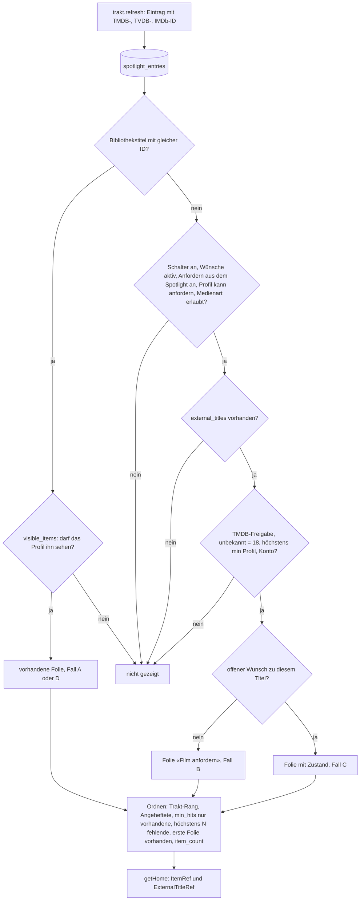

# Konzept 25 · Spotlight: fehlende Titel auf der Bühne

> **Kurz gesagt.** Das Spotlight zeigt künftig auf Wunsch des Administrators auch Trakt-Titel, die noch
> nicht in der Bibliothek stehen, höchstens fünf von zwanzig und nur für Profile, die anfordern können. Sie
> tragen den Chip «Noch nicht in der Bibliothek» und statt «Abspielen» den Knopf «Film anfordern». Die
> erste Folie ist immer ein vorhandener Titel, damit Vormalen und Vorladen unverändert bleiben. Damit
> vorhandene Serien nicht fälschlich als fehlend gelten, speichert der Trakt-Abruf neu auch TVDB- und
> IMDb-ID. Ab Werk ist alles aus.

Grundlage: [Anhang F](anhang/F-entscheid-blatt.md), Abschnitte 2.13, 3 und 4 (Band «Fehlende Titel»). Bestand mit Belegen:
`01-bestandsanalyse.md` Abschnitte 2 und 3. Den Anforderungsdialog und die Zustände beschreibt
`02-funktionskonzept.md`. Gebaut wird das in Stufe 3 «Spotlight». Offen als F-8 und F-9.

## 1. Heute

- Eine Trakt-Liste, bis 100 Einträge je Medienart, gespeichert in `spotlight_entries`
  (`server/internal/metadata/trakt.go:291-298`).
- Die Startseite zeigt nur Einträge mit Treffer in der Bibliothek, die das Profil sehen darf (innerer Join
  mit `items` und `visible_items`, `server/queries/scoped/spotlight.sql:9-16`).
- Ordnung: Trakt-Position, Angeheftete einfügen, `min_hits` prüfen, auf `item_count` (5–20) schneiden
  (`server/internal/visibility/discover.go:383-447`). Unter `min_hits` Treffern fehlt die Reihe.
- Bühne: Folie mit Hintergrund, Logo, Metazeile, «Abspielen», «Details», «Trailer»; Posterreihe darunter
  stellt den Titel ins Band (`web/src/ui/HeroCarousel.tsx`, `web/src/features/catalog/HomePage.tsx:586-616`).
- Fehlende Einträge sieht nur die Verwaltung, ohne Poster und ohne Aktionen
  (`web/src/features/admin/spotlight/columns.tsx:106,126-129`).
- S-4 (Frage 11, `docs/planning/04-entscheidungen.md:20`) verbietet fehlende Titel auf der Startseite; ADR 0011
  verwirft den Schalter dafür (`docs/adr/0011-spotlight.md:99`). ADR 0038 löst beides ab.

## 2. Die vier Fälle

| Fall | Bühne | Posterreihe | Spotlight-Liste |
|---|---|---|---|
| **A vorhanden** | wie heute: «Abspielen», «Details», «Trailer» | wie heute: Stift, Merken, Gesehen-Haken | wie heute |
| **B fehlt** | Chip «Noch nicht in der Bibliothek» in der Metazeile; Hauptknopf «Film anfordern» / «Serie anfordern» (Plus-Symbol); «Details» öffnet die Vorschauseite; «Trailer», wenn einer da ist | kein Gesehen-Haken, kein Merken; unten rechts runder Plus-Knopf; Unterzeile «2026 · Noch nicht da» | im Filter «Noch nicht da» |
| **C angefordert** | Chip bleibt; Hauptknopf wird zur Zustandsanzeige («Wird übermittelt», «Freigabe ausstehend», «In Beschaffung», «Teilweise verfügbar»); er führt zu «Meine Wünsche» | Zustandssymbol statt Plus-Knopf; Unterzeile mit Zustand | im Filter «Noch nicht da», mit Zustand |
| **D verfügbar geworden** | normale Folie wie Fall A | wie Fall A | im Filter «In der Bibliothek» |

Fall C zeigt den Zustand jedem Profil, das anfordern kann, auch wenn ein anderes Profil gewünscht hat; ein
solches Profil sieht «Benachrichtige mich» als Mitwunsch (F-7), nie den Namen des Anforderers.

**Fall D im Einzelnen:** Sobald der Titel in der Bibliothek steht und das Profil ihn sehen darf, trifft
der Trakt-Eintrag den Bibliothekstitel. Er ist ab dann ein vorhandener Titel und zählt für `min_hits`.
Für das anfordernde Profil und die Mitwünscher trägt die Folie 14 Tage nach der Erfüllung den Chip «Dein
Wunsch ist da» (wie im Mockup).

**Geschlossene Wünsche:** Ein abgelehnter, fehlgeschlagener oder zurückgezogener Wunsch ist geschlossen. Der
Titel gilt wieder als fehlend und erscheint als Fall B mit «Film anfordern». Die Vorschauseite nennt den letzten
Wunsch mit Datum und Grund. Ausnahme `arr_failed`: Der Request in Jellyseerr sperrt den Titel weiter; die Folie
zeigt «Fehlgeschlagen» ohne Anforderungsknopf (`03-architektur.md`, Abschnitt 8.1).

## 3. Kennzeichnung: unauffällig, aber eindeutig

- Ein Chip «Noch nicht in der Bibliothek» in der Metazeile der Folie, in der gleichen Grösse wie die
  übrigen Angaben (Jahr, Freigabe, Laufzeit).
- Das Plus-Symbol auf dem Hauptknopf und der runde Plus-Knopf am Poster ersetzen «Abspielen» und die
  Haken. Es gibt kein Banner, keine Farbe nur für fehlende Titel und kein gedämpftes Bild.
- Die Unterzeile am Poster sagt «Noch nicht da» oder den Zustand. Ein Zuschauer erkennt also an drei
  Stellen, dass der Titel fehlt: Chip, Knopf, Unterzeile.
- Farben und Texte nur aus Tokens und `locales` (Regel 9).

## 4. Regeln

| Nr. | Regel | Begründung |
|---|---|---|
| S-1 | Schalter «Fehlende Titel zeigen» ist ab Werk **aus**. | S-4 galt bisher; Marco schaltet bewusst ein. |
| S-2 | Höchstens N fehlende Titel (0–10, Vorgabe 5) unter den höchstens 20 Titeln (`item_count`). | Das Spotlight bleibt eine Bühne der Bibliothek. |
| S-3 | Reihenfolge «Wie bei Trakt» (Vorgabe) oder «Nach den vorhandenen». | Trakt-Rang ist die Kuration; die zweite Wahl stellt fehlende ans Ende. |
| S-4 | Die **erste Folie ist immer ein vorhandener Titel.** Steht ein fehlender auf Platz 1, rückt der erste vorhandene davor. | Vormalen und Vorladen setzen ein Bild aus dem Bildspeicher der Bibliothek voraus (Abschnitt 9). |
| S-5 | Fehlende Titel zählen **nicht** für «Ausblenden unter» (`min_hits`). | Sonst erschiene die Reihe mit zu wenig Abspielbarem. |
| S-6 | Profile, die nicht anfordern können, sehen **keine** fehlenden Titel (F-9): ohne Wunschrecht von Konto oder Profil, ohne Zuordnung (und ohne Sammelbenutzer), Medienart nicht erlaubt. | Ein Knopf ohne Wirkung wäre nur Werbung. |
| S-7 | Freigabe des fehlenden Titels aus TMDB, gelesen in der Länderreihenfolge nach ADR 0034 (gewähltes Freigabeland, dann DE, AT, CH, GB, US; das erste Land mit bekanntem Wert gilt, dieselbe Funktion wie für Bibliothekstitel; innerhalb eines Lands der strengste Wert über die Anbieter), gegen min(Profil, Konto); **unbekannt = 18**. | Gleiche Regel wie für Bibliothekstitel (Regel 12: Entscheid im Server). |
| S-8 | Ist «Wünsche aktiv» aus, Jellyseerr ausgeschaltet oder «Anfordern aus dem Spotlight» aus, gilt `canRequest` für das Spotlight als falsch: keine fehlenden Titel, weder auf der Startseite noch in der Spotlight-Liste. | Abgeleitet aus S-6. Ist Jellyseerr nur kurz nicht erreichbar oder lehnt den Schlüssel ab, bleiben die Titel sichtbar (Abschnitt 10). |
| S-9 | Ein fehlender Titel ohne Eintrag in `external_titles` (noch nicht geholt) erscheint nicht. | Ohne Bild und Freigabe gibt es keine Folie und keine Prüfung. |
| S-10 | Ein fehlender Titel, dessen Wunsch für dieses Profil schon `available` ist, ist ein vorhandener Titel (Fall D). | Ein Titel ist nie zugleich fehlend und vorhanden. |

Mit N = 0 und eingeschaltetem Schalter zeigt das Spotlight wie heute nur vorhandene Titel; die
Verwaltung zeigt trotzdem Poster und Zustand der fehlenden Einträge.

**Vorschlag zum Schnitt:** Der Server bildet die Reihe in dieser Folge: (1) Trakt-Liste mit Angehefteten wie
heute; (2) vorhandene und erlaubte fehlende Titel getrennt filtern; (3) `min_hits` nur mit den vorhandenen
prüfen; (4) fehlende auf N kürzen, in Trakt-Reihenfolge; (5) beide Gruppen nach der gewählten Reihenfolge
zusammenführen; (6) S-4 anwenden; (7) auf `item_count` schneiden.

## 5. Teilweise vorhandene Serien im Spotlight

- Eine Serie, die in der Bibliothek steht, ist ein **vorhandener** Titel, auch wenn Staffeln fehlen. Die
  Folie zeigt «Abspielen» wie heute.
- **Vorschlag:** Kennt `series_catalog` fehlende Staffeln und kann das Profil anfordern, zeigt die Metazeile
  zusätzlich «2 von 4 Staffeln»; die Aktion «Staffeln anfordern» liegt auf der Detailseite (M-06), nicht
  auf der Bühne. Die Bühne bleibt so bei höchstens drei Knöpfen.
- Teilweise vorhandene Serien zählen nicht zu den N fehlenden.

## 6. Kuratierung

Der Administrator kann fehlende Einträge künftig genauso kuratieren wie vorhandene. Heute nimmt der
Server Anpassungen auch ohne Treffer an (`server/internal/admin/spotlight.go:178-189`); nur die Oberfläche
bot keine Knöpfe.

| Aktion | für vorhandene | für fehlende |
|---|---|---|
| «Anheften» (Platz in der Reihe) | wie heute | neu; Vorschlag: ein angehefteter fehlender Titel zählt zu den N, und S-4 geht dem Anheften auf Platz 1 vor |
| «Ausblenden» / «Einblenden» | wie heute | neu |
| «Notiz» | wie heute (Bildunterschrift statt Jahr) | neu |
| «Anfordern» | – | neu; **Vorschlag:** fordert im Namen des aktiven Profils (= Hauptprofil, die Verwaltung verlangt es) des Administrators an, über denselben Dialog M-13 |

Die Anpassungen liegen weiter in `spotlight_overrides` mit Schlüssel (`list_key`, `media`, `tmdb_id`) und
überleben jeden Abruf.

## 7. Abgleich über TMDB-, TVDB- und IMDb-ID

- **Heute** liest der Trakt-Client nur `ids.tmdb` (`server/internal/trakt/trakt.go:270-273`). Eine Serie, die
  TVDB zuerst zugeordnet hat, hat keine `tmdb_id` (`server/internal/metadata/tvdb.go:430-434`) und gälte als
  fehlend. Mit eingeschaltetem Schalter würde Slouchcat dann anbieten, eine vorhandene Serie anzufordern.
- **Künftig** speichert `spotlight_entries` zusätzlich `tvdb_id` und `imdb_id` aus Trakt `ids`.
- Ein Eintrag gilt als vorhanden, wenn ein Bibliothekstitel derselben Art eine gleiche TMDB-ID **oder**
  TVDB-ID (Serien) **oder** IMDb-ID hat. Die Abfrage liegt in `visibility` (Regel 2).
- Einträge ohne TMDB-ID fallen weiter weg: Jellyseerr braucht sie als `mediaId`.
- Dieselbe Abgleichsregel gilt für die Suche und für die Erkennung «verfügbar» (`02-funktionskonzept.md`
  Ablauf 4.7).

## 8. Verwaltung «Spotlight»: was bleibt, was dazukommt

Alle heutigen Optionen bleiben (ADR 0035: nichts geht verloren). Ort: Verwaltung › Startseite › Spotlight
(M-27).

**Kopf:** Titel «Spotlight», Hilfetext. **Vorschlag:** Der Satz «Gezeigt werden nur Titel, die in der eigenen
Bibliothek stehen» wird zu «Gezeigt werden Titel aus der eigenen Bibliothek und, wenn eingeschaltet,
fehlende Titel zum Anfordern».

**Band «Quelle»** (unverändert, elf Felder):

| Nr. | Feld | Werte |
|---|---|---|
| 1 | «Auf der Startseite zeigen» | Schalter |
| 2 | «Trakt-Liste» | sieben Listenarten |
| 3 | «Adresse der Liste» | nur bei «per Adresse» |
| 4 | «Medienart» | Nur Filme, Nur Serien, Filme und Serien |
| 5 | «Höchstens» | 5–20 Titel je Profil |
| 6 | «Ausblenden unter» | 0–10 Treffer je Profil; Hinweis neu: «Fehlende Titel zählen nicht.» |
| 7 | «Abruf alle … Stunden» | 6–48 |
| 8 | «Spotlight Wechsel Takt» | 3–15 Sekunden |
| 9 | Abrufzustand | zuletzt abgerufen, Treffer, Schlüssel, Gründe |
| 10 | «Jetzt abrufen» | höchstens einmal je Minute |
| 11 | «Speichern» | speichert auch das Band «Fehlende Titel» |

**Band «Fehlende Titel»** (neu, zugeklappt; gespeichert zusammen mit dem Band «Quelle» über dessen «Speichern»):

| Feld | Werte |
|---|---|
| «Fehlende Titel zeigen» | Schalter, ab Werk aus |
| «Höchstens fehlende Titel» | 0–10, Vorgabe 5 |
| Reihenfolge | «Wie bei Trakt» / «Nach den vorhandenen» |
| Zustand | «7 fehlende Titel dürften erscheinen; 3 sind angefordert» |
| Hinweis | ohne Jellyseerr, mit «Wünsche aktiv» aus oder mit «Anfordern aus dem Spotlight» aus: «Fehlende Titel erscheinen erst, wenn Wünsche eingerichtet sind.» bzw. «Anfordern aus dem Spotlight ist aus.» mit Link zu Medien › Wünsche › Einstellungen (Wortlaut Vorschlag) |

**Band «Einträge der Liste»:** Spalten «Rang», «Titel», «Status», «Eigene Notiz», «Aktionen» bleiben.
Fehlende Einträge bekommen Poster (aus `external_titles`, über die Admin-Bildroute `getAdminExternalTitleImage`), den Status «Noch nicht in der Bibliothek» oder
«Angefordert · In Beschaffung» und die Aktionen «Anheften», «Ausblenden», «Notiz», «Anfordern».

**Band «Verwaiste Anpassungen»** und **Fussnote** bleiben unverändert.

Die Einstellungen der Wünsche selbst liegen unter Medien › Wünsche › Einstellungen (M-25), das verweist
hierher («Fehlende Titel im Spotlight: Aus · Zur Seite Spotlight»). Jede Einstellung hat genau einen Ort.

## 9. Daten für fehlende Titel

- **`external_titles`** hält je fehlendem Titel die Daten aus TMDB: Titel je Sprache
  (`external_title_texts`), Jahr, Beschreibung, Laufzeit, Genres, Freigabe je Land, Poster, Backdrop, Logo,
  Trailer; bei Serien Staffeln mit Folgenzahl und Datum, Status und nächste Folge.
- Der Job `titles.refresh` (24 h, läuft nach `trakt.refresh`) füllt sie für alle fehlenden Spotlight-Einträge.
  Die Startseite ruft TMDB also nie selbst auf.
- **Bildweg:** Slouchcat lädt Poster, Backdrop und Logo in den eigenen Bildspeicher und liefert sie über
  `GET /titles/{media}/{tmdbId}/images/{kind}/{size}` (`http.Handler`, `scoped`). Die Verwaltung nutzt die
  eigene Route `GET /admin/titles/{media}/{tmdbId}/images/{kind}/{size}` (`admin`), weil Verwaltungsantworten
  keine scoped Adressen tragen. Der Browser lädt nie direkt von TMDB.
- Die Startseite liefert fehlende Titel als eigenes Schema `ExternalTitleRef` neben `ItemRef` (nicht
  brechend). Einzelheiten: `08-datenmodell-api.md`, Abschnitte 4.2 und 4.6.
- `spotlight_entries` bleibt eine flüchtige Kopie der Trakt-Liste. Wunschzustände hängen nie daran, sondern
  an `wishes`.

## 10. Jellyseerr nicht erreichbar, kein Recht

| Lage | Spotlight |
|---|---|
| Jellyseerr kurz nicht erreichbar | fehlende Titel erscheinen weiter; «Film anfordern» nimmt den Wunsch an (`queued`, «Wird übermittelt») |
| Jellyseerr meldet «Schlüssel ungültig» (403) | wie «nicht erreichbar», solange der Administrator «Jellyseerr verwenden» nicht ausschaltet: fehlende Titel bleiben sichtbar, Wünsche warten im Ausgangsfach, die Übersicht meldet den Fehler |
| «Jellyseerr verwenden», «Wünsche aktiv» oder «Anfordern aus dem Spotlight» aus | keine fehlenden Titel (S-8) |
| Profil oder Konto ohne Wunschrecht | keine fehlenden Titel (S-6) |
| Konto ohne Zuordnung (und kein Sammelbenutzer) | keine fehlenden Titel (S-6); den Fall sieht der Administrator in der Verwaltung (Übersicht, Zuordnung, Konten) |
| Medienart nicht erlaubt (z. B. «Serien erlauben» aus) | keine fehlenden Titel dieser Art |
| Trakt-Abruf fehlgeschlagen | die Tabelle ist leer, das Spotlight fehlt ganz wie heute; offene Wünsche bleiben unberührt |

## 11. Performance, Caching, Vormalen, Vorladen

| Punkt | Heute | Künftig | Warum |
|---|---|---|---|
| `homeQuery` | `staleTime` 30 s (`web/src/features/catalog/queries.ts:28-55`) | unverändert | Zustände ändern sich höchstens alle 5 min (`wishes.sync`) |
| **Prepaint** (Vormalen des ersten Bühnenbilds durch den Server) | nur wenn Spotlight die erste Reihe ist (`server/internal/api/preload.go:24-27,100,194`) | unverändert | die erste Folie ist immer vorhanden (S-4), ihr Bild liegt im Bildspeicher der Bibliothek |
| Vorladen von `/home?start=K` | Server würfelt die Startfolie (ADR 0016) | **Vorschlag:** `heroStart` zeigt nur auf vorhandene Folien | sonst wäre die erste sichtbare Folie fehlend |
| Bilder der Bühne | aktive Folie sofort, nächste zwei danach (`web/src/ui/HeroCarousel.tsx:210-215`) | unverändert; fehlende Folien nutzen den neuen Bildweg | gleiche Ladeordnung, andere Adresse |
| Service Worker | Bilder `/api/v1/items/{id}/images/…` CacheFirst, sonst `/api` NetworkOnly (`web/vite.config.ts:141-161`) | **Vorschlag:** Regel erweitern auf `/api/v1/titles/*/images/*`, gleicher Cache | sonst lädt jedes Bühnenbild eines fehlenden Titels bei jedem Wechsel neu |
| Kosten für `getHome` | Join mit `items`, `visible_items` | dazu ein Join mit `external_titles` und `wishes` je Profil | lokale Abfragen, keine Aufrufe an TMDB oder Jellyseerr |
| Höchstzahl | `MaxRowItems = 20` | unverändert, fehlende zählen mit | – |

Unverändert bleiben ausserdem Rotation, Pause bei Fokus, Endlosband und das Verhalten unter 768 px. Grund:
Eine fehlende Folie hat denselben Aufbau wie eine vorhandene, nur andere Knöpfe.

## 12. Aktualisierung nach dem Anfordern

1. `createWish` antwortet mit dem Wunsch (201) oder dem bestehenden (200, auch Mitwunsch).
2. Die App macht diese Abfragen ungültig: Startseite (`['home']`), die Spotlight-Liste, «Meine Wünsche», den
   Zähler der Seitenleiste, die Vorschauseite des Titels und die Suchergebnisse.
3. Bühne und Poster zeigen sofort den neuen Zustand aus der Antwort, ohne auf den nächsten Abruf zu warten.
4. Solange das Profil offene Wünsche hat (`queued`, `pending`, `processing`, `partial`), fragt die App den
   Zustand alle 30 s ab, nur bei sichtbarem Tab. Ohne offene Wünsche ruht die Abfrage.
5. Antwortet `createWish` mit 409 `already_available`, zeigt der Dialog «Schon in der Bibliothek» und einen
   Link zum Titel; die Startseite lädt neu.

## 13. Spotlight-Liste `/lists/spotlight`

- Die Liste hinter dem Titel «Spotlight» zeigt heute die Reihe in ihrer Ordnung
  (`web/src/features/catalog/HomeListPage.tsx`).
- Neu: Filter «Alle / In der Bibliothek / Noch nicht da» (M-02). «Noch nicht da» erscheint nur für Profile,
  die anfordern können.
- In der Liste gilt der Deckel N nicht. Sie zeigt alle erlaubten Einträge der Trakt-Liste, die
  `external_titles` kennt, mit der Medienart aus dem Band «Quelle», geblättert wie heute (wie im Mockup).
  Fehlende Titel haben hier dieselben Karten wie in der Posterreihe.
- Ein Druck auf eine fehlende Karte öffnet die Vorschauseite, der Plus-Knopf den Dialog.

## 14. Wie ein Trakt-Eintrag zur Folie wird

