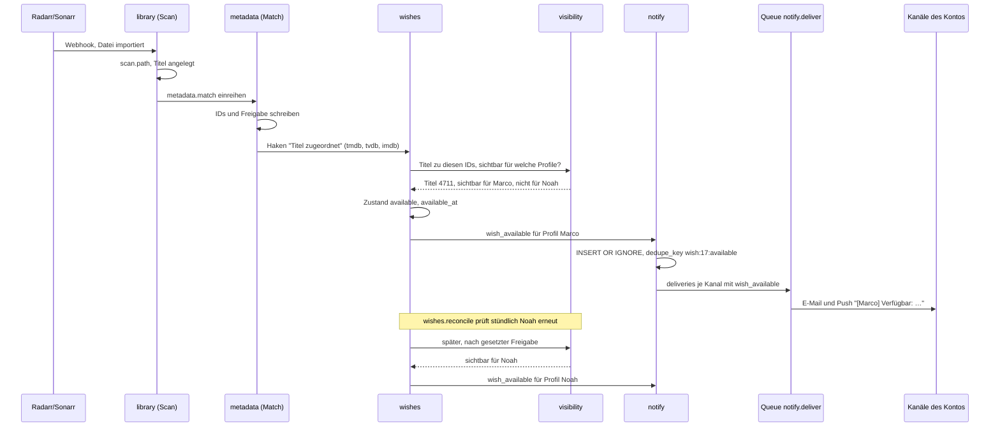

# Konzept 25 · Benachrichtigungen

> **Kurz gesagt.** Über Wünsche benachrichtigt nur Slouchcat, mit den Wegen, die es schon gibt: dem Eingang
> des Profils und den Kanälen des Kontos (E-Mail, Web-Push, Telegram). Die wichtigste Meldung ist
> «verfügbar»: Sie kommt erst, wenn Slouchcat den Titel für **dieses** Profil abspielen kann, nicht wenn
> Jellyseerr «verfügbar» meldet (F-13). Neu sind fünf Eingangsarten und drei Kanal-Ereignisse; Stufe 2 bringt
> «verfügbar» für Filme und ganze Serien, Stufe 4 die Staffel- und Zustandsmeldungen und «Freigabe nötig». Ab Werk ist
> nur «Wünsche: verfügbar» auf den Kanälen an, für Administratoren dazu «Wünsche: Freigabe nötig» (F-14). Ein
> eindeutiger Schlüssel je Profil verhindert doppelte Meldungen. Bei Profilen mit PIN nennt die externe
> Nachricht den Titel nicht (F-15). Der Download-Fortschritt aus Radarr und Sonarr ist nur eine Anzeige beim
> Wunsch und löst keine Meldung aus, auch «Download verzögert» nicht.

Grundlage ist [Anhang F](anhang/F-entscheid-blatt.md) (Abschnitte 2.8, 2.16, 2.17, 5). Belege zum heutigen System stammen aus
[Anhang B](anhang/B-konten-benachrichtigungen.md) (Abschnitte 5 bis 8), am Anker `ba6efe31` im Worktree nachgesehen. Die Abläufe aus
Zuschauersicht stehen in `02-funktionskonzept.md` (Abschnitte 4.6 und 4.7), die Kanalseite der Verwaltung in
`07-administration.md` (Abschnitt 11). Für Fassung 3 kommen die Fälle aus [Anhang H](anhang/H-nachtrag-17-november.md)
dazu (Eröffnung, Limit, Profil-Tag), aus Marcos zweiter Rückmeldung der Download-Fortschritt (E-7, Anhang H 8.4);
sie ändern nichts an Arten und Ereignissen. Abschnitte mit **Vorschlag**
gehen über Anhang F hinaus.

## 1. Das heutige System in fünf Sätzen

1. Der **Eingang** gehört dem Profil: Tabelle `notifications` mit `profile_id`, heute nur die Art
   `new_episode` (`server/migrations/00015_discover.sql:332`), eindeutig je (`profile_id`, `kind`, `item_id`)
   (`:337`), gelesen über `visible_items`.
2. Die **Kanäle** gehören dem Konto: `account_channels` je Kanal mit eingeschaltet/aus und einer
   Ereignisliste `events` (JSON), heute `new_content`, `errors`, `invitations`, `announcements`
   (`server/internal/notify/channels.go:23`).
3. Ein Erzeuger ruft `Emit`; der **Dispatcher** sucht die Kanäle, deren Ereignisliste das Ereignis enthält,
   setzt bei Profil-Ereignissen `[Profilname] ` vor den Betreff (`server/internal/notify/dispatch.go:108`) und
   legt je Ziel eine Zeile `deliveries` an (`event` mit CHECK, `server/migrations/00018_drop_acquisition_channel.sql:26`).
4. Der Job `notify.deliver` stellt zu (Pool `notify`, Priorität 3, 5 Versuche mit Backoff, Schlüssel
   `notify.deliver:<id>`); Push geht an **alle** Geräte des Kontos.
5. Vorbild für Wünsche ist `new_content`: Eintrag je Profil mit `INSERT OR IGNORE`, Sichtbarkeit einmal vor dem
   Versand geprüft, Kanalmeldung nur für eine neue Zeile.

## 2. Neue Eingangsarten und Kanal-Ereignisse

| Auslöser | Eingang (Text deutsch) | Link | Empfänger | Eingangsart | Kanal-Ereignis | Vorgabe Kanal | Stufe |
|---|---|---|---|---|---|---|---|
| Film in Slouchcat für das Profil abspielbar | «Verfügbar: Dune: Part Two» · «Dein Wunsch ist da» | `/items/{id}` | Anforderer und Mitwünscher, je sichtbar | `wish_available` | `wish_available` «Wünsche: verfügbar» | an | 2 |
| Serie: alle gewünschten Staffeln abspielbar | «Verfügbar: Tulsa King» · «Alle gewünschten Staffeln sind da» | `/items/{id}` der Serie | wie oben | `wish_available` | `wish_available` | an | 2 |
| Serie: eine gewünschte Staffel vollständig abspielbar (Abschnitt 3.3), weitere fehlen noch | «Tulsa King: Staffel 3 ist verfügbar» · «Weitere Staffeln folgen»; bei einer laufenden Staffel «Tulsa King: Die bisher erschienenen Folgen von Staffel 3 sind da» | `/items/{id}` der Staffel | wie oben | `wish_season_available` | `wish_available` | an | 4 |
| Jellyseerr hat freigegeben (vorher `pending`) | «Freigegeben: Paddington in Peru» · «Wird jetzt beschafft» | `/wishes?focus={wishId}` | wie oben | `wish_approved` | `wish_status` «Wünsche: freigegeben, abgelehnt, fehlgeschlagen» | aus | 4 |
| Jellyseerr hat abgelehnt | «Abgelehnt: Paddington in Peru» · «Ohne Angabe eines Grundes» | `/wishes?focus={wishId}` | wie oben | `wish_declined` | `wish_status` | aus | 4 |
| Übergabe gescheitert oder endgültig abgewiesen | «Fehlgeschlagen: Paddington in Peru» · Klartext, etwa «Limit erreicht: Jellyseerr hat den Wunsch nicht angenommen.» | `/wishes?focus={wishId}` | wie oben | `wish_failed` | `wish_status` | aus | 4 |
| Wunsch wartet in Jellyseerr auf Freigabe | kein Eingang | `/admin/wishes?state=pending` | alle Administratorkonten | – | `wish_review` «Wünsche: Freigabe nötig» (nur Administratoren) | an | 4 |
| Übermittlung nach 24 h ohne Erfolg | kein Eingang | `/admin/wishes` | alle Administratorkonten | – | `errors` (besteht) | wie heute | 2 |
| Konto nach 24 h noch nicht in Jellyseerr eröffnet (`seerr.provision` scheitert) | kein Eingang | `/admin/wishes/mapping` (Seite «Jellyseerr-Benutzer») | alle Administratorkonten | – | `errors` (besteht) | wie heute | 1 |

Die Kanal-Ereignisse und Eingangsarten stammen aus Anhang F (2.16). Die Stufen sind ein Redaktionsentscheid vom 17. November 2026
(`11-entscheide-und-adr.md` Abschnitt 7): **Stufe 2** bringt die Eingangsart und das Kanal-Ereignis `wish_available` für Filme und ganze
Serien; **Stufe 4** bringt die Staffel-Meldungen (`wish_season_available`), «freigegeben, abgelehnt,
fehlgeschlagen» (`wish_approved`, `wish_declined`, `wish_failed`, Kanal `wish_status`) und `wish_review`.
**Vorschlag** sind die Texte und die Links mit `focus`. Bis Stufe 4 zeigt nur «Meine Wünsche» die Zustände
«freigegeben», «abgelehnt» und «fehlgeschlagen». Die Zeile «Konto nicht eröffnet» ist Empfehlung für Fassung 3
und nutzt das bestehende Ereignis `errors`; ein neues Ereignis braucht sie nicht. Für das Limit, das Passwort,
den Profil-Tag und den Download-Fortschritt gibt es keine Benachrichtigung (Abschnitt 4).

**Vorschlag zu «freigegeben»:** Nur der Übergang `pending` → `processing` meldet «freigegeben». Gibt
Jellyseerr einen Wunsch schon beim Anlegen frei (Auto-Freigabe), sieht das Profil das sofort im Dialog
(«Wird sofort beschafft»); eine Meldung käme Sekunden später und wäre doppelt.

## 3. Der wichtigste Auslöser: «verfügbar»

### 3.1 Wann

1. Radarr oder Sonarr legt die Datei ab; Slouchcat liest sie ein (Webhook wie heute, Watcher oder Vollscan).
   Dass Radarr oder Sonarr importiert haben, zeigt der Download-Fortschritt als «Wird eingelesen»; es ist kein
   Auslöser für «verfügbar».
2. Der Metadaten-Match schreibt die Anbieter-IDs. An dieser Stelle hängt heute der Haken `WithRelink`
   («after it wrote the provider ids of a film or series», `server/internal/metadata/metadata.go:344-349`).
   Ein neuer Haken «Titel zugeordnet» (`WithMatched`) stösst den Dienst `wishes` an (Anhang F 7). Der Match
   ruft ihn nach `relinkQueued`, wenn kein Zwilling gemeldet wurde, auch bei `relink = false`, bei Serien erst
   nach `matchSeasons` (`server/internal/metadata/match.go:191`, `:300-303`; `03-architektur.md`, Abschnitt 11).
3. `wishes` sucht offene Wünsche mit derselben ID, bei Serien **TVDB zuerst**, dann TMDB, dann IMDb, bei Filmen
   TMDB, dann IMDb (`05-spotlight-integration.md`, Abschnitt 3.3, N-61), und fragt
   `visibility`, ob es den Titel gibt und welches Profil ihn sehen darf (Regel 2: `wishes` fragt `items` nicht
   selbst ab).
4. Stündlich läuft `wishes.reconcile` als Netz für alles, was der Haken verpasst hat (Neustart, späte
   Freigabe, Titel mit nachträglich korrigierter ID).

Der Haken für neue Folgen (`WithNewEpisodes`) taugt nicht: Er feuert vor dem Match, also ohne IDs, und nur
für Folgen ([Anhang C](anhang/C-integrationen-jobs-regeln.md) 6). Der Zustand «AVAILABLE» in Jellyseerr löst allein nichts aus; er zeigt nur
den Zusatz «wird eingelesen» am Zustand `processing`.

### 3.2 Sichtbarkeit je Profil

- Für jedes Profil in `wish_requesters` prüft der Server einzeln, ob der Titel für dieses Profil sichtbar ist
  (`visible_items`: vorhanden, verfügbar, Freigabe gegen min(Profil, Konto), Bibliotheken).
- Erst dann entsteht der Eingangseintrag und die Kanalmeldung für dieses Profil. Ein Erwachsener kann so früher
  Bescheid bekommen als ein Kind.
- **Freigabe unbekannt:** Ein neu eingelesener Film ohne Freigabe zählt als 18 (`COALESCE(effective_rating, 18)`,
  Anhang B 1.1). Für ein Kinderprofil wartet die Meldung, bis der Match oder das Auffüllen eine Freigabe
  setzt; `wishes.reconcile` prüft stündlich nach.
- Je Anforderer merkt sich Slouchcat, ob die Meldung «verfügbar» erfolgt ist (`wish_requesters.notified_at`;
  bei Staffeln `wish_seasons.notified_at`, `08-datenmodell-api.md`, Abschnitte 2.5 und 2.6; Lücke in Anhang F,
  als Redaktionsentscheid vom 17. November 2026 gesetzt). `wishes.reconcile` prüft Anforderer ohne Meldung bei jedem Lauf
  erneut.
- Ist der Titel für ein Profil nach den Regeln der Bibliothek strenger eingestuft als laut TMDB beim Anfordern,
  bleibt der Wunsch für dieses Profil «In Beschaffung · wird eingelesen». Nach 7 Tagen schliesst Slouchcat ihn
  für dieses Profil als «Fehlgeschlagen» mit dem Text «Für dieses Profil nicht freigegeben»
  (**Vorschlag**, wie `03-architektur.md`, Abschnitt 8.3). Dafür gibt es keine eigene Meldung; der Titel bleibt
  für das Profil 404 und wird nie als «gesperrt» gezeigt. Die Verwaltung zeigt in der Diagnose «für Profil Noah
  nicht sichtbar».

### 3.3 Film, Staffel, ganze Serie

| Art | «verfügbar», wenn | Zustand des Wunsches |
|---|---|---|
| Film | der Film ist als Titel vorhanden, mit der ersten abspielbaren Datei, und für das Profil sichtbar | `available` |
| Staffel | die Staffel ist **vollständig**: Slouchcat kann ihre Folgen für das Profil abspielen **und** die Zahl der abspielbaren Folgen erreicht die Folgenzahl laut `series_catalog` (bei laufenden Staffeln: alle bisher ausgestrahlten Folgen) | Staffel in `wish_seasons` `available`; Wunsch `partial`, solange gewünschte Staffeln fehlen |
| Ganze Serie (alle gewünschten Staffeln) | jede gewünschte Staffel ist verfügbar | `available` |

Redaktionsentscheid (17. November 2026): Eine Staffel ist erst verfügbar, wenn sie vollständig ist. Eine
eingelesene Folge von zehn genügt nicht; die Staffel bleibt für den Wunsch «In Beschaffung». Die Folgenzahl
kommt aus TMDB: aus `series_catalog` der Serie in der Bibliothek, solange es ihn noch nicht gibt (vor Stufe 4
oder vor dem ersten Lauf von `series.catalog`) aus `external_titles.seasons` des Wunsches. Der Zustand der
Staffel in Jellyseerr ist keine Bedingung.

**Laufende Staffel.** Ist die Staffel noch nicht fertig ausgestrahlt, zählen nur die bisher ausgestrahlten
Folgen. Sind sie alle da, kommt einmal die Meldung «Die bisher erschienenen Folgen sind da». Weitere Folgen meldet
danach die bestehende Benachrichtigung der Merkliste (`new_episode`), nicht der Wunsch; sie kommt nur,
wenn die Serie auf der Merkliste des Profils steht (Anhang B 1.3, Zeile «Merkliste»).

### 3.4 Mitwünscher

Mitwünscher (`role` = `joined`) bekommen dieselben Meldungen wie der Anforderer, je nach ihrer eigenen
Sichtbarkeit. Keine Meldung nennt, wer sonst gewünscht hat.

## 4. Geprüfte weitere Ereignisse

| Ereignis aus dem Auftrag | Entscheid | Begründung |
|---|---|---|
| Wunsch eingereicht | **keine** Benachrichtigung | Das Profil hat gerade selbst geklickt. Rückmeldung am Bildschirm im Dialog und in «Meine Wünsche» (Anhang F 2.16). |
| genehmigt | Eingang `wish_approved`, Kanal `wish_status` (aus) | nützlich bei Kinderprofilen; nicht bei Auto-Freigabe (Abschnitt 2). |
| abgelehnt | Eingang `wish_declined`, Kanal `wish_status` (aus) | ohne Grund, weil Jellyseerr keinen kennt ([Anhang D](anhang/D-jellyseerr-api.md) 8). |
| fehlgeschlagen | Eingang `wish_failed`, Kanal `wish_status` (aus); Administratoren bekommen `errors` | Klartext für das Profil (Limit, Sperrliste, kein Recht); den Administratoren hilft das bestehende Fehlerereignis. |
| Staffel verfügbar | Eingang `wish_season_available`, Kanal `wish_available` | Serien kommen oft staffelweise; die gewünschte Staffel ist der eigentliche Nutzen. |
| Serie vollständig | als `wish_available`, keine zusätzliche Meldung | Die letzte fehlende Staffel macht den Wunsch `available`; eine Staffelmeldung und eine Serienmeldung zugleich wären doppelt. |
| Zurückgezogen | keine | eigene Handlung |
| Mitwunsch angenommen | keine | eigene Handlung |
| Jellyseerr meldet «verfügbar», Slouchcat hat die Datei noch nicht | keine | F-13; Anzeige «wird eingelesen» genügt. |
| Freigabe nötig (für Administratoren) | Kanal `wish_review` (an für Administratoren) | Jellyseerr meldet es zwar selbst, aber nicht an Slouchcats Kanäle; ab F-16 kann der Administrator in Slouchcat freigeben. |
| Limit erreicht | **keine** Benachrichtigung | Der Dialog «Anfordern» sagt es im Moment, in dem es zählt: wie viel frei ist und wann der nächste Platz frei wird (`04-benutzer-profilmapping.md`, Abschnitt 17.6). Die Übersicht der Verwaltung zeigt «Limit erreicht» je Konto. |
| Jellyseerr lehnt einen Wunsch trotz Vorprüfung wegen des Limits ab | Wunsch `failed` mit Grund `quota`; derselbe Weg wie jedes «fehlgeschlagen»: Eingang `wish_failed`, Kanal `wish_status` (ab Stufe 4) | Kommt vor, wenn zur gleichen Zeit jemand direkt in Jellyseerr wünscht (Jellyseerr zählt, Marco E-3). Kein eigenes Ereignis. |
| Konto lässt sich nicht in Jellyseerr eröffnen | nach 24 h `errors` an die Administratoren (besteht), kein Eingang | Ein Fehler der Einrichtung, wie die Übermittlung nach 24 h. Der Zuschauer sieht nichts; das Konto kann bis dahin nicht anfordern. |
| Profil-Tag in Radarr oder Sonarr nicht gesetzt | **keine** | Der Wunsch läuft unverändert weiter; die Verwaltung zeigt «Tag noch nicht gesetzt», der nächste Abgleich holt es nach (`04-benutzer-profilmapping.md`, Abschnitt 16.5). |
| Download-Fortschritt («Wird gesucht», «Wird heruntergeladen · 45 % · noch 12 min», «Wird eingelesen») | **keine** | Nur Anzeige beim Wunsch unter «Meine Wünsche», auf der Wunschkarte der Vorschauseite und in der Verwaltung (Marco, E-7; N-82, N-87; `02-funktionskonzept.md`, Abschnitt 5.3). Die Meldung «verfügbar» kommt weiter erst, wenn Slouchcat den Titel abspielen kann. |
| «Download verzögert» (Warteschlange meldet Warnung oder Fehler) | **keine** | Wird angezeigt, nicht gesendet. Die Meldung von Radarr oder Sonarr sieht nur die Verwaltung unter Anfragen (N-83). Erst wenn Jellyseerr den Wunsch als gescheitert führt, gilt der Weg «fehlgeschlagen» oben. |
| Radarr oder Sonarr für den Fortschritt nicht erreichbar | **keine** | Der Wunsch bleibt «In Beschaffung»; die Verwaltung zeigt «Fortschritt nicht lesbar» (N-85). |
| Passwort an Jellyseerr nicht übergeben | **keine** | Slouchcat übernimmt es bei der nächsten Anmeldung; die Seite «Jellyseerr-Benutzer» zeigt den Stand (`04-benutzer-profilmapping.md`, Abschnitt 13). |

## 5. Getrennte Einstellbarkeit

- Die Wahl liegt dort, wo sie heute liegt: in der **Ereignisliste je Kanal** (`account_channels.events`). Je
  Kanal kommen drei Häkchen dazu: «Wünsche: verfügbar», «Wünsche: freigegeben, abgelehnt, fehlgeschlagen» und
  nur für Administratoren «Wünsche: Freigabe nötig».
- `wish_review` ist wie `errors` Administratoren vorbehalten: Der Server lehnt es für andere Konten ab
  (`ErrEventNotAllowed`, `server/internal/notify/channels.go:207`), die App blendet das Häkchen aus.
- Staffelmeldungen haben kein eigenes Häkchen; sie laufen über «Wünsche: verfügbar». Drei Ereignisse statt
  fünf halten die Seite übersichtlich.
- **Kein Schalter je Profil.** Kanäle gehören dem Konto; ein Schalter je Profil wurde für Kanäle schon einmal
  verworfen (ADR 0009, Anhang B 6). Der Schutz für einzelne Profile ist die PIN-Regel (Abschnitt 8).
- **Der Eingang ist immer an.** Er ist kein Kanal, und das gilt weiter.
- Ändern darf nur das Hauptprofil oder eine Sitzung ohne Profil (`requireManager`,
  `server/internal/notify/channels.go:104`).

## 6. Standardwerte und Rückfüllung

Heute legt `ChannelEnsureDefaults` (`server/queries/system/notify_channels.sql:7-18`) für jedes Konto drei
Zeilen an:

| Konto | E-Mail | Web-Push | Telegram | Ereignisse |
|---|---|---|---|---|
| gewöhnliches Konto (`role = 'user'`) | an | aus | aus | `["announcements"]` |
| Administrator | aus | aus | aus | `["new_content","errors","invitations","announcements"]` |

Ein gewöhnliches Konto bekommt damit heute auf keinem Kanal neue Inhalte. Für Wünsche wäre das zu still.

**Neu (F-14):**

| Konto | zusätzliche Ereignisse auf allen drei Kanälen |
|---|---|
| gewöhnliches Konto | `wish_available` |
| Administrator | `wish_available`, `wish_review` |

- Wirksam wird das nur auf eingeschalteten Kanälen. Ein gewöhnliches Konto bekommt «verfügbar» also ab Werk
  per E-Mail; ein Administrator erst, wenn er einen Kanal einschaltet. Die Übersicht zeigt wartende
  Freigaben ohnehin (`07-administration.md`, Abschnitt 2).
- **Rückfüllung (Vorschlag):** Die Migration von Stufe 2 ergänzt `wish_available` in den Ereignislisten
  **aller** bestehenden Kanalzeilen. `wish_review` kommt erst mit Stufe 4 dazu, wenn es einen Erzeuger hat
  (ADR 0009: kein Ereignis ohne Erzeuger): Die Datenmigration von Stufe 4 ergänzt es in den Kanalzeilen der
  bestehenden Administratorkonten, und `ChannelEnsureDefaults` nimmt es für neue Administratorkonten auf.
  `wish_status` kommt nirgends dazu. Wer bisher alle Häkchen entfernt hat, bekommt so eines dazu; die
  Versionshinweise sagen es. Die Migration ändert nur Listen, nie `enabled`.

## 7. Schutz vor doppelten Meldungen

| Stelle | Schutz |
|---|---|
| Grundlage | Massgeblich ist `wish_requesters.notified_at` (bei Staffeln `wish_seasons.notified_at`): Ist es gesetzt, meldet Slouchcat «verfügbar» für dieses Profil nie wieder. Der `dedupe_key` schützt nur gegen gleichzeitige Läufe, denn gelesene Eingangseinträge räumt Slouchcat nach 90 Tagen weg (Anhang B 5.3, Punkt 10); danach fehlte der Schlüssel. |
| Eingang | neuer eindeutiger Schlüssel `dedupe_key` je Profil, `INSERT OR IGNORE`; nur eine neue Zeile löst eine Kanalmeldung aus (wie `server/internal/notify/notify.go`, Anhang B 5.5). Schlüssel: `wish:<id>:available`, `wish:<id>:season:<n>`, `wish:<id>:approved`, `wish:<id>:declined`, `wish:<id>:failed`. |
| Haken und Nachlauf | Der Haken nach dem Match und `wishes.reconcile` dürfen beide auslösen; `notified_at` und der Schlüssel fangen das zweite ab. |
| Abgleich alle 5 min | Ein Zustandswechsel wird einmal erkannt; ein zweiter Lauf trifft denselben Schlüssel. |
| Wiederholungen der Queue | `notify.deliver` wiederholt eine bestehende Zeile `deliveries`, erzeugt keine neue (Schlüssel `notify.deliver:<id>`). Bekannte Lücke bleibt: doppelter Push nach Teilerfolg (Anhang B 5.5). |
| Mitwunsch | jedes Profil hat seinen eigenen Schlüssel und bekommt genau eine Meldung. **Vorschlag:** Treffen im selben Lauf mehrere Profile **eines** Kontos zu, geht je Kanal **eine** Nachricht mit allen Profilnamen hinaus («[Marco, Noah] Verfügbar: …»); der Eingang bleibt je Profil. Ist eines der Profile PIN-geschützt, gilt die PIN-Regel für die ganze Nachricht. |
| Staffeln | je Staffel ein Schlüssel. **Vorschlag:** Werden im selben Lauf mehrere Staffeln verfügbar, kommt eine Meldung «Staffeln 2 und 3 sind verfügbar». Macht die Staffel den Wunsch vollständig, kommt nur `wish_available`; die Schlüssel der Staffeln werden trotzdem geschrieben, damit keine späte Staffelmeldung folgt. |
| Zustand kippt zurück | **Vorschlag:** Wird ein verfügbarer Titel gelöscht und später wieder eingelesen, kommt keine zweite Meldung, weil `notified_at` gesetzt ist, auch wenn der Eingangseintrag längst weggeräumt ist. Ein neuer Wunsch (neue `id`) hat neue Schlüssel und eigene Zeilen in `wish_requesters`. |
| Höchstens eine Meldung | je Wunsch und Art höchstens eine Meldung; bei Staffeln je Staffel eine. |

## 8. Empfänger und Datenschutz

- **Der Wunsch gehört dem Profil, die Kanäle gehören dem Konto.** Die Eingangseinträge gehen nur an Anforderer
  und Mitwünscher und sind `scoped`.
- **Neuer Leseweg des Eingangs.** Heute verbinden Liste, Zähler und «gelesen» den Eingang **innen** mit
  `visible_items` über `item_id` (`server/queries/system/notify.sql:30-60`). Einträge ohne `item_id` fielen
  so heraus. Künftig gilt:
  - Einträge **mit** `item_id` (`new_episode`, `wish_available`, `wish_season_available`) laufen wie heute über
    `visible_items`.
  - Einträge **ohne** `item_id` (`wish_approved`, `wish_declined`, `wish_failed` zu einem noch fehlenden Titel)
    hängen am Wunsch (`wish_id`). Sie sind sichtbar, wenn das Profil Anforderer oder Mitwünscher dieses Wunsches
    ist (Zeile in `wish_requesters`). Das deckt sich mit der Ausnahme von F-9: Titel mit eigenem Wunsch bleiben
    für das Profil sichtbar.
  - `NotifyList`, `NotifyCount` (Zähler der Glocke), `NotifyMarkRead` und `NotifyMarkAllRead` zählen und lesen
    beide Arten.
- Die Kanalmeldung geht an die Kanäle des
  Kontos mit `[Profilname]` vor dem Betreff, nach der heutigen Regel 5.5 (`docs/planning/03-plan-v1.md:308-310`:
  «Ein Ereignis für ein Profil geht an die Kanäle des Kontos mit Profilname als Präfix … Vor dem Versand prüft
  `notify` über `visibility`, ob das Profil das Item sehen darf»).
- **Neu: PIN-Profile ohne Titel (F-15).** Hat das Profil eine PIN und ist «Externe Nachrichten bei PIN-Profilen
  ohne Titel» an (Vorgabe an), nennt die externe Nachricht keinen Titel: «[Sandra] Ein Wunsch ist jetzt
  verfügbar.» **Vorschlag:** Der Link zeigt dann auf `/wishes` statt auf den Titel; den Weg dorthin schützt die PIN.
  Der Eingang zeigt den Titel, denn er ist nur hinter der PIN lesbar.
- **Push erreicht jedes Gerät des Kontos** (`push_subscriptions` des Kontos, Anhang B 5.3), also auch
  das Tablet eines Kindes. Das ist der Grund für F-15: Externe Kanäle erreichen jedes Gerät des Kontos, auch
  das eines Kindes. Die PIN-Regel ist der Schutz für Erwachsenenprofile, die eine PIN haben.
- **Was F-15 nicht regelt.** Innerhalb des Kontos sieht das Hauptprofil die Wünsche aller Profile
  (`listAccountWishes`, auch die von PIN-Profilen). Das ist gewollt: Das Hauptprofil verwaltet das Konto, setzt
  und entfernt PINs und sieht Schauzeit und Einstellungen aller Profile. Wer das Hauptprofil schützen will,
  setzt dort eine PIN (`docs/adr/0005-profilwahl-sitzung.md:34`).
- **Nur das Hauptprofil ändert Kanäle.** Ein Kinderprofil kann Meldungen nicht auf sein Gerät umleiten
  (`docs/planning/04-entscheidungen.md:50`).
- **Was Administratoren sehen:** in «Wünsche › Anfragen» je Wunsch «Konto · Profil» und alle Mitwünscher
  (Anhang F 2.11); Zustellungen anderer Konten sehen sie nicht (eine solche Seite gibt es nicht),
  fehlgeschlagene `notify.deliver` nur auf «Hintergrundjobs».
- **`wish_review` nur an Administratoren**, ohne `[Profilname]` im Betreff, weil es ein Ereignis des Servers ist.
  Der Text nennt Titel und «Konto · Profil», wie die Verwaltung.
- **Jellyseerr meldet weiter selbst**, wenn es dort eingerichtet ist (etwa E-Mail bei «verfügbar»). Weil jedes
  Konto jetzt einen eigenen Jellyseerr-Benutzer mit seiner E-Mail hat (`04-benutzer-profilmapping.md`,
  Abschnitt 12), können solche Meldungen von Jellyseerr auch die Konten erreichen.
- **Bekannte Grenze (Redaktionsentscheid, Anhang H, Abschnitt 9, K-19).** Die Profile eines Kontos teilen das
  Jellyseerr-Login des Kontos. Wer sich damit in Jellyseerr anmeldet, sieht dort die Wünsche aller Profile des
  Kontos, auch die eines PIN-Profils. Die eigenen E-Mails von Jellyseerr nennen den Titel und umgehen so die
  Regel für PIN-Profile (F-15). Slouchcat kann beides nicht verhindern (`04-benutzer-profilmapping.md`,
  Abschnitt 13.6). **Empfehlung:** In Jellyseerr die eigenen Benachrichtigungen für die eröffneten Benutzer
  ausgeschaltet lassen. Die Verwaltung zeigt dazu einen Hinweis unter Wünsche › Einstellungen; so vermeidet
  Marco auch doppelte Meldungen.

## 9. Texte

### 9.1 Aufwand

| Ort | Neu | Sprachen |
|---|---|---|
| `server/internal/notify/locales/*.json` (Betreff und Text der Kanäle) | 9 Schlüssel: `wish_available`, `wish_available_show`, `wish_season_available`, `wish_season_aired` (laufende Staffel), `wish_approved`, `wish_declined`, `wish_failed`, `wish_review`, `wish_hidden` (PIN-Fassung) | 23 Server-Sprachen (Kette Sprache → de für de-DE → en) |
| `web/src/locales/*.json` (Eingang und Kanalseite) | Darstellung der fünf Arten unter `notifications.*`, drei Ereignisse unter `settings.notifications.events.*`, Leerzustand | `de`, `en`, `de-DE` bei ss-Wörtern (Regel 9) |

Die übrigen Server-Sprachen laufen über den Übersetzungsweg aus ADR 0033; bis dahin greift die Kette auf
Englisch zurück. Grob ein halber Tag für Texte und Tests der Sprachkette.

### 9.2 Beispieltexte

Betreff bei E-Mail, Titel bei Push, erste Zeile bei Telegram. Der Link steht in der E-Mail unten, bei Push als
Ziel des Tippens, bei Telegram als letzte Zeile.

| Ereignis | E-Mail Betreff · Text | Push Titel · Text | Telegram |
|---|---|---|---|
| verfügbar (Film) | «[Noah] Verfügbar: Paddington in Peru» · «Dein Wunsch ist da und kann jetzt geschaut werden.» | «[Noah] Verfügbar: Paddington in Peru» · «Jetzt ansehen» | «[Noah] Verfügbar: Paddington in Peru» + Link |
| verfügbar (Serie) | «[Marco] Verfügbar: Tulsa King» · «Alle gewünschten Staffeln sind da.» | «[Marco] Verfügbar: Tulsa King» · «Alle gewünschten Staffeln» | wie E-Mail-Betreff + Link |
| Staffel | «[Marco] Tulsa King: Staffel 3 ist verfügbar» · «Weitere gewünschte Staffeln folgen.» | «[Marco] Tulsa King: Staffel 3» · «Jetzt verfügbar» | wie E-Mail-Betreff + Link |
| Staffel, läuft noch | «[Marco] Tulsa King: Die bisher erschienenen Folgen von Staffel 3 sind da» · «Neue Folgen meldet die Merkliste.» | «[Marco] Tulsa King: Staffel 3» · «Bisher erschienene Folgen da» | wie E-Mail-Betreff + Link |
| verfügbar, PIN-Profil | «[Sandra] Ein Wunsch ist jetzt verfügbar.» · «Öffne Slouchcat, um ihn zu sehen.» | «[Sandra] Ein Wunsch ist jetzt verfügbar.» | «[Sandra] Ein Wunsch ist jetzt verfügbar.» + Link auf `/wishes` |
| freigegeben | «[Noah] Freigegeben: Paddington in Peru» · «Der Wunsch wird jetzt beschafft.» | «[Noah] Freigegeben» · «Paddington in Peru wird beschafft» | wie E-Mail-Betreff + Link |
| abgelehnt | «[Noah] Abgelehnt: Paddington in Peru» · «Jellyseerr nennt keinen Grund.» | «[Noah] Abgelehnt» · «Paddington in Peru» | wie E-Mail-Betreff + Link |
| fehlgeschlagen | «[Noah] Fehlgeschlagen: Paddington in Peru» · «Limit erreicht: Jellyseerr hat den Wunsch nicht angenommen.» | «[Noah] Fehlgeschlagen» · «Limit erreicht: Jellyseerr hat den Wunsch nicht angenommen.» | wie E-Mail-Betreff + Grund + Link |
| Freigabe nötig | «Freigabe nötig: Paddington in Peru» · «marco@example.ch · Noah wünscht den Film. In Jellyseerr wartet er auf Freigabe.» | «Freigabe nötig» · «Paddington in Peru (Noah)» | wie E-Mail-Betreff + Link auf `/admin/wishes?state=pending` |

## 10. Deep-Links

| Meldung | Pfad | Hinweis |
|---|---|---|
| verfügbar, Film oder Serie | `/items/{id}` | wie `new_content` |
| Staffel | `/items/{id}` der Staffel | |
| freigegeben, abgelehnt, fehlgeschlagen | `/wishes?focus={wishId}` | **Vorschlag:** `focus` öffnet den Wunsch in «Meine Wünsche» und klappt seinen Verlauf auf |
| PIN-Profil | `/wishes` | ohne Kennung im Pfad |
| Freigabe nötig | `/admin/wishes?state=pending` | Verwaltung |

E-Mail und Push machen aus dem Pfad mit der **öffentlichen Adresse** (Integrationen › Server) eine absolute
Adresse (`server/internal/notify/texts.go`, Anhang B 5.7). Ohne öffentliche Adresse steht in der E-Mail
kein Link, Push nimmt den Pfad relativ. Die Ansicht «Jellyseerr» erinnert daran, wenn die Adresse fehlt
(**Vorschlag**).

## 11. Nötige technische Änderungen

| Teil | Änderung |
|---|---|
| `notifications` | Neubau nach Vorlage (Regel 5): `kind` CHECK um die fünf Arten, `item_id` nullable, neu `wish_id` (→ `wishes`, CASCADE), `dedupe_key` mit UNIQUE (`profile_id`, `dedupe_key`). **Vorschlag:** bestehende Zeilen bekommen `dedupe_key` = `episode:<item_id>`. |
| Lesen | `NotifyList`, `NotifyCount`, `NotifyMarkRead`, `NotifyMarkAllRead` neu: Einträge mit `item_id` wie heute über `visible_items`; Einträge ohne `item_id` über `wish_id` und `wish_requesters` (Profil ist Anforderer oder Mitwünscher); nicht sichtbar heisst nicht gelistet und nicht gezählt. `notify` liest `wish_requesters` dafür nur lesend |
| `deliveries` | Neubau nach Vorlage wie in 00018: `event` CHECK um `wish_available`, `wish_status`, `wish_review` |
| `account_channels` | Migration ergänzt die Ereignislisten (Abschnitt 6); `ChannelEnsureDefaults` mit den neuen Vorgaben |
| `internal/model` | neue `Event*`-Konstanten, `Kind*` für die Eingangsarten |
| `internal/notify` | `eventNames` erweitert (`channels.go:23`), `wish_review` wie `errors` nur für Administratoren, Erzeuger für Wunschmeldungen mit Sichtbarkeitsprüfung je Profil, PIN-Fassung, Bündelung je Konto (Vorschlag) |
| `internal/wishes` | ruft `notify` bei Zustandswechseln; Haken «Titel zugeordnet» aus `metadata`; schreibt `wish_requesters.notified_at` und `wish_seasons.notified_at` |
| Vertrag | `EventType` und `Notification.kind` um die neuen Werte; `Notification.item` wird optional, dazu `wish` (Titel, Medienart, Zustand, Kennung). Nach der Praxis des Projekts **brechend** in Stufe 2 und 4 (`08-datenmodell-api.md`, Abschnitt 4.6); der Vertrag sagt zusätzlich, dass Clients unbekannte Arten überspringen. |
| App | `NotificationsPage`: `entryContext` und `entryTitle` setzen heute «Neue Folge» voraus und brauchen je Art eine Darstellung; Leerzustand nennt auch Wünsche; Kanalseite mit drei neuen Häkchen |
| Tests | Doppelschutz (auch nach dem Wegräumen nach 90 Tagen), Sichtbarkeit je Profil, Leseweg ohne `item_id` (Liste und Glocke), PIN-Fassung, Mitwunsch, Staffelbündel, Rückfüllung bei neuen und bestehenden Konten (eingefrorene DB-Stände, Regel 5) |

## 12. Ablauf «Titel wird verfügbar → Benachrichtigung»

## 13. Offene Entscheide in diesem Papier

| Nr. | Frage | Empfehlung |
|---|---|---|
| F-13 | «Verfügbar» = Slouchcat kann es für das Profil abspielen? | Ja |
| F-14 | Drei Kanal-Ereignisse mit den Vorgaben aus Abschnitt 6? | Ja |
| F-15 | Externe Nachrichten bei PIN-Profilen ohne Titel? | Ja |

Begründungen und Folgen anderer Wahl: `11-entscheide-und-adr.md`, Abschnitt 1.
