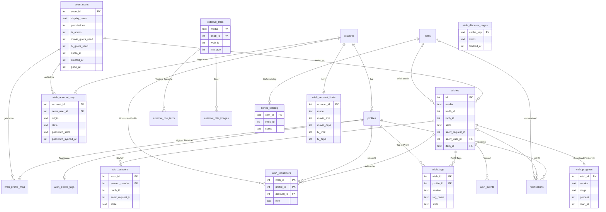

# Konzept 25 · Datenmodell und API

> **Kurz gesagt.** Neue Tabellen halten die Jellyseerr-Benutzer, die Zuordnung, die Wünsche mit Staffeln,
> Wünschern und Verlauf sowie die Daten fehlender Titel (`external_titles`) und den Staffelkatalog vorhandener
> Serien (`series_catalog`). Bestehende Tabellen mit CHECK-Bedingungen (`notifications`, `deliveries`,
> `accounts`, `profiles`, `home_rows`, `webhook_integrations`) baut der Bau nach der Vorlage neu, nur vorwärts.
> Der Vertrag bekommt Zuschauer-Operationen (`scoped`), eine Konto-Übersicht (`scoped` mit Hauptprofil) und
> Verwaltungs-Operationen (`admin`, ohne `ItemRef`); fehlende Titel erscheinen als eigenes Schema
> `ExternalTitleRef` neben `ItemRef`.
> Stufe 1 bleibt im Vertrag nicht brechend; Stufen 2, 3 und 4 erweitern Enums und sind nach der Praxis des
> Projekts brechend; Stufe 5 (Wünsche-Seiten) ist wieder nicht brechend. Neu in Fassung 3: Zustand und
> Passwortstand des Jellyseerr-Benutzers je Konto, das Limit je Konto, der Stand des Limits aus Jellyseerr, der
> Profil-Tag je Wunsch und Profil, ein Zwischenspeicher für den Download-Fortschritt je Wunsch (`wish_progress`)
> und einer für die Listen von Entdecken. Startseite und Spotlight bekommen keine fehlenden Titel und keine
> Schalter dafür; `spotlight_entries` speichert nur zusätzlich TVDB- und IMDb-ID.

Stand: Fassung 3 vom 17. November 2026 mit beiden Rückmeldungen von Marco an diesem Tag (E-1 bis E-7,
[Anhang H](anhang/H-nachtrag-17-november.md); Abschnitt 8 dort geht den Abschnitten 4 bis 7 vor). Grundlage: [Anhang F](anhang/F-entscheid-blatt.md) Abschnitte 5 und 6. Architektur und Begründungen: `03-architektur.md`. Bauschritte:
`09-umsetzungsplan.md`. Was über Anhang F hinausgeht, ist als **Vorschlag** gekennzeichnet. Typen nach SQLite
`STRICT`: Zeitstempel `INTEGER` wie die übrigen Tabellen, Wahrheitswerte `INTEGER` 0/1, `items.id` ist `TEXT`,
`accounts.id` und `profiles.id` sind `INTEGER` (`server/migrations/00015_discover.sql:329-341`,
`00063_minimum_age_accounts.sql:27-45`).

## 1. Übersicht

### 1.1 Neue und geänderte Tabellen

| Tabelle | neu/geändert | Stufe | Besitzer (schreibt) |
|---|---|---|---|
| `seerr_users` (mit Stand des Limits) | neu | 1 | `wishes` |
| `wish_account_map` (mit Zustand und Passwortstand) | neu | 1 | `wishes` |
| `wish_account_limits` | neu | 1 | `wishes` (über `admin`) |
| `wish_profile_map` | neu | 1 | `wishes` |
| `accounts` (+ `can_request`) | Neubau | 1 | `admin`, `auth` |
| `profiles` (+ `can_request`) | Neubau | 1 | `auth` |
| `invitations` (+ `can_request`, Limit) | Spalten | 1 | `auth` |
| `settings` (`seerr.*`, `wishes.*`) | Schlüssel | 1 | `admin` |
| `seerr_log` | neu | 1 | `wishes` |
| `wishes` | neu | 2 | `wishes` |
| `wish_seasons` | neu | 2 | `wishes` |
| `wish_requesters` | neu | 2 | `wishes` |
| `wish_events` | neu | 2 | `wishes` |
| `external_titles`, `external_title_texts` | neu | 2 | `metadata` |
| `external_title_images` | neu | 2 | `metadata` |
| `notifications` | Neubau | 2 | `notify` |
| `deliveries` | Neubau | 2 | `notify` |
| `account_channels` | Daten (Ereignisse rückfüllen) | 2 | Migration, dann `notify` |
| `spotlight_entries` (+ `tvdb_id`, `imdb_id`) | Spalten | 3 | `metadata` |
| `home_rows` (CHECK + `wishes`, Reihe «Erfüllte Wünsche») | Neubau | 3 | `admin` |
| `series_catalog` | neu | 4 | `metadata` |
| `webhook_integrations` (CHECK + `jellyseerr`) | Neubau | 4 | `integrations` |
| `wish_profile_tags`, `wish_tags` | neu | 4 | `wishes` |
| `wish_progress` (Download-Fortschritt, **Vorschlag**) | neu | 4 | `wishes` (Job `wishes.progress`) |
| `wish_discover_pages` | neu | 5 | `wishes` |

### 1.2 Diagramm: Beziehungen



`external_titles` hat bewusst keinen Fremdschlüssel zu `wishes` oder `items`: Ein fehlender Titel existiert
unabhängig davon, ob ihn jemand wünscht (Muster `spotlight_overrides`, [Anhang A](anhang/A-spotlight-startseite.md) 1.2).

## 2. Tabellen im Einzelnen

### 2.1 `seerr_users` (Stufe 1)

Zweck: Abbild der Jellyseerr-Benutzer für die Seite Jellyseerr-Benutzer, das Verknüpfen über die E-Mail, den
Stand des Limits und Hinweise im Dialog. Quelle `GET /user`, `GET /user/{id}/quota` ([Anhang D](anhang/D-jellyseerr-api.md) 7, Anhang H 3.2).

| Spalte | Typ | Bedingung |
|---|---|---|
| `seerr_id` | INTEGER | PK, die ID in Jellyseerr |
| `display_name` | TEXT | NOT NULL, `length` 1–200 |
| `email` | TEXT | NULL erlaubt, COLLATE NOCASE |
| `user_type` | INTEGER | NOT NULL, CHECK IN (1, 2, 3, 4) (Plex, lokal, Jellyfin, Emby) |
| `permissions` | INTEGER | NOT NULL, CHECK ≥ 0 (Bitmaske, Anhang D 7.3) |
| `movie_quota_limit`, `movie_quota_days` | INTEGER | NULL = kein Limit; wie Jellyseerr es meldet (`/quota` `movie.limit`, `movie.days`) |
| `tv_quota_limit`, `tv_quota_days` | INTEGER | NULL = kein Limit; `tv.limit`, `tv.days` (Staffeln) |
| `movie_quota_used`, `tv_quota_used` | INTEGER | **Vorschlag**, aus `/quota` (`used`, bei Serien Summe der Staffeln), NULL = unbekannt; zählt auch Requests, die direkt in Jellyseerr gestellt wurden (E-3) |
| `movie_next_free_at`, `tv_next_free_at` | INTEGER | NULL; wann der nächste Platz frei wird (ältester zählender Request + Tage, N-35; `03-architektur.md`, Abschnitt 19.3) |
| `quota_at` | INTEGER | NULL; wann der Stand zuletzt gelesen wurde |
| `is_admin` | INTEGER | NOT NULL DEFAULT 0, 0/1; `ADMIN` oder `MANAGE_USERS` in `permissions`, also ohne Limit und ohne Passwortabgleich (N-6, N-34). Abgeleitet beim Laden, als Spalte für Abfragen der Verwaltung (**Vorschlag**) |
| `created_at` | INTEGER | NULL; `createdAt` des Benutzers in Jellyseerr, Teil des Fingerabdrucks der Instanz (`03-architektur.md`, Abschnitt 7.4) |
| `fetched_at` | INTEGER | NOT NULL |
| `gone_at` | INTEGER | NULL; gesetzt, wenn der Benutzer in Jellyseerr fehlt |

Index `seerr_users_email (email)` für das Verknüpfen über die E-Mail (N-2; Vergleich ohne Gross-/Kleinschreibung).
Wer sich über Jellyfin, Emby oder Plex anmeldet, steht mit `user_type` ≠ 2 da; für ihn gleicht Slouchcat kein
Passwort ab (N-6). Zeilen werden nie gelöscht, solange eine Zuordnung oder ein
Wunsch auf sie zeigt; sonst nach 30 Tagen mit `gone_at` (**Vorschlag**).

Abgeleitete Fakten für die Oberfläche (im Server, nicht im Client): «darf Filme anfordern» = `ADMIN` (2) oder
`REQUEST` (32) oder `REQUEST_MOVIE` (262144); «darf Serien» entsprechend mit `REQUEST_TV` (524288);
«Auto-Freigabe» = `ADMIN`, `MANAGE_REQUESTS` (16), `AUTO_APPROVE` (128) bzw. `AUTO_APPROVE_MOVIE` (256) /
`AUTO_APPROVE_TV` (512) (Anhang D 3.3, 7.3).

### 2.2 `wish_account_map` und `wish_profile_map` (Stufe 1)

| Tabelle | Spalte | Typ | Bedingung |
|---|---|---|---|
| `wish_account_map` | `account_id` | INTEGER | PK, → `accounts(id)` ON DELETE CASCADE |
| | `seerr_user_id` | INTEGER | NULL nur in den Zuständen `waiting` und `suggested`; UNIQUE, → `seerr_users(seerr_id)` |
| | `origin` | TEXT | NULL; CHECK IN ('created', 'linked', 'manual'): eröffnet, verknüpft (gleiche E-Mail oder 409, nur auf Handlung oder Bestätigung eines Administrators, N-2a), von Hand gewählt; NOT NULL bei `state = 'ready'` (**Vorschlag**, Fassung 3) |
| | `state` | TEXT | NOT NULL DEFAULT 'ready', CHECK IN ('ready', 'waiting', 'suggested'); CHECK `(state IN ('waiting', 'suggested')) = (seerr_user_id IS NULL)`; «nicht eröffnet» = keine Zeile. `suggested` = «Verknüpfung vorgeschlagen» (N-2a, Redaktionsentscheid zu K-1): beim Annehmen einer Einladung oder nach einer E-Mail-Änderung des Kontos gab es einen Benutzer mit gleicher Adresse; keine Verknüpfung, kein Passwort, kein Anfordern bis zur Bestätigung |
| | `suggested_seerr_user_id` | INTEGER | NULL; die ID des vorgeschlagenen Benutzers, → `seerr_users(seerr_id)`, nicht UNIQUE (zwei Vorschläge können denselben Benutzer nennen; bestätigt wird nur einer). CHECK `(state = 'suggested') = (suggested_seerr_user_id IS NOT NULL)` (**Vorschlag**) |
| | `password_state` | TEXT | NOT NULL DEFAULT 'next_login', CHECK IN ('synced', 'next_login', 'off', 'admin', 'external') (`03-architektur.md`, Abschnitt 18.1) |
| | `password_synced_at` | INTEGER | NULL; letzter gelungener Passwortabgleich. **Nie** das Passwort selbst, auch kein Hash davon |
| | `provision_error` | TEXT | NULL; letzter Fehler beim Eröffnen, ohne Body (Anzeige «wartet: …») |
| | `limit_written_at` | INTEGER | NULL; wann das Limit zuletzt in den Benutzer geschrieben wurde |
| | `set_at` | INTEGER | NOT NULL |
| | `set_by` | INTEGER | → `accounts(id)` ON DELETE SET NULL; der Administrator, der eröffnet, verknüpft, gewählt oder einen Vorschlag bestätigt hat; NULL, wenn Slouchcat nach einer Einladung selbst eröffnet hat oder bei einem Vorschlag |
| `wish_profile_map` | `profile_id` | INTEGER | PK, → `profiles(id)` ON DELETE CASCADE |
| | `seerr_user_id` | INTEGER | NOT NULL, → `seerr_users(seerr_id)` |
| | `set_at` | INTEGER | NOT NULL |

Rechte in Jellyseerr führt Slouchcat nur bei `origin = 'created'` (N-9); bei `linked` und `manual` fasst es sie
nicht an, auch nicht beim Löschen des Kontos (N-10, Redaktionsentscheid zu K-2). Ein Konto im Zustand
`suggested` hat keinen Jellyseerr-Benutzer: `canRequest` ist falsch mit Grund `mapping_missing`, der
Sammelbenutzer (F-4) gilt für es nicht, und kein Passwort geht an den vorgeschlagenen Benutzer (N-2a). `wish_profile_map` ist seit Fassung 3 die zugeklappte **Ausnahme** «Profil sendet als anderer
Jellyseerr-Benutzer» (N-41, F-27); im Normalfall hat ein Profil keine Zeile und sendet als Benutzer des Kontos.

Regel «Ein Jellyseerr-Benutzer gehört höchstens zu einem Konto, Profile desselben Kontos dürfen ihn teilen»
(Anhang F 2.4): `UNIQUE` deckt nur die Kontozuordnung. Den Rest prüft der Dienst in derselben Transaktion und
antwortet 409 `seerr_user_taken` (`04-benutzer-profilmapping.md`, Abschnitt 5). **Vorschlag:** zusätzlich ein
Trigger `BEFORE INSERT/UPDATE` auf beiden Tabellen als zweite Sicherung. Fehlt eine Zeile in
`wish_profile_map`, gilt das Profil als «Wie Konto». Die Spalte `wishes.seerr_user_id` friert den Benutzer je
Wunsch ein; spätere Zuordnungsänderungen hängen nichts um (`04-benutzer-profilmapping.md`, Abschnitt 8.1).

### 2.3 `accounts.can_request`, `profiles.can_request`, `invitations.can_request` (Stufe 1)

| Tabelle | Spalte | Bedingung | Rückfüllung |
|---|---|---|---|
| `accounts` | `can_request INTEGER NOT NULL DEFAULT 0 CHECK (can_request IN (0, 1))` | Deckel, setzt nur der Administrator | Besitzerkonto 1, alle anderen 0 |
| `profiles` | `can_request INTEGER NOT NULL DEFAULT 0 CHECK (can_request IN (0, 1))` | setzt das Hauptprofil | Hauptprofile 1, übrige 0 |
| `invitations` | `can_request INTEGER NOT NULL DEFAULT 0 CHECK (can_request IN (0, 1))` | geht beim Annehmen an das neue Konto | 0 |
| `invitations` | **Vorschlag:** `wish_limit_mode TEXT NOT NULL DEFAULT 'default' CHECK IN ('default', 'custom', 'unlimited')` und vier Zahlen wie `wish_account_limits` (2.13) | geht beim Annehmen als Zeile in `wish_account_limits` an das neue Konto | `default` |

Wirksam ist `accounts.can_request = 1 AND profiles.can_request = 1` (Anhang F 2.6). Neue Konten bekommen den Wert
aus `wishes.new_accounts_can_request`, neue Hauptprofile 1, weitere Profile 0.

Anhang F sieht für `accounts` und `profiles` einen **Tabellenneubau** vor. Der Neubau folgt dem Muster von
00063 und 00061: Die View `visible_items` und die Trigger auf diesen Tabellen werden in derselben Migration
neu angelegt (`00063_minimum_age_accounts.sql:86-112`). **Vorschlag:** Der Bau prüft zuerst, ob `ALTER TABLE …
ADD COLUMN` mit konstantem `DEFAULT` und `CHECK` genügt (SQLite erlaubt das); dann entfällt der Neubau samt View.
Für `invitations` reicht `ADD COLUMN` in jedem Fall.

### 2.4 `wishes` (Stufe 2)

Zweck: ein Wunsch = ein Film oder ein Satz Staffeln einer Serie. Ein Film hat genau einen Request in
Jellyseerr; ein Serienwunsch kann auf mehrere Requests verteilt sein (je Staffel in `wish_seasons`, Abschnitt
2.5).

| Spalte | Typ | Bedingung |
|---|---|---|
| `id` | INTEGER | PK |
| `media` | TEXT | NOT NULL, CHECK IN ('movie', 'show') |
| `tmdb_id` | INTEGER | NOT NULL, > 0 |
| `tvdb_id` | INTEGER | NULL; bei `show` vor dem Senden Pflicht (Dienst) |
| `imdb_id` | TEXT | NULL |
| `title` | TEXT | NOT NULL (Titel zum Zeitpunkt des Wunsches, Sprache des Besitzers) |
| `year` | INTEGER | NULL |
| `origin` | TEXT | NOT NULL, CHECK IN ('slouchcat', 'jellyseerr') |
| `seerr_request_id` | INTEGER | NULL; nur bei Filmen (CHECK `media = 'movie' OR seerr_request_id IS NULL`); Serien führen die Request-ID je Staffel |
| `seerr_media_id` | INTEGER | NULL (interne Media-ID von Jellyseerr, nicht TMDB, Anhang D 11.3) |
| `seerr_user_id` | INTEGER | NULL, → `seerr_users(seerr_id)` ON DELETE SET NULL |
| `state` | TEXT | NOT NULL, CHECK IN ('queued', 'pending', 'processing', 'partial', 'available', 'declined', 'failed', 'withdrawn'); CHECK `state <> 'partial' OR media = 'show'` |
| `state_detail` | TEXT | NULL; **Vorschlag** Werte `importing` («wird eingelesen»), `not_found_in_library` (Diagnose) |
| `fail_reason` | TEXT | NULL; CHECK IN ('quota', 'blocklisted', 'no_permission', 'arr_failed', 'unreachable_24h', 'seerr_request_gone', 'seerr_media_deleted', 'seerr_user_gone', 'tvdb_id_missing', 'account_deleted') (**Vorschlag** Liste); CHECK `(state = 'failed') = (fail_reason IS NOT NULL)` |
| `attempts` | INTEGER | NOT NULL DEFAULT 0, ≥ 0 |
| `next_attempt_at` | INTEGER | NULL; bei `queued` und bei gesetztem `withdraw_pending` |
| `withdraw_pending` | INTEGER | NOT NULL DEFAULT 0, 0/1; «in Jellyseerr noch zu löschen» nach dem Zurückziehen (`03-architektur.md`, Abschnitt 6.6) |
| `checked_at` | INTEGER | NULL; letzte Einzelprüfung `GET /request/{id}`, höchstens einmal je 24 h (`03-architektur.md`, Abschnitt 7.1) |
| `item_id` | TEXT | NULL, → `items(id)` ON DELETE SET NULL |
| `created_at`, `updated_at` | INTEGER | NOT NULL |
| `submitted_at`, `approved_at`, `available_at`, `closed_at` | INTEGER | NULL |
| `seerr_updated_at` | INTEGER | NULL (`updatedAt` des Requests) |

Schlüssel und Indizes:

| Name | Definition | Zweck |
|---|---|---|
| `wishes_open_movie` | UNIQUE (`tmdb_id`) WHERE `media = 'movie' AND state IN ('queued', 'pending', 'processing')` | höchstens ein offener Filmwunsch (Anhang F 2.11) |
| `wishes_request` | UNIQUE (`seerr_request_id`) WHERE `seerr_request_id IS NOT NULL` | ein Film-Request gehört höchstens einem Wunsch; geschlossene Wünsche eines gelöschten Kontos geben ihre ID an den Verlauf ab |
| `wishes_withdraw` | (`next_attempt_at`) WHERE `withdraw_pending = 1` | offene Löschaufträge |
| `wishes_open` | (`media`, `tmdb_id`) WHERE `state IN ('queued', 'pending', 'processing', 'partial')` | Wunschzustand am Titel, Haken `WithMatched` |
| `wishes_open_tvdb` | (`tvdb_id`) WHERE `media = 'show' AND state IN (…offen…)` | Abgleich TVDB-zuerst-Serien |
| `wishes_due` | (`next_attempt_at`) WHERE `state = 'queued'` | Ausgangsfach |
| `wishes_admin` | (`state`, `updated_at` DESC) | Verwaltung «Anfragen» |

`item_id` schreibt `wishes` als Wert, den `visibility` geliefert hat. Das Paket liest `items` nicht (Regel 2).

### 2.5 `wish_seasons` (Stufe 2)

| Spalte | Typ | Bedingung |
|---|---|---|
| `wish_id` | INTEGER | NOT NULL, → `wishes(id)` ON DELETE CASCADE |
| `season_number` | INTEGER | NOT NULL, ≥ 1 (Staffel 0 nie, Anhang F 2.15) |
| `tmdb_id` | INTEGER | NOT NULL (Kopie aus `wishes` für die Eindeutigkeit) |
| `seerr_request_id` | INTEGER | NULL; der Request in Jellyseerr, der diese Staffel trägt. **Nicht** eindeutig über die Tabelle, weil ein Request mehrere Staffeln trägt |
| `seerr_updated_at` | INTEGER | NULL (`updatedAt` dieses Requests) |
| `state` | TEXT | NOT NULL, CHECK IN ('queued', 'pending', 'processing', 'available', 'declined', 'failed', 'withdrawn') |
| `available_at` | INTEGER | NULL |
| `notified_at` | INTEGER | NULL; wann die Staffelmeldung erfolgt ist (Doppelschutz, `06-benachrichtigungen.md`, Abschnitt 7) |

PK (`wish_id`, `season_number`). Teilindex `wish_seasons_open` UNIQUE (`tmdb_id`, `season_number`) WHERE
`state IN ('queued', 'pending', 'processing')`. Index `wish_seasons_request` (`seerr_request_id`) für den Abgleich.

Die Kopie `tmdb_id` schliesst eine Lücke in Anhang F (als Redaktionsentscheid vom 17. November 2026 gesetzt): Anhang F
verlangt «eine offene Zeile je (`tmdb_id`, `season_number`)», aber ein Index in SQLite kann nicht über zwei
Tabellen gehen. Ein Trigger `BEFORE INSERT` setzt sie aus `wishes` und verweigert Abweichungen (**Vorschlag**).

**Staffelstatus.** Ob eine Staffel `available` ist, rechnet `wishes` aus der eigenen Bibliothek, nicht aus
Jellyseerr: Die Zahl der abspielbaren, für das Profil sichtbaren Folgen (`visibility.VisibleSeasons`) erreicht
die Folgenzahl laut `series_catalog` bzw. vor Stufe 4 laut `external_titles.seasons`; bei laufenden Staffeln die
bisher ausgestrahlten Folgen (`06-benachrichtigungen.md`, Abschnitt 3.3). Die Zustände `pending` und
`processing` je Staffel kommen aus dem Request dieser Staffel; `media.seasons[].status` aus dem Abgleich liefert
nur den Zusatz «wird eingelesen».

### 2.6 `wish_requesters` (Stufe 2)

| Spalte | Typ | Bedingung |
|---|---|---|
| `wish_id` | INTEGER | NOT NULL, → `wishes(id)` ON DELETE CASCADE |
| `profile_id` | INTEGER | NOT NULL, → `profiles(id)` ON DELETE CASCADE |
| `account_id` | INTEGER | NOT NULL, → `accounts(id)` ON DELETE CASCADE |
| `role` | TEXT | NOT NULL, CHECK IN ('owner', 'joined') |
| `created_at` | INTEGER | NOT NULL |
| `notified_at` | INTEGER | NULL; wann «verfügbar» für dieses Profil gemeldet wurde. Massgeblich für den Doppelschutz (`06-benachrichtigungen.md`, Abschnitt 7) |
| `closed_at` | INTEGER | NULL (**Vorschlag**, `03-architektur.md` 8.3) |

PK (`wish_id`, `profile_id`). Teilindex `wish_requesters_owner` UNIQUE (`wish_id`) WHERE `role = 'owner'`.
Index `wish_requesters_profile` (`profile_id`, `created_at` DESC) für «Meine Wünsche».
Wird ein Profil gelöscht, gehen seine Wünsche an das Hauptprofil des Kontos; das Löschen in `auth` ruft dafür
vorher `wishes` auf, weil CASCADE die Zeile sonst entfernt. Wird ein Konto gelöscht, gehen Wünsche mit
Mitwünschern anderer Konten an den ältesten dieser Mitwünscher; die übrigen schliesst Slouchcat: offene werden
`failed` mit `fail_reason = account_deleted`, alle bekommen `wishes.closed_at`, und die Request-IDs wandern in
`wish_events`. In Jellyseerr bleiben die Requests und erscheinen ab Stufe 4 als «nicht zuordenbar» (beides
Redaktionsentscheid vom 17. November 2026, `04-benutzer-profilmapping.md`, Abschnitt 10).

### 2.7 `wish_events` (Stufe 2)

| Spalte | Typ | Bedingung |
|---|---|---|
| `id` | INTEGER | PK |
| `wish_id` | INTEGER | NOT NULL, → `wishes(id)` ON DELETE CASCADE |
| `at` | INTEGER | NOT NULL |
| `kind` | TEXT | NOT NULL, `^[a-z_]+$`, ohne Enum (Muster Aktivitätsprotokoll, `docs/adr/0019-verwaltungsleiste-aktivitaet-neustart.md:49-58`) |
| `detail` | TEXT | NULL, JSON (z. B. `{"from":"pending","to":"processing"}`), ohne Geheimnisse |

Index (`wish_id`, `at`). Arten (**Vorschlag**): `created`, `joined`, `submitted`, `submit_failed`, `attached`,
`state_changed`, `season_available`, `withdrawn`, `withdraw_deleted`, `reopened`, `retried`, `imported`,
`owner_changed`, `closed`, `approved_by_admin`, `declined_by_admin`.
Aufräumen (**Vorschlag**): abgeschlossene Wünsche samt Verlauf nach 365 Tagen.

### 2.8 `seerr_log` (Stufe 1)

Zweck: Band «Protokoll» (Anhang F 4: «letzte 20 Aufrufe und Fehler»), auch nach einem Neustart. Anhang F nennt
dafür keine Tabelle; sie ist ein Redaktionsentscheid vom 17. November 2026.
Spalten `id` PK, `at`, `method`, `path` (ohne Query), `status` (NULL bei Netzfehler), `duration_ms`, `error`
(ohne Host-Pfad und Schlüssel). Ein Trigger hält 20 Zeilen wie `webhook_events` (`server/migrations/00017_integrations.sql:47-57`).

### 2.9 `external_titles`, `external_title_texts`, `external_title_images` (Stufe 2)

`external_titles`:

| Spalte | Typ | Bedingung |
|---|---|---|
| `media` | TEXT | NOT NULL, CHECK IN ('movie', 'show') |
| `tmdb_id` | INTEGER | NOT NULL |
| `tvdb_id`, `imdb_id` | INTEGER, TEXT | NULL |
| `original_title` | TEXT | NULL |
| `year` | INTEGER | NULL |
| `release_date` | TEXT | NULL, ISO-Datum |
| `runtime_minutes` | INTEGER | NULL |
| `genres` | TEXT | NOT NULL DEFAULT '[]', JSON-Array |
| `certifications` | TEXT | NOT NULL DEFAULT '{}', JSON Land → Freigabe roh |
| `min_age` | INTEGER | NULL = unbekannt (zählt als 18); 0–18; `metadata` rechnet es mit `ageFromCertifications` (`server/internal/metadata/ratings.go:113-125`), derselben Funktion wie für Bibliothekstitel: Länderreihenfolge nach ADR 0034, das erste Land mit bekanntem Wert gilt |
| `poster_path`, `backdrop_path`, `logo_path` | TEXT | NULL, TMDB-Pfade (nie an den Browser) |
| `trailers` | TEXT | NOT NULL DEFAULT '[]', JSON (YouTube-Schlüssel, Sprache) |
| `status` | TEXT | NULL (TMDB, z. B. `Returning Series`) |
| `seasons` | TEXT | NOT NULL DEFAULT '[]', JSON `[{number, episodeCount, airDate}]`, nur `show` |
| `next_episode` | TEXT | NULL, JSON `{season, episode, airDate}` |
| `last_episode` | TEXT | NULL, JSON `{season, episode, airDate}` der zuletzt ausgestrahlten Folge (**Vorschlag**, für «bisher erschienene Folgen», `06-benachrichtigungen.md`, Abschnitt 3.3) |
| `fetched_at` | INTEGER | NOT NULL |

PK (`media`, `tmdb_id`). Indizes `external_titles_tvdb (tvdb_id)`, `external_titles_imdb (imdb_id)`.
`min_age` rechnet `metadata` beim Abruf und neu, wenn sich das Freigabeland ändert (**Vorschlag**: im selben
Job wie «Freigaben neu lesen»).

`external_title_texts`: PK (`media`, `tmdb_id`, `language`), `title` NOT NULL, `overview`, `tagline`;
Fremdschlüssel (`media`, `tmdb_id`) → `external_titles` ON DELETE CASCADE.

`external_title_images` (Lücke in Anhang F, Redaktionsentscheid; Muster `images` und 00040): PK `id`, (`media`, `tmdb_id`) →
`external_titles` CASCADE, `kind` CHECK IN ('poster', 'backdrop', 'logo'), `size`, `format`, `lang`,
`source_url`, `rel_path`, `content_hash`, `media_type`, `width`, `height`, `bytes`, `fetched_at`; UNIQUE
(`media`, `tmdb_id`, `kind`, `size`, `format`).

Aufräumen (**Vorschlag**): Zeilen, die weder in `spotlight_entries` stehen noch einen offenen oder in den
letzten 30 Tagen geschlossenen Wunsch haben und 30 Tage nicht abgerufen wurden, löscht `titles.refresh`.

### 2.10 `series_catalog` (Stufe 4)

| Spalte | Typ | Bedingung |
|---|---|---|
| `item_id` | TEXT | PK, → `items(id)` ON DELETE CASCADE (nur `kind = 'series'`, Dienst) |
| `tmdb_id` | INTEGER | NOT NULL |
| `status` | TEXT | NULL |
| `in_production` | INTEGER | NOT NULL DEFAULT 0, 0/1 |
| `seasons` | TEXT | NOT NULL DEFAULT '[]', JSON `[{number, episodeCount, airDate}]` |
| `next_episode` | TEXT | NULL, JSON |
| `last_episode` | TEXT | NULL, JSON wie bei `external_titles` (**Vorschlag**) |
| `fetched_at` | INTEGER | NOT NULL |

Schreibt `metadata` (`series.catalog`), liest `visibility`. Serien ohne `tmdb_id` bekommen keinen Eintrag
(**Vorschlag:** die Serienseite zeigt dann keine fehlenden Staffeln).

### 2.11 Erweiterungen bestehender Tabellen

| Tabelle | Änderung | Weg | Stufe |
|---|---|---|---|
| `notifications` | `kind` CHECK IN ('new_episode', 'wish_available', 'wish_season_available', 'wish_approved', 'wish_declined', 'wish_failed'); `item_id` NULL erlaubt; neu `wish_id` → `wishes(id)` ON DELETE CASCADE; neu `dedupe_key` TEXT NOT NULL; UNIQUE (`profile_id`, `dedupe_key`) statt UNIQUE (`profile_id`, `kind`, `item_id`); CHECK `kind = 'new_episode' OR wish_id IS NOT NULL`; CHECK `item_id IS NOT NULL OR wish_id IS NOT NULL` | Neubau; bestehende Zeilen bekommen `dedupe_key = 'episode:' || item_id` (wie `06-benachrichtigungen.md`, Abschnitt 11); Indizes `notifications_inbox`, `notifications_unread`, `notifications_item`, `notifications_parent` neu, dazu `notifications_wish` (`wish_id`). Neuer Leseweg: Einträge ohne `item_id` sind sichtbar, wenn das Profil in `wish_requesters` dieses Wunsches steht; Liste, Zähler und «gelesen» zählen beide Arten (`06-benachrichtigungen.md`, Abschnitt 8) | 2 |
| `deliveries` | `event` CHECK + 'wish_available', 'wish_status', 'wish_review' | Neubau wie 00018 | 2 |
| `account_channels` | `events` JSON: Vorgaben nach F-14 (`wish_available` an ab Stufe 2; `wish_review` an für Administratoren ab Stufe 4, wenn es einen Erzeuger hat) | Datenmigration je Stufe für **bestehende** Konten, `ChannelEnsureDefaults` für neue; Einzelheiten `06-benachrichtigungen.md`, Abschnitt 6 | 2, 4 |
| `spotlight_entries` | `tvdb_id INTEGER`, `imdb_id TEXT`; Indizes (`media`, `tvdb_id`) und (`media`, `imdb_id`) | `ADD COLUMN` (Tabelle wird bei jedem Abruf ersetzt, `metadata/trakt.go:278-313`). Zweck: vorhandene Titel auch über TVDB und IMDb erkennen (`ListSpotlightRow` vergleicht heute nur `tmdb_id`, `server/queries/scoped/spotlight.sql:10`) und der Verwaltung die IDs je Eintrag zeigen (N-71, N-73) | 3 |
| `home_rows` | `key` CHECK + 'wishes'; neue Zeile `wishes` («Erfüllte Wünsche») | Neubau wie 00035/00039; neue Zeile direkt nach «Weiterschauen» (wie im Mockup); **Vorschlag:** ausgeblendet, wenn schon 15 Reihen sichtbar sind (wie `07-administration.md`, Abschnitt 10). Inhaltsregel: nur Wünsche des Profils, die in den letzten 14 Tagen erfüllt wurden (`wishes.available_at`), also nur Bibliothekstitel als `ItemRef` (Empfehlung N-74, offen als F-34) | 3 |
| `webhook_integrations` | `kind` CHECK + 'jellyseerr' | Neubau; `webhook_events` bleibt | 4 |

**Vorschlag** (Abweichung von der Reihenfolge der Stufen, aber nicht von Anhang F): Der CHECK von `notifications` und
`deliveries` nimmt schon in Stufe 2 alle Arten auf, auch die erst in Stufe 4 erzeugten. So braucht es nur einen
Neubau. Der Vertrag nimmt die Werte erst mit ihrem Erzeuger auf (ADR 0009: kein Ereignis ohne Erzeuger).

### 2.12 Einstellungen (`settings`)

| Schlüssel | Wert | Vorgabe | Ort in der Verwaltung |
|---|---|---|---|
| `seerr.enabled` | 0/1 | 0 | Integrationen › Jellyseerr, «Jellyseerr verwenden» |
| `seerr.url` | Adresse | leer | «Adresse» |
| `seerr.api_key` | verschlüsselt (`v1:`) | leer | «API-Schlüssel» |
| `seerr.version` | Text | leer | Anzeige im Test |
| `seerr.last_sync` | Zeitstempel | leer | Band «Abgleich» (Zeiger des Abgleichs; leer heisst: Erstabgleich nötig) |
| `seerr.sync_pass` | JSON `{oben, bis, erreicht, seite}` | leer | Stand des laufenden Durchgangs, nach jeder Seite gespeichert (`03-architektur.md`, Abschnitt 7.2) |
| `seerr.instance` | JSON `{adminEmail, adminCreatedAt}` | leer | Fingerabdruck der Instanz (**Vorschlag**, `03-architektur.md`, Abschnitt 7.4) |
| `seerr.last_success`, `seerr.last_attempt`, `seerr.last_error` | Zeitstempel, Text | leer | Zustand (Muster `trakt_last_*`, `metadata/trakt.go:41-44`) |
| `wishes.enabled` | 0/1 | 0 (Redaktionsentscheid; das Mockup zeigt «an» nur zur Vorführung) | Medien › Wünsche › Einstellungen, «Wünsche aktiv»; einschaltbar nur nach gelungenem Test (**Vorschlag**, T-1) |
| `wishes.allow_movies`, `wishes.allow_shows` | 0/1 | 1, 1 | «Filme erlauben», «Serien erlauben» |
| `wishes.from_search`, `wishes.from_detail` | 0/1 | 1, 1 | «Anfordern aus der Suche», «Anfordern auf Detailseiten». Der Schalter «Aus dem Spotlight» entfällt (N-72), weil das Spotlight keine fehlenden Titel zeigt |
| `wishes.already_requested` | `join`/`status` | `join` (F-7) | «Bereits angeforderte Titel» |
| `wishes.unmapped` | `deny`/`fallback` | `deny` (F-4) | «Konten ohne Jellyseerr-Benutzer» |
| `wishes.shared_seerr_user` | Zahl | leer | Auswahl Sammelbenutzer |
| `wishes.new_accounts_can_request` | 0/1 | 0 | «Neue Konten dürfen anfordern» |
| `wishes.allow_withdraw` | 0/1 | 1 (F-17) | «Zurückziehen erlauben» |
| `wishes.pin_external_hide_title` | 0/1 | 1 (F-15) | «Externe Nachrichten bei PIN-Profilen ohne Titel» |
| `wishes.provision_accounts` | 0/1 | 1, wirksam sobald Jellyseerr eingerichtet ist (N-8) | Band «Konten in Jellyseerr», «Neue Konten in Jellyseerr eröffnen» |
| `wishes.sync_password` | 0/1 | 1 (N-8) | «Passwort abgleichen» |
| `wishes.limit_movie_count`, `wishes.limit_movie_days` | Zahl | 10, 7 (Marcos Beispiel, N-31, F-26); 0 = ohne Limit | Band «Limit ab Werk», «Filme» |
| `wishes.limit_tv_count`, `wishes.limit_tv_days` | Zahl | 5, 7 | «Staffeln» |
| `wishes.profile_tags` | 0/1 | 1 (**Vorschlag**) | Band «Radarr und Sonarr: Profil-Tag und Fortschritt», «Profil-Tag in Radarr und Sonarr setzen» |
| `wishes.tag_prefix` | Text `^[a-z0-9-]{1,10}$` (**Vorschlag**) | `sc-` (N-21, F-25) | «Präfix» |
| `wishes.show_progress` | 0/1 | 1 (N-86) | Band «Radarr und Sonarr: Profil-Tag und Fortschritt», «Download-Fortschritt zeigen»; aus: `wishes.progress` ruht, `wish_progress` wird geleert |
| `wishes.discover_pages` | 0/1 | 1 (**Vorschlag**) | «Seiten Entdecken, Filme, Serien und Suche» (N-57) |
| `arr.radarr_url`, `arr.sonarr_url` | Adresse | leer = Adresse aus Jellyseerr | Integrationen › Jellyseerr, Band «Radarr und Sonarr (Profil-Tags und Fortschritt)», «Eigene Adresse» (N-23) |
| `arr.radarr_host`, `arr.sonarr_host` | Host | leer | vom Administrator mit «Testen» bestätigter Host (**Vorschlag**, `03-architektur.md`, Abschnitt 20.2) |

Die Einstellungen unter Wünsche › Einstellungen gelten sofort (`setWishSettings` je Änderung, kein «Speichern»).
Schlüssel von Radarr und Sonarr stehen **nicht** in `settings`; Slouchcat liest sie bei Bedarf aus Jellyseerr und
hält sie nur im Speicher (N-23).
Die Takte der Jobs stehen in `job_schedules` (`docs/adr/0017-scheduler-fortschritt-pause-abbruch.md`), nicht in `settings`. Die Spotlight-Werte stehen
weiter in `spotlight_config`, unverändert: Fassung 3 bringt dort keine neuen Spalten (N-72).

### 2.13 `wish_account_limits` (Stufe 1)

Zweck: Limit je Konto, wenn es von der Vorgabe abweicht (N-31). Keine Zeile = «Standard» (Vorgabe aus `settings`).
Eigene Tabelle statt Spalten an `accounts`, damit `accounts` nicht ein zweites Mal neu gebaut werden muss
(**Vorschlag**).

| Spalte | Typ | Bedingung |
|---|---|---|
| `account_id` | INTEGER | PK, → `accounts(id)` ON DELETE CASCADE |
| `mode` | TEXT | NOT NULL, CHECK IN ('custom', 'unlimited') |
| `movie_limit`, `movie_days` | INTEGER | NULL bei `unlimited`; sonst NOT NULL (CHECK), `movie_limit` 0–100 (0 = ohne Limit für Filme), `movie_days` 1–90 (Grenzen wie im Mockup, **Vorschlag**) |
| `tv_limit`, `tv_days` | INTEGER | wie oben, für Staffeln |
| `set_at` | INTEGER | NOT NULL |
| `set_by` | INTEGER | → `accounts(id)` ON DELETE SET NULL |

Das wirksame Limit rechnet `wishes` (Zeile oder Vorgabe) und schreibt es über `seerr.provision` in den
Jellyseerr-Benutzer (`03-architektur.md`, Abschnitt 19). Für einen Benutzer mit `is_admin = 1` schreibt es nichts
(Jellyseerr nimmt die Felder nicht an, Anhang H 3.1).

### 2.14 `wish_profile_tags` und `wish_tags` (Stufe 4)

`wish_profile_tags`: überschriebener Tag-Name je Profil (N-21). Keine Zeile = Name aus Präfix und Profilname.
Haben zwei Profile denselben Namen, behält das zuerst angelegte (kleinere `profiles.id`) den einfachen Namen
(`sc-kinder`); für das später angelegte schreibt Slouchcat beim ersten Tag eine Zeile mit dem Kontonamen dazu
(`sc-kinder-grosseltern`). So ändert sich kein Name nachträglich; Tags werden nie umbenannt (N-21 genauer,
Redaktionsentscheid zu K-18).

| Spalte | Typ | Bedingung |
|---|---|---|
| `profile_id` | INTEGER | PK, → `profiles(id)` ON DELETE CASCADE |
| `name` | TEXT | NOT NULL, nur `a–z`, `0–9`, `-` (CHECK mit `NOT GLOB '*[^a-z0-9-]*'`, dazu Prüfung im Dienst), Länge 1–64 (**Vorschlag**); UNIQUE |
| `set_at` | INTEGER | NOT NULL |

`wish_tags`: Zustand des Profil-Tags je Wunsch und Profil (N-24, N-25).

| Spalte | Typ | Bedingung |
|---|---|---|
| `wish_id` | INTEGER | NOT NULL, → `wishes(id)` ON DELETE CASCADE |
| `profile_id` | INTEGER | NOT NULL, → `profiles(id)` ON DELETE CASCADE |
| `service` | TEXT | NOT NULL, CHECK IN ('radarr', 'sonarr') (folgt aus `wishes.media`) |
| `tag_name` | TEXT | NOT NULL; der Name zum Zeitpunkt des Setzens (Tags werden nie umbenannt oder entfernt, N-26) |
| `arr_tag_id` | INTEGER | NULL; ID des Tags in Radarr bzw. Sonarr |
| `arr_title_id` | INTEGER | NULL; ID des Films bzw. der Serie in Radarr bzw. Sonarr |
| `state` | TEXT | NOT NULL DEFAULT 'pending', CHECK IN ('pending', 'set', 'failed') |
| `attempts` | INTEGER | NOT NULL DEFAULT 0 |
| `last_error` | TEXT | NULL, ohne Adresse und Schlüssel |
| `set_at` | INTEGER | NULL |

PK (`wish_id`, `profile_id`). Teilindex `wish_tags_open` (`state`) WHERE `state <> 'set'` für `wishes.tag`.
Eine Zeile entsteht für Besitzer und Mitwünscher, sobald der Wunsch `processing` ist; Wünsche mit `origin =
'jellyseerr'` bekommen keine, auch wenn `wishes.import` sie einem Profil zugeordnet hat (N-27).

### 2.15 `wish_discover_pages` (Stufe 5)

`external_titles` genügt für die Listen nicht: Es hält Titel, aber keine Reihenfolge je Liste, Seite, Sprache und
Altersstufe und keine Seitenzahl. Darum eine eigene Tabelle für den Zwischenspeicher von 1 Stunde (N-54).
Titeldaten und Freigaben bleiben in `external_titles`.

| Spalte | Typ | Bedingung |
|---|---|---|
| `cache_key` | TEXT | PK; Liste und Parameter, Seite, Sprache, Altersstufe (z. B. `movies|sort=popularity|genre=|p=2|de|12`) |
| `items` | TEXT | NOT NULL, JSON `[{media, tmdbId, title, year, posterPath, seerrStatus?}]` in der Reihenfolge von Jellyseerr; `seerrStatus` nur als Zusatz «in Jellyseerr angefragt» (N-55) |
| `total_pages` | INTEGER | NULL |
| `fetched_at` | INTEGER | NOT NULL |

Aufräumen: Zeilen älter als 24 h löscht `wishes.discover` (**Vorschlag**). Grunddaten der Treffer (Titel, Jahr,
Poster) schreibt `metadata` beim ersten Abruf in `external_titles`, damit Bilder über die eigene Route laufen; die
Felder der Treffer in Jellyseerr sind **nicht verifiziert** (Anhang H 3.3 sagt nur, dass jede Liste ein
TMDB-Abruf ist).

### 2.16 `wish_progress` (Stufe 4, **Vorschlag**)

Zweck: Zwischenspeicher des Download-Fortschritts aus Radarr und Sonarr (Marco, E-7; Regeln N-82 bis N-87,
`03-architektur.md`, Abschnitt 22). Geschrieben nur von `wishes.progress`; gelesen beim Seitenaufbau, der Radarr
und Sonarr nie selbst aufruft (N-84). Eine Zeile je Wunsch «In Beschaffung»; geschlossene Wünsche haben keine.

| Spalte | Typ | Bedingung |
|---|---|---|
| `wish_id` | INTEGER | PK, → `wishes(id)` ON DELETE CASCADE |
| `service` | TEXT | NOT NULL, CHECK IN ('radarr', 'sonarr') (folgt aus `wishes.media`) |
| `arr_title_id` | INTEGER | NULL; ID des Films bzw. der Serie in Radarr bzw. Sonarr (aus `GET /api/v3/movie?tmdbId=` bzw. `series?tvdbId=`); NULL = noch nicht gefunden |
| `stage` | TEXT | NULL; CHECK IN ('search', 'download', 'import', 'stalled'); NULL = nichts Zusätzliches anzeigen (nicht gefunden, nicht lesbar) |
| `percent` | INTEGER | NULL; 0–100, nur bei `download` (aus `size` und `sizeleft`) |
| `eta_seconds` | INTEGER | NULL; Restzeit aus `timeleft` bzw. `estimatedCompletionTime`, nur bei `download` |
| `episodes_done`, `episodes_total` | INTEGER | NULL; nur Sonarr, «x von y Folgen da» der gewünschten Staffeln |
| `admin_message` | TEXT | NULL; `errorMessage` bzw. `statusMessages` und Download-Programm, gekürzt auf 500 Zeichen, ohne Pfade (**Vorschlag**); nur für die Verwaltung |
| `error` | TEXT | NULL; CHECK IN ('unreachable', 'not_found', 'incomplete'): Grund, warum nichts oder nur ein Teil lesbar war |
| `read_at` | INTEGER | NOT NULL; letzter Lauf, der diese Zeile geschrieben hat. Älter als 5 min (**Vorschlag**) heisst veraltet: Zuschauer sehen nichts Zusätzliches, die Verwaltung «Fortschritt nicht lesbar» (N-85) |

CHECK `(stage = 'download') OR (percent IS NULL AND eta_seconds IS NULL)`. Index `wish_progress_service`
(`service`). Die Zeile wird gelöscht, wenn der Wunsch geschlossen wird oder der Schalter «Download-Fortschritt
zeigen» ausgeht. Pfade aus Radarr und Sonarr speichert die Tabelle nicht.

## 3. Migrationen

### 3.1 Regeln (CLAUDE.md Regel 5, `server/migrations/TEMPLATE.sql.txt`)

- Jede Datei beginnt mit `-- +goose Up`, `-- +goose NO TRANSACTION`, `PRAGMA foreign_keys=OFF;`, dann `BEGIN;`
  … `COMMIT;`, dann `PRAGMA foreign_key_check;` und `PRAGMA foreign_keys=ON;`.
- Nur vorwärts, keine Down-Migration, eine committete Migration wird nie geändert.
- Neubau: neue Tabelle `…_new` anlegen, Daten kopieren, alte löschen, umbenennen, Indizes, Trigger und
  abhängige Views neu anlegen.
- Vor jedem Lauf sichert der Server mit `VACUUM INTO` (fünf behalten).
- Je Stufe ein eingefrorener DB-Stand in `testdata/db/` (heute 46 Dateien) mit Test `frozen_<name>_test.go`
  nach dem Muster `server/internal/store/frozen_detailseiten3_test.go`, dazu je Migration ein
  `migration<nummer>_test.go` (Muster `migration00065_test.go`).

### 3.2 Reihenfolge je Stufe (Nummern vergibt der Bau, nächste freie heute 00066)

| Stufe | Migration (Kurzname, Vorschlag) | Inhalt |
|---|---|---|
| 1 | `wishes_mapping` | `seerr_users` (mit Limit-Stand und `is_admin`), `wish_account_map` (mit `origin`, `state`, `password_state`), `wish_profile_map`, `wish_account_limits`, Trigger der Kontoregel, `seerr_log` |
| 1 | `wishes_rights` | `accounts`/`profiles` + `can_request` (Neubau oder `ADD COLUMN`, 2.3), `visible_items` neu, `invitations` + `can_request` und Limit, Rückfüllung |
| 2 | `wishes` | `wishes` (mit `withdraw_pending`, `checked_at`), `wish_seasons` (mit `seerr_request_id`, `notified_at`, + Trigger), `wish_requesters` (mit `notified_at`), `wish_events` |
| 2 | `external_titles` | `external_titles`, `external_title_texts`, `external_title_images` |
| 2 | `wishes_notifications` | Neubau `notifications`, `deliveries`; Rückfüllung `account_channels` |
| 3 | `spotlight_ids` | Spalten `tvdb_id`, `imdb_id` und zwei Indizes an `spotlight_entries`; Neubau `home_rows` mit Zeile `wishes`. Keine Spalten an `spotlight_config` (N-72) |
| 4 | `series_catalog` | `series_catalog`; Datenmigration `account_channels` (`wish_review` für bestehende Administratorkonten) |
| 4 | `webhook_jellyseerr` | Neubau `webhook_integrations` |
| 4 | `wish_tags` | `wish_profile_tags`, `wish_tags`, `wish_progress` |
| 5 | `wish_discover` | `wish_discover_pages` |

Eingefrorene Stände (**Vorschlag** für Namen): `testdata/db/wuensche1.sql` nach Stufe 1, `wuensche2.sql`,
`wuensche3.sql`, `wuensche4.sql`, `wuensche5.sql`, je mit Konten, Profilen, Jellyseerr-Benutzern in allen
Zuständen (eröffnet, verknüpft, von Hand, wartet), Limits und Wünschen in allen Zuständen.

## 4. API

### 4.1 Konventionen

Alle Pfade unter `/api/v1`. Fehler als RFC 9457 `application/problem+json` mit `code`
(`api/openapi.yaml:39-41`, Schema `Problem` Z. 10651); Validierungsfehler 422 `validation_failed` mit
`errors[]`; Mutationen brauchen `X-Requested-With: Slouchcat`, sonst 403 `csrf_header_missing`; Blättern mit
`offset` (≥ 0) und `limit` (1–100, Vorgabe 50). Nicht sichtbar heisst 404. Jede Operation trägt `x-visibility` und
steht im Vertragstest (Abschnitt 4.7). Bestehende gemeinsame Antworten (`Unauthenticated`, `AdminOnly`,
`PrimaryProfileRequired`, Z. 10172ff.) werden wiederverwendet. Zuviele Versuche: 429 `too_many_attempts` mit
`Retry-After` (Muster Z. 261).

### 4.2 Neue Schemas (Kern)

| Schema | Felder (Auswahl) |
|---|---|
| `ExternalTitleRef` | `media`, `tmdbId`, `title`, `year?`, `minAge?`, `images {poster?, backdrop?, logo?}`, `hasTrailer`, `wish? {id, state, stateDetail?, progress?}`, `canRequest`, `requestReason?`. Kommt nie in Antworten der Startseite oder der Spotlight-Liste vor (N-70) |
| `ExternalTitle` | alles aus `ExternalTitleRef` + `originalTitle?`, `overview?`, `tagline?`, `releaseDate?`, `runtimeMinutes?`, `genres[]`, `status?`, `seasons[] {number, episodeCount, airDate?, state}`, `nextEpisode?`, `trailers[]`, `request {canRequest, reason?, seerrUser?, autoApprove?, quota? (WishQuota)}` |
| `Wish` | `id`, `media`, `tmdbId`, `title`, `year?`, `state`, `stateDetail?`, `failReason?`, `failText?`, `origin`, `role` (`owner`/`joined`), `seasons[] {number, state}`, `external?` (`ExternalTitleRef`), `item?` (`ItemRef`), `canWithdraw`, `canRequestAgain`, `hint?` (z. B. `already_approved` nach einem zu späten Zurückziehen), `createdAt`, `updatedAt`, `availableAt?`, `events[]` (höchstens 20), ab Stufe 4 `progress?` (`WishProgress`). Nur in scoped Antworten |
| `WishPage` | `items[]`, `total`, `counts {open, pending, processing, partial, available, closed}` |
| `WishCreate` | `media`, `tmdbId`, `seasons?` (`"all"` oder Zahlenliste), `source?` (**Vorschlag**: `search`, `detail`, `list`, `admin_spotlight` für «Anfordern» in Verwaltung › Spotlight, ab Stufe 5 `discover`) |
| `WishProgress` (neu, Stufe 4) | `stage` (`search`, `download`, `import`, `stalled`), `percent?`, `etaSeconds?`, `episodes? {done, total}` (nur Serien), `readAt`. **Keine** Meldung von Radarr oder Sonarr, kein Dienst, keine Pfade (N-83). Fehlt, wenn nichts zu zeigen ist (nicht gefunden, nicht lesbar, veraltet, Schalter aus) |
| `AdminWishProgress` (neu, Stufe 4) | alles aus `WishProgress` + `service` (`radarr`, `sonarr`), `message?` (Meldung von Radarr oder Sonarr), `error?` (`unreachable`, `not_found`, `incomplete`); ohne Pfade |
| `WishRights` | `enabled`, `canRequest`, `reason?` (Enum, 4.4), `movies`, `shows`, ab Stufe 5 `discover` (Seiten des Bereichs «Wünsche» sichtbar) |
| `WishQuota` (neu) | `unlimited`, `reason?` (`admin`, `no_limit`), `movie? {limit, days, used, queued, remaining, nextFreeAt?}`, `tv? {…}` (bei `tv` zählen Staffeln), `at` (Stand). `used` zählt auch Wünsche, die direkt in Jellyseerr gestellt wurden (E-3); `queued` sind Wünsche, die noch auf die Übermittlung warten (N-35) |
| `WishSeasons` (neu) | `source` (`seerr`, `tmdb_fallback`), `seasons[] {number, episodeCount, state}` (Staffeln aus Jellyseerr, N-63) |
| `DiscoverEntry` (neu) | `title: ExternalTitleRef`, `item?` (`ItemRef`, wenn der Titel in der Bibliothek steht und sichtbar ist, N-55), `seerrRequested?` (in Jellyseerr angefragt) |
| `DiscoverRow` (neu) | `key` (`trending`, `popular_movies`, `movie_genres`, `upcoming_movies`, `popular_shows`, `show_genres`, `upcoming_shows`, N-51), `entries[]` bzw. `genres[] {id, name, backdrop?}`, `nextPage?` |
| `DiscoverPage` (neu) | `entries[]` (`DiscoverEntry`), `page`, `totalPages?`, `stale` (Stand älter als 1 h, Jellyseerr nicht erreichbar), `fetchedAt` |
| `SeerrSettings` | `enabled`, `url`, `apiKey` (`writeOnly`), `apiKeyHint?`, `source` (`env`/`stored`/`none`) |
| `SeerrStatus` | `state` (`not_configured`, `connected`, `key_invalid`, `unreachable`, `instance_changed`, `disabled`), `version?`, `lastSync?`, `nextSync?`, `initialSync? {page, pages}`, `counts {open, queued, unmapped}`, `log[]` (20) |
| `SeerrTestResult` | `checks[] {key, level, detail?}` mit `level` IN (`ok`, `warn`, `fail`) und `key` IN (`reachable`, `key_valid`, `version`, `act_as_user`, `instance`, `csrf_off`, `radarr`, `sonarr`, neu `manage_users`, `local_login`, `tvdb_seasons`, `password_transport`, ab Stufe 4 `radarr_tags`, `sonarr_tags`); `version` mit `warn` und `detail = not_verified` bei Versionen unter Jellyseerr 2.7 bzw. Seerr 3.0. Ein `warn` lässt den Test nicht scheitern (`07-administration.md`, Abschnitt 4.1) |
| `SeerrUser` | `id`, `displayName`, `email?`, `userType`, `isAdmin`, `canRequestMovies`, `canRequestShows`, `autoApprove`, `quota?` (`WishQuota`), `gone`, `mappedTo? {accountId, email}` |
| `WishMappings` | `accounts[]` je Konto: `accountId`, `email`, `canRequest`, `seerrUserId?`, `state` (`created`, `linked`, `manual`, `waiting`, `none`), `passwordState?`, `passwordSyncedAt?`, `rights?` (`request`, `none`, `external`), `limit` (`AccountWishLimit`), `quota?` (`WishQuota`), `provisionError?`, `profiles[] {profileId, name, tagName, tagNameCustom, seerrUserId?, mode}`; dazu `unlinkedUsers[]` (`SeerrUser` ohne Konto), `opened`, `total` |
| `ArrStatus` (neu, Stufe 4) | je `radarr` und `sonarr`: `source` (`seerr`, `own`, `none`), `address?`, `confirmed`, `reachable?`, `tagRequests?`, `lastError?`, `counts {set, pending, failed}`, `progress {enabled, lastReadAt?, error?, tracked}` (`tracked` = Wünsche mit Fortschritt). **Nie** ein Schlüssel |
| `AccountWishLimit` (neu) | `mode` (`default`, `custom`, `unlimited`), `movie? {limit, days}`, `tv? {limit, days}`, `effective` (wirksames Limit), `seerrAdmin` (kein Limit in Jellyseerr) |
| `AdminWishTitle` | `itemId?` (Zeichenkette, keine `ItemRef`), `media`, `tmdbId`, `tvdbId?`, `imdbId?`, `title`, `year?`, `posterUrl?` (fehlender Titel: `getAdminExternalTitleImage`; vorhandener: `getAdminItemImage`) |
| `AdminWish` | `id`, `title: AdminWishTitle`, `state`, `stateDetail?`, `failReason?`, `origin`, `seasons[] {number, state, seerrRequestId?}`, `requesters[] {accountEmail, profileName, role, tag? {name, state, lastError?}}` (`tag` ab Stufe 4), `seerrUser?`, `seerrRequestId?`, `diagnosis?`, `seerrLink?`, `progress?` (`AdminWishProgress`, ab Stufe 4), `events[]`, `createdAt`, `updatedAt`. **Keine** `ItemRef` und keine scoped Adresse (Regel 7, Muster `adminCurationAnswer`) |
| `WishSettings` | alle `wishes.*` aus 2.12, mit dem Limit ab Werk als `defaultLimit {movie {limit, days}, tv {limit, days}}`; ab Stufe 4 `showProgress`; kein Schalter für das Spotlight (N-72) |

### 4.3 Beispiel `ExternalTitleRef` (Beispielwerte)

```json
{
  "media": "movie",
  "tmdbId": 1061474,
  "title": "Superman",
  "year": 2025,
  "minAge": 12,
  "images": {
    "poster": "/api/v1/titles/movie/1061474/images/poster/w400",
    "backdrop": "/api/v1/titles/movie/1061474/images/backdrop/w1280",
    "logo": "/api/v1/titles/movie/1061474/images/logo/w400"
  },
  "hasTrailer": true,
  "wish": { "id": 42, "state": "processing", "stateDetail": "importing" },
  "canRequest": false,
  "requestReason": "already_requested"
}
```

Die Bildadressen zeigen immer auf Slouchcat, nie auf TMDB (Anhang F 2.12).

### 4.4 Beispiel `createWish`

Anfrage (Profil Noah, Konto marco, Jellyseerr-Benutzer `kinder`):

```http
POST /api/v1/wishes
Content-Type: application/json
X-Requested-With: Slouchcat

{ "media": "show", "tmdbId": 153312, "seasons": [1, 2], "source": "detail" }
```

Antwort 201:

```json
{
  "id": 57,
  "media": "show",
  "tmdbId": 153312,
  "title": "Tulsa King",
  "year": 2022,
  "state": "pending",
  "origin": "slouchcat",
  "role": "owner",
  "seasons": [ { "number": 1, "state": "pending" }, { "number": 2, "state": "pending" } ],
  "canWithdraw": true,
  "canRequestAgain": false,
  "createdAt": "2026-11-16T19:04:11Z",
  "updatedAt": "2026-11-16T19:04:12Z",
  "events": [
    { "at": "2026-11-16T19:04:11Z", "kind": "created" },
    { "at": "2026-11-16T19:04:12Z", "kind": "submitted" }
  ]
}
```

Antworten von `createWish`:

| Status | `code` | Wann |
|---|---|---|
| 201 | – | neuer Wunsch (Zustand `queued`, `pending`, `processing` oder `failed` mit Grund, `03-architektur.md` 6.1) |
| 200 | – | bestehender Wunsch: dasselbe Profil fragt erneut (idempotent) oder Mitwunsch (`role: joined`) |
| 403 | `wish_not_allowed` | kein Recht; Erweiterung `reason` IN (`disabled`, `account_not_allowed`, `profile_not_allowed`, `no_mapping`, `seerr_user_gone` (diese fünf wie `04-benutzer-profilmapping.md`, Abschnitt 9), `movies_not_allowed`, `shows_not_allowed`, `source_not_allowed`, `tvdb_id_missing`, `status_only`) (**Vorschlag** Liste; `status_only` = Einstellung «Nur Zustand zeigen») |
| 404 | `not_found` | Titel bei TMDB unbekannt oder für das Profil nicht sichtbar (Freigabe zu hoch, unbekannt bei Profil unter 18, in der Bibliothek, aber nicht sichtbar) |
| 409 | `already_available` | in der Bibliothek und sichtbar; Erweiterung `item` (`ItemRef`) |
| 409 | `quota_exceeded` (**Vorschlag**, neu) | Vorprüfung: der freie Platz des Limits reicht nicht (Film: 1; Serie: gewählte Staffeln ohne Mitwunsch-Staffeln; `03-architektur.md`, Abschnitt 19.2). Erweiterung `quota` (`WishQuota`) mit `nextFreeAt` und `needed`. Kein Wunsch entsteht. Nie bei einem Mitwunsch, nie für Benutzer ohne Limit, nie ohne bekannten Stand |
| 422 | `validation_failed` | `media` falsch, `tmdbId` ≤ 0, Staffel 0, Staffeln bei Film, keine wählbare Staffel |
| 429 | `too_many_attempts` | Rate-Limit je Profil (**Vorschlag** 20/h), `Retry-After` |
| 503 | `tmdb_unreachable` | Titel nicht im Cache und TMDB antwortet nicht |

`403` ist hier zulässig, weil es um das **Recht** zu wünschen geht, nicht um die Sichtbarkeit eines Titels.
`quota_exceeded` ist 409 und nicht 403 oder 422 (**Vorschlag**): Das Recht besteht und die Eingabe ist richtig;
nur der Stand des Kontos lässt den Wunsch gerade nicht zu. Lehnt Jellyseerr trotzdem ab (jemand hat inzwischen
direkt dort angefordert), bleibt es bei 201 mit dem Wunsch im Zustand `failed`, Grund `quota`.

### 4.5 Neue Operationen

| operationId | Methode, Pfad | `x-visibility` | Anfrage | Antworten | Stufe |
|---|---|---|---|---|---|
| `getSeerrSettings` | GET `/admin/seerr` | admin | – | 200 `SeerrSettings` | 1 |
| `updateSeerrSettings` | PUT `/admin/seerr` | admin | `SeerrSettings` (leerer `apiKey` behält ihn) | 200; 422 `validation_failed`, `seerr_url_invalid`; 409 `env_wins` | 1 |
| `testSeerrConnection` | POST `/admin/seerr/test` | admin | optional ungespeicherte `url`, `apiKey`. Weicht der Host von `url` vom gespeicherten ab, ist `apiKey` Pflicht (422 `seerr_key_required`); der gespeicherte Schlüssel geht nie an eine neue Adresse | 200 `SeerrTestResult` (auch bei Fehlschlägen einzelner Punkte) | 1 |
| `getSeerrStatus` | GET `/admin/seerr/status` | admin | – | 200 `SeerrStatus` | 1 |
| `syncWishesNow` | POST `/admin/seerr/sync` | admin | – | 202; 409 `job_type_paused`; 422 `seerr_not_configured` | 2 |
| `listSeerrUsers` | GET `/admin/wishes/mappings/users` | admin | – | 200 `SeerrUser[]` | 1 |
| `refreshSeerrUsers` | POST `/admin/wishes/mappings/users/refresh` | admin | – | 202; 422 `seerr_not_configured` | 1 |
| `getWishMappings` | GET `/admin/wishes/mappings` | admin | – | 200 `WishMappings` | 1 |
| `setAccountWishMapping` | PUT `/admin/wishes/mappings/accounts/{accountId}` | admin | `{seerrUserId: int\|null}` | 200; 404; 409 `seerr_user_taken` | 1 |
| `setProfileWishMapping` | PUT `/admin/wishes/mappings/profiles/{profileId}` | admin | `{mode: same_as_account\|own, seerrUserId?}` | 200; 404; 409 `seerr_user_taken` | 1 |
| `applyWishMappingSuggestions` | POST `/admin/wishes/mappings/suggestions` | admin | `{accountIds[]}` | 200 `WishMappings`; 409 bei Konflikt (nichts übernommen) | entfällt in Fassung 3 (**Vorschlag**): ersetzt durch `provisionSeerrAccounts`, weil Slouchcat bei gleicher E-Mail auf Knopfdruck des Administrators selbst verknüpft (E-4); einen Vorschlag nach N-2a bestätigt `confirmSeerrAccountLink` je Konto |
| `getWishSettings` | GET `/admin/wishes/settings` | admin | – | 200 `WishSettings` | 1 |
| `setWishSettings` | PUT `/admin/wishes/settings` | admin | `WishSettings` | 200; 422 | 1 |
| `listWishes` | GET `/wishes?state=&offset=&limit=` | scoped | Filter `open`, `available`, `closed`, `all` | 200 `WishPage` (nur eigene, auch Mitwünsche) | 2 |
| `createWish` | POST `/wishes` | scoped | `WishCreate` | siehe 4.4 | 2 |
| `withdrawWish` | DELETE `/wishes/{id}` | scoped | – | 204; 404 (fremd oder unbekannt); 409 `wish_not_withdrawable`; 403 `wish_not_allowed` (`reason: withdraw_disabled`) | 2 |
| `listAccountWishes` | GET `/account/wishes` | scoped, zusätzlich Hauptprofil (`requirePrimary`, `server/internal/auth/profiles.go:40`) | wie `listWishes` | 200 `WishPage` mit `profileName` je Eintrag; 403 `primary_profile_required`. Die Antwort trägt `ItemRef` und ist darum `scoped` (Regel 7) | 2 |
| `getExternalTitle` | GET `/titles/{media}/{tmdbId}` | scoped | – | 200 `ExternalTitle` (mit `lastWish?` {state, at, reason} eines geschlossenen Wunsches); 404 (auch ohne Recht oder wenn alle drei Stellen aus sind, ausser bei eigenem Wunsch); 409 `already_available` mit `item` (Client leitet auf `/items/{id}`); 503 `tmdb_unreachable` | 2 |
| `searchExternalTitles` | GET `/titles/search?q=&media=&offset=&limit=` | scoped | `q` 2–100 Zeichen | 200 `{items: ExternalTitleRef[]}`; leer ohne Recht oder mit «Anfordern aus der Suche» aus (F-9); 429; 503 `tmdb_unreachable`. Die TMDB-Suche liefert keine Freigaben: Für Profile unter 18 holt der Server die Details der ersten 20 Treffer (zwischengespeichert in `external_titles`); Treffer ohne bekannte Freigabe gelten als 18 und fehlen diesen Profilen (`03-architektur.md`, Abschnitt 16) | 2 |
| `getExternalTitleImage` | GET `/titles/{media}/{tmdbId}/images/{kind}/{size}` | scoped | `kind` = `ImageKind`, `size` wie `getItemImage` (w200 … w3840) | 200 Bild; 404 (auch nicht sichtbar oder ohne Recht, ausser bei eigenem Wunsch); 503 | 2 |
| `getAdminExternalTitleImage` | GET `/admin/titles/{media}/{tmdbId}/images/{kind}/{size}` | admin | wie oben | 200 Bild; 404; 503. Bild fehlender Titel für die Verwaltung (Anfragen, Spotlight), ohne Profilbezug, Muster `getAdminItemImage` | 2 |
| `listAdminWishes` | GET `/admin/wishes?state=&unmapped=&q=&offset=&limit=` | admin | Filter | 200 `{items: AdminWish[], total, counts}` | 2 |
| `retryWish` | POST `/admin/wishes/{id}/retry` | admin | – | 202; 404; 409 `wish_not_retryable` | 2 |
| `confirmSeerrInstance` | POST `/admin/seerr/instance` | admin | `{action: confirm\|reset}` | 200 `SeerrStatus`; 409 `instance_unchanged`. Bestätigt den neuen Fingerabdruck (Erstabgleich folgt) oder löscht alle Zuordnungen (**Vorschlag**, `03-architektur.md`, Abschnitt 7.4) | 1 |
| `importSeerrRequests` | POST `/admin/wishes/mappings/import` | admin | `{seerrUserId?}` (leer: alle zugeordneten) | 202; 422 `seerr_not_configured`. Reiht `wishes.import` ein (F-21) | 4 |
| `countSeerrRequests` | GET `/admin/wishes/mappings/users/{seerrUserId}/requests/count` | admin | – | 200 `{count}` aus `GET /request?requestedBy=…&take=1` (`pageInfo.results`), für die Meldung nach einer Zuordnung (**Vorschlag**) | 4 |
| `approveWish` | POST `/admin/wishes/{id}/approve` | admin | – | 200 `AdminWish`; 409 `wish_not_pending`; 502 `seerr_failed`; 503 `seerr_unreachable` | 4 |
| `declineWish` | POST `/admin/wishes/{id}/decline` | admin | – | wie `approveWish` | 4 |
| `provisionSeerrAccount` (neu) | POST `/admin/wishes/accounts/{accountId}/provision` | admin | – | 202 (`seerr.provision` eingereiht) mit `state` `waiting`; 200 `WishMappings`-Eintrag, wenn sofort fertig; 404; 409 `provision_disabled` («Neue Konten in Jellyseerr eröffnen» aus); 409 `link_suggested` (Konto im Zustand `suggested`: bestätigen mit `confirmSeerrAccountLink` oder von Hand wählen); 422 `seerr_not_configured`. Verknüpft bei gleicher E-Mail (N-2), weil ein Administrator handelt (N-2a) | 1 |
| `provisionSeerrAccounts` (neu) | POST `/admin/wishes/accounts/provision` | admin | – | 202 mit `{link, create, suggested}` (Zahl der Konten; `suggested` = ausgelassene Vorschläge); 409 `provision_disabled`; 422 `seerr_not_configured`. «Alle eröffnen»; Konten im Zustand `suggested` lässt es aus und bestätigt keinen Vorschlag (N-2a) | 1 |
| `confirmSeerrAccountLink` (neu) | POST `/admin/wishes/accounts/{accountId}/confirm-link` | admin | `{seerrUserId}` (muss gleich `suggested_seerr_user_id` sein) | 200 `WishMappings`-Eintrag mit `origin = linked`, `state = ready`; 404 (Konto unbekannt); 409 `no_link_suggested` (kein Vorschlag offen), 409 `link_suggestion_stale` (Benutzer weg, andere ID oder E-Mail passt nicht mehr; der Vorschlag fällt weg), 409 `seerr_user_taken`; 503 `seerr_unreachable`. «Verknüpfung bestätigen» (N-2a, Redaktionsentscheid zu K-1; Name **Vorschlag**). Danach Rechte unverändert (N-9), Limit schreiben, Passwort nach F-24 bei der nächsten Anmeldung, `wishes.import` ab Stufe 4 | 1 |
| `setSeerrPasswordMode` (neu) | PUT `/admin/wishes/accounts/{accountId}/password` | admin | `{mode: next_login\|off}` | 200; 404; 409 `password_not_syncable` (Administrator oder Anmeldung über Jellyfin, Emby, Plex). «Passwort bei der nächsten Anmeldung neu übernehmen» bzw. «nicht abgleichen» (N-7) | 1 |
| `setAccountWishLimit` (neu) | PUT `/admin/accounts/{accountId}/wish-limit` | admin | `AccountWishLimit` | 200 `AccountWishLimit`; 404; 422 `validation_failed` (Anzahl 0–100, Tage 1–90). Schreibt `wish_account_limits` und reiht `seerr.provision` ein | 1 |
| `getWishQuota` (neu) | GET `/wishes/quota` | scoped | – | 200 `WishQuota` für den Benutzer, als den das Profil anfordert; aus dem Zwischenspeicher, kein Aufruf an Jellyseerr | 2 |
| `setProfileTagName` (neu) | PUT `/admin/wishes/profiles/{profileId}/tag` | admin | `{name: string\|null}` (leer = aus Präfix und Profilname) | 200; 404; 409 `tag_name_taken`; 422 `validation_failed` (nur `a–z`, `0–9`, `-`) | 4 |
| `getArrStatus` (neu) | GET `/admin/seerr/arr` | admin | – | 200 `ArrStatus` | 4 |
| `updateArrSettings` (neu) | PUT `/admin/seerr/arr` | admin | `{radarrUrl?, sonarrUrl?}` (eigene Adressen, leer = aus Jellyseerr) | 200 `ArrStatus`; 422 `validation_failed` (Schema, Benutzerangaben) | 4 |
| `testArrConnection` (neu) | POST `/admin/seerr/arr/test` | admin | `{service: radarr\|sonarr}` | 200 `{reachable, keyValid, tagRequests?, host}`; bestätigt den Host (`arr.*_host`, **Vorschlag**) | 4 |
| `getWishSeasons` (neu) | GET `/titles/show/{tmdbId}/seasons` | scoped | – | 200 `WishSeasons` (aus Jellyseerr `GET /tv/{tmdbId}`, 1 h zwischengespeichert, sonst `tmdb_fallback`; N-63). Antwortet für eine fehlende Serie und ebenso für eine Serie der Bibliothek mit fehlenden Staffeln, wenn `getItem` für das Profil `canRequestSeasons` meldet (Redaktionsentscheid zu K-4); bei der Serie der Bibliothek nur mit den Staffeln, die dem Profil fehlen. 404-Fälle eigens (nicht wie `getExternalTitle`, das bei einem Bibliothekstitel 409 `already_available` antwortet): kein Recht für Serien und kein eigener Wunsch zur Serie; Freigabe der fehlenden Serie über der Grenze des Profils; Serie der Bibliothek, die das Profil nicht sehen darf (404-Regel); Serie der Bibliothek ohne fehlende Staffeln oder mit «Anfordern auf Detailseiten» aus (`canRequestSeasons` falsch); fehlende Serie mit allen drei Stellen aus; TMDB-ID unbekannt. 503 `tmdb_unreachable`, wenn weder Jellyseerr noch Zwischenspeicher noch TMDB antworten | 2 |
| `getWishDiscover` (neu) | GET `/wishes/discover` | scoped | – | 200 `{rows: DiscoverRow[]}` mit der ersten Seite jeder Reihe; 404, wenn das Profil nicht anfordern kann oder die Seiten aus sind (F-9, N-56) | 5 |
| `listWishDiscoverRow` (neu) | GET `/wishes/discover/{row}?page=&genre=` | scoped | `row` = Schlüssel aus `DiscoverRow` | 200 `DiscoverPage`; 404 wie oben | 5 |
| `listWishTitles` (neu) | GET `/wishes/titles/{media}?sort=&genre=&hideAvailable=&page=` | scoped | `media` `movie`/`show`; `sort` `popularity`, `newest`, `title` (N-52) | 200 `DiscoverPage`; 404 wie oben | 5 |
| `searchWishTitles` (neu) | GET `/wishes/search?q=&page=` | scoped | `q` 2–100 Zeichen, auch `tmdb:`, `tvdb:`, `imdb:` (N-53, Anhang H 3.3); `year:` **Vorschlag** nicht angeboten | 200 `DiscoverPage` ohne Personen; 404 wie oben; 429 | 5 |

Pfade für Stufe 1 folgen Anhang F («`/admin/seerr…`», «`/admin/wishes/mappings…`»); die genaue Form ist ein
**Vorschlag**, ebenso alle Operationen mit «(neu)» aus Fassung 3. Verknüpfen von Hand und Lösen bleiben
`setAccountWishMapping` (`{seerrUserId: int|null}`; ein gesetzter Wert ergibt Herkunft `manual`). `refreshSeerrUsers`
bleibt. Die Vorschlagsliste aus Fassung 2 entfällt in der Oberfläche, weil Slouchcat bei gleicher E-Mail auf
Knopfdruck des Administrators selbst verknüpft (E-4); nur nach einer selbst eingetippten Adresse entsteht ein
Vorschlag je Konto, den `confirmSeerrAccountLink` bestätigt (N-2a);
`applyWishMappingSuggestions` darum **Vorschlag:** streichen, «Alle eröffnen» (`provisionSeerrAccounts`) ersetzt es. Das Limit ab Werk und
die Schalter gehen über `setWishSettings`. `getExternalTitleImage` ist ein `http.Handler` nach Regel 6, im Vertrag beschrieben wie
`getItemImage` (`api/openapi.yaml:1438`), mit `Cache-Control` wie die Titelbilder.

`approveWish`/`declineWish` rufen `POST /request/{id}/approve|decline` auf. **Vorschlag:** mit `X-API-User` des
Jellyseerr-Benutzers, der dem handelnden Administratorkonto zugeordnet ist, wenn er `MANAGE_REQUESTS` oder
`ADMIN` hat; sonst ohne Header (Benutzer 1).

### 4.6 Erweiterte Operationen

| operationId | Erweiterung | Stufe | brechend? |
|---|---|---|---|
| `getSession` | `SessionInfo.wishes` (`WishRights`) | 1 | nein (optionales Feld) |
| `listAccounts`, `updateAccountAccess` (Konten) | `canRequest`, Zuordnung `seerrUser? {id, displayName}`, Chip-Zustand `wishState` (`allowed`, `not_allowed`, `mapping_missing`) | 1 | nein |
| `createProfile`, `updateProfile`, `listProfiles` | `canRequest` | 1 | nein |
| `createInvitation`, `listInvitations` | `canRequest`; neu `wishLimit?` (`AccountWishLimit` ohne `effective`) | 1 | nein (optionale Felder) |
| `acceptInvitation` | Antwort unverändert; Seiteneffekt: Jellyseerr-Benutzer eröffnen und Passwort weitergeben. Gibt es die E-Mail in Jellyseerr schon, nur Vorschlag (`state = suggested`), keine Verknüpfung, kein Passwort an den bestehenden Benutzer (N-2a). Die Antwort ist in allen Fällen gleich und verrät nie, ob Jellyseerr die Adresse kennt (`03-architektur.md`, Abschnitt 18) | 1 | nein |
| `login` | Antwort unverändert; Seiteneffekt: Passwort übernehmen, wenn `password_state = next_login` | 1 | nein |
| `updateAccount` | Seiteneffekt: neues Passwort und neue E-Mail gehen an einen bestehenden Jellyseerr-Benutzer des Kontos (`state = ready`). Hat das Konto noch keinen (`waiting`, `suggested`) und gibt es die neue Adresse in Jellyseerr, entsteht nur ein Vorschlag, ein alter Vorschlag fällt weg (N-2a). Antwort neu mit optionalem `seerr? {passwordState}`, damit die Seite «Das neue Passwort gilt auch in Jellyseerr» bzw. «folgt bei der nächsten Anmeldung» sagen kann (**Vorschlag**); ohne Benutzer fehlt das Feld, bei `waiting` und `suggested` gleich, damit die Antwort nicht verrät, ob Jellyseerr die Adresse kennt | 1 | nein (optionales Feld) |
| `deleteAccount` | Seiteneffekt nur bei einem Benutzer, den Slouchcat eröffnet hat (`origin = created`): Rechte weg (`permissions = 0`), Zufallspasswort. Verknüpfte (`linked`) und von Hand gewählte (`manual`) Benutzer bleiben unverändert; ein Vorschlag fällt weg. Der Jellyseerr-Benutzer bleibt in jedem Fall (N-10, Redaktionsentscheid zu K-2) | 1 | nein |
| `listAccounts`, `updateAccountAccess` | zusätzlich `wishLimit` (`AccountWishLimit`), `seerrUser? {id, displayName, state, passwordState}`; `state` neu auch `suggested`, dann `suggestedUser {id, displayName, email}` (nur Verwaltung); `wishState` ist bei `suggested` `mapping_missing` | 1 | nein (optionale Felder) |
| `getDashboard` | Kennzahl «Offene Wünsche», Hinweise, Integrationsstatus `seerr` | 1/2 | Enum des Integrationsschlüssels: ja, nur Verwaltung |
| `listNotifications` | `Notification.kind` + `wish_available` (2), weitere in 4; `item` wird optional, neu `wish` | 2, 4 | **ja** (`item` ist heute Pflicht, `api/openapi.yaml:16683`) |
| Kanal-Ereignisse (`EventType`) | + `wish_available` (2), `wish_status`, `wish_review` (4, wie `06-benachrichtigungen.md`, Abschnitt 2) | 2, 4 | **ja** (Enum in Antworten) |
| `getHome`, `listHomeRow` | Reihe `wishes` («Erfüllte Wünsche») liefert nur `ItemRef` (Wünsche des Profils, in den letzten 14 Tagen erfüllt; F-34). Kein Feld für fehlende Titel: Bühne, Posterreihe und Spotlight-Liste bleiben reine `ItemRef`-Listen (N-70) | 3 | nein (nur ein neuer Reihenschlüssel, siehe nächste Zeile) |
| `getHomeRows`, `setHomeRows`, `HomeRowKey` | + `wishes` | 3 | **ja** (Präzedenz 1.19.0, `api/openapi.yaml:54`) |
| `getSpotlightConfig`, `setSpotlightConfig` | unverändert; keine Felder für fehlende Titel (N-72) | – | – |
| `getSpotlightEntries`, `setSpotlightEntryOverride` | `SpotlightEntry.itemId` (heute «matched by TMDB id», `api/openapi.yaml:17154`) findet den Bibliothekstitel neu auch über TVDB und IMDb; je Eintrag neu `tvdbId?`, `imdbId?`, `unmatched?` (nur TVDB-ID, bei TMDB nicht gefunden, N-62); fehlende Einträge mit `posterUrl` über `getAdminExternalTitleImage` (heute nur mit Bibliothekstreffer, Z. 17171) und `wish?` ohne `ItemRef`; Zähler für das Band «Fehlende Einträge». Aktion «Anfordern» über `createWish` des aktiven Profils (= Hauptprofil, `source: admin_spotlight`) | 3 | nein (optionale Felder) |
| `listWishes`, `listAccountWishes`, `getExternalTitle` | `Wish.progress?` bzw. `wish.progress?` (`WishProgress`) aus `wish_progress` | 4 | nein (optionales Feld eines neuen Schemas) |
| `listAdminWishes` | `AdminWish.progress?` (`AdminWishProgress`); Filter **Vorschlag** `progress=stalled` («Download verzögert») | 4 | nein (optionales Feld, neuer Filterwert) |
| `getWishSettings`, `setWishSettings` | `showProgress` | 4 | nein (optionales Feld) |
| `search` | unverändert; fehlende Titel über `searchExternalTitles` | – | – |
| `getItem` | `ItemDetail.catalog? {seasons[] {number, episodeCount, state}, status, nextEpisode?}`, `canRequestSeasons` | 4 | nein |
| `createWish` | neue Antwort 409 `quota_exceeded` (4.4); `WishCreate.source` + `discover` | 2 (mit der Operation) bzw. 5 | nein (Teil der neuen Operation; ein neuer Wert in einem Anfrage-Enum bricht keinen Client) |
| `getSeerrStatus`, `testSeerrConnection` | neue Prüfpunkte `manage_users`, `local_login`, `tvdb_seasons`, `password_transport` (1), `radarr_tags`, `sonarr_tags` (4; prüfen Tag-Liste und Warteschlange) | 1, 4 | Stufe 1 nein (neue Operation); Stufe 4 Enum `key` in einer Antwort: ja, nur Verwaltung |
| `getWishMappings`, `listAdminWishes` | Felder aus 4.2 (Zustand, Passwort, Limit, Tags) | 1, 4 | Stufe 4 `requesters[].tag` optional: nein |
| `getSession` | `SessionInfo.wishes.discover` | 5 | nein (optionales Feld) |
| `receiveWebhook`, `createIntegration`, `listIntegrations` | Art `jellyseerr` | 4 | Enum `kind`: ja, nur Verwaltung |

**Widerspruch zu Anhang F:** Anhang F nennt die Erweiterung von `getHome` «nicht brechend». Seit der zweiten
Rückmeldung (E-5) bekommt `getHome` keine fehlenden Titel mehr; die Antwort ändert sich nur um den neuen
Reihenschlüssel. Die neue Reihe `wishes` erweitert aber `HomeRowKey`; das Projekt hat neue Schlüssel bisher als
brechend gezählt (1.15.0, 1.19.0, 1.23.0). Ebenso brechend sind die Enums der Benachrichtigungen in Stufe 2.
Folge für die Vertragsfassung:

| Stufe | Vertrag | Was bricht |
|---|---|---|
| 1 | Minor, nicht brechend | nichts: neue Operationen und optionale Felder |
| 2 | Minor, brechend | `Notification.kind`, `Notification.item` wird optional, `EventType` |
| 3 | Minor, brechend | `HomeRowKey` + `wishes`. Die Spotlight-Teile (IDs je Eintrag, Zustand `match`) sind optionale Felder in Verwaltungsantworten und brechen nichts |
| 4 | Minor, brechend | `EventType`, Webhook-Art `jellyseerr`, Prüfpunkte von Radarr und Sonarr. Der Download-Fortschritt (`WishProgress`, `AdminWishProgress`, `showProgress`) bricht nichts: neue Schemas als optionale Felder |
| 5 | Minor, nicht brechend | nichts: neue Operationen und optionale Felder |
| F-33 (falls angenommen, eigener Schritt) | Minor, nicht brechend | `receiveWebhook` liest mehr Felder aus derselben Nutzlast (`additionalProperties: true` bleibt); Antwort unverändert |

Die Teile aus Fassung 3 ändern die Einordnung der Stufen 1 bis 4 nicht: Eröffnen, Passwort und Limit (Stufe 1)
sind neue Operationen und optionale Felder; `quota_exceeded` kommt mit `createWish` (Stufe 2, ohnehin brechend);
Profil-Tag und Fortschritt (Stufe 4) erweitern ein Enum der Verwaltung und fügen optionale Felder hinzu. Dass das
Spotlight keine fehlenden Titel zeigt (E-5), macht Stufe 3 kleiner, aber nicht weniger brechend, solange die
Reihe «Erfüllte Wünsche» bleibt (F-34; ohne die Reihe wäre Stufe 3 nicht brechend).

Nach «Vertrag = Tag» wird jede Anhebung beim Merge getaggt (`docs/dev/HANDOVER.md:120-127`). Die Nummern vergibt
der Bau.

### 4.7 Vertragstest (Regel 7)

Jede neue Operation bekommt einen Eintrag in `TestContractCoversEveryOperation`
(`server/internal/api/contract_access_test.go:494`) und in der passenden Gruppe:

| Gruppe | Operationen |
|---|---|
| `TestContractAdminOperations` (Z. 655) | alle `admin` aus 4.5, dazu `getAdminExternalTitleImage`; neu `provisionSeerrAccount`, `provisionSeerrAccounts`, `confirmSeerrAccountLink`, `setSeerrPasswordMode`, `setAccountWishLimit`, `setProfileTagName`, `getArrStatus`, `updateArrSettings`, `testArrConnection` |
| Keine Geheimnisse in Antworten (neu) | `getArrStatus`, `testArrConnection`, `getSeerrStatus`, `getWishMappings`: kein Schlüssel von Radarr, Sonarr oder Jellyseerr, kein Passwort, kein Passwort-Hash |
| Seiteneffekte ohne Antwortänderung (neu) | `acceptInvitation`, `login`, `updateAccount`: Antwort byte-gleich mit und ohne Jellyseerr (Mock erreichbar, nicht erreichbar) und mit und ohne Benutzer gleicher E-Mail in Jellyseerr; keine Auskunft, ob es die E-Mail in Jellyseerr gibt (N-2a) |
| Kein Übernehmen fremder Benutzer (neu) | `acceptInvitation` und `updateAccount` mit einer E-Mail, die es in Jellyseerr gibt: Mock bekommt kein `POST …/settings/password` und kein `…/settings/main`, Zustand `suggested`; erst `confirmSeerrAccountLink` verknüpft; `provisionSeerrAccounts` lässt das Konto aus (N-2a) |
| Verwaltungsantworten der Wünsche (Muster `adminCurationAnswer`, `server/internal/api/contract_curation_test.go:30-43`) | `listAdminWishes`, `approveWish`, `declineWish`, `getSpotlightEntries`: keine `ItemRef` und keine scoped Adresse in der Antwort |
| Startseite nur Bibliothek (neu) | `getHome`, `listHomeRow` (Spotlight, Reihe `wishes`), auch für Profile, die anfordern können: nur `ItemRef`, nie ein `ExternalTitleRef` (N-70) |
| Fortschritt ohne Meldung (neu, Stufe 4) | `listWishes`, `listAccountWishes`, `getExternalTitle`: `progress` ohne `message`, `service`, `error` und ohne Pfade; `listAdminWishes` mit `message` (N-83) |
| scoped-Fälle | `listWishes`, `createWish`, `withdrawWish`, `getExternalTitle`, `searchExternalTitles`, `getExternalTitleImage`, `listAccountWishes`, neu `getWishQuota`, `getWishSeasons`, `getWishDiscover`, `listWishDiscoverRow`, `listWishTitles`, `searchWishTitles` (dazu: Bibliothekstreffer als `ItemRef` nur, wenn sichtbar; Profil ohne Recht 404 auf alle vier Wunsch-Seiten): ohne Profil 403 `profile_required`, fremder Wunsch 404, zu hohe Freigabe 404, Profil ohne Recht 404 (ausser bei eigenem Wunsch); `listAccountWishes` mit weiterem Profil 403 `primary_profile_required` |
| `TestContractPublicOperations` (Z. 747) | `receiveWebhook` mit Art `jellyseerr` (Stufe 4) |
| Altersfälle (Muster `TestContractRatingChange`, Z. 798) | fehlender Titel mit `min_age` 16 für Profil 12: 404 bei `getExternalTitle`, Bild, `createWish`; unbekannte Freigabe für Profil 12: 404 |

## 5. Jellyseerr-Endpunkte (streng nach Anhang D und Anhang H)

Header überall: `X-Api-Key`. Spalte «Header» nennt nur, ob zusätzlich `X-API-User` gesetzt wird.

| Zweck | Methode, Pfad | Header | Slouchcat liest | Fallstricke |
|---|---|---|---|---|
| Erreichbar, Version | GET `/api/v1/status` | keiner nötig (ohne Anmeldung, Anhang D 10) | `version`, `commitTag` | – |
| Schlüssel prüfen, Fingerabdruck | GET `/api/v1/auth/me` | ohne | `id` (= 1), `displayName`, `email`, `createdAt` | falscher Schlüssel: 403 `You do not have permission to access this endpoint` (Anhang D 2.1) |
| `X-API-User` prüfen | GET `/api/v1/auth/me` | `X-API-User` | `id` = gesendete ID | undokumentiert (Anhang D 2.1); unbekannte ID: 403 |
| Radarr/Sonarr vorhanden | GET `/api/v1/service/radarr`, `/service/sonarr` | ohne | Anzahl Einträge, `isDefault` | nur Hinweis; die Tag-Liste daraus nutzt Slouchcat nicht, es spricht Radarr und Sonarr für den Profil-Tag selbst an (Abschnitt 6) |
| CSRF erkennen | POST `/api/v1/request` mit `{}` | ohne | Status 400 (aus) oder 403 (an) | **abgeleitet**, nicht gegen eine Instanz geprüft (Anhang D 2.4, 2.5) |
| Benutzerliste | GET `/api/v1/user?take=100&skip=n&sort=created` | ohne | `id`, `displayName`, `email`, `userType`, `permissions`, `movieQuotaLimit/Days`, `tvQuotaLimit/Days` | E-Mail nur mit `MANAGE_USERS` sichtbar (Benutzer 1 hat es); `permissions` als Zahl |
| Limit (Stand) | GET `/api/v1/user/{id}/quota` | ohne | `movie {limit, days, used, remaining, restricted}`, `tv {…}` | braucht `MANAGE_USERS` und `MANAGE_REQUESTS` (Benutzer 1 hat `ADMIN`); Serien zählen Staffeln, `DECLINED` zählt nicht, `FAILED` zählt; wer `MANAGE_USERS` hat, hat kein Limit (Anhang H 3.2) |
| Benutzer zur E-Mail suchen | GET `/api/v1/user?q=<E-Mail>` | ohne | `results[] {id, email, userType, permissions}` | `q` sucht auch in Benutzernamen (Anhang D 7.2): nur ein **exakter** Treffer bei der E-Mail ohne Gross-/Kleinschreibung zählt (N-2) |
| Benutzer anlegen | POST `/api/v1/user` | ohne | `id` | Body `{email, username, password}`; mit `password` kein SMTP nötig; `permissions` im Body wird ignoriert, es gelten die Standardrechte; gleiche E-Mail → 409 `User already exists with submitted email.` (Anhang H 3.1, Anhang D 7.2). Body nie ins Protokoll |
| Rechte setzen | POST `/api/v1/user/{id}/settings/permissions` | ohne | Status | `{permissions}`; nur für eröffnete Benutzer (N-9); `REQUEST` = 32 oder 0 (Anhang D 7.3, H 3.1) |
| Einstellungen des Benutzers lesen | GET `/api/v1/user/{id}/settings/main` | ohne | alle Felder (`username`, `email`, Sprache, Regionen, vier Quota-Felder) | Pflicht vor jedem Schreiben |
| Limit und E-Mail schreiben | POST `/api/v1/user/{id}/settings/main` | ohne | Status | schreibt **immer alle** Felder aus dem Body, was fehlt, wird geleert (`usersettings.ts` Z. 77–150): die gelesenen Felder unverändert zurückschicken. Quota-Felder nimmt Jellyseerr nur an, wenn der Zielbenutzer **nicht** `MANAGE_USERS` hat (Z. 120–129). Ob `…QuotaLimit = 0` «unbegrenzt» heisst: **nicht verifiziert** |
| Passwort setzen | POST `/api/v1/user/{id}/settings/password` | ohne | Status | `{newPassword}`, mindestens 8 Zeichen; für einen anderen Benutzer ohne altes Passwort; nicht für Benutzer 1 (verlangt das alte), Administratoren gleicht Slouchcat nicht ab (Anhang H 3.1, N-6). Body nie ins Protokoll; Schlüssel `newpassword` in der Redaction-Liste |
| Lokale Anmeldung | GET `/api/v1/settings/public` | ohne | `localLogin` | ab Werk an (`settings/index.ts` Z. 423); aus → Warnung (N-11) |
| Staffelquelle | GET `/api/v1/settings/metadatas` | ohne | Anbieter für Serien und Anime (`tmdb`/`tvdb`) | seit 3.x (Anhang H 3.4); **nicht verifiziert:** Feldnamen der Antwort |
| Radarr und Sonarr für Tags | GET `/api/v1/settings/radarr`, `/api/v1/settings/sonarr` | ohne | `hostname`, `port`, `useSsl`, `baseUrl`, `apiKey`, `tagRequests`, `isDefault`, `is4k` | gibt die Einträge **vollständig mit Schlüssel** zurück (`routes/settings/radarr.ts` Z. 9–13): Antwort nie speichern, nie ins Protokoll, nie an den Browser; Standardserver ohne 4K wählen (N-23) |
| Staffeln für den Dialog | GET `/api/v1/tv/{tmdbId}` | ohne | `seasons[] {seasonNumber, episodeCount}`, `mediaInfo.requests[].seasons` | mit Staffelquelle `tvdb` die TVDB-Staffeln (Anhang H 3.4); jeder Aufruf geht an TMDB (Anhang D 6.2): 1 h zwischenspeichern. **Nicht verifiziert:** genaue Feldnamen der Staffeln |
| Entdecken | GET `/api/v1/discover/trending`, `/discover/movies`, `/discover/movies/upcoming`, `/discover/tv`, `/discover/tv/upcoming`, `/discover/genreslider/movie`, `/discover/genreslider/tv`, `/discover/movies/genre/{id}`, `/discover/tv/genre/{id}` | `X-API-User` | Treffer mit TMDB-ID und `mediaInfo`; Seitenzahl | Parameter nach Anhang H 3.3 (`page`, `language`, `sortBy`, `genre`, `certificationLte`, `certificationCountry`, `mediaType`, `timeWindow`); jede Liste ist ein TMDB-Abruf: 1 h zwischenspeichern; unbekannte Query-Parameter → 400 (Anhang D 2.5). `mediaInfo` nur als Zusatz, nie für «in der Bibliothek» (N-55). **Nicht verifiziert:** Felder der Treffer |
| Suche | GET `/api/v1/search?query=…&page=` | `X-API-User` | Treffer | TMDB-Suche; Präfixe `tmdb:`, `imdb:`, `tvdb:`, `year:` (`lib/search.ts` Z. 46, 94, 132, 170); `tvdb:` löst über TMDB «find» auf. Personen blendet Slouchcat aus (N-53) |
| Vorprüfung vor dem Senden (ab Versuch 2) und vor dem Zurückziehen | GET `/api/v1/movie/{tmdbId}`, `/api/v1/tv/{tmdbId}` | `X-API-User` (Senden, Zurückziehen), ohne (Anhängen nach 409 und 202) | `mediaInfo.id`, `mediaInfo.status`, `mediaInfo.requests[] {id, status, requestedBy.id, seasons[]}`, `mediaInfo.seasons[]`, `externalIds.tvdbId` | jeder Aufruf geht an TMDB (Anhang D 6.2): nur im Job, nie im Seitenaufbau. **Nicht verifiziert:** `externalIds.tvdbId` in `GET /tv/{id}` belegt Anhang D nicht; Slouchcat nimmt die TVDB-ID aus `external_titles` und liest dieses Feld nur zur Kontrolle |
| Wunsch anlegen | POST `/api/v1/request` | `X-API-User` | `id`, `status`, `media.id`, `media.status`, `updatedAt`, `seasons[]` | **ohne `userId`**; `seasons` als Zahlenliste; `tvdbId` mitsenden; 409 und 202 sind Erfolg; 403-Texte unterscheiden (Anhang D 3.4); Spec dokumentiert nur 201 |
| Abgleich | GET `/api/v1/request?take=50&skip=n&sort=modified&sortDirection=desc` (ohne `filter`; Standard alle) | ohne | `results[] {id, status, updatedAt, requestedBy.id, media {id, tmdbId, tvdbId, mediaType, status, seasons[]}, seasons[]}`, `pageInfo` | kein `since`; unbekannte Parameter → 400; Sperrliste-Medien fehlen; jeder Aufruf fragt alle Radarr/Sonarr ab (Anhang D 6.1). **Nicht verifiziert:** dass `media` mit `seasons[]` in den Ergebnissen steht; gegen eine Instanz prüfen, sonst Medienstatus aus der Einzelprüfung |
| Übernahme (F-21) | GET `/api/v1/request?requestedBy=<id>&take=50&skip=n` | ohne (Benutzer 1 hat `MANAGE_REQUESTS`) | wie Abgleich; mit `take=1` nur `pageInfo.results` für die Zahl | `requestedBy` nur mit `MANAGE_REQUESTS` oder `REQUEST_VIEW` (Anhang D 6.1) |
| Einzelprüfung | GET `/api/v1/request/{id}` | ohne | wie oben | 404 = gelöscht (auch durch Löschen des Benutzers, CASCADE, Anhang D 7.2) |
| Zurückziehen | DELETE `/api/v1/request/{id}` | `X-API-User` | Status 204 | nur eigener Request im Status PENDING; sonst **401**, nicht 403 (Anhang D 8); 401 → Zustand neu lesen, Wunsch wieder öffnen; 404 → schon weg; 403 → wie Senden mit `GET /auth/me` unterscheiden (`03-architektur.md`, Abschnitt 6.6) |
| Freigeben, Ablehnen | POST `/api/v1/request/{id}/approve`, `/decline` | `X-API-User` eines Admins oder ohne (4.5) | neuer Status | nur `MANAGE_REQUESTS`; in 3.x nur PENDING, sonst 409; kein Ablehnungsgrund (Anhang D 8) |
| Wiederholen | POST `/api/v1/request/{id}/retry` | ohne | neuer Status | nur FAILED, sonst 409 (Anhang D 8) |
| Link «In Jellyseerr öffnen» | – (kein Aufruf) | – | Adresse `seerr.url` + `/movie/{tmdbId}` bzw. `/tv/{tmdbId}` | **Vorschlag**: Pfad der Jellyseerr-Oberfläche, nicht geprüft |

Nicht verwendet, weil es sie nicht gibt oder weil sie stören: Bündelabruf nach TMDB-IDs, Änderungs-Feed, Feld
für fremde Kennungen an Benutzer oder Request, Ablehnungsgrund, mehrere Webhook-Ziele, `userId` im Body,
`ignoreQuota`, `POST /media/{id}/{status}` (Slouchcat setzt in Jellyseerr nie einen Medienstatus),
`POST /settings/notifications/webhook` (würde ein bestehendes Webhook-Ziel überschreiben, Anhang D 9.4), neu:
`tags` im Body von `POST /request` (Anhang H 4.2, verworfen), `DELETE /user/{id}` (löschte die Requests mit, N-10),
`PUT /user/{id}` (Rechte gehen über `…/settings/permissions`), `/settings/discover` (die Reihen sind fest, F-28),
`GET /service/radarr/{id}` (Tag-Liste; Jellyseerr legt keine Tags an), `POST /auth/local` (Slouchcat meldet sich
nie als Benutzer an).

## 6. Radarr- und Sonarr-Endpunkte (Stufe 4)

Nur für den Profil-Tag (N-22) und das Lesen des Download-Fortschritts (N-81; Marco, E-6 und E-7): Warteschlange
und Dateistand der gewünschten Titel (`queue`, `movie?tmdbId`, `series?tvdbId`; Redaktionsentscheid zu K-5). Den
Import in die Bibliothek meldet weiter der Webhook. Adresse und Schlüssel aus Jellyseerr (Abschnitt 5, «Radarr und Sonarr für Tags») oder die eigene Adresse (`arr.radarr_url`,
`arr.sonarr_url`). Header: `X-Api-Key` mit dem Schlüssel aus Jellyseerr. `arr` hält den Schlüssel 10 Minuten im
Speicher und liest ihn erst nach Ablauf oder nach einer Antwort 401 neu aus Jellyseerr (Redaktionsentscheid zu
K-23).

Spalte «Stand»: **geprüft** heisst nur lesend gegen Marcos Instanzen Radarr 6.4.4.10685 und Sonarr 4.0.20.3014
aufgerufen; gelesen wurden Versionen, Feldnamen und Anzahlen, keine Schlüssel und keine Pfade (Anhang H 8.3).
**Nicht geprüft** heisst nur aus der öffentlichen Dokumentation (API v3, Anhang H 3.5).

| Zweck | Dienst | Methode, Pfad | Slouchcat liest | Stand | Fallstricke |
|---|---|---|---|---|---|
| Erreichbar, Schlüssel gültig (Test) | beide | GET `/api/v3/tag` | Status 200 | geprüft | nur lesend; 401 = Schlüssel falsch |
| Tag finden | beide | GET `/api/v3/tag` | `[{id, label}]` | geprüft | Namen nur Kleinbuchstaben, Ziffern, Bindestrich |
| Tag anlegen | beide | POST `/api/v3/tag {label}` | `id` | **nicht geprüft** (schreibend, nicht ausgeführt) | nur wenn der Name noch fehlt; zwei gleichzeitige Läufe könnten doppelt anlegen: danach neu lesen (**Vorschlag**) |
| Film finden | Radarr | GET `/api/v3/movie?tmdbId=` | `id`, `tags`, `hasFile` | geprüft (`hasFile`, `movieFile.path`, `path`, `tags`, `tmdbId`, `imdbId`) | leer = Titel noch nicht in Radarr → später erneut; `movieFile.path` und `path` liest Slouchcat nicht |
| Tag an Film hängen | Radarr | PUT `/api/v3/movie/editor {movieIds, tags, applyTags: "add"}` | Status | **nicht geprüft** (schreibend) | nur `add`, nie `replace` oder `remove` (N-26) |
| Serie finden | Sonarr | GET `/api/v3/series?tvdbId=` | `id`, `tags`, `statistics {episodeFileCount, episodeCount}`, `seasons` | geprüft (`path`, `seasons`, `statistics`, `tags`, `tvdbId`, `tmdbId`, `imdbId`); Felder **in** `seasons` nicht genannt | Sonarr arbeitet mit der TVDB-ID; Tags nur an der Serie, nicht an der Staffel |
| Tag an Serie hängen | Sonarr | PUT `/api/v3/series/editor {seriesIds, tags, applyTags: "add"}` | Status | **nicht geprüft** (schreibend) | wie Radarr |
| Download-Fortschritt (neu) | beide | GET `/api/v3/queue` | `size`, `sizeleft`, `timeleft`, `estimatedCompletionTime`, `status`, `trackedDownloadState`, `trackedDownloadStatus`, `errorMessage`, `statusMessages`, `downloadClient`; Radarr `movieId`; Sonarr `seriesId`, `episodeId`, `seasonNumber` | Radarr geprüft mit `movieId`; Sonarr: Warteschlange beim Test leer, `seriesId`, `episodeId`, `seasonNumber` **nicht geprüft** | höchstens ein Lauf je Minute und Dienst (`wishes.progress`). Die Antwort ist **in Seiten** geteilt (`page`, `pageSize`, `totalRecords`): Slouchcat liest alle Seiten oder setzt `pageSize` gross genug, damit kein Eintrag fehlt (Redaktionsentscheid zu K-8); Vorgabe von `pageSize` und Höchstwert **nicht geprüft**, der Bau prüft beides vor dem Bau gegen die Instanz. Einträge ohne passenden Wunsch verwirft Slouchcat; fehlt ein Feld, gilt `03-architektur.md`, Abschnitt 14; Pfade der Einträge liest Slouchcat nicht |

Nicht verwendet: alles andere, ausdrücklich Hinzufügen, Löschen, Suchen, Qualitätsprofile, Einträge der
Warteschlange ändern oder entfernen, Tags entfernen (N-22; Spec `:69` bleibt Nicht-Ziel mit den zwei Ausnahmen).
Ebenso nicht verwendet, obwohl geprüft: `GET /api/v3/notification` und `/notification/schema` (Slouchcat richtet
keinen Webhook ein, N-80), `GET /api/v3/history/since` (gehörte zu «API und Webhook», von Marco nicht gewählt, E-6),
`GET /api/v3/rootfolder`.
