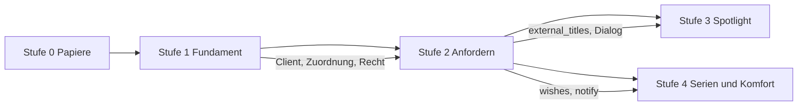

# Konzept 25 · Umsetzungsplan

> **Kurz gesagt.** Der Bau läuft in fünf Stufen (0 bis 4) wie in [Anhang F](anhang/F-entscheid-blatt.md), je Stufe ein Release und
> je Planschritt ein Commit. Stufe 0 ändert nur Papiere (Frage 33, ADR 0037 und 0038, Regel 11). Stufe 1 legt
> das Fundament in der Verwaltung, ohne dass Zuschauer etwas merken; Stufe 2 bringt das Anfordern samt
> Abgleich und Meldung «verfügbar»; Stufe 3 das Spotlight; Stufe 4 Serien, Freigeben in Slouchcat, Webhook und
> die Übernahme bestehender Anfragen. Getestet wird nach den drei Teststufen des Projekts, mit einem
> Mock-Jellyseerr über `httptest`. Gebaut wird erst, wenn Marco Konzept und Mockups freigegeben hat.

Grundlage: Anhang F Abschnitt 10 (Stufen, Aufwand), Architektur `03-architektur.md`, Datenmodell und
API `08-datenmodell-api.md`, Abnahme `10-abnahmekriterien.md`. Was über Anhang F hinausgeht, ist als
**Vorschlag** gekennzeichnet. Migrations- und Vertragsnummern vergibt der Bau.

## 1. Arbeitsregeln für den Bau

| Regel | Quelle |
|---|---|
| Jeder Planschritt ist ein eigener Commit; Titel englisch mit Bereich, z. B. `feat(seerr): add Jellyseerr client` | CLAUDE.md «Arbeitsweise» |
| Generierter Code nur über `task gen` (Quelle `api/openapi.yaml`, `server/queries/`, `server/migrations/`) | Regel 1 |
| Migrationen nach `server/migrations/TEMPLATE.sql.txt`, nur vorwärts; je Stufe ein eingefrorener Stand in `testdata/db/` | Regel 5 |
| Jede neue Seite mit Playwright-Tastaturtest; neue Bauteile in `web/src/ui` mit Storybook | Regel 8, CLAUDE.md |
| Texte nur aus `web/src/locales/*.json` (`de`, `en`, `de-DE` bei ss-Wörtern); Servertexte der Kanäle in 23 Sprachen (`server/internal/notify/locales/*.json`) | Regel 9, [Anhang B](anhang/B-konten-benachrichtigungen.md) 5.6 |
| Höchstens drei Executor gleichzeitig; schwere Läufe nur über die Task-Ziele | CLAUDE.md «Agenten» |
| Höchstens drei Korrekturversuche je roter Prüfung; nie `.skip`, `.only`, `t.Skip` | CLAUDE.md |

### 1.1 Teststufen (CLAUDE.md, `docs/dev/SETUP.md` «Teststufen»)

| Stufe | Wann | Was |
|---|---|---|
| 1 | je Planschritt | `task check:fast` und nur die Tests, die der Schritt anfasst: `go test ./internal/<paket> -run <Test>`, `task e2e:quick -- <spec>`, `task storybook:test` bei geänderten Bauteilen. Belege (Befehl, Ausgabe, Commit-SHA) je Schritt |
| 2 | einmal vor dem Pull Request je Stufe | `task ci` grün, Belege in den PR, `docs/dev/CURRENT_STATUS.md` aktualisieren |
| 3 | GitHub CI | volle Prüfung jedes PR; gemergt wird nur mit grünem Gate `ci` |

`e2e:quick` prüft nur Chromium und `check:fast` nur Uncommittetes (Fallen aus früheren Bauten): vor dem PR
deckt `task ci` beides ab.

### 1.2 Testmittel (Vorschlag)

| Mittel | Zweck |
|---|---|
| `internal/seerr/seerrtest` | Mock-Jellyseerr auf `httptest.Server`: Benutzer, Requests, Medien, Statuswechsel, Fehlerbilder aus [Anhang D](anhang/D-jellyseerr-api.md) (403-Texte, 409, 202, 500, Weiterleitung, Zeitlimit, CSRF an). Nur in Tests importierbar (depguard-Regel `test-helpers`, Muster `radiotest`) |
| Uhr-Mock | Ausgangsfach-Leiter, 24-h-Grenze, Abgleichszeiger |
| `vistest`/`storetest` | Sichtbarkeit fehlender Titel und Altersgrenzen gegen eingefrorene Daten |
| Instanz-Mock | zweite Mock-Instanz mit anderen Benutzern unter derselben Adresse, für den Instanzwechsel (`03-architektur.md`, Abschnitt 7.4) |
| `--dev`-Mock | **Vorschlag:** wie die Trakt-Mock-Basis (`server/cmd/slouchcat/main.go:293-298`) eine Mock-Adresse für Jellyseerr, damit Playwright die Abläufe ohne echte Instanz prüft |
| Mockup-Daten | Konten, Profile und Jellyseerr-Benutzer aus Anhang F Abschnitt 11 als Fixture für e2e |

## 2. Stufe 0: Papiere (0,5 Tage)

Ziel: Die Nicht-Ziele fallen für genau diese Funktion, bevor eine Zeile Code entsteht (`docs/ideas/README.md:9-12`).

| Schritt (Commit) | Inhalt | Dateien | DoD |
|---|---|---|---|
| 0.1 `docs: question 33, wishes through Jellyseerr` | Frage 33 mit Marcos Antworten zu F-1 bis F-22 und T-1, T-2; ändert Spec `:35` und `:46`, hebt `:66` und `:67` in Teilen auf, bestätigt `:65`, `:68` und `:69` als Nicht-Ziel; löst S-4 ab (Wortlaut wie `11-entscheide-und-adr.md`, Abschnitte 2.1 und 3) | `docs/planning/04-entscheidungen.md` | Marco hat die Antworten gegeben; Eintrag verweist auf dieses Konzept |
| 0.2 `docs(adr): 0037 wishes through Jellyseerr, 0038 titles outside the library` | ADR 0037 (Ausnahme vom Nicht-Ziel, LAN-Client, `X-API-User`, Zuordnung C, Zustände, Verfügbarkeit, Ausgangsfach, Mitwunsch, Benachrichtigungen); ADR 0038 (`external_titles`, Jugendschutzregel, Bildweg, S-4 abgelöst, `series_catalog`) | `docs/adr/0037-…md`, `docs/adr/0038-…md` | beide ADR «angenommen», Verweise auf Frage 33 |
| 0.3 `docs: rule 11, spec and plan notes for concept 25` | CLAUDE.md Regel 11 neu (Wortlaut **Vorschlag**: «… eigene Beschaffung, Steuerung von Radarr/Sonarr/SABnzbd; Wünsche nur über Jellyseerr nach ADR 0037 …»); Nachträge in Spec (nicht umschreiben, Muster ADR 0014), Plan 5.1/5.6, ADR 0009, 0010, 0011, `docs/ideas/README.md` | `CLAUDE.md`, `docs/spec/01-anforderungen-v1.md`, `docs/planning/03-plan-v1.md`, `docs/adr/0009…`, `0010…`, `0011…` | Text erst nach Marcos Freigabe; `task check:fast` grün |

Abhängigkeit: Freigabe von Konzept und Mockups durch Marco. Kein Release (nur Doku).

## 3. Stufe 1 «Fundament» (4 Tage)

Ziel: Jellyseerr anbinden, testen, Benutzer laden, zuordnen, Wunschrecht und Einstellungen pflegen. Für
Zuschauer ändert sich nichts ausser dem Schalter im Profildialog, der ohne «Wünsche aktiv» keine Wirkung hat.

| Schritt (Commit) | Inhalt | Pakete, Dateien | Aufwand |
|---|---|---|---|
| 1.1 `feat(seerr): add Jellyseerr client` | Client nach `03-architektur.md` 2.2: LAN erlaubt, keine Weiterleitung, 10 s, 5/s, Fehlerklassen, Typen; `seerrtest` | `server/internal/seerr/` | 0,5 T |
| 1.2 `feat(store): seerr users, wish mapping and request rights` | Migrationen `wishes_mapping`, `wishes_rights` (`08-datenmodell-api.md` 3.2), Rückfüllung; Abfragen `server/queries/wishes/` → `store/wishq`; depguard-Regel; eingefrorener Stand `wuensche1.sql` | `server/migrations/`, `server/queries/wishes/`, `server/.golangci.yml`, `testdata/db/` | 0,5 T |
| 1.3 `feat(admin): Jellyseerr settings and wish settings` | `seerr.*`, `wishes.*` in `settings`; Schlüssel verschlüsselt; Umgebungsvariablen; Redaction-Liste + Test | `server/internal/admin/settings.go`, `server/internal/logging/` | 0,3 T |
| 1.4 `feat(api): contract for Jellyseerr connection, mapping and rights` | Operationen Stufe 1 aus `08-datenmodell-api.md` 4.5/4.6; `task gen`; Vertragstest-Einträge | `api/openapi.yaml`, `server/internal/api/` | 0,5 T |
| 1.5 `feat(wishes): mapping, rights and the seerr.users job` | Dienst `Mapping`, `Rights`, Verbindungstest (Version ab 2.7 bzw. 3.0, neuer Host verlangt den Schlüssel), Fingerabdruck der Instanz mit `confirmSeerrInstance`, Jobart `seerr.users`, Vorschläge bei gleicher E-Mail | `server/internal/wishes/`, `cmd/slouchcat/main.go` | 0,8 T |
| 1.6 `feat(auth): request right on accounts, profiles and invitations` | `can_request` schreiben, Deckelregel, Sitzung `wishes` | `server/internal/auth/`, `server/internal/admin/` | 0,3 T |
| 1.7 `feat(web): Jellyseerr integration view` | siebte Kachel nach «Webhooks von Radarr und Sonarr» und Ansicht (M-21, M-22) mit Test, Zustand, Instanz, Protokoll; Zeile oben mit neun Statusschlüsseln | `web/src/features/admin/integrations/` | 0,4 T |
| 1.8 `feat(web): wishes administration, mapping and settings` | Bereichsreiter «Wünsche» unter Medien direkt nach «Pflege» mit den Reitern «Zuordnung» (Auswahlfelder direkt in der Liste, sofort wirksam) und «Einstellungen» (Schalter, sofort wirksam) (M-24, M-25); «Anfragen» zeigt bis Stufe 2 nur den Hinweis «Ab der nächsten Version» (**Vorschlag**) | `web/src/features/admin/wishes/`, `sections.ts` | 0,5 T |
| 1.9 `feat(web): request right on accounts and profiles` | Konten (Spalte, Formular «Zugriff», Einladung; M-26), Profildialog (M-11) | `web/src/features/admin/accounts/`, `web/src/features/profiles/` | 0,3 T |
| 1.10 `docs: status of concept 25 stage 1` | `CURRENT_STATUS.md`, Versionen, Release-Notiz | `docs/dev/` | – |

DoD je Schritt (Teststufe 1):

| Schritt | Belege |
|---|---|
| 1.1 | `go test ./internal/seerr` grün: Weiterleitung abgewiesen, Zeitlimit greift, LAN-Adresse erreichbar, Rate-Limit 5/s, 403-Texte richtig klassiert, `X-API-User` gesetzt, Schlüssel nie im Fehlertext |
| 1.2 | `go test ./internal/store -run 'TestMigration000NN|TestFrozenWuensche1'` grün; `PRAGMA foreign_key_check` leer; Rückfüllung (Besitzer 1, Hauptprofile 1) geprüft; `task check:fast` (depguard) grün |
| 1.3 | `go test ./internal/logging -run TestRedact` mit `seerr.api_key`; `go test ./internal/admin -run Seerr` |
| 1.4 | `go test ./internal/api -run 'TestContractCoversEveryOperation|TestContractAdminOperations'` |
| 1.5 | `go test ./internal/wishes -run 'Mapping|Rights|Users|Instance'` mit `seerrtest`: Vorschlag bei gleicher E-Mail, nie automatisch, belegter Benutzer 409 `seerr_user_taken`, Benutzer weg → `gone_at`; zweite Mock-Instanz → «Andere Instanz erkannt», kein Aufruf im Namen eines Benutzers bis zur Bestätigung; Test mit neuem Host ohne Schlüssel → 422 |
| 1.6 | `go test ./internal/auth -run CanRequest`: Profil kann den Kontodeckel nicht anheben; Sitzung liefert Grund |
| 1.7–1.9 | `task e2e:quick -- e2e/admin-seerr.spec.ts`, `e2e/admin-wishes.spec.ts`, `e2e/admin-accounts.spec.ts` mit Tastaturtest (Pfeile, Tab, Enter, Zurück, sichtbarer Fokus, keine Fokusfalle); `task storybook:test` für neue Bauteile; `NAV_PAGES` in `admin-home.spec.ts` ergänzt |

Vertrag: Minor, nicht brechend. Abhängig von Stufe 0. Tests der Stufe: Client-Tests, Migration und eingefrorener
Stand, Vertragstest, Redaction-Test, Tastaturtests der drei Verwaltungsseiten.

## 4. Stufe 2 «Anfordern» (8 Tage)

Ziel: Zuschauer mit Recht finden fehlende Titel über Suche und Vorschauseite, fordern an, sehen den Zustand in
«Meine Wünsche» und bekommen «verfügbar» gemeldet. Die Verwaltung sieht alle Anfragen.

| Schritt (Commit) | Inhalt | Pakete, Dateien | Aufwand |
|---|---|---|---|
| 2.1 `feat(store): wishes, external titles and notification kinds` | Migrationen `wishes`, `external_titles`, `wishes_notifications` (Neubau `notifications`, `deliveries`); eingefrorener Stand `wuensche2.sql` | `server/migrations/`, `server/queries/`, `testdata/db/` | 0,8 T |
| 2.2 `feat(metadata): external titles from TMDB` | Abruf Details, Texte je Sprache, Freigaben, `min_age` mit `ageFromCertifications` (Länderreihenfolge nach ADR 0034), `last_episode`, Trailer, Bilder in den Bildspeicher; Jobart `titles.refresh` (Priorität 7); Bild-Handler `scoped` und `admin`; Leiter in `server/internal/jobs/queue.go:11-29` nachführen | `server/internal/metadata/`, `server/internal/api/`, `server/internal/jobs/queue.go` | 1,0 T |
| 2.3 `feat(visibility): missing titles and external ids` | `TitleByExternalIDs`, `MissingTitle`, `VisibleSeasons` mit Folgenzahl; Regel «sehen nur mit Anfordern» (F-9); Suche über TMDB gefiltert, für Profile unter 18 mit Detailabruf der ersten 20 Treffer | `server/internal/visibility/`, `server/queries/system/` | 0,9 T |
| 2.4 `feat(wishes): create, submit and withdraw with an outbox` | `createWish`, Mitwunsch (auch je Staffel), Sofortversuch 3 s ohne Vorprüfung, `wishes.submit`, Leiter, 24-h-Grenze, Vorprüfung ab Versuch 2, 409/202 als Erfolg, Request-ID je Staffel, Zurückziehen mit `wishes.withdraw` und Sperre je Wunsch | `server/internal/wishes/` | 1,4 T |
| 2.5 `feat(wishes): sync with Jellyseerr and reconcile with the library` | `wishes.sync` (Seiten, Abbruch, Zeiger je Seite, Erstabgleich ohne Seitengrenze, Einzelprüfung höchstens einmal je 24 h), `wishes.reconcile`, Haken `WithMatched` in `metadata` (nach `relinkQueued`, bei Serien nach `matchSeasons`) | `server/internal/wishes/`, `server/internal/metadata/match.go`, `metadata.go` | 1,1 T |
| 2.6 `feat(notify): wish available` | Eingangsart `wish_available`, Kanal-Ereignis `wish_available` (Film und ganze Serie), Schlüssel `wish:<id>:available`, `notified_at` als Doppelschutz, neuer Leseweg für Einträge ohne `item_id` (Liste, Zähler, gelesen), PIN-Fassung (F-15), Rückfüllung der Kanäle mit `wish_available` (F-14); Texte in 23 Sprachen | `server/internal/notify/`, `server/queries/system/notify.sql` | 0,7 T |
| 2.7 `feat(api): contract for wishes and external titles` | Operationen Stufe 2; brechend für Benachrichtigungen; Vertragstest inkl. Altersfälle | `api/openapi.yaml`, `server/internal/api/` | 0,5 T |
| 2.8 `feat(web): preview page, request dialog and search section` | Vorschauseite Film/Serie (M-03, M-04), Dialog (M-13), Abschnitt «Noch nicht in der Bibliothek» (M-07) | `web/src/features/titles/`, `web/src/ui/`, `features/discover/SearchPage.tsx` | 1,0 T |
| 2.9 `feat(web): my wishes, side navigation and inbox` | «Meine Wünsche» (M-08), Eintrag «Wünsche» mit Zähler, neue Eingangsart (M-09), Kanäle (M-10) | `web/src/features/wishes/`, `AppLayout.tsx`, `NotificationsPage.tsx` | 0,6 T |
| 2.10 `feat(web): wish requests in the administration` | Reiter «Anfragen» (M-23), Übersicht (M-20), Band «Abgleich» (M-22), Jobtexte (M-30) | `web/src/features/admin/` | 0,5 T |
| 2.11 `docs: status of concept 25 stage 2` | Status, Messung `docs/perf/` | `docs/` | – |

DoD je Schritt:

| Schritt | Belege |
|---|---|
| 2.1 | Migrationstests und `TestFrozenWuensche2`; Teilindizes verhindern zweiten offenen Filmwunsch und zweite offene Staffelzeile |
| 2.2 | `go test ./internal/metadata -run ExternalTitle`: `min_age` nach Länderreihenfolge, unbekannt = NULL; Bilder nur über die eigene Route |
| 2.3 | `go test ./internal/visibility -run 'Missing|ExternalIDs|VisibleSeasons'`: Titel in der Bibliothek, aber zu hoch eingestuft, ist **nicht** fehlend; TVDB-zuerst-Serie ohne `tmdb_id` wird über TVDB/IMDb gefunden |
| 2.4 | `go test ./internal/wishes -run 'Create|Submit|Withdraw'`: Doppelaufruf liefert 200; zwei Profile legen gleichzeitig an → ein Wunsch und ein Mitwunsch (Konflikt am Teilindex, Transaktion wiederholt); Mitwunsch ohne Aufruf an Jellyseerr; Sofortversuch ohne Vorprüfung; Zeitlimit → `queued`; Antwort verloren und Neustart → kein zweiter POST (Vorprüfung ab Versuch 2); 409 und 202 hängen an, Serie mit fremd angefragter Staffel → zwei Request-IDs; 403 mit unbekanntem Benutzer → `seerr_user_gone`, mit ungültigem Schlüssel → bleibt `queued`; 24 h → `failed` + `errors`; Zeitlimit, Request kam an, Profil zieht zurück → kein Request mehr in Jellyseerr; schon freigegeben → wieder `processing` mit Hinweis |
| 2.5 | `go test ./internal/wishes -run 'Sync|Reconcile|Initial'`: Abbruch bei `updatedAt` vor dem Zeiger; abgebrochener Lauf setzt an der gespeicherten Seite fort; 3000 Requests: Erstabgleich ohne Seitengrenze setzt den Zeiger, danach höchstens eine Seite je Lauf; zweiter Lauf erzeugt keine doppelten Ereignisse; Einzelprüfung je Wunsch höchstens einmal je 24 h; Request 404 → `failed`; Haken nach dem Match löst `available` aus, nicht schon der Scan; Staffel mit 1 von 10 Folgen bleibt `processing` |
| 2.6 | `go test ./internal/notify -run Wish`: nur sichtbare Profile; Mitwünscher bekommen je eine Meldung; zweiter Durchlauf ohne zweite Meldung, auch nach dem Wegräumen des Eingangseintrags (`notified_at`); Eintrag ohne `item_id` erscheint in Liste und Glocke für Anforderer und Mitwünscher, nicht für andere Profile; PIN-Profil extern ohne Titel |
| 2.7 | Vertragstest inkl. 404 für zu hohe und unbekannte Freigabe |
| 2.8–2.10 | `task e2e:quick -- e2e/title-preview.spec.ts e2e/wishes.spec.ts e2e/search.spec.ts e2e/admin-wishes.spec.ts` mit Tastaturtest; `task storybook:test` für Dialog, Plus-Knopf, Zustandschip |

Vertrag: Minor, brechend. Abhängig von Stufe 1 (Zuordnung, Recht, Client).

## 5. Stufe 3 «Spotlight» (5 Tage)

Ziel: Fehlende Titel erscheinen auf Wunsch des Administrators in Bühne, Posterreihe und Spotlight-Liste; die Reihe
«Deine Wünsche» kommt dazu. Einzelheiten der Regeln: `05-spotlight-integration.md`.

| Schritt (Commit) | Inhalt | Pakete, Dateien | Aufwand |
|---|---|---|---|
| 3.1 `feat(trakt): keep tvdb and imdb ids of list entries` | Trakt liest `ids.tvdb`, `ids.imdb`; Migration `spotlight_missing`; eingefrorener Stand `wuensche3.sql` | `server/internal/trakt/`, `server/internal/metadata/trakt.go`, `server/migrations/` | 0,6 T |
| 3.2 `feat(discover): missing titles in the spotlight` | Mischregel (höchstens N, Reihenfolge, erste Folie vorhanden, zählt nicht für «Ausblenden unter», nur mit Recht), scoped Abfrage neben `ListSpotlightRow` | `server/internal/discover/`, `server/internal/visibility/discover.go`, `server/queries/scoped/spotlight.sql` | 1,2 T |
| 3.3 `feat(api): contract for missing titles on the start page` | `HomeRow.external`, `HomeRowKey` + `wishes`, Spotlight-Konfiguration | `api/openapi.yaml` | 0,4 T |
| 3.4 `feat(web): missing titles on the stage and in the poster row` | Bühne, Posterreihe (M-01), Spotlight-Liste mit Filter (M-02), Reihe «Deine Wünsche» | `web/src/ui/HeroCarousel.tsx`, `HomePage.tsx`, `HomeListPage.tsx` | 1,4 T |
| 3.5 `feat(web): spotlight band for missing titles` | Band «Fehlende Titel», Aktionen in «Einträge der Liste» (M-27), Reihe in «Startseite» (M-28) | `web/src/features/admin/SpotlightPage.tsx`, `HomeRowsPage.tsx` | 0,8 T |
| 3.6 `docs: status and measurements of concept 25 stage 3` | Messung Startseite in `docs/perf/` | `docs/` | 0,6 T |

DoD: `go test ./internal/discover -run Spotlight` (erste Folie immer vorhanden; Profil ohne Recht sieht keine
fehlenden; Profil 12 sieht keinen fehlenden Titel ab 16 oder ohne Freigabe; höchstens N; `min_hits` zählt nur
vorhandene); `go test ./internal/metadata -run Trakt` (TVDB-zuerst-Serie gilt nicht als fehlend);
`task e2e:quick -- e2e/home.spec.ts e2e/admin-spotlight.spec.ts` mit Tastaturtest; `task storybook:test` für
`HeroCarousel`; Messung nach `10-abnahmekriterien.md` (Performance).

Vertrag: Minor, brechend (`HomeRowKey`). Abhängig von Stufe 2 (`external_titles`, Wünsche, Dialog).

## 6. Stufe 4 «Serien und Komfort» (7 Tage)

Ziel: Fehlende Staffeln vorhandener Serien, Staffelmeldungen, Zustandsmeldungen, Freigeben/Ablehnen in der
Verwaltung, Sofortmeldung per Webhook, Übernahme bestehender Anfragen.

| Schritt (Commit) | Inhalt | Pakete, Dateien | Aufwand |
|---|---|---|---|
| 4.1 `feat(metadata): series catalog from TMDB` | Migration `series_catalog`, Jobart `series.catalog` (Zeitplanlauf Priorität 7, Ereignisläufe 4; Leiter in `queue.go` nachführen), `getItem.catalog`, `canRequestSeasons`; eingefrorener Stand `wuensche4.sql` | `server/internal/metadata/`, `server/migrations/`, `server/internal/jobs/queue.go` | 1,0 T |
| 4.2 `feat(web): missing seasons on the series page` | gedämpfte Karten, «Staffeln anfordern», «2 von 4 Staffeln vorhanden», «Läuft noch, nächste Folge am …» (M-06), nur für Profile, die anfordern können; Staffelwahl mit «Bereits angefordert» als Mitwunsch | `web/src/features/catalog/ItemPage.tsx`, `SeasonShelf.tsx` | 1,0 T |
| 4.3 `feat(notify): season and status notifications` | `wish_season_available` (auch «bisher erschienene Folgen»), `wish_approved`, `wish_declined`, `wish_failed`, Kanal `wish_status` (ab Werk aus), `wish_review` (Administratoren); Datenmigration: `wish_review` in die Ereignislisten der bestehenden Administratorkonten, `ChannelEnsureDefaults` für neue | `server/internal/notify/`, `server/migrations/` | 0,9 T |
| 4.4 `feat(wishes): approve and decline from the administration` | `approveWish`, `declineWish` (F-16) | `server/internal/wishes/`, `web/src/features/admin/wishes/` | 0,8 T |
| 4.5 `feat(integrations): Jellyseerr webhook as a sync trigger` | Migration `webhook_jellyseerr`, Art `jellyseerr`, Band «Sofortmeldung» mit Vorlage (F-18) | `server/internal/integrations/`, `web/src/features/admin/integrations/` | 0,8 T |
| 4.6 `feat(wishes): take over existing Jellyseerr requests` | F-21: Jobart `wishes.import` (ausgelöst beim Setzen oder Ändern einer Zuordnung und von Hand, `GET /request?requestedBy=` seitenweise als Benutzer 1), Zahl für die Meldung (`take=1`), `importSeerrRequests`, `countSeerrRequests`; Regeln nach `03-architektur.md` 7.3 und `04-benutzer-profilmapping.md` 8.2 | `server/internal/wishes/`, `web/src/features/admin/wishes/` | 1,1 T |
| 4.7 `feat(api): contract for series catalog, status events and webhook kind` | Vertrag Stufe 4 | `api/openapi.yaml` | 0,4 T |
| 4.8 `docs: status of concept 25 stage 4` | Status, Abschluss | `docs/` | 1,2 T (mit Abnahme) |

DoD: `go test ./internal/metadata -run SeriesCatalog`; `go test ./internal/wishes -run 'Approve|Decline|Import|Webhook'`
(Übernahme dem richtigen Profil, auch alter Requests eines neu zugeordneten Benutzers; nicht zuordenbare ohne
Meldung; schon geführter nicht zuordenbarer Wunsch bekommt das Zielprofil; Webhook nur Anstoss; Approve auf
nicht PENDING → 409 sauber); `go test ./internal/notify -run 'Season|Status|Review'` (Staffelmeldung erst bei
vollständiger Staffel; `wish_review` bei bestehenden Administratorkonten nach der Migration);
`go test ./internal/integrations -run Jellyseerr`; `task e2e:quick -- e2e/series.spec.ts e2e/admin-wishes.spec.ts`
mit Tastaturtest.

Vertrag: Minor, brechend. Abhängig von Stufe 2; 4.2 von 4.1.

## 7. Abhängigkeiten im Überblick

Stufe 3 und 4 hängen beide nur an Stufe 2. **Vorschlag:** Die Reihenfolge von Anhang F (F-22) bleibt; tauschen
liesse sich 3 und 4 ohne Umbau.

## 8. Notwendige Tests (Übersicht)

| Art | Inhalt | Stufe |
|---|---|---|
| Go mit Mock-Jellyseerr (`httptest`) | Client, Senden, 409/202/403/500, Weiterleitung, Zeitlimit, CSRF an, Benutzer gelöscht, Request gelöscht, Statuswechsel 1 → 2 → 5 | 1, 2, 4 |
| Vertragstest | jede Operation in `TestContractCoversEveryOperation` und ihrer Gruppe; 404 statt 403 | 1 bis 4 |
| Sichtbarkeit | fehlender Titel über der Altersgrenze 404 (Vorschauseite, Bild, Suche, Spotlight, `createWish`); unbekannte Freigabe = 18; Titel in der Bibliothek, aber nicht sichtbar, ist nicht fehlend; Profil ohne Recht sieht keine fehlenden Titel | 2, 3 |
| Idempotenz und Wiederaufnahme | doppelter `createWish`; Job doppelt ausgeführt (Lease abgelaufen); Neustart mitten im Senden; Abgleich abgebrochen; Benachrichtigung höchstens einmal | 2 |
| Migrationen | je Migration ein Test; je Stufe ein eingefrorener Stand (`wuensche1.sql` bis `wuensche4.sql`), Wiedereinspielen der früheren Stände | 1 bis 4 |
| Redaction | `seerr.api_key` nie im Log, `X-Api-Key` redigiert | 1 |
| Playwright | Tastaturtest je neuer Seite (Integrationen › Jellyseerr, Wünsche › Anfragen/Zuordnung/Einstellungen, Vorschauseite, «Meine Wünsche»); geänderte Seiten im bestehenden Test erweitert | 1 bis 4 |
| Storybook | neue Bauteile in `web/src/ui` (Anforderungsdialog, Plus-Knopf am Poster, Zustandschip, gedämpfte Staffelkarte, Chip «Noch nicht in der Bibliothek») | 2 bis 4 |
| i18n | App-Texte in `de`, `en`, `de-DE`; Servertexte der Kanäle in 23 Sprachen; Lint `eslint-plugin-i18next` | 1 bis 4 |
| Messung | Startseite mit fehlenden Titeln, Abgleich bei vielen Requests (`10-abnahmekriterien.md`) | 3 |

## 9. Risiken und Gegenmassnahmen

| Risiko | Folge | Gegenmassnahme |
|---|---|---|
| `X-API-User` ist undokumentiert und fällt in einer künftigen Version weg | Wünsche liefen als Benutzer 1 und wären sofort freigegeben, oder scheiterten | Verbindungstest prüft es (`GET /auth/me`); zusätzlich prüft **Vorschlag** jeder Wunsch nach dem Senden `requestedBy.id` in der Antwort (abgeleitet: Jellyseerr setzt `requestedBy: requestUser`, `MediaRequest.ts` Z. 338, 453); Abweichung → Wunsch `failed`, Anfordern gesperrt, `errors` an Administratoren. Nie auf `userId` ausweichen |
| TMDB-Kontingent und Last | Suche, Vorschauseite und `titles.refresh` erzeugen Aufrufe | bestehender TMDB-Limiter (≤ 20/s); Cache in `external_titles`; Suche 10 min im Speicher; Rate-Limit je Profil |
| Falsche «fehlt»-Erkennung | ein vorhandener Titel wird angefordert | Abgleich über TMDB, TVDB und IMDb; Trakt-IDs mitnehmen; ein Titel in der Bibliothek, aber nicht sichtbar, gilt nicht als fehlend; Jellyseerr meldet bei Doppelbestellung 409 |
| Falsches «verfügbar» oder keines | Meldung fehlt oder kommt zu früh | Auslöser nach dem Match; stündlicher Nachlauf; Diagnose «In Jellyseerr verfügbar, in Slouchcat nicht gefunden» |
| Spotlight-Performance | langsamere Startseite | alles lokal; erste Folie bleibt vorhanden (Prepaint unverändert); Messung vor dem PR; Grenzwerte in `10-abnahmekriterien.md` |
| Teure Abgleichsaufrufe in Jellyseerr | jedes `GET /request` fragt alle Radarr/Sonarr ab (Anhang D 6.1) | 5 min Takt, `take=50`, Abbruch beim Zeiger, höchstens 40 Seiten je Lauf mit Zeiger je Seite (kein Festfahren); Erstabgleich einmal im Hintergrund; Einzelprüfung höchstens einmal je 24 h je Wunsch |
| Instanz wechselt | Wünsche gingen unter fremden Benutzer-IDs an andere Personen | Fingerabdruck der Instanz; bei Abweichung halten Übermittlung und Abgleich an, bis der Administrator bestätigt oder löscht (`03-architektur.md`, Abschnitt 7.4) |
| Geisterbestellung nach Zurückziehen | ein Request bleibt in Jellyseerr, Radarr beschafft | `wishes.withdraw` sucht den Request auch ohne bekannte ID und löscht ihn, solange er `PENDING` ist (`03-architektur.md`, Abschnitt 6.6) |
| CSRF-Schutz in Jellyseerr an | alle Wünsche hängen in `queued` | Prüfpunkt im Verbindungstest; Hinweis mit Abhilfe |
| Webhook-Ziel in Jellyseerr schon belegt | Marco verliert seine bestehende Meldung | Slouchcat richtet den Webhook nie selbst ein; Hinweis «Jellyseerr kennt nur ein Webhook-Ziel» |
| Brechende Vertragsänderungen in drei Stufen (2 bis 4; Stufe 1 ist nicht brechend) | Fremd-Clients brechen | jede Stufe ein Tag, Release-Notiz nennt die Änderung; die App ist der einzige Client (`08-datenmodell-api.md`, Abschnitt 4.6) |
| Jellyseerr-Benutzer gelöscht | seine Requests verschwinden (CASCADE) | `seerr.users` täglich, 404 als `failed`, Warnung in der Zuordnung |
| Datenschutz zwischen Profilen | Titel eines Erwachsenenprofils auf dem Gerät des Kindes | PIN-Regel F-15, Sichtbarkeit je Empfänger (`06-benachrichtigungen.md`) |

## 10. Ausdrücklich später oder nie

| Thema | Status | Grund |
|---|---|---|
| Radarr, Sonarr, SABnzbd ansprechen; Qualitätsprofile, Zielordner, Tags, 4K | nie | Non-Goal Spec `:69`, Anhang F 2.1 |
| Eigene Freigabe in Slouchcat, Freigabe-Anfragen von Kinderprofilen | nie | Spec `:65` bleibt; Freigabe liegt in Jellyseerr (F-6) |
| Einzelne Folgen anfordern | nie | Jellyseerr arbeitet staffelweise (Anhang F 2.15) |
| Seite «Entdecken» | nie | Anhang F 2.14 |
| Wünsche offline | nie | `/api` ist `NetworkOnly` (Anhang F 2.20) |
| Ablehnungsgrund | nie (gibt es in Jellyseerr nicht) | Anhang D 8 |
| Jellyseerr-Benutzer aus Slouchcat anlegen oder Rechte dort ändern | **Vorschlag:** nicht in diesem Konzept | Zuordnen macht der Administrator (Anhang F 2.4); Anlegen wäre Steuerung von Jellyseerr |
| Medienstatus in Jellyseerr setzen (`POST /media/{id}/{status}`) | nie | Slouchcat meldet nur in Slouchcat |
| Mehrere Jellyseerr-Instanzen | später, Ideensammlung (**Vorschlag**) | ein Schlüssel, eine Adresse genügt dem Haushalt |
| Störungsmeldungen (Issues) an Jellyseerr | später, Ideensammlung (**Vorschlag**) | nicht Teil des Auftrags |
| Overseerr | nie | archiviert (Anhang D 1) |
