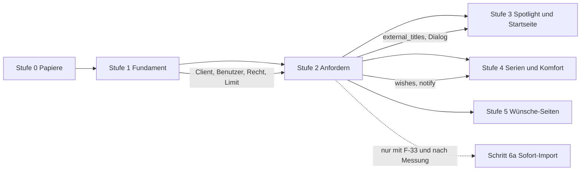

# Konzept 25 · Umsetzungsplan

> **Kurz gesagt.** Der Bau läuft in sechs Stufen (0 bis 5), je Stufe ein Release und je Planschritt ein Commit.
> Stufe 0 ändert nur Papiere (Frage 33, ADR 0037 und 0038, Regeln 10 und 11, ADR 0010). Stufe 1 legt das
> Fundament in der Verwaltung, eröffnet die Konten in Jellyseerr mit demselben Login und führt das Limit ein, ohne
> dass Zuschauer mehr merken als den Hinweis beim Einladen; Stufe 2 bringt das Anfordern samt Abgleich, Vorprüfung
> des Limits und Meldung «verfügbar»; Stufe 3 im Spotlight nur den Abgleich vorhandener Titel über TVDB und IMDb,
> die fehlenden Einträge in der Verwaltung und die Startreihe «Erfüllte Wünsche» (für Zuschauer zeigt das Spotlight
> weiter nur Titel der Bibliothek); Stufe 4 Serien, Freigeben in Slouchcat, Jellyseerr-Webhook, die Übernahme
> bestehender Anfragen, den Profil-Tag und den Download-Fortschritt aus Radarr und Sonarr; Stufe 5 die Wünsche-Seiten «Entdecken»,
> «Filme», «Serien» und «Suche». Getestet wird nach den drei Teststufen des Projekts, mit einem Mock-Jellyseerr
> und einem Mock-Radarr/Sonarr über `httptest`. Der Sofort-Import über die Webhook-Meldung (F-33) ist ein eigener,
> wahlweiser Schritt nach einer Messung. Gebaut wird erst, wenn Marco Konzept und Mockups freigegeben hat.

Stand: Fassung 3 vom 17. November 2026 mit beiden Rückmeldungen von Marco an diesem Tag (E-1 bis E-7,
[Anhang H](anhang/H-nachtrag-17-november.md), Abschnitte 4.7 und 8.7). Die Stufen 0 bis 4 aus Anhang F bleiben; die
Zuordnung der neuen Teile zu den Stufen, die Stufe 5 und der Schritt zu F-33 sind Empfehlung der Redaktion. Grundlage: Anhang F Abschnitt 10 (Stufen, Aufwand), Architektur `03-architektur.md`, Datenmodell und
API `08-datenmodell-api.md`, Abnahme `10-abnahmekriterien.md`. Was über Anhang F hinausgeht, ist als
**Vorschlag** gekennzeichnet. Migrations- und Vertragsnummern vergibt der Bau.

## 1. Arbeitsregeln für den Bau

| Regel | Quelle |
|---|---|
| Jeder Planschritt ist ein eigener Commit; Titel englisch mit Bereich, z. B. `feat(seerr): add Jellyseerr client` | CLAUDE.md «Arbeitsweise» |
| Generierter Code nur über `task gen` (Quelle `api/openapi.yaml`, `server/queries/`, `server/migrations/`) | Regel 1 |
| Migrationen nach `server/migrations/TEMPLATE.sql.txt`, nur vorwärts; je Stufe ein eingefrorener Stand in `testdata/db/` | Regel 5 |
| Jede neue Seite mit Playwright-Tastaturtest; neue Bauteile in `web/src/ui` mit Storybook | Regel 8, CLAUDE.md |
| Texte nur aus `web/src/locales/*.json` (`de`, `en`, `de-DE` bei ss-Wörtern); Servertexte der Kanäle in 23 Sprachen (`server/internal/notify/locales/*.json`) | Regel 9, [Anhang B](anhang/B-konten-benachrichtigungen.md) 5.6 |
| Höchstens drei Executor gleichzeitig; schwere Läufe nur über die Task-Ziele | CLAUDE.md «Agenten» |
| Höchstens drei Korrekturversuche je roter Prüfung; nie `.skip`, `.only`, `t.Skip` | CLAUDE.md |

### 1.1 Teststufen (CLAUDE.md, `docs/dev/SETUP.md` «Teststufen»)

| Stufe | Wann | Was |
|---|---|---|
| 1 | je Planschritt | `task check:fast` und nur die Tests, die der Schritt anfasst: `go test ./internal/<paket> -run <Test>`, `task e2e:quick -- <spec>`, `task storybook:test` bei geänderten Bauteilen. Belege (Befehl, Ausgabe, Commit-SHA) je Schritt |
| 2 | einmal vor dem Pull Request je Stufe | `task ci` grün, Belege in den PR, `docs/dev/CURRENT_STATUS.md` aktualisieren |
| 3 | GitHub CI | volle Prüfung jedes PR; gemergt wird nur mit grünem Gate `ci` |

`e2e:quick` prüft nur Chromium und `check:fast` nur Uncommittetes (Fallen aus früheren Bauten): vor dem PR
deckt `task ci` beides ab.

### 1.2 Testmittel (Vorschlag)

| Mittel | Zweck |
|---|---|
| `internal/seerr/seerrtest` | Mock-Jellyseerr auf `httptest.Server`: Benutzer, Requests, Medien, Statuswechsel, Fehlerbilder aus [Anhang D](anhang/D-jellyseerr-api.md) (403-Texte, 409, 202, 500, Weiterleitung, Zeitlimit, CSRF an); neu die Benutzerpflege nach Anhang H 3.1 (409 bei gleicher E-Mail, `settings/main` leert fehlende Felder, Passwort-Route weist Benutzer 1 ab), das Limit nach Anhang H 3.2 (rollierend, Staffeln summiert, `DECLINED` zählt nicht), Discover- und Suchrouten, `/settings/public|metadatas|radarr|sonarr`. Nur in Tests importierbar (depguard-Regel `test-helpers`, Muster `radiotest`) |
| `internal/arr/arrtest` (neu) | Mock-Radarr und Mock-Sonarr: Tags, Filme nach `tmdbId` (mit `hasFile`), Serien nach `tvdbId` (mit `statistics`, `seasons`), Editor mit `applyTags`, Warteschlange `GET /api/v3/queue` mit den Feldern aus Anhang H 8.3 (Download läuft, hängt mit `trackedDownloadStatus` `warning`, fehlende Felder); zählt jeden Aufruf, damit Tests belegen, dass nichts ausser Tags angelegt oder angehängt und sonst nur gelesen wird. Die Feldnamen der Sonarr-Warteschlange folgen der Dokumentation und sind gegen Marcos Sonarr zu prüfen, sobald dort ein Download läuft |
| Uhr-Mock | Ausgangsfach-Leiter, 24-h-Grenze, Abgleichszeiger, rollierendes Limit, Zwischenspeicher 1 h |
| `vistest`/`storetest` | Sichtbarkeit fehlender Titel und Altersgrenzen gegen eingefrorene Daten |
| Instanz-Mock | zweite Mock-Instanz mit anderen Benutzern unter derselben Adresse, für den Instanzwechsel (`03-architektur.md`, Abschnitt 7.4) |
| `--dev`-Mock | **Vorschlag:** wie die Trakt-Mock-Basis (`server/cmd/slouchcat/main.go:293-298`) eine Mock-Adresse für Jellyseerr, damit Playwright die Abläufe ohne echte Instanz prüft |
| Mockup-Daten | Konten, Profile und Jellyseerr-Benutzer aus Anhang F Abschnitt 11 als Fixture für e2e |

## 2. Stufe 0: Papiere (0,5 Tage)

Ziel: Die Nicht-Ziele fallen für genau diese Funktion, bevor eine Zeile Code entsteht (`docs/ideas/README.md:9-12`).

| Schritt (Commit) | Inhalt | Dateien | DoD |
|---|---|---|---|
| 0.1 `docs: question 33, wishes through Jellyseerr` | Frage 33 mit Marcos Entscheiden E-1 bis E-7 vom 17. November 2026 und seinen Antworten zu F-1 bis F-34 und T-1, T-2; ändert Spec `:35` und `:46`, hebt `:66` und `:67` in Teilen auf (`:67` nur beim Wunsch), bestätigt `:65` und `:68`, fasst `:69` mit der Ausnahme Profil-Tag (die Warteschlange liest Slouchcat nur, steuert sie nicht); S-4 bleibt ohne Ausnahme (Wortlaut wie `11-entscheide-und-adr.md`, Abschnitte 2.1 und 3) | `docs/planning/04-entscheidungen.md` | Marco hat die Antworten gegeben; Eintrag verweist auf dieses Konzept |
| 0.2 `docs(adr): 0037 wishes through Jellyseerr, 0038 titles outside the library` | ADR 0037 (Ausnahme vom Nicht-Ziel, LAN-Client, `X-API-User`, Jellyseerr-Benutzer je Konto mit demselben Login, Passwort nur in drei Momenten, Limit, Profil-Tag und Download-Fortschritt aus Radarr und Sonarr, Webhooks wie heute, Zustände, Verfügbarkeit, Ausgangsfach, Mitwunsch, Benachrichtigungen); ADR 0038 (`external_titles`, Jugendschutzregel, Bildweg, S-4 bleibt, keine fehlenden Titel auf der Startseite, `series_catalog`, Wünsche-Seiten, Abgleich Serien TVDB zuerst) | `docs/adr/0037-…md`, `docs/adr/0038-…md` | beide ADR «angenommen», Verweise auf Frage 33 |
| 0.3 `docs: rules 10 and 11, spec and plan notes for concept 25` | CLAUDE.md Regel 11 neu (Wortlaut **Vorschlag** in `11-entscheide-und-adr.md`, Abschnitt 6: zwei eng gefasste Ausnahmen vom Nicht-Ziel «Steuerung von Arr/Seerr»), Regel 10 mit den neuen Schlüsseln; Nachträge in Spec (nicht umschreiben, Muster ADR 0014), Plan 5.1/5.6, ADR 0009, 0010 (zwei Ausnahmen: Profil-Tag, Warteschlange lesen; Webhook-Empfang unverändert), 0011 (nur Hinweis auf den Abgleich über TVDB und IMDb), `docs/ideas/README.md` | `CLAUDE.md`, `docs/spec/01-anforderungen-v1.md`, `docs/planning/03-plan-v1.md`, `docs/adr/0009…`, `0010…`, `0011…` | Text erst nach Marcos Freigabe; `task check:fast` grün |

Abhängigkeit: Freigabe von Konzept und Mockups durch Marco. Kein Release (nur Doku).

## 3. Stufe 1 «Fundament» (7 Tage)

Ziel: Jellyseerr anbinden, testen, Benutzer laden, Konten in Jellyseerr eröffnen oder über die E-Mail verknüpfen
(verknüpft wird nur auf Handlung oder Bestätigung eines Administrators, sonst nur vorgeschlagen; N-2a),
das Passwort in den drei Momenten weitergeben, das Limit je Konto einstellen und in Jellyseerr schreiben,
Wunschrecht und Einstellungen pflegen. Eröffnen, Passwort und Limit gehören in diese Stufe, weil sich ohne sie
nicht sinnvoll anfordern lässt (Anhang H 4.7, Redaktion). Für Zuschauer ändert sich nichts ausser dem Schalter im
Profildialog, der ohne «Wünsche aktiv» keine Wirkung hat, und dem Hinweis «Dein Login gilt auch für Jellyseerr»
beim Annehmen einer Einladung (M-35). Aufwand **Vorschlag**: Anhang F nennt 4 Tage ohne die Teile aus Fassung 3.

| Schritt (Commit) | Inhalt | Pakete, Dateien | Aufwand |
|---|---|---|---|
| 1.1 `feat(seerr): add Jellyseerr client` | Client nach `03-architektur.md` 2.2: LAN erlaubt, keine Weiterleitung, 10 s, 5/s, Fehlerklassen, Typen, Aufrufe der Gruppen Verbindung, Benutzer, Limit, Einstellungen; nie ein Body im Protokoll; `seerrtest` | `server/internal/seerr/` | 0,8 T |
| 1.2 `feat(store): seerr users, wish mapping, limits and request rights` | Migrationen `wishes_mapping` (mit Zustand und Passwortstand an `wish_account_map`, Limit-Stand an `seerr_users`, `wish_account_limits`), `wishes_rights` (`08-datenmodell-api.md` 3.2), Rückfüllung; Abfragen `server/queries/wishes/` → `store/wishq`; depguard-Regel; eingefrorener Stand `wuensche1.sql` | `server/migrations/`, `server/queries/wishes/`, `server/.golangci.yml`, `testdata/db/` | 0,5 T |
| 1.3 `feat(admin): Jellyseerr settings and wish settings` | `seerr.*`, `wishes.*` in `settings` (mit Limit ab Werk, «Neue Konten in Jellyseerr eröffnen», «Passwort abgleichen»); Schlüssel verschlüsselt; Umgebungsvariablen; Redaction-Liste + Test mit `seerrapikey`, `newpassword` | `server/internal/admin/settings.go`, `server/internal/logging/` | 0,3 T |
| 1.4 `feat(api): contract for Jellyseerr connection, mapping and rights` | Operationen Stufe 1 aus `08-datenmodell-api.md` 4.5/4.6; `task gen`; Vertragstest-Einträge | `api/openapi.yaml`, `server/internal/api/` | 0,5 T |
| 1.5 `feat(wishes): mapping, rights and the seerr.users job` | Dienst `Mapping`, `Rights`, Verbindungstest (Version ab 2.7 bzw. 3.0, neuer Host verlangt den Schlüssel, neue Prüfpunkte «Benutzer anlegen und ändern», «Lokale Anmeldung in Jellyseerr», «Staffeln aus TVDB», Passwort unverschlüsselt; Warnungen lassen den Test nicht scheitern), Fingerabdruck der Instanz mit `confirmSeerrInstance`, Jobart `seerr.users` | `server/internal/wishes/`, `cmd/slouchcat/main.go` | 0,8 T |
| 1.5a `feat(wishes): open accounts in Jellyseerr` | `Service.Provision` und Jobart `seerr.provision` (`03-architektur.md`, Abschnitt 18.2): suchen über die E-Mail; Treffer verknüpfen nur, wenn ein Administrator auslöst, sonst Zustand «Verknüpfung vorgeschlagen» (`suggested`, mit `suggested_seerr_user_id`; N-2a, K-1); `POST /user`, 409 als Treffer, Rechte nach Wunschrecht nur für eröffnete, `settings/main` lesen und vollständig zurückschreiben, Zustand «wartet»; `provisionSeerrAccount`, `provisionSeerrAccounts` (lässt Vorschläge aus), `confirmSeerrAccountLink`; Abschluss beim Löschen eines Kontos nur für eröffnete Benutzer (N-10, K-2) | `server/internal/wishes/`, `server/internal/auth/accounts.go` | 1,0 T |
| 1.5b `feat(auth): hand the password to Jellyseerr at three moments` | Haken `WithPasswordSeen` in `AcceptInvitation`, `UpdateAccount`, `Login` (`03-architektur.md`, Abschnitt 18.3), nach dem Commit bzw. nach der Prüfung; Übergabe nur im Speicher, nie in einer Job-Nutzlast; `password_state`; `setSeerrPasswordMode`; E-Mail-Änderung an Jellyseerr, ohne Benutzer nur Vorschlag (N-2a); kein Passwort an einen vorgeschlagenen Benutzer; gleiche Antwort mit und ohne Treffer | `server/internal/auth/`, `server/internal/wishes/`, `cmd/slouchcat/main.go` | 0,6 T |
| 1.5c `feat(wishes): limit per account written to Jellyseerr` | `Quota`: Vorgabe, «Standard», «Eigenes», «Unbegrenzt», Schreiben in die vier Felder (nicht bei `MANAGE_USERS`), Stand aus `GET /user/{id}/quota` in `seerr_users`, «nächster Platz frei»; `setAccountWishLimit` | `server/internal/wishes/` | 0,6 T |
| 1.6 `feat(auth): request right on accounts, profiles and invitations` | `can_request` schreiben, Deckelregel, Sitzung `wishes` | `server/internal/auth/`, `server/internal/admin/` | 0,3 T |
| 1.7 `feat(web): Jellyseerr integration view` | siebte Kachel nach «Webhooks von Radarr und Sonarr» und Ansicht (M-21, M-22) mit Test, Zustand, Instanz, Protokoll; Zeile oben mit neun Statusschlüsseln | `web/src/features/admin/integrations/` | 0,4 T |
| 1.8 `feat(web): wishes administration, Jellyseerr users and settings` | Bereichsreiter «Wünsche» unter Medien direkt nach «Pflege» mit den Reitern «Jellyseerr-Benutzer» (Zustand, Passwort, Rechte, Limit je Konto, «In Jellyseerr eröffnen», «Alle eröffnen», «Verknüpfung bestätigen» mit Band, das sich bei einem Vorschlag von selbst öffnet, Ausnahme je Profil zugeklappt; sofort wirksam) und «Einstellungen» (Schalter, Bänder «Limit ab Werk» und «Konten in Jellyseerr», sofort wirksam) (M-24, M-25); Band «Benutzer und Limit» in M-22; «Anfragen» zeigt bis Stufe 2 nur den Hinweis «Ab der nächsten Version» (**Vorschlag**) | `web/src/features/admin/wishes/`, `sections.ts` | 0,8 T |
| 1.9 `feat(web): request right and limit on accounts, invitation hint` | Konten (Spalte, Formular «Zugriff» mit Limit, Einladung mit Limit und Hinweis, Passwortänderung mit Hinweis; M-26), Profildialog (M-11), Seite «Einladung annehmen» mit «Dein Login gilt auch für Jellyseerr» (M-35) | `web/src/features/admin/accounts/`, `web/src/features/profiles/`, Seite `/invite/$token` | 0,5 T |
| 1.10 `docs: status of concept 25 stage 1` | `CURRENT_STATUS.md`, Versionen, Release-Notiz | `docs/dev/` | – |

DoD je Schritt (Teststufe 1):

| Schritt | Belege |
|---|---|
| 1.1 | `go test ./internal/seerr` grün: Weiterleitung abgewiesen, Zeitlimit greift, LAN-Adresse erreichbar, Rate-Limit 5/s, 403-Texte richtig klassiert, `X-API-User` gesetzt, Schlüssel nie im Fehlertext, Body mit Passwort nie im Log oder Fehlertext |
| 1.2 | `go test ./internal/store -run 'TestMigration000NN|TestFrozenWuensche1'` grün; `PRAGMA foreign_key_check` leer; Rückfüllung (Besitzer 1, Hauptprofile 1) geprüft; `task check:fast` (depguard) grün |
| 1.3 | `go test ./internal/logging -run TestRedact` mit `seerr.api_key`, `newPassword`, `password`; `go test ./internal/admin -run Seerr` |
| 1.4 | `go test ./internal/api -run 'TestContractCoversEveryOperation|TestContractAdminOperations'` |
| 1.5 | `go test ./internal/wishes -run 'Mapping|Rights|Users|Instance'` mit `seerrtest`: belegter Benutzer 409 `seerr_user_taken`, Benutzer weg → `gone_at`; zweite Mock-Instanz → «Andere Instanz erkannt», kein Aufruf im Namen eines Benutzers bis zur Bestätigung; Test mit neuem Host ohne Schlüssel → 422; «Lokale Anmeldung» aus → Warnung, Test gelungen |
| 1.5a | `go test ./internal/wishes -run 'Provision|ConfirmLink|DeleteAccount'`: «In Jellyseerr eröffnen» mit gleicher E-Mail (andere Schreibung) → verknüpft, kein `POST /user`; 409 auf Knopfdruck → verknüpft; Einladung angenommen mit einer E-Mail, die es in Jellyseerr gibt → `suggested`, kein `POST …/settings/password`, kein `…/settings/main`, `canRequest` falsch; dasselbe nach einer E-Mail-Änderung des Kontos; «Alle eröffnen» lässt `suggested` aus; `confirmSeerrAccountLink` → `linked`, Rechte unverändert, Passwort erst bei der nächsten Anmeldung; Bestätigung mit veraltetem Vorschlag → 409 `link_suggestion_stale`; neu → `POST /user` und Rechte `REQUEST`; ohne Wunschrecht `0`; verknüpfter Benutzer behält seine Rechte; `settings/main` schickt alle gelesenen Felder zurück; Jellyseerr weg → «wartet», später eröffnet mit `next_login`; Konto gelöscht, beide Fälle: eröffneter Benutzer → Rechte 0 und Zufallspasswort, verknüpfter oder von Hand gewählter Benutzer → kein Aufruf an Jellyseerr, Rechte und Passwort unverändert; Benutzer bleibt in beiden Fällen (K-2) |
| 1.5b | `go test ./internal/auth -run PasswordSeen` und `./internal/wishes -run Password`: Haken an allen drei Stellen nach dem Commit; Antwort an den Browser unverändert und nicht verzögert (Mock hängt 10 s), byte-gleich mit und ohne Benutzer gleicher E-Mail in Jellyseerr (N-2a); bei `suggested` geht kein Passwort an Jellyseerr, auch nicht bei der Anmeldung; Passwort in keiner Job-Nutzlast, keiner Tabelle, keinem Log (Volltextsuche über DB und Log nach dem Testpasswort); Benutzer 1 und Administratoren → `admin`, Jellyfin → `external`; `next_login` → bei der Anmeldung gesetzt |
| 1.5c | `go test ./internal/wishes -run 'Quota|Limit'`: Vorgabe 10/7 und 5/7 geschrieben; «Eigenes» und «Unbegrenzt»; Benutzer mit `MANAGE_USERS` → nichts geschrieben, «Kein Limit»; verknüpfter Benutzer: alter Wert überschrieben; Stand und «nächster Platz frei» aus dem Mock |
| 1.6 | `go test ./internal/auth -run CanRequest`: Profil kann den Kontodeckel nicht anheben; Sitzung liefert Grund |
| 1.7–1.9 | `task e2e:quick -- e2e/admin-seerr.spec.ts`, `e2e/admin-wishes.spec.ts`, `e2e/admin-accounts.spec.ts`, `e2e/invite.spec.ts` mit Tastaturtest (Pfeile, Tab, Enter, Zurück, sichtbarer Fokus, keine Fokusfalle); `task storybook:test` für neue Bauteile (Limit-Feld, Zustandschip des Jellyseerr-Benutzers); `NAV_PAGES` in `admin-home.spec.ts` ergänzt |

Vertrag: Minor, nicht brechend. Abhängig von Stufe 0. Tests der Stufe: Client-Tests, Migration und eingefrorener
Stand, Vertragstest, Redaction-Test, Tastaturtests der drei Verwaltungsseiten und der Seite «Einladung annehmen»;
einmal von Hand auf CT 190: Einladung annehmen, dann mit demselben Login in Jellyseerr anmelden.

## 4. Stufe 2 «Anfordern» (8,5 Tage)

Ziel: Zuschauer mit Recht finden fehlende Titel über Suche und Vorschauseite, fordern an, sehen den Zustand und
den Stand des Limits in «Meine Wünsche» und bekommen «verfügbar» gemeldet. Der Dialog prüft das Limit vor und
bietet die Staffeln an, die Jellyseerr bestellen kann. Die Verwaltung sieht alle Anfragen.

| Schritt (Commit) | Inhalt | Pakete, Dateien | Aufwand |
|---|---|---|---|
| 2.1 `feat(store): wishes, external titles and notification kinds` | Migrationen `wishes`, `external_titles`, `wishes_notifications` (Neubau `notifications`, `deliveries`); eingefrorener Stand `wuensche2.sql` | `server/migrations/`, `server/queries/`, `testdata/db/` | 0,8 T |
| 2.2 `feat(metadata): external titles from TMDB` | Abruf Details, Texte je Sprache, Freigaben, `min_age` mit `ageFromCertifications` (Länderreihenfolge nach ADR 0034), `last_episode`, Trailer, Bilder in den Bildspeicher; Jobart `titles.refresh` (Priorität 7); Bild-Handler `scoped` und `admin`; Leiter in `server/internal/jobs/queue.go:11-29` nachführen | `server/internal/metadata/`, `server/internal/api/`, `server/internal/jobs/queue.go` | 1,0 T |
| 2.3 `feat(visibility): missing titles and external ids` | `TitleByExternalIDs` (Filme TMDB, dann IMDb; Serien TVDB zuerst, dann TMDB, dann IMDb, wie die Bibliothek), `MissingTitle`, `VisibleSeasons` mit Folgenzahl; Regel «sehen nur mit Anfordern» (F-9); Suche über TMDB gefiltert, für Profile unter 18 mit Detailabruf der ersten 20 Treffer | `server/internal/visibility/`, `server/queries/system/` | 0,9 T |
| 2.4 `feat(wishes): create, submit and withdraw with an outbox` | `createWish`, Mitwunsch (auch je Staffel), Vorprüfung des Limits mit 409 `quota_exceeded` (Mitwunsch frei, wartende Wünsche mitgezählt), `getWishQuota`, Staffelliste aus Jellyseerr mit `getWishSeasons` (1 h zwischengespeichert, Rückfall TMDB), Sofortversuch 3 s ohne Vorprüfung, `wishes.submit`, Leiter, 24-h-Grenze, Vorprüfung ab Versuch 2, 409/202 als Erfolg, Request-ID je Staffel, Zurückziehen mit `wishes.withdraw` und Sperre je Wunsch | `server/internal/wishes/` | 1,9 T |
| 2.5 `feat(wishes): sync with Jellyseerr and reconcile with the library` | `wishes.sync` (Seiten, Abbruch, Zeiger je Seite, Erstabgleich ohne Seitengrenze, Einzelprüfung höchstens einmal je 24 h), `wishes.reconcile`, Haken `WithMatched` in `metadata` (nach `relinkQueued`, bei Serien nach `matchSeasons`) | `server/internal/wishes/`, `server/internal/metadata/match.go`, `metadata.go` | 1,1 T |
| 2.6 `feat(notify): wish available` | Eingangsart `wish_available`, Kanal-Ereignis `wish_available` (Film und ganze Serie), Schlüssel `wish:<id>:available`, `notified_at` als Doppelschutz, neuer Leseweg für Einträge ohne `item_id` (Liste, Zähler, gelesen), PIN-Fassung (F-15), Rückfüllung der Kanäle mit `wish_available` (F-14); Texte in 23 Sprachen | `server/internal/notify/`, `server/queries/system/notify.sql` | 0,7 T |
| 2.7 `feat(api): contract for wishes and external titles` | Operationen Stufe 2; brechend für Benachrichtigungen; Vertragstest inkl. Altersfälle | `api/openapi.yaml`, `server/internal/api/` | 0,5 T |
| 2.8 `feat(web): preview page, request dialog and search section` | Vorschauseite Film/Serie (M-03, M-04), Dialog (M-13) mit Limit (frei, erreicht mit Datum, zu viele Staffeln) und Staffeln aus Jellyseerr, Abschnitt «Noch nicht in der Bibliothek» (M-07) | `web/src/features/titles/`, `web/src/ui/`, `features/discover/SearchPage.tsx` | 1,0 T |
| 2.9 `feat(web): my wishes, side navigation and inbox` | «Meine Wünsche» (M-08) mit Anzeige des Limits, Eintrag «Wünsche» mit Zähler, neue Eingangsart (M-09), Kanäle (M-10) | `web/src/features/wishes/`, `AppLayout.tsx`, `NotificationsPage.tsx` | 0,6 T |
| 2.10 `feat(web): wish requests in the administration` | Reiter «Anfragen» (M-23) mit Band «Limit je Konto», Übersicht (M-20) mit «Limit erreicht» und «Konten ohne Jellyseerr-Benutzer», Band «Abgleich» (M-22), Jobtexte (M-30) | `web/src/features/admin/` | 0,5 T |
| 2.11 `docs: status of concept 25 stage 2` | Status, Messung `docs/perf/` | `docs/` | – |

DoD je Schritt:

| Schritt | Belege |
|---|---|
| 2.1 | Migrationstests und `TestFrozenWuensche2`; Teilindizes verhindern zweiten offenen Filmwunsch und zweite offene Staffelzeile |
| 2.2 | `go test ./internal/metadata -run ExternalTitle`: `min_age` nach Länderreihenfolge, unbekannt = NULL; Bilder nur über die eigene Route |
| 2.3 | `go test ./internal/visibility -run 'Missing|ExternalIDs|VisibleSeasons'`: Titel in der Bibliothek, aber zu hoch eingestuft, ist **nicht** fehlend; TVDB-zuerst-Serie ohne `tmdb_id` wird über TVDB gefunden; Serie mit TVDB- und abweichender TMDB-Zuordnung: TVDB gewinnt |
| 2.4 | `go test ./internal/wishes -run 'Create|Submit|Withdraw|QuotaCheck|Seasons'`: Limit erreicht → 409 `quota_exceeded` mit `nextFreeAt`, kein Wunsch, kein Aufruf; Mitwunsch bei erreichtem Limit → 200; 3 Staffeln bei 2 frei → 409; Benutzer mit `MANAGE_USERS` → keine Vorprüfung; Jellyseerr meldet trotzdem 403 Quota → `failed`/`quota`; Staffeln im Dialog aus `GET /tv/{tmdbId}`, bei Ausfall `tmdb_fallback`; Doppelaufruf liefert 200; zwei Profile legen gleichzeitig an → ein Wunsch und ein Mitwunsch (Konflikt am Teilindex, Transaktion wiederholt); Mitwunsch ohne Aufruf an Jellyseerr; Sofortversuch ohne Vorprüfung; Zeitlimit → `queued`; Antwort verloren und Neustart → kein zweiter POST (Vorprüfung ab Versuch 2); 409 und 202 hängen an, Serie mit fremd angefragter Staffel → zwei Request-IDs; 403 mit unbekanntem Benutzer → `seerr_user_gone`, mit ungültigem Schlüssel → bleibt `queued`; 24 h → `failed` + `errors`; Zeitlimit, Request kam an, Profil zieht zurück → kein Request mehr in Jellyseerr; schon freigegeben → wieder `processing` mit Hinweis |
| 2.5 | `go test ./internal/wishes -run 'Sync|Reconcile|Initial'`: Abbruch bei `updatedAt` vor dem Zeiger; abgebrochener Lauf setzt an der gespeicherten Seite fort; 3000 Requests: Erstabgleich ohne Seitengrenze setzt den Zeiger, danach höchstens eine Seite je Lauf; zweiter Lauf erzeugt keine doppelten Ereignisse; Einzelprüfung je Wunsch höchstens einmal je 24 h; Request 404 → `failed`; Haken nach dem Match löst `available` aus, nicht schon der Scan; Staffel mit 1 von 10 Folgen bleibt `processing` |
| 2.6 | `go test ./internal/notify -run Wish`: nur sichtbare Profile; Mitwünscher bekommen je eine Meldung; zweiter Durchlauf ohne zweite Meldung, auch nach dem Wegräumen des Eingangseintrags (`notified_at`); Eintrag ohne `item_id` erscheint in Liste und Glocke für Anforderer und Mitwünscher, nicht für andere Profile; PIN-Profil extern ohne Titel |
| 2.7 | Vertragstest inkl. 404 für zu hohe und unbekannte Freigabe |
| 2.8–2.10 | `task e2e:quick -- e2e/title-preview.spec.ts e2e/wishes.spec.ts e2e/search.spec.ts e2e/admin-wishes.spec.ts` mit Tastaturtest; `task storybook:test` für Dialog, Plus-Knopf, Zustandschip |

Vertrag: Minor, brechend. Abhängig von Stufe 1 (Jellyseerr-Benutzer, Recht, Limit, Client).

## 5. Stufe 3 «Spotlight und Startseite» (2,5 Tage)

Ziel: Das Spotlight erkennt vorhandene Titel auch über TVDB- und IMDb-ID, die Verwaltung › Spotlight listet die
fehlenden Einträge mit Zustand und «Anfordern», und die Startreihe «Erfüllte Wünsche» kommt dazu. Für Zuschauer
zeigt das Spotlight weiter nur Titel der Bibliothek, wie heute (Marco, E-5; N-70 bis N-74). Es gibt keine
Mischregel, keinen Schalter und keine Änderung an Bühne, Posterreihe oder Spotlight-Liste ausser den zusätzlich
erkannten Serien. Einzelheiten: `05-spotlight-integration.md`, Abschnitte 3 und 4; `03-architektur.md`, Abschnitt
5.1. Aufwand **Vorschlag**: Anhang F nannte 5 Tage mit den fehlenden Titeln auf der Bühne; die entfallen.

| Schritt (Commit) | Inhalt | Pakete, Dateien | Aufwand |
|---|---|---|---|
| 3.1 `feat(trakt): keep tvdb and imdb ids of list entries` | Trakt liest `ids.tvdb`, `ids.imdb` (`server/internal/trakt/trakt.go:270-273`); nur TVDB-ID bekannt → TMDB «find», sonst «nicht zuordenbar» (N-62); Migration `spotlight_ids` (Spalten und Indizes an `spotlight_entries`, Neubau `home_rows`); eingefrorener Stand `wuensche3.sql` | `server/internal/trakt/`, `server/internal/metadata/trakt.go`, `server/migrations/` | 0,6 T |
| 3.2 `feat(visibility): match spotlight entries by tvdb and imdb ids` | `ListSpotlightRow` (`server/queries/scoped/spotlight.sql:8-16`) vergleicht heute nur `tmdb_id`; neu Filme TMDB, dann IMDb, Serien TVDB, dann TMDB, dann IMDb; ein Titel erscheint höchstens einmal | `server/queries/scoped/spotlight.sql`, `server/internal/visibility/` | 0,5 T |
| 3.3 `feat(api): spotlight entries with ids and the fulfilled wishes row` | `SpotlightEntry` mit `tvdbId`, `imdbId`, `unmatched`, `wish`, Poster fehlender Einträge über `getAdminExternalTitleImage`; `HomeRowKey` + `wishes` | `api/openapi.yaml`, `server/internal/api/` | 0,3 T |
| 3.4 `feat(discover): fulfilled wishes row` | Reihe `wishes` «Erfüllte Wünsche»: Wünsche des Profils, in den letzten 14 Tagen erfüllt, nur `ItemRef` (Empfehlung N-74, F-34). Die Titel-IDs liefert der Dienst `wishes` (nur er liest die Wunsch-Tabellen); `discover` prüft die Sichtbarkeit über `visibility` (Regel 2, K-16) | `server/internal/discover/`, `web/src/features/catalog/HomePage.tsx` | 0,4 T |
| 3.5 `feat(web): missing entries in the spotlight administration` | Band «Fehlende Einträge» ohne Schalter, IDs und «Anfordern» in «Einträge der Liste», Band «Abgleich über TMDB, TVDB und IMDb» (M-27), Reihe in «Startseite» (M-28) | `web/src/features/admin/SpotlightPage.tsx`, `HomeRowsPage.tsx` | 0,5 T |
| 3.6 `docs: status of concept 25 stage 3` | Status; Messung `getHome` vor und nach dem Abgleich über drei IDs in `docs/perf/` | `docs/` | 0,2 T |

DoD: `go test ./internal/visibility -run Spotlight` (TVDB-zuerst-Serie ohne `tmdb_id` erscheint im Spotlight; Film
nur mit IMDb-Treffer erscheint; kein Titel doppelt; fehlender Eintrag erscheint **nie**, auch nicht für ein Profil,
das anfordern kann); `go test ./internal/metadata -run Trakt` (IDs gespeichert, nur TVDB-ID → «nicht zuordenbar»);
`go test ./internal/discover -run Wishes` (nur in 14 Tagen erfüllte Wünsche, nur sichtbare `ItemRef`);
`task e2e:quick -- e2e/home.spec.ts e2e/admin-spotlight.spec.ts` mit Tastaturtest; Messung nach
`10-abnahmekriterien.md` (Performance).

Vertrag: Minor, brechend (`HomeRowKey`). Abhängig von Stufe 2 (`external_titles`, Wünsche, Dialog für «Anfordern»
in der Verwaltung).

## 6. Stufe 4 «Serien und Komfort» (10,5 Tage)

Ziel: Fehlende Staffeln vorhandener Serien, Staffelmeldungen, Zustandsmeldungen, Freigeben/Ablehnen in der
Verwaltung, Sofortmeldung per Jellyseerr-Webhook, Übernahme bestehender Anfragen, Profil-Tag und Download-Fortschritt
aus Radarr und Sonarr (Anhang H 4.7 und 8.7: beide brauchen den Zugang zu Radarr und Sonarr, Redaktion). Die
Webhooks von Radarr und Sonarr bleiben unverändert (E-6). Aufwand **Vorschlag**: 7 Tage aus Anhang F plus 2 Tage
für den Tag und 1,5 Tage für den Fortschritt.

| Schritt (Commit) | Inhalt | Pakete, Dateien | Aufwand |
|---|---|---|---|
| 4.1 `feat(metadata): series catalog from TMDB` | Migration `series_catalog`, Jobart `series.catalog` (Zeitplanlauf Priorität 7, Ereignisläufe 4; Leiter in `queue.go` nachführen), `getItem.catalog`, `canRequestSeasons`; eingefrorener Stand `wuensche4.sql` | `server/internal/metadata/`, `server/migrations/`, `server/internal/jobs/queue.go` | 1,0 T |
| 4.2 `feat(web): missing seasons on the series page` | gedämpfte Karten, «Staffeln anfordern», «2 von 4 Staffeln vorhanden», «Läuft noch, nächste Folge am …» (M-06), nur für Profile, die anfordern können; Staffelwahl mit «Bereits angefordert» als Mitwunsch | `web/src/features/catalog/ItemPage.tsx`, `SeasonShelf.tsx` | 1,0 T |
| 4.3 `feat(notify): season and status notifications` | `wish_season_available` (auch «bisher erschienene Folgen»), `wish_approved`, `wish_declined`, `wish_failed`, Kanal `wish_status` (ab Werk aus), `wish_review` (Administratoren); Datenmigration: `wish_review` in die Ereignislisten der bestehenden Administratorkonten, `ChannelEnsureDefaults` für neue | `server/internal/notify/`, `server/migrations/` | 0,9 T |
| 4.4 `feat(wishes): approve and decline from the administration` | `approveWish`, `declineWish` (F-16) | `server/internal/wishes/`, `web/src/features/admin/wishes/` | 0,8 T |
| 4.5 `feat(integrations): Jellyseerr webhook as a sync trigger` | Migration `webhook_jellyseerr`, Art `jellyseerr`, Band «Sofortmeldung» mit Vorlage (F-18) | `server/internal/integrations/`, `web/src/features/admin/integrations/` | 0,8 T |
| 4.6 `feat(wishes): take over existing Jellyseerr requests` | F-21: Jobart `wishes.import` (ausgelöst beim Verknüpfen, Setzen oder Ändern eines Jellyseerr-Benutzers und von Hand, `GET /request?requestedBy=` seitenweise als Benutzer 1), Zahl für die Meldung (`take=1`), `importSeerrRequests`, `countSeerrRequests`; Regeln nach `03-architektur.md` 7.3 und `04-benutzer-profilmapping.md` 8.2 | `server/internal/wishes/`, `web/src/features/admin/wishes/` | 1,1 T |
| 4.6a `feat(arr): add the Radarr and Sonarr client for tags and the queue` | Paket `internal/arr` (`03-architektur.md`, Abschnitt 2.6): Tag-Liste, Tag anlegen, Titel finden, Tag anhängen mit `applyTags: "add"`, Warteschlange lesen (`GET /api/v3/queue`, alle Seiten oder `pageSize`, K-8), Dateistand über `movie?tmdbId` bzw. `series?tvdbId` (K-5); Schlüssel 10 min im Speicher, nach 401 neu (K-23); LAN-Ausnahme wie `seerr`, keine Weiterleitung, kein `os/exec`, kein Aufruf an `/api/v3/notification`; depguard-Regel, damit nur `wishes` es importiert (**Vorschlag**); `arrtest` | `server/internal/arr/`, `server/.golangci.yml` | 0,7 T |
| 4.6b `feat(wishes): profile tag in Radarr and Sonarr` | Migration `wish_tags`, Jobart `wishes.tag` nach jedem Abgleich, Name aus Präfix und Profilname (Kollision mit Kontoname), Mitwunsch nachträglich, nie entfernen; Adresse und Schlüssel aus `GET /settings/radarr|sonarr`, eigene Adresse, Host-Bestätigung; `setProfileTagName`, `getArrStatus`, `updateArrSettings`, `testArrConnection`; Prüfpunkte «Radarr für Profil-Tags», «Sonarr für Profil-Tags»; Redaction `radarrapikey`, `sonarrapikey` | `server/internal/wishes/`, `server/migrations/`, `server/internal/logging/` | 0,9 T |
| 4.6c `feat(web): profile tags in the administration` | Band «Radarr und Sonarr (Profil-Tags und Fortschritt)» (M-22), Tag je Wunsch in «Anfragen» mit Filter (M-23), Tag-Name je Profil (M-24), Band «Radarr und Sonarr: Profil-Tag und Fortschritt» in «Einstellungen» (M-25), Hinweis in der Übersicht (M-20), Job (M-30) | `web/src/features/admin/` | 0,5 T |
| 4.6d `feat(wishes): download progress from the Radarr and Sonarr queue` | Migration mit `wish_progress` (`08-datenmodell-api.md`, Abschnitt 2.16), Jobart `wishes.progress` (1 min, nur mit Wünschen in Beschaffung), Zuordnung über `movieId` bzw. `seriesId` und `seasonNumber` (`03-architektur.md`, Abschnitt 22.3), vier Anzeigen, Veralten nach 5 min, Einstellung `wishes.show_progress`; `WishProgress` in `listWishes`, `getExternalTitle`, `AdminWishProgress` in `listAdminWishes` | `server/internal/wishes/`, `server/migrations/`, `server/queries/wishes/` | 0,8 T |
| 4.6e `feat(web): download progress at wishes` | Fortschritt in «Meine Wünsche» und auf der Wunschkarte der Vorschauseite (M-08, M-03, M-04), in «Anfragen» mit Meldung in der Aufklappzeile und Filter «Download verzögert» (M-23), Hinweis «n Downloads verzögert» (M-20), Schalter «Download-Fortschritt zeigen» (M-25), Job (M-30); Storybook für die Fortschrittszeile | `web/src/features/wishes/`, `web/src/features/titles/`, `web/src/features/admin/`, `web/src/ui/` | 0,7 T |
| 4.7 `feat(api): contract for series catalog, status events, webhook kind, profile tags and progress` | Vertrag Stufe 4 | `api/openapi.yaml` | 0,4 T |
| 4.8 `docs: status of concept 25 stage 4` | Status, Abschluss | `docs/` | 1,2 T (mit Abnahme) |

DoD: `go test ./internal/metadata -run SeriesCatalog`; `go test ./internal/wishes -run 'Approve|Decline|Import|Webhook'`
(Übernahme dem richtigen Profil, auch alter Requests eines neu zugeordneten Benutzers; nicht zuordenbare ohne
Meldung; schon geführter nicht zuordenbarer Wunsch bekommt das Zielprofil; Webhook nur Anstoss; Approve auf
nicht PENDING → 409 sauber); `go test ./internal/notify -run 'Season|Status|Review'` (Staffelmeldung erst bei
vollständiger Staffel; `wish_review` bei bestehenden Administratorkonten nach der Migration);
`go test ./internal/integrations -run Jellyseerr`; `go test ./internal/arr` und `go test ./internal/wishes -run Tag`
mit `arrtest` (Tag einmal angelegt, an Film bzw. Serie gehängt; Titel noch nicht in Radarr → `pending` und später
gesetzt; Radarr nicht erreichbar → Wunsch unverändert, `failed`, nächster Lauf setzt ihn; Mitwunsch bekommt seinen
Tag nachträglich; kein Aufruf ausser den sechs Endpunkten, nie `remove`; Schlüssel nie in Log, DB oder Antwort;
anderer Host aus Jellyseerr → Halt bis zur Bestätigung); `go test ./internal/wishes -run Progress` mit `arrtest`
(Warteschlange mit `size` 1000 und `sizeleft` 550 → «download», 45 %; kein Eintrag, keine Datei → «search»;
`hasFile` → «import»; `trackedDownloadStatus` `warning` → «stalled» mit Meldung nur in der Admin-Antwort; Eintrag
eines Titels ohne Wunsch wird nicht gespeichert; Sonarr-Eintrag ohne `seriesId` wird übergangen; ohne Wünsche in
Beschaffung kein Aufruf; die Warteschlange einmal je Lauf und Dienst, über zwei Seiten im Mock vollständig
gelesen (K-8); Schlüssel aus Jellyseerr höchstens alle 10 min neu gelesen, nach 401 sofort (K-23); Radarr weg → `unreachable`, Zuschauer
ohne Anzeige; Schalter aus → kein Aufruf, Tabelle leer; `listWishes` ruft Radarr nie auf); `task e2e:quick --
e2e/series.spec.ts e2e/admin-wishes.spec.ts e2e/admin-seerr.spec.ts e2e/wishes.spec.ts` mit Tastaturtest;
`task storybook:test` für die Fortschrittszeile.

Vertrag: Minor, brechend (`EventType`, Webhook-Art, Prüfpunkte; der Fortschritt selbst ist nicht brechend).
Abhängig von Stufe 2; 4.2 von 4.1; 4.6b und 4.6d von 4.6a; 4.6e von 4.6d.

## 6a. Wahlweiser Schritt zu F-33: Sofort-Import über die Webhook-Meldung (nach Messung)

Nur, wenn Marco F-33 mit «Ja» beantwortet (Empfehlung der Redaktion, N-88; nicht Teil von E-6). Ohne Antwort
entfällt der Schritt, und der Webhook-Empfang bleibt, wie er ist. Einzelheiten: `03-architektur.md`, Abschnitt 10.1.

| Schritt (Commit) | Inhalt | Pakete, Dateien | Aufwand |
|---|---|---|---|
| 6a.1 `docs(perf): time from Radarr import to available` | **zuerst messen**: Zeit von der Webhook-Meldung bis «Verfügbar» je Abschnitt (Entprellung 2 s, Ordner-Scan, Probe, Match, Haken, Meldung) für einen Film und eine Folge auf CT 190; Ergebnis in `docs/perf/`. Zeigt die Messung keinen nennenswerten Anteil von Ordner-Scan und Titelsuche, endet der Schritt hier mit einer Notiz | `docs/perf/` | 0,5 T |
| 6a.2 `feat(integrations): read file path and ids from the webhook` | `receiveWebhook` liest `movieFile.path`, `episodeFile.path` und die Kennungen; `model.WebhookPayload` und Handler (`server/internal/model/integrations.go:45-51`, `server/internal/api/webhook_handlers.go:21-32`) erweitert; Pfad-Umsetzung wie heute; Protokoll mit Datei und Kennung | `api/openapi.yaml`, `server/internal/integrations/`, `server/internal/api/`, `server/internal/model/` | 0,6 T |
| 6a.3 `feat(library): import one file with priority and match it by id` | Auftrag «nur diese Datei» mit Vorrang vor `scan.path`, Zuordnung über die Kennung statt Titelsuche, danach sofort `wishes.reconcile:item:<itemId>` | `server/internal/library/`, `server/internal/metadata/`, `server/internal/wishes/` | 1,2 T |
| 6a.4 `docs(perf): measurement after the fast import` | gleiche Messung wie 6a.1, Vergleich | `docs/perf/` | 0,2 T |

DoD: `go test ./internal/integrations -run Webhook` mit den aufgezeichneten Meldungen aus `testdata/webhooks/`
(Datei und Kennung gelesen; Ereignis ohne Datei wie heute; Pfad ausserhalb der Wurzeln → `outside_roots`);
`go test ./internal/library -run ImportFile` (nur die Datei gelesen, Zuordnung ohne Titelsuche, falsche Kennung →
Rückfall auf den Ordner-Scan); Messung vorher und nachher in `docs/perf/`.

Vertrag: Minor, nicht brechend. Abhängig von Stufe 2 (`wishes.reconcile`); unabhängig von Stufen 3 bis 5.

## 7. Stufe 5 «Wünsche-Seiten» (5 Tage)

Ziel: Der Eintrag «Wünsche» der Seitenleiste führt in einen Bereich mit den Reitern «Entdecken», «Filme», «Serien»,
«Suche» und «Meine Wünsche», wie die Startseite von Jellyseerr (Marco, Anhang H 1; Regeln N-50 bis N-58). Die
Daten kommen über Jellyseerr mit Zwischenspeicher; Altersstufe und Bibliotheksabgleich rechnet Slouchcat. Stufe 5
ist neu in Fassung 3 (Anhang H 4.7, Redaktion). Aufwand **Vorschlag**.

| Schritt (Commit) | Inhalt | Pakete, Dateien | Aufwand |
|---|---|---|---|
| 5.1 `feat(store): cache for discover lists` | Migration `wish_discover` (`wish_discover_pages`), eingefrorener Stand `wuensche5.sql`; Einstellung `wishes.discover_pages` | `server/migrations/`, `server/queries/wishes/`, `testdata/db/` | 0,3 T |
| 5.2 `feat(seerr): discover and search routes` | Aufrufe nach Anhang H 3.3 mit `X-API-User`, nur bekannte Parameter (Validator, Anhang D 2.5); Präfixe `tmdb:`, `tvdb:`, `imdb:` | `server/internal/seerr/` | 0,5 T |
| 5.3 `feat(wishes): discover read path and the wishes.discover job` | `Discover`: Zwischenspeicher 1 h je Liste, Seite, Sprache, Altersstufe; `certificationLte` als Vorfilter, Nachprüfung je Treffer mit `MissingTitle`, Detailabruf der Treffer ohne Freigabe (höchstens 20 je Seite); Bibliotheksabgleich über `visibility.MatchExternalTitles` (Serien TVDB zuerst); Jobart `wishes.discover` (1 h) | `server/internal/wishes/`, `server/internal/visibility/`, `server/internal/metadata/` | 1,2 T |
| 5.4 `feat(api): contract for the wishes pages` | `getWishDiscover`, `listWishDiscoverRow`, `listWishTitles`, `searchWishTitles`, `SessionInfo.wishes.discover`; Vertragstest (404 ohne Recht, `ItemRef` nur sichtbar) | `api/openapi.yaml`, `server/internal/api/` | 0,4 T |
| 5.5 `feat(web): wishes area with discover, movies, series and search` | Bereich mit fünf Reitern (M-31 bis M-34, M-08), Reihen mit Genre-Kacheln, Posterraster mit Sortierung, Genre-Filter zugeklappt mit Wahl im Kopf, «Vorhandene ausblenden», «Mehr laden», Marke «In der Bibliothek» mit Link; Verweis der Bibliothekssuche auf die Wunsch-Suche (M-07) | `web/src/features/wishes/`, `web/src/ui/`, `features/discover/SearchPage.tsx` | 1,6 T |
| 5.6 `feat(web): switch for the wishes pages` | Schalter in Wünsche › Einstellungen (M-25), Job in M-30 | `web/src/features/admin/` | 0,2 T |
| 5.7 `docs: status and measurements of concept 25 stage 5` | Messung Entdecken (kalt, warm) in `docs/perf/` | `docs/` | 0,8 T (mit Abnahme) |

DoD je Schritt:

| Schritt | Belege |
|---|---|
| 5.1 | Migrationstest und `TestFrozenWuensche5` |
| 5.2 | `go test ./internal/seerr -run Discover`: Parameter wie Anhang H 3.3, `X-API-User` gesetzt, unbekannte Parameter nie gesendet |
| 5.3 | `go test ./internal/wishes -run Discover` und `./internal/visibility -run MatchExternal`: zweiter Abruf in 1 h ohne Aufruf an Jellyseerr; andere Altersstufe = eigener Eintrag; Profil 12 sieht keinen Treffer ab 16 und keinen ohne Freigabe, auch wenn Jellyseerr ihn trotz `certificationLte` liefert; Bibliothekstitel mit `ItemRef` und Marke, nicht sichtbarer Bibliothekstitel fehlt; Serie in der Bibliothek nur mit TVDB-ID wird als vorhanden erkannt; `mediaInfo` «available» ohne Treffer in der Bibliothek gilt **nicht** als vorhanden; Jellyseerr weg → älterer Eintrag mit `stale` |
| 5.4 | `go test ./internal/api -run 'TestContractCoversEveryOperation|Wishes'` |
| 5.5–5.6 | `task e2e:quick -- e2e/wishes-discover.spec.ts e2e/wishes-titles.spec.ts e2e/wishes-search.spec.ts` mit je einem **Tastaturtest je neuer Seite** (Regel 8: Pfeiltasten in Reihen und Raster, Tab, Enter, Zurück, sichtbarer Fokus, keine Fokusfalle im Filter); `task storybook:test` für Posterraster, Filterkopf und Reihe; Profil Mia ohne Recht sieht nur «Meine Wünsche» |

Vertrag: Minor, nicht brechend. Abhängig von Stufe 2 (`external_titles`, Dialog, `createWish`); unabhängig von
Stufen 3 und 4.

## 8. Abhängigkeiten im Überblick

Stufen 3, 4 und 5 und der wahlweise Schritt 6a hängen nur an Stufe 2. **Vorschlag:** Die Reihenfolge von Anhang F (F-22) bleibt; tauschen
liesse sich 3 und 4 ohne Umbau.

## 9. Notwendige Tests (Übersicht)

| Art | Inhalt | Stufe |
|---|---|---|
| Go mit Mock-Jellyseerr (`httptest`) | Client, Senden, 409/202/403/500, Weiterleitung, Zeitlimit, CSRF an, Benutzer gelöscht, Request gelöscht, Statuswechsel 1 → 2 → 5; Eröffnen, Verknüpfen, 409 bei `POST /user`, `settings/main` vollständig zurück, Passwort-Route mit Benutzer 1, Limit rollierend, Discover und Suche | 1, 2, 4, 5 |
| Go mit Mock-Radarr/Sonarr (`arrtest`) | Tag anlegen und anhängen, Titel fehlt, nicht erreichbar, nie mehr als die sechs Tag-Endpunkte und `GET /api/v3/queue`; Fortschritt: vier Anzeigen, Zuordnung über `movieId`/`seriesId`, fehlende Felder, ein Aufruf je Minute und Dienst, keiner ohne Wünsche in Beschaffung, keiner im Seitenaufbau | 4 |
| Passwort und Geheimnisse | Testpasswort nach jedem Ablauf weder in der Datenbank (Volltext über alle Tabellen und `jobs`), noch im Log, noch in einer Antwort; Schlüssel von Radarr und Sonarr ebenso | 1, 4 |
| Vertragstest | jede Operation in `TestContractCoversEveryOperation` und ihrer Gruppe; 404 statt 403; `acceptInvitation` und `login` antworten mit und ohne Jellyseerr gleich | 1 bis 5 |
| Sichtbarkeit | fehlender Titel über der Altersgrenze 404 (Vorschauseite, Bild, Suche, `createWish`, Wünsche-Seiten); unbekannte Freigabe = 18; Titel in der Bibliothek, aber nicht sichtbar, ist nicht fehlend; Profil ohne Recht sieht keine fehlenden Titel und keine Wünsche-Seiten; Startseite und Spotlight-Liste liefern nie einen fehlenden Titel, auch nicht mit Recht; Serien TVDB zuerst, auch im Spotlight | 2, 3, 5 |
| Idempotenz und Wiederaufnahme | doppelter `createWish`; Job doppelt ausgeführt (Lease abgelaufen); Neustart mitten im Senden; Abgleich abgebrochen; Benachrichtigung höchstens einmal | 2 |
| Migrationen | je Migration ein Test; je Stufe ein eingefrorener Stand (`wuensche1.sql` bis `wuensche5.sql`), Wiedereinspielen der früheren Stände | 1 bis 5 |
| Redaction | `seerr.api_key`, `password`, `newPassword`, `radarrApiKey`, `sonarrApiKey` nie im Log, `X-Api-Key` redigiert | 1, 4 |
| Playwright | Tastaturtest je neuer Seite (Integrationen › Jellyseerr, Wünsche › Anfragen/Jellyseerr-Benutzer/Einstellungen, Vorschauseite, «Meine Wünsche», «Entdecken», «Filme», «Serien», «Suche», Seite «Einladung annehmen»); geänderte Seiten im bestehenden Test erweitert (Konten, Verwaltung › Spotlight, Startseite mit «Erfüllte Wünsche», Suche, Dialog); die Seite «Webhooks von Radarr und Sonarr» bleibt im bestehenden Test unverändert grün | 1 bis 5 |
| Storybook | neue Bauteile in `web/src/ui` (Anforderungsdialog, Plus-Knopf am Poster, Zustandschip, gedämpfte Staffelkarte, Chip «Noch nicht in der Bibliothek», Fortschrittszeile des Wunsches) | 2 bis 4 |
| i18n | App-Texte in `de`, `en`, `de-DE`; Servertexte der Kanäle in 23 Sprachen; Lint `eslint-plugin-i18next` | 1 bis 4 |
| Messung | Startseite mit Abgleich über drei IDs, Abgleich bei vielen Requests, Entdecken kalt und warm für Profile mit und ohne Altersgrenze, Dauer eines Laufs von `wishes.progress`; bei F-33 die Zeit vom Import bis «Verfügbar» vorher und nachher (`10-abnahmekriterien.md`) | 3, 4, 5, 6a |

## 10. Risiken und Gegenmassnahmen

| Risiko | Folge | Gegenmassnahme |
|---|---|---|
| `X-API-User` ist undokumentiert und fällt in einer künftigen Version weg | Wünsche liefen als Benutzer 1 und wären sofort freigegeben, oder scheiterten | Verbindungstest prüft es (`GET /auth/me`); zusätzlich prüft **Vorschlag** jeder Wunsch nach dem Senden `requestedBy.id` in der Antwort (abgeleitet: Jellyseerr setzt `requestedBy: requestUser`, `MediaRequest.ts` Z. 338, 453); Abweichung → Wunsch `failed`, Anfordern gesperrt, `errors` an Administratoren. Nie auf `userId` ausweichen |
| TMDB-Abrufgrenze und Last | Suche, Vorschauseite und `titles.refresh` erzeugen Aufrufe | bestehender TMDB-Limiter (≤ 20/s); Cache in `external_titles`; Suche 10 min im Speicher; Rate-Limit je Profil |
| Falsche «fehlt»-Erkennung | ein vorhandener Titel wird angefordert oder steht in der Verwaltung unter «Fehlende Einträge» | Abgleich über TMDB, TVDB und IMDb, auch im Spotlight; Trakt-IDs mitnehmen; ein Titel in der Bibliothek, aber nicht sichtbar, gilt nicht als fehlend; Jellyseerr meldet bei Doppelbestellung 409 |
| Falsches «verfügbar» oder keines | Meldung fehlt oder kommt zu früh | Auslöser nach dem Match; stündlicher Nachlauf; Diagnose «In Jellyseerr verfügbar, in Slouchcat nicht gefunden» |
| Spotlight-Abfrage über drei IDs | langsamere Startseite, ein Titel doppelt | Indizes auf `spotlight_entries` und `items` (`items_tvdb`, `items_imdb`); ein Titel höchstens einmal; Messung vor dem PR; Prepaint unverändert |
| Teure Abgleichsaufrufe in Jellyseerr | jedes `GET /request` fragt alle Radarr/Sonarr ab (Anhang D 6.1) | 5 min Takt, `take=50`, Abbruch beim Zeiger, höchstens 40 Seiten je Lauf mit Zeiger je Seite (kein Festfahren); Erstabgleich einmal im Hintergrund; Einzelprüfung höchstens einmal je 24 h je Wunsch |
| Instanz wechselt | Wünsche gingen unter fremden Benutzer-IDs an andere Personen | Fingerabdruck der Instanz; bei Abweichung halten Übermittlung und Abgleich an, bis der Administrator bestätigt oder löscht (`03-architektur.md`, Abschnitt 7.4) |
| Geisterbestellung nach Zurückziehen | ein Request bleibt in Jellyseerr, Radarr beschafft | `wishes.withdraw` sucht den Request auch ohne bekannte ID und löscht ihn, solange er `PENDING` ist (`03-architektur.md`, Abschnitt 6.6) |
| CSRF-Schutz in Jellyseerr an | alle Wünsche hängen in `queued` | Prüfpunkt im Verbindungstest; Hinweis mit Abhilfe |
| Webhook-Ziel in Jellyseerr schon belegt | Marco verliert seine bestehende Meldung | Slouchcat richtet den Webhook nie selbst ein; Hinweis «Jellyseerr kennt nur ein Webhook-Ziel» |
| Brechende Vertragsänderungen in drei Stufen (2 bis 4; Stufe 1 ist nicht brechend) | Fremd-Clients brechen | jede Stufe ein Tag, Release-Notiz nennt die Änderung; die App ist der einzige Client (`08-datenmodell-api.md`, Abschnitt 4.6) |
| Jellyseerr-Benutzer gelöscht | seine Requests verschwinden (CASCADE); darum löscht auch Slouchcat beim Löschen eines Kontos den Benutzer nicht (N-10) | `seerr.users` täglich, 404 als `failed`, Warnung auf der Seite Jellyseerr-Benutzer |
| Datenschutz zwischen Profilen | Titel eines Erwachsenenprofils auf dem Gerät des Kindes | PIN-Regel F-15, Sichtbarkeit je Empfänger (`06-benachrichtigungen.md`) |
| Passwort unterwegs | das Klartext-Passwort verlässt den Server; landet es in einer Job-Nutzlast, einem Log oder einer Antwort, ist es dauerhaft offen | nur in den drei Momenten, nur im Speicher (Goroutine statt Job), nie gespeichert; Redaction-Schlüssel und Volltext-Test über DB und Log; Warnung bei `http` ausserhalb des eigenen Netzes (`03-architektur.md`, Abschnitt 18.3, 15.1) |
| Passwort läuft auseinander | jemand ändert es direkt in Jellyseerr; Slouchcat überschreibt es bei der nächsten Änderung oder merkt es nie (Marco kannte die Folge, E-1) | Anzeige «Abgeglichen am …»; «Passwort bei der nächsten Anmeldung neu übernehmen»; kein Abgleich für Administratoren (N-6, N-7) |
| Interna von Jellyseerr | `X-API-User`, die Passwort-Route für andere Benutzer, `settings/main` (leert fehlende Felder) und `/settings/radarr|sonarr` (liefert Schlüssel) sind belegt im Code von 3.5.2, aber nicht dokumentiert und nicht gegen eine Instanz geprüft | Verbindungstest prüft, was sich prüfen lässt; `settings/main` immer lesen und vollständig zurückschreiben; Mock nach dem Code; Abnahme von Hand auf CT 190 mit echtem Jellyseerr; jede neue Hauptversion als «nicht geprüft» melden |
| Übernahme eines fremden Jellyseerr-Benutzers | wer eine Einladung annimmt oder seine E-Mail ändert, tippt die Adresse frei ein; würde Slouchcat verknüpfen und das Passwort setzen, gehörte ihm ein fremder Benutzer samt Requests (K-1) | über die E-Mail verknüpft nur ein Administrator; nach einer selbst eingetippten Adresse nur Vorschlag ohne Passwort und ohne Anfordern, bis ein Administrator bestätigt; gleiche Antwort mit und ohne Treffer; Tests in 1.5a und 1.5b, Vertragstest «Kein Übernehmen fremder Benutzer» (N-2a) |
| Direkter Zugriff auf Radarr und Sonarr | bricht ADR 0010 und das Nicht-Ziel «Steuerung von Arr»; ein Fehler könnte Titel verändern | eigenes kleines Paket `arr` mit nur sechs Tag-Endpunkten (darunter die lesenden `movie?tmdbId` und `series?tvdbId`, die auch den Dateistand liefern) und dem lesenden `GET /api/v3/queue`, nur `applyTags: "add"`, depguard; Test zählt jeden Aufruf; Host-Bestätigung vor dem ersten Schlüssel; Ausnahmen ausdrücklich in ADR 0037, ADR 0010 und Regel 11 |
| Fortschritt hängt an Feldern der Warteschlange | eine neue Version von Radarr oder Sonarr benennt Felder um; bei Sonarr sind `seriesId`, `episodeId`, `seasonNumber` nicht geprüft (Anhang H 8.3) | fehlt ein Feld, zeigt Slouchcat weniger, nie Falsches (`03-architektur.md`, Abschnitt 14); der Zustand des Wunsches hängt nie am Fortschritt (N-87); Prüfung gegen Marcos Sonarr beim Bau, sobald ein Download läuft; Testpunkt «Warteschlange lesbar» |
| Last durch einen Aufruf je Minute | Radarr und Sonarr bekommen dauernd Anfragen | nur solange Wünsche in Beschaffung sind, die Warteschlange einmal je Dienst und Minute (alle Seiten oder `pageSize` gross genug, K-8), Titelsuche nur bis die ID bekannt ist; Schlüssel 10 min im Speicher, Jellyseerr höchstens alle 10 min gefragt (K-23); Schalter «Download-Fortschritt zeigen»; Messung der Laufzeit in Stufe 4 |
| Warteschlange in Seiten | ein Eintrag auf Seite 2 fehlt, der Wunsch zeigt «Wird gesucht» statt «Wird heruntergeladen» | alle Seiten lesen oder `pageSize` setzen; vor dem Bau gegen Marcos Instanzen prüfen (nicht geprüft, K-8); Test mit einer Mock-Warteschlange über zwei Seiten |
| Falsche Zuordnung von Einträgen der Warteschlange | ein Kind sieht den Fortschritt eines fremden Titels, oder ein Wunsch zeigt den Download eines anderen | Zuordnung nur über die ID aus `movie?tmdbId=` bzw. `series?tvdbId=` und `movieId`/`seriesId`, bei Serien zusätzlich `seasonNumber`; Einträge ohne passenden Wunsch werden verworfen; die Zuschauer-App zeigt nie Titel oder Meldung aus der Warteschlange, nur die Anzeige am eigenen Wunsch |
| Erwartung «rasend schnell» | Marco erwartet nach der Rückmeldung einen schnelleren Import, die Webhooks bleiben aber wie heute (E-6) | Vorschlag F-33 mit Messung zuerst (Schritt 6a); ohne Messung keine Änderung am Empfang |
| Staffelzählung TMDB gegen TVDB | Dialog bietet Staffel 3 an, die Bibliothek nennt sie Staffel 2; «verfügbar» kommt nie oder falsch | Staffeln aus Jellyseerr (N-63); Empfehlung, Jellyseerr auf TVDB-Staffeln zu stellen, mit Prüfpunkt (N-64, F-29); Abgleich Serien TVDB zuerst; Diagnose «In Jellyseerr verfügbar, in Slouchcat nicht gefunden» |
| Last von Entdecken für Profile mit Altersgrenze | je Altersstufe eigene Listen, je Treffer ohne Freigabe ein TMDB-Detailabruf; Jellyseerr ruft für jede Liste TMDB | Zwischenspeicher 1 h je Liste, Seite, Sprache und Altersstufe; `certificationLte` als Vorfilter; höchstens 20 Detailabrufe je Seite; `wishes.discover` lädt nur die erste Seite der Reihen vor; Messung in Stufe 5 |
| Limit doppelt geführt | Slouchcat zeigt einen anderen Stand als Jellyseerr durchsetzt | Jellyseerr zählt (E-3); Slouchcat liest den Stand nach jedem Wunsch und bei jedem Abgleich und zählt nur wartende Wünsche dazu; 403 Quota bleibt der massgebliche Fall |

## 11. Ausdrücklich später oder nie

| Thema | Status | Grund |
|---|---|---|
| Radarr, Sonarr, SABnzbd ansprechen für Qualitätsprofile, Zielordner, Warteschlange ändern, Suchen, Hinzufügen, Löschen, 4K; Tags entfernen | nie | Non-Goal Spec `:69`, Anhang F 2.1; Ausnahmen sind nur der Profil-Tag (Tag anlegen und anhängen, N-22) und das Lesen der Warteschlange für den Download-Fortschritt (N-81), beide Stufe 4 |
| Webhooks in Radarr und Sonarr selbst einrichten («API und Webhook»), Radarr und Sonarr im Takt nach Importen abfragen («Nur API») | nie in diesem Konzept | von Marco nicht gewählt (E-6, Anhang H 8.4) |
| Fehlende Titel im Spotlight, in der Posterreihe, in der Spotlight-Liste oder als Reihe unter «Entdecken» | nie in diesem Konzept | Marco, E-5 «Nein, nirgends»; S-4 bleibt |
| Download-Fortschritt am Titel der Bibliothek, in Reihen oder in der Suche; Fortschritt aus SABnzbd | nie | N-82; Spec `:67` ausserhalb des Wunsches, `:68` |
| Eigene Freigabe in Slouchcat, Freigabe-Anfragen von Kinderprofilen | nie | Spec `:65` bleibt; Freigabe liegt in Jellyseerr (F-6) |
| Einzelne Folgen anfordern | nie | Jellyseerr arbeitet staffelweise (Anhang F 2.15) |
| Reihen «Recently Added», «Recent Requests», «Plex Watchlist», «Studios», «Networks» auf «Entdecken»; Personen in der Suche; Reihen-Einstellung von Jellyseerr übernehmen | nicht in diesem Konzept (**Vorschlag**, F-28) | Anhang H N-51, N-53 |
| Wünsche offline | nie | `/api` ist `NetworkOnly` (Anhang F 2.20) |
| Ablehnungsgrund | nie (gibt es in Jellyseerr nicht) | Anhang D 8 |
| Jellyseerr-Benutzer je Profil mit eigenem Login | nie | Marco: Profile brauchen kein Login, nur einen Tag (Anhang H 1); die zugeklappte Ausnahme je Profil nutzt bestehende Benutzer (F-27) |
| Jellyseerr-Benutzer löschen (`DELETE /user/{id}`), Rechte von Benutzern ändern, die es schon gab, übrige Einstellungen von Jellyseerr ändern | nie (**Vorschlag**) | löschte die Requests mit (N-10); N-9; Verwaltung von Jellyseerr bleibt sonst Nicht-Ziel |
| Teil-Limit je Profil | nicht in diesem Konzept | N-38 |
| Medienstatus in Jellyseerr setzen (`POST /media/{id}/{status}`) | nie | Slouchcat meldet nur in Slouchcat |
| Mehrere Jellyseerr-Instanzen | später, Ideensammlung (**Vorschlag**) | ein Schlüssel, eine Adresse genügt dem Haushalt |
| Störungsmeldungen (Issues) an Jellyseerr | später, Ideensammlung (**Vorschlag**) | nicht Teil des Auftrags |
| Overseerr | nie | archiviert (Anhang D 1) |
