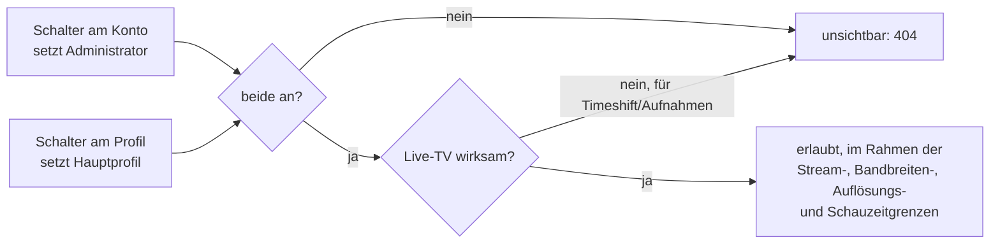

# Konzept 28 · Fachkonzept Live-TV

Stand: 28. November 2026 · Fassung 1 · Status: Entwurf, nicht freigegeben

> **Kurz gesagt.** Diese Datei ist die vollständige Fachspezifikation für Live-TV in Slouchcat. Sie macht aus
> jeder Aufzählungszeile und jedem verbindlichen Satz der Abschnitte 6 bis 17 des Auftrags genau eine prüfbare
> Anforderung oder einen Ausschluss, ordnet sie einer Baustufe zu und verweist auf das Dokument, das sie
> technisch ausarbeitet. Dazu kommen Rollen und Rechte, die Detailregeln, die der Auftrag offen lässt, zehn Fragen
> an Marco (F-1 bis F-10) und die Liste dessen, was nicht dazugehört.

Dieses Papier ändert keine Zeile Code und keine Regel. **Status jeder Anforderung in dieser Datei:
«spezifiziert».** Nichts davon ist gebaut. Technische Lösungen legt diese Datei nicht fest; sie verweist auf
`04-architektur.md` bis `13-ressourcen-und-performance.md`. Die Grundsatzentscheide, die Abweichungen des
Auftrags vom Repo, Marcos Antworten E-1 bis E-4 und die benannten Ausnahmen A-1 bis A-8 stehen in
`02-grundsatzentscheide.md`.

## Lesart

**Kennungen.** `LTV-nnn` ist ein Grundsatzentscheid, `LTV-nnn.mm` eine Anforderung darunter, `LTV-nnn.X-mm` ein
Ausschluss darunter. `LTV-Q-nn.mm` ist eine Anforderung aus einem Querschnittsabschnitt des Auftrags (`nn` =
Abschnittsnummer des Auftrags, 08 bis 15 und 17). `LTV-X-nn` ist eine Zeile der Ausschlussliste (Auftrag
Abschnitt 16). `DR-nn` ist eine fachliche Detailregel dieser Datei (Abschnitt 5), `F-n` eine Frage an Marco
(Abschnitt 6). Abnahmekriterien (`AK-L-nnn`) stehen in `17-test-und-abnahme.md`, die Rückverfolgung in
`22-anforderungsmatrix.md`.

**Spalte «Z.»** nennt die Zeile in `anhang/auftrag-2026-11-28.md`. Jede Aufzählungszeile der Abschnitte 6 bis 17
kommt genau einmal vor; verbindliche Sätze ausserhalb von Aufzählungen ebenfalls. Die Tabelle in Abschnitt 1 von
`02-grundsatzentscheide.md` deckt das Register (Abschnitt 6 des Auftrags, Z. 340–360) ab.

**Spalte «Stufe»** (Vorschlag an Marco, festgelegt in `18-umsetzungsplan.md`):

| Stufe | Inhalt |
|---|---|
| K | Konzeptphase: Der Nachweis ist dieses Konzept selbst (Dokument oder Mockup). |
| 0 | Regeln und Grundlagen: Ausnahmen A-1 bis A-8 in Regeln und Spec, Schutz von Zugangsdaten in Logs, Regel für Quellen im Heimnetz. Keine Funktion für Zuschauer. |
| 1 | Sender schauen: Quellen über HTTP(S), HLS und MPEG-TS aus M3U-Datei, M3U-URL, Einzel-URL und Xtream; Senderverwaltung; Import und automatische Aktualisierung; Rechte (zuerst «Live-TV»); Empfang bei Bedarf; zentrale Verteilung; Original, Remux, Umwandlung; Player ohne Timeshift; Senderübersicht, Favoriten, zuletzt gesehen; Grundüberwachung; Verwaltungsseiten. |
| 2 | Programmzeitschrift: XMLTV, Zuordnung, Zeitraster, Sendungsdetails, Programmsuche, Live-TV-Startseite, Erinnerungen. |
| 3 | Empfang und Umschalten: permanente, automatische und zeitgesteuerte Strategie, Vorladen, Startpuffer, automatischer Wechsel auf Ersatzquellen, erweiterte Überwachung, RTSP, RTMP, UDP, RTP, Multicast, DASH, Quellen im Heimnetz, Umschalt-Benchmark. |
| 4 | Persönliches Timeshift samt Speicherorten für Startpuffer und Timeshift. |
| 5 | Aufnahmen: sofort, einzeln, manuell, aus der Programmzeitschrift; «Meine Aufnahmen», «Geplante Aufnahmen»; Vor- und Nachlauf; Konflikte; Kontingent; Aufbewahrungsfrist; Speicherort für Aufnahmen. |
| 6 | Serien- und wiederkehrende Aufnahmen, Folgenerkennung, «behalte N». |

Jede Stufe gilt zuerst für die Web-App; wann die Android-TV-App und die Handy-App folgen, ist F-6.

**Spalte «Dok»** nennt das vertiefende Dokument: 04 Architektur, 05 Streaming und Fast Zapping, 06 Abläufe,
07 Datenmodell, 08 API, 09 EPG, 10 Timeshift, 11 DVR, 12 Sicherheit, 13 Ressourcen und Performance,
14 Oberfläche, 15 Administration, 16 Client-Kompatibilität, 17 Test und Abnahme; dazu 18 Umsetzungsplan,
19 Mockups, 21 Änderungen an Dokumenten, 24 Recherche (`docs/planning/28-live-tv/<nn>-….md`).

**Spalte «Abn.»** nennt die Art der Abnahme: **T** = automatischer Test, **M** = Messung (Zielwert ist eine zu
prüfende Grösse, keine Zusage), **S** = Sichtprüfung (am Bau, am Mockup oder im Dokument).

---

## 1. Zweck, Abgrenzung, Begriffe

### 1.1 Zweck

Slouchcat soll neben Filmen, Serien, Hörbüchern, Podcasts und Webradio Internetfernsehen (IPTV) zeigen: Sender
aus Listen des Haushalts empfangen, einmal empfangen und an alle Zuschauer im Haushalt verteilen, schnell
umschalten, eine Programmzeitschrift zeigen, live pausieren und Sendungen privat je Profil aufnehmen.

### 1.2 Abgrenzung

- Live-TV ist ein **eigener Bereich**. Sender, Sendungen und Aufnahmen sind keine Titel der Bibliothek; sie
  erscheinen nicht auf der Slouchcat-Startseite, nicht in Top Picks, Sammlungen, Merkliste oder Downloads der
  Bibliothek (festgelegte Auslegung; Aufnahmen nur in «Meine Aufnahmen» des Profils).
- **Webradio bleibt unverändert** und ohne Aufnahmen.
- Kein Download und kein Offline-Abspielen von Aufnahmen in Konzept 28 (festgelegte Auslegung).
- Keine Plattform-Streams (YouTube, Twitch), kein DRM und keine Umgehung.
- Was ausdrücklich nicht dazugehört: Abschnitt 7.

### 1.3 Begriffe

| Begriff | Bedeutung |
|---|---|
| **Quelle** | Ein Eintrag des Administrators, aus dem Slouchcat Sender bezieht: eine M3U-Liste (Datei oder Adresse), ein Xtream-Codes-Zugang oder eine einzeln erfasste Stream-Adresse. |
| **M3U / M3U8** | Ein Textformat für Listen; als **Senderliste** zählt es Sender mit Name, Gruppe, Logo und Adresse auf. Dieselbe Endung trägt auch ein **HLS-Manifest** (die Inhaltsliste eines einzelnen Stroms); Slouchcat unterscheidet beides am Inhalt. |
| **Xtream-Codes** | Eine verbreitete Schnittstelle von IPTV-Anbietern, über die Slouchcat mit Benutzername und Passwort Senderlisten und Programmdaten abruft; in Konzept 28 nur die Live-Sender. |
| **Sender** | Ein Fernsehprogramm in Slouchcat (zum Beispiel «Sender A») mit eigener, fester Kennung; die Kennung bleibt, auch wenn sich die Stream-Adresse ändert. |
| **Senderquelle / Ersatzquelle** | Eine Adresse, über die ein Sender empfangen werden kann. Ein Sender kann mehrere haben; die nach Rang erste ist die Hauptquelle, die anderen sind Ersatzquellen für Störungen. |
| **Sendergruppe** | Eine Inhaltskategorie wie «Nachrichten» oder «Sport» zum Ordnen und Filtern; keine Benutzergruppe und kein Recht. |
| **Kanalnummer** | Die Nummer, unter der ein Sender in Listen steht und mit der man ihn wählen kann. |
| **Eingangsstrom** | Die eine Verbindung, über die Slouchcat einen Sender von seiner Quelle empfängt. Alle Zuschauer und Aufnahmen desselben Senders teilen ihn. |
| **Stream-Sharing** | Das Verteilen eines Eingangsstroms an mehrere Zuschauer und Aufnahmen. |
| **Wiedergabesitzung** | Das Fernsehen eines Profils auf einem Gerät; jede Sitzung ist unabhängig von den anderen. |
| **Remux** | Umpacken in ein anderes Format ohne Bild oder Ton neu zu berechnen (verlustfrei, billig). |
| **Transcoding / Umwandlung** | Bild oder Ton neu berechnen, damit ein Gerät es abspielen kann oder eine Grenze eingehalten wird (kostet Rechenleistung). |
| **Empfangsstrategie** | Die Regel, wann Slouchcat einen Sender empfängt: **permanent** (rund um die Uhr), **automatisch** (häufig genutzte Sender nach Nutzung und freien Mitteln), **bei Bedarf** (erst, wenn jemand schaut oder eine Aufnahme ihn braucht) oder **zeitgesteuert** (nach einem Zeitplan des Administrators). |
| **Vorladen** | Einen Sender vorsorglich empfangen, auf den vermutlich gleich umgeschaltet wird (Nachbarsender, Favoriten, häufige Sender), damit das Umschalten schneller geht. Vorgeladen wird nur der Empfang, nie eine Umwandlung. |
| **Technischer Startpuffer** | Wenige Sekunden des Eingangsstroms im Server, damit ein Zuschauer beim Einschalten sofort ein Bild bekommt; er ist kein Archiv. |
| **Persönliches Timeshift** | Der eigene Zeitversatz-Puffer eines Zuschauers ab seinem Einschalten, zum Pausieren, Zurück- und Vorspulen. Er wird beim Senderwechsel und beim Beenden gelöscht. |
| **Fast Zapping** | Sehr schnelles Umschalten zwischen Sendern. |
| **EPG / Programmzeitschrift** | EPG (Electronic Program Guide) sind die Programmdaten: welche Sendung wann auf welchem Sender läuft. Die Programmzeitschrift ist ihre Anzeige als Zeitraster (Sender untereinander, Zeit nebeneinander). |
| **XMLTV** | Das verbreitete Dateiformat für Programmdaten, oft gepackt (zum Beispiel `.xml.gz`). |
| **EPG-Zuordnung** | Die Verbindung zwischen einem Sender in Slouchcat und seinem Eintrag in einer XMLTV-Quelle. |
| **Sendung** | Ein Eintrag der Programmzeitschrift mit Titel, Zeit, Beschreibung und weiteren Angaben, soweit die Quelle sie liefert. |
| **Erinnerung** | Eine Meldung an das Profil kurz vor Beginn einer gewählten Sendung. |
| **Aufnahme** | Die gespeicherte Datei einer Sendung oder Zeitspanne eines Senders, in Originalqualität, privat für das Profil, das sie geplant hat. |
| **Aufnahmeplanung** | Ein Auftrag, der künftig eine Aufnahme auslöst: Einzelaufnahme, manuelle Aufnahme (Sender, Start, Ende), Serienaufnahme oder wiederkehrende Aufnahme. |
| **Serienregel / Serienaufnahme** | Eine Planung, die alle passenden Folgen einer Sendereihe aus der Programmzeitschrift aufnimmt. |
| **Wiederkehrende Aufnahme** | Eine Planung nach Uhrzeit und Wochentag, zum Beispiel «jeden Montag 20:15 bis 21:00 auf Sender A». |
| **Vor- und Nachlauf** | Minuten, die eine Aufnahme vor dem geplanten Beginn startet und nach dem geplanten Ende weiterläuft. |
| **Konflikt** | Eine Planung, die zur geplanten Zeit voraussichtlich nicht ausgeführt werden kann (DR-11). |
| **Kontingent** | Der Speicherplatz, den alle Aufnahmen eines Kontos zusammen belegen dürfen. |
| **Aufbewahrungsfrist / «behalte N»** | Vom Profil gewählte Regel, nach der Slouchcat eine Aufnahme automatisch löscht: nach einer Zahl von Tagen, oder bei einer Serienaufnahme alles ausser den letzten N Folgen. |
| **Catch-up TV** | Das Nachschauen verpasster Sendungen aus einem Archiv des Anbieters; ausgeschlossen. |
| **DRM** | Kopierschutz eines Stroms; solche Ströme nimmt Slouchcat nicht an. |
| **UDP, RTP, Multicast** | Übertragungsarten, wie sie IPTV im Heimnetz oder beim Anbieter nutzt; Multicast sendet einen Strom an viele Empfänger zugleich. |
| **Administrator** | Ein Konto mit Verwaltungsrecht; richtet Live-TV ein und setzt den Deckel der Rechte je Konto. |
| **Konto** | Ein Zugang (Person oder Haushaltsteil) mit einem oder mehreren Profilen. |
| **Hauptprofil** | Das Profil eines Kontos, das die anderen Profile verwaltet (heisst im Auftrag «Hauptnutzer»). |
| **Profil mit Altersgrenze («Kinderprofil»)** | Jedes Profil mit einer Altersgrenze unter 18. Einen eigenen Profiltyp «Kinderprofil» gibt es nicht. |
| **Deckel** | Ein Recht des Kontos, über das kein Profil des Kontos hinauskommt. |

---

## 2. Rollen und Rechte

### 2.1 Wer darf was

| Rolle | Darf bei Live-TV | Darf nicht |
|---|---|---|
| **Administrator** (mit aktivem Hauptprofil, wie heute) | Quellen, Sender, Gruppen, EPG-Quellen, Empfangsstrategien, Zeitpläne, Speicherorte, Timeshift- und Aufnahme-Einstellungen pflegen; Quellen im Heimnetz freigeben (A-3); je Konto die drei Schalter als Deckel setzen; das Kontingent je Konto setzen; technische Zustände, aktive Ströme, Fehler und Belegung je Konto sehen; Ströme beenden | Titel fremder Aufnahmen, fremde Planungen, fremde Favoriten oder Timeshift-Puffer sehen (E-3); als Administrator fernsehen (er schaut wie jeder über sein eigenes Profil) |
| **Konto** | nichts Eigenes; seine Profile nutzen, was der Deckel erlaubt | Quellen eintragen (A-3); den Deckel ändern |
| **Hauptprofil** | für jedes Profil des Kontos (auch sich selbst) die drei Schalter setzen, innerhalb des Deckels; die Aufnahmen der Profile mit Altersgrenze sehen, löschen und abspielen (E-3); Meldungen «Kontingent voll» erhalten (E-4) | Aufnahmen von Profilen ohne Altersgrenze sehen; über den Deckel hinaus freigeben |
| **Profil ohne Altersgrenze** | mit wirksamen Rechten fernsehen, pausieren, aufnehmen, eigene Favoriten, Erinnerungen, Aufnahmen und Planungen verwalten | Aufnahmen, Planungen oder Puffer anderer Profile sehen |
| **Profil mit Altersgrenze** | wie oben, sobald das Hauptprofil es freigibt (LTV-015); dann alle Sender des Kontos ohne Altersprüfung | Rechte ändern; seine Aufnahmen vor dem Hauptprofil verbergen (E-3) |

### 2.2 Die drei Schalter

| Schalter | Am Konto setzt | Am Profil setzt | Wirksam, wenn | Setzt voraus |
|---|---|---|---|---|
| «Live-TV» | Administrator | Hauptprofil | Konto **und** Profil an | – |
| «Timeshift» | Administrator | Hauptprofil | Konto **und** Profil an | «Live-TV» wirksam |
| «Aufnahmen» | Administrator | Hauptprofil | Konto **und** Profil an | «Live-TV» wirksam |

Das ist das Muster des Wunschrechts (`can_request`, Konto und Profil), aber **ohne** Kopplung an die
Altersgrenze (A-5). Welche Werte neue Konten und Profile ab Werk haben: DR-01 und F-1. Die bestehenden Grenzen
(gleichzeitige Ströme, Bandbreite, Auflösung, tägliche Schauzeit) gelten für Live-TV unverändert (DR-12).

### 2.3 Unsichtbarkeit

Ohne wirksames Recht ist die Funktion **unsichtbar**: kein Eintrag in der Navigation, keine Knöpfe, und jede
Anfrage an eine Live-TV-Funktion, auch ein direkter API-Aufruf, eine Segment- oder Bildadresse, beantwortet der
Server mit **404, nie 403**. Ein deaktivierter Sender, eine fremde Aufnahme und eine fremde Planung sind ebenso
404. Der Client entscheidet nichts selbst; er zeigt an, was der Server meldet (Regel 12).

### 2.4 Entzug während der Nutzung

| Was wird entzogen | Was gerade läuft | Danach |
|---|---|---|
| «Live-TV» (Konto oder Profil) | Laufende Wiedergaben des betroffenen Profils enden; der Player zeigt eine verständliche Meldung. Wie schnell, misst `17-test-und-abnahme.md` (Ablauf 15 in `06-ablaeufe.md`). | Bereich unsichtbar (404). Timeshift und Aufnahmen wirken nicht mehr (setzen Live-TV voraus); für Planungen und Aufnahmen gilt dann die Zeile «Aufnahmen». |
| «Timeshift» | Der persönliche Puffer wird gelöscht; die Wiedergabe springt auf Live und läuft ohne Pause weiter. | Pause, Spulen und Sprung zu Live sind ausgeblendet. |
| «Aufnahmen» | Was mit einer laufenden Aufnahme geschieht: F-7. | Vorhandene Aufnahmen sind für das Profil 404 und **bleiben** gespeichert und im Kontingent, bis das Recht zurückkommt oder gelöscht wird; was mit geplanten Aufnahmen geschieht: F-7. Das Hauptprofil kann Aufnahmen von Profilen mit Altersgrenze weiter löschen (DR-03). |
| Profil bekommt eine Altersgrenze | Nichts ändert sich von selbst (A-5). | Das Hauptprofil sieht ab jetzt die Aufnahmen dieses Profils (E-3). |

---

## 3. Anforderungen je Grundsatzentscheid

### LTV-001 Funktionsumfang

Die Zeilen von LTV-001 sind Sammelanforderungen; prüfbar werden sie über die genannten Detailentscheide. Erfüllt
ist eine Sammelanforderung erst, wenn alle Anforderungen des Detailentscheids erfüllt sind (Z. 1753).

| ID | Z. | Anforderung | Stufe | Dok | Abn. |
|---|---|---|---|---|---|
| LTV-001.01 | 368 | Slouchcat hat einen eigenständigen Bereich «Live-TV», getrennt von Bibliothek, Webradio und Podcasts. | 1 | 14 | S |
| LTV-001.02 | 372 | Slouchcat zeigt Internet-TV aus den Quellen nach LTV-003. | 1 | 04 | T |
| LTV-001.03 | 373 | Slouchcat hat eine Senderverwaltung nach LTV-006. | 1 | 15 | S |
| LTV-001.04 | 374 | Slouchcat liest Programmdaten (EPG) nach LTV-005. | 2 | 09 | T |
| LTV-001.05 | 375 | Slouchcat zeigt eine elektronische Programmzeitschrift nach LTV-005 und LTV-014. | 2 | 14 | S |
| LTV-001.06 | 376 | Slouchcat schaltet schnell um (Fast Zapping) nach LTV-010. | 3 | 05 | M |
| LTV-001.07 | 377 | Slouchcat empfängt jeden benötigten Sender zentral nach LTV-004. | 1 | 05 | T |
| LTV-001.08 | 378 | Slouchcat verteilt einen Eingangsstrom an mehrere Zuschauer und Aufnahmen (Stream-Sharing) nach LTV-004. | 1 | 05 | T |
| LTV-001.09 | 379 | Slouchcat bietet persönliches Timeshift nach LTV-007. | 4 | 10 | T |
| LTV-001.10 | 380 | Slouchcat nimmt auf (DVR) nach LTV-008. | 5 | 11 | T |
| LTV-001.11 | 381 | Slouchcat bietet Serienaufnahmen nach LTV-008. | 6 | 11 | T |
| LTV-001.12 | 382 | Jedes Profil hat eigene Senderfavoriten (DR-14). | 1 | 14 | T |
| LTV-001.13 | 383 | Slouchcat erinnert ein Profil an gewählte Sendungen (DR-08). | 2 | 09 | T |
| LTV-001.14 | 384 | Slouchcat überwacht empfangene Ströme nach LTV-011. | 1 | 05 | T |
| LTV-001.15 | 385 | Slouchcat hat eine umfangreiche Live-TV-Verwaltung nach Auftrag Abschnitt 9 (LTV-Q-09). | 1 | 15 | S |
| LTV-001.16 | 387 | Bei Widerspruch zwischen LTV-001 und einem Detailentscheid gilt der Detailentscheid. | K | 02 | S |

### LTV-002 Hybride Empfangsstrategie

| ID | Z. | Anforderung | Stufe | Dok | Abn. |
|---|---|---|---|---|---|
| LTV-002.01 | 393–395 | Ein Sender mit Strategie «permanent» wird rund um die Uhr empfangen, auch ohne Zuschauer und ohne Aufnahme. | 3 | 05 | T |
| LTV-002.02 | 397–399 | Mit Strategie «automatisch» hält Slouchcat häufig genutzte Sender nach Nutzung und freien Mitteln bereit und gibt sie bei Mangel zuerst frei. | 3 | 05 | T |
| LTV-002.03 | 401–403 | Mit Strategie «bei Bedarf» startet Slouchcat den Empfang erst, wenn ein Profil den Sender wählt oder eine Aufnahme ihn braucht. | 1 | 05 | T |
| LTV-002.04 | 405–407 | Mit Strategie «zeitgesteuert» empfängt Slouchcat den Sender nach einem Zeitplan, den der Administrator festlegt. | 3 | 05 | T |
| LTV-002.05 | 411 | Der Administrator legt eine globale Standardstrategie fest, die für jeden Sender ohne eigene Strategie gilt. | 3 | 15 | T |
| LTV-002.06 | 412 | Der Administrator kann je Sender eine eigene Strategie wählen, die der globalen vorgeht. | 3 | 15 | T |
| LTV-002.07 | 413 | Slouchcat lädt benachbarte Sender (nach Kanalnummer) vor, wenn die Mittel reichen (LTV-010). | 3 | 05 | T |
| LTV-002.08 | 414 | Slouchcat startet den Empfang für eine geplante Aufnahme selbst und rechtzeitig vor dem Vorlauf. | 5 | 11 | T |
| LTV-002.09 | 415 | Slouchcat beendet einen Eingangsstrom, den kein Zuschauer, keine Aufnahme, keine Strategie und kein Vorladen mehr braucht, nach einer kurzen Frist. | 1 | 05 | T |
| LTV-002.10 | 416 | Slouchcat beendet nie einen Eingangsstrom, solange eine Wiedergabe ihn nutzt, auch nicht zugunsten von Vorladen oder automatischem Empfang. | 1 | 05 | T |
| LTV-002.11 | 417 | Slouchcat beendet nie einen Eingangsstrom, solange eine laufende Aufnahme ihn nutzt. | 5 | 05 | T |
| LTV-002.12 | 418 | Nach einem Neustart nimmt Slouchcat den Empfang aller Sender mit Strategie «permanent» (und laufender Zeitpläne) selbst wieder auf. | 3 | 06 | T |
| LTV-002.13 | 420 | Das Konzept beschreibt eine ressourcenschonende Regel, wann Slouchcat Eingangsströme automatisch startet und freigibt. | K | 05 | S |

### LTV-003 Unterstützte Empfangsquellen

| ID | Z. | Anforderung | Stufe | Dok | Abn. |
|---|---|---|---|---|---|
| LTV-003.01 | 426 | Der Administrator kann eine M3U-Datei hochladen und als Quelle importieren. | 1 | 15 | T |
| LTV-003.02 | 427 | Der Administrator kann eine M3U8-Datei (Senderliste in UTF-8) hochladen und als Quelle importieren. | 1 | 15 | T |
| LTV-003.03 | 428 | Der Administrator kann eine M3U-Adresse als Quelle eintragen, die Slouchcat abruft. | 1 | 15 | T |
| LTV-003.04 | 429 | Der Administrator kann eine M3U8-Adresse als Quelle eintragen, die Slouchcat abruft. | 1 | 15 | T |
| LTV-003.05 | 430 | Der Administrator kann einen Sender mit einer von Hand erfassten Stream-Adresse anlegen. | 1 | 15 | T |
| LTV-003.06 | 431 | Slouchcat empfängt Ströme über HTTP. | 1 | 05 | T |
| LTV-003.07 | 432 | Slouchcat empfängt Ströme über HTTPS. | 1 | 05 | T |
| LTV-003.08 | 433 | Slouchcat empfängt HLS-Ströme. | 1 | 05 | T |
| LTV-003.09 | 434 | Slouchcat empfängt MPEG-TS-Ströme. | 1 | 05 | T |
| LTV-003.10 | 435 | Slouchcat empfängt MPEG-DASH-Ströme ohne DRM; DASH mit Kopierschutz lehnt es mit verständlicher Meldung ab. | 3 | 05 | T |
| LTV-003.11 | 436 | Slouchcat bezieht Live-Sender (nur Live) über eine Xtream-Codes-kompatible Schnittstelle. | 1 | 09 | T |
| LTV-003.12 | 437 | Slouchcat empfängt RTSP-Ströme. | 3 | 05 | T |
| LTV-003.13 | 438 | Slouchcat empfängt RTMP-Ströme. | 3 | 05 | T |
| LTV-003.14 | 439 | Slouchcat empfängt UDP-Ströme, auch aus dem Heimnetz nach Freigabe (A-3). | 3 | 05 | T |
| LTV-003.15 | 440 | Slouchcat empfängt RTP-Ströme, auch aus dem Heimnetz nach Freigabe (A-3). | 3 | 05 | T |
| LTV-003.16 | 441 | Slouchcat empfängt Multicast-Ströme nach Freigabe der Quelle (A-3). | 3 | 05 | T |
| LTV-003.17 | 442 | Slouchcat empfängt Ströme, die eine Anmeldung verlangen (Benutzer und Passwort oder Token), mit sicher gespeicherten Zugangsdaten (LTV-017.02). | 1 | 12 | T |
| LTV-003.18 | 443 | Der Administrator kann je Quelle eigene HTTP-Header festlegen, die Slouchcat beim Abruf mitsendet. | 1 | 15 | T |
| LTV-003.19 | 444 | Der Administrator kann je Quelle den User-Agent festlegen. | 1 | 15 | T |
| LTV-003.20 | 445 | Ein Sender kann mehrere alternative Quellen haben. | 1 | 07 | T |
| LTV-003.21 | 446 | Der Administrator legt die Rangfolge der Quellen eines Senders fest. | 1 | 15 | T |
| LTV-003.22 | 447 | Bei einer Störung wechselt Slouchcat selbst auf die nächste Ersatzquelle nach Rang. | 3 | 05 | T |
| LTV-003.23 | 449 | Slouchcat erkennt beim Import, ob eine M3U-Datei eine Senderliste oder ein HLS-Manifest ist, am Inhalt und nicht an der Endung. | 1 | 09 | T |
| LTV-003.24 | 451 | Das Konzept beschreibt je Protokoll die besonderen technischen Anforderungen (Netz, Wiederverbindung, Risiken). | K | 05 | S |
| LTV-003.25 | 453 | Das Konzept enthält eine Kompatibilitätsmatrix aus Eingangsprotokoll, Container, Codec und Client. | K | 16 | S |
| LTV-003.X-01 | 457 | Nicht dabei: physische TV-Tuner. | – | – | S |
| LTV-003.X-02 | 458 | Nicht dabei: HDHomeRun. | – | – | S |
| LTV-003.X-03 | 459 | Nicht dabei: SAT>IP. | – | – | S |
| LTV-003.X-04 | 460 | Nicht dabei: TVHeadend-Integration. | – | – | S |
| LTV-003.X-05 | 461 | Nicht dabei: DVB-C. | – | – | S |
| LTV-003.X-06 | 462 | Nicht dabei: DVB-S/S2. | – | – | S |
| LTV-003.X-07 | 463 | Nicht dabei: DVB-T/T2. | – | – | S |
| LTV-003.X-08 | 464 | Nicht dabei: DRM-geschützte Streams; Slouchcat erkennt sie und lehnt sie ab. | – | 12 | T |
| LTV-003.X-09 | 465 | Nicht dabei: Umgehung von Kopierschutzmechanismen. | – | 12 | S |
| LTV-003.X-10 | 466 | Nicht dabei: Xtream-VOD-Bibliotheken; Slouchcat ruft Xtream-VOD weder ab noch zeigt es sie. | – | – | T |
| LTV-003.X-11 | 467 | Nicht dabei: Xtream-Serienbibliotheken. | – | – | T |

### LTV-004 Zentraler Streamempfang und individuelles Transcoding

| ID | Z. | Anforderung | Stufe | Dok | Abn. |
|---|---|---|---|---|---|
| LTV-004.01 | 471, 473 | Slouchcat empfängt einen benötigten Sender möglichst nur einmal, von der aktiven, kompatiblen Quelle (laut Auftrag eine der wichtigsten Anforderungen des Projekts). | 1 | 05 | T |
| LTV-004.02 | 475 | Ein Eingangsstrom steht zugleich mehreren Zuschauern und Aufnahmen zur Verfügung. | 1 | 05 | T |
| LTV-004.03 | 479 | Prüffall: 20 Zuschauer schauen denselben Sender. | 1 | 17 | T |
| LTV-004.04 | 480 | Im Prüffall LTV-004.03 empfängt Slouchcat den Sender genau einmal. | 1 | 17 | T |
| LTV-004.05 | 481 | Im Prüffall LTV-004.03 verteilt Slouchcat den Strom intern an alle 20 Zuschauer. | 1 | 17 | T |
| LTV-004.06 | 482 | Eine zusätzliche Aufnahme desselben Senders öffnet möglichst keine weitere Eingangsverbindung. | 5 | 17 | T |
| LTV-004.07 | 484 | Jeder Zuschauer hat eine eigene, unabhängige Wiedergabesitzung. | 1 | 05 | T |
| LTV-004.08 | 486 | Passen Originalqualität und Format zum Gerät, rechnet Slouchcat Bild und Ton nicht neu. | 1 | 05 | T |
| LTV-004.09 | 488 | Braucht ein Zuschauer eine Umwandlung, bekommt er einen eigenen Umwandlungsprozess. | 1 | 05 | T |
| LTV-004.10 | 492 | Slouchcat gibt den Strom in Originalform weiter, wenn das Gerät ihn kann. | 1 | 05 | T |
| LTV-004.11 | 493 | Slouchcat packt den Strom verlustfrei um (Remux), wenn nur der Container nicht passt. | 1 | 05 | T |
| LTV-004.12 | 494 | Slouchcat wandelt das Bild je Zuschauer um, wenn Gerät oder Grenze es verlangen. | 1 | 05 | T |
| LTV-004.13 | 495 | Slouchcat wandelt den Ton je Zuschauer um, wenn Gerät oder Grenze es verlangen. | 1 | 05 | T |
| LTV-004.14 | 496 | Jeder Zuschauer kann innerhalb seiner Grenzen eine eigene Auflösung bekommen. | 1 | 05 | T |
| LTV-004.15 | 497 | Jeder Zuschauer kann innerhalb seiner Grenzen eine eigene Bitrate bekommen. | 1 | 05 | T |
| LTV-004.16 | 498 | Jeder Zuschauer wählt seine Tonspur selbst, ohne andere Zuschauer zu beeinflussen. | 1 | 05 | T |
| LTV-004.17 | 499 | Jeder Zuschauer wählt seine Untertitelspur selbst, ohne andere Zuschauer zu beeinflussen. | 1 | 05 | T |
| LTV-004.18 | 500 | Slouchcat nutzt für Umwandlungen die bestehende Hardwarebeschleunigung. | 1 | 05 | T |
| LTV-004.19 | 501 | Ohne verfügbare Hardware fällt Slouchcat wie heute auf Software zurück, gemäss der bestehenden Konfiguration. | 1 | 05 | T |
| LTV-004.20 | 502 | Live-TV hält die bestehenden Konto- und Ressourcenlimits ein (Ströme, Bandbreite, Auflösung, Budget der Umwandlungen; DR-12). | 1 | 13 | T |
| LTV-004.X-01 | 504 | Nicht dabei: gemeinsam genutzte Transcoding-Ausgaben für mehrere Zuschauer. | – | 05 | T |
| LTV-004.21 | 506 | Slouchcat hat eine zentrale Streamverwaltung mit klarem Lebenszyklus je Eingangsstrom (Start, Betrieb, Störung, Ende). | 1 | 05 | S |
| LTV-004.22 | 510 | Slouchcat öffnet für denselben Sender nie zwei Eingangsströme, wenn einer genügt. | 1 | 05 | T |
| LTV-004.23 | 511 | Gleichzeitige Anfragen für denselben Sender führen zu genau einem Eingangsstrom. | 1 | 05 | T |
| LTV-004.24 | 512 | Gleichzeitiges Starten, Beitreten und Verlassen desselben Senders führt nie zu einem verlorenen oder doppelten Eingangsstrom (keine Race Condition). | 1 | 05 | T |
| LTV-004.25 | 513 | Slouchcat weiss jederzeit, wer einen Eingangsstrom nutzt (Zuschauer, Aufnahme, Strategie, Vorladen). | 1 | 05 | T |
| LTV-004.26 | 514 | Slouchcat verwaltet die Abnehmer eines Eingangsstroms (Hinzufügen, Entfernen, Zählen). | 1 | 05 | T |
| LTV-004.27 | 515 | Bricht die Verbindung eines Zuschauers ab, entfernt Slouchcat ihn als Abnehmer, ohne andere zu stören. | 1 | 05 | T |
| LTV-004.28 | 516 | Ein langsamer Zuschauer verlangsamt weder den Eingangsstrom noch andere Zuschauer. | 1 | 05 | T |
| LTV-004.29 | 517 | Slouchcat behandelt Rückstau (Backpressure) je Abnehmer, ohne den Eingangsstrom anzuhalten. | 1 | 05 | T |
| LTV-004.30 | 518 | Alle Puffer der Verteilung haben eine feste Obergrenze. | 1 | 05 | T |
| LTV-004.31 | 519 | Slouchcat hinterlässt keine verwaisten Prozesse und räumt sie nach einem Absturz auf. | 1 | 05 | T |
| LTV-004.32 | 520 | Fällt die Quelle aus, kann der Eingangsstrom auf eine Ersatzquelle wechseln (LTV-003.22). | 3 | 05 | T |
| LTV-004.33 | 521 | Slouchcat gibt Prozesse, Verbindungen, Puffer und Dateien frei, sobald sie niemand mehr braucht. | 1 | 05 | T |
| LTV-004.34 | 522 | Jeder Zuschauer bleibt von den anderen unabhängig (Start, Pause, Ende, Qualität). | 1 | 05 | T |
| LTV-004.35 | 523 | Slouchcat legt fest, wann zwei Abrufe derselbe Strom sind, auch bei unterschiedlichen Zugangsdaten und Quellen, und teilt nur dann. | 1 | 05 | T |
| LTV-004.36 | 525 | Ein langsamer oder fehlerhafter Client beeinträchtigt andere Zuschauer nicht. | 1 | 05 | T |
| LTV-004.37 | 527 | Beendet ein Zuschauer seine Wiedergabe, laufen Empfang für andere Zuschauer und laufende Aufnahmen weiter. | 1 | 05 | T |
| LTV-004.38 | 529 | Die Verwaltungsseite der Quelle weist darauf hin, dass der Administrator für die zulässige Mehrfachverteilung seiner Quelle verantwortlich ist. | 1 | 15 | S |

### LTV-005 EPG und Programmzeitschrift

| ID | Z. | Anforderung | Stufe | Dok | Abn. |
|---|---|---|---|---|---|
| LTV-005.01 | 535 | Der Administrator kann eine XMLTV-Datei hochladen. | 2 | 09 | T |
| LTV-005.02 | 536 | Der Administrator kann eine XMLTV-Adresse eintragen, die Slouchcat abruft. | 2 | 09 | T |
| LTV-005.03 | 537 | Slouchcat liest komprimierte XMLTV-Dateien. | 2 | 09 | T |
| LTV-005.04 | 538 | Slouchcat nutzt mehrere EPG-Quellen zugleich; jeder Sender hat genau eine EPG-Zuordnung (DR-19). | 2 | 09 | T |
| LTV-005.05 | 539 | Der Administrator kann einen Sender von Hand einem EPG-Eintrag zuordnen. | 2 | 09 | T |
| LTV-005.06 | 540 | Slouchcat schlägt Zuordnungen selbst vor bzw. ordnet eindeutig passende Sender selbst zu. | 2 | 09 | T |
| LTV-005.07 | 541 | Slouchcat aktualisiert die Programmdaten automatisch nach dem Intervall der Quelle. | 2 | 09 | T |
| LTV-005.08 | 542 | Slouchcat zeigt je Sender die laufende Sendung. | 2 | 14 | T |
| LTV-005.09 | 543 | Slouchcat zeigt je Sender kommende Sendungen. | 2 | 14 | T |
| LTV-005.10 | 544 | Slouchcat zeigt den Sendungstitel. | 2 | 14 | T |
| LTV-005.11 | 545 | Slouchcat zeigt die Sendungsbeschreibung, wenn die Quelle sie liefert. | 2 | 14 | T |
| LTV-005.12 | 546 | Slouchcat zeigt Sendungsbilder, wenn die Quelle sie liefert (über den Server, `12-sicherheit.md`). | 2 | 09 | T |
| LTV-005.13 | 547 | Slouchcat zeigt Kategorien, wenn die Quelle sie liefert. | 2 | 09 | T |
| LTV-005.14 | 548 | Slouchcat zeigt Genres, wenn die Quelle sie liefert, und kann danach filtern. | 2 | 09 | T |
| LTV-005.15 | 549 | Ein Profil kann über alle sichtbaren Sender nach Sendungen suchen (F-5). | 2 | 09 | T |
| LTV-005.16 | 550 | Der Administrator legt fest, wie viele Tage voraus Slouchcat Programmdaten führt und zeigt. | 2 | 15 | T |
| LTV-005.17 | 551 | Slouchcat zeigt eine elektronische Programmzeitschrift (Ausgestaltung LTV-014.20 ff.). | 2 | 14 | S |
| LTV-005.18 | 552 | Ein Profil kann aus der Programmzeitschrift eine Aufnahme planen. | 5 | 11 | T |
| LTV-005.19 | 553 | Ein Profil kann aus der Programmzeitschrift eine Erinnerung setzen (DR-08). | 2 | 09 | T |
| LTV-005.20 | 557 | Slouchcat rechnet Zeitangaben mit Zeitzone richtig um und zeigt sie in der Ortszeit des Servers bzw. des Profils. | 2 | 09 | T |
| LTV-005.21 | 558 | Slouchcat zeigt Sendungen über die Umstellung von Sommer- auf Winterzeit und zurück richtig. | 2 | 09 | T |
| LTV-005.22 | 559 | Slouchcat verwirft Sendungen mit unmöglichen Zeitangaben (Ende vor Beginn, überlappend) nachvollziehbar, ohne den übrigen Import zu verlieren. | 2 | 09 | T |
| LTV-005.23 | 560 | Fehlende Angaben bleiben leer; Slouchcat zeigt eine Lücke als Lücke. | 2 | 09 | T |
| LTV-005.24 | 561 | Ein Sender ohne EPG-Zuordnung bleibt nutzbar und zeigt «Keine Programmdaten» (DR-09); die Verwaltung listet ihn als «ohne Zuordnung». | 2 | 09 | T |
| LTV-005.25 | 562 | Ändert eine Aktualisierung die Zeit einer Sendung, zeigt Slouchcat die neue Zeit. | 2 | 09 | T |
| LTV-005.26 | 563 | Ändert eine Aktualisierung die Zeit einer geplanten Sendung, passt Slouchcat die Aufnahmeplanung an, soweit die Sendung eindeutig wiedererkannt wird (LTV-008.14). | 5 | 11 | T |
| LTV-005.27 | 565 | Slouchcat ergänzt unvollständige Programmdaten nie durch erfundene Angaben. | 2 | 09 | T |
| LTV-005.28 | 567 | Fällt eine EPG-Quelle aus, spielt Slouchcat die Sender weiter ab. | 2 | 09 | T |
| LTV-005.X-01 | 571 | Nicht dabei: intelligente Zusammenführung konkurrierender EPG-Quellen je Sender. | – | 09 | S |
| LTV-005.X-02 | 572 | Nicht dabei: KI-Empfehlungen. | – | – | S |
| LTV-005.X-03 | 573 | Nicht dabei: automatische Verknüpfung mit den Film- und Serienbibliotheken. | – | – | S |

### LTV-006 Erweiterte Senderverwaltung

| ID | Z. | Anforderung | Stufe | Dok | Abn. |
|---|---|---|---|---|---|
| LTV-006.01 | 577 | Der Administrator hat eine übersichtliche Senderverwaltung, die auch mit 10'000 Sendern bedienbar bleibt (Menge nach Z. 1421). | 1 | 15 | M |
| LTV-006.02 | 581 | Slouchcat übernimmt die Gruppen einer M3U-Liste als Sendergruppen. | 1 | 09 | T |
| LTV-006.03 | 582 | Der Administrator kann eigene Sendergruppen anlegen, umbenennen und löschen. | 1 | 15 | T |
| LTV-006.04 | 583 | Ein Sender kann zu mehreren Sendergruppen gehören. | 1 | 07 | T |
| LTV-006.05 | 584 | Der Administrator kann einen Sender aktivieren und deaktivieren; ein deaktivierter Sender ist für Profile unsichtbar (DR-16). | 1 | 15 | T |
| LTV-006.06 | 585 | Der Administrator kann einen Sender umbenennen. | 1 | 15 | T |
| LTV-006.07 | 586 | Slouchcat zeigt Senderlogos aus der Quelle (über den Server, `12-sicherheit.md`). | 1 | 14 | T |
| LTV-006.08 | 587 | Der Administrator kann das Logo eines Senders von Hand ersetzen. | 1 | 15 | T |
| LTV-006.09 | 588 | Der Administrator kann die Reihenfolge der Sender von Hand festlegen. | 1 | 15 | T |
| LTV-006.10 | 589 | Der Administrator kann jedem Sender eine eigene Kanalnummer geben. | 1 | 15 | T |
| LTV-006.11 | 590 | Der Administrator kann gleiche Sender aus verschiedenen Quellen zu einem Sender mit mehreren Senderquellen zusammenführen. | 1 | 15 | T |
| LTV-006.12 | 591 | Der Administrator kann die Rangfolge der Senderquellen eines Senders festlegen (wie LTV-003.21). | 1 | 15 | T |
| LTV-006.13 | 592 | Der Administrator kann einem Sender ein Land zuordnen. | 1 | 15 | T |
| LTV-006.14 | 593 | Der Administrator kann einem Sender eine Sprache zuordnen. | 1 | 15 | T |
| LTV-006.15 | 594 | Der Administrator kann einem Sender Kategorien zuordnen. | 1 | 15 | T |
| LTV-006.16 | 595 | Der Administrator kann mehrere Sender auf einmal bearbeiten (aktivieren, Gruppe, Land, Sprache, Kategorie, Strategie). | 1 | 15 | T |
| LTV-006.17 | 596 | Der Administrator kann Sender von Hand als Duplikat markieren und zusammenführen. | 1 | 15 | T |
| LTV-006.18 | 597 | Slouchcat schlägt wahrscheinliche Duplikate selbst vor; zusammengeführt wird erst nach Bestätigung des Administrators (Annahme). | 1 | 09 | T |
| LTV-006.19 | 599 | Jeder Sender hat eine stabile interne Kennung, unabhängig von seiner aktuellen Stream-Adresse. | 1 | 07 | T |
| LTV-006.20 | 601 | Sendergruppen sind reine Inhaltskategorien; sie vergeben keine Rechte und sind keine Benutzergruppen. | 1 | 07 | S |
| LTV-006.X-01 | 603 | Nicht dabei: ein zusätzliches Benutzergruppenmodell. | – | – | S |

### LTV-007 Persönliches Timeshift

| ID | Z. | Anforderung | Stufe | Dok | Abn. |
|---|---|---|---|---|---|
| LTV-007.01 | 607 | Timeshift ist je Zuschauer (Wiedergabesitzung) getrennt. | 4 | 10 | T |
| LTV-007.02 | 609 | Der persönliche Puffer beginnt beim Einschalten eines Senders. | 4 | 10 | T |
| LTV-007.03 | 610 | Jeder Zuschauer hat seinen eigenen Timeshift-Puffer. | 4 | 10 | T |
| LTV-007.04 | 611 | Ein Zuschauer kann Live-TV pausieren. | 4 | 10 | T |
| LTV-007.05 | 612 | Ein Zuschauer kann innerhalb seines Puffers zurückspulen. | 4 | 10 | T |
| LTV-007.06 | 613 | Ein Zuschauer kann bis zum Live-Zeitpunkt vorspulen, nicht darüber hinaus. | 4 | 10 | T |
| LTV-007.07 | 614 | Ein Zuschauer kann direkt zum Live-Zeitpunkt springen. | 4 | 10 | T |
| LTV-007.08 | 615 | Beim Senderwechsel löscht Slouchcat den bisherigen Puffer des Zuschauers. | 4 | 10 | T |
| LTV-007.09 | 616 | Beim Beenden der Wiedergabe löscht Slouchcat die temporären Dateien des Puffers. | 4 | 10 | T |
| LTV-007.10 | 617 | Der Administrator stellt die maximale Timeshift-Dauer ein (Vorgabe DR-07). | 4 | 15 | T |
| LTV-007.X-01 | 619 | Nicht dabei: ein gemeinsames, serverweites Timeshift-Archiv. | – | 10 | T |
| LTV-007.11 | 621 | Ein Zuschauer kann nie auf Inhalte zurückspulen, die vor seinem Einschalten gesendet wurden. | 4 | 10 | T |
| LTV-007.12 | 623 | Der technische Startpuffer ist vom persönlichen Puffer getrennt (eigener Zweck, eigene Grenze, eigener Speicherort). | 3 | 05 | S |
| LTV-007.13 | 625 | Der Startpuffer dient nur dem schnelleren Start; kein Zuschauer kann über ihn zurückspulen. | 3 | 05 | T |
| LTV-007.14 | 627 | Timeshift verändert den gemeinsamen Eingangsstrom nicht (Pause eines Zuschauers hält ihn nicht an). | 4 | 10 | T |

### LTV-008 Erweiterte DVR-Funktion

| ID | Z. | Anforderung | Stufe | Dok | Abn. |
|---|---|---|---|---|---|
| LTV-008.01 | 633 | Ein Profil kann eine Sofortaufnahme des laufenden Senders starten (im Player und in der Senderübersicht). | 5 | 11 | T |
| LTV-008.02 | 634 | Ein Profil kann eine einzelne künftige Sendung zur Aufnahme planen. | 5 | 11 | T |
| LTV-008.03 | 635 | Ein Profil kann eine Aufnahme direkt aus der Programmzeitschrift planen (wie LTV-005.18). | 5 | 11 | T |
| LTV-008.04 | 636 | Ein Profil kann eine manuelle Aufnahme mit Sender, Start- und Endzeit planen, auch ohne Programmdaten. | 5 | 11 | T |
| LTV-008.05 | 637 | Ein Profil kann eine Serienaufnahme anlegen, die passende Folgen selbst plant. | 6 | 11 | T |
| LTV-008.06 | 638 | Ein Profil kann eine wiederkehrende Aufnahme nach Wochentag und Uhrzeit anlegen. | 6 | 11 | T |
| LTV-008.07 | 639 | Ein Profil kann je Planung einen Vorlauf einstellen; ohne Angabe gilt der Standard des Administrators. | 5 | 11 | T |
| LTV-008.08 | 640 | Ein Profil kann je Planung einen Nachlauf einstellen; ohne Angabe gilt der Standard des Administrators. | 5 | 11 | T |
| LTV-008.09 | 641 | Slouchcat erkennt bereits aufgenommene Folgen, wenn die Programmdaten sie zuverlässig kennzeichnen, und plant sie dann nicht erneut (Verhalten ohne Kennzeichnung: F-8). | 6 | 09 | T |
| LTV-008.10 | 642 | Slouchcat nimmt verschiedene Sender gleichzeitig auf. | 5 | 11 | T |
| LTV-008.11 | 643 | Slouchcat löscht Aufnahmen nach der Aufbewahrungsfrist, die das Profil gewählt hat (A-4, F-10). | 5 | 11 | T |
| LTV-008.12 | 644 | Slouchcat hält ein Speicherkontingent je Konto für alle Aufnahmen seiner Profile ein (DR-06, F-2). | 5 | 11 | T |
| LTV-008.13 | 645 | Slouchcat erkennt Konflikte einer Planung vor ihrer Ausführung und zeigt sie an (DR-11). | 5 | 11 | T |
| LTV-008.14 | 646 | Slouchcat passt geplante Aufnahmen an geänderte EPG-Zeiten an, wenn die Sendung eindeutig wiedererkannt wird; sonst bleibt die Planung und wird als «nicht eindeutig» markiert. | 5 | 09 | T |
| LTV-008.15 | 647 | Aufnahmen laufen unabhängig davon, ob jemand angemeldet ist. | 5 | 11 | T |
| LTV-008.16 | 648 | Ein Profil sieht eine Übersicht seiner laufenden Aufnahmen. | 5 | 14 | T |
| LTV-008.17 | 649 | Ein Profil sieht eine Übersicht seiner geplanten Aufnahmen. | 5 | 14 | T |
| LTV-008.18 | 650 | Ein Profil sieht eine Übersicht seiner abgeschlossenen Aufnahmen. | 5 | 14 | T |
| LTV-008.19 | 651 | Ein Profil sieht eine Übersicht seiner fehlgeschlagenen Aufnahmen mit Grund. | 5 | 14 | T |
| LTV-008.20 | 652 | Ein Profil kann abgeschlossene Aufnahmen abspielen. | 5 | 11 | T |
| LTV-008.21 | 653 | Ein Profil kann eigene Aufnahmen löschen. | 5 | 11 | T |
| LTV-008.22 | 654 | Slouchcat zeigt bei einer unvollständigen Aufnahme verständlich, welche Teile fehlen und warum. | 5 | 11 | T |
| LTV-008.23 | 656 | Aufnahmen nutzen die zentrale Streamverwaltung (LTV-004). | 5 | 05 | T |
| LTV-008.24 | 658 | Wird ein Sender schon empfangen, nimmt Slouchcat aus dem bestehenden Eingangsstrom auf. | 5 | 05 | T |
| LTV-008.25 | 660 | Eine Aufnahme hängt nicht davon ab, ob das aufnehmende Profil gerade schaut. | 5 | 11 | T |
| LTV-008.26 | 662 | Slouchcat behandelt Serverneustart, Stromausfall, Netzunterbruch und fehlenden Speicher bei Aufnahmen so, dass erhaltene Teile bleiben und die Lücke angezeigt wird. | 5 | 06 | T |
| LTV-008.X-01 | 666 | Nicht dabei: automatische Werbeerkennung. | – | – | S |
| LTV-008.X-02 | 667 | Nicht dabei: KI-Funktionen. | – | – | S |
| LTV-008.X-03 | 668 | Nicht dabei: suchwortbasierte automatische Aufnahmen. | – | – | S |
| LTV-008.X-04 | 669 | Nicht dabei: automatische Aufnahmen bestimmter Schauspieler oder Sportmannschaften. | – | – | S |
| LTV-008.X-05 | 670 | Nicht dabei: automatische Übernahme von Aufnahmen in die Film- und Serienbibliotheken. | – | 11 | T |

### LTV-009 Private Aufnahmen pro Profil

| ID | Z. | Anforderung | Stufe | Dok | Abn. |
|---|---|---|---|---|---|
| LTV-009.01 | 674 | Jede Aufnahme gehört genau einem Profil, dem Profil, das sie geplant oder gestartet hat. | 5 | 07 | T |
| LTV-009.02 | 678 | Jedes Profil hat eigene Aufnahmen. | 5 | 07 | T |
| LTV-009.03 | 679 | Jedes Profil hat eigene Aufnahmeplanungen. | 5 | 07 | T |
| LTV-009.04 | 680 | Jedes Profil hat eigene Serienaufnahmen. | 6 | 07 | T |
| LTV-009.05 | 681 | Jedes Profil hat einen eigenen Wiedergabefortschritt je Aufnahme (DR-21). | 5 | 07 | T |
| LTV-009.06 | 682 | Jedes Profil kann seine Aufnahmen und Planungen selbst löschen. | 5 | 11 | T |
| LTV-009.07 | 684 | Andere Profile desselben Kontos sehen und spielen die Aufnahmen eines Profils nicht; **einzige Ausnahme**: das Hauptprofil bei Profilen mit Altersgrenze (E-3, A-6). | 5 | 12 | T |
| LTV-009.08 | 686 | Andere Konten haben keinen Zugriff auf die Aufnahmen; jeder Zugriff ist 404. | 5 | 12 | T |
| LTV-009.09 | 688 | Das Speicherkontingent gilt für das Konto als Ganzes (Summe der Aufnahmen aller Profile, DR-06). | 5 | 11 | T |
| LTV-009.10 | 690 | Die Privatsphäre des bestehenden Profilmodells bleibt erhalten (Aufnahmen, Planungen, Favoriten, Erinnerungen, Fortschritt je Profil). | 5 | 12 | T |
| LTV-009.11 | 692 | Der Administrator sieht Speicherbelegung je Konto und technische Fehler, aber keine Titel, Sender oder Zeiten fremder Aufnahmen (E-3). | 5 | 15 | T |
| LTV-009.12 | 694 | Das Konzept untersucht, ob gleiche Aufnahmen mehrerer Profile physisch einmal gespeichert werden können, ohne Privatsphäre, Löschbarkeit und Quellenrechte zu schwächen; eine Umsetzung ist nicht beschlossen. | K | 11 | S |

### LTV-010 Erweitertes Fast Zapping

| ID | Z. | Anforderung | Stufe | Dok | Abn. |
|---|---|---|---|---|---|
| LTV-010.01 | 698 | Schnelles Umschalten hat bei Abwägungen in Konzept und Bau hohe Priorität. | K | 05 | S |
| LTV-010.02 | 702 | Wird ein Sender schon empfangen, nutzt Slouchcat beim Umschalten diesen Eingangsstrom sofort. | 1 | 05 | T |
| LTV-010.03 | 703 | Die Player starten Live-Ströme mit optimierten Einstellungen für einen schnellen Start. | 3 | 05 | M |
| LTV-010.04 | 704 | Slouchcat hält je empfangenem Sender einen kleinen technischen Startpuffer. | 3 | 05 | T |
| LTV-010.05 | 705 | Slouchcat lädt benachbarte Sender vor (wie LTV-002.07). | 3 | 05 | T |
| LTV-010.06 | 706 | Slouchcat lädt häufig genutzte Sender vor. | 3 | 05 | T |
| LTV-010.07 | 707 | Slouchcat berücksichtigt beim Vorladen die Senderfavoriten der aktiven Zuschauer. | 3 | 05 | T |
| LTV-010.08 | 708 | Slouchcat gibt vorgeladene Ströme frei, wenn sie nicht mehr gebraucht werden (wie LTV-002.09). | 3 | 05 | T |
| LTV-010.09 | 709 | Die Grösse der Startpuffer ist auf schnellen Start bei geringem Speicher abgestimmt. | 3 | 05 | M |
| LTV-010.10 | 710 | Slouchcat bereitet die Ausgabe je Gerätetyp so vor, dass jedes Gerät ohne Umweg starten kann. | 3 | 16 | M |
| LTV-010.X-01 | 712 | Nicht dabei: vorsorglich gestartete individuelle Umwandlungen für Sender, die niemand schaut. | – | 05 | T |
| LTV-010.11 | 716 | Das Konzept untersucht Keyframe-Abstände. | K | 05 | S |
| LTV-010.12 | 717 | Das Konzept untersucht GOP-Strukturen. | K | 05 | S |
| LTV-010.13 | 718 | Das Konzept untersucht HLS-Segmentlängen. | K | 05 | S |
| LTV-010.14 | 719 | Das Konzept untersucht Low-Latency HLS. | K | 05 | S |
| LTV-010.15 | 720 | Das Konzept untersucht MPEG-TS. | K | 05 | S |
| LTV-010.16 | 721 | Das Konzept untersucht Anlaufzeiten der Ströme. | K | 05 | S |
| LTV-010.17 | 722 | Das Konzept untersucht die Pufferung in den Clients. | K | 16 | S |
| LTV-010.18 | 723 | Das Konzept untersucht die Wechselzeiten der Player. | K | 16 | S |
| LTV-010.19 | 724 | Das Konzept untersucht die Wiederverwendung bestehender Empfangsverbindungen. | K | 05 | S |
| LTV-010.20 | 725 | Das Konzept untersucht, wie am schnellsten ein decodierbares Bild bereitsteht. | K | 05 | S |
| LTV-010.21 | 726 | Das Konzept untersucht die Synchronität von Bild und Ton. | K | 05 | S |
| LTV-010.22 | 727 | Das Konzept untersucht die Wirkung der Eingangsprotokolle. | K | 05 | S |
| LTV-010.23 | 728 | Das Konzept untersucht die Wirkung der Video-Codecs. | K | 05 | S |
| LTV-010.24 | 729 | Das Konzept untersucht das Verhalten der Browser und der nativen Clients. | K | 16 | S |
| LTV-010.25 | 731 | Das Konzept bestimmt je Client das am besten geeignete Auslieferungsprotokoll. | K | 16 | S |
| LTV-010.26 | 733 | Das Konzept legt sich nicht vorschnell auf ein Streaming-Protokoll fest, sondern begründet die Wahl. | K | 05 | S |
| LTV-010.27 | 735 | Das Konzept vergleicht Varianten nach Kompatibilität, Geschwindigkeit, Stabilität, Sicherheit und Ressourcenbedarf. | K | 05 | S |
| LTV-010.28 | 741 | Zielwert: Umschalten auf einen schon empfangenen, kompatiblen Sender unter 1 Sekunde. | 3 | 13 | M |
| LTV-010.29 | 742 | Zielwert: Umschalten auf einen vorgeladenen Sender unter 1 Sekunde. | 3 | 13 | M |
| LTV-010.30 | 743 | Zielwert: Umschalten auf einen noch nicht empfangenen Sender unter 3 Sekunden. | 3 | 13 | M |
| LTV-010.31 | 744 | Zielwert: Umschalten mit neuer Umwandlung unter 5 Sekunden. | 3 | 13 | M |
| LTV-010.32 | 746 | Die Zielwerte sind zu prüfende Grössen, keine Zusagen; Konzept und Bau behaupten sie nicht ohne Messung. | K | 13 | S |
| LTV-010.33 | 748, 750 | Der Umschalt-Benchmark nennt die Referenzhardware. | K | 13 | S |
| LTV-010.34 | 751 | Der Benchmark nennt die Testquellen (selbst erzeugt, rechtlich unbedenklich). | K | 13 | S |
| LTV-010.35 | 752 | Der Benchmark nennt die Eingangsprotokolle. | K | 13 | S |
| LTV-010.36 | 753 | Der Benchmark nennt die Client-Geräte. | K | 13 | S |
| LTV-010.37 | 754 | Der Benchmark nennt die Netzbedingungen. | K | 13 | S |
| LTV-010.38 | 755 | Der Benchmark beschreibt die Messmethode. | K | 13 | S |
| LTV-010.39 | 756 | Der Benchmark nennt die Zahl der Wiederholungen. | K | 13 | S |
| LTV-010.40 | 757 | Der Benchmark wertet Median und geeignete Perzentile aus. | K | 13 | S |
| LTV-010.41 | 758 | Der Benchmark weist die Fehlerquote aus. | K | 13 | S |
| LTV-010.42 | 760 | Gemessen wird vom Befehl des Benutzers bis zum sichtbaren Bild. | 3 | 13 | M |
| LTV-010.43 | 762 | Das Konzept bewertet die Zielkonflikte zwischen Umschaltzeit, Bildqualität, Ressourcen und Verzögerung zum Live-Signal. | K | 05 | S |

### LTV-011 Erweiterte Streamüberwachung

| ID | Z. | Anforderung | Stufe | Dok | Abn. |
|---|---|---|---|---|---|
| LTV-011.01 | 768 | Slouchcat prüft die Verfügbarkeit der Sender regelmässig, in einem massvollen Takt (LTV-011.18). | 3 | 05 | T |
| LTV-011.02 | 769 | Slouchcat verbindet sich nach einem Abbruch selbst neu. | 1 | 05 | T |
| LTV-011.03 | 770 | Slouchcat erkennt einen unterbrochenen Strom (keine Daten mehr). | 1 | 05 | T |
| LTV-011.04 | 771 | Slouchcat erkennt einen eingefrorenen Strom (Daten ohne neues Bild). | 3 | 05 | T |
| LTV-011.05 | 772 | Slouchcat erkennt fehlende Ton- oder Bilddaten. | 3 | 05 | T |
| LTV-011.06 | 773 | Slouchcat überwacht die Bitrate eines Stroms. | 3 | 05 | T |
| LTV-011.07 | 774 | Slouchcat überwacht die Auflösung eines Stroms. | 3 | 05 | T |
| LTV-011.08 | 775 | Slouchcat überwacht die Codecs eines Stroms und erkennt Wechsel. | 3 | 05 | T |
| LTV-011.09 | 776 | Slouchcat wechselt bei Störung selbst auf eine Ersatzquelle (wie LTV-003.22). | 3 | 05 | T |
| LTV-011.10 | 777 | Slouchcat stellt einen Strom möglichst unterbrechungsarm wieder her (Zuschauer bleiben verbunden). | 3 | 05 | M |
| LTV-011.11 | 778 | Zuschauer und Administrator bekommen verständliche Fehlermeldungen ohne Zugangsdaten. | 1 | 14 | T |
| LTV-011.12 | 779 | Slouchcat protokolliert technische Fehler über das bestehende Logging (Regel 10). | 1 | 12 | T |
| LTV-011.13 | 780 | Slouchcat meldet dem Administrator längere Ausfälle eines Senders oder einer Quelle. | 3 | 15 | T |
| LTV-011.14 | 782 | Die Überwachung unterscheidet Stromarten (Video mit Ton, ohne Ton, verschiedene Protokolle). | 3 | 05 | T |
| LTV-011.15 | 784 | Ein Sender, der regulär keine Tonspur hat, gilt nicht als gestört. | 3 | 05 | T |
| LTV-011.16 | 788 | Die Wiederherstellung endet nie in einer Endlosschleife. | 1 | 05 | T |
| LTV-011.17 | 789 | Wiederverbindungen sind begrenzt und werden mit wachsendem Abstand versucht. | 1 | 05 | T |
| LTV-011.18 | 790 | Verfügbarkeitsprüfungen sind in Zahl und Takt begrenzt. | 3 | 05 | T |
| LTV-011.19 | 791 | Slouchcat öffnet keine unnötigen parallelen Prüfverbindungen (ein laufender Strom wird an sich selbst geprüft). | 3 | 05 | T |
| LTV-011.20 | 792 | Meldungen an den Administrator sind entprellt (keine Flut für denselben Ausfall). | 3 | 15 | T |
| LTV-011.21 | 794 | Meldungen laufen über das bestehende Benachrichtigungssystem. | 3 | 15 | T |
| LTV-011.X-01 | 796 | Nicht dabei: ein umfangreiches historisches IPTV-Qualitätsbewertungssystem. | – | – | S |

### LTV-012 Benutzerrechte

| ID | Z. | Anforderung | Stufe | Dok | Abn. |
|---|---|---|---|---|---|
| LTV-012.01 | 800 | Die Rechte bleiben bewusst einfach: drei Schalter je Konto und Profil (Abschnitt 2.2), nichts sonst. | 1 | 07 | S |
| LTV-012.02 | 804 | Der Administrator schaltet Live-TV je Konto ein oder aus. | 1 | 15 | T |
| LTV-012.03 | 805 | Das Hauptprofil schaltet Live-TV je Profil ein oder aus. | 1 | 14 | T |
| LTV-012.04 | 806 | Administrator (Konto) und Hauptprofil (Profil) erlauben oder verbieten Aufnahmen. | 5 | 14 | T |
| LTV-012.05 | 807 | Administrator (Konto) und Hauptprofil (Profil) erlauben oder verbieten Timeshift. | 4 | 14 | T |
| LTV-012.06 | 808 | Live-TV-Wiedergaben zählen zu den bestehenden Grenzen gleichzeitiger Ströme je Konto und Profil (DR-12). | 1 | 13 | T |
| LTV-012.07 | 809 | Für Live-TV gelten die bestehenden Zugriffsregeln innen und aussen unverändert; eine neue Heimnetz-Regel entsteht nicht (AB-10). | 1 | 12 | T |
| LTV-012.08 | 810 | Für Umwandlungen gelten die bestehenden Regeln (Budget der Umwandlungen); ein eigenes Umwandlungsrecht entsteht nicht (AB-9). | 1 | 13 | T |
| LTV-012.09 | 811 | Live-TV hält die bestehende Bandbreitengrenze je Konto und Profil ein. | 1 | 05 | T |
| LTV-012.10 | 812 | Live-TV hält die bestehende Auflösungsgrenze je Konto und Profil ein. | 1 | 05 | T |
| LTV-012.11 | 814 | Ein Profil hat nie mehr Rechte als sein Konto; wirksam ist ein Recht nur, wenn es an Konto und Profil an ist. | 1 | 07 | T |
| LTV-012.X-01 | 816 | Nicht dabei: Rechte je Sender oder je Sendergruppe. | – | – | S |
| LTV-012.12 | 818 | Der Server setzt alle Rechte durch; der Client entscheidet nichts. | 1 | 12 | T |
| LTV-012.13 | 820 | Nicht freigegebene Inhalte und Funktionen sind auch über direkte API-Aufrufe, Segment- und Bildadressen nicht erreichbar (404). | 1 | 12 | T |

### LTV-013 Kein Catch-up TV

| ID | Z. | Anforderung | Stufe | Dok | Abn. |
|---|---|---|---|---|---|
| LTV-013.X-01 | 824 | Nicht dabei: Catch-up TV. | – | – | S |
| LTV-013.X-02 | 828 | Nicht dabei: Einbindung von TV-Archiven der IPTV-Anbieter. | – | – | S |
| LTV-013.X-03 | 829 | Nicht dabei: Wiedergabe verpasster Sendungen aus Anbieterarchiven. | – | – | S |
| LTV-013.X-04 | 830 | Nicht dabei: Erzeugen von Catch-up-Adressen. | – | – | S |
| LTV-013.X-05 | 831 | Nicht dabei: serverweite rollierende TV-Archive. | – | 10 | T |
| LTV-013.X-06 | 832 | Nicht dabei: Daueraufzeichnung aller empfangenen Sender. | – | 11 | T |
| LTV-013.01 | 834 | Persönliches Timeshift (LTV-007) und gezielte Aufnahmen (LTV-008) bleiben vom Ausschluss unberührt. | K | 02 | S |
| LTV-013.02 | 836 | Permanenter Empfang schreibt nichts dauerhaft auf; ausser dem Startpuffer entsteht ohne Zuschauer und ohne Aufnahme keine Datei. | 3 | 05 | T |

### LTV-014 Moderne Benutzeroberfläche

| ID | Z. | Anforderung | Stufe | Dok | Abn. |
|---|---|---|---|---|---|
| LTV-014.01 | 840 | Live-TV ist ein eigener Bereich im bestehenden Slouchcat-Design, mit den Bauteilen aus `web/src/ui` und den bestehenden Tokens. | 1 | 14 | S |
| *Live-TV-Startseite* | | | | | |
| LTV-014.02 | 844 | Die Live-TV-Startseite zeigt «Aktuell im Fernsehen». | 2 | 14 | T |
| LTV-014.03 | 845 | Die Live-TV-Startseite zeigt «Demnächst im Fernsehen». | 2 | 14 | T |
| LTV-014.04 | 846 | Die Live-TV-Startseite zeigt die zuletzt angesehenen Sender des Profils (DR-15). | 2 | 14 | T |
| LTV-014.05 | 847 | Die Live-TV-Startseite zeigt die Senderfavoriten des Profils. | 2 | 14 | T |
| LTV-014.06 | 848 | Die Live-TV-Startseite zeigt Sendungen nach Genre. | 2 | 14 | T |
| LTV-014.07 | 849 | Die Live-TV-Startseite führt übersichtlich in die Programmzeitschrift. | 2 | 14 | S |
| LTV-014.08 | 850 | Die Live-TV-Startseite führt zu «Meine Aufnahmen» (nur mit Recht «Aufnahmen»). | 5 | 14 | T |
| LTV-014.09 | 851 | Die Live-TV-Startseite führt zu «Geplante Aufnahmen» (nur mit Recht «Aufnahmen»). | 5 | 14 | T |
| *Senderübersicht* | | | | | |
| LTV-014.10 | 855 | Die Senderübersicht zeigt Senderlogos (Platzhalter, wenn keines da ist). | 1 | 14 | T |
| LTV-014.11 | 856 | Die Senderübersicht zeigt Kanalnummern. | 1 | 14 | T |
| LTV-014.12 | 857 | Die Senderübersicht zeigt Sendernamen. | 1 | 14 | T |
| LTV-014.13 | 858 | Die Senderübersicht zeigt die laufende Sendung, wenn Programmdaten da sind. | 2 | 14 | T |
| LTV-014.14 | 859 | Die Senderübersicht zeigt die nächste Sendung, wenn Programmdaten da sind. | 2 | 14 | T |
| LTV-014.15 | 860 | Die Senderübersicht zeigt den Fortschritt der laufenden Sendung. | 2 | 14 | T |
| LTV-014.16 | 861 | Die Senderübersicht lässt nach Sendergruppen ordnen und wählen. | 1 | 14 | T |
| LTV-014.17 | 862 | Die Senderübersicht hat Filter (Gruppe, Land, Sprache, Kategorie, Favoriten). | 1 | 14 | T |
| LTV-014.18 | 863 | Die Senderübersicht hat eine Suche nach Sendernamen. | 1 | 14 | T |
| LTV-014.19 | 864 | In der Senderübersicht kann ein Profil Favoriten setzen und entfernen. | 1 | 14 | T |
| *Programmzeitschrift* | | | | | |
| LTV-014.20 | 868 | Die Programmzeitschrift ist ein klassisches Zeitraster. | 2 | 14 | S |
| LTV-014.21 | 869 | Sender stehen untereinander. | 2 | 14 | S |
| LTV-014.22 | 870 | Die Zeit läuft von links nach rechts. | 2 | 14 | S |
| LTV-014.23 | 871 | Eine Linie markiert die aktuelle Zeit. | 2 | 14 | T |
| LTV-014.24 | 872 | Man kann zwischen Tagen und Uhrzeiten springen. | 2 | 14 | T |
| LTV-014.25 | 873 | Die Programmzeitschrift zeigt laufende und künftige Sendungen. | 2 | 14 | T |
| LTV-014.26 | 874 | Eine Sendung öffnet ihre Details. | 2 | 14 | T |
| LTV-014.27 | 875 | Aus der Programmzeitschrift lässt sich eine Aufnahme planen. | 5 | 14 | T |
| LTV-014.28 | 876 | Aus der Programmzeitschrift lässt sich eine Serienaufnahme planen. | 6 | 14 | T |
| LTV-014.29 | 877 | Aus der Programmzeitschrift lässt sich eine Erinnerung setzen. | 2 | 14 | T |
| *Sendungsdetailseite* | | | | | |
| LTV-014.30 | 881 | Die Sendungsdetailseite zeigt den Titel. | 2 | 14 | T |
| LTV-014.31 | 882 | Sie zeigt die Beschreibung, wenn vorhanden. | 2 | 14 | T |
| LTV-014.32 | 883 | Sie zeigt den Sender. | 2 | 14 | T |
| LTV-014.33 | 884 | Sie zeigt verfügbare Bilder. | 2 | 14 | T |
| LTV-014.34 | 885 | Sie zeigt Start- und Endzeit. | 2 | 14 | T |
| LTV-014.35 | 886 | Sie zeigt die Dauer. | 2 | 14 | T |
| LTV-014.36 | 887 | Sie zeigt das Genre, wenn vorhanden. | 2 | 14 | T |
| LTV-014.37 | 888 | Läuft die Sendung gerade, startet sie von hier die Wiedergabe des Senders. | 2 | 14 | T |
| LTV-014.38 | 889 | Von hier lässt sich eine Aufnahme planen. | 5 | 14 | T |
| LTV-014.39 | 890 | Von hier lässt sich eine Serienaufnahme planen. | 6 | 14 | T |
| LTV-014.40 | 891 | Von hier lässt sich eine Erinnerung erstellen. | 2 | 14 | T |
| *Live-TV-Player* | | | | | |
| LTV-014.41 | 895 | Der Player gibt den Sender wieder. | 1 | 14 | T |
| LTV-014.42 | 896 | Der Player kann pausieren (mit Recht «Timeshift»). | 4 | 14 | T |
| LTV-014.43 | 897 | Der Player bedient das persönliche Timeshift. | 4 | 14 | T |
| LTV-014.44 | 898 | Der Player spult zurück. | 4 | 14 | T |
| LTV-014.45 | 899 | Der Player spult vor bis Live. | 4 | 14 | T |
| LTV-014.46 | 900 | Der Player zeigt an, ob er live ist oder wie weit zurück. | 1 | 14 | T |
| LTV-014.47 | 901 | Der Player springt zurück zum Live-Zeitpunkt. | 4 | 14 | T |
| LTV-014.48 | 902 | Im Player lässt sich der Sender wechseln (Liste, Nummer, nächster/vorheriger). | 1 | 14 | T |
| LTV-014.49 | 903 | Der Player zeigt aktuelle und kommende Sendung. | 2 | 14 | T |
| LTV-014.50 | 904 | Im Player lässt sich eine Aufnahme starten (mit Recht «Aufnahmen»). | 5 | 14 | T |
| LTV-014.51 | 905 | Im Player lässt sich die Tonspur wählen. | 1 | 14 | T |
| LTV-014.52 | 906 | Im Player lässt sich die Untertitelspur wählen. | 1 | 14 | T |
| LTV-014.53 | 907 | Im Player lässt sich die Qualität wählen, innerhalb der Grenzen. | 1 | 14 | T |
| LTV-014.54 | 908 | Der Player hat einen Vollbildmodus. | 1 | 14 | T |
| LTV-014.55 | 909 | Der Player zeigt verständliche Ladezustände. | 1 | 14 | S |
| LTV-014.56 | 910 | Der Player zeigt verständliche Fehlerzustände (Sender gestört, kein Recht mehr, Grenze erreicht). | 1 | 14 | S |
| *Meine Aufnahmen* | | | | | |
| LTV-014.57 | 914 | «Meine Aufnahmen» zeigt die private Aufnahmebibliothek des Profils. | 5 | 14 | T |
| LTV-014.58 | 915 | Sie zeigt laufende Aufnahmen. | 5 | 14 | T |
| LTV-014.59 | 916 | Sie zeigt abgeschlossene Aufnahmen. | 5 | 14 | T |
| LTV-014.60 | 917 | Sie zeigt fehlgeschlagene Aufnahmen. | 5 | 14 | T |
| LTV-014.61 | 918 | Sie zeigt den Wiedergabefortschritt je Aufnahme. | 5 | 14 | T |
| LTV-014.62 | 919 | Von hier lässt sich eine Aufnahme abspielen. | 5 | 14 | T |
| LTV-014.63 | 920 | Von hier lässt sich eine Aufnahme löschen (mit Rückfrage). | 5 | 14 | T |
| LTV-014.64 | 921 | Sie zeigt je Aufnahme, wie lange sie aufbewahrt wird und warum (Frist, «behalte N», unbegrenzt). | 5 | 14 | T |
| *Geplante Aufnahmen* | | | | | |
| LTV-014.65 | 925 | «Geplante Aufnahmen» zeigt Einzelaufnahmen. | 5 | 14 | T |
| LTV-014.66 | 926 | Sie zeigt Serienaufnahmen. | 6 | 14 | T |
| LTV-014.67 | 927 | Sie zeigt wiederkehrende Aufnahmen. | 6 | 14 | T |
| LTV-014.68 | 928 | Eine Planung lässt sich bearbeiten. | 5 | 14 | T |
| LTV-014.69 | 929 | Eine Planung lässt sich abbrechen. | 5 | 14 | T |
| LTV-014.70 | 930 | Konflikte sind sichtbar und erklärt (DR-11). | 5 | 14 | T |
| LTV-014.71 | 931 | Vor- und Nachlauf sind sichtbar und änderbar. | 5 | 14 | T |
| LTV-014.72 | 932 | Der Aufnahmezeitpunkt ist sichtbar. | 5 | 14 | T |
| LTV-014.73 | 933 | Der Zustand jeder Planung ist sichtbar (geplant, läuft, Konflikt, nicht eindeutig, ruht). | 5 | 14 | T |
| LTV-014.74 | 935 | Die Oberfläche ist modern, ruhig, übersichtlich und konsistent mit dem bestehenden Design. | 1 | 19 | S |
| *Clients* | | | | | |
| LTV-014.75 | 939 | Live-TV läuft in der Web-App am Desktop. | 1 | 16 | T |
| LTV-014.76 | 940 | Live-TV läuft auf dem Smartphone (Web-App und Handy-App, F-6). | 1 | 16 | T |
| LTV-014.77 | 941 | Live-TV läuft auf dem Tablet (Web-App und Handy-App, F-6). | 1 | 16 | T |
| LTV-014.78 | 942 | Live-TV läuft in der Android-TV-App (F-6). | 1 | 16 | T |
| LTV-014.79 | 943 | Live-TV läuft auf Google-TV-Geräten über die Android-TV-App (F-6). | 1 | 16 | T |
| LTV-014.X-01 | 944 | Nicht dabei: Fire TV (Nicht-Ziel des Repos, AB-3). | – | 02 | S |
| LTV-014.80 | 945 | Weitere bestehende Clients sind berücksichtigt; geplante weitere Clients gibt es nicht (Apple TV, webOS, Tizen, iOS sind Nicht-Ziele). | K | 16 | S |
| LTV-014.81 | 947 | Live-TV erfindet kein neues Designsystem. | 1 | 14 | S |

### LTV-015 Kinderprofile und Jugendschutz

| ID | Z. | Anforderung | Stufe | Dok | Abn. |
|---|---|---|---|---|---|
| LTV-015.01 | 951 | Slouchcat prüft bei Live-TV kein Alter. | 1 | 12 | T |
| LTV-015.02 | 953 | Das Hauptprofil entscheidet ausdrücklich, ob ein Profil mit Altersgrenze Live-TV nutzen darf; ab Werk darf es nicht (DR-01). | 1 | 14 | T |
| LTV-015.03 | 955 | Das Hauptprofil kann Live-TV für ein Profil mit Altersgrenze freigeben und wieder sperren. | 1 | 14 | T |
| LTV-015.04 | 956 | Slouchcat prüft keinen Sender auf ein Alter. | 1 | 12 | T |
| LTV-015.05 | 957 | Slouchcat prüft keine Sendung auf ein Alter, auch wenn die Programmdaten eine Altersangabe enthalten. | 2 | 09 | T |
| LTV-015.06 | 958 | Slouchcat filtert die Programmzeitschrift nicht nach Alter. | 2 | 09 | T |
| LTV-015.07 | 959 | Slouchcat sperrt nichts dynamisch aufgrund von Programminformationen. | 2 | 09 | T |
| LTV-015.08 | 960 | Mit Freigabe sieht das Profil alle Sender, die für sein Konto verfügbar sind. | 1 | 12 | T |
| LTV-015.09 | 961 | Ohne Freigabe ist der ganze Live-TV-Bereich für das Profil unsichtbar (404). | 1 | 12 | T |
| LTV-015.10 | 963 | Der Deckel des Administrators je Konto bleibt verbindlich; das Hauptprofil kann nicht über ihn hinaus freigeben. | 1 | 12 | T |
| LTV-015.11 | 965 | Die Ausnahme vom altersabhängigen Sichtbarkeitsmodell ist als beschlossene Ausnahme dokumentiert (A-2). | 0 | 21 | S |
| LTV-015.12 | 967 | Die Ausnahme gilt nicht für Filme, Serien und andere altersgefilterte Bibliotheken; deren Jugendschutz bleibt unverändert. | 1 | 17 | T |
| LTV-015.13 | 969 | Die Behandlung der Aufnahmen von Profilen mit Altersgrenze, auch in Suche und Wiedergabe, ist geregelt: nur in «Meine Aufnahmen» des Profils und beim Hauptprofil, nie in Suche, Startseite oder Sammlungen der Bibliothek (DR-02, DR-13). | 5 | 11 | T |
| LTV-015.14 | 971 | Nicht eindeutige Detailregeln zu Aufnahmen von Profilen mit Altersgrenze sind Marco vorgelegt (E-3, E-4; offen F-1, F-7). | K | 20 | S |

### LTV-016 Klassische Wiedergabe

| ID | Z. | Anforderung | Stufe | Dok | Abn. |
|---|---|---|---|---|---|
| LTV-016.01 | 975 | Ein Player gibt genau einen Sender wieder. | 1 | 14 | T |
| LTV-016.X-01 | 979 | Nicht dabei: Multi-View. | – | – | S |
| LTV-016.X-02 | 980 | Nicht dabei: Bild-in-Bild. | – | – | S |
| LTV-016.X-03 | 981 | Nicht dabei: mehrere Sender gleichzeitig im selben Player. | – | – | S |
| LTV-016.02 | 983 | Ein Profil kann auf verschiedenen Geräten zugleich schauen, im Rahmen der Grenze gleichzeitiger Ströme. | 1 | 13 | T |

### LTV-017 Keine separate Anbieterlimitverwaltung

| ID | Z. | Anforderung | Stufe | Dok | Abn. |
|---|---|---|---|---|---|
| LTV-017.X-01 | 987 | Nicht dabei: eine Verwaltung von Verbindungslimits je IPTV-Anbieter, auch kein vom Administrator eingetragenes Limit je Quelle. | – | – | S |
| LTV-017.X-02 | 991 | Nicht dabei: anbieterbezogene Verbindungskontingente. | – | – | S |
| LTV-017.X-03 | 992 | Nicht dabei: Abonnementverwaltung. | – | – | S |
| LTV-017.X-04 | 993 | Nicht dabei: Abonnementlaufzeiten. | – | – | S |
| LTV-017.X-05 | 994 | Nicht dabei: automatische Verteilung auf mehrere Anbieterzugänge. | – | – | S |
| LTV-017.X-06 | 995 | Nicht dabei: anbieterbezogene Verbrauchsabrechnung. | – | – | S |
| LTV-017.01 | 997 | Die allgemeinen Ressourcenlimits von Slouchcat gelten für Live-TV weiter (DR-11, DR-12). | 1 | 13 | T |
| LTV-017.02 | 999 | Zugangsdaten authentifizierter Quellen sind verschlüsselt gespeichert und nie in Logs, Antworten, Fehlermeldungen oder an fremde Ziele sichtbar. | 1 | 12 | T |
| LTV-017.03 | 1001 | Die Verwaltung der Quelle weist darauf hin, dass der Administrator für Nutzungsbedingungen und zulässige Verbindungszahl seiner Anbieter verantwortlich ist. | 1 | 15 | S |

### LTV-018 Automatische Senderaktualisierung

| ID | Z. | Anforderung | Stufe | Dok | Abn. |
|---|---|---|---|---|---|
| LTV-018.01 | 1007 | Slouchcat aktualisiert externe Senderlisten automatisch. | 1 | 09 | T |
| LTV-018.02 | 1008 | Der Administrator stellt das Aktualisierungsintervall je Quelle ein. | 1 | 15 | T |
| LTV-018.03 | 1009 | Der Administrator kann eine Quelle von Hand aktualisieren. | 1 | 15 | T |
| LTV-018.04 | 1010 | Neue Sender einer Quelle übernimmt Slouchcat automatisch (aktiv nach Vorgabe der Quelle, DR-16). | 1 | 09 | T |
| LTV-018.05 | 1011 | Sender, die in der Liste fehlen, kennzeichnet Slouchcat als «nicht mehr vorhanden», statt sie zu löschen. | 1 | 09 | T |
| LTV-018.06 | 1012 | Geänderte Stream-Adressen übernimmt Slouchcat für denselben Sender. | 1 | 09 | T |
| LTV-018.07 | 1013 | Von Hand gepflegte Sendernamen bleiben erhalten. | 1 | 09 | T |
| LTV-018.08 | 1014 | Von Hand gepflegte Logos bleiben erhalten. | 1 | 09 | T |
| LTV-018.09 | 1015 | Sendergruppen und Zuordnungen zu Gruppen bleiben erhalten. | 1 | 09 | T |
| LTV-018.10 | 1016 | Kanalnummern bleiben erhalten. | 1 | 09 | T |
| LTV-018.11 | 1017 | Favoriten der Profile bleiben erhalten. | 1 | 09 | T |
| LTV-018.12 | 1018 | EPG-Zuordnungen bleiben erhalten. | 2 | 09 | T |
| LTV-018.13 | 1019 | Aufnahmeplanungen bleiben erhalten. | 5 | 09 | T |
| LTV-018.14 | 1021 | Ein fehlerhafter Import zerstört keine funktionierende Senderliste; Slouchcat behält dann den letzten guten Stand. | 1 | 09 | T |
| LTV-018.15 | 1023 | Der Import nutzt stabile interne Kennungen und schreibt alles oder nichts (transaktional). | 1 | 09 | T |
| LTV-018.16 | 1027 | Geänderte Sendernamen in der Quelle führen nicht zu einem neuen Sender, wenn der Sender sonst wiedererkannt wird. | 1 | 09 | T |
| LTV-018.17 | 1028 | Geänderte Adressen werden wie LTV-018.06 behandelt; ein aktiver Strom wechselt erst an einem sicheren Punkt (Ablauf 16, `06-ablaeufe.md`). | 1 | 06 | T |
| LTV-018.18 | 1029 | Fehlende Sender werden wie LTV-018.05 behandelt. | 1 | 09 | T |
| LTV-018.19 | 1030 | Doppelte Sender innerhalb einer Liste werden erkannt und nicht doppelt angelegt. | 1 | 09 | T |
| LTV-018.20 | 1031 | Ist eine Liste kurz nicht erreichbar, bleibt der bisherige Stand unverändert. | 1 | 09 | T |
| LTV-018.21 | 1032 | Eine fehlerhafte Liste wird verworfen, mit Fehleranzeige in der Verwaltung. | 1 | 09 | T |
| LTV-018.22 | 1033 | Eine auffällig unvollständige Liste (Schwelle in `09-epg.md`) entfernt nicht massenhaft Sender, sondern wartet auf Bestätigung. | 1 | 09 | T |
| LTV-018.23 | 1034 | Von Hand bearbeitete Sender behalten alle Änderungen des Administrators. | 1 | 09 | T |
| LTV-018.X-01 | 1036 | Nicht dabei: ein komplexes Freigabe- oder Versionierungssystem für Senderlisten. | – | – | S |

### LTV-019 Erweiterte Speicherverwaltung

| ID | Z. | Anforderung | Stufe | Dok | Abn. |
|---|---|---|---|---|---|
| LTV-019.01 | 1042 | Der Administrator stellt den Speicherort der technischen Startpuffer ein. | 3 | 15 | T |
| LTV-019.02 | 1043 | Der Administrator stellt den Speicherort der persönlichen Timeshift-Puffer ein. | 4 | 15 | T |
| LTV-019.03 | 1044 | Der Administrator stellt den Speicherort der Aufnahmen ein. | 5 | 15 | T |
| LTV-019.04 | 1048 | Ein Speicherort kann eine RAM-Disk sein. | 3 | 13 | T |
| LTV-019.05 | 1049 | Ein Speicherort kann eine SSD sein. | 4 | 13 | T |
| LTV-019.06 | 1050 | Ein Speicherort kann eine NVMe sein. | 4 | 13 | T |
| LTV-019.07 | 1051 | Ein Speicherort kann eine HDD sein. | 4 | 13 | T |
| LTV-019.08 | 1052 | Ein Speicherort kann ein eingebundener Netzspeicher sein. | 5 | 13 | T |
| LTV-019.09 | 1053 | Ein Speicherort kann jedes bestehende Linux-Dateisystem sein, das der Container sieht. | 4 | 13 | T |
| LTV-019.10 | 1057 | Der Administrator setzt globale Speicherlimits je Speicherort. | 4 | 15 | T |
| LTV-019.11 | 1058 | Der Administrator setzt ein Kontingent für Aufnahmen je Konto. | 5 | 15 | T |
| LTV-019.12 | 1059 | Der Administrator setzt die maximale Timeshift-Dauer (wie LTV-007.10). | 4 | 15 | T |
| LTV-019.13 | 1060 | Der Administrator setzt je Speicherort eine Mindestreserve an freiem Platz, die Slouchcat nie unterschreitet. | 4 | 15 | T |
| LTV-019.14 | 1061 | Slouchcat wendet Aufbewahrungsfristen automatisch an, so wie das Profil sie gewählt hat (A-4). | 5 | 11 | T |
| LTV-019.15 | 1062 | Slouchcat bereinigt automatisch, was flüchtig ist (Puffer) oder nach der Wahl des Profils fällig ist (Frist, «behalte N»). | 4 | 11 | T |
| LTV-019.16 | 1063 | Slouchcat warnt den Administrator bei knappem Speicherplatz. | 4 | 15 | T |
| LTV-019.17 | 1064 | Die Verwaltung zeigt eine Speicherübersicht (je Speicherort und je Konto, ohne Titel). | 4 | 15 | S |
| LTV-019.18 | 1065 | Keine automatische Bereinigung erfasst eine laufende Aufnahme. | 5 | 11 | T |
| LTV-019.19 | 1066 | Nach einem Absturz bereinigt Slouchcat verwaiste temporäre Dateien, aber nie Aufnahmen. | 4 | 11 | T |
| LTV-019.20 | 1068 | Ein voller Datenträger bringt Slouchcat nicht zum Absturz; andere Funktionen laufen weiter. | 4 | 13 | T |
| LTV-019.21 | 1070 | Fällt ein eingebundener Netzspeicher aus, schreibt Slouchcat nicht unbemerkt auf das lokale Dateisystem darunter. | 5 | 11 | T |
| LTV-019.22 | 1072 | Slouchcat prüft Platz, Schreibrecht und Verfügbarkeit jedes Speicherorts beim Einrichten und laufend. | 4 | 11 | T |
| LTV-019.X-01 | 1076 | Nicht dabei: automatische Verteilung auf mehrere Aufnahme-Datenträger. | – | – | S |
| LTV-019.X-02 | 1077 | Nicht dabei: automatische Archivierung. | – | – | S |
| LTV-019.X-03 | 1078 | Nicht dabei: automatisches Verschieben älterer Aufnahmen. | – | – | S |
| LTV-019.X-04 | 1079 | Nicht dabei: nachträgliche Komprimierung. | – | – | S |

### LTV-020 Aufnahmen in Originalqualität

| ID | Z. | Anforderung | Stufe | Dok | Abn. |
|---|---|---|---|---|---|
| LTV-020.01 | 1083 | Slouchcat speichert Aufnahmen ausschliesslich in Originalqualität. | 5 | 11 | T |
| LTV-020.02 | 1085 | Während der Aufnahme rechnet Slouchcat nichts neu. | 5 | 11 | T |
| LTV-020.03 | 1086 | Die Bildqualität der Quelle bleibt erhalten. | 5 | 11 | T |
| LTV-020.04 | 1087 | Die Tonqualität der Quelle bleibt erhalten. | 5 | 11 | T |
| LTV-020.05 | 1088 | Alle empfangenen Tonspuren bleiben erhalten. | 5 | 11 | T |
| LTV-020.06 | 1089 | Alle empfangenen Untertitelspuren bleiben erhalten. | 5 | 11 | T |
| LTV-020.07 | 1090 | Slouchcat komprimiert Aufnahmen nachträglich nicht. | 5 | 11 | T |
| LTV-020.08 | 1091 | Es gibt keine Auswahl einer reduzierten Aufnahmequalität. | 5 | 14 | S |
| LTV-020.09 | 1093 | Slouchcat darf verlustfrei umpacken, wenn es technisch nötig ist. | 5 | 11 | T |
| LTV-020.10 | 1095 | Das Konzept vergleicht Containerformate und begründet die Wahl. | K | 11 | S |
| LTV-020.11 | 1099 | Beschädigte Eingangsströme führen zu einer nutzbaren Aufnahme mit markierten Fehlstellen. | 5 | 11 | T |
| LTV-020.12 | 1100 | Unterbrochene Eingangsströme führen zu einer Aufnahme mit markierter Lücke. | 5 | 11 | T |
| LTV-020.13 | 1101 | Wechselnde Stromparameter (Auflösung, Codec, Spuren) brechen die Aufnahme nicht ab. | 5 | 11 | T |
| LTV-020.14 | 1102 | Ein Wechsel auf eine Ersatzquelle während der Aufnahme bricht sie nicht ab. | 5 | 11 | T |
| LTV-020.15 | 1103 | Unterschiedliche Tonformate werden erhalten. | 5 | 11 | T |
| LTV-020.16 | 1104 | Unterschiedliche Untertitelformate werden erhalten oder ihr Verlust nach LTV-020.21 behandelt. | 5 | 11 | T |
| LTV-020.17 | 1105 | Mehrere Tonspuren werden erhalten. | 5 | 11 | T |
| LTV-020.18 | 1106 | Zeitstempel bleiben stimmig; die Aufnahme ist durchgehend spulbar. | 5 | 11 | T |
| LTV-020.19 | 1107 | Bild und Ton bleiben synchron. | 5 | 11 | T |
| LTV-020.20 | 1108 | Eine unvollständige Aufnahme (Neustart, Absturz) bleibt abspielbar, soweit Daten da sind. | 5 | 11 | T |
| LTV-020.21 | 1110 | Kann ein Container eine Quellspur nicht erhalten, dokumentiert das Konzept den Fall und legt Marco eine Lösung vor (`20-offene-entscheidungen.md`). | K | 11 | S |
| LTV-020.22 | 1112 | Beim Abspielen einer Aufnahme ist eine Umwandlung je Zuschauer weiterhin möglich. | 5 | 05 | T |

### LTV-021 Entwicklungsstrategie

| ID | Z. | Anforderung | Stufe | Dok | Abn. |
|---|---|---|---|---|---|
| LTV-021.01 | 1116 | Live-TV ist vollständig konzipiert, bevor gebaut wird. | K | – | S |
| LTV-021.02 | 1120 | Konzept 28 enthält eine Ist-Analyse (`01-bestandsanalyse.md`). | K | – | S |
| LTV-021.03 | 1121 | Konzept 28 enthält ein Soll-Konzept (diese Datei und `02-grundsatzentscheide.md`). | K | – | S |
| LTV-021.04 | 1122 | Konzept 28 enthält ein Architekturkonzept. | K | 04 | S |
| LTV-021.05 | 1123 | Konzept 28 enthält ein Datenmodell. | K | 07 | S |
| LTV-021.06 | 1124 | Konzept 28 enthält ein API-Konzept. | K | 08 | S |
| LTV-021.07 | 1125 | Konzept 28 enthält ein Sicherheitskonzept. | K | 12 | S |
| LTV-021.08 | 1126 | Konzept 28 enthält ein Performance-Konzept. | K | 13 | S |
| LTV-021.09 | 1127 | Konzept 28 enthält eine Speicher- und Ressourcenplanung. | K | 13 | S |
| LTV-021.10 | 1128 | Konzept 28 enthält ein Testkonzept. | K | 17 | S |
| LTV-021.11 | 1129 | Konzept 28 enthält klickbare Mockups. | K | 19 | S |
| LTV-021.12 | 1130 | Konzept 28 enthält die Änderungen an bestehenden Spezifikationen. | K | 21 | S |
| LTV-021.13 | 1131 | Konzept 28 enthält eine Entwicklungsroadmap. | K | 18 | S |
| LTV-021.14 | 1132 | Konzept 28 enthält Abnahmekriterien. | K | 17 | S |
| LTV-021.15 | 1134 | Vor Marcos ausdrücklicher Freigabe entsteht kein Produktivcode. | K | – | S |

---

## 4. Anforderungen aus den Querschnittsabschnitten

Diese Zeilen gehören keinem LTV-Entscheid allein. Viele sind Arbeitsaufträge an das Konzept (Stufe K, Abnahme S
im genannten Dokument); die übrigen sind Anforderungen an den Bau.

### LTV-Q-08 Zentrale Streaming-Engine (Auftrag Abschnitt 8)

| ID | Z. | Anforderung | Stufe | Dok | Abn. |
|---|---|---|---|---|---|
| LTV-Q-08.01 | 1138 | Das Konzept enthält eine besonders detaillierte Architektur des zentralen Empfangs. | K | 05 | S |
| LTV-Q-08.02 | 1142 | Es untersucht die Verantwortung «Source Manager» (Quellen). | K | 04 | S |
| LTV-Q-08.03 | 1143 | Es untersucht «Channel Registry» (Sender und ihre Kennungen). | K | 04 | S |
| LTV-Q-08.04 | 1144 | Es untersucht «Stream Manager» (Eingangsströme). | K | 04 | S |
| LTV-Q-08.05 | 1145 | Es untersucht «Stream Lifecycle Manager» (Lebenszyklus). | K | 04 | S |
| LTV-Q-08.06 | 1146 | Es untersucht «Stream Distributor» (Verteilung). | K | 04 | S |
| LTV-Q-08.07 | 1147 | Es untersucht «Input Buffer Manager» (Startpuffer). | K | 04 | S |
| LTV-Q-08.08 | 1148 | Es untersucht «Preload Manager» (Vorladen). | K | 04 | S |
| LTV-Q-08.09 | 1149 | Es untersucht «Playback Session Manager» (Wiedergabesitzungen). | K | 04 | S |
| LTV-Q-08.10 | 1150 | Es untersucht «Timeshift Manager». | K | 04 | S |
| LTV-Q-08.11 | 1151 | Es untersucht «Recording Manager» (Aufnahmen). | K | 04 | S |
| LTV-Q-08.12 | 1152 | Es untersucht «EPG Manager». | K | 04 | S |
| LTV-Q-08.13 | 1153 | Es untersucht «Stream Health Monitor» (Überwachung). | K | 04 | S |
| LTV-Q-08.14 | 1154 | Es untersucht «Resource Manager» (Ressourcen). | K | 04 | S |
| LTV-Q-08.15 | 1156 | Die Bezeichnungen führen nicht zu eigenen Prozessen, Microservices oder Pflichtmodulen; alles läuft im einen Serverprozess. | K | 04 | S |
| LTV-Q-08.16 | 1158 | Das Konzept prüft je Verantwortung, welche bestehende Komponente sie abdeckt (Relay, Transcoding, Jobs, `notify`, `paths`, `netguard`). | K | 04 | S |
| LTV-Q-08.17 | 1164 | Die Architektur trennt die Ebene «externe Eingangsquelle». | K | 04 | S |
| LTV-Q-08.18 | 1165 | … die Ebene «zentraler Empfang». | K | 04 | S |
| LTV-Q-08.19 | 1166 | … die Ebene «kurzfristiger technischer Startpuffer». | K | 04 | S |
| LTV-Q-08.20 | 1167 | … die Ebene «interne Verteilung». | K | 04 | S |
| LTV-Q-08.21 | 1168 | … die Ebene «individuelle Wiedergabesitzung». | K | 04 | S |
| LTV-Q-08.22 | 1169 | … die Ebene «individuelle Umwandlung». | K | 04 | S |
| LTV-Q-08.23 | 1170 | … die Ebene «persönliches Timeshift». | K | 04 | S |
| LTV-Q-08.24 | 1171 | … die Ebene «Aufnahme». | K | 04 | S |
| LTV-Q-08.25 | 1173 | Der zentrale Empfang läuft unabhängig von den einzelnen Wiedergabesitzungen. | 1 | 05 | T |
| LTV-Q-08.26 | 1175 | Eine Aufnahme hängt nie an einem umgewandelten Zuschauerstrom, sondern am Eingangsstrom. | 5 | 05 | T |
| LTV-Q-08.27 | 1177 | Das Konzept begründet die Lage des Timeshift-Puffers in der Kette (Spulen, Umwandlung, Qualitätswechsel). | K | 10 | S |
| LTV-Q-08.28 | 1183 | Ablaufdiagramm: Start eines noch nicht empfangenen Senders. | K | 06 | S |
| LTV-Q-08.29 | 1184 | Ablaufdiagramm: Start eines schon empfangenen Senders. | K | 06 | S |
| LTV-Q-08.30 | 1185 | Ablaufdiagramm: mehrere Zuschauer desselben Senders. | K | 06 | S |
| LTV-Q-08.31 | 1186 | Ablaufdiagramm: ein Zuschauer braucht eine Umwandlung. | K | 06 | S |
| LTV-Q-08.32 | 1187 | Ablaufdiagramm: Senderwechsel. | K | 06 | S |
| LTV-Q-08.33 | 1188 | Ablaufdiagramm: Pause und Timeshift. | K | 06 | S |
| LTV-Q-08.34 | 1189 | Ablaufdiagramm: Aufnahme bei schon empfangenem Sender. | K | 06 | S |
| LTV-Q-08.35 | 1190 | Ablaufdiagramm: Aufnahme ohne angemeldeten Benutzer. | K | 06 | S |
| LTV-Q-08.36 | 1191 | Ablaufdiagramm: Ausfall einer Quelle. | K | 06 | S |
| LTV-Q-08.37 | 1192 | Ablaufdiagramm: Wechsel auf eine Ersatzquelle. | K | 06 | S |
| LTV-Q-08.38 | 1193 | Ablaufdiagramm: der letzte Zuschauer beendet. | K | 06 | S |
| LTV-Q-08.39 | 1194 | Ablaufdiagramm: Neustart von Slouchcat. | K | 06 | S |
| LTV-Q-08.40 | 1195 | Ablaufdiagramm: Ausfall eines Datenträgers. | K | 06 | S |
| LTV-Q-08.41 | 1196 | Ablaufdiagramm: erschöpfte Serverressourcen. | K | 06 | S |
| LTV-Q-08.42 | 1197 | Ablaufdiagramm: Entzug eines Rechts während der Wiedergabe. | K | 06 | S |
| LTV-Q-08.43 | 1198 | Ablaufdiagramm: M3U-Aktualisierung ändert die Adresse eines aktiven Senders. | K | 06 | S |
| LTV-Q-08.44 | 1199 | Ablaufdiagramm: ein langsamer Client gefährdet die Verteilung. | K | 06 | S |
| LTV-Q-08.45 | 1200 | Ablaufdiagramm: mehrere Aufnahmen und Zuschauer am selben Sender. | K | 06 | S |
| LTV-Q-08.46 | 1202 | Das Konzept beschreibt den vollständigen Lebenszyklus eines Eingangsstroms. | K | 05 | S |
| LTV-Q-08.47 | 1204 | Der Lebenszyklus unterscheidet permanenten Empfang, Vorladen, aktive Zuschauer, persönliche Puffer und aktive Aufnahmen. | K | 05 | S |

### LTV-Q-09 Administration (Auftrag Abschnitt 9)

| ID | Z. | Anforderung | Stufe | Dok | Abn. |
|---|---|---|---|---|---|
| LTV-Q-09.01 | 1208 | Live-TV ist in die bestehende Verwaltung und ihre Navigation eingefügt (Seitenleiste als Baum). | 1 | 15 | S |
| LTV-Q-09.02 | 1212 | Das Live-TV-Dashboard zeigt den Status der Live-TV-Funktion. | 1 | 15 | T |
| LTV-Q-09.03 | 1213 | … die Zahl konfigurierter Sender. | 1 | 15 | T |
| LTV-Q-09.04 | 1214 | … die Zahl verfügbarer Sender. | 1 | 15 | T |
| LTV-Q-09.05 | 1215 | … die Zahl nicht verfügbarer Sender. | 1 | 15 | T |
| LTV-Q-09.06 | 1216 | … die aktiven Eingangsströme. | 1 | 15 | T |
| LTV-Q-09.07 | 1217 | … die permanent empfangenen Sender. | 3 | 15 | T |
| LTV-Q-09.08 | 1218 | … die vorgeladenen Sender. | 3 | 15 | T |
| LTV-Q-09.09 | 1219 | … die aktiven Zuschauer (Anzahl). | 1 | 15 | T |
| LTV-Q-09.10 | 1220 | … die aktiven Umwandlungen. | 1 | 15 | T |
| LTV-Q-09.11 | 1221 | … die laufenden Aufnahmen (Anzahl, ohne Titel). | 5 | 15 | T |
| LTV-Q-09.12 | 1222 | … die geplanten Aufnahmen (Anzahl, ohne Titel). | 5 | 15 | T |
| LTV-Q-09.13 | 1223 | … die eingehende Bandbreite. | 1 | 15 | M |
| LTV-Q-09.14 | 1224 | … die ausgehende Bandbreite. | 1 | 15 | M |
| LTV-Q-09.15 | 1225 | … die CPU-Auslastung (neu zu messen, AB-13). | 1 | 13 | M |
| LTV-Q-09.16 | 1226 | … die GPU-Auslastung, soweit die Hardware sie liefert (AB-13). | 1 | 13 | M |
| LTV-Q-09.17 | 1227 | … den RAM-Verbrauch (AB-13). | 1 | 13 | M |
| LTV-Q-09.18 | 1228 | … den Speicherverbrauch der Live-TV-Speicherorte. | 4 | 15 | T |
| LTV-Q-09.19 | 1229 | … aktuelle Fehler und Warnungen. | 1 | 15 | T |
| LTV-Q-09.20 | 1233 | Der Administrator kann Quellen hinzufügen. | 1 | 15 | T |
| LTV-Q-09.21 | 1234 | … Quellen bearbeiten. | 1 | 15 | T |
| LTV-Q-09.22 | 1235 | … Quellen entfernen (mit Rückfrage, welche Sender betroffen sind). | 1 | 15 | T |
| LTV-Q-09.23 | 1236 | … M3U-Dateien importieren. | 1 | 15 | T |
| LTV-Q-09.24 | 1237 | … M3U-Adressen einrichten. | 1 | 15 | T |
| LTV-Q-09.25 | 1238 | … authentifizierte Quellen einrichten. | 1 | 15 | T |
| LTV-Q-09.26 | 1239 | … Xtream-Codes-Quellen einrichten. | 1 | 15 | T |
| LTV-Q-09.27 | 1240 | … einzelne Ströme erfassen. | 1 | 15 | T |
| LTV-Q-09.28 | 1241 | … eine Quelle testen, ohne sie zu speichern. | 1 | 15 | T |
| LTV-Q-09.29 | 1242 | … die automatische Aktualisierung einstellen. | 1 | 15 | T |
| LTV-Q-09.30 | 1243 | Die Verwaltung zeigt Importfehler verständlich. | 1 | 15 | T |
| LTV-Q-09.31 | 1247 | Die Senderverwaltung lässt Sender bearbeiten. | 1 | 15 | T |
| LTV-Q-09.32 | 1248 | … Sendergruppen verwalten. | 1 | 15 | T |
| LTV-Q-09.33 | 1249 | … Kanalnummern pflegen. | 1 | 15 | T |
| LTV-Q-09.34 | 1250 | … Senderlogos pflegen. | 1 | 15 | T |
| LTV-Q-09.35 | 1251 | … Ersatzquellen pflegen. | 1 | 15 | T |
| LTV-Q-09.36 | 1252 | … die Empfangsstrategie wählen. | 3 | 15 | T |
| LTV-Q-09.37 | 1253 | … Empfangszeitpläne pflegen. | 3 | 15 | T |
| LTV-Q-09.38 | 1254 | … mehrere Sender auf einmal bearbeiten. | 1 | 15 | T |
| LTV-Q-09.39 | 1255 | … Duplikate erkennen und zusammenführen. | 1 | 15 | T |
| LTV-Q-09.40 | 1256 | … die Verfügbarkeit je Sender zeigen. | 1 | 15 | T |
| LTV-Q-09.41 | 1257 | … technische Parameter je Sender zeigen (Codec, Auflösung, Bitrate, Spuren). | 3 | 15 | T |
| LTV-Q-09.42 | 1261 | Die EPG-Verwaltung pflegt EPG-Quellen. | 2 | 15 | T |
| LTV-Q-09.43 | 1262 | … Aktualisierungsintervalle. | 2 | 15 | T |
| LTV-Q-09.44 | 1263 | … Senderzuordnungen. | 2 | 15 | T |
| LTV-Q-09.45 | 1264 | … die automatische Zuordnung. | 2 | 15 | T |
| LTV-Q-09.46 | 1265 | … zeigt fehlende Zuordnungen. | 2 | 15 | T |
| LTV-Q-09.47 | 1266 | … zeigt den Importstatus. | 2 | 15 | T |
| LTV-Q-09.48 | 1267 | … zeigt Fehler. | 2 | 15 | T |
| LTV-Q-09.49 | 1268 | … stellt den Vorschauzeitraum ein. | 2 | 15 | T |
| LTV-Q-09.50 | 1272 | «Aktive Streams» zeigt je Eingangsstrom den Sender. | 1 | 15 | T |
| LTV-Q-09.51 | 1273 | … die aktive Quelle (ohne Zugangsdaten). | 1 | 15 | T |
| LTV-Q-09.52 | 1274 | … den Empfangsstatus. | 1 | 15 | T |
| LTV-Q-09.53 | 1275 | … die Laufzeit. | 1 | 15 | T |
| LTV-Q-09.54 | 1276 | … die Zahl der Zuschauer. | 1 | 15 | T |
| LTV-Q-09.55 | 1277 | … die Zahl der Aufnahmeprozesse. | 5 | 15 | T |
| LTV-Q-09.56 | 1278 | … die Empfangsbitrate. | 1 | 15 | T |
| LTV-Q-09.57 | 1279 | … die Video-Codecs. | 1 | 15 | T |
| LTV-Q-09.58 | 1280 | … die Audio-Codecs. | 1 | 15 | T |
| LTV-Q-09.59 | 1281 | … die Auflösung. | 1 | 15 | T |
| LTV-Q-09.60 | 1282 | … technische Fehler. | 1 | 15 | T |
| LTV-Q-09.61 | 1283 | … den Umwandlungszustand. | 1 | 15 | T |
| LTV-Q-09.62 | 1284 | … den Speicherverbrauch (Puffer). | 3 | 15 | T |
| LTV-Q-09.63 | 1286 | Profilbezogene Angaben folgen der bestehenden Regel (W-6) für Wiedergaben; Aufnahmen erscheinen nur als Zahl (DR-17). | 1 | 15 | T |
| LTV-Q-09.64 | 1290 | «DVR und Speicher» enthält globale Aufnahme-Einstellungen. | 5 | 15 | T |
| LTV-Q-09.65 | 1291 | … den Standard-Vorlauf. | 5 | 15 | T |
| LTV-Q-09.66 | 1292 | … den Standard-Nachlauf. | 5 | 15 | T |
| LTV-Q-09.67 | 1293 | … Aufbewahrungsfristen (als Vorgabe, F-10). | 5 | 15 | T |
| LTV-Q-09.68 | 1294 | … Speicherpfade. | 4 | 15 | T |
| LTV-Q-09.69 | 1295 | … Speicherlimits. | 4 | 15 | T |
| LTV-Q-09.70 | 1296 | … Kontingente je Konto. | 5 | 15 | T |
| LTV-Q-09.71 | 1297 | … Timeshift-Einstellungen. | 4 | 15 | T |
| LTV-Q-09.72 | 1298 | … verfügbaren Speicherplatz. | 4 | 15 | T |
| LTV-Q-09.73 | 1299 | … Speicherverbrauch. | 4 | 15 | T |
| LTV-Q-09.74 | 1300 | … Warnmeldungen. | 4 | 15 | T |
| LTV-Q-09.75 | 1304 | «Überwachung und Diagnose» zeigt nicht erreichbare Sender. | 1 | 15 | T |
| LTV-Q-09.76 | 1305 | … fehlerhafte Ströme. | 1 | 15 | T |
| LTV-Q-09.77 | 1306 | … Wiederverbindungen. | 1 | 15 | T |
| LTV-Q-09.78 | 1307 | … Wechsel auf Ersatzquellen. | 3 | 15 | T |
| LTV-Q-09.79 | 1308 | … technische Protokolle (gefiltert, ohne Zugangsdaten). | 1 | 15 | T |
| LTV-Q-09.80 | 1309 | … Benachrichtigungen. | 3 | 15 | T |
| LTV-Q-09.81 | 1310 | … Möglichkeiten zur Fehlerdiagnose (zum Beispiel Quelle testen, letzter Fehler je Quelle). | 1 | 15 | T |
| LTV-Q-09.82 | 1312 | Die Live-TV-Verwaltung nutzt die bestehenden Verwaltungsbauteile und ihr Design. | 1 | 15 | S |
| LTV-Q-09.83 | 1314 | Bestehende Verwaltungsseiten werden nur erweitert, wo es nötig ist (Konten, Profile, Dashboard, Aktive Wiedergaben). | 1 | 15 | S |

### LTV-Q-10 Sicherheit (Auftrag Abschnitt 10)

| ID | Z. | Anforderung | Stufe | Dok | Abn. |
|---|---|---|---|---|---|
| LTV-Q-10.01 | 1318 | Das Konzept enthält ein vollständiges Sicherheitskonzept mit Bedrohungsmodell. | K | 12 | S |
| LTV-Q-10.02 | 1324 | Stream-Adressen können keine serverseitige Anfragefälschung (SSRF, Abruf interner Ziele über den Server) auslösen. | 1 | 12 | T |
| LTV-Q-10.03 | 1325 | EPG-Adressen können kein SSRF auslösen. | 2 | 12 | T |
| LTV-Q-10.04 | 1326 | M3U-Adressen können kein SSRF auslösen. | 1 | 12 | T |
| LTV-Q-10.05 | 1327 | Weiterleitungen werden bei jedem Sprung neu geprüft. | 1 | 12 | T |
| LTV-Q-10.06 | 1328 | DNS-Rebinding umgeht die Prüfung nicht. | 1 | 12 | T |
| LTV-Q-10.07 | 1329 | Die Prüfung gilt für IPv4. | 1 | 12 | T |
| LTV-Q-10.08 | 1330 | Die Prüfung gilt für IPv6. | 1 | 12 | T |
| LTV-Q-10.09 | 1331 | Interne Netze sind nur über eine freigegebene Quelle erreichbar (A-3). | 3 | 12 | T |
| LTV-Q-10.10 | 1332 | Lokale Quellen brauchen eine ausdrückliche Freigabe des Administrators je Quelle (AB-17). | 3 | 12 | T |
| LTV-Q-10.11 | 1333 | Risiken von Multicast und UDP sind behandelt (Netzmodus des Containers, fremde Gruppen). | 3 | 12 | S |
| LTV-Q-10.12 | 1334 | Verschachtelte HLS- und DASH-Manifeste werden in jeder Stufe geprüft. | 1 | 12 | T |
| LTV-Q-10.13 | 1335 | Segment-Adressen werden geprüft. | 1 | 12 | T |
| LTV-Q-10.14 | 1336 | Schlüssel-Adressen werden geprüft. | 1 | 12 | T |
| LTV-Q-10.15 | 1337 | Playlist-Adressen werden geprüft. | 1 | 12 | T |
| LTV-Q-10.16 | 1338 | Externe Senderlogos lädt nur der Server, mit Prüfung. | 1 | 12 | T |
| LTV-Q-10.17 | 1339 | Externe EPG-Bilder lädt nur der Server, mit Prüfung. | 2 | 12 | T |
| LTV-Q-10.18 | 1343 | Zugangsdaten sind verschlüsselt gespeichert. | 1 | 12 | T |
| LTV-Q-10.19 | 1344 | Zugangsdaten in Adressen (Benutzer, Passwort, Pfad, Query) werden erkannt und geschützt. | 0 | 12 | T |
| LTV-Q-10.20 | 1345 | Eigene HTTP-Header gelten als geheim und werden geschützt. | 1 | 12 | T |
| LTV-Q-10.21 | 1346 | Die Anmeldung an Quellen geschieht nur vom Server aus. | 1 | 12 | T |
| LTV-Q-10.22 | 1347 | Zugangsdaten erscheinen nie in Logs (Regel 10 erweitert). | 0 | 12 | T |
| LTV-Q-10.23 | 1348 | Zugangsdaten erscheinen nie in Antworten an Clients. | 1 | 12 | T |
| LTV-Q-10.24 | 1349 | Zugangsdaten erscheinen nie in Fehlermeldungen. | 1 | 12 | T |
| LTV-Q-10.25 | 1350 | Zugangsdaten sind in Sicherungen geschützt. | 1 | 12 | T |
| LTV-Q-10.26 | 1351 | Zugangsdaten gehen nie an andere Ziele als die eingetragene Quelle. | 1 | 12 | T |
| LTV-Q-10.27 | 1355 | Kein Eingabewert kann Befehle einschleusen (Argumentliste, Regel 3). | 1 | 12 | T |
| LTV-Q-10.28 | 1356 | FFmpeg darf nur die nötigen Protokolle verwenden. | 1 | 12 | T |
| LTV-Q-10.29 | 1357 | Bösartige Medienströme gefährden den Server nicht (Grenzen, Abbruch). | 1 | 12 | T |
| LTV-Q-10.30 | 1358 | Fehlerhafte Mediendaten führen zu einem kontrollierten Fehler. | 1 | 12 | T |
| LTV-Q-10.31 | 1359 | Die Zahl externer Prozesse ist begrenzt. | 1 | 13 | T |
| LTV-Q-10.32 | 1360 | Jeder externe Prozess hat Zeitgrenzen. | 1 | 12 | T |
| LTV-Q-10.33 | 1361 | Prozesse werden sicher beendet. | 1 | 12 | T |
| LTV-Q-10.34 | 1362 | Verwaiste Prozesse entstehen nicht oder werden aufgeräumt. | 1 | 12 | T |
| LTV-Q-10.35 | 1363 | Prozesse können die Ressourcen des Servers nicht erschöpfen. | 1 | 13 | T |
| LTV-Q-10.36 | 1365 | Adressen, die FFmpeg oder eine Medienbibliothek selbst abruft, umgehen den SSRF-Schutz nicht. | 1 | 12 | T |
| LTV-Q-10.37 | 1369 | XML External Entities werden nicht aufgelöst. | 2 | 12 | T |
| LTV-Q-10.38 | 1370 | XML-Bomben werden abgewehrt. | 2 | 12 | T |
| LTV-Q-10.39 | 1371 | Komprimierte XMLTV-Dateien werden mit Grenzen entpackt. | 2 | 12 | T |
| LTV-Q-10.40 | 1372 | Dekompressionsbomben werden abgewehrt. | 2 | 12 | T |
| LTV-Q-10.41 | 1373 | Fehlerhafte M3U-Dateien führen zu einem kontrollierten Fehler. | 1 | 12 | T |
| LTV-Q-10.42 | 1374 | Uploads haben eine Grössengrenze. | 1 | 12 | T |
| LTV-Q-10.43 | 1375 | Abgerufene Dateien haben eine Grössengrenze. | 1 | 12 | T |
| LTV-Q-10.44 | 1376 | Parser haben Zeitgrenzen. | 1 | 12 | T |
| LTV-Q-10.45 | 1377 | Importe können die Ressourcen des Servers nicht erschöpfen. | 1 | 13 | T |
| LTV-Q-10.46 | 1381 | Kein Puffer ist unbegrenzt. | 1 | 12 | T |
| LTV-Q-10.47 | 1382 | Pfade können nicht aus den Speicherorten ausbrechen (Regel 4). | 4 | 12 | T |
| LTV-Q-10.48 | 1383 | Dateirechte der Speicherorte sind eng gesetzt. | 4 | 12 | S |
| LTV-Q-10.49 | 1384 | Timeshift-Dateien sind nur für ihre Sitzung abrufbar. | 4 | 12 | T |
| LTV-Q-10.50 | 1385 | Aufnahmen sind nur für Berechtigte abrufbar (Profil, Hauptprofil nach E-3). | 5 | 12 | T |
| LTV-Q-10.51 | 1386 | Datenträgerausfälle sind sicher behandelt (LTV-019.20–.21). | 4 | 12 | T |
| LTV-Q-10.52 | 1387 | Temporäre Dateien werden sicher bereinigt, nur in eigenen Ordnern. | 4 | 12 | T |
| LTV-Q-10.53 | 1391 | Stream-Endpunkte verlangen eine gültige Berechtigung. | 1 | 12 | T |
| LTV-Q-10.54 | 1392 | Segment-Endpunkte verlangen eine gültige Berechtigung. | 1 | 12 | T |
| LTV-Q-10.55 | 1393 | Die Berechtigung wird bei jedem relevanten Zugriff geprüft. | 1 | 12 | T |
| LTV-Q-10.56 | 1394 | Laufende Wiedergabeberechtigungen lassen sich widerrufen (Abschnitt 2.4). | 1 | 12 | T |
| LTV-Q-10.57 | 1395 | Private Profildaten sind geschützt (Favoriten, Verlauf, Erinnerungen). | 1 | 12 | T |
| LTV-Q-10.58 | 1396 | Private Aufnahmebibliotheken sind geschützt. | 5 | 12 | T |
| LTV-Q-10.59 | 1397 | Live-TV nutzt die bestehende Sitzungs- und Token-Architektur, keine zweite Anmeldung. | 1 | 12 | T |
| LTV-Q-10.60 | 1398 | Die bestehenden Kontogrenzen gelten. | 1 | 12 | T |
| LTV-Q-10.61 | 1399 | Alle Freigaben werden im Server durchgesetzt. | 1 | 12 | T |
| LTV-Q-10.62 | 1400 | Unsichtbare Inhalte liefern 404. | 1 | 12 | T |
| LTV-Q-10.63 | 1402 | Alle bestehenden Sicherheitsanforderungen gelten weiter, ausser den benannten Ausnahmen A-1 bis A-8. | 0 | 12 | S |
| LTV-Q-10.64 | 1404 | Kein Sicherheitsmechanismus wird stillschweigend gelockert. | K | 12 | S |
| LTV-Q-10.65 | 1406 | Das Sicherheitskonzept wird unabhängig geprüft. | K | 23 | S |

### LTV-Q-11 Performance und Ressourcen (Auftrag Abschnitt 11)

| ID | Z. | Anforderung | Stufe | Dok | Abn. |
|---|---|---|---|---|---|
| LTV-Q-11.01 | 1410 | Das Konzept enthält eine nachvollziehbare Ressourcenplanung für verschiedene Grössen. | K | 13 | S |
| LTV-Q-11.02 | 1416 | Szenario: 5 permanent empfangene Sender. | K | 13 | S |
| LTV-Q-11.03 | 1417 | Szenario: 20 permanent empfangene Sender. | K | 13 | S |
| LTV-Q-11.04 | 1418 | Szenario: 50 permanent empfangene Sender. | K | 13 | S |
| LTV-Q-11.05 | 1419 | Szenario: 100 permanent empfangene Sender. | K | 13 | S |
| LTV-Q-11.06 | 1420 | Szenario: 500 importierte Sender. | K | 13 | S |
| LTV-Q-11.07 | 1421 | Szenario: 5'000 importierte Sender. | K | 13 | S |
| LTV-Q-11.08 | 1422 | Szenario: 10'000 importierte Sender. | K | 13 | S |
| LTV-Q-11.09 | 1423 | Szenario: 1 gleichzeitiger Zuschauer. | K | 13 | S |
| LTV-Q-11.10 | 1424 | Szenario: 5 gleichzeitige Zuschauer. | K | 13 | S |
| LTV-Q-11.11 | 1425 | Szenario: 20 gleichzeitige Zuschauer. | K | 13 | S |
| LTV-Q-11.12 | 1426 | Szenario: 50 gleichzeitige Zuschauer. | K | 13 | S |
| LTV-Q-11.13 | 1427 | Szenario: mehrere Zuschauer desselben Senders. | K | 13 | S |
| LTV-Q-11.14 | 1428 | Szenario: mehrere Zuschauer verschiedener Sender. | K | 13 | S |
| LTV-Q-11.15 | 1429 | Szenario: gleichzeitige Aufnahmen. | K | 13 | S |
| LTV-Q-11.16 | 1430 | Szenario: gleichzeitige individuelle Umwandlungen. | K | 13 | S |
| LTV-Q-11.17 | 1432 | Die Szenarien sind Analysen, keine zugesicherten Kapazitäten. | K | 13 | S |
| LTV-Q-11.18 | 1436 | Untersucht wird die Eingangsbandbreite. | K | 13 | S |
| LTV-Q-11.19 | 1437 | … die Ausgangsbandbreite. | K | 13 | S |
| LTV-Q-11.20 | 1438 | … die CPU. | K | 13 | S |
| LTV-Q-11.21 | 1439 | … die GPU. | K | 13 | S |
| LTV-Q-11.22 | 1440 | … der RAM. | K | 13 | S |
| LTV-Q-11.23 | 1441 | … der temporäre Speicher. | K | 13 | S |
| LTV-Q-11.24 | 1442 | … der Timeshift-Speicher. | K | 13 | S |
| LTV-Q-11.25 | 1443 | … der Aufnahmespeicher. | K | 13 | S |
| LTV-Q-11.26 | 1444 | … die Zahl der Dateideskriptoren. | K | 13 | S |
| LTV-Q-11.27 | 1445 | … die Zahl externer Prozesse. | K | 13 | S |
| LTV-Q-11.28 | 1446 | … die Datenbanklast (SQLite, eine Schreibverbindung). | K | 13 | S |
| LTV-Q-11.29 | 1447 | … die «Redis-Last»: entfällt, es gibt kein Redis (AB-1); an ihre Stelle tritt die Last auf der Job-Queue in SQLite. | K | 13 | S |
| LTV-Q-11.30 | 1448 | … die EPG-Datenmenge. | K | 13 | S |
| LTV-Q-11.31 | 1449 | … die Dateisystemlast. | K | 13 | S |
| LTV-Q-11.32 | 1450 | … die Wirkung auf bestehende Medienwiedergaben. | K | 13 | S |
| LTV-Q-11.33 | 1452 | Das Konzept rechnet Beispiele und empfiehlt Ausstattungen für kleine, mittlere und grössere Homelabs. | K | 13 | S |
| LTV-Q-11.34 | 1454 | Die Rechnung trennt empfangene Sender, Zuschauer, Umwandlungen und Aufnahmen. | K | 13 | S |
| LTV-Q-11.35 | 1458 | Slouchcat hat ein festgelegtes Verhalten bei Überlastung. | 3 | 13 | T |
| LTV-Q-11.36 | 1460 | Bei Überlastung bleiben laufende Wiedergaben und Aufnahmen möglichst geschützt. | 3 | 13 | T |
| LTV-Q-11.37 | 1462 | Bei Mangel reduziert Slouchcat zuerst Vorladen und andere entbehrliche Hintergrundarbeit. | 3 | 13 | T |
| LTV-Q-11.38 | 1466 | Untersucht wird ein voller Datenträger. | K | 13 | S |
| LTV-Q-11.39 | 1467 | … CPU-Überlast. | K | 13 | S |
| LTV-Q-11.40 | 1468 | … GPU-Überlast. | K | 13 | S |
| LTV-Q-11.41 | 1469 | … RAM-Mangel. | K | 13 | S |
| LTV-Q-11.42 | 1470 | … Bandbreitenmangel. | K | 13 | S |
| LTV-Q-11.43 | 1471 | … zu viele offene Verbindungen. | K | 13 | S |
| LTV-Q-11.44 | 1472 | … zu viele FFmpeg-Prozesse. | K | 13 | S |
| LTV-Q-11.45 | 1473 | … fehlerhafte oder nicht erreichbare Quellen. | K | 13 | S |
| LTV-Q-11.46 | 1475 | Offene Vorrangkonflikte sind ausdrücklich aufgeschrieben (F-4, `20-offene-entscheidungen.md`). | K | 20 | S |

### LTV-Q-12 Integration in bestehende Funktionen (Auftrag Abschnitt 12)

| ID | Z. | Anforderung | Stufe | Dok | Abn. |
|---|---|---|---|---|---|
| LTV-Q-12.01 | 1481 | Die Benutzerverwaltung (Konten, Einladungen) trägt die drei Schalter je Konto. | 1 | 15 | T |
| LTV-Q-12.02 | 1482 | Die Profilverwaltung trägt die drei Schalter je Profil. | 1 | 14 | T |
| LTV-Q-12.03 | 1483 | Profile mit Altersgrenze folgen LTV-015 und DR-01 bis DR-05. | 1 | 14 | T |
| LTV-Q-12.04 | 1484 | Die Verwaltung des Hauptprofils zeigt Freigaben und die Aufnahmen der Profile mit Altersgrenze (E-3). | 5 | 14 | T |
| LTV-Q-12.05 | 1485 | Der Live-TV-Player baut auf dem bestehenden Player auf. | 1 | 14 | S |
| LTV-Q-12.06 | 1486 | Umwandlungen laufen über die bestehende Transcoding-Kette, kein zweites System. | 1 | 04 | S |
| LTV-Q-12.07 | 1487 | Die bestehende Hardwarebeschleunigung wird genutzt. | 1 | 05 | T |
| LTV-Q-12.08 | 1488 | Live-Wiedergaben fügen sich in die bestehenden Wiedergabesitzungen ein (Zählung, Stopp, Widerruf). | 1 | 04 | T |
| LTV-Q-12.09 | 1489 | Die Geräteverwaltung zeigt und beendet auch Live-Wiedergaben eines Geräts. | 1 | 15 | T |
| LTV-Q-12.10 | 1490 | Senderfavoriten folgen dem Muster der Radio-Favoriten (AB-12). | 1 | 07 | T |
| LTV-Q-12.11 | 1491 | Die Programmsuche fügt sich in die Suche nach F-5 ein. | 2 | 09 | T |
| LTV-Q-12.12 | 1492 | Meldungen nutzen das bestehende Benachrichtigungssystem mit neuen Ereignisarten (AB-15, F-3). | 2 | 08 | T |
| LTV-Q-12.13 | 1493 | Import, Abgleich, Prüfung und Aufräumen laufen im bestehenden Jobsystem (AB-16). | 1 | 04 | T |
| LTV-Q-12.14 | 1494 | Die Systemüberwachung zeigt Live-TV-Werte (AB-13). | 1 | 15 | S |
| LTV-Q-12.15 | 1495 | Live-TV protokolliert über das bestehende Logging mit Redaktion (Regel 10). | 0 | 12 | T |
| LTV-Q-12.16 | 1496 | Die Statistiken zählen Live-TV-Schauzeit getrennt von Titeln (DR-12). | 1 | 15 | T |
| LTV-Q-12.17 | 1497 | Sicherung und Wiederherstellung umfassen die Live-TV-Daten in der Datenbank, nicht die Aufnahmedateien; fehlende Dateien werden als «Datei fehlt» angezeigt. | 5 | 07 | T |
| LTV-Q-12.18 | 1498 | Der «Installer» (Compose-Dateien und Anleitung) beschreibt Speicherorte und Netz für Live-TV. | 1 | 21 | S |
| LTV-Q-12.19 | 1499 | Der Einrichtungsassistent bleibt unverändert; Live-TV wird in der Verwaltung eingerichtet (Annahme). | 1 | 15 | S |
| LTV-Q-12.20 | 1500 | Live-TV läuft im bestehenden Docker-Container, ohne zweiten Container. | 1 | 04 | T |
| LTV-Q-12.X-01 | 1501 | Nicht dabei: native Linux-Installation (`.deb`), Nicht-Ziel des Repos (AB-2). | – | 02 | S |
| LTV-Q-12.21 | 1502 | Alle neuen Operationen stehen im Vertrag `api/openapi.yaml` mit `x-visibility` und `x-clients`. | 1 | 08 | T |
| LTV-Q-12.22 | 1503 | Alle neuen Texte stehen in den Locales (Namensraum `live`, de, en, de-DE). | 1 | 14 | T |
| LTV-Q-12.23 | 1504 | Die Web-App erhält den Live-TV-Bereich. | 1 | 14 | T |
| LTV-Q-12.24 | 1505 | Die Android-Handy-App erhält den Live-TV-Bereich (F-6). | 1 | 16 | T |
| LTV-Q-12.25 | 1506 | Die Android-TV-App erhält den Live-TV-Bereich (F-6). | 1 | 16 | T |
| LTV-Q-12.26 | 1507 | Weitere geplante Clients: keine (AB-3). | K | 16 | S |
| LTV-Q-12.27 | 1509 | Keine bestehende Funktion, Einstellung oder Option geht durch Live-TV verloren. | 1 | 17 | T |
| LTV-Q-12.28 | 1511 | Live-TV schafft keine zweite Anmeldung, keine zweite Benutzerverwaltung und kein zweites Transcoding-System. | 1 | 04 | S |
| LTV-Q-12.29 | 1513 | Live-TV folgt der bestehenden Versionierung (Vertrag = Tag) und der Stufen-Systematik. | 1 | 18 | S |

### LTV-Q-13 Klickbare Mockups (Auftrag Abschnitt 13)

| ID | Z. | Anforderung | Stufe | Dok | Abn. |
|---|---|---|---|---|---|
| LTV-Q-13.01 | 1517 | Alle neuen und geänderten Seiten sind vor dem Bau als Mockup anschaubar und bedienbar. | K | 19 | S |
| LTV-Q-13.02 | 1519 | Die Mockups sind voll klickbar und haben realistische Beispieldaten. | K | 19 | S |
| LTV-Q-13.03 | 1521 | Die Mockups nutzen das aktuelle Design und die bestehenden Bauteile. | K | 19 | S |
| LTV-Q-13.04 | 1527 | Mockup: Live-TV-Startseite. | K | 19 | S |
| LTV-Q-13.05 | 1528 | Mockup: Senderübersicht. | K | 19 | S |
| LTV-Q-13.06 | 1529 | Mockup: Sendergruppen. | K | 19 | S |
| LTV-Q-13.07 | 1530 | Mockup: Favoriten. | K | 19 | S |
| LTV-Q-13.08 | 1531 | Mockup: Programmzeitschrift. | K | 19 | S |
| LTV-Q-13.09 | 1532 | Mockup: Sendungsdetails. | K | 19 | S |
| LTV-Q-13.10 | 1533 | Mockup: Live-TV-Player. | K | 19 | S |
| LTV-Q-13.11 | 1534 | Mockup: Senderwechsel im Player. | K | 19 | S |
| LTV-Q-13.12 | 1535 | Mockup: Timeshift-Bedienung. | K | 19 | S |
| LTV-Q-13.13 | 1536 | Mockup: Sofortaufnahme. | K | 19 | S |
| LTV-Q-13.14 | 1537 | Mockup: geplante Aufnahme. | K | 19 | S |
| LTV-Q-13.15 | 1538 | Mockup: Serienaufnahme. | K | 19 | S |
| LTV-Q-13.16 | 1539 | Mockup: Meine Aufnahmen. | K | 19 | S |
| LTV-Q-13.17 | 1540 | Mockup: Geplante Aufnahmen. | K | 19 | S |
| LTV-Q-13.18 | 1541 | Mockup: Aufnahmekonflikte. | K | 19 | S |
| LTV-Q-13.19 | 1542 | Mockup: Sendungserinnerungen. | K | 19 | S |
| LTV-Q-13.20 | 1543 | Mockup: leere Zustände. | K | 19 | S |
| LTV-Q-13.21 | 1544 | Mockup: Ladezustände. | K | 19 | S |
| LTV-Q-13.22 | 1545 | Mockup: Fehlerzustände. | K | 19 | S |
| LTV-Q-13.23 | 1551 | Mockup Verwaltung: Live-TV-Dashboard. | K | 19 | S |
| LTV-Q-13.24 | 1552 | … Quellenverwaltung. | K | 19 | S |
| LTV-Q-13.25 | 1553 | … M3U-Import. | K | 19 | S |
| LTV-Q-13.26 | 1554 | … Xtream-Quellenkonfiguration. | K | 19 | S |
| LTV-Q-13.27 | 1555 | … manuelle Streamkonfiguration. | K | 19 | S |
| LTV-Q-13.28 | 1556 | … Senderverwaltung. | K | 19 | S |
| LTV-Q-13.29 | 1557 | … Sendergruppen. | K | 19 | S |
| LTV-Q-13.30 | 1558 | … Senderbearbeitung. | K | 19 | S |
| LTV-Q-13.31 | 1559 | … Ersatzquellen. | K | 19 | S |
| LTV-Q-13.32 | 1560 | … Empfangsstrategien. | K | 19 | S |
| LTV-Q-13.33 | 1561 | … Empfangszeitpläne. | K | 19 | S |
| LTV-Q-13.34 | 1562 | … EPG-Verwaltung. | K | 19 | S |
| LTV-Q-13.35 | 1563 | … EPG-Zuordnungen. | K | 19 | S |
| LTV-Q-13.36 | 1564 | … aktive Streams. | K | 19 | S |
| LTV-Q-13.37 | 1565 | … Streamüberwachung. | K | 19 | S |
| LTV-Q-13.38 | 1566 | … DVR-Einstellungen. | K | 19 | S |
| LTV-Q-13.39 | 1567 | … Timeshift-Einstellungen. | K | 19 | S |
| LTV-Q-13.40 | 1568 | … Speicherverwaltung. | K | 19 | S |
| LTV-Q-13.41 | 1569 | … Fehlerdiagnose. | K | 19 | S |
| LTV-Q-13.42 | 1575 | Mockup bestehender Seite: Hauptnavigation. | K | 19 | S |
| LTV-Q-13.43 | 1576 | … Benutzerberechtigungen (Konten). | K | 19 | S |
| LTV-Q-13.44 | 1577 | … Profilverwaltung. | K | 19 | S |
| LTV-Q-13.45 | 1578 | … Einstellungen von Profilen mit Altersgrenze (in der Profilverwaltung, AB-18). | K | 19 | S |
| LTV-Q-13.46 | 1579 | … Serverübersicht (Dashboard). | K | 19 | S |
| LTV-Q-13.47 | 1580 | … aktive Wiedergaben. | K | 19 | S |
| LTV-Q-13.48 | 1581 | … weitere tatsächlich betroffene Seiten (zum Beispiel «Meine Medien», Benachrichtigungseinstellungen). | K | 19 | S |
| LTV-Q-13.49 | 1585 | Die Mockups sind realistisch, ganz navigierbar und tatsächlich bedienbar. | K | 19 | S |
| LTV-Q-13.50 | 1589 | Im Mockup funktionieren Knöpfe. | K | 19 | S |
| LTV-Q-13.51 | 1590 | … Dialoge. | K | 19 | S |
| LTV-Q-13.52 | 1591 | … Menüs. | K | 19 | S |
| LTV-Q-13.53 | 1592 | … Untermenüs. | K | 19 | S |
| LTV-Q-13.54 | 1593 | … Filter. | K | 19 | S |
| LTV-Q-13.55 | 1594 | … Reiter. | K | 19 | S |
| LTV-Q-13.56 | 1595 | … Suchfelder. | K | 19 | S |
| LTV-Q-13.57 | 1596 | … Eingabefelder. | K | 19 | S |
| LTV-Q-13.58 | 1597 | … Auswahlfelder. | K | 19 | S |
| LTV-Q-13.59 | 1598 | … Kontextmenüs, wo nötig. | K | 19 | S |
| LTV-Q-13.60 | 1599 | … die wesentlichen Bedienabläufe. | K | 19 | S |
| LTV-Q-13.61 | 1601 | Senderlogos und Bilder: rechtmässig verwendbar; im Repo nur neutrale Platzhalter, echte Logos höchstens lokal ausserhalb von git (AB-19). | K | 19 | S |
| LTV-Q-13.62 | 1603 | Keine rein statischen Screenshots. | K | 19 | S |
| LTV-Q-13.63 | 1605 | Keine unvollständigen Wireframes. | K | 19 | S |
| LTV-Q-13.64 | 1607 | Keine Einzelseiten ohne zusammenhängende Navigation. | K | 19 | S |
| LTV-Q-13.65 | 1609 | Keine produktiven Zugangsdaten und keine vertraulichen Stream-Adressen. | K | 19 | S |
| LTV-Q-13.66 | 1611 | Die Mockups brauchen keine echte Streaming-Engine. | K | 19 | S |
| LTV-Q-13.67 | 1613 | Simulierte Wiedergabe und Beispieldaten sind als solche erkennbar. | K | 19 | S |
| LTV-Q-13.68 | 1615 | Die Mockups liegen getrennt von der App (`docs/planning/mockups/28-live-tv/`). | K | 19 | S |
| LTV-Q-13.69 | 1617 | Die Mockups lassen sich ohne Anpassung öffnen und ausprobieren. | K | 19 | S |
| LTV-Q-13.70 | 1619 | Aufruf und Start sind dokumentiert. | K | 19 | S |
| LTV-Q-13.71 | 1621 | Die Mockups werden unabhängig gegen die Anforderungen geprüft. | K | 23 | S |

### LTV-Q-14 Datenmodell und API (Auftrag Abschnitt 14)

| ID | Z. | Anforderung | Stufe | Dok | Abn. |
|---|---|---|---|---|---|
| LTV-Q-14.01 | 1627 | Das Konzept enthält ein vollständiges Datenmodell aller Entitäten. | K | 07 | S |
| LTV-Q-14.02 | 1631 | Entität: Streamquellen. | K | 07 | S |
| LTV-Q-14.03 | 1632 | Entität: Sender. | K | 07 | S |
| LTV-Q-14.04 | 1633 | Entität: alternative Senderquellen. | K | 07 | S |
| LTV-Q-14.05 | 1634 | Entität: Sendergruppen. | K | 07 | S |
| LTV-Q-14.06 | 1635 | Entität: Senderzuordnungen (Gruppen, EPG). | K | 07 | S |
| LTV-Q-14.07 | 1636 | Entität: EPG-Quellen. | K | 07 | S |
| LTV-Q-14.08 | 1637 | Entität: EPG-Programme (Sendungen). | K | 07 | S |
| LTV-Q-14.09 | 1638 | Entität: Empfangsstrategien. | K | 07 | S |
| LTV-Q-14.10 | 1639 | Entität: Empfangszeitpläne. | K | 07 | S |
| LTV-Q-14.11 | 1640 | Entität: aktive Eingangsströme. | K | 07 | S |
| LTV-Q-14.12 | 1641 | Entität: Wiedergabesitzungen. | K | 07 | S |
| LTV-Q-14.13 | 1642 | Entität: Timeshift-Sitzungen. | K | 07 | S |
| LTV-Q-14.14 | 1643 | Entität: Aufnahmen. | K | 07 | S |
| LTV-Q-14.15 | 1644 | Entität: Aufnahmeplanungen. | K | 07 | S |
| LTV-Q-14.16 | 1645 | Entität: Serienaufnahme-Regeln. | K | 07 | S |
| LTV-Q-14.17 | 1646 | Entität: Speicherlimits. | K | 07 | S |
| LTV-Q-14.18 | 1647 | Entität: Favoriten. | K | 07 | S |
| LTV-Q-14.19 | 1648 | Entität: Sendungserinnerungen. | K | 07 | S |
| LTV-Q-14.20 | 1649 | Entität: technische Streamzustände. | K | 07 | S |
| LTV-Q-14.21 | 1650 | Entität: Berechtigungen. | K | 07 | S |
| LTV-Q-14.22 | 1652 | Das Datenmodell trennt Dauerhaftes (in SQLite, AB-1) von flüchtigem Laufzeitzustand. | K | 07 | S |
| LTV-Q-14.23 | 1656 | Es berücksichtigt stabile Kennungen. | K | 07 | S |
| LTV-Q-14.24 | 1657 | … referenzielle Integrität. | K | 07 | S |
| LTV-Q-14.25 | 1658 | … Indizes. | K | 07 | S |
| LTV-Q-14.26 | 1659 | … Transaktionen. | K | 07 | S |
| LTV-Q-14.27 | 1660 | … Nebenläufigkeit (eine Schreibverbindung). | K | 07 | S |
| LTV-Q-14.28 | 1661 | … Datenbereinigung. | K | 07 | S |
| LTV-Q-14.29 | 1662 | … Aufbewahrungsfristen. | K | 07 | S |
| LTV-Q-14.30 | 1663 | … Löschvorgänge. | K | 07 | S |
| LTV-Q-14.31 | 1664 | … Zuordnung zu Profil und Konto. | K | 07 | S |
| LTV-Q-14.32 | 1666 | Das Konzept enthält ein Entity-Relationship-Diagramm. | K | 07 | S |
| LTV-Q-14.33 | 1668 | In der Konzeptphase entstehen keine Migrationen. | K | 07 | S |
| LTV-Q-14.34 | 1672 | Das Konzept enthält ein vollständiges API-Konzept. | K | 08 | S |
| LTV-Q-14.35 | 1674 | … mit Endpunkten. | K | 08 | S |
| LTV-Q-14.36 | 1675 | … Request-Modellen. | K | 08 | S |
| LTV-Q-14.37 | 1676 | … Response-Modellen. | K | 08 | S |
| LTV-Q-14.38 | 1677 | … Berechtigungen (`x-visibility`, `x-clients`). | K | 08 | S |
| LTV-Q-14.39 | 1678 | … Fehlerzuständen (RFC 9457, 404 statt 403). | K | 08 | S |
| LTV-Q-14.40 | 1679 | … seitenweiser Abfrage (Pagination). | K | 08 | S |
| LTV-Q-14.41 | 1680 | … Filtern. | K | 08 | S |
| LTV-Q-14.42 | 1681 | … Streaming-Endpunkten (`http.Handler`, Regel 6). | K | 08 | S |
| LTV-Q-14.43 | 1682 | … Statusaktualisierungen. | K | 08 | S |
| LTV-Q-14.44 | 1683 | … Client-Kompatibilität (`VERTRAEGLICHKEIT.md`). | K | 08 | S |
| LTV-Q-14.45 | 1684 | … API-Versionierung (Vertrag = Tag). | K | 08 | S |
| LTV-Q-14.46 | 1686 | Die API folgt den bestehenden API- und OpenAPI-Konventionen. | 1 | 08 | T |
| LTV-Q-14.47 | 1688 | Es gibt keine zweite API-Architektur. | 1 | 08 | S |

### LTV-Q-15 Tests und Abnahmekriterien (Auftrag Abschnitt 15)

| ID | Z. | Anforderung | Stufe | Dok | Abn. |
|---|---|---|---|---|---|
| LTV-Q-15.01 | 1692 | Das Konzept enthält einen vollständigen Test- und Abnahmeplan. | K | 17 | S |
| LTV-Q-15.02 | 1698 | Test: Mehrere Zuschauer desselben Senders nutzen nachweislich denselben Eingangsstrom. | 1 | 17 | T |
| LTV-Q-15.03 | 1699 | Test: Verschiedene Zuschauer bekommen bei Bedarf eigene Umwandlungen. | 1 | 17 | T |
| LTV-Q-15.04 | 1700 | Test: Ein Senderwechsel stört andere Zuschauer nicht. | 1 | 17 | T |
| LTV-Q-15.05 | 1701 | Test: Beendet ein Zuschauer, laufen die anderen weiter. | 1 | 17 | T |
| LTV-Q-15.06 | 1702 | Test: Permanente Sender bleiben ohne Zuschauer aktiv. | 3 | 17 | T |
| LTV-Q-15.07 | 1703 | Test: Nicht mehr gebrauchte dynamische Ströme enden zuverlässig. | 1 | 17 | T |
| LTV-Q-15.08 | 1704 | Test: Zeitgesteuerter Empfang funktioniert. | 3 | 17 | T |
| LTV-Q-15.09 | 1705 | Test: Vorladen bleibt innerhalb seiner Grenzen. | 3 | 17 | T |
| LTV-Q-15.10 | 1706 | Test: Timeshift-Puffer bleiben strikt getrennt. | 4 | 17 | T |
| LTV-Q-15.11 | 1707 | Test: Timeshift-Puffer werden beim Senderwechsel gelöscht. | 4 | 17 | T |
| LTV-Q-15.12 | 1708 | Test: Niemand greift auf einen fremden Timeshift-Puffer zu. | 4 | 17 | T |
| LTV-Q-15.13 | 1709 | Test: Geplante Aufnahmen laufen ohne angemeldeten Benutzer. | 5 | 17 | T |
| LTV-Q-15.14 | 1710 | Test: Aufnahmen nutzen möglichst bestehende Eingangsströme. | 5 | 17 | T |
| LTV-Q-15.15 | 1711 | Test: Aufnahmen sind in Originalqualität gespeichert. | 5 | 17 | T |
| LTV-Q-15.16 | 1712 | Test: Ton- und Untertitelspuren bleiben erhalten. | 5 | 17 | T |
| LTV-Q-15.17 | 1713 | Test: Private Aufnahmen sind für andere Profile unsichtbar (ausser Hauptprofil nach E-3). | 5 | 17 | T |
| LTV-Q-15.18 | 1714 | Test: Kontingente je Konto werden eingehalten. | 5 | 17 | T |
| LTV-Q-15.19 | 1715 | Test: Profile mit Altersgrenze ohne Freigabe bekommen keine Live-TV-Inhalte. | 1 | 17 | T |
| LTV-Q-15.20 | 1716 | Test: Freigaben für Profile mit Altersgrenze wirken ohne Altersfilter. | 1 | 17 | T |
| LTV-Q-15.21 | 1717 | Test: Der Jugendschutz für andere Medienarten bleibt unverändert. | 1 | 17 | T |
| LTV-Q-15.22 | 1718 | Test: Fehlerhafte M3U-Importe beschädigen keine vorhandenen Sender. | 1 | 17 | T |
| LTV-Q-15.23 | 1719 | Test: Senderaktualisierungen erhalten Favoriten und Aufnahmeplanungen. | 5 | 17 | T |
| LTV-Q-15.24 | 1720 | Test: EPG-Aktualisierungen funktionieren zuverlässig. | 2 | 17 | T |
| LTV-Q-15.25 | 1721 | Test: Ersatzquellen greifen bei Ausfällen. | 3 | 17 | T |
| LTV-Q-15.26 | 1722 | Test: Speicherlimits werden eingehalten. | 4 | 17 | T |
| LTV-Q-15.27 | 1723 | Test: Neustarts hinterlassen keine unkontrollierten Prozesse. | 1 | 17 | T |
| LTV-Q-15.28 | 1724 | Test: Aufnahmeunterbrechungen werden richtig erkannt. | 5 | 17 | T |
| LTV-Q-15.29 | 1725 | Test: Unberechtigte Stromzugriffe werden verhindert. | 1 | 17 | T |
| LTV-Q-15.30 | 1726 | Test: Entzogene Rechte setzt der Server durch. | 1 | 17 | T |
| LTV-Q-15.31 | 1727 | Test: FFmpeg-Prozesse enden zuverlässig. | 1 | 17 | T |
| LTV-Q-15.32 | 1728 | Test: Verschachtelte Stream-Adressen umgehen die Sicherheit nicht. | 1 | 17 | T |
| LTV-Q-15.33 | 1729 | Test: Ein ausgefallener Netzspeicher führt nicht zu lokalen Schreibvorgängen. | 5 | 17 | T |
| LTV-Q-15.34 | 1730 | Test: Live-TV beeinträchtigt bestehende Medienfunktionen nicht unzulässig. | 1 | 17 | M |
| LTV-Q-15.35 | 1736 | Testart: Unit-Tests. | 1 | 17 | T |
| LTV-Q-15.36 | 1737 | Testart: Integrationstests. | 1 | 17 | T |
| LTV-Q-15.37 | 1738 | Testart: End-to-End-Tests (Playwright-Tastaturtest je Web-Seite, `XScreenTest` je Handy-Seite, Regel 8). | 1 | 17 | T |
| LTV-Q-15.38 | 1739 | Testart: API-Vertragstests. | 1 | 17 | T |
| LTV-Q-15.39 | 1740 | Testart: Lasttests. | 1 | 17 | M |
| LTV-Q-15.40 | 1741 | Testart: Sicherheitstests. | 1 | 17 | T |
| LTV-Q-15.41 | 1742 | Testart: Langzeittests. | 3 | 17 | M |
| LTV-Q-15.42 | 1743 | Testart: Neustarttests. | 1 | 17 | T |
| LTV-Q-15.43 | 1744 | Testart: Ausfalltests. | 1 | 17 | T |
| LTV-Q-15.44 | 1745 | Testart: Performance-Benchmarks. | 3 | 17 | M |
| LTV-Q-15.45 | 1746 | Testart: Client-Kompatibilitätstests. | 1 | 17 | T |
| LTV-Q-15.46 | 1747 | Testart: Regressionstests. | 1 | 17 | T |
| LTV-Q-15.47 | 1749 | Tests nutzen kontrollierte, reproduzierbare, rechtmässig verwendbare Teststreams (selbst erzeugt). | 1 | 17 | S |
| LTV-Q-15.48 | 1751 | Ein Langzeittest zeigt, dass permanenter Empfang mehrere Tage stabil läuft, ohne Ressourcenlecks. | 3 | 17 | M |
| LTV-Q-15.49 | 1753 | Eine Anforderung gilt erst als erfüllt, wenn alle Teile gebaut und durch Test oder Messung belegt sind. | 1 | 22 | S |
| LTV-Q-15.50 | 1755 | In der Konzeptphase heisst jede Anforderung «spezifiziert», nicht «implementiert». | K | 22 | S |

### LTV-Q-17 Technische Recherche (Auftrag Abschnitt 17)

| ID | Z. | Anforderung | Stufe | Dok | Abn. |
|---|---|---|---|---|---|
| LTV-Q-17.01 | 1795 | Die Recherche nutzt Research- und Architect-Agents. | K | 23 | S |
| LTV-Q-17.02 | 1799 | Recherchethema: zentraler Empfang. | K | 24 | S |
| LTV-Q-17.03 | 1800 | … interne Verteilung. | K | 24 | S |
| LTV-Q-17.04 | 1801 | … FFmpeg-Prozessführung. | K | 24 | S |
| LTV-Q-17.05 | 1802 | … Fast Zapping. | K | 24 | S |
| LTV-Q-17.06 | 1803 | … HLS. | K | 24 | S |
| LTV-Q-17.07 | 1804 | … Low-Latency HLS. | K | 24 | S |
| LTV-Q-17.08 | 1805 | … MPEG-TS. | K | 24 | S |
| LTV-Q-17.09 | 1806 | … MPEG-DASH. | K | 24 | S |
| LTV-Q-17.10 | 1807 | … RTSP. | K | 24 | S |
| LTV-Q-17.11 | 1808 | … RTMP. | K | 24 | S |
| LTV-Q-17.12 | 1809 | … UDP/RTP. | K | 24 | S |
| LTV-Q-17.13 | 1810 | … Multicast. | K | 24 | S |
| LTV-Q-17.14 | 1811 | … Browser-Kompatibilität. | K | 24 | S |
| LTV-Q-17.15 | 1812 | … Android-Kompatibilität. | K | 24 | S |
| LTV-Q-17.16 | 1813 | … TV-Client-Kompatibilität. | K | 24 | S |
| LTV-Q-17.17 | 1814 | … persönliches Timeshift. | K | 24 | S |
| LTV-Q-17.18 | 1815 | … Aufnahmen. | K | 24 | S |
| LTV-Q-17.19 | 1816 | … EPG-Import. | K | 24 | S |
| LTV-Q-17.20 | 1817 | … Speicherung grosser Programmdatenmengen. | K | 24 | S |
| LTV-Q-17.21 | 1818 | … Streamüberwachung. | K | 24 | S |
| LTV-Q-17.22 | 1819 | … automatische Wiederherstellung. | K | 24 | S |
| LTV-Q-17.23 | 1821 | Plex, Emby, Jellyfin, TVHeadend und andere dürfen als Vergleich dienen. | K | 24 | S |
| LTV-Q-17.24 | 1823 | Keine Architektur wird unkritisch übernommen; Abweichungen sind begründet. | K | 04 | S |
| LTV-Q-17.25 | 1827 | Je vorgeschlagener Bibliothek: technische Eignung. | K | 24 | S |
| LTV-Q-17.26 | 1828 | … Wartungszustand. | K | 24 | S |
| LTV-Q-17.27 | 1829 | … Sicherheitsrisiken. | K | 24 | S |
| LTV-Q-17.28 | 1830 | … Lizenzbedingungen. | K | 24 | S |
| LTV-Q-17.29 | 1831 | … Verträglichkeit mit der Slouchcat-Lizenz (AGPL-3.0). | K | 24 | S |
| LTV-Q-17.30 | 1832 | … Wirkung auf das Deployment. | K | 24 | S |
| LTV-Q-17.31 | 1833 | … Ressourcenbedarf. | K | 24 | S |
| LTV-Q-17.32 | 1834 | … Plattformverträglichkeit. | K | 24 | S |
| LTV-Q-17.33 | 1836 | Quellen sind vorzugsweise offizielle Dokumentationen und Primärquellen. | K | 24 | S |
| LTV-Q-17.34 | 1838 | Quellen und Erkenntnisse sind dokumentiert. | K | 24 | S |
| LTV-Q-17.35 | 1840 | Belegte Fakten, Annahmen, Empfehlungen und Hypothesen sind getrennt gekennzeichnet. | K | 24 | S |
| LTV-Q-17.36 | 1842 | Kein Performance-Ziel gilt als erreicht ohne Messung. | K | 13 | S |

---

## 5. Fachliche Detailregeln

Regeln, die der Auftrag offen lässt. Jede trägt ihre Einordnung: **festgelegt** (aus Marcos Antwort oder den
Leitplanken), **Empfehlung** (die Redaktion legt fest, Marco kann ändern), **Annahme** (kleinere Festlegung, die
der Bau übernimmt, solange Marco nichts anderes sagt) oder **offen** (Frage F-n in Abschnitt 6).

### 5.1 Aufnahmen von Profilen mit Altersgrenze

| Nr. | Regel | Einordnung |
|---|---|---|
| DR-01 | **Werkseinstellung für Profile mit Altersgrenze:** Ein neues Profil mit Altersgrenze hat alle drei Schalter aus. Das Hauptprofil schaltet sie einzeln ein (LTV-015 «ausdrücklich»). Eine später gesetzte oder geänderte Altersgrenze schaltet nichts um (A-5). Die Werkseinstellung für Konten und Profile ohne Altersgrenze und der Bestand bei Einführung sind F-1. | Empfehlung (Profile mit Altersgrenze); offen F-1 (übrige) |
| DR-02 | **Wer sieht die Aufnahme eines Profils mit Altersgrenze:** das Profil selbst (sehen, abspielen, löschen, planen) und das Hauptprofil des Kontos (sehen, abspielen, löschen). Das Hauptprofil sieht sie in einem eigenen Bereich «Aufnahmen meiner Profile» der Profilverwaltung, nicht vermischt mit seinen eigenen Aufnahmen. Niemand sonst sieht sie; die Suche der Bibliothek, Startseite, Sammlungen und Downloads zeigen sie nie. Der Administrator sieht nur die Belegung des Kontos. | festgelegt (E-3); Ort in der Oberfläche: Empfehlung |
| DR-03 | **Löschen durch das Hauptprofil** geht auch dann, wenn das Recht «Aufnahmen» des Profils oder des Kontos aus ist, damit das Kontingent frei gemacht werden kann. **Abspielen durch das Hauptprofil** setzt voraus, dass beim Hauptprofil selbst «Live-TV» wirksam ist. | Annahme |
| DR-04 | **Profil oder Konto gelöscht:** Aufnahmen, Planungen, Serienregeln, Favoriten, Erinnerungen und Fortschritt des Profils werden mitgelöscht. Der bestehende Löschdialog nennt Zahl und Grösse der Aufnahmen. Laufende Aufnahmen des Profils enden vorher. | Empfehlung (aus A1 Q-7 e) |
| DR-05 | **Meldungen bei PIN-Profilen:** Eine Meldung über externe Kanäle (E-Mail, Push, Telegram) für ein Profil mit PIN nennt keinen Sendungs- oder Sendertitel, sondern nur «Eine Aufnahme ist fertig» bzw. «Eine Sendung beginnt gleich» mit Profilname; der Link führt in den Live-TV-Bereich, den die PIN schützt. Das ist die Regel aus Konzept 25 F-15. | Empfehlung |

### 5.2 Kontingent und Aufbewahrung

| Nr. | Regel | Einordnung |
|---|---|---|
| DR-06 | **Zurechnung:** Das Kontingent gilt je Konto; es zählt die Summe aller Aufnahmen aller Profile des Kontos. Eine laufende Aufnahme zählt mit ihrer erwarteten Grösse (Bitrate des Senders mal geplante Dauer), damit eine lange Sendung nicht erst am Ende scheitert. **Voll:** Die neue Aufnahme wird abgelehnt und gemeldet (an das Profil und das Hauptprofil); der Planer warnt schon beim Planen, wenn die erwartete Grösse nicht mehr hineinpasst. Nichts wird deshalb gelöscht. **Vorgabewert:** F-2. **Laufende Aufnahme überschreitet das Kontingent:** F-9. | festgelegt (E-4); Zurechnung: Annahme; offen F-2, F-9 |
| DR-18 | **Automatisches Löschen** nur, wenn das Profil eine Aufbewahrungsfrist oder «behalte N» gewählt hat (A-4). Ab Werk ist jede Planung «unbegrenzt aufbewahren». Eine laufende Aufnahme und eine Aufnahme, die gerade jemand ansieht, löscht Slouchcat nie automatisch. Wie eine Vorgabe des Administrators wirkt: F-10. | festgelegt (E-4); Werkseinstellung: Empfehlung; offen F-10 |

### 5.3 Timeshift

| Nr. | Regel | Einordnung |
|---|---|---|
| DR-07 | **Höchstdauer:** Vorgabe 60 Minuten je Zuschauer; der Administrator stellt sie ein (LTV-007.10). Dazu ein Deckel je Speicherort für alle Puffer zusammen; ist er erreicht, kürzt Slouchcat zuerst den ältesten Teil des grössten Puffers, nie einen anderen Zuschauer ganz. Ist der Puffer voll, fällt der älteste Teil weg; Live läuft weiter. Die Zahlen prüft `13-ressourcen-und-performance.md` (M-n). | Annahme (60 min); Deckel: Empfehlung (R5 E-2) |
| DR-22 | **Timeshift und Aufnahmen setzen Live-TV voraus.** Ohne wirksames Recht «Timeshift» zeigt der Player keine Pause; der Zuschauer sieht nur Live. | Annahme |

### 5.4 Erinnerungen

| Nr. | Regel | Einordnung |
|---|---|---|
| DR-08 | Eine Erinnerung gehört dem Profil, das sie setzt. Sie kommt **5 Minuten** vor Beginn (das Profil kann 0, 5, 15 oder 30 Minuten wählen) im Posteingang des Profils (Glocke) und über die Kanäle nach F-3. Verschiebt das EPG die Sendung und ist sie eindeutig wiedererkannt, folgt die Erinnerung; fällt die Sendung weg, erhält das Profil einen Hinweis «Sendung nicht mehr im Programm». Ist der Sender deaktiviert oder das Recht entzogen, kommt keine Erinnerung. | Annahme (Zeiten); Kanäle offen F-3 |

### 5.5 Programmdaten

| Nr. | Regel | Einordnung |
|---|---|---|
| DR-09 | **Ohne EPG:** Ein Sender ohne Zuordnung oder ohne Daten für die Zeit ist voll nutzbar (schauen, Favorit, Timeshift, Sofortaufnahme, manuelle und wiederkehrende Aufnahme). Er zeigt «Keine Programmdaten»; erfundene Platzhaltersendungen gibt es nicht. Einzel- und Serienaufnahmen aus dem EPG und Erinnerungen gibt es für ihn nicht. Fällt eine EPG-Quelle aus, bleiben die zuletzt gelesenen Daten bis zu ihrem Ende sichtbar. | Empfehlung |
| DR-19 | **Eine EPG-Zuordnung je Sender:** Mehrere EPG-Quellen sind erlaubt, aber ein Sender bezieht seine Programmdaten aus genau einer Quelle (LTV-005.X-01 schliesst das Zusammenführen aus). | Empfehlung (R4) |
| DR-20 | **Rückschau:** Vergangene Sendungen bleiben 24 Stunden in den Programmdaten (für «läuft seit», Timeshift-Anzeige und den Zusammenhang einer Aufnahme); danach werden sie entfernt. Eine Aufnahme speichert Titel und Angaben der Sendung selbst und verliert sie nicht mit dem EPG. | Annahme |
| DR-10 | **Serienerkennung «sofern zuverlässig»:** Als zuverlässig gilt nur eine Folgenkennung aus den Programmdaten (Staffel und Folge oder eine Programmkennung der Quelle) zusammen mit dem Serientitel. Nur dann erkennt Slouchcat «schon aufgenommen» und plant die Folge nicht erneut. Ohne solche Kennung: F-8. Verglichen wird mit den eigenen Aufnahmen des Profils, nie mit der Bibliothek. | Empfehlung (R4 6.3); offen F-8 |

### 5.6 Konflikte, Grenzen und Zählung

| Nr. | Regel | Einordnung |
|---|---|---|
| DR-11 | **Konflikte ohne Tuner:** Es gibt keine Tuner und kein Verbindungslimit je Anbieter (LTV-017). Ein Konflikt ist deshalb nur: (a) das Kontingent des Kontos reicht voraussichtlich nicht; (b) der Speicherort hat voraussichtlich zu wenig Platz über der Reserve; (c) der Sender ist deaktiviert oder nicht mehr vorhanden; (d) das Recht «Aufnahmen» fehlt; (e) eine serverweite Ressourcengrenze (zum Beispiel höchste Zahl gleichzeitiger Eingangsströme oder Prozesse, `13-ressourcen-und-performance.md`) wäre zur geplanten Zeit überschritten. Zwei Aufnahmen desselben oder verschiedener Sender zur selben Zeit sind **kein** Konflikt. Wer bei (e) Vorrang hat: F-4. | Empfehlung (R5 5.7, ohne Anbieterlimit); offen F-4 |
| DR-12 | **Zählung:** Jede Live-Wiedergabe (live oder im Timeshift) und jede Wiedergabe einer Aufnahme zählt als ein Strom zur Grenze gleichzeitiger Ströme von Profil und Konto und unterliegt Bandbreiten- und Auflösungsgrenze. Aufnahmeprozesse, Vorladen und permanenter Empfang zählen nicht, denn niemand schaut. Die Abspielzeit von Live-TV und Aufnahmen zählt zur täglichen Schauzeit des Profils; eine Pause zählt nicht. Ist die Schauzeit erreicht, endet die Wiedergabe mit dem bestehenden Hinweis; laufende Aufnahmen laufen weiter. Die Statistik zählt Live-TV-Schauzeit je Profil, ohne Sender (wie heute ohne Titel bei Radio). | festgelegt (Zählung zu den Grenzen); Einzelheiten: Annahme |
| DR-24 | **Mehrere Geräte:** Ein Profil darf auf mehreren Geräten zugleich verschiedene oder gleiche Sender schauen, solange die Grenze gleichzeitiger Ströme es zulässt (LTV-016.02); jede Wiedergabe hat ihren eigenen Timeshift-Puffer. | festgelegt |

### 5.7 Suche, Favoriten, Verlauf

| Nr. | Regel | Einordnung |
|---|---|---|
| DR-13 | **Suche:** Die Live-TV-Suche findet Sender (nach Name) und Sendungen (nach Titel, in Programmdaten der Vorschau). Ob sie auch in der allgemeinen Slouchcat-Suche erscheint: F-5. Aufnahmen findet nur die Suche in «Meine Aufnahmen» des Profils. | Empfehlung; offen F-5 |
| DR-14 | **Favoriten:** je Profil, mit eigener Reihenfolge (Muster Radio-Favoriten). Der Favorit gilt dem Sender, nicht der Stream-Adresse; er überlebt Senderaktualisierungen, Quellwechsel und Zusammenführen (beim Zusammenführen geht er auf den verbleibenden Sender über). | Empfehlung |
| DR-15 | **Zuletzt gesehen:** je Profil die letzten 20 Sender, gezählt ab dem ersten sichtbaren Bild; Vorladen und Vorschau zählen nicht. Das Profil kann die Liste leeren. | Annahme (Zahl 20) |
| DR-21 | **Fortschritt:** Der Wiedergabefortschritt einer Aufnahme gehört dem Profil, dem sie gehört. Spielt das Hauptprofil eine Aufnahme seines Profils mit Altersgrenze ab, ändert das deren Fortschritt nicht. | Annahme |

### 5.8 Deaktivierte und verschwundene Sender

| Nr. | Regel | Einordnung |
|---|---|---|
| DR-16 | **Deaktiviert** (Administrator) oder **nicht mehr vorhanden** (Import): Der Sender ist für Profile unsichtbar (404). Favoriten, Kanalnummer, Gruppen, EPG-Zuordnung und Aufnahmeplanungen **bleiben gespeichert** und wirken wieder, sobald der Sender zurück ist. Eine Planung, die fällig wird, während der Sender fehlt, schlägt fehl mit Grund «Sender nicht verfügbar»; sie wird nicht verschoben. Vorhandene Aufnahmen bleiben abspielbar. Slouchcat löscht einen Sender nie automatisch; nur der Administrator löscht ihn, mit Rückfrage, die Favoriten und Planungen nennt. Neu importierte Sender sind ab Werk aktiv (Einstellung je Quelle). | Empfehlung |

### 5.9 Administrator und Privatsphäre

| Nr. | Regel | Einordnung |
|---|---|---|
| DR-17 | In «Aktive Wiedergaben» sieht der Administrator Live-Wiedergaben wie heute Titel (W-6): Konto, Profil, Gerät, **Sender**, Qualität, Umwandlung, und kann sie beenden. Aufnahmen erscheinen dort nur als Zahl je Sender, ohne Profil und Titel. In «DVR und Speicher» sieht er Belegung, Zahl und Fehlerzustände je Konto, keine Titel, Sender oder Zeiten. | Annahme (Wiedergaben wie W-6); festgelegt (Aufnahmen, E-3) |
| DR-23 | **Ort in der Navigation:** Live-TV ist ein Eintrag der Hauptnavigation und, wie Webradio, ein Eintrag in «Meine Medien», den der Administrator ordnen und ausblenden kann. Ohne Recht fehlt beides. Die Slouchcat-Startseite bekommt keine Live-TV-Reihe. | Annahme |

---

## 6. Fragen an Marco

Nur echte fachliche Weichen. Was Marco am 28. November 2026 beantwortet hat (E-1 bis E-4) und was die Leitplanken
festlegen (Rechte-Modell, Zählung zu den Grenzen, kein Anbieterlimit, keine Heimnetz-Regel, kein Download), wird
nicht erneut gefragt. Für jede Frage gilt die Empfehlung, solange Marco nichts anderes sagt.

### F-1 Werkseinstellung der Live-TV-Rechte

Profile mit Altersgrenze haben ab Werk alles aus (DR-01). Offen ist der Rest.
- **(a)** Konten ab Werk aus; der Administrator schaltet jedes Konto bewusst ein. Profile ohne Altersgrenze ab
  Werk an (wirken also, sobald das Konto an ist). Bei Einführung: Konto des Administrators an, alle anderen aus.
- **(b)** Alles ab Werk an (ausser Profilen mit Altersgrenze); bei Einführung sieht jedes Konto Live-TV sofort.
- **(c)** Alles ab Werk aus, auch Profile ohne Altersgrenze; jedes Profil braucht eine Freigabe.

Folgen: (a) passt dazu, dass der Administrator für die Verbindungen seiner Anbieter verantwortlich ist
(LTV-017.03), und lässt Gastkonten nicht ungefragt an die Quellen; Aufwand ein Klick je Konto. (b) ist am
bequemsten, belastet aber sofort Leitung und Anbieter. (c) bringt dem Hauptprofil Arbeit ohne Gewinn an Schutz.
**Empfehlung: (a)**; dieselbe Werkseinstellung für «Timeshift» und «Aufnahmen».

### F-2 Vorgabewert des Aufnahme-Kontingents je Konto

- **(a)** 100 GB je Konto (wie das Download-Budget, Frage 8), der Administrator ändert je Konto.
- **(b)** 0 GB, also keine Aufnahmen, bis der Administrator ein Kontingent setzt.
- **(c)** unbegrenzt, nur die Speicherreserve begrenzt.

Folgen: Eine Stunde HD braucht je nach Sender rund 2 bis 4 GB (Annahme, zu messen, M-n in
`13-ressourcen-und-performance.md`); 100 GB sind damit etwa 25 bis 50 Stunden. (b) verhindert Überraschungen,
macht das Recht «Aufnahmen» aber bis zur Einstellung wirkungslos. (c) lässt ein Konto den ganzen Speicherort
füllen. **Empfehlung: (a)**, Zahl nach der ersten Messung überprüfen.

### F-3 Über welche Kanäle gehen Erinnerungen und Aufnahme-Meldungen?

Heute sind Kanäle je **Konto** eingestellt, nicht je Profil (AB-15); eine Meldung für ein Profil geht an alle
Kanäle des Kontos mit dem Profilnamen als Präfix.
- **(a)** Posteingang des Profils (Glocke in Web und Apps) **und** die Kanäle des Kontos mit Profilpräfix, wie
  bei den anderen Meldungen; je Ereignisart (Erinnerung, Aufnahme fertig, Aufnahme fehlgeschlagen) ein Schalter
  in den bestehenden Kontoeinstellungen; PIN-Profile nach DR-05.
- **(b)** nur im Posteingang des Profils, nie über externe Kanäle.
- **(c)** eigene Kanaleinstellungen je Profil.

Folgen: (a) nutzt das Bestehende; andere Profile desselben Kontos mit gemeinsamer E-Mail sehen, dass eine
Erinnerung kam (bei PIN-Profilen ohne Titel). (b) ist ganz privat, aber eine Erinnerung erreicht niemanden, der
die App nicht offen hat. (c) ändert das Benachrichtigungsmodell für alle Ereignisse und geht über den Auftrag
hinaus. **Empfehlung: (a).** Hinweis: Push hat heute normale Dringlichkeit und kann sich auf Android verzögern;
die Pünktlichkeit ist zu messen.

### F-4 Vorrang, wenn Serverressourcen nicht reichen

Auftrag Z. 1460–1462 verlangt Schutz laufender Wiedergaben und Aufnahmen und zuerst weniger Vorladen; offen ist,
was geschieht, wenn auch danach etwas zurückstehen muss (DR-11 e).
- **(a)** Laufende Wiedergaben und laufende Aufnahmen werden nie verdrängt. Eine fällige Aufnahme verdrängt
  Vorladen und automatisch gehaltene Sender; reicht das nicht, startet sie nicht und wird gemeldet. Ein neuer
  Zuschauer wird abgewiesen, wenn kein Platz ist.
- **(b)** wie (a), aber eine fällige Aufnahme verdrängt im Notfall die jüngste Live-Wiedergabe (mit Hinweis an
  den Zuschauer).
- **(c)** Wer zuerst kommt, mahlt zuerst, auch gegenüber Aufnahmen.

Folgen: (a) unterbricht nie jemanden, kann aber eine geplante Aufnahme verlieren. (b) sichert Aufnahmen auf
Kosten eines Zuschauers. (c) ist einfach, aber unberechenbar. **Empfehlung: (a)**, mit Warnung im Planer, wenn
eine Grenze zur geplanten Zeit absehbar knapp ist.

### F-5 Programmsuche auch in der allgemeinen Suche?

- **(a)** nur im Live-TV-Bereich (Sender und Sendungen).
- **(b)** zusätzlich als eigener Abschnitt «Im Fernsehen» in der allgemeinen Suche, nur bei wirksamem Recht.

Folgen: (a) lässt Bibliothekssuche und ihren Jugendschutz unberührt (A-2 verlangt, dass Live-TV dort nie
auftaucht, wo altersgefiltert wird) und braucht keinen Umbau der Suche. (b) ist bequemer, mischt aber
ungefilterte Sendungen in eine Liste, die für Titel altersgefiltert ist. **Empfehlung: (a).**

### F-6 Welche Clients in welcher Stufe?

- **(a)** jede Stufe zuerst nur in der Web-App; Android TV und Handy-App folgen gesammelt in einer eigenen Stufe.
- **(b)** jede Stufe in Web-App und Android-TV-App zugleich, die Handy-App danach.
- **(c)** jede Stufe in allen drei Clients zugleich.

Folgen: Fernsehen gehört meist auf den Fernseher; (b) bringt den grössten Nutzen früh, verlangt aber ab Stufe 1
die Verträglichkeitsregeln für `x-clients`. (a) ist am schnellsten gebaut, lässt den Fernseher aber lange
ohne Live-TV. (c) verlängert jede Stufe deutlich. **Empfehlung: (b).**

### F-7 Was geschieht mit Planungen und laufenden Aufnahmen, wenn das Recht «Aufnahmen» (oder «Live-TV») entzogen wird?

- **(a)** Planungen **ruhen**: sie bleiben gespeichert, lösen nichts aus und wirken wieder, wenn das Recht
  zurückkommt (Zustand «ruht»). Eine laufende Aufnahme endet sofort und bleibt als «abgebrochen (Recht
  entzogen)» erhalten.
- **(b)** Planungen werden gelöscht; laufende Aufnahme wie (a).
- **(c)** wie (a), aber eine laufende Aufnahme läuft bis zum geplanten Ende.

Folgen: (a) verliert nichts, was das Profil eingerichtet hat, und passt zu «Aufnahmeplanungen bleiben erhalten»
(LTV-018.13); (b) ist endgültig und überraschend, wenn das Recht nur kurz weg war; (c) widerspricht dem Entzug.
Vorhandene Aufnahmen sind in allen Varianten 404 und bleiben (Abschnitt 2.4). **Empfehlung: (a).**

### F-8 Serienaufnahme ohne zuverlässige Folgenkennung

Liefern die Programmdaten keine Folgenkennung (DR-10), kann Slouchcat Wiederholungen nicht erkennen.
- **(a)** Alle passenden Ausstrahlungen aufnehmen; die Planung zeigt «Folgen nicht erkennbar, Wiederholungen
  werden mit aufgenommen».
- **(b)** Höchstens eine Ausstrahlung je Tag aufnehmen.
- **(c)** Serienaufnahme für solche Sendungen nicht anbieten, nur wiederkehrende Aufnahme nach Uhrzeit.

Folgen: (a) verpasst nichts, braucht mehr Platz (mildert «behalte N»). (b) spart Platz, verpasst aber
Doppelfolgen und Tage mit zwei neuen Folgen; sie ist eine Zusatzregel, die der Auftrag nicht nennt. (c) ist
streng und lässt viele Sender ohne Serienaufnahme. **Empfehlung: (a).**

### F-9 Laufende Aufnahme wächst über das Kontingent

Die erwartete Grösse (DR-06) kann zu klein sein, etwa bei höherer Bitrate oder Nachlauf.
- **(a)** Die laufende Aufnahme läuft zu Ende; das Konto liegt danach über dem Kontingent, neue Aufnahmen werden
  abgelehnt, bis Platz frei ist (Meldung an Profil und Hauptprofil).
- **(b)** Die Aufnahme stoppt beim Erreichen des Kontingents und gilt als unvollständig.

Folgen: (a) schützt die laufende Aufnahme (LTV-019.18) und überschreitet das Kontingent um höchstens eine
Aufnahme; (b) hält das Kontingent hart ein, schneidet aber das Ende ab. **Empfehlung: (a).**

### F-10 Wirkt eine Standard-Aufbewahrungsfrist des Administrators automatisch?

Der Auftrag nennt Aufbewahrungsfristen in der Verwaltung (Z. 1293); Marco hat festgelegt, dass automatisch nur
gelöscht wird, was das Profil selbst eingestellt hat (E-4).
- **(a)** Die Frist des Administrators ist nur ein **Vorschlag**: Der Planer füllt sie vor; sie gilt erst, wenn
  das Profil die Planung damit speichert, und ist dann an der Aufnahme sichtbar.
- **(b)** Sie gilt für alle Aufnahmen ohne eigene Frist, auch bestehende.

Folgen: (a) hält E-4 wörtlich ein; (b) löscht Aufnahmen, deren Profil nie eine Frist gewählt hat, und ist eine
zweite Ausnahme von ADR 0032. **Empfehlung: (a);** ab Werk ist der Vorschlag «unbegrenzt».

---

## 7. Nicht dabei

### 7.1 Ausschlussliste des Auftrags (Abschnitt 16)

Diese Funktionen werden nicht gebaut und nicht durch ungenutzte Infrastruktur vorbereitet (Z. 1759, 1791). Jede
neue Zeile in Konzept oder Bau, die eine davon berührt, ist ein roter Befund.

| ID | Z. | Ausgeschlossen | Auch in |
|---|---|---|---|
| LTV-X-01 | 1761 | Catch-up TV | LTV-013.X-01 |
| LTV-X-02 | 1762 | Serverweite TV-Archive | LTV-013.X-05 |
| LTV-X-03 | 1763 | Gemeinsame Timeshift-Puffer | LTV-007.X-01 |
| LTV-X-04 | 1764 | Gemeinsam sichtbare Aufnahmebibliotheken (die Einsicht des Hauptprofils nach E-3 ist keine gemeinsame Bibliothek) | LTV-009.07 |
| LTV-X-05 | 1765 | Multi-View | LTV-016.X-01 |
| LTV-X-06 | 1766 | Bild-in-Bild | LTV-016.X-02 |
| LTV-X-07 | 1767 | Physische TV-Tuner | LTV-003.X-01 |
| LTV-X-08 | 1768 | SAT>IP | LTV-003.X-03 |
| LTV-X-09 | 1769 | DVB-Empfang | LTV-003.X-05 bis X-07 |
| LTV-X-10 | 1770 | HDHomeRun | LTV-003.X-02 |
| LTV-X-11 | 1771 | TVHeadend | LTV-003.X-04 |
| LTV-X-12 | 1772 | DRM-Umgehung | LTV-003.X-09 |
| LTV-X-13 | 1773 | Xtream-VOD-Bibliotheken | LTV-003.X-10 |
| LTV-X-14 | 1774 | Xtream-Serienbibliotheken | LTV-003.X-11 |
| LTV-X-15 | 1775 | Automatische Werbeerkennung | LTV-008.X-01 |
| LTV-X-16 | 1776 | KI-Funktionen | LTV-005.X-02, LTV-008.X-02 |
| LTV-X-17 | 1777 | Automatische Altersprüfung von Live-TV-Sendungen | LTV-015.05 |
| LTV-X-18 | 1778 | Anbieterbezogene Abonnementverwaltung | LTV-017.X-03 |
| LTV-X-19 | 1779 | Separate IPTV-Anbieterlimits | LTV-017.X-01 |
| LTV-X-20 | 1780 | Gemeinsam genutzte Transcoding-Ausgaben mehrerer Zuschauer | LTV-004.X-01 |
| LTV-X-21 | 1781 | Vorsorglich gestartete individuelle Transcoding-Prozesse | LTV-010.X-01 |
| LTV-X-22 | 1782 | Automatische Komprimierung von Aufnahmen | LTV-019.X-04, LTV-020.07 |
| LTV-X-23 | 1783 | Automatische Aufnahme-Konvertierung | LTV-020.02 |
| LTV-X-24 | 1784 | Automatische Übernahme in Film- und Serienbibliotheken | LTV-008.X-05 |
| LTV-X-25 | 1785 | Suchwortbasierte automatische Aufnahmen | LTV-008.X-03 |
| LTV-X-26 | 1786 | Neue Benutzergruppen | LTV-006.X-01 |
| LTV-X-27 | 1787 | Externe Transcoding-Nodes | AB-1 |
| LTV-X-28 | 1788 | Separate Live-TV-Microservices | LTV-Q-08.15 |
| LTV-X-29 | 1789 | Verpflichtende externe IPTV-Middleware | AB-1 |

### 7.2 Bestehende Nicht-Ziele, die bleiben

| Nicht-Ziel | Beleg | Bezug zu Live-TV |
|---|---|---|
| Fire TV, Apple TV, webOS, Tizen, native iOS-Apps | Spec `:58-60`, Regel 11, K26 E-1 | LTV-014.X-01 |
| Natives Installationspaket (`.deb`), Cloud-Betrieb | Spec `:41`, `:86-89` | LTV-Q-12.X-01; kein Slouchcat-Dienst im Internet für Live-TV |
| Aufnahmen von Webradio; Musikbibliothek; Fotos | K16 F-1, Spec Non-Goals | Webradio bleibt unverändert |
| Download von YouTube-Inhalten; Plattform-Streams als Quelle (YouTube, Twitch) | Spec `:90`, Regel 11; Leitplanken | keine Plattform-Streams |
| Freigabe-Anfragen von Kinderprofilen an den Hauptbenutzer | Spec `:67` | Die Freigabe ist ein Schalter des Hauptprofils, keine Anfrage des Kindes. |
| Mandantenfähigkeit | Spec `:85` | Sender gelten für einen Haushalt (einen Server). |
| Algorithmische Empfehlungen, Plugins, Trakt-Login | Regel 11 | keine Empfehlungen im Live-TV-Bereich |
| Download und Offline-Abspielen von Aufnahmen | Leitplanken (für Konzept 28) | später als eigene Frage, nicht vorbereitet |

---

## Anhang: Zählung

| Entscheid | Anforderungen | Ausschlüsse | Entscheid | Anforderungen | Ausschlüsse |
|---|---|---|---|---|---|
| LTV-001 | 16 | 0 | LTV-012 | 13 | 1 |
| LTV-002 | 13 | 0 | LTV-013 | 2 | 6 |
| LTV-003 | 25 | 11 | LTV-014 | 81 | 1 |
| LTV-004 | 38 | 1 | LTV-015 | 14 | 0 |
| LTV-005 | 28 | 3 | LTV-016 | 2 | 3 |
| LTV-006 | 20 | 1 | LTV-017 | 3 | 6 |
| LTV-007 | 14 | 1 | LTV-018 | 23 | 1 |
| LTV-008 | 26 | 5 | LTV-019 | 22 | 4 |
| LTV-009 | 12 | 0 | LTV-020 | 22 | 0 |
| LTV-010 | 43 | 1 | LTV-021 | 15 | 0 |
| LTV-011 | 21 | 1 | **Summe** | **453** | **45** |

Querschnitt: LTV-Q-08 47, LTV-Q-09 83, LTV-Q-10 65, LTV-Q-11 46, LTV-Q-12 29 (+1 Ausschluss), LTV-Q-13 71,
LTV-Q-14 47, LTV-Q-15 50, LTV-Q-17 36; zusammen 474 Anforderungen und 1 Ausschluss. Ausschlussliste
Abschnitt 16: 29 (LTV-X-01 bis LTV-X-29). Detailregeln: DR-01 bis DR-24. Fragen: F-1 bis F-10.

**Was der Auftrag in sich offen oder widersprüchlich lässt** (Einzelheiten in `02-grundsatzentscheide.md`
Abschnitt 2 und `20-offene-entscheidungen.md`):

1. LTV-009 Z. 684 «andere Profile dürfen nicht sehen oder abspielen» gegen die Einsicht des Hauptprofils:
   gelöst durch Marcos speziellere Antwort E-3, nur für Profile mit Altersgrenze.
2. LTV-005 verlangt mehrere EPG-Quellen (Z. 538), schliesst aber das Zusammenführen je Sender aus (Z. 571):
   gelöst durch DR-19 (eine Zuordnung je Sender).
3. Aufbewahrungsfristen in der Verwaltung (Z. 1293) und «automatische Bereinigung» (Z. 1062) gegen E-4: F-10.
4. LTV-012 setzt «bestehende» Transcoding-Rechte und Heimnetz-Beschränkungen voraus (Z. 809–810), die es nicht
   gibt: AB-9, AB-10.
5. LTV-014 nennt Fire TV (Z. 944), Abschnitt 12 die `.deb`-Installation (Z. 1501): Nicht-Ziele (AB-2, AB-3).
6. Abschnitt 13.4 verlangt echte Senderlogos (Z. 1601), das öffentliche Repo verbietet sie: AB-19.
7. Abschnitt 9.1 verlangt CPU-, GPU- und RAM-Werte als bestehend (Z. 1225–1227); sie fehlen: AB-13.
8. «Konflikterkennung» (Z. 645) ohne Tuner und ohne Anbieterlimit (LTV-017): Bedeutung erst durch DR-11.
9. Abschnitt 10.1 setzt eine «bestehende» Freigabe lokaler Quellen voraus (Z. 1332); es gibt sie nicht: A-3, AB-17.
10. Abschnitte 11.2 und 14.1 nennen Redis und PostgreSQL (Z. 1447, 1652): AB-1.

