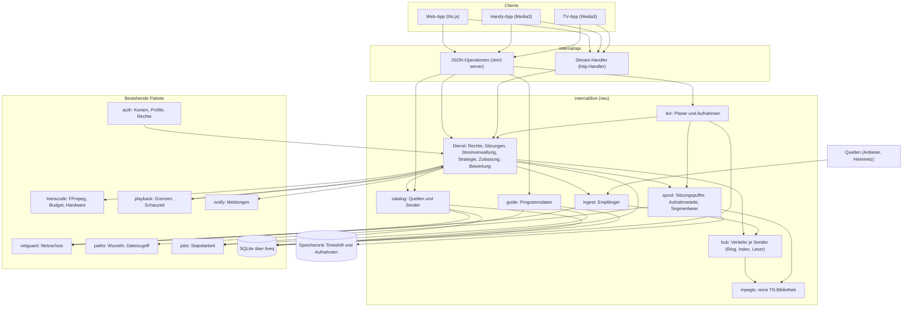
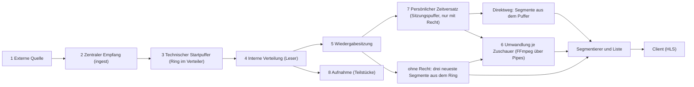
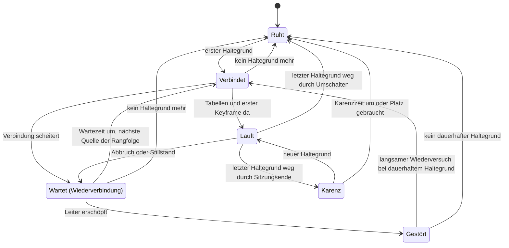

# Konzept 28 · Technische Architektur

Stand: 28. November 2026 · Fassung 2 · Status: Entwurf nach Review 1, nicht freigegeben

Dieses Dokument legt fest, wie Live-TV im bestehenden Go-Server gebaut wird: welche Bausteine es gibt,
wer wofür zuständig ist, wie die Daten fliessen und was bei Mangel und Fehlern geschieht. Die Einzelheiten
des Empfangs, der Verteilung und des schnellen Umschaltens stehen in `05-streaming-und-fast-zapping.md`,
die 18 Abläufe aus Auftrag Abschnitt 8.2 in `06-ablaeufe.md` (dort aus T-1 bis T-28 abgeleitet).
Alles hier ist **spezifiziert**, nichts ist gebaut. Wo eine Aussage auf bestehendem Code beruht, steht
«gebaut» mit Datei und Zeile (Stand `origin/main` 1220769b, Server 1.44.1).

Fassung 2 arbeitet die zwei unabhängigen Reviews ein (`anhang/reviews/review-1-architektur.md`, Befunde
RA-01 bis RA-26; `anhang/reviews/review-1-sicherheit.md`, Befunde RS-01 bis RS-24). Was sich geändert hat,
steht in Abschnitt 13.

Kennungen: `T-n` tragende Entscheide (Abschnitt 2), `F-n` Fragen an dich (Abschnitt 12.3; fortlaufend über
`04` und `05`, andere Dateien zählen eigen und werden mit Dateinummer genannt, etwa «`03` F-4»), `O-n` offene
technische Punkte (Abschnitt 12.2), `M-n` Messpunkte (Liste in `05`, Abschnitt 10). Stufen nach
`03-fachkonzept.md` (0 Regeln, 1 Sender schauen, 2 Programmzeitschrift, 3 Empfang und Umschalten,
4 Timeshift, 5 Aufnahmen, 6 Serien).

## 1. Ziel und Grenzen

Der Server empfängt jeden Fernsehsender **höchstens einmal** von seiner Quelle, hält die letzten Sekunden
bereit und gibt den Strom an beliebig viele Abnehmer weiter: an Zuschauer (jeder mit eigener Sitzung, mit
dem Recht «Timeshift» auch mit eigenem Zeitversatz-Puffer, und nur wenn nötig mit eigener Umwandlung) und an
Aufnahmen (unverändert in Originalqualität). Das alles läuft **im einen Serverprozess** als neuer Dienst
`live`, nach dem Muster des Webradios (ein Relay je Sender: gebaut, `server/internal/radio/relay.go:20-24`),
mit FFmpeg nur als kurzlebigem Hilfsprozess. Es entsteht **kein** zweiter Container, kein zweites Benutzer-,
Rechte-, Job- oder Umwandlungssystem und keine externe Vermittlungssoftware.

Ausdrücklich **nicht** gebaut wird (Auftrag Abschnitt 16, wörtlich bindend): gemeinsamer Zeitversatz-Puffer,
serverweites Archiv, Catch-up, gemeinsam genutzte Umwandlungen, vorsorglich gestartete Umwandlungen, Mehrfachbild,
Tuner-Hardware, DRM-Umgehung, Verbindungslimits je Anbieter, automatische Übernahme von Aufnahmen in die
Bibliothek. Die Architektur bereitet nichts davon vor.

## 2. Tragende Entscheide

Jeder weitere Teil des Konzepts baut auf diesen Entscheiden auf. «Zu messen» nennt, was belegt sein muss;
die Messpunkte stehen in `05`, Abschnitt 10. Die Nummern T-1 bis T-26 sind dieselben wie in Fassung 1;
T-27 und T-28 sind neu.

Begriffe, einmal erklärt: **MPEG-TS** (kurz TS) ist das Transportformat des Fernsehens, ein Strom aus Paketen
zu 188 Byte. Ein **Keyframe** ist ein Bild, das ohne Vorgänger dekodiert werden kann; die Bilder von einem
Keyframe bis vor den nächsten heissen **Bildgruppe** (GOP). **HLS** ist das Abspielverfahren, das Slouchcat
schon nutzt: eine Wiedergabeliste mit kurzen Stücken (Segmenten), die der Player nacheinander holt.
**Umwandlung** (Transcoding) heisst neu kodieren; **Umpacken** (Remux) heisst nur die Verpackung wechseln.

### 2.1 Vorgaben, die auf deine Antwort warten

An vier Stellen legte Fassung 1 einen verbindlichen Entscheid aus oder wich von seinem Wortlaut ab. Dort
steht jetzt die **wortlauttreue** Variante als Vorgabe; meine Empfehlung ist eine Frage an dich.

| Thema | Vorgabe bis zu deiner Antwort (wortlauttreu) | Frage |
|---|---|---|
| Rückspulgrenze (LTV-007) | Kein Zurückspulen vor den Zeitpunkt des Einschaltens. Das erste Bild darf älter sein (es stammt aus dem Startpuffer), bleibt aber nicht abrufbar. | F-7 |
| Form des Zeitversatz-Puffers (LTV-007, Auftrag 16) | Jede Sitzung hat ihre eigene Kopie. | F-8 |
| Speicherort des technischen Startpuffers (LTV-019) | wählbar: Arbeitsspeicher des Servers, RAM-Disk oder ein anderer Ordner. | F-2 |
| Verbindungslimit des Anbieters (LTV-017) | Es gibt keines. Der Entwurf arbeitet ohne Kenntnis eines Limits korrekt (Abschnitt 5.3). | F-3 |

Dazu kommt der **Werkszustand** von Vorladen und «automatisch» (LTV-002, LTV-010): Beide Funktionen sind
verbindlich und in Abschnitt 6 vollständig beschrieben. Ob sie ab Werk an oder aus sind, sagt der Auftrag
nicht; das ist F-9.

### 2.2 Tabelle der Entscheide

| Nr. | Entscheid | Begründung | Verworfen | Zu messen |
|---|---|---|---|---|
| **T-1** | **Ein Dienst im Prozess.** Empfang, Verteilung, Sitzungen, Aufnahmen und der Aufnahme-Planer laufen als Dienst `live` im Serverprozess mit eigener Laufschleife, wie das Radio (`server/cmd/slouchcat/main.go:459-483`, `:569`). Das Jobsystem bekommt nur Stapelarbeit: Listen- und EPG-Import, Logos, Prüfungen ruhender Sender, Aufräumen. | Das Jobsystem tickt im Minutentakt, arbeitet mit Leases von 5 Minuten und bricht bei Pause ab (A3, Abschnitt 4): für sekundengenaue Starts und stundenlange Läufe ungeeignet. | Aufnahme als Job; eigener Prozess oder Container für Live-TV. | – |
| **T-2** | **Identität eines Eingangsstroms ist der Sender.** Je Sender läuft höchstens ein Eingangsstrom. Welche Quelle (Adresse, Zugangsdaten, Kopfzeilen) ihn gerade speist, ist ein Zustand dieses Stroms, kein Teil der Identität. | Erfüllt «einmal empfangen» (LTV-004) unabhängig vom Zugang; verhindert eine zweite Verbindung beim Wechsel auf eine Ersatzquelle. Gleiche Sender aus zwei Listen werden in der Senderverwaltung zusammengeführt (LTV-006). | Identität aus der normalisierten Adresse. | – |
| **T-3** | **Wer die Quelle holt: drei Wege.** **Weg G** (Go liest selbst): HTTP-TS, HLS mit TS-Segmenten, Xtream-Live (Stufe 1); UDP, RTP, Multicast (Stufe 3). **Weg L** (Go-Bibliothek): RTSP und RTMP, späte Stufe, vorbehaltlich F-1. **Weg W** (FFmpeg liest über den Go-Weiterleiter): DASH, HLS mit fMP4-Segmenten oder getrennter Tonspur. **Weg W gehört zu keiner der Stufen 1 bis 3.** Er kommt in einer eigenen, späteren Stufe und nur, wenn M-10 ihn als dicht belegt (T-4). | Go behält Wiederverbindung, Ersatzquellen, Fehlermeldungen und den Netzschutz in der Hand. Weg G deckt die üblichen IPTV-Quellen ab und braucht keinen Prozess. Berichtete Langlauf-Schwächen von FFmpeg (Speicher, Zeitüberlauf) sind eine **Annahme** aus R1 und nicht für 7.1.4 geprüft (M-12); der Entscheid trägt auch ohne sie. | Alles über FFmpeg (R3 H5): ein Dauerprozess je Sender, Adresse und Zugangsdaten in der Argumentliste, kein Netzschutz. Alles in Go (auch DASH): viel eigener Protokollcode; bleibt die Alternative zu Weg W. | M-10, M-11, M-12, M-23 |
| **T-4** | **Die Regel «FFmpeg sieht keine Adresse» (ADR 0025) gilt für Live-TV fort:** FFmpeg bekommt nie eine Anbieter-Adresse, nie Zugangsdaten und nie eine Kopfzeile, weder in der Argumentliste noch in Daten, die es liest, und öffnet keine Verbindung, die nicht Go gewählt und geprüft hat. Regelfall wie heute: nur `pipe:0` und `pipe:1`, festes Eingangsformat, `-protocol_whitelist pipe` (gebaut für das Radio, `server/internal/transcode/radio.go:75-82`). **Eine benannte Ausnahme (Weg W), enger als in Fassung 1:** FFmpeg spricht ausschliesslich unverschlüsseltes HTTP mit dem Go-Weiterleiter auf `127.0.0.1`. Kein Tunnel. Go schreibt jede Adresse in Listen und Manifesten auf einen lokalen Ersatznamen um und beendet jedes TLS selbst. Der Prozess läuft mit einer Sperre, die ihm nur den Port des Weiterleiters erlaubt. Ohne diese Sperre und ohne den Beleg M-10 wird Weg W nicht gebaut. | Regel 10 und Auftrag 10.3 («auch indirekt abgerufene Adressen dürfen den Schutz nicht umgehen»). Einzelheiten und Alternativen in `05`, Abschnitt 2.6. | FFmpeg öffnet die Quelle selbst mit `-protocol_whitelist`; Tunnel (`CONNECT`) durch den Weiterleiter (Fassung 1: der Weiterleiter sähe weder Inhalt noch Weiterleitungen, RA-06, RS-02). | M-10, M-25 |
| **T-5** | **Netzschutz je Quelle mit festen Zielen.** Jede ausgehende Verbindung des Live-TV läuft über einen Go-Dialer, der die Adresse nach der Namensauflösung prüft (gebaut: `server/internal/netguard/netguard.go:73-82`). Öffentliche Adressen sind erlaubt. Eine lokale Adresse nur, wenn sie in den **festen Zielen dieser Quelle** liegt: einer Liste aus Adresse oder kleinem Netz und Port, die der Administrator beim Freigeben bestätigt. Loopback, Link-Local, die Metadaten-Adressen und die eigenen Adressen des Servers sind **nie** freigebbar. Die Prüfung gilt für jede Verbindung der Quelle, auch Weiterleitungen, Unterlisten, Segmente und Schlüssel. Der bestehende ungeschützte Client (`netguard.go:118-128`) wird für Live-TV nicht verwendet. Abschnitt 10.9, `05` Abschnitt 2.3. | Der Administrator vertraut einem Gerät, nicht jeder Adresse in dessen Listen. Ein Ja-Nein-Schalter je Quelle (Fassung 1) hätte blinde Abrufe ins ganze Heimnetz erlaubt (RS-01, RA-19). | Globale Freigabe; Ja-Nein je Quelle; Freigabe durch Konten. | M-16 |
| **T-6** | **Internes Verteilformat ist unveränderter MPEG-TS.** Je empfangenem Sender hält ein **Verteiler** einen Ring aus TS-Paketen mit einem Verzeichnis der Keyframes (GOP-Index), den zuletzt gesehenen Programmtabellen (PAT/PMT) und einer fortlaufenden 64-Bit-Zeit. Es gibt keinen gemeinsamen Segmentvorrat. Ein **Zeitabschnitt** (neuer Aufnahmeteil, Neustart laufender Umwandlungen) beginnt nur bei geänderten Spuren, Codecs oder Bildparametern und bei Quellwechsel; ein blosser Zeitsprung der Quelle ist eine **Diskontinuität** ohne neuen Abschnitt. | TS ist das Format fast aller IPTV-Quellen, erhält alle Spuren (LTV-020), ist ohne Abschluss lesbar und lässt sich an Paketgrenzen schneiden. Enger gefasste Zeitabschnitte vermeiden Dutzende Aufnahmeteile bei Sendern mit Werbeeinblendungen (RA-15). | Gemeinsamer HLS-Segmentierer je Sender; fMP4 intern. | M-9, M-13 |
| **T-7** | **Der technische Startpuffer ist dieser Ring und nichts sonst.** Eine einzige harte Grenze: höchstens **15 Sekunden** Inhalt (Konstante im Code, nach unten einstellbar, nie höher). Reserviert wird beim Start nach dem Muster des Radios: gespeicherte Bitrate × 15 s × 1,03 (`server/internal/radio/buffer.go:67-70`); ein Ring wächst nie an Ort. Speicherort nach T-25 (Vorgabe wählbar, F-2). Ein neuer Abnehmer beginnt an der letzten **vollständigen** Bildgruppe; passt keine vollständige in 15 Sekunden, am neuesten Keyframe (dann ohne schnellen Start). Lesen kann man den Ring nur vorwärts; eine Leseschnittstelle nach Uhrzeit gibt es nicht. **Die Rückspulgrenze einer Sitzung ist der Zeitpunkt des Einschaltens** (Vorgabe, F-7). | Erzwingt, was LTV-007 und LTV-013 verlangen: kein Archiv, kein Zurückspulen vor das Einschalten. Eine Grenze statt zwei beseitigt die Widersprüche aus Fassung 1 (RA-04). | Startpuffer über Minuten; zweite Konstante in Byte; Start an bis zu drei Bildgruppen. | M-1, M-13 |
| **T-8** | **Niemand kann den Empfang aufhalten.** Der Schreiber des Rings wartet nie. Jeder Leser kopiert seinen Bereich und prüft danach, ob der Bereich inzwischen überschrieben wurde; wenn ja, verwirft er die Kopie, bekommt eine Lücke und setzt am nächsten Keyframe fort. Leser sind: Schreiber von Sitzungspuffern und Aufnahmen (jeder mit eigenem, begrenztem Rückstau im Arbeitsspeicher, damit ein kurz stockender Datenträger keine Lücke reisst), Zuführer einer Umwandlung, und Segmentabrufe von Sitzungen ohne Zeitversatz. | Ein langsamer Client, ein langsamer Datenträger oder ein langsamer FFmpeg trifft nur sich selbst (LTV-004 «Backpressure»). Der Rückstau trennt die Grenze gegen ein Archiv (15 s) von der Toleranz gegen Stockungen (RA-07). | Push an Clients aus dem Ring; Sperre im Schreibpfad. | M-14 |
| **T-9** | **Eigener Sitzungstyp «Live-Sitzung».** Getrennt von `playback_sessions` (dort ist `item_id` Pflicht und zeigt auf `items`, A2 Abschnitt 1.3) und vom Radio. Eine Live-Sitzung gehört zu Anmeldung, Profil und Gerät; **Umschalten ist ein Vorgang innerhalb der Sitzung** («Einstellen» mit laufender Nummer), keine neue Sitzung. Dieselbe Sitzungsart spielt auch fertige Aufnahmen ab. Sitzungen, Aufnahmen, Planungen und Erinnerungen tragen zufällige Kennungen (ULID). | Keine Eingriffe in die Dateiwiedergabe; schnelles Umschalten ohne Neuanlage; Aufnahmen bleiben ausserhalb von `items` (Regel 2). | Sender als `items`; Wiederverwendung von `playback.Session`. | – |
| **T-10** | **Der persönliche Zeitversatz-Puffer liegt vor der Umwandlung und gehört einer Sitzung.** Mit wirksamem Recht «Timeshift» hat die Sitzung einen **Sitzungspuffer**: eine eigene Kopie des Quell-TS ab dem Einstellen, in Stückdateien mit Verzeichnis, auf dem Speicherort «Timeshift» (Vorgabe: eigene Kopie, F-8). Er wird beim Umschalten, beim Sitzungsende und beim Serverstart gelöscht. **Ohne wirksames Recht gibt es keinen Sitzungspuffer und kein rückwärts lesbares Fenster:** Die Sitzung bekommt nur die drei neuesten Segmente, direkt aus dem Ring; ältere Segmente beantwortet der Server mit 404. Der Sitzungspuffer auf Datenträger kommt mit Stufe 4. | Spulen, Qualitäts- und Tonspurwechsel wirken auf die ganze Vergangenheit; die Umwandlung läuft nur für das, was jemand ansieht. Das Recht wird im Server durchgesetzt, nicht nur in der Oberfläche (Regel 12, Auftrag 10.6, `03` DR-22; RA-08). | Puffer nach der Umwandlung; Fenster von 60 Sekunden ohne Recht (Fassung 1: im Player pausier- und rückspulbar); Puffer erst ab der ersten Pause (widerspricht LTV-007). | M-14 |
| **T-11** | **Auslieferung als HLS je Sitzung mit TS-Segmenten; die Wiedergabeliste baut Go.** Kein LL-HLS, kein DASH, kein fortlaufender Strom in der ersten Stufe. Das ist eine **Empfehlung unter Vorbehalt**: M-2, M-3, M-4 und M-5 müssen **vor der Baufreigabe der Stufe 1** vorliegen. Für Safari und iPhone ist die Startregel von HLS ein benanntes Risiko (`05` Abschnitt 4.3). Der Segmentierer ist die eine Stelle, an der ein zweites Segmentformat (fMP4) anschliesst. | HLS spielen alle drei Clients; nur segmentbasierte Verfahren tragen Zeitversatz im Player (R2 Abschnitt 6). Vergleich in `05`, Abschnitt 4. | Ein Format fMP4 für alle; fortlaufender TS-Strom. | M-1 bis M-5 |
| **T-12** | **Direktweg ohne FFmpeg, wo der Strom zum Gerät passt.** Go schneidet die Segmente an Keyframes und setzt die Programmtabellen davor. Die Tonspurwahl geschieht durch Weglassen der anderen Ton-PIDs (PID: Kennung eines Teilstroms im TS) samt angepasster Tabelle, ausser das Gerät wählt Spuren selbst (`selectsTracks`, ADR 0041). **Für wen der Direktweg real ist, steht in Abschnitt 7.6:** im Browser und auf dem iPhone nur für H.264 ohne Zeilensprung mit AAC-Ton; auf Geräten mit Media3 für deutlich mehr. | Keine unnötige Neukodierung (LTV-004), kein Prozessstart beim Umschalten. Wie oft der Direktweg bei deinen Sendern greift, zeigt erst M-2; davon hängt die Kapazität ab. | Umpacken je Zuschauer durch FFmpeg als Regelfall. | M-2, M-3 |
| **T-13** | **Umwandlung je Sitzung durch genau einen FFmpeg, TS hinein, TS heraus, nur über Pipes.** Eingang ist der Sitzungspuffer (mit Zeitversatz) oder ein Zuführer am Ring (ohne). Die Ausgabe schneidet derselbe Go-Segmentierer. Wiederverwendet werden Hardware-Erkennung (`server/internal/transcode/backend.go:140-223`), Videoketten je Backend (`pipeline.go:398`), Tonregeln (ADR 0041), Start und Beenden (`session.go:660-683`). Das Budget bekommt eine **neue Schnittstelle** (reservieren, umbuchen, freigeben): Die Reservierung gehört der **Live-Sitzung**, nicht dem Prozess, und wird beim Umschalten nur umgebucht. `playback.Decide`, `transcode.Plan`, `transcode.Session` und `ffmpegArgs` bleiben **im Verhalten unverändert**, belegt durch die bestehenden Tests (Vergleich der Argumentlisten, Tests des Managers). | Kein zweites Umwandlungssystem. Der heutige Einstieg des Managers verlangt einen Plan mit Segmenten (`manager.go:180-182`) und taugt für Live nicht. Eine Reservierung je Prozess würde schnelles Umschalten mit sterbenden Prozessen blockieren (RA-12). | Live-Zweig in `transcode.Session`; gemeinsame Umwandlung je Sender. | M-8, M-9 |
| **T-14** | **Der Server entscheidet je Sitzung zwischen Original, Ton-Umwandlung und Bild-Umwandlung** mit einer eigenen Funktion im Paket `live`, aus den gemeldeten Gerätefähigkeiten (ADR 0041, additiv erweitert), den Grenzen des Profils und den **gespeicherten Streamparametern** des Senders. Die Parameter kommen aus den Programmtabellen (Go) und einer Probe mit `ffprobe` über eine Pipe aus dem Ring. | Regel 12; `playback.Decide` wird durch Vergleich ganzer Entscheide getestet (`decide.go:318-326`). Gespeicherte Parameter sparen die Probe beim Umschalten. | Erweiterung von `playback.Decide`; Entscheid im Client. | M-7, M-8 |
| **T-15** | **Zeilensprung-Entfernung (Deinterlacing) ist ein neuer, abschaltbarer Baustein der Videokette**, nur von Live-TV eingeschaltet. Vorgabe: Der Server entfernt den Zeilensprung, ausser das Gerät meldet, dass es ihn sauber darstellt. **Ein Browser kann das nie melden; dort greift die Vorgabe immer**, bis M-6 etwas anderes belegt. | Im Server gibt es heute keinen solchen Filter (A2 Abschnitt 1.1), im Image sind sie vorhanden (M1). Folge für die Kapazität: Abschnitt 7.6. | Immer durchreichen. | M-6, M-8 |
| **T-16** | **Die Aufnahme zweigt am Verteiler ab,** mit eigenem Leser und eigenem Rückstau (T-8), unabhängig von jeder Sitzung. Go schreibt den Quell-TS des einen Programms unverändert in Teilstücke mit Verzeichnis auf den Speicherort «Aufnahmen». Ein neuer Teil beginnt nur mit einem neuen Zeitabschnitt (T-6), nach einem Neustart und nach einer Lücke des Speicherorts. Kein FFmpeg, kein Umwandlungsbudget. | LTV-008 und LTV-020. TS überlebt einen harten Abbruch (R5 Abschnitt 3). | Aufnahme aus einer Zuschauersitzung; über FFmpeg `-c copy`; als `items`. | M-14 |
| **T-17** | **Lebenszyklus über benannte Haltegründe.** Ein Eingangsstrom lebt, solange mindestens ein Haltegrund eingetragen ist. Jeder Haltegrund ist ein Eintrag mit Art und Besitzer. **Beim Umschalten innerhalb einer Sitzung gibt es keine Karenz;** Karenz gibt es nur nach dem Ende einer Sitzung, und ein Strom ohne Haltegrund belegt keinen Platz. **Vor jedem neuen Verbindungsaufbau gibt die Stromverwaltung Ströme derselben Quelle frei, die niemand mehr hält.** Eine Ablehnung (401, 403, 429), während eine andere Verbindung derselben Quelle offen ist oder eben war, gilt als «vermutlich Verbindungslimit» und sperrt nichts. Abschnitt 5. | Fassung 1 hätte bei Zugängen mit einer einzigen erlaubten Verbindung beim Umschalten die Quelle gesperrt (RA-01). Die neue Regel ist Fehlerbehandlung, keine Limitverwaltung; LTV-017 bleibt unberührt. | Reiner Referenzzähler; Karenz nach jedem Verlassen. | M-12, M-15 |
| **T-18** | **Empfangsstrategie: vier Arten und Vorladen, alle verbindlich und vollständig beschrieben** (Abschnitt 6): dauerhaft, zeitgesteuert, automatisch, bei Bedarf; dazu Vorladen der Nachbarsender. Je Quelle gibt es **einen** Schalter «weitere gleichzeitige Verbindungen erlaubt»; ist er aus, öffnet der Server zu dieser Quelle nichts vorsorglich. **Der Werkszustand** (was ab Werk an ist) ist F-9. | LTV-002, LTV-010. Jeder vorsorgliche Empfang ist eine weitere Verbindung zum Anbieter, dessen Limit Slouchcat nicht kennt. | Zwei Schalter je Quelle (Fassung 1); Werkszustand als Entscheid statt als Frage (RA-18). | M-17 |
| **T-19** | **Ein Zulassungsort, vier Grössen.** Die Stromverwaltung entscheidet über jeden Empfang, Sitzungspuffer und jede Aufnahme gegen: Zahl der Eingangsströme, Byte-Budget im Arbeitsspeicher (Ringe und Rückstau), Platz auf den Speicherorten, Umwandlungseinheiten (bestehendes Budget, T-13). Dazu feste Serverdeckel unabhängig von den Grenzen der Konten und eine Drosselung des Umschaltens (Abschnitt 8.5). Rangfolge in Abschnitt 8.2; die Kapazität der Referenz steht in Abschnitt 7.6. | Ein einziges Zahlenbudget für Netz, Speicher und Encoder wäre falsch: es sind verschiedene Engpässe. Die Stream-Grenze eines Kontos ist ab Werk leer, also unbegrenzt (RS-10); der Server braucht eigene Deckel. | Eigenes Budget für Live-Umwandlungen; kein Schutz der Dateiwiedergabe. | M-8, M-13, M-14 |
| **T-20** | **Empfang und Aufnahme laufen im Serverprozess, nicht in FFmpeg,** und sind damit von `nice 10` und `oom_score_adj 500` (gebaut: `server/internal/transcode/session.go:702-712`) nicht betroffen. FFmpeg-Empfänger des Wegs W starten in einer neuen Klasse «Empfang» ohne Zurückstufung. Umwandlungen für Zuschauer behalten die heutige Klasse. | Heute würde gerade der Empfänger unter Last zuerst Pakete verlieren und bei Speichermangel zuerst sterben (A2 Abschnitt 2.1). | Alle FFmpeg gleich behandeln. | M-12 |
| **T-21** | **Stream-Endpunkte tragen ein Token `lt`,** gebunden an Live-Sitzung und Einstell-Nummer (HMAC wie beim Radio, `server/internal/radio/token.go:11-30`; Schlüssel aus `secrets.Keyring.Derive("live-token")`). **Am Leben hält eine Sitzung nur ihr Herzschlag,** eine angemeldete Operation derselben Anmeldung; Segmentabrufe verlängern nichts. Jede Listenanfrage prüft, höchstens 30 Sekunden alt, das Recht und die Gültigkeit der Anmeldung. Ein ungültiges, fremdes oder abgelaufenes Token ergibt dieselbe 404-Antwort wie «kein Recht». Abschnitt 10.3. | Bestehende Token-Architektur (`st`, `rt`, `dt`). Ein erbeutetes Token darf eine Sitzung nicht unbegrenzt halten (RS-08); beim Radio verlängert jede Anfrage (`server/internal/radio/listen.go:561-571`). | Cookie-Prüfung an Segmenten; Verlängerung durch Segmentabruf. | M-5 |
| **T-22** | **Flüchtiges lebt im Arbeitsspeicher, Dauerhaftes in SQLite.** Flüchtig: Ringe, Verzeichnisse, Leser, Haltegründe, Wartezeit-Zähler, Messwerte, Einstell-Nummern. In SQLite: Quellen, Sender, Strategie, gespeicherte Streamparameter, Zustand je Quelle (nur bei Wechsel geschrieben), Sitzungszeilen (Anlage, Ende, Berührung höchstens einmal je Minute), Aufnahmen mit Teilen und Lücken. Die Nutzung je Sender für «automatisch» wird aus den Sitzungszeilen gerechnet, nicht eigens gespeichert. Abschnitt 4.2. | SQLite hat genau einen Schreiber (A3 Abschnitt 3). | Zustand je Segment in der Datenbank; Redis; eigene Nutzungstabelle (Fassung 1, RA-26). | – |
| **T-23** | **Statusänderungen kommen über Abfragen, nicht über einen neuen Push-Kanal.** Der Herzschlag der Sitzung (alle 10 Sekunden) liefert den Zustand zurück; der Player sieht Störungen ausserdem direkt an Liste und Segmenten. Kein SSE, kein WebSocket in der ersten Stufe. | Es gibt heute keinen Push-Kanal (A3 Abschnitt 6). | SSE je Sitzung; WebSocket. | – |
| **T-24** | **Paketzuschnitt** nach Abschnitt 3.2: neues Paket `internal/live` mit Unterpaketen, eigenes sqlc-Paket `liveq` mit depguard-Riegel, alle Prozessstarts in `internal/transcode`, alle Dateizugriffe über `paths`, Stream-Endpunkte als `http.Handler`. Kein Live-Paket fasst `items`, `media_files` oder `tracks` an. | Regeln 2, 3, 4, 6 und das Muster `wishq` (`server/.golangci.yml`, Regel `wishq`). | Live-TV im Paket `radio` oder `playback`. | – |
| **T-25** | **Drei Speicherorte, jeder vom Administrator gewählt.** Startpuffer: Arbeitsspeicher des Servers (ab Werk) oder ein Ordner (RAM-Disk empfohlen). Timeshift: ein Ordner, ab Werk `<cache>/live/timeshift`. Aufnahmen: eine eigens eingehängte, schreibbare Wurzel (Muster ADR 0029). Jeder Ordner trägt eine Markerdatei und hat einen Zustand. Der Server schreibt nur relativ zu einer geprüften, geöffneten Wurzel und **nie an einen Ort, den der Administrator nicht gewählt hat**. Namen von Dateien und Ordnern bestehen nur aus Kennungen; Rechte 0700 und 0600; gelöscht wird Datei für Datei über `paths`. Abschnitt 10.10. | LTV-019; ein nicht eingehängtes Netzlaufwerk darf nie zu Schreiben auf die lokale Platte führen (gebaut für Podcasts, A2 Abschnitt 7.4). | Aufnahmen im Cache; stiller Ausweichordner (Fassung 1, RS-22). | M-14 |
| **T-26** | **Live-TV zählt zu den bestehenden Grenzen:** gleichzeitige Streams, Bitrate und Höhe je Konto und Profil sowie die tägliche Schauzeit (`03` DR-12). Dafür braucht es eine Kopplung in **beide** Richtungen zwischen `playback` und `live`, über gesetzte Rückrufe wie beim Radio (`main.go:471`): `playback` fragt `live` nach den aktiven Live-Sitzungen je Profil und Konto, `live` reserviert seinen Platz unter derselben Startsperre (`server/internal/playback/limits.go:147-201`). Das Radio zählt heute nur zur Schauzeit, nicht zu den Streams; das Muster trifft also nur zur Hälfte. | Kein zweites Limit-System; `playback` darf `liveq` wegen des depguard-Riegels nicht lesen (RA-22). | Getrennte Zählung für Live-TV. | – |
| **T-27** | **FFmpeg wird eingedämmt, und kein Paket der Quelle kann den Server beenden.** Jeder Live-FFmpeg und jede Probe startet mit eigener, kleiner Umgebung (keine `SLOUCHCAT_*`-Variablen), festem Eingangsformat, Ressourcengrenzen und Argumenten, die nur Zahlen und Werte aus festen Listen enthalten. Wo der Kernel es kann, läuft FFmpeg in einer Sperre ohne Lesezugriff auf `/config` und ohne Netz. Jede Go-Routine des Live-Dienstes fängt Programmfehler an ihrer Wurzel ab und macht daraus einen Fehler der Quelle; alle Parser bekommen Fuzz-Tests. Abschnitt 10.8. | Live-TV gibt FFmpeg erstmals Video, Untertitel und Manifeste aus beliebigen Fremdquellen; heute erbt FFmpeg die ganze Umgebung und kann `secret.key` lesen (`session.go:662-683`, RS-03). Ein Indexfehler in einer Go-Routine ausserhalb des HTTP-Servers beendet den ganzen Prozess (RS-04). | Wie heute starten. | M-25 |
| **T-28** | **Jede Adresse einer Quelle und jede Stream-Adresse eines Senders ist ein Geheimnis.** Sie wird ganz verschlüsselt gespeichert; im Klartext steht daneben nur Schema, Host und Port. Zugangsdaten und Kopfzeilen einer Quelle gehen nur an eine **feste Menge von Ursprüngen** (ab Werk der Host der eingetragenen Adresse), nie von `https` nach `http`, und keine API-Antwort gibt sie zurück. Abschnitt 10.5. | Eine Erkennung «Adresse mit Zugangsdaten» nach Muster versagt bei unbekannten Namen und bei Xtream-Pfaden; Klartext landete in jeder Sicherung (RS-05). Ohne feste Ursprünge erntet ein gekaperter Listen-Host die Kopfzeilen (RS-06). | Nur erkannte Zugangsdaten verschlüsseln; Maskierung in der Oberfläche. | – |

## 3. Komponenten

### 3.1 Die dreizehn Verantwortlichkeiten des Auftrags

Der Auftrag (Abschnitt 8) nennt dreizehn Verantwortlichkeiten und stellt ausdrücklich frei, sie zusammenzufassen.
Sieben davon werden zu drei Bausteinen; für «Vorladen», «Timeshift» und «Streamüberwachung» wären eigene
Bausteine Overengineering.

| Verantwortlichkeit (Auftrag) | Zuordnung | Begründung |
|---|---|---|
| Source Manager | `live/catalog` (neu) mit Jobs für den Abgleich | Quellen, Import, Aktualisierung; Stapelarbeit gehört ins Jobsystem. |
| Channel Registry | `live/catalog` (zusammengefasst) | Sender und ihre Quellzeilen sind dasselbe Datenmodell (Quellzeile n:1 Sender, R3 Abschnitt 2). |
| Stream Manager | `live`: **Stromverwaltung** | Verzeichnis der laufenden Eingangsströme. |
| Stream Lifecycle Manager | `live`: Stromverwaltung (zusammengefasst) | Der Zustandsautomat **ist** die Verwaltung. |
| Stream Distributor | `live/hub`: **Verteiler** | Ring, Verzeichnis, Leser. |
| Input Buffer Manager | `live/hub` (zusammengefasst) | Der Ring ist der Eingangspuffer; es gibt keinen zweiten. |
| Preload Manager | kein eigener Baustein: ein Haltegrund «Vorladen» und eine Regel in der Stromverwaltung | Vorladen ist nur «Empfang ohne Abnehmer mit Ablauf». |
| Playback Session Manager | `live`: **Sitzungen** (neuer Sitzungstyp, T-9) | Nicht `playback`, siehe T-9. |
| Timeshift Manager | kein eigener Baustein: `live/spool` (Sitzungspuffer) und die Sitzung | Zeitversatz ist eine Eigenschaft des Sitzungspuffers. |
| Recording Manager | `live/dvr` (neu) | Regeln, Termine, Aufnahmen, Aufbewahrung. |
| EPG Manager | `live/guide` (neu) mit Jobs für den Import | Unabhängig vom Strom (LTV-005). |
| Stream Health Monitor | kein eigener Baustein: Messwerte im Verteiler, Bewertung in der Stromverwaltung, Meldung über `notify` | Die Signale fallen beim Empfang ohnehin an. |
| Resource Manager | bestehend: `transcode.Manager` (Umwandlungseinheiten); dazu die Zulassung in der Stromverwaltung (T-19) | Kein zweites Budget. |

### 3.2 Paketliste

| Paket | Verantwortung | Öffentliche Schnittstelle (in Worten) | Hängt ab von |
|---|---|---|---|
| `internal/live` (neu) | Der Dienst: Rechteprüfung (drei Schalter, 404), Live-Sitzungen mit Token und Herzschlag, Stromverwaltung mit Haltegründen und Zustandsautomat, Empfangsstrategie und Vorladen, Zulassung und Drosselung, Bewertung der Streamgüte, Meldungen, geordnetes Herunterfahren. | Für die API: Sender einstellen, Sitzung beenden, Herzschlag, Liste und Segment einer Sitzung, Qualität und Spur ändern. Für die Verwaltung: laufende Eingangsströme, Sitzungen ohne private Inhalte, Stopp, «läuft eine Aufnahme?». Für `auth` und `playback`: Sitzungen eines Kontos oder Profils beenden; aktive Live-Sitzungen zählen. Für `dvr`: Haltegrund «Aufnahme» setzen und lösen, Leser anmelden. | `live/*`, `transcode`, `playback` (nur Grenzen und Schauzeit), `netguard`, `paths`, `secrets`, `ratelimit`, `notify`, `jobs`, `store/liveq`, `model`, `logging` |
| `internal/live/mpegts` (neu) | Reine TS-Bibliothek ohne Ein- und Ausgabe; Anforderungen unten. | Zerlegen, Erkennen, Filtern, Schneiden. | nur Standardbibliothek |
| `internal/live/hub` (neu) | Verteiler je Sender: Ring, GOP-Index, Tabellen-Zwischenspeicher, Leser, Messwerte. Kein Netz, keine Datenbank. | Pakete annehmen; Leser ab der letzten vollständigen Bildgruppe anmelden; Bereich kopieren und nachprüfen; Messwerte lesen. | `live/mpegts` |
| `internal/live/ingest` (neu) | Empfänger je Protokoll (Wege G, L, später W), Wiederverbindung innerhalb einer Quelle, DRM-Erkennung, je Quelle ein eigener HTTP-Transport. | Eine Quelle öffnen und TS an einen Verteiler liefern, bis Abbruch; Fehler als stabile Codes. | `live/mpegts`, `live/hub`, `netguard`, `transcode` (nur Weg W), `golang.org/x/net/ipv4` (schon Abhängigkeit, `server/go.mod:21`) |
| `internal/live/spool` (neu) | Stückdateien mit Verzeichnis für Sitzungspuffer und Aufnahmeteile; Rückstau der Schreiber; Segmentierer; Bau der Wiedergabeliste; Zustand der Speicherorte (Marker, Platz, Schreibfehler). | Schreiben ab einem Leser; Segment nach Nummer lesen; Liste rendern; ältestes Stück verwerfen; Speicherort prüfen. | `live/mpegts`, `paths` |
| `internal/live/catalog` (neu) | Quellen, Listen-Import (M3U, Xtream) mit festen Grössengrenzen, Sender mit stabiler Kennung, Ersatzquellen, Gruppen, Logos, feste Ziele und Ursprünge einer Quelle. Einzelheiten in `03`, `07`, `15`. | Sender und ihre Quellen in Rangfolge liefern; Adressen und Zugangsdaten nur entschlüsselt im Speicher an `ingest` geben. | `netguard`, `secrets`, `ratelimit`, `jobs`, `store/liveq` |
| `internal/live/guide` (neu) | Programmdaten: Import, Zuordnung, Abfragen. Einzelheiten in `09`. | Jetzt und danach je Sender; Raster; Suche. | `netguard`, `jobs`, `store/liveq` |
| `internal/live/dvr` (neu) | Regeln, Termine, sekundengenauer Planer im Prozess, Aufnahmen mit Teilen und Lücken, Aufbewahrung, Kontingent. Einzelheiten in `11`. | Termin anlegen, ändern, absagen; laufende und fertige Aufnahmen eines Profils; Wiederaufnahme nach Neustart. | `live`, `live/spool`, `paths`, `notify`, `store/liveq` |
| `internal/store/liveq` (neu, erzeugt) | sqlc-Paket aller Live-TV-Tabellen. | – | nur von `internal/live/**` und `internal/store/**` importierbar (depguard, Muster `wishq`) |
| `internal/transcode` (erweitert) | Neue Datei `live.go`: Argumentlisten und Prozesshüllen für (a) Umwandlung einer Live-Sitzung, (b) Probe über Pipe, (c) später FFmpeg-Empfänger des Wegs W. Neue Schnittstelle des Budgets für Live (reservieren, umbuchen, freigeben). Baustein «Zeilensprung» in der Videokette. Start mit eigener Umgebung, Ressourcengrenzen und, wo möglich, Sperre (T-27). | Live-Umwandler starten (Schreiben hinein, Lesen heraus); Probe aus Bytes; Einheiten reservieren, umbuchen, freigeben. | wie heute; **importiert `live` nicht** |
| `internal/netguard` (erweitert) | Prüffunktion mit festen Zielen je Quelle; Liste der nie freigebbaren Adressen; ergänzte Präfixe (Abschnitt 10.9). | Dialer-Kontrolle für eine Quelle; Adresse prüfen. | – |
| `internal/playback` (erweitert um zwei Rückrufe) | Live-Sitzungen zählen bei den Stream-Grenzen und bei der Schauzeit mit; `live` reserviert einen Platz unter derselben Startsperre (T-26). | Platz reservieren und freigeben; Zähler-Rückruf setzen; Schauzeit melden. | – |
| `internal/api` (erweitert) | JSON-Operationen über den erzeugten strict server; Stream-Handler als `http.Handler` (Liste, Segment, Logo). Einzelheiten in `08`. | – | `live` |
| `internal/logging` (erweitert) | Neue Muster in der Schwärzung, Abschnitt 10.4. | – | – |
| `internal/admin`, `internal/auth`, `internal/jobs`, `internal/notify` (angeschlossen) | Übersicht und laufende Streams; Haken beim Entzug von Rechten und beim Löschen; neue Jobarten; neue Ereignisse. | – | – |

**Anforderungen an `live/mpegts`** (jede auch als feindlicher Testfall und Fuzz-Ziel, Vorbild
`server/internal/radio/hostile_test.go`):

1. **Referenzuhr beim Filtern:** Trägt eine weggelassene Tonspur die Referenzuhr (PCR), bleiben ihre Pakete
   mit Uhr erhalten, oder die Tabelle nennt eine andere PID und die Uhr zieht um.
2. **Keyframe ohne Kennzeichen:** Das Bildpaket wird bis zum ersten Bild-Element zusammengesetzt; Startcodes
   können über Paketgrenzen laufen.
3. **Offene Bildgruppen:** Einstiegspunkte mit Vorlaufbildern, die am Start nicht dekodierbar sind (HEVC-CRA,
   MPEG-2 ohne geschlossene Bildgruppe, H.264 mit Wiedereinstiegspunkt), werden gekennzeichnet; IDR und
   geschlossene Bildgruppen werden vorgezogen.
4. **Eingefügte Tabellen:** Die Zähler der eingefügten PAT- und PMT-Pakete passen zum übrigen Strom.
5. **Keine Fehlalarme:** Verschlüsselungskennzeichen zählen nur auf Bild- und Ton-PIDs und über eine
   Mindestdauer; Zählersprünge an Segmentgrenzen einer HLS-Quelle sind kein Paketverlust.
6. **Keine Speicheranforderung aus einem Längenfeld der Quelle ohne Obergrenze.**

**Eigene Bibliothek oder `mediacommon`?** Die Bibliothek `bluenviron/mediacommon` (Kandidat aus R1) liest TS
in dekodierte Zugriffseinheiten (Annahme, nicht am Quelltext geprüft). Slouchcat braucht das Gegenteil:
unveränderte Pakete mit Positionen. Deshalb eine eigene, kleine Bibliothek für die Paket-, Tabellen- und
PID-Ebene. Kommt mit F-1 (a) `mediacommon` ohnehin ins Projekt, wird für die Erkennung der Bildparameter
(Punkte 2 und 3) geprüft, ob deren Codec-Helfer die eigene Erkennung ersetzen (O-21).

Abhängigkeitsregeln, die der Bau als Lint oder Test festhält: `mpegts` und `hub` kennen weder Netz noch
Datenbank; `os/exec` bleibt in `transcode` (Regel 3); `live` importiert `systemq` nicht.

### 3.3 Komponentendiagramm

## 4. Datenfluss in acht Ebenen

### 4.1 Die Ebenen

Die Reihenfolge im Bild weicht bewusst von der Aufzählung des Auftrags ab: Der persönliche Zeitversatz (7)
liegt **vor** der Umwandlung (6). Das ist der Entscheid T-10.

| Ebene | Format | Besitzer | Lebensdauer | Speicherort | Grenze |
|---|---|---|---|---|---|
| 1 Externe Quelle | HTTP-TS, HLS, DASH, RTSP, RTMP, UDP, RTP, Multicast | Anbieter oder Gerät im Heimnetz | – | – | feste Ziele je Quelle (T-5); Verbindungslimit des Anbieters, das Slouchcat nicht kennt |
| 2 Zentraler Empfang | TS-Bytestrom, ein Programm | `live/ingest`, je Sender einer | solange der Eingangsstrom lebt (T-17) | Arbeitsspeicher (Lesepuffer) | Obergrenze gleichzeitiger Eingangsströme; Stillstandsfrist; Grössen von Listen und Segmenten |
| 3 Technischer Startpuffer | TS-Pakete im Ring, GOP-Index, letzte Programmtabellen | Verteiler des Senders, **keinem Zuschauer** zugeordnet | wie Ebene 2; Inhalt höchstens 15 Sekunden alt | nach T-25: Arbeitsspeicher oder gewählter Ordner (F-2) | 15 s hart; Byte-Budget über alle Ringe |
| 4 Interne Verteilung | Leser am Ring, nur vorwärts, kopieren und nachprüfen | Verteiler; je Abnehmer ein Leser | wie der Abnehmer | Arbeitsspeicher | überrundeter Leser setzt am nächsten Keyframe fort |
| 5 Wiedergabesitzung | Sitzungszeile, Token, Einstell-Nummer, Entscheid | `live` (Sitzungen), gehört Profil und Gerät | bis Stopp, Abmelden, Entzug, 60 s ohne Herzschlag, Höchstdauer oder Neustart | Arbeitsspeicher, Zeile in SQLite | Stream-Grenzen und Schauzeit (T-26); Serverdeckel (Abschnitt 8.5) |
| 6 Umwandlung je Zuschauer | TS hinein, TS heraus | die Sitzung; ein FFmpeg-Prozess | nur solange Segmente geholt werden; endet 60 s nach der letzten Anfrage (Vorbild `server/internal/transcode/manager.go:22`) | Pipes; Ausgabestücke mit Zeitversatz neben dem Sitzungspuffer (höchstens 5 Minuten), ohne Zeitversatz im Arbeitsspeicher (höchstens 8 MiB) | Umwandlungseinheiten (T-19); nie ohne Zuschauer |
| 7 Persönlicher Zeitversatz | Stückdateien mit Quell-TS und Verzeichnis | die Sitzung, ein Profil; nur mit Recht «Timeshift» | vom Einstellen bis zum Umschalten oder Sitzungsende; gelöscht beim Serverstart | Speicherort «Timeshift» (T-25) | Höchstdauer der Verwaltung (`03` DR-07: Vorgabe 60 Minuten); Deckel über alle Sitzungspuffer; Rückspulgrenze am Einschaltzeitpunkt (F-7) |
| 8 Aufnahme | Teilstücke mit Quell-TS des einen Programms, Verzeichnis je Teil | `live/dvr`, gehört einem Profil | bis das Profil löscht oder die Aufbewahrung greift | Speicherort «Aufnahmen» (T-25) | Kontingent je Konto, Mindestreserve, Obergrenze gleichzeitiger Eingangsströme |

### 4.2 Flüchtig oder dauerhaft

| Zustand | Wo | Bemerkung |
|---|---|---|
| Ringe, GOP-Index, Leser, Messwerte der Streamgüte | Arbeitsspeicher (Ring nach T-25 auch als Datei) | nach Neustart leer |
| Haltegründe, Zustand des Automaten, Wartezeit-Zähler, Quarantäne einer Quelle | Arbeitsspeicher | dauerhafte Haltegründe entstehen beim Start neu aus der Strategie |
| Live-Sitzung: Token-Bindung, Einstell-Nummer, Abspielstand, Verzeichnis des Sitzungspuffers | Arbeitsspeicher | Sitzungen überleben keinen Neustart (wie Radio, `server/internal/radio/listen.go:62-72`) |
| Live-Sitzung: Zeile mit Konto, Profil, Gerät, Sender, Beginn, Ende, Grund des Endes | SQLite | für Grenzen, Verwaltung, Schauzeit und die Nutzung für «automatisch»; Berührung höchstens einmal je Minute |
| Quellen, feste Ziele, Ursprünge, Sender, Rangfolge, Strategie, Zeitpläne | SQLite | `07-datenmodell.md`; Adressen verschlüsselt (T-28) |
| Gespeicherte Streamparameter je Sender und Quelle | SQLite | geschrieben bei Probe und bei geänderter Tabelle, nie fortlaufend |
| Zustand je Quelle (in Ordnung, gestört seit, Zugang prüfen, DRM) | SQLite | nur bei Wechsel geschrieben |
| Aufnahmen, Teile, Lücken, Regeln, Termine | SQLite | Fortschritt eines Teils alle 10 Sekunden (R5 Abschnitt 4.3) |

Regel für alle Schreiber: nie eine lange Transaktion. Importe schreiben in Stapeln von höchstens 500 Zeilen
(bestehende Jobregel, A3 Abschnitt 3).

## 5. Lebenszyklus eines Eingangsstroms

### 5.1 Zustandsautomat

Ein Sender gilt auch dann als «läuft», wenn seine Bildgruppen länger als 15 Sekunden sind; er hat dann
keinen schnellen Start, und die Verwaltung zeigt das an.

### 5.2 Haltegründe

Ein Haltegrund ist ein Eintrag `(Art, Besitzer)` am Eingangsstrom. Die Stromverwaltung gleicht die Einträge
einmal je Minute mit ihren Besitzern ab: Ein Eintrag, dessen Besitzer nicht mehr existiert, wird entfernt und
als Fehler protokolliert (Auftrag Abschnitt 21, Punkt 8).

| Art | Besitzer | Entsteht | Endet | Geschützt bei Mangel |
|---|---|---|---|---|
| dauerhaft | der Sender | Strategie «dauerhaft»; beim Serverstart | Strategie geändert, Sender deaktiviert | nein, weicht Abnehmern (F-4) |
| Zeitplan | der Zeitplan-Eintrag | Beginn des Fensters; beim Serverstart, wenn im Fenster | Ende des Fensters | nein, weicht Abnehmern (F-4) |
| automatisch | die Regel aus Abschnitt 6.2 | Sender gehört zu den meistgenutzten und jemand schaut gerade Live-TV | 10 Minuten nach der letzten Live-Sitzung im Haushalt | nein |
| Vorladen | die Live-Sitzung, die umschaltet | Nachbarsender nach Abschnitt 6.3 | 3 Minuten nach dem letzten Umschalten oder Sitzungsende | nein, fällt früh |
| Zuschauer | die Live-Sitzung | Einstellen | Umschalten, Stopp, Entzug, Ablauf | **ja** |
| Aufnahme | die Aufnahme | Vorlauf (Öffnen 30 s vor Beginn) | Ende mit Nachlauf, Absage, Kontingent | **ja** |
| Prüfung | der Prüfjob | Verfügbarkeitsprüfung eines ruhenden Senders | nach höchstens 10 Sekunden | nein |

Ein pausierter Zuschauer hält den Strom weiter, denn sein Sitzungspuffer füllt sich (wie beim Radio,
ADR 0025 Punkt 3). **Karenz ist kein Haltegrund:** Ein Strom in Karenz hat keinen Haltegrund, zählt bei der
Zulassung nicht als belegt und ist das Erste, was bei Mangel weicht (Abschnitt 8.2).

### 5.3 Regeln

**Start.** Der erste Haltegrund startet den Empfang mit der ranghöchsten Quelle, die nicht in Quarantäne ist.
Der Strom gilt als «läuft», sobald Programmtabellen und der erste Keyframe im Ring liegen. Die Zulassung
(T-19) wird vor dem Start geprüft.

**Erst freigeben, dann verbinden.** Unmittelbar vor **jedem** Verbindungsaufbau beendet die Stromverwaltung
alle Ströme **derselben Quelle** (derselbe Eintrag in der Quellenverwaltung, also derselbe Zugang), die keinen
Haltegrund mehr haben oder nur noch Vorladen oder Prüfung halten, und wartet deren Verbindungsende ab
(höchstens 1 Sekunde). So ist beim Umschalten von A nach B die Verbindung von A geschlossen, bevor B
verbindet, sofern niemand sonst A braucht. Das kostet nichts und macht den Server mit Zugängen verträglich,
die nur eine Verbindung erlauben, ohne dass er das Limit kennen muss.

**Gleichzeitige Anfragen.** Das Verzeichnis der Eingangsströme hat eine Sperre; «suchen oder anlegen» ist ein
Schritt unter dieser Sperre, mit zweiter Prüfung nach dem Lesen der Quellen. Ein Strom, dem gerade jemand
beitritt, trägt einen Beitrittszähler, damit ihn die Aufräumschleife nicht beendet (gebaut für das Radio,
`server/internal/radio/listen.go:232-271`, `:280-300`). Anders als beim Radio, das einen endenden Relay mit
Fehler ablehnt, **wartet** ein Beitritt zu einem endenden Strom auf dessen Ende und startet ihn neu.
Zwanzig gleichzeitige Anfragen auf denselben Sender ergeben einen Eingangsstrom und zwanzig Haltegründe.

**Wiederverbindung.** Bricht die Quelle ab oder steht sie still (Abschnitt 9), folgen Versuche nach **einer**
Leiter je Strom: 1, 2, 5, 10, 20 Sekunden (gebaut für das Radio, `relay.go:53-62`). Jeder Versuch nimmt die
nächste Quelle der Rangfolge, die nicht in Quarantäne ist. Eine Verbindung, die wieder Daten bis zu einem
Keyframe liefert, setzt die Leiter zurück; eine, die verbindet, aber nichts Brauchbares liefert, zählt als
Fehlversuch (gebaut, `relay.go:220-228`). Nach der letzten Stufe:

- Gibt es nur Haltegründe auf Abruf (Zuschauer, Vorladen, automatisch, Prüfung), endet der Strom mit einem
  Fehlercode. Zuschauer sehen eine verständliche Meldung und können neu einstellen.
- Gibt es einen dauerhaften Haltegrund (dauerhaft, Zeitplan, laufende Aufnahme), verlängert sich dieselbe
  Leiter: nach 60 Sekunden, dann alle 5 Minuten, ab der ersten Stunde alle 15 Minuten. Das ist eine
  begrenzte Rate und keine Schleife; die Zähler stehen in der Verwaltung. Nach 10 Minuten Ausfall geht eine
  Meldung an den Administrator (Abschnitt 10.2).

Für Vorladen und Prüfung gibt es keine Leiter: ein Versuch, dann Ende.

**Ablehnungen der Quelle (401, 403, 429) werden nach der Lage gedeutet:**

| Lage beim Verbindungsversuch | Deutung | Folge |
|---|---|---|
| Eine andere Verbindung derselben Quelle ist offen oder wurde in den letzten 10 Sekunden geschlossen | «vermutlich Verbindungslimit des Anbieters» | haltegrundlose Ströme und Vorladen dieser Quelle sofort beenden, **einmal** sofort neu versuchen. Keine Sperre, kein Zustand «Zugang prüfen». Scheitert auch der zweite Versuch: Fehlercode «Quelle lehnt weitere Verbindung ab» an den Zuschauer, Hinweis in der Verwaltung. |
| Keine andere Verbindung derselben Quelle, Ablehnung 401 oder 403, zweimal in Folge im Abstand von mindestens 10 Sekunden | Zugang stimmt nicht | Quelle bekommt «Zugang prüfen» und wird übersprungen, bis der Administrator sie ändert, testet oder die Liste sie neu liefert. |
| 429 ohne andere Verbindung | zu viele Anfragen | Leiter wie bei einem Abbruch, keine Sperre. |

Dazu die Gegenrichtung: Bricht ein Strom **mit** Zuschauer oder Aufnahme innert 10 Sekunden ab, nachdem der
Server zur selben Quelle eine vorsorgliche Verbindung geöffnet hat (Vorladen, automatisch, Prüfung), gilt
auch das als «vermutlich Verbindungslimit»: Die vorsorglichen Ströme dieser Quelle enden, der gehaltene Strom
verbindet sofort neu (ohne Wartezeit), und vorsorglicher Empfang für diese Quelle ruht 30 Minuten. Die
Verwaltung zeigt den Hinweis. Das ist Fehlerbehandlung aus Beobachtung, keine Verwaltung eines Limits.

Weitere Fehler, die Wiederholen nicht heilt (erkanntes DRM, verschlüsselter Strom), beenden die Versuche für
diese Quelle mit dem passenden Zustand.

**Ersatzquelle und Rückkehr.** Der Wechsel auf eine Ersatzquelle ist ein Wiederverbinden mit anderer Quelle im
selben Eingangsstrom, also ohne zweite Verbindung. Im Verteiler beginnt ein neuer Zeitabschnitt (T-6). Eine
gescheiterte Quelle kommt in Quarantäne (30 Sekunden, 5 Minuten, 30 Minuten, zurückgesetzt nach einem Erfolg).
Zurück zur ranghöheren Quelle geht es:

1. beim nächsten Start des Senders (immer zuerst die Hauptquelle);
2. bei laufendem Strom **ohne** Zuschauer und Aufnahme frühestens nach 10 Minuten, durch Neuverbinden;
3. bei laufendem Strom mit Zuschauer oder Aufnahme nie von selbst, nur auf Befehl des Administrators.

Eine Probeverbindung zur Hauptquelle neben dem laufenden Strom gibt es nicht.

**Freigabe.** Fällt der letzte Haltegrund weg, entscheidet der Anlass:

- **Umschalten innerhalb einer Sitzung:** Der verlassene Strom endet **sofort**, wenn er keinen anderen
  Haltegrund hat. Keine Karenz.
- **Ende einer Sitzung** (Stopp, App geschlossen, Ablauf): Der Strom läuft eine Karenzzeit weiter (Vorgabe
  30 Sekunden, einstellbar von 15 Sekunden bis 5 Minuten), damit ein Wiedereinstieg sofort Bild hat. Je
  Sitzung höchstens ein Strom in Karenz. Ein Strom in Karenz endet vorzeitig, sobald irgendetwas den Platz
  oder eine Verbindung derselben Quelle braucht.
- **Prüfung, Vorladen:** keine Karenz.

Danach schliesst der Empfänger die Verbindung, der Ring wird freigegeben, das Byte-Budget zurückgebucht.

**Serverneustart.** Beim Start, in dieser Reihenfolge: (1) Speicherort «Timeshift» leeren, nur unter dem
eigenen Marker und nur Dateien mit eigenen Namen (Abschnitt 10.10); offene Live-Sitzungen der letzten Laufzeit
als beendet eintragen (Grund «Neustart»). (2) Aufnahmen im Zustand «läuft» prüfen: Liegt das geplante Ende
noch in der Zukunft, sofort weiter aufnehmen mit neuem Teil und einer Lücke «Server lief nicht»; sonst als
unvollständig abschliessen (`11-dvr.md`). (3) Dauerhafte Sender und Sender in einem laufenden Zeitfenster
starten, gestaffelt mit höchstens zwei Starts je Sekunde und nie zwei gleichzeitig bei derselben Quelle.
(4) «Automatisch» und «Vorladen» entstehen aus der Nutzung.

**Herunterfahren.** Heute wartet der Server zuerst bis 10 Sekunden auf offene Anfragen
(`server/cmd/slouchcat/main.go:68`, `shutdown`) und stoppt erst danach die Dienste (`main.go:569-574`). Eine
offene Wiedergabe hält ihre Anfrage lange offen; die 10 Sekunden sind also der Normalfall, und Docker beendet
nach 10 Sekunden hart, weil `compose.yaml` keine Stoppfrist setzt (nur `compose.updater.yaml:26`). Für Live-TV
gilt deshalb:

1. `live` bekommt beim Signal einen **eigenen Abschluss, der gleichzeitig mit dem Warten auf Anfragen
   beginnt**: neue Sitzungen ablehnen, Aufnahmeteile schliessen und den Stand schreiben (Ziel unter
   3 Sekunden), dann FFmpeg beenden. Er läuft vor dem Schliessen des Umwandlungs-Managers und der Datenbank.
2. Die Standard-Compose-Datei bekommt `stop_grace_period: 30s`. Das ist eine Änderung an `deploy/`, die mit
   der Stufe der Aufnahmen kommt (Stufe 5), nicht in einer freiwilligen Zusatzdatei.

## 6. Empfangsstrategie (LTV-002)

Alles in diesem Abschnitt ist verbindlicher Umfang (LTV-002.01 bis .13, LTV-010.04 bis .09) und gehört zu
Stufe 3, ausser «bei Bedarf» (Stufe 1). Offen ist allein der Werkszustand (F-9).

### 6.1 Arten und Geltung

Es gibt eine **Vorgabe für alle Sender** und eine **Einstellung je Sender**, die die Vorgabe überschreibt
(LTV-002.05, .06).

| Art | Bedeutung | Haltegrund |
|---|---|---|
| bei Bedarf | Empfang startet, wenn jemand einstellt oder eine Aufnahme ihn braucht. | Zuschauer, Aufnahme |
| dauerhaft | Empfang rund um die Uhr, auch ohne Zuschauer. Kein Aufzeichnen (LTV-013): nur der Ring läuft. | dauerhaft |
| zeitgesteuert | Empfang in Zeitfenstern, die der Administrator je Sender festlegt (Wochentage, Beginn, Ende, in der Zeitzone des Servers). | Zeitplan |
| automatisch | Der Server hält viel genutzte Sender bereit, solange jemand Live-TV schaut (6.2). | automatisch |

Dazu kommt das **Vorladen** von Nachbarsendern (6.3), unabhängig von der Art eines Senders.

**Ein Schalter je Quelle:** «weitere gleichzeitige Verbindungen erlaubt». Ist er aus, öffnet der Server zu
dieser Quelle nichts vorsorglich: kein Vorladen, kein «automatisch», keine Prüfung ruhender Sender neben
einem laufenden Empfang. Dauerhaft und zeitgesteuert sind ausdrückliche Aufträge des Administrators und
hängen nicht an diesem Schalter. Der Schalter ist keine Zahl und keine Limitverwaltung; er sagt nur, ob
Slouchcat von sich aus mehr als das Nötige öffnen darf.

### 6.2 Die Regel für «automatisch»

In einem Satz, so wie sie in der Verwaltung stehen soll: **«Solange jemand im Haushalt Live-TV schaut, hält
der Server die meistgenutzten Sender der letzten 14 Tage bereit, und noch 10 Minuten danach.»**

Genau:

1. Rangliste über alle Sender mit der Art «automatisch» (eigene Einstellung oder Vorgabe): zuerst die
   Favoriten der Profile, die gerade schauen (LTV-010.07; abschaltbar); danach nach der Zahl der Tage in den
   letzten 14 Tagen, an denen der Sender mindestens 30 Sekunden lief (über alle Profile, gerechnet aus den
   Sitzungszeilen); bei Gleichstand der zuletzt gesehene zuerst.
2. Bereitgehalten werden die ersten **N** Sender dieser Liste (N von 0 bis 10).
3. Der Haltegrund entsteht mit der ersten Live-Sitzung und endet 10 Minuten nach der letzten.
4. Die Liste wird höchstens einmal je Minute neu berechnet.
5. Nur Sender, deren Quelle den Schalter aus 6.1 an hat.

Die Regel läuft nie rund um die Uhr (das ist «dauerhaft») und startet nie eine Umwandlung. Sie erfüllt
LTV-002.02 und LTV-010.06 («häufig genutzte Sender vorladen»).

### 6.3 Vorladen und Freigabe

Vorladen heisst: Der Eingangsstrom eines Nachbarsenders läuft in seinen Ring, ohne Sitzungspuffer und ohne
Umwandlung. Welche Sender und wie lange, steht in `05`, Abschnitt 6. Die Grenzen:

| Grenze | Bereich | Empfohlener Wert, wenn eingeschaltet |
|---|---|---|
| Vorladen je Sitzung und Richtung | 0, 1 oder 2 | 1 davor und 1 danach |
| Vorgeladene Sender insgesamt | 0 bis 16 | 4 |
| Automatisch bereitgehaltene Sender (N) | 0 bis 10 | 3 |
| Eingangsströme insgesamt | 1 bis 200 | 8 |
| Byte-Budget im Arbeitsspeicher (Ringe und Rückstau) | 64 MB bis 8 GB | ein Achtel des Arbeitsspeichers, höchstens 512 MB |
| Karenz nach Sitzungsende | 15 Sekunden bis 5 Minuten | 30 Sekunden |

Alle Werte sind **Annahmen** und werden nach M-13 und M-17 festgelegt; `15-administration.md` zeigt dieselben
Einstellungen. Was davon ab Werk an ist, ist F-9. Vorladen und «automatisch» zählen zur Obergrenze der
Eingangsströme und weichen bei Mangel früh (Abschnitt 8.2). Vorsorgliche Umwandlung gibt es in keinem Fall
(LTV-010.X-01).

## 7. Individuelle Umwandlung (LTV-004)

### 7.1 Entscheid je Sitzung

Die Funktion im Paket `live` (T-14) bekommt: Streamparameter des Senders, Fähigkeiten des Geräts, wirksame
Grenzen des Profils, gewünschte Tonspur, Untertitel und Qualität. Sie liefert einen von drei Wegen und einen
stabilen Grund (Muster der Gründe: `server/internal/playback/decide.go`).

| Weg | Wann | Was läuft | Kosten im Budget |
|---|---|---|---|
| **Original** | Bild und Ton passen zum Gerät, Höhe und Bitrate liegen in den Grenzen, keine Qualität unter der Quelle gewählt. | nur Go (T-12) | keine |
| **Ton-Umwandlung** | Bild passt, Ton nicht (MP2, AC-3 oder AAC-LATM im Browser). | FFmpeg mit kopiertem Bild und neu kodiertem Ton | 0,25 (bestehender Satz für reine Tonarbeit, `server/internal/transcode/plan.go:123`; **Annahme**, M-8) |
| **Bild-Umwandlung** | Codec passt nicht (MPEG-2, HEVC ohne Unterstützung), Zeilensprung und das Gerät meldet keine saubere Darstellung, Grenze für Höhe oder Bitrate, gewählte Qualität, einzubrennende Untertitel, HDR ohne HDR-Gerät. | FFmpeg mit Videokette des Backends | wie heute nach Ausgabegrösse (1,5 bis 6, `plan.go:111-121`), Zuschlag für Zeilensprung auf der CPU nach M-8 |

Die Geräte melden ihre Fähigkeiten wie bei der Dateiwiedergabe. Für Live-TV kommen **additive** Angaben dazu
(`08`, `16`): Videocodec `mpeg2video`; Toncodecs `mp2` und `aac_latm`; ein Feld «stellt Zeilensprung sauber
dar»; Untertitelformate `dvb_subtitle` und `dvb_teletext`. Fehlt eine Angabe, gilt die vorsichtige Annahme
(H.264 ohne Zeilensprung, AAC), wie heute (`decide.go:116-118`).

### 7.2 Bild

- **Kopieren** bei H.264 ohne Zeilensprung für alle Clients; bei HEVC, MPEG-2 und Zeilensprung nur, wenn das
  Gerät es meldet. HEVC in TS-Segmenten für Apple-Geräte und hls.js ist offen (M-3, M-5); bis dahin wird HEVC
  für diese Clients umgewandelt (O-3).
- **Umwandeln** auf H.264 nach der bestehenden Leiter der Qualitätsstufen, mit der bestehenden Videokette je
  Backend (`pipeline.go:398`) und dem bestehenden Tonemapping.
- **Zeilensprung** (T-15): vor dem Skalieren ein Filter je Backend. Vorgesehen, nach M-8 zu bestätigen: Software
  `bwdif`, QSV `deinterlace_qsv`, VAAPI `deinterlace_vaapi`, NVENC `bwdif_cuda`. Ausgabe mit der Bildrate der
  Quelle; die doppelte Bildrate ist eine spätere Option (O-4). Der Baustein kommt in die gemeinsame Videokette
  und ist für die Dateiwiedergabe aus; dass sich deren Argumentlisten nicht ändern, belegen die bestehenden
  Tests der Pipeline.
- **Hardware und Software-Rückfall** wie heute (`backend.go:140-223`). Live-TV führt keinen neuen Rückfall zur
  Laufzeit ein.

### 7.3 Ton

Regeln aus ADR 0041, angewandt auf TS als Ausgabe: AAC wird kopiert; AC-3 und E-AC-3 werden kopiert, wenn das
Gerät sie meldet, sonst neu kodiert; MP2 und AAC-LATM werden kopiert, wenn das Gerät sie meldet, sonst zu AAC.
Ein Sender **ohne** Tonspur ist ein gültiger Fall (`05`, Abschnitt 9.3).

### 7.4 Untertitel

| Quelle | Gerät zeichnet selbst (gemeldet) | Gerät zeichnet nicht |
|---|---|---|
| DVB-Untertitel (Bilder) | PID wird durchgereicht (nur Media3, **Annahme**, M-24) | auf Wunsch einbrennen: Bild-Umwandlung mit der bestehenden Überlagerung (`pipeline.go:327`) |
| Teletext-Untertitel | kein bekannter Client zeichnet sie (**Annahme**, M-24) | erste Stufen: nicht angeboten; Umsetzung nach WebVTT ist O-5 (`libzvbi` ist im Image, M1) |
| Untertitel im Bildstrom (CEA-608/708) | Media3 und Safari zeigen sie (Annahme) | der schlanke Bau von hls.js lässt sie vermutlich weg (Annahme, 24 N-7): im Browser nicht verfügbar, bis O-22 entschieden ist |

Ehrlich gesagt heisst das: **Im Browser und auf dem iPhone gibt es Untertitel in den ersten Stufen nur
eingebrannt,** also mit Bild-Umwandlung. «Individuelle Untertitelauswahl» (LTV-004) ist dort erfüllt, aber
teuer. Die Matrix je Client führt `16-client-kompatibilitaet.md`. Aufnahmen behalten immer alle Spuren (T-16).

### 7.5 Qualitätswechsel, Spurwechsel, Pause

- **Qualität oder Tonspur ändern** erzeugt eine neue **Ausgabe-Generation** derselben Sitzung: FFmpeg startet
  an der aktuellen Stelle neu (oder endet, wenn der neue Entscheid «Original» ist), der Client lädt die Liste
  neu und setzt an derselben Uhrzeit fort. Die Reservierung der Sitzung wird umgebucht; der neue Prozess
  startet, ohne auf das Ende des alten zu warten (T-13). Ein Sitzungspuffer bleibt.
- **Pause** gibt es nur mit Recht «Timeshift». Im Direktweg läuft dann nichts ausser dem Schreiber des
  Sitzungspuffers. Mit Umwandlung gibt Go FFmpeg nur so viel Eingang, wie der Client abholt, plus einen Vorlauf
  von drei Segmenten; nach 60 Sekunden ohne Anfrage endet der Prozess, die Reservierung bleibt bei der Sitzung.
- **Spulen mit Umwandlung:** Eine Anfrage nach einem Segment ausserhalb des Erzeugten startet FFmpeg an dieser
  Stelle neu (Suchmodell der Dateiwiedergabe, ADR 0003), höchstens zweimal je Sitzung in 10 Sekunden
  (Abschnitt 8.5). Ob die Segmente verschiedener Läufe nahtlos passen, klärt M-9; der Rückfall steht in `05`,
  Abschnitt 4.5.
- **Fällt die Abspielstelle aus dem Fenster,** setzt die Wiedergabe am Fensteranfang fort; der Client zeigt das
  an.
- **Ohne Recht «Timeshift»** gibt es keine Pause und kein Spulen: Hält der Player trotzdem an, sind die
  Segmente danach weg (404), und er springt an die Live-Kante.

### 7.6 Für wen der Direktweg real ist, und was das für die Kapazität heisst

Fassung 1 klang, als sei der Direktweg der Normalfall für alle. Das stimmt nicht (RA-05).

| Sender liefert | Browser (hls.js) | iPhone, Safari (nativ) | Handy, Fernseher (Media3) |
|---|---|---|---|
| H.264 ohne Zeilensprung, AAC | **Original** | **Original** | **Original** |
| H.264 ohne Zeilensprung, MP2 oder AAC-LATM | Ton-Umwandlung | Ton-Umwandlung | Original, wenn das Gerät den Ton dekodiert (M-7), sonst Ton-Umwandlung |
| H.264 ohne Zeilensprung, AC-3 oder E-AC-3 | Ton-Umwandlung (Annahme) | Original (Annahme, M-5) | Original mit passender Tonanlage, sonst Ton-Umwandlung |
| H.264 **mit** Zeilensprung (576i, 1080i) | **Bild-Umwandlung** (T-15), bis M-6 etwas anderes belegt | offen: Apple entfernt den Zeilensprung nach Annahme selbst (M-6); bis dahin Bild-Umwandlung | Original, wenn das Gerät es meldet (Fernseher meist, Handys eher nicht; Annahme, M-6) |
| MPEG-2 | Bild-Umwandlung | Bild-Umwandlung | Original, wenn das Gerät MPEG-2 dekodiert (M-7) |
| HEVC | Bild-Umwandlung, bis M-3 HEVC in TS belegt | Bild-Umwandlung oder zweites Segmentformat (O-3) | Original bei Hardware-Decoder |

**«Nur Ton umwandeln, Bild kopieren» ist ein eigener, billiger Weg** und deckt im Browser den häufigen Fall
«H.264 ohne Zeilensprung, aber MP2 oder AC-3» ab. Er hilft **nicht**, sobald das Bild Zeilensprung hat: Dann
bleibt nach T-15 nur die Bild-Umwandlung, oder man reicht den Zeilensprung durch und nimmt Kammartefakte in
Kauf. Ob das im Browser erträglich aussieht, misst M-6; danach kann eine Einstellung «Zeilensprung im Browser
durchreichen» kommen (O-23). Wie viele deiner Sender Zeilensprung, MP2 oder MPEG-2 haben, weiss erst M-2.

**Kapazität der Referenz (Rechnung als Annahme).** CT 190 hat mit QSV ein Budget von 8 Einheiten
(`server/internal/transcode/manager.go:104-115`); gemessen trägt die Hardware vier Umwandlungen in 1080p
(`docs/perf/M1b.md`, laut A2). Live-TV darf ab Werk die Hälfte belegen (Abschnitt 8.1), also 4 Einheiten.

| Lage | Kosten je Zuschauer | Gleichzeitig auf CT 190 mit halbem Budget | mit ganzem Budget |
|---|---|---|---|
| Original (Direktweg) | 0 | begrenzt durch Netz, Arbeitsspeicher und Serverdeckel, nicht durch das Budget | gleich |
| Ton-Umwandlung | 0,25 | 16 nach Budget; ob zwei Kerne das tragen, ist offen (M-8) | 32 nach Budget |
| Bild-Umwandlung HD | 2 (`plan.go:120`) | **2** | 4 |
| Bild-Umwandlung auf eine kleinere Stufe | 1,5 (`plan.go:121`) | 2 | 5 |

Klartext: **Auf der Referenz können ab Werk höchstens zwei Personen gleichzeitig im Browser einen Sender mit
Zeilensprung oder MPEG-2 schauen;** die dritte bekommt «Der Server ist ausgelastet». Zwanzig Zuschauer
desselben Senders sind nur im Direktweg realistisch, also für H.264 ohne Zeilensprung mit AAC oder auf
Geräten, die den Strom selbst dekodieren. Das ist keine Schwäche des Entwurfs, sondern die Folge von LTV-004
(«jeder Zuschauer einen individuellen Transcoding-Prozess», keine gemeinsame Umwandlung). `13` rechnet die
drei Installationsgrössen aus.

## 8. Ressourcenverwaltung und Überlast

### 8.1 Vier Grössen, ein Ort

| Grösse | Was sie schützt | Wer zählt | Heute |
|---|---|---|---|
| Eingangsströme (Anzahl) | Bandbreite, Verbindungen | Stromverwaltung; Ströme ohne Haltegrund zählen nicht | neu |
| Byte-Budget im Arbeitsspeicher | Ringe und Rückstau der Schreiber | Stromverwaltung, Reservierung beim Start wie beim Radio (`server/internal/radio/buffer.go:67-70`, `listen.go:245-254`) | neu, Muster gebaut |
| Platz je Speicherort | Deckel über alle Sitzungspuffer, Mindestreserve, Kontingent je Konto | `live/spool` und `live/dvr` | neu |
| Umwandlungseinheiten | CPU und GPU | `transcode.Manager` | gebaut: Budget je Backend, Warteschlange, Verdrängung von Downloads (`manager.go:176-261`, `download.go:207-246`) |

**Neue Schnittstelle des Umwandlungs-Managers** (T-13): reservieren (wartet wie eine Dateiwiedergabe bis
10 Sekunden in Ankunftsreihenfolge, `manager.go:27-28`, dann «ausgelastet»; verdrängt Offline-Downloads),
umbuchen (nur eine Erhöhung wartet), freigeben. Die Reservierung gehört der Live-Sitzung und bleibt über
Umschalten, Pause und Neustart von FFmpeg bestehen. Die Regeln der Dateiwiedergabe ändern sich nicht (O-7).
Empfang (Weg G, L) und Aufnahme brauchen **keine** Einheiten. Ein FFmpeg-Empfänger des Wegs W zählt mit
0,5 Einheiten ausserhalb des Anteils für Live-Umwandlungen und ist nicht verdrängbar; ihre Zahl begrenzt die
Obergrenze der Eingangsströme.

**Schutz der Dateiwiedergabe.** Live-Umwandlungen dürfen zusammen höchstens einen einstellbaren Anteil des
Budgets belegen, ab Werk die Hälfte. Was das für die Kapazität heisst, steht in Abschnitt 7.6. Sitzungspuffer
liegen ab Werk auf demselben Volume wie der Umwandlungs-Cache der Filme; ihr Deckel (Abschnitt 10.10)
verhindert, dass Live-TV dieses Volume füllt.

### 8.2 Rangfolge bei Mangel

Fehlt eine Grösse, gibt die Stromverwaltung in dieser Reihenfolge frei, bis es reicht:

0. **Ströme ohne Haltegrund** (Karenz, abgebrochenes Verbinden), ältester zuerst. Sie sind sofort beendbar
   und zählen bei der Zulassung gar nicht erst als belegt.
1. Vorgeladene Sender (jüngster zuerst).
2. Automatisch bereitgehaltene Sender (hinterster der Rangliste zuerst).
3. Laufende Prüfungen ruhender Sender und die Stichprobe mit Dekodieren.
4. Offline-Downloads, die Umwandlungseinheiten halten (bestehende Verdrängung), und zurückstellbare
   Hintergrundjobs (bestehende Rücksicht auf CPU-Last, `manager.go:371-410`).
5. Zeitgesteuerter und dauerhafter Empfang **ohne Abnehmer**. Sie starten von selbst wieder, sobald Platz
   ist. Das ist eine echte Weiche: F-4.
6. Reicht es dann nicht: Die **neue** Anforderung wird abgelehnt (Zuschauer: «Der Server ist ausgelastet»;
   Aufnahme: F-5 und `03` F-4).

**Nie** freigegeben werden: Eingangsströme mit Zuschauer oder laufender Aufnahme, Umwandlungen einer aktiven
Sitzung, laufende Aufnahmen (LTV-002.10, .11).

### 8.3 Einzelne Engpässe

| Engpass | Verhalten |
|---|---|
| Datenträger «Timeshift» voll oder Deckel erreicht | Der grösste Sitzungspuffer wird von hinten gekürzt (`03` DR-07). Reicht das nicht, bekommen neue Sitzungen keinen Sitzungspuffer und laufen ohne Zeitversatz aus dem Ring, mit Hinweis. Live läuft weiter. |
| Datenträger «Aufnahmen» voll oder Reserve unterschritten | Laufender Teil wird geschlossen, Lücke «Speicher voll», Wiederaufnahme mit neuem Teil, sobald Platz ist. Neue Aufnahmen starten nicht. Meldung. |
| Datenträger stockt kurz (Platte läuft an, Netzspeicher baut neu auf) | Der Rückstau des Schreibers fängt es auf (T-8): für Aufnahmen bis 64 MiB oder 60 Sekunden, für Sitzungspuffer bis 16 MiB. Erst danach entsteht eine Lücke. |
| CPU oder GPU ausgelastet | Neue Umwandlungen warten bis 10 Sekunden, dann Ablehnung. Laufende Umwandlungen, die langsamer als Echtzeit sind: mit Zeitversatz fallen sie hinter die Live-Kante zurück (nichts geht verloren); ohne Zeitversatz überspringen sie. Nach 30 Sekunden meldet die Sitzung «zu langsam» und schlägt eine tiefere Qualität vor. |
| Arbeitsspeicher knapp | Ringe und Rückstau sind reserviert und wachsen nicht über das Budget. Das Betriebssystem beendet bei Not zuerst FFmpeg-Umwandlungen (`oom_score_adj 500`). |
| Bandbreite zum Anbieter | Slouchcat kennt sie nicht. Anzeige der Summe der gemessenen Bitraten; Schutz nur über die Obergrenze der Eingangsströme. |
| Zu viele offene Verbindungen oder Dateien | Serverdeckel (8.5); die Compose-Datei hebt die Grenze offener Dateien an (Abschnitt 10.6). |
| Zu viele FFmpeg-Prozesse | Begrenzt durch die Einheiten, die Grenze für Neustarts (8.5) und, in einer gehärteten Compose-Datei, durch eine Prozessgrenze des Containers. |
| Quelle fehlerhaft oder nicht erreichbar | Abschnitt 5.3; kein Einfluss auf andere Sender. |

### 8.4 Prozessprioritäten

| Klasse | Wer | `nice` | `oom_score_adj` |
|---|---|---|---|
| Server | Go-Prozess mit Empfang (Weg G, L), Verteilern, Sitzungspuffern, Aufnahmen | 0 | unverändert |
| Empfang (neu, erst mit Weg W) | FFmpeg-Empfänger des Wegs W | 0 | 100 |
| Zuschauer | FFmpeg-Umwandlung einer Live-Sitzung, wie Dateiwiedergabe | 10 | 500 (gebaut, `session.go:702-712`) |
| Hintergrund | Download-Umwandlung, Trickplay, Probe, Stichprobe | 10 | 500 |

Die heutige Funktion setzt eine Klasse für alle; sie bekommt einen Parameter. Für die Dateiwiedergabe ändert
sich am Verhalten nichts.

### 8.5 Serverdeckel und Drosselung

Die Stream-Grenze eines Kontos ist ab Werk leer, also unbegrenzt (`server/migrations/00063_minimum_age_accounts.sql:41`).
Deshalb gelten unabhängig davon feste Grenzen des Servers (alle Werte Annahmen):

| Schutz | Wert |
|---|---|
| Einstellen (Umschalten) | je Sitzung und je Profil höchstens 1 je Sekunde, Stoss 5 (bestehendes Paket `ratelimit`); darüber antwortet der Server «zu schnell», der Client wiederholt |
| Live-Sitzungen insgesamt | Vorgabe 20, einstellbar 1 bis 200 |
| Ströme in Karenz | höchstens einer je Sitzung; weichen als Erste (8.2) |
| Neustarts von FFmpeg | höchstens 2 je Sitzung in 10 Sekunden; weitere Segmentanfragen ausserhalb des Erzeugten warten |
| Sitzungspuffer | Deckel in Byte über alle zusammen (Abschnitt 10.10) |
| Ausgabestücke einer Umwandlung | 5 Minuten mit Zeitversatz, 8 MiB ohne |

Abnahmeprüfungen dazu (`17`): Wer in 10 Sekunden durch 20 Sender schaltet, hält danach höchstens zwei
Eingangsströme, und ein zweites Profil kann sofort einen anderen Sender einstellen. Zehn Umschaltungen in
zehn Sekunden auf einem Testserver, der nur eine Verbindung annimmt und die zweite mit 403 ablehnt: Jede
gelingt, keine Quelle wird gesperrt. Nach 1000 Umschaltungen gibt es so viele Go-Routinen, offene Dateien und
Prozesse wie vorher.

Offene Prioritätskonflikte, die du entscheiden musst, stehen als F-3, F-4 und F-5 in Abschnitt 12.3.

## 9. Fehlerfälle

| Fall | Erkennung | Verhalten | Wer merkt was |
|---|---|---|---|
| **Quelle weg** | Verbindungsfehler, HTTP-Fehler, Ende des Stroms | Wiederverbindung und Ersatzquelle nach 5.3. | Zuschauer: Bild steht kurz, Hinweis über den Herzschlag, danach weiter an der Live-Kante. Aufnahme: Lücke mit Grund. |
| **Eingefrorener Strom** | keine Daten oder kein Fortschritt der Zeitstempel für 10 Sekunden (Annahme, M-15); bei HLS: Liste rückt nicht vor | wie «Quelle weg». Ein stehendes Bild in einem sonst gültigen Strom erkennt erst die Stichprobe mit Dekodieren, die in einer späteren Stufe kommt (`05`, Abschnitt 9.4). | wie oben |
| **Zeitsprung der Quelle bei gleichen Parametern** (Werbeeinblendung, Wiederverbindung zur selben Quelle) | Diskontinuität der Quelle, Sprung der Zeitstempel | **Diskontinuität**, kein neuer Zeitabschnitt: Marke in der Wiedergabeliste, Vermerk im Verzeichnis der Aufnahme, derselbe Aufnahmeteil. Ob eine laufende Umwandlung den Sprung ohne Neustart übernimmt, klärt M-9; sonst startet sie neu. | kurzer Bildsprung |
| **Wechselnde Streamparameter** | andere Menge der PIDs, anderer Codec, andere Bildgrösse, Zeilensprung; nicht schon eine neue Versionsnummer der Tabelle allein | **Neuer Zeitabschnitt:** Aufnahme beginnt einen neuen Teil, Sitzungen berechnen den Entscheid neu, laufende Umwandlungen starten neu, gespeicherte Parameter werden erneuert. | kurzer Bildsprung |
| **Langsamer Client** | holt Segmente verspätet | Betrifft nur ihn: Fällt er aus seinem Fenster, antwortet der Server für alte Segmente 404 und der Player springt nach vorn (T-8). | nur dieser Client |
| **Langsamer Datenträger eines Abnehmers** | Rückstau des Schreibers läuft voll, danach wird der Leser überrundet | Lücke im Sitzungspuffer oder in der Aufnahme, Fortsetzung am nächsten Keyframe, Zähler in der Verwaltung. Der Empfang wartet nicht. | dieser Zuschauer: kurzer Sprung; diese Aufnahme: Lücke |
| **Ungültige Daten der Quelle lösen einen Programmfehler aus** | Abfangen an der Wurzel der Go-Routine (T-27) | Fehler der Quelle «liefert ungültige Daten», Quarantäne, Eintrag mit Aufrufstapel ohne Inhalt. Der Server und alle anderen Wiedergaben laufen weiter. | Zuschauer dieses Senders: Wiederverbindung oder Ersatzquelle |
| **Verwaiste Prozesse** | Jeder FFmpeg hängt am Kontext seines Besitzers und des Managers (`manager.go:86`, `:300-329`); Abgleich je Minute | Prozess ohne Besitzer wird beendet und protokolliert. | Verwaltung (Zähler) |
| **Verwaiste Dateien** | Start: Dateien im Timeshift-Ordner ohne Sitzung; Betrieb: ohne aktive Sitzung länger als 60 Sekunden | Timeshift: löschen nach Abschnitt 10.10. Aufnahmen: **nie** von selbst löschen; Teile ohne Datenbankzeile werden gemeldet. | Verwaltung |
| **Datenträger voll** | Schreibfehler «kein Platz», Mindestreserve unterschritten | Abschnitt 8.3. Jeder Schreibfehler ist ein Zustand des Speicherorts, kein Programmfehler. | Meldung an den Administrator |
| **Datenträger ausgefallen oder nicht eingehängt** | Marker fehlt oder falsch, Dateisystemtyp anders als beim Einrichten (gebaut als Prüfung für Podcast-Ordner, A2 Abschnitt 7.4), Schreibfehler | Speicherort «fehlt». Timeshift: Sitzungen laufen ohne Zeitversatz aus dem Ring weiter; der Server weicht **nicht** von selbst auf einen anderen Ordner aus. Aufnahmen: Lücke «Speicher fehlt», Wiederaufnahme, wenn der Ort zurück ist. Nie schreibt der Server in den leeren Einhängepunkt. | Meldung an den Administrator; Zuschauer: Hinweis «Zeitversatz gerade nicht möglich» |
| **Serverneustart** | – | Abschnitt 5.3. | Zuschauer: Sitzung endet, Client stellt neu ein. Aufnahme: Lücke. |
| **Update** | Der Updater prüft heute nichts (A3 Abschnitt 9) | Vor dem Update fragt die Verwaltung `live`, ob Aufnahmen laufen oder in den nächsten 15 Minuten beginnen. Wenn ja: Warnung mit ausdrücklicher Bestätigung (F-6). | Administrator |
| **Entzug eines Rechts während der Wiedergabe** | Haken in `auth` bei Änderung der drei Schalter, beim Abmelden, Löschen, Tageslimit (bestehende Wege `EndSession`, `EndAccount`, `EndProfile`, `server/internal/playback/sessions.go:1121-1187`) | Über den Haken endet die Sitzung sofort (Ziel: innert 10 Sekunden ist die Wiedergabe weg). Als Sicherung prüft jede Listenanfrage Recht und Anmeldung, höchstens 30 Sekunden alt. Danach: Token ungültig, Sitzungspuffer gelöscht, Haltegrund gelöst, jede Anfrage 404. | Zuschauer: Wiedergabe endet. Aufnahmen bei Entzug: `11`, `03` F-7. |
| **Entzug nur des Rechts «Timeshift»** | derselbe Haken | Sitzungspuffer wird gelöscht, die Sitzung läuft ohne Zeitversatz aus dem Ring weiter; eine zeitversetzte Wiedergabe springt an die Live-Kante. | Zuschauer |
| **Listen-Aktualisierung ändert die Adresse eines aktiven Senders** | Der Import ändert die Quellzeile | Die laufende Verbindung bleibt bestehen, solange sie liefert; die neue Adresse gilt ab der nächsten Verbindung. Liegt die neue Adresse ausserhalb der festen Ziele oder Ursprünge der Quelle, gilt für sie T-5 und T-28 neu. Verschwindet die Quellzeile ganz, läuft der Strom weiter, bis er abbricht; eine laufende Aufnahme wird nicht abgebrochen. Deaktiviert der Administrator den Sender, endet der Strom sofort (wie beim Radio, `listen.go:875-893`). | niemand, solange die alte Verbindung hält |
| **Mehrere Zuschauer und Aufnahmen auf einem Sender** | – | Ein Eingangsstrom, ein Ring, je Abnehmer ein Leser. Ende eines Abnehmers löst nur seinen Haltegrund. | – |
| **Überlauf der Zeitstempel (alle 26,5 Stunden)** | Go entfaltet die 33-Bit-Zeit zu 64 Bit | Für Verzeichnis, Fenster und Aufnahmeschnitte unsichtbar. Für Player und FFmpeg: `05`, Abschnitt 3.4. | höchstens ein kurzer Sprung je Sender und Tag |

## 10. Integration

### 10.1 Jobs oder eigener Dienst

Begründung aus A3 (Abschnitt 4): Das Jobsystem hat einen Zeitplan je Jobart, tickt im Minutentakt und
arbeitet mit Leases von 5 Minuten; eine Pause der Jobart bricht laufende Jobs ab.

| Aufgabe | Wo | Warum |
|---|---|---|
| Empfang, Verteilung, Sitzungen, Sitzungspuffer | Dienst `live` | Langläufer mit Echtzeit; Muster Radio |
| Aufnahme-Planer (sekundengenau), laufende Aufnahmen | Dienst `live/dvr` | Jobs sind zu grob und brechen bei Pause ab |
| Zeitfenster des zeitgesteuerten Empfangs | Dienst `live` (Minutentakt genügt) | hängt am Zustand der Stromverwaltung |
| Listen-Abgleich je Quelle | Job: ein Planer-Job wählt die fälligen Quellen, je Quelle ein Abgleich-Job (Muster `podcast.poll` und `podcast.fetch`) | ein Zeitplan je Jobart, aber Intervall je Quelle verlangt |
| EPG-Import | Job, eigener Pool mit einem Arbeiter (`09`) | lange Stapelarbeit mit Fortschritt |
| Logos holen | Job (Muster `radio.logo.fetch`) | gedrosselt, unkritisch |
| Verfügbarkeitsprüfung ruhender Sender | Job, der bei `live` einen Haltegrund «Prüfung» anfordert | der Empfang selbst gehört dem Dienst |
| Termine aus Serienregeln berechnen | Job nach jedem EPG-Import, und beim Ändern einer Regel direkt | idempotent |
| Aufräumen | Zusatzaufgabe von `jobs.prune` | bestehender Weg |

Eine Pause der Jobarten hält Importe und Prüfungen an, **nie** Empfang oder Aufnahmen.

### 10.2 Benachrichtigungen

Längere Ausfälle melden sich über das bestehende Ereignis «Fehler» an die Administratoren, mit der Quelle als
Absender; die bestehende Entprellung (einmal je Absender und Stunde, A3 Abschnitt 5) verhindert Fluten.
Gemeldet wird: ein dauerhaft oder zeitgesteuert empfangener Sender oder der Sender einer laufenden oder in
30 Minuten beginnenden Aufnahme ist länger als 10 Minuten gestört; ein Speicherort ist voll oder fehlt. Welche
Sender eine Meldung auslösen, ist `15` F-19. Neue Ereignisse (Aufnahme fertig, Erinnerung) gehören in `11`
und `09`.

### 10.3 Rechte, Sichtbarkeit, Token

Die drei Schalter (Live-TV, Aufnahmen, Timeshift) je Konto und Profil prüft der Dienst `live`, nicht die
Middleware: Die kennt nur Sitzungsstufen (A3 Abschnitt 1). Ohne wirksames Recht antwortet **jede**
Live-Operation mit 404, auch die Stream-Handler. Sender sind keine Titel: kein Live-Paket liest `items`,
`media_files` oder `tracks`. Aufnahmen sind privat je Profil: Jede Abfrage trägt die Profil-Kennung der
Sitzung; die Zugriffsregel für Aufnahmen ist **eine** Abfrage in `liveq` mit allen Bedingungen (dazu F-10).

Für das Token `lt` (T-21) gilt:

| Regel | Festlegung |
|---|---|
| Was die Sitzung am Leben hält | nur der Herzschlag (alle 10 Sekunden), eine angemeldete JSON-Operation derselben Anmeldung (Cookie oder Bearer). 60 Sekunden ohne Herzschlag heissen Ende, auch wenn noch Segmente geholt werden. |
| Prüfung je Listenanfrage | Token (HMAC zuerst, erst dann Zugriff auf Zustand), Einstell-Nummer, und höchstens 30 Sekunden alt: Recht und Gültigkeit der Anmeldung (Abmelden, Passwortwechsel, Rolle, Ablauf). Das Radio prüft die Anmeldung heute einmal je Minute (`server/internal/radio/listen.go:578-587`). |
| Höchstdauer je Einstellen | 12 Stunden (Annahme); danach gibt der Herzschlag ein neues Token aus. |
| Schreibende Operationen | Einstellen, Beenden, Qualitäts- und Spurwechsel sind `POST` mit dem bestehenden CSRF-Kopf. |
| Fehlerantwort | Ein ungültiges, fremdes, abgelaufenes oder widerrufenes Token ergibt bei allen Live-Routen dieselbe 404-Antwort mit gleichem Körper wie «kein Recht». Die gebauten Token-Routen antworten heute mit 401; Live-TV weicht davon bewusst ab, weil «unsichtbar heisst 404» gilt. |
| Kennungen | Sitzungen, Aufnahmen, Planungen, Erinnerungen: zufällig (ULID), nie fortlaufend. |
| Protokoll | `lt` steht in der Schwärzung der Abfrageparameter, nicht in der Liste der Schlüsselnamen (10.4). |

Risiko dazu: Ob ein Gerät den Herzschlag auch dann schickt, wenn die Wiedergabe im Hintergrund oder über eine
Bildübertragung auf ein anderes Gerät läuft, ist zu messen (M-5). Fällt er dort aus, endet die Sitzung nach
60 Sekunden.

Was die Verwaltung von Sitzungen und Aufnahmen sieht, legen `03` (DR-17), `12` und `15` fest.

### 10.4 Protokollierung

Heute schwärzt das Protokoll weder `username` und `password` in Abfragen noch Zugangsdaten im Pfad oder vor
dem Host (gebaut ist die Liste in `server/internal/logging/logging.go:63-75`). Für Live-TV gilt:

1. **Von einer Adresse steht im Protokoll nur Schema und Host** (`server/internal/netguard/netguard.go:132-138`).
   Ein Lint im Paket `live/**` verbietet, eine Adresse als Text oder beliebigen Wert zu protokollieren.
2. **Ergänzungen der Schwärzung** (vollständige Liste in `12-sicherheit.md`, Grundlage Review Sicherheit
   Abschnitt 7): Abfrageparameter `lt`, `username`, `user`, `password`, `pass`, `passwd`, `pwd` und Namen, die
   auf `token`, `key`, `secret`, `sig` oder `auth` enden; Muster für Zugangsdaten vor dem Host und für
   Xtream-Pfade (`/live/…`, `/movie/…`, `/series/…`, `/timeshift/…` und die Kurzform); Schlüsselnamen `cookie`,
   `sourceurl`, `streamurl`, `sourceheaders`, `livetoken`. **`lt` gehört nur zu den Abfrageparametern:** Die
   Schlüsselnamen werden nach Endung verglichen (`logging.go:200-207`), und «lt» träfe `default` und `result`.
3. **Zusammengesetzte Werte** (Kopfzeilen, Abfragewerte, Listen von Texten) werden Element für Element
   geschwärzt; heute gilt das nur für Fehler und Adressen (`logging.go:185-198`).
4. **Die Fehlerausgabe von FFmpeg geht bei Live-TV nie roh in eine Datei oder ins Protokoll** (bei der
   Dateiwiedergabe tut sie es, `session.go:305`, weil dort nur Pfade stehen). Sie bleibt im Speicher und läuft
   vor jeder Verwendung durch die Schwärzung.
5. Dasselbe gilt für den Fehlerring der Verwaltung und für «Text kopieren» in der Diagnose.

Jede Ergänzung steht auch im Test der Schwärzung (Regel 10). Sie gehört zu Stufe 0.

### 10.5 Geheimnisse der Quellen (T-28)

| Punkt | Festlegung |
|---|---|
| Speicherung | **Jede** Adresse einer Quelle und jede Stream-Adresse eines Senders wird ganz verschlüsselt gespeichert (bestehender Schlüsselbund, A2 Abschnitt 6.1). Daneben steht im Klartext nur `site` (Schema, Host, Port) für Anzeige, Suche und Protokoll. Benutzer, Passwort und alle Kopfzeilen-Werte ebenso. |
| Bindung an die Zeile | Neue verschlüsselte Werte binden Tabelle, Spalte und Zeile mit ein, damit ein in eine andere Zeile kopierter Wert nicht entschlüsselbar ist (Empfehlung; heute ist nur die Fassung gebunden, `server/internal/secrets/secrets.go:115-141`). |
| Antworten | Die API der Verwaltung liefert nur `site` und die **Namen** der Kopfzeilen. Felder für Adresse, Passwort und Kopfzeilen sind nur schreibbar; «leer» heisst unverändert. Die Maskierung geschieht im Server. `15-administration.md` (LA-03) beschreibt heute eine Maskierung nach Namen und ist anzupassen. |
| Adressen mit `benutzer:passwort@` | werden beim Anlegen in Benutzer und Passwort zerlegt und ohne Benutzerteil gespeichert. |
| Xtream | Stream- und EPG-Adressen baut der Server im Speicher nur aus dem Host, den der Administrator eingetragen hat. Host und Port aus der Antwort der Anmeldung werden nicht verwendet; weichen sie ab, zeigt die Verwaltung einen Hinweis. Der Import einer Xtream-Liste speichert je Sender nur die Kennung des Stroms. |
| Ursprünge | Zugangsdaten und Kopfzeilen einer Quelle hängen an einer festen Menge von Ursprüngen (Schema, Host, Port). Ab Werk nur der Host der eingetragenen Adresse; der Administrator kann weitere ausdrücklich hinzufügen (die Verwaltung schlägt die Hosts der importierten Sender vor). Jede Anfrage an einen anderen Ursprung bekommt nur User-Agent und `Accept`. |
| Weiterleitungen | Eigene Prüfung bei jeder Weiterleitung: Wechselt der Ursprung, fallen alle Kopfzeilen ausser User-Agent, `Accept` und `Range` weg. Führt eine Weiterleitung von `https` nach `http`, bricht der Abruf einer Quelle mit Geheimnissen ab. |
| Kopfzeilen aus Listen | Aus M3U-Zusatzzeilen übernimmt der Import nur `User-Agent` und `Referer`, je höchstens 256 Zeichen, ohne Steuerzeichen. Alles andere wird verworfen und gezählt. |
| Sicherung | Mit der Regel oben enthält eine Sicherung ohne Geheimnisse keine Zugangsdaten mehr. Ohne `secret.key` sind die Adressen nach einer Wiederherstellung unlesbar und müssen neu eingegeben werden. Aufnahmen sind Mediendateien und nicht Teil der Sicherung (ADR 0009). Wie gross das EPG die Sicherung macht: `09` F-1 schlägt eine eigene Datei vor (O-8). |
| Einstellungen | eine Einzeilentabelle für Live-TV nach dem Muster `radio_config`. |
| Ersteinrichtung | kein neuer Pflichtschritt. Live-TV ist aus, bis der Administrator eine Quelle anlegt und Konten das Recht gibt (`03` F-1). |
| Nachweis | Jede Änderung an Quelle, festen Zielen und Ursprüngen schreibt einen Eintrag ins Protokoll der Verwaltung (wer, wann, was; ohne Geheimnisse). |

### 10.6 Betrieb

Die Standard-Compose-Datei bleibt im Netz, wie sie ist: Bridge-Netz, Port 8096, Medien nur lesbar
(`deploy/compose.yaml:29-40`). Live-TV über HTTP und HLS funktioniert damit.

**Änderungen an der Standard-Compose-Datei** (alle mit der Baustufe ausgewiesen, keine lockert etwas):

| Änderung | Stufe | Zweck |
|---|---|---|
| `stop_grace_period: 30s` | 5 | Aufnahmen sauber schliessen (Abschnitt 5.3) |
| `security_opt: no-new-privileges`, `cap_drop: ALL`, Prozessgrenze (`pids_limit`) | 1, vorbehaltlich F-12 | Eindämmung (T-27) |
| höhere Grenze offener Dateien | 1 | viele Sitzungen und Empfänger |

**Freiwillige Zusatzdateien** nach dem Muster `compose.podcasts.yaml`:

| Zusatzdatei (Arbeitsname) | Inhalt | Wann nötig |
|---|---|---|
| `compose.live.yaml` | schreibbares Volume für Aufnahmen | sobald Aufnahmen genutzt werden |
| `compose.live-udp.yaml` | veröffentlichte UDP-Ports für Unicast-Quellen | UDP oder RTP an eine feste Adresse des Servers |
| `compose.live-hostnet.yaml` | Netzmodus «host» statt Bridge | Multicast: Der Beitritt zu einer Gruppe kommt aus dem Bridge-Netz nicht beim Heimnetz an (R3 Abschnitt 4.3) |

Eine eigene Zusatzdatei für eine RAM-Disk gibt es nicht mehr: Wer Startpuffer oder Zeitversatz im
Arbeitsspeicher will, hängt selbst eine RAM-Disk ein und wählt den Ordner in der Verwaltung. Für den
Zeitversatz rechnet die Verwaltung dabei vor, was hineinpasst (Fenster × Bitrate × Zuschauer; bei 8 Mbit/s
sind das 3,6 GB je Stunde und Zuschauer).

**Der Netzmodus «host» und veröffentlichte UDP-Ports sind benannte Lockerungen, keine blosse Betriebswahl.**
Sie brauchen eine neue Ausnahme in `02-grundsatzentscheide.md` (dort ist A-9 frei) mit diesen Folgen im
Wortlaut:

1. `127.0.0.1` ist dann das Loopback des Docker-Hosts. Alles, was dort lauscht, liegt hinter jeder Lücke der
   Abwehr.
2. Der Server bekommt die IPv6-Adressen des Hosts; die bekannte Lücke «weltweite IPv6-Adresse im Heimnetz ist
   nicht erkennbar» (`netguard.go:44-47`) wird wirksam.
3. Die Annahmen über vertrauenswürdige Proxys und die HTTPS-Variante ändern sich (`compose.yaml:3-7`, O-10).
4. Ein lauschender UDP-Socket ist für jedes Gerät im Netz erreichbar.

Im Netzmodus «host» gilt zusätzlich: Weg W ist gesperrt; `netguard` verweigert die eigenen Adressen des Hosts
(beim Start aus den Schnittstellen gelesen). Ob Multicast statt über «host» über ein eigenes Netz des
Containers angeboten wird, ist F-11.

Die Verwaltung zeigt bei einer Multicast-Quelle, die 10 Sekunden lang kein Paket erhält, den Hinweis
«vermutlich fehlt das Host-Netz».

### 10.7 Updater

Siehe Abschnitt 9 «Update» und F-6. Die Prüfung ist eine Frage der Verwaltung an `live` vor dem Auslösen;
der Updater-Begleiter selbst (ADR 0024) bleibt unverändert.

### 10.8 Eindämmung von FFmpeg und Schutz der Parser (T-27)

**FFmpeg.** Heute startet FFmpeg ohne eigene Umgebung, ohne Ressourcengrenzen und mit derselben Benutzerkennung
wie der Server (`server/internal/transcode/session.go:662-683`); es kann `/config/secret.key`, die Datenbank
und die Umgebung des Servers lesen. Für die Dateien des Haushalts ist das vertretbar. Live-TV gibt FFmpeg
Daten beliebiger Fremdquellen.

| Massnahme | Geht im heutigen Container? | Stufe |
|---|---|---|
| Eigene, kleine Umgebung für jeden Live-FFmpeg und jede Probe: `PATH`, Sprache, die Variablen der Hardware; keine `SLOUCHCAT_*` | ja, nur Code | 1 |
| Festes Eingangsformat (`-f mpegts`) und `-protocol_whitelist pipe`, auch für `ffprobe` | ja, nur Code | 1 |
| Argumente nur aus Ganzzahlen (PIDs, Indizes, Bitraten, Grössen) und Werten aus festen Listen (Codec, Filter, Backend). Kein Text aus Quelle, EPG oder Profil, auch nicht in einem Filter. Ein Test prüft jede erzeugte Argumentliste gegen erlaubte Muster. | ja, nur Code | 1 |
| Ressourcengrenzen gleich nach dem Start: keine Speicherabbilder, höchstens 256 offene Dateien, Grenze für den Adressraum. Ob eine Adressraum-Grenze mit QSV und NVENC verträglich ist, ist offen (M-25); sonst gilt sie nur für das Software-Backend. | ja, nur Code | 1 |
| `no-new-privileges`, alle Fähigkeiten entzogen, Prozessgrenze des Containers | braucht eine Änderung an `compose.yaml` (10.6, F-12) | 1 |
| **Sperre des Prozesses (Landlock):** kein Lesezugriff auf `/config`, Schreiben nirgends, keine Netzverbindung. Eine Hülle (Unterbefehl des Servers) setzt die Regeln und startet dann FFmpeg. | braucht den Kernel: Dateiregeln ab Linux 5.13, Netzregeln ab 6.7; ob der Kernel von CT 190 und das Profil von Docker es zulassen, ist zu messen (M-25) | empfohlen ab 1; **Pflicht für Weg W** |
| Anzeige in der Verwaltung, wenn die Sperre fehlt: «FFmpeg läuft ohne Sandbox» | ja | 1 |
| Abgleich der FFmpeg-Fassung des Images mit bekannten Lücken bei jedem Release; Prüfung der Go-Abhängigkeiten auf bekannte Lücken in der CI | Betrieb und CI | 1 |

**Restrisiko, offen gesagt:** Ohne die Sperre kann Schadcode in FFmpeg weiterhin die Geheimnisse des Servers
lesen. Die Massnahmen der ersten vier Zeilen verkleinern die Angriffsfläche, schliessen sie aber nicht. Mit
der Sperre bleibt, dass FFmpeg rechnen und seine Ausgabe verfälschen kann.

**Go-Parser.** Empfang, Verteilung, Sitzungspuffer und Aufnahme laufen als Go-Routinen im Serverprozess und
verarbeiten Fremddaten. Heute gibt es ein Abfangen von Programmfehlern nur für HTTP-Anfragen und Jobs
(`server/internal/api/problem.go:83`, `server/internal/jobs/worker.go:189`); die Relays des Radios haben keines.

1. Jede Go-Routine von `live/ingest`, `live/hub`, `live/spool` und `live/dvr` fängt Programmfehler an ihrer
   Wurzel ab und macht daraus einen Fehler der Quelle mit Quarantäne.
2. Fuzz-Ziele für TS (Paket, Tabellen, Bildpakete), RTP, HLS-Listen, M3U, Xtream-Antworten, später Manifeste
   von DASH; die CI lässt sie eine feste Zeit laufen.
3. Keine Speicheranforderung aus einem Längenfeld der Quelle ohne Obergrenze.
4. Feste Grenzen für Listen und Antworten: `05`, Abschnitt 2.3.

### 10.9 Feste Ziele im Heimnetz (T-5)

| Punkt | Festlegung |
|---|---|
| Form der Freigabe | je Quelle eine **Liste fester Ziele**: je Eintrag eine Adresse oder ein kleines Netz (höchstens /24 bei IPv4, /64 bei IPv6) und ein Port oder ein kleiner Portbereich (höchstens 64 Ports, Annahme). Ein Hostname wird beim Freigeben aufgelöst; die Adressen werden angezeigt, bestätigt und gespeichert. Ändert sich die Auflösung, ist das eine neue Freigabe mit Rückfrage. |
| Prüfung | im Dialer, für **jede** Verbindung der Quelle (Liste, Sender, Weiterleitung, Unterliste, Segment, Schlüssel): öffentlich geht; lokal nur innerhalb der festen Ziele dieser Quelle. |
| Nie freigebbar | Loopback (`127.0.0.0/8`, `::1`), `0.0.0.0/8`, unspezifiziert, Link-Local (`169.254.0.0/16`, `fe80::/10`, darin die Metadaten-Adressen), die eigenen Adressen des Containers, im Netzmodus «host» die des Hosts, der Port des Weiterleiters. Wer einen Dienst auf dem Docker-Host einbindet, gibt dessen Adresse im Heimnetz frei, nicht Loopback. |
| Sender aus einer Liste | erben die Freigabe nur, wenn ihr Ziel in den festen Zielen liegt. Sonst wird der Eintrag importiert, als «Ziel im Heimnetz nicht freigegeben» markiert und nie verbunden; der Import probiert keine Adresse aus. |
| Verbindungsvorrat | ein eigener HTTP-Transport je Quelle und Regelstand; bei geänderter Regel wird er geschlossen. Kein gemeinsamer Vorrat zwischen Quellen, sonst nutzt eine Quelle «nur öffentlich» eine offene Verbindung einer freigegebenen. Das gebaute Muster trennt aus diesem Grund zwei Transporte (`netguard.go:93-111`). |
| Bestehender ungeschützter Client | `netguard.Clients.For` (`netguard.go:118-128`) entscheidet mit einer eigenen Namensauflösung, getrennt von der Verbindung, und gibt einen Client ganz ohne Prüfung zurück. Für Live-TV wird er **nicht** verwendet. |
| Adressfilter | `netguard` bekommt weitere nie öffentliche Präfixe (lokales NAT64, Teredo, `192.0.0.0/24`, `240.0.0.0/4`, die IPv4-übersetzte Form). Das wirkt auch für Radio und Podcasts und ist eine Verschärfung. Bekannte Restlücken bleiben benannt: weltweite IPv6-Adressen im Heimnetz, die öffentliche Adresse des eigenen Anschlusses. |
| UDP, RTP, Multicast | immer lokale Quellen; das feste Ziel ist die Lausch-Adresse mit Port (und die Gruppe). `05`, Abschnitt 2.3. |
| Logos, EPG-Bilder | immer nur öffentlich, nie über eine Freigabe (`09`, Abschnitt 9). |

**Abgleich mit `02-grundsatzentscheide.md`:** Die Ausnahme A-3 sagt heute, die Freigabe gelte «nur für die
eingetragene Quelle, nicht für Adressen, auf die sie weiterleitet oder verweist». Wörtlich genommen bräche
das jede lokale HLS-Quelle (ihre Segmente sind «verwiesen»). Die festen Ziele lösen den Widerspruch: Ein
Verweis ist erlaubt, wenn er **innerhalb** der bestätigten Ziele liegt, sonst nicht. A-3 ist entsprechend zu
präzisieren.

### 10.10 Speicherorte (T-25)

| Punkt | Festlegung |
|---|---|
| Deckel über alle Sitzungspuffer | ab Werk der kleinere Wert aus 20 % des beim Einrichten freien Platzes und 50 GB (Annahme); einstellbar. |
| Mindestreserve | je Speicherort; ab Werk 5 GB oder 5 % für Timeshift (`15` zeigt die Einstellung). Unter der Reserve entstehen keine neuen Stücke. |
| Kein stilles Ausweichen | Fehlt ein Speicherort, schreibt der Server nirgends sonst hin. Sitzungen laufen ohne Zeitversatz weiter, Aufnahmen bekommen eine Lücke. |
| Namen | Ordner und Dateien heissen nur nach Kennungen (ULID, Zahlen), nie nach Sender- oder Sendungstiteln. |
| Rechte | Ordner 0700, Dateien 0600. |
| Löschen | Datei für Datei über `paths.Remove` und leere Ordner über `paths.RemoveEmptyDir`: Diese beiden sind der einzige erlaubte Weg, löschen nie rekursiv und folgen keinem Symlink aus der Wurzel (`server/internal/paths/remove.go:9-13`; ein Lint verbietet das rekursive Löschen auf einer Wurzel). Die Namen kennt der Server aus seinem Verzeichnis; beim Start löscht er nur Dateien, deren Name seinem Muster entspricht, unter einer Wurzel mit eigener Markerdatei. Ein Symlink im Ordner bleibt unberührt. |
| Marker und Art | Markerdatei mit zufälliger Kennung und der beim Einrichten erkannte Dateisystemtyp je Speicherort; geprüft vor jedem neuen Stück. |
| Startpuffer in einem Ordner | Der Ring ist dann eine Datei fester Grösse je Sender in diesem Ordner. Stockt der Ordner, hat der Sender keinen schnellen Start; der Empfang läuft weiter. Die Verwaltung empfiehlt eine RAM-Disk und warnt bei einem Datenträger. |

## 11. Verworfene Architekturen

| Variante | Grund der Ablehnung |
|---|---|
| **FFmpeg als Dauerempfänger je Sender** (R3 H5) | Wiederverbindung als Blackbox ohne Rückmeldung; Adresse und Zugangsdaten in der Argumentliste; kein Netzschutz für nachgeladene Adressen; ein Prozess je Sender auch ohne Zuschauer. Dazu berichtete Langlaufprobleme (Annahme, M-12). |
| **Gemeinsamer HLS-Segmentvorrat je Sender als Verteilung und Zeitversatz** | Der Vorrat reicht so weit zurück wie der älteste Zuschauer: nach dem Wortlaut von Auftrag 16 ein gemeinsamer Puffer; «beim Umschalten löschen» wäre nicht erfüllt. Als Speicherform des Zeitversatzes steht die mildere Variante «einmal geschriebene Stücke mit Referenzliste» als Frage F-8. |
| **Zeitversatz nach der Umwandlung** | Vergangenheit bleibt in alter Qualität und Tonspur; die Umwandlung müsste in der Pause weiterlaufen. |
| **Externe Vermittlungssoftware** (Dispatcharr, Threadfin, TVHeadend) | durch Auftrag und Leitplanken ausgeschlossen. |
| **MediaMTX oder go2rtc im Container** | zweiter Serverprozess; ihr Kernnutzen wird nur für RTSP und RTMP gebraucht, dafür genügen ihre Bibliotheken (F-1). |
| **Redis oder ein anderer Zwischenspeicher für die Stücke** | zweiter Dienst; der Ring im Prozess leistet dasselbe. |
| **Live-Sender als `items` und Sitzungen in `playback_sessions`** | zöge Sichtbarkeit, Altersregeln, Suche und Startseite der Bibliothek auf Sender. |
| **Live-Zweig in der bestehenden Umwandlungs-Sitzung** | deren Plan kennt Dauer und alle Segmente vorab (A2 Abschnitt 2.7). |
| **Ein FFmpeg je Zuschauer auch im Direktweg** | Prozessstart in jeder Umschaltung; MPEG-2 und MP2 passen nicht in fMP4. Bleibt als Rückfall, falls M-3 bis M-5 TS-Segmente widerlegen. |
| **Tunnel (`CONNECT`) durch den Weiterleiter** (Fassung 1) | Der Weiterleiter sähe nur verschlüsselte Bytes: keine DRM-Prüfung, keine Grössengrenzen, keine Zertifikatsprüfung durch Go (RA-06, RS-02). |
| **Freigabe lokaler Ziele als Ja-Nein-Schalter** (Fassung 1) | öffnet das ganze Heimnetz für jede Adresse, die eine Liste nennt (RS-01). |
| **Sitzungspuffer von 60 Sekunden ohne Timeshift-Recht** (Fassung 1) | im Player pausier- und rückspulbar: das Recht wäre nur in der Oberfläche durchgesetzt (RA-08). |
| **Push-Kanal (SSE, WebSocket) für Zustände** | neuer Mechanismus ohne zwingenden Nutzen in der ersten Stufe (T-23). |
| **Aufnahme über die Sitzung eines Zuschauers** | vom Auftrag ausgeschlossen (8.1). |

## 12. Risiken, offene Punkte, Fragen

### 12.1 Risiken

| Risiko | Wirkung | Gegenmassnahme | Messpunkt |
|---|---|---|---|
| Der Direktweg greift bei deinen Sendern selten (Zeilensprung, MP2, MPEG-2) | wenige gleichzeitige Zuschauer im Browser (Abschnitt 7.6) | M-2 **vor der Baufreigabe der Stufe 1**; Ton-Umwandlung als billiger Weg; nach M-6 Durchreichen des Zeilensprungs als Wahl | M-2, M-6, M-8 |
| Safari und iPhone warten nach der Startregel von HLS auf drei Segmente | Zielwerte der Fälle 1 und 2 auf dem iPhone vom Aufbau her gefährdet | M-5 **vor der Baufreigabe der Stufe 1** mit Listen von einem, zwei und drei Segmenten; kurze Segmente in der Startphase; hls.js auf dem iPhone als Ausweg (`05` Abschnitt 4.3) | M-5 |
| Quellen kennzeichnen Keyframes nicht oder senden Bildparameter nur selten | kein Start am Keyframe, langes Umschalten | Erkennung in Stufen; Rückfall «Strom normalisieren» über FFmpeg mit Pipes (O-2) | M-2 |
| Zielwert «noch nicht empfangen unter 3 Sekunden» hängt an der Bildgruppen-Länge der Quelle | bei Quellen mit 4 Sekunden und mehr nicht erreichbar | offen benennen (`05`, Abschnitt 7); Länge je Sender messen und zeigen | M-1, M-2, M-21 |
| Unbekanntes Verbindungslimit des Anbieters | vorsorgliche Verbindungen stören laufende | Regeln in 5.3 (erst freigeben, dann verbinden; Deutung von Ablehnungen; Ruhen nach Störung); Schalter je Quelle; Entscheid F-3 | M-17 |
| Sitzungspuffer schreibt für jeden Zuschauer mit Recht dauernd (LTV-007) | 20 Zuschauer desselben Senders schreiben zwanzigmal dasselbe (Rechnung in F-8) | Deckel und Höchstdauer; ohne Recht kein Plattenpuffer; Entscheid F-8 | M-14 |
| Ohne Sperre des Prozesses liest Schadcode in FFmpeg die Geheimnisse des Servers | Zugangsdaten aller Anbieter und Sitzungen offen | T-27; Sperre empfohlen ab Stufe 1; Anzeige, wenn sie fehlt | M-25 |
| TS-Segmente spielen nicht auf allen Clients gleich (HEVC, AC-3, Überlauf, Diskontinuität) | Umwandlung, wo sie nicht nötig wäre, oder Abbrüche | Segmentierer als eine austauschbare Stelle; Rückfall fMP4 über FFmpeg je Sitzung | M-3, M-4, M-5 |
| Nahtloses Spulen mit Umwandlung über mehrere FFmpeg-Läufe gelingt mit TS nicht | sichtbare Sprünge beim Zurückspulen mit Umwandlung | Rückfall in `05`, Abschnitt 4.5 | M-9 |
| Weg W ist nicht belegbar dicht | DASH und HLS mit fMP4 fehlen (Abstrich an LTV-003) | eigene späte Stufe; Alternative «Go liest selbst»; sonst Frage an dich (F-13) | M-10 |
| Deinterlacing auf der Referenzhardware zu teuer | wenige gleichzeitige Zuschauer bei Sendern mit Zeilensprung | Filter der GPU; Budgetkosten nach Messung | M-6, M-8 |
| Arbeitsspeicher: viele dauerhafte Sender | 100 HD-Sender brauchen bis 1,5 GB für die Ringe (`05` Abschnitt 3.6) | Byte-Budget mit Reservierung aus dem Arbeitsspeicher abgeleitet; Ablehnung statt Wachstum; Ringe ausserhalb der Speicherverwaltung von Go | M-13 |
| Der Herzschlag fällt im Hintergrund oder bei Bildübertragung aus | Sitzung endet nach 60 Sekunden | messen; sonst Ausnahme für diese Lage | M-5 |
| Ein Schreiber in SQLite | lange Importe verzögern Sitzungs- und Aufnahmezeilen | Stapel bis 500 Zeilen; Zustände nur bei Wechsel | Lasttest in `17` |
| Langlauf des Go-Empfängers über Tage | Lecks bei dauerhaftem Empfang | Abgleich der Haltegründe; Zähler; Langzeittest über 7 Tage | M-12 |
| Heimnetz-Quellen über UDP | Jedes Gerät im Heimnetz kann Pakete einschleusen, auch mit gefälschtem Absender; das Bild sehen auch Profile mit Altersgrenze, und es wird aufgenommen | binden an eine Schnittstelle, Mengengrenzen, klarer Text in der Verwaltung; das Restrisiko bleibt (`05` Abschnitt 2.3) | M-16 |

### 12.2 Offene technische Punkte

| Nr. | Punkt | Gehört zu |
|---|---|---|
| O-1 | Genaue Form der additiven Fähigkeitsangaben der Geräte (Abschnitt 7.1). | `08`, `16` |
| O-2 | «Strom normalisieren»: FFmpeg zwischen Empfänger und Verteiler, nur Pipes, für Quellen ohne Keyframe-Kennzeichen. Bedarf nach M-2. | `05` |
| O-3 | HEVC für Apple-Geräte und hls.js: umwandeln oder zweites Segmentformat. Entscheid nach M-3 und M-5. | `05`, `16` |
| O-4 | Zeilensprung-Entfernung mit doppelter Bildrate als Option. | `13` |
| O-5 | Teletext-Untertitel nach WebVTT. | spätere Stufe |
| O-6 | entfällt; ersetzt durch F-8. | – |
| O-7 | Schnittstelle des Umwandlungs-Managers für Live (reservieren, umbuchen, freigeben; Anteil für Live) ohne Änderung an den Regeln der Dateiwiedergabe; Nachweis über die bestehenden Tests. | Bau |
| O-8 | Grösse des EPG und Sicherung: `09` F-1. | `07`, `09` |
| O-9 | Laufende und geplante Aufnahmen beim Entzug des Aufnahme-Rechts: `03` F-7. | `11` |
| O-10 | Zusatzdatei für den Netzmodus «host»: Zusammenspiel mit dem veröffentlichten Port, den Proxys und der HTTPS-Variante. | `15`, Bau |
| O-11 | Mehrere Programme in einem Strom (Multicast): je Sender ein eigener Socket auf derselben Gruppe. | `05` |
| O-12 | Grenze gleichzeitiger Aufnahmen: `15` F-21. | `11`, `13` |
| O-13 | Neue ADR (nächste freie Nummer 0046; vergibt der Bau): Ausnahme vom Nicht-Ziel, Empfang und Verteilung, Fortgeltung von ADR 0025 mit Weg W, feste Ziele im Heimnetz, Eindämmung von FFmpeg. | `21` |
| O-21 | Ersetzen die Codec-Helfer von `mediacommon` die eigene Erkennung der Bildparameter, falls die Bibliothek mit F-1 (a) kommt? | Bau |
| O-22 | Schlanker oder voller Bau von hls.js für Live-TV (Untertitel im Bildstrom, getrennte Tonspuren). | `16` |
| O-23 | Einstellung «Zeilensprung im Browser durchreichen» nach M-6. | `13`, `15` |
| O-24 | Folgeänderungen in anderen Dateien: Präzisierung von A-3 und neue Ausnahme für den Netzmodus «host» in `02-grundsatzentscheide.md`; in `03-fachkonzept.md` DASH aus Stufe 3 in die eigene späte Stufe von Weg W; in `15-administration.md` die Freigabe im Heimnetz als feste Ziele statt als Schalter, die Kopfzeilen-Maskierung (LA-03) und der eine Schalter je Quelle. | `02`, `03`, `15` |

(O-14 bis O-20 stehen in `05`, Abschnitt 10.2.)

### 12.3 Fragen an dich

Nur echte Weichen. Jede mit Varianten, Folgen und meiner Empfehlung. F-1 bis F-6 stammen aus Fassung 1
(F-2 und F-3 neu gefasst), F-7 bis F-13 sind neu.

**F-1 · RTSP und RTMP: mit neuen Go-Bibliotheken oder mit einer Ausnahme für FFmpeg?**
LTV-003 verlangt beide Protokolle. Go spricht sie nicht von Haus aus.

- **(a) Go-Bibliotheken** (`gortsplib`, `gortmplib`, `mediacommon`; alle MIT, gepflegt, Grundlage von MediaMTX;
  R1 Abschnitt 5.6). Folge: drei neue Abhängigkeiten samt deren eigenen (unter anderem die `pion`-Pakete), die
  wir bei Updates mitpflegen. Vor dem Bau ist zu belegen, dass jede Bibliothek nur über den übergebenen Dialer
  verbindet (M-23); RTSP nur über TCP, ohne Rückfall auf UDP.
- **(b) FFmpeg öffnet RTSP und RTMP selbst**, als zweite benannte Ausnahme von ADR 0025. Folge: keine neue
  Abhängigkeit, aber zwei benannte Restrisiken: Zugangsdaten in der Argumentliste, und ein RTSP-Server kann
  FFmpeg an eine Adresse weiterleiten, die Go nicht geprüft hat (widerspricht dem Wortlaut von Auftrag 10.3).
- **(c) Später.** Bis dahin fehlt dieser Teil von LTV-003.

Empfehlung: **(a), in einer späten Stufe**.

**F-2 · Speicherort des technischen Startpuffers.**
LTV-019 verlangt einen einstellbaren Speicherort auch für den kurzfristigen Streampuffer.

- **(a) Wortlauttreu (Vorgabe in diesem Dokument):** Der Administrator wählt «Arbeitsspeicher des Servers»
  (ab Werk), eine RAM-Disk oder einen anderen Ordner. Folge: Der Ring braucht zwei Bauformen (Speicher und
  Datei). Auf einer SSD wären das bei 20 dauerhaft empfangenen Sendern rund 1,7 TB Schreiblast je Tag
  (20 × 1 MB/s × 86'400 s) ohne Nutzen; auf einer HDD oder einem Netzspeicher wird das Umschalten langsamer
  als ohne Puffer. Die Verwaltung warnt davor.
- **(b) Nur Arbeitsspeicher.** Einstellbar ist nur die Grösse. Das ist eine **Abweichung** vom Wortlaut von
  LTV-019 (LTV-019.01, .04). Folge: eine Bauform, kein Fehlgriff möglich.

Empfehlung: **(b)**. Die Wahl des Speicherorts bleibt für Timeshift und Aufnahmen, wo sie etwas bewirkt.

**F-3 · Verbindungslimit des Anbieters: bleibt es beim «nichts verwalten»?**
LTV-017 schliesst eine Verwaltung von Anbieterlimits aus, und der Entwurf arbeitet ohne sie: Er gibt vor
jedem Verbindungsaufbau frei, was niemand hält, deutet Ablehnungen nach der Lage und lässt vorsorglichen
Empfang nach einer Störung ruhen (Abschnitt 5.3). Was er **nicht** kann: wissen, dass der dritte gleichzeitige
Sender scheitern wird, bevor er es versucht.

- **(a) Wie beschlossen (Vorgabe in diesem Dokument).** Kein Limit. Schauen mehr Personen verschiedene Sender,
  als der Anbieter erlaubt, bekommt die letzte die Meldung «Quelle lehnt weitere Verbindung ab», oder der
  Anbieter wirft eine laufende Verbindung hinaus (dann sieht es für die betroffene Person wie eine Störung
  aus). Eine geplante Aufnahme kann aus demselben Grund scheitern.
- **(b) Eine einzige Zahl je Quelle** «höchstens N gleichzeitige Empfänge» (leer heisst unbegrenzt). Keine
  Abos, keine Laufzeiten, keine Verteilung auf mehrere Zugänge. Das **ändert LTV-017** und kann nur von dir
  kommen. Folge: Der Server lehnt klar ab, bevor etwas gestört wird; Aufnahmen können Plätze reservieren.

Empfehlung: **(b) in dieser kleinsten Form**. Ohne deinen Entscheid bleibt es bei (a).

**F-4 · Vorrang: neuer Zuschauer gegen Empfang ohne Zuschauer.**
Die Obergrenze der Eingangsströme ist erreicht, weil dauerhaft oder zeitgesteuert empfangene Sender laufen, die
gerade niemand schaut. Jemand stellt einen anderen Sender ein.

- **(a) Der Zuschauer geht vor.** Ein Sender ohne Abnehmer pausiert seinen Empfang und nimmt ihn wieder auf,
  sobald Platz ist.
- **(b) Dauerhaft bleibt dauerhaft.** Der Zuschauer bekommt «Server ausgelastet».

Empfehlung: **(a)**.

**F-5 · Vorrang: beginnende Aufnahme gegen Wiedergaben.**
Verfeinert `03` F-4. Eine geplante Aufnahme beginnt, die Obergrenze der Eingangsströme ist durch Zuschauer auf
anderen Sendern erreicht.

- **(a) Die Aufnahme reserviert.** Ab 2 Minuten vor Beginn hält der Server einen Platz frei: Wer in dieser
  Zeit einen **weiteren** Sender einstellen will, wird abgelehnt. Eine laufende Wiedergabe wird nie beendet.
  Ist trotz Reservierung kein Platz, scheitert die Aufnahme mit Grund und Meldung.
- **(b) Die Aufnahme verdrängt** die jüngste Wiedergabe auf einem anderen Sender.
- **(c) Wer zuerst kommt.**

Empfehlung: **(a)** (entspricht `03` F-4 (a), mit Reservierung).

**F-6 · Update, während eine Aufnahme läuft.**

- **(a) Warnen und bestätigen lassen.**
- **(b) Sperren,** bis keine Aufnahme läuft.
- **(c) Nichts tun** wie heute.

Empfehlung: **(a)**. (b) kann Sicherheitsupdates bei Serienaufnahmen über Tage blockieren.

**F-7 · Wo liegt die Rückspulgrenze einer Sitzung?**
LTV-007: «Ein Benutzer kann nicht auf Inhalte zurückspulen, die vor seinem Einschalten ausgestrahlt wurden.»
Damit das Bild sofort steht, beginnt jede Wiedergabe mit einem **Anlauf** aus dem Startpuffer: der letzten
vollständigen Bildgruppe und dem Anfang der laufenden, also Bildern von bis zu zwei Bildgruppen vor dem
Tastendruck (bei 2 Sekunden je Bildgruppe bis 4 Sekunden; hart begrenzt auf 15 Sekunden). Ohne Anlauf gäbe es
kein sofortiges Bild.

- **(a) Grenze am Tastendruck (Vorgabe in diesem Dokument, wortlauttreu).** Der Anlauf wird einmal gezeigt.
  Sobald die Liste Segmente nach dem Tastendruck enthält, spätestens nach 15 Sekunden, fallen die Segmente des
  Anlaufs heraus und sind nicht mehr abrufbar; die Zeitleiste beginnt beim Tastendruck. Ehrliche Grenze: In
  diesen ersten Sekunden kann ein Player den Anlauf aus seinem eigenen Speicher noch einmal zeigen; der Server
  liefert ihn danach nie wieder.
- **(b) Grenze am ersten gezeigten Bild.** Der Anlauf bleibt Teil des Fensters und ist rückspulbar. Einfacher
  (keine Sonderbehandlung), aber bis zu zwei Bildgruppen, höchstens 15 Sekunden, liegen vor dem Tastendruck.

Dazu gehört: Braucht Safari für einen schnellen Start einen längeren Anlauf (M-5), zeigt es bei (a) ein
älteres erstes Bild, verschiebt aber die Grenze nicht; bei (b) wüchse der rückspulbare Teil vor dem
Tastendruck. Empfehlung: **(a)**.

**F-8 · Speicherform des persönlichen Zeitversatzes.**
LTV-007 verlangt «jeder Zuschauer besitzt seinen eigenen Timeshift-Puffer»; Auftrag 16 schliesst «gemeinsame
Timeshift-Puffer» aus. Rechnung bei 8 Mbit/s (1 MB je Sekunde, 3,6 GB je Stunde) und der Höchstdauer von
60 Minuten (`03` DR-07), für Zuschauer **desselben** Senders, alle mit Recht «Timeshift»:

| Zuschauer desselben Senders | (a) eigene Kopie: Schreiblast | (a) Platz bei vollen Puffern | (b) einmal geschrieben: Schreiblast | (b) Platz höchstens |
|---|---|---|---|---|
| 1 | 1 MB/s | 3,6 GB | 1 MB/s | 3,6 GB |
| 5 | 5 MB/s | 18 GB | 1 MB/s | 3,6 GB |
| 20 | 20 MB/s (72 GB je Stunde) | 72 GB | 1 MB/s | 3,6 GB |

Schauen die Zuschauer **verschiedene** Sender, sind beide Formen gleich teuer.

- **(a) Eigene Kopie je Sitzung (Vorgabe in diesem Dokument, wortlauttreu).** Einfach und robust: Jeder Puffer
  gehört einer Sitzung und wird mit ihr gelöscht. Für einen Haushalt mit bis zu fünf Zuschauern tragbar; für
  zwanzig Zuschauer desselben Senders die zwanzigfache Kopie.
- **(b) Einmal geschriebene Stücke je Sender, je Sitzung eine Referenzliste.** Jeder Zuschauer sieht nur
  seinen Bereich ab seinem Einschalten; ein Stück wird gelöscht, wenn keine Sitzung es mehr nennt. Meine
  Einschätzung, ob das «kein gemeinsamer Puffer» verletzt: **In der Wirkung für den Zuschauer nein** (jeder
  hat sein eigenes Fenster ab seinem Einschalten). **In der Speicherform ja:** Es gibt einen Vorrat je Sender,
  der so weit zurückreicht wie der älteste Zuschauer; «beim Senderwechsel wird der Puffer gelöscht» gilt nur
  noch für die Liste, nicht für die Daten, solange ein anderer sie hält; ein Fehler in der Zugriffsregel
  öffnete sofort das Zurückspulen vor das eigene Einschalten. Ob der Ausschluss die Speicherform meint, kannst
  nur du sagen. Die rechtliche Seite eines gemeinsamen Vorrats ist ungeklärt (24, N-19).
- **(c) Eigene Kopie, dazu eine Obergrenze gleichzeitiger Sitzungen mit Zeitversatz.** Wer darüber liegt,
  schaut ohne Zeitversatz.

Empfehlung: **(a)** für die erste Stufe mit Zeitversatz, mit dem Deckel aus Abschnitt 10.10; (c) als
einfache Bremse, falls M-14 es verlangt. (b) nur, wenn du die Speicherform ausdrücklich zulässt.

**F-9 · Was ist ab Werk eingeschaltet: Vorladen, «automatisch», Vorgabe der Strategie?**
Die Funktionen sind verbindlich (LTV-002, LTV-010) und gebaut wird in jedem Fall alles aus Abschnitt 6. Der
Auftrag sagt nicht, was nach der Installation an ist. Jeder vorsorgliche Empfang ist eine weitere Verbindung
zum Anbieter.

- **(a) Alles aus, bis der Administrator es einschaltet.** Vorgabe der Strategie «bei Bedarf», Vorladen 0,
  N = 0, Schalter je Quelle aus. Folge: sicher bei knappen Zugängen; die Zielwerte «vorgeladen» und die
  schnellen Umschaltungen gibt es erst nach bewusstem Einschalten.
- **(b) An, sobald die Quelle es erlaubt.** Vorgabe der Strategie «bei Bedarf»; Vorladen (1 davor, 1 danach)
  und «automatisch» (N = 3) sind global an, wirken aber nur für Quellen, bei denen der Administrator «weitere
  gleichzeitige Verbindungen erlaubt» gesetzt hat; dieser Schalter ist ab Werk aus und wird beim Anlegen
  einer Quelle abgefragt.
- **(c) Alles an** (so zeigt es `15-administration.md` als Platzhalter). Folge: schnellstes Umschalten ohne
  Zutun; bei Zugängen mit einer Verbindung Störungen, die erst die Regeln aus 5.3 wieder einfangen.

Empfehlung: **(b)**: Eine Frage beim Anlegen der Quelle, danach arbeitet alles von selbst.

**F-10 · Sieht das Hauptprofil Aufnahmen eines Profils, dem es nachträglich eine Altersgrenze setzt?**
Nach `02` A-6 und `03` DR-02 sieht das Hauptprofil die Aufnahmen seiner Profile **mit Altersgrenze**; Profile
ohne Altersgrenze bleiben ganz privat. Das Hauptprofil kann aber einem erwachsenen Profil desselben Kontos
jederzeit eine Altersgrenze setzen (gebaut: `server/internal/auth/profiles.go:204-225`) und sähe dann dessen
bisherige Aufnahmen. Das Sicherheits-Review nennt das eine stillschweigende Lockerung (RS-09).

- **(a) Hinnehmen,** als benannte Ausnahme mit diesem Wortlaut: Wer eine Altersgrenze hat, dessen Aufnahmen
  sieht das Hauptprofil, auch die älteren.
- **(b) Nur Aufnahmen ab dem Zeitpunkt der Grenze.** Jede Aufnahme merkt sich beim Anlegen, ob ihr Profil
  eine Altersgrenze hatte; nur solche sieht das Hauptprofil.
- **(c) Hinweis an das Profil.** Wie (a), aber das betroffene Profil bekommt beim Setzen der Grenze eine
  Meldung «Das Hauptprofil kann ab jetzt deine Aufnahmen sehen».

Empfehlung: **(b)**; sie hält A-6 ohne Lücke. Gehört fachlich zu `03` und `11`; hier steht sie, weil die
Zugriffsregel (eine Abfrage in `liveq`) davon abhängt.

**F-11 · Multicast: Netzmodus «host» oder eigenes Netz des Containers?**

- **(a) Netzmodus «host»** als benannte Ausnahme mit den vier Folgen aus Abschnitt 10.6. Einfach einzurichten.
- **(b) Eigenes Netz** (`macvlan` oder `ipvlan`): Der Container bekommt eine eigene Adresse im Heimnetz, das
  Loopback des Hosts bleibt getrennt. Mehr Einrichtung; ob es auf deinem Aufbau (Docker im Proxmox-Container)
  geht, ist zu messen (M-16).

Empfehlung: **(b), wenn M-16 es bestätigt, sonst (a)**.

**F-12 · Härtung der Standard-Compose-Datei für alle?**
`no-new-privileges`, alle Fähigkeiten entzogen und eine Prozessgrenze ändern nichts an den Funktionen, sind
aber eine Änderung an der Installation jedes Nutzers.

- **(a) In `compose.yaml` für alle.**
- **(b) Nur in der Zusatzdatei für Live-TV.**

Empfehlung: **(a)**, nach einem Probelauf der ganzen Prüfreihe mit diesen Einstellungen.

**F-13 · DASH und HLS mit fMP4, falls Weg W nicht dicht zu belegen ist.**
Weg W wird nur gebaut, wenn die Sperre des Prozesses verfügbar ist und M-10 zeigt, dass FFmpeg keine andere
Verbindung öffnet (`05` Abschnitt 2.6).

- **(a) Nur mit Sperre.** Auf Hosts ohne die nötige Kernel-Funktion gibt es DASH und HLS mit fMP4 nicht; die
  Verwaltung sagt es.
- **(b) Go liest selbst** (eigener Leser für Manifeste, FFmpeg nur über Pipes zum Umpacken). Keine Ausnahme
  von ADR 0025, aber deutlich mehr eigener Code für seltene Quellarten.
- **(c) Auch ohne Sperre,** mit dem benannten Restrisiko, dass ein unbekannter Codepfad von FFmpeg den
  Netzschutz umgeht.
- **(d) Gar nicht** (Abstrich an LTV-003).

Empfehlung: **(a)**, und (b) erst, wenn sich zeigt, dass du solche Quellen wirklich hast (M-2).

## 13. Änderungen gegenüber Fassung 1

Jeder Befund beider Reviews, mit dem, was daraus wurde. «05» meint `05-streaming-und-fast-zapping.md`.

### 13.1 Review Architektur

| Befund | Schwere | Änderung |
|---|---|---|
| RA-01 Karenz, Verbindungslimit, Sperre bei 401/403 | kritisch | Behoben. T-17 und Abschnitt 5.3 neu: keine Karenz beim Umschalten; «erst freigeben, dann verbinden» je Quelle; Ablehnungen nach der Lage gedeutet, keine Sperre bei offener Nachbarverbindung; Ruhen vorsorglichen Empfangs nach Störung. Abnahmeprüfung in 8.5. |
| RA-02 Karenz fehlt in der Rangfolge | hoch | Behoben. Abschnitt 8.2 Stufe 0; Ströme ohne Haltegrund zählen nicht als belegt (5.2, 8.1). |
| RA-03 LTV-007 umgedeutet | hoch | Behoben. Vorgabe wortlauttreu (T-7, 2.1), Frage F-7; Menge korrigiert (letzte vollständige Bildgruppe, bis zu zwei vor dem Tastendruck); 05 Abschnitt 3.7. |
| RA-04 Grenzen des Rings widersprüchlich | hoch | Behoben. Eine Grenze (15 s), Reservierung aus der Bitrate, kein Wachsen an Ort, Regel für lange Bildgruppen (T-7, 5.1; 05 Abschnitt 3.1, 3.6). |
| RA-05 Direktweg überzeichnet | hoch | Behoben. T-12 und T-15 eingeschränkt; neuer Abschnitt 7.6 mit Tabelle je Client und Kapazität der Referenz; M-2 vor der Baufreigabe der Stufe 1; Kostensatz der Ton-Umwandlung auf 0,25 als Annahme. |
| RA-06 Tunnel im Weg W | hoch | Behoben. Kein Tunnel, Umschreiben aller Adressen, TLS nur in Go (T-4; 05 Abschnitt 2.6); Weg W in eine eigene späte Stufe hinter M-10 (T-3). |
| RA-07 Nur 15 s Toleranz für Schreiber | hoch | Behoben. Eigener Rückstau je Schreiber (T-8, 8.3; 05 Abschnitt 3.5); M-14 erweitert. |
| RA-08 Zeitversatz ohne Recht | hoch | Behoben. T-10: ohne Recht kein Sitzungspuffer, nur drei Segmente aus dem Ring, ältere 404; Plattenpuffer erst in Stufe 4. |
| RA-09 Kosten von T-10 nicht abgewogen | hoch | Behoben. Vorgabe eigene Kopie; Frage F-8 mit Rechnung für 1, 5 und 20 Zuschauer und Einschätzung zur Referenzliste; O-6 entfällt. |
| RA-10 Startregel von Safari | hoch | Behoben als benanntes Risiko mit Messpunkt (12.1; 05 Abschnitt 4.3, 7; M-5 vor der Baufreigabe der Stufe 1); Einstellungen für hls.js festgelegt (05 Abschnitt 5.3). |
| RA-11 Herunterfahren | mittel | Übernommen. Abschnitt 5.3: eigener Abschluss gleichzeitig mit dem Warten; `stop_grace_period` in der Standard-Compose-Datei (10.6). |
| RA-12 Budget beim Umschalten | mittel | Übernommen. T-13, 8.1: Reservierung gehört der Sitzung; neue Schnittstelle des Managers; neuer Prozess wartet nicht auf den alten. |
| RA-13 Nebenläufigkeit im Ring, Speicherverwaltung | mittel | Übernommen. T-8 und 05 Abschnitt 3.5 (kopieren und nachprüfen, Index unter Lesesperre, Signal als ersetzter Kanal); Ringe ausserhalb der Speicherverwaltung von Go (05 Abschnitt 3.1); Beitritt zu endendem Strom wartet (5.3); Abnahmeprüfung 1000 Umschaltungen (8.5). |
| RA-14 Arbeitsspeicher nicht gerechnet | mittel | Übernommen. Tabelle in 05 Abschnitt 3.6; Budget aus dem Arbeitsspeicher abgeleitet (6.3); Zusatzdatei für die RAM-Disk gestrichen (10.6). Die Szenarien rechnet `13`. |
| RA-15 Zu viele Zeitabschnitte | mittel | Übernommen. T-6: Zeitabschnitt nur bei geänderten Spuren, Codecs, Bildparametern und Quellwechsel; sonst Diskontinuität (Abschnitt 9; 05 Abschnitt 3.3, 3.4). |
| RA-16 TS-Bibliothek unterschätzt | mittel | Übernommen. Sechs Anforderungen an `live/mpegts` und Begründung «eigene Bibliothek» in 3.2; O-21. |
| RA-17 Untertitel zu optimistisch | mittel | Übernommen. Abschnitt 7.4 neu; O-22; Matrix in `16`. |
| RA-18 Werkszustand als Entscheid | mittel | Übernommen. T-18 beschreibt nur noch die Funktionen; Frage F-9; ein Schalter je Quelle (6.1). **Nicht übernommen:** «automatisch» ohne eigene Art je Sender, weil LTV-002.02 und .06 die Art je Sender verlangen. |
| RA-19 Lokale Ausnahme zu breit | mittel | Behoben mit RS-01: feste Ziele (T-5, 10.9). |
| RA-20 Bereiche der Umschaltkette | mittel | Übernommen. 05 Abschnitt 5.1 und 5.2: Summen aus den Zeilen, Annahmen genannt. |
| RA-21 «Belegte» Schwächen von FFmpeg | niedrig | Übernommen. T-3 und Abschnitt 11: «berichtet (Annahme, M-12)». Löst zugleich W-4. |
| RA-22 Haken für Stream-Grenzen | niedrig | Übernommen. T-26 und 3.2: Kopplung in beide Richtungen, Radio zählt nur zur Schauzeit. |
| RA-23 VOD-Nähte doch berührt | niedrig | Übernommen. T-13, 7.2, 8.4: «im Verhalten unverändert, belegt durch die bestehenden Tests». |
| RA-24 18 Abläufe fehlen | niedrig | Übernommen. Verweis auf `06-ablaeufe.md` im Kopf. |
| RA-25 Eingefrorene Streams | niedrig | Übernommen als Stufe: Stichprobe mit Dekodieren in einer späteren Stufe, bis dahin nur Stillstand der Zeit (Abschnitt 9; 05 Abschnitt 9.4). Keine eigene Frage, weil nichts gestrichen wird. |
| RA-26 Kleinere Unstimmigkeiten | niedrig | Übernommen: 10 s gelten für den Haken, 30 s für die Sicherung (Abschnitt 9); FFmpeg-Empfänger ausserhalb des Live-Anteils (8.1); Nutzungstabelle gestrichen (T-22); Delta-Listen erst mit Zeitversatz (05 Abschnitt 4.4). |
| Abschnitt 5 «streichen oder verschieben» | – | Übernommen: Tunnel, Weg W spät, Weg L spät, planmässiger Ersatz erst nach M-12, Plattenpuffer ohne Zeitversatz, Delta-Listen, ein Schalter je Quelle, Nutzungstabelle, zwei statt drei Leitern, RAM-Disk-Zusatzdatei, eine Konstante, Stichprobe später. |
| Widersprüche der Recherche W-4, W-6, W-10 | – | W-4 aufgelöst durch RA-21 und den Vorbehalt «für 7.1.4 nicht geprüft» an jeder FFmpeg-Aussage. W-6 aufgelöst in 05 Abschnitt 5.3 (Startpunkt vom Server, `liveSyncDurationCount` 2). W-10 bleibt offen als F-3; der Entwurf arbeitet ohne Limit. |

### 13.2 Review Sicherheit

| Befund | Schwere | Änderung |
|---|---|---|
| RS-01 Freigabe lokaler Ziele nicht eng | hoch | Behoben. T-5 und Abschnitt 10.9: feste Ziele, nie freigebbare Adressen, Prüfung jeder Verbindung, kein `Clients.For`, Nachweis im Protokoll; 05 Abschnitt 2.3. Abgleich mit `02` A-3 als O-24. |
| RS-02 Weg W nicht dicht | hoch | Behoben. T-4 und 05 Abschnitt 2.6: kein Tunnel, Umschreiben, keine durchgereichten Weiterleitungen, Manifest zuerst in Go, Sperre des Prozesses als Bedingung, gesperrt im Netzmodus «host», M-10 als feindliche Testmenge mit Mitschrift der Verbindungen; eigene späte Stufe. **Teilweise widersprochen:** `tcp` bleibt in der Protokoll-Liste, siehe 13.3. |
| RS-03 FFmpeg mit Zugriff auf Geheimnisse | hoch | Behoben, soweit im Container möglich. T-27 und Abschnitt 10.8, mit der Trennung «geht heute», «braucht den Kernel», «braucht eine Compose-Änderung» und dem benannten Restrisiko; F-12. |
| RS-04 Kaputtes Paket beendet den Server | hoch | Behoben. T-27, Abschnitt 10.8 und 9: Abfangen an der Wurzel jeder Go-Routine, Fuzz-Ziele, keine unbegrenzte Speicheranforderung. |
| RS-05 Adressen im Klartext | hoch | Behoben. T-28 und Abschnitt 10.5: jede Adresse verschlüsselt, nur `site` im Klartext, Antworten ohne Adressen, Xtream nur gegen den eingetragenen Host. |
| RS-06 Kopfzeilen an fremde Hosts | hoch | Behoben. T-28 und Abschnitt 10.5: feste Ursprünge, eigene Prüfung bei Weiterleitungen, kein Wechsel von `https` nach `http`, aus Listen nur zwei Kopfzeilen, Zerlegen von `benutzer:passwort@`; 05 Abschnitt 2.4. |
| RS-07 Schwärzung reicht nicht | mittel | Übernommen. Abschnitt 10.4; vollständige Liste in `12`. |
| RS-08 Token: Lebensdauer, Bindung, Widerruf | mittel | Übernommen. T-21 und Abschnitt 10.3. Risiko «Herzschlag im Hintergrund» benannt (M-5). |
| RS-09 Hauptprofil und Altersgrenze | mittel | Als Frage F-10 aufgenommen, keine stille Festlegung. |
| RS-10 Umschalten als Hebel | mittel | Übernommen. Abschnitt 8.5: Drosselung, Serverdeckel, höchstens ein Karenz-Strom, Grenze für Neustarts. |
| RS-11 Wiederverwendete Verbindungen | mittel | Übernommen. Abschnitt 10.9: ein Transport je Quelle und Regelstand. |
| RS-12 UDP, RTP, Multicast | mittel | Übernommen. 05 Abschnitt 2.3; Risiko in 12.1 mit dem Satz, dass die Absenderprüfung nicht gegen Fälschung schützt. |
| RS-13 Netzmodus «host» nicht benannt | mittel | Übernommen. Abschnitt 10.6 nennt ihn eine Lockerung mit vier Folgen; Weg W dort gesperrt; F-11; O-24 für die Ausnahme in `02`. |
| RS-14 Grenzen für M3U, Xtream, HLS | mittel | Übernommen. 05 Abschnitt 2.3 mit Zahlen als Annahme. |
| RS-15 XMLTV | mittel | Nicht in 04 oder 05: betrifft `09-epg.md`. Hier nur der Verweis. |
| RS-16 Argumente und Filtergraph | mittel | Übernommen. T-27 und Abschnitt 10.8. |
| RS-17 Kopfzeilen nur maskiert, wenn der Name geheim klingt | mittel | Übernommen in Abschnitt 10.5; die Stelle selbst steht in `15` (O-24). |
| RS-18 Lücken im Adressfilter | niedrig | Übernommen. Abschnitt 10.9. |
| RS-19 401 oder 404, Kennungen | niedrig | Übernommen. T-9, T-21, Abschnitt 10.3. |
| RS-20 Verschlüsselte Werte nicht an die Zeile gebunden | niedrig | Übernommen als Empfehlung in Abschnitt 10.5. |
| RS-21 Logos durch FFmpeg | niedrig | Übernommen. 05 Abschnitt 2.3. |
| RS-22 Speicherorte | mittel | Übernommen. T-25 und Abschnitt 10.10. **Teilweise widersprochen:** kein rekursives Löschen über `os.Root.RemoveAll`, siehe 13.3. |
| RS-23 Programmsuche | niedrig | Nicht in 04 oder 05: betrifft `09-epg.md`. |
| RS-24 Abhängigkeiten, FFmpeg-Fassung, Test-Dialer | niedrig | Übernommen. F-1 (Nachweis des Dialers, RTSP nur TCP), Abschnitt 10.8 (Abgleich der Fassung, Prüfung in der CI). Dass kein Test-Schalter in ein Release gelangt, gehört nach `12` und `17`. |
| Stillschweigende Lockerungen SL-1 bis SL-5 | – | SL-1 geschlossen (RS-01). SL-2 geschlossen (RS-02). SL-3 in 04 geschlossen, in `15` anzupassen (O-24). SL-4 als benannte Lockerung ausgewiesen (10.6, F-11). SL-5 als Frage F-10. |

### 13.3 Wo ich einem Befund widerspreche

| Befund | Widerspruch | Begründung |
|---|---|---|
| RS-02 Punkt 2 und Auftrag zur Überarbeitung: `tcp` nicht in der Protokoll-Liste von Weg W | `tcp` bleibt, `https`, `tls`, `httpproxy`, `crypto`, `data`, `file` fallen weg. | Die Protokoll-Liste von FFmpeg gilt auch für das Transportprotokoll **unter** `http`: Ohne `tcp` kann FFmpeg gar keine HTTP-Verbindung öffnen, auch nicht zum Weiterleiter (Annahme aus der Arbeitsweise von FFmpeg; beide Reviews nennen selbst `http,tcp,crypto`). Dass `tcp` nicht missbraucht wird, sichert nicht die Liste, sondern die Sperre des Prozesses, die nur den Port des Weiterleiters zulässt. M-10 prüft zusätzlich, ob FFmpeg 7.1.4 auch ohne `tcp` auskommt; wenn ja, fällt es weg. `crypto` entfällt, weil der Weiterleiter Segmente mit Transportverschlüsselung selbst entschlüsselt. |
| RS-22 Punkt (c): rekursives Löschen über `os.Root.RemoveAll` | Nicht übernommen. Gelöscht wird Datei für Datei über `paths`. | Das Repo verbietet `Remove` und `RemoveAll` auf einer Wurzel ausserhalb von `paths` per Lint, und `paths` löscht bewusst nie rekursiv (`server/internal/paths/remove.go:9-13`; `server/.golangci.yml`, Regel `forbidigo`). Der Server kennt alle Namen seiner Stücke aus dem eigenen Verzeichnis; rekursives Löschen ist nicht nötig. Das Ziel des Befunds (nie über Symlinks, nie die Wurzel, nur unter dem Marker) ist damit strenger erfüllt. |
| RA-18 Vereinfachung: «automatisch» ohne eigene Art je Sender | Nicht übernommen. | LTV-002.02 und LTV-002.06 verlangen «automatisch» als eine der Strategien, global und je Sender wählbar. Der Rest von RA-18 ist übernommen. |
| RS-08 Punkt 1: Segmentabrufe verlängern nie | Übernommen, aber mit benanntem Risiko. | Das Radio hat sich bewusst anders entschieden, weil ein gesperrtes iPhone Stücke weiter holt, während seine Zeitgeber schlafen (ADR 0025, Punkt 4). Für Bild ist das seltener, aber bei Wiedergabe im Hintergrund oder über Bildübertragung möglich. Deshalb M-5 und die Risikozeile in 12.1. |
