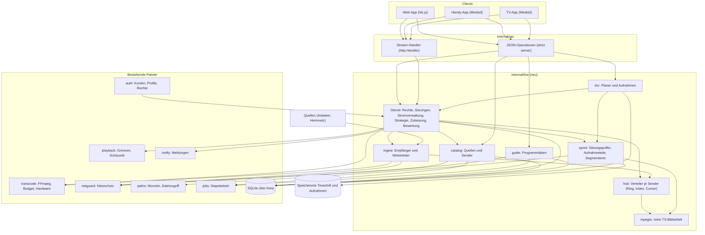
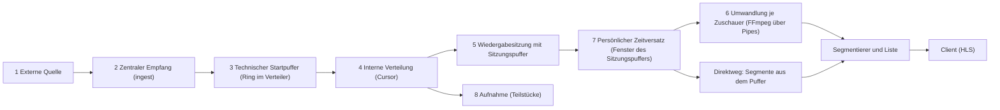
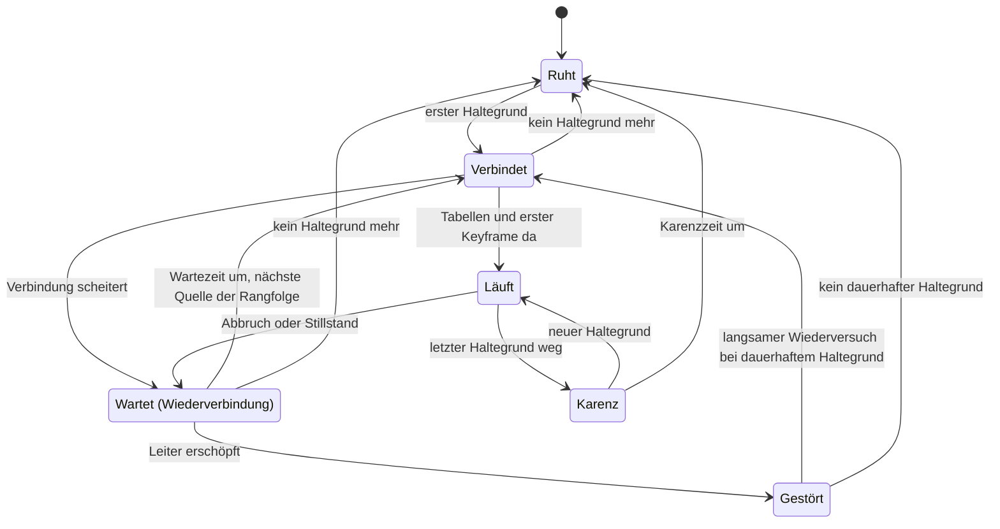

# Konzept 28 · Technische Architektur

Stand: 28. November 2026 · Fassung 1 · Status: Entwurf, nicht freigegeben

Dieses Dokument legt fest, wie Live-TV im bestehenden Go-Server gebaut wird: welche Bausteine es gibt,
wer wofür zuständig ist, wie die Daten fliessen und was bei Mangel und Fehlern geschieht. Die Einzelheiten
des Empfangs, der Verteilung und des schnellen Umschaltens stehen in `05-streaming-und-fast-zapping.md`.
Alles hier ist **spezifiziert**, nichts ist gebaut. Wo eine Aussage auf bestehendem Code beruht, steht
«gebaut» mit Datei und Zeile (Stand `origin/main` 1220769b, Server 1.44.1).

Kennungen: `T-n` tragende Entscheide (Abschnitt 2), `F-n` Fragen an dich (Abschnitt 12.3), `O-n` offene
technische Punkte (Abschnitt 12.2), `M-n` Messpunkte (Liste in `05`, Abschnitt 10). Die Nummern sind
vorläufig; der Koordinator führt sie in `20-offene-entscheidungen.md` zusammen.

## 1. Ziel und Grenzen

Der Server empfängt jeden Fernsehsender **höchstens einmal** von seiner Quelle, hält die letzten Sekunden im
Arbeitsspeicher bereit und gibt den Strom an beliebig viele Abnehmer weiter: an Zuschauer (jeder mit eigener
Sitzung, eigenem Zeitversatz-Puffer und, nur wenn nötig, eigener Umwandlung) und an Aufnahmen (unverändert
in Originalqualität). Das alles läuft **im einen Serverprozess** als neuer Dienst `live`, nach dem Muster des
Webradios (ein Relay je Sender: gebaut, `server/internal/radio/relay.go:20-24`), mit FFmpeg nur als kurzlebigem
Hilfsprozess. Es entsteht **kein** zweiter Container, kein zweites Benutzer-, Rechte-, Job- oder
Umwandlungssystem und keine externe Vermittlungssoftware.

Ausdrücklich **nicht** gebaut wird (Auftrag Abschnitt 16, wörtlich bindend): gemeinsamer Zeitversatz-Puffer,
serverweites Archiv, Catch-up, gemeinsam genutzte Umwandlungen, vorsorglich gestartete Umwandlungen, Mehrfachbild,
Tuner-Hardware, DRM-Umgehung, Verbindungslimits je Anbieter, automatische Übernahme von Aufnahmen in die
Bibliothek. Die Architektur bereitet nichts davon vor.

## 2. Tragende Entscheide

Jeder weitere Teil des Konzepts (Datenmodell, API, EPG, Timeshift, DVR, Sicherheit, Performance, Tests) baut
auf diesen Entscheiden auf. «Zu messen» nennt, was vor dem Bau belegt sein muss; die Messpunkte stehen in
`05`, Abschnitt 10.

Begriffe, einmal erklärt: **MPEG-TS** (kurz TS) ist das Transportformat des Fernsehens, ein Strom aus Paketen
zu 188 Byte. Ein **Keyframe** ist ein Bild, das ohne Vorgänger dekodiert werden kann; die Bilder von einem
Keyframe bis vor den nächsten heissen **Bildgruppe** (GOP). **HLS** ist das Abspielverfahren, das Slouchcat
schon nutzt: eine Wiedergabeliste mit kurzen Stücken (Segmenten), die der Player nacheinander holt.
**Umwandlung** (Transcoding) heisst neu kodieren; **Umpacken** (Remux) heisst nur die Verpackung wechseln.

| Nr. | Entscheid | Begründung | Verworfen | Zu messen |
|---|---|---|---|---|
| **T-1** | **Ein Dienst im Prozess.** Empfang, Verteilung, Sitzungen, Aufnahmen und der Aufnahme-Planer laufen als Dienst `live` im Serverprozess mit eigener Laufschleife, wie das Radio (`server/cmd/slouchcat/main.go:459-483`, `:569`). Das Jobsystem bekommt nur Stapelarbeit: Listen- und EPG-Import, Logos, Prüfungen ruhender Sender, Aufräumen. | Das Jobsystem tickt im Minutentakt, arbeitet mit Leases von 5 Minuten und bricht bei Pause ab (A3, Abschnitt 4): für sekundengenaue Starts und stundenlange Läufe ungeeignet. Das Radio zeigt den Weg für Langläufer. | Aufnahme als Job; eigener Prozess oder Container für Live-TV. | – |
| **T-2** | **Identität eines Eingangsstroms ist der Sender.** Je Sender läuft höchstens ein Eingangsstrom. Welche Quelle (Adresse, Zugangsdaten, Kopfzeilen) ihn gerade speist, ist ein Zustand dieses Stroms, kein Teil der Identität. | Erfüllt «einmal empfangen» (LTV-004) unabhängig davon, über welchen Zugang; verhindert eine zweite Verbindung beim Wechsel auf eine Ersatzquelle. Gleiche Sender aus zwei Listen werden in der Senderverwaltung zusammengeführt (LTV-006), nicht zur Laufzeit erraten. | Identität aus der normalisierten Adresse (teilt Ströme zwischen verschiedenen Sendern, bricht bei Token in der Adresse). | – |
| **T-3** | **Wer die Quelle holt: drei Wege.** **Weg G** (Go liest selbst): HTTP-TS, HLS mit TS-Segmenten, Xtream-Live, UDP, RTP, Multicast. **Weg W** (FFmpeg liest über den Go-Weiterleiter, siehe T-4): DASH, HLS mit fMP4-Segmenten oder getrennter Tonspur. **Weg L** (Go-Bibliothek liest): RTSP und RTMP, vorbehaltlich F-1. Jeder Weg liefert einen TS-Bytestrom an denselben Verteiler. | Go behält Wiederverbindung, Ersatzquellen, Fehlermeldungen und den Netzschutz in der Hand; FFmpeg als Dauerempfänger hat belegte Schwächen (Speicherwachstum nach 24 h, 33-Bit-Überlauf, R1 Abschnitt 5). Weg G deckt die üblichen IPTV-Quellen ab und braucht keinen Prozess. | Alles über FFmpeg (R3 H5): ein Dauerprozess je Sender, Adresse und Zugangsdaten in der Argumentliste, kein Netzschutz. Alles in Go (auch DASH): zu viel eigener Protokollcode. | M-10, M-11, M-12, M-23 |
| **T-4** | **Die Regel «FFmpeg sieht keine Adresse» (ADR 0025) gilt für Live-TV fort, verschärft formuliert:** FFmpeg bekommt nie eine Anbieter-Adresse, nie Zugangsdaten und nie eine Kopfzeile in die Argumentliste und öffnet keine Verbindung, die nicht Go gewählt und geprüft hat. Regelfall wie heute: nur `pipe:0` und `pipe:1` mit `-protocol_whitelist pipe` (gebaut für das Radio, `server/internal/transcode/radio.go:75-82`). **Eine benannte Ausnahme (Weg W):** FFmpeg darf HTTP sprechen, aber ausschliesslich zum Go-Weiterleiter auf `127.0.0.1`; die Quelle erscheint ihm unter einem Ersatznamen. | Hält Regel 10 (keine Geheimnisse in Logs und Prozesslisten) und den Auftrag 10.3 («auch indirekt abgerufene Adressen dürfen den Schutz nicht umgehen») ein. Einzelheiten und die Alternative stehen in `05`, Abschnitt 2.6. | FFmpeg öffnet die Quelle selbst mit `-protocol_whitelist` (kein Schutz gegen Weiterleitungen und Unterlisten; Zugangsdaten in `/proc/<pid>/cmdline`). | M-10 |
| **T-5** | **Netzschutz je Quelle.** Jede ausgehende Verbindung des Live-TV läuft über einen Go-Dialer mit Prüfung nach der Namensauflösung (gebaut: `server/internal/netguard/netguard.go:73-82`). Vorgabe je Quelle: nur öffentliche Adressen. Lokale Ziele nur, wenn der Administrator sie **für diese Quelle** freigibt. UDP, RTP und Multicast sind immer lokale Quellen und brauchen diese Freigabe. | Festgelegte Auslegung (Leitplanken Abschnitt 4): eng gefasste Ausnahme von «nichts im lokalen Netz», nur für Live-TV, nur durch den Administrator. | Globale Freigabe lokaler Ziele; Freigabe durch Konten. | M-16 |
| **T-6** | **Internes Verteilformat ist unveränderter MPEG-TS.** Je empfangenem Sender hält ein **Verteiler** im Arbeitsspeicher einen Ring aus TS-Paketen mit einem Verzeichnis der Keyframes (GOP-Index), den zuletzt gesehenen Programmtabellen (PAT/PMT) und einer fortlaufenden 64-Bit-Zeit. Es gibt keinen gemeinsamen Segmentvorrat. | TS ist das Format fast aller IPTV-Quellen, erhält alle Spuren (LTV-020), ist ohne Abschluss lesbar und lässt sich an Paketgrenzen schneiden. Aufnahme, Zeitversatz und Umwandlung bekommen denselben Rohstrom. | Gemeinsamer HLS-Segmentierer je Sender (R1 Variante B: nähert sich dem verbotenen gemeinsamen Puffer, schlechter Abzweig für Aufnahmen); fMP4 intern (verliert Teletext, DVB-Untertitel, MPEG-2). | M-13 |
| **T-7** | **Der technische Startpuffer ist dieser Ring und nichts sonst.** Er hält die letzten zwei vollständigen Bildgruppen und die laufende, hart begrenzt auf 15 Sekunden und 64 MiB je Sender (Konstanten im Code, nicht höher einstellbar). Er liegt im Arbeitsspeicher (siehe F-2). Lesen kann man ihn nur vorwärts ab «letzte vollständige Bildgruppen»; eine Leseschnittstelle nach Uhrzeit gibt es nicht. | Erzwingt technisch, was LTV-007 und LTV-013 verlangen: kein Zurückspulen vor das Einschalten, kein Archiv. | Startpuffer als Datei; einstellbare Länge über Minuten. | M-13 |
| **T-8** | **Am Verteiler hängen nur lokale Schreiber.** Abnehmer des Rings sind ausschliesslich Sitzungspuffer (T-10) und Aufnahmen (T-16), beide Go-Routinen, die auf Datenträger schreiben. Clients im Netz holen ihre Stücke per HTTP aus dem Sitzungspuffer. Der Empfang wartet nie auf einen Abnehmer; ein überrundeter Abnehmer bekommt eine Lücke und setzt am nächsten Keyframe fort. | Ein langsamer Client kann den Empfang und andere Zuschauer gar nicht erreichen (LTV-004 «Backpressure»). Die einzige Kopplung ist ein langsamer Datenträger, und die trifft nur den einen Abnehmer. | Push an Clients aus dem Ring (progressiver Strom): Rückstau über TCP bis in den Verteiler. | M-14 |
| **T-9** | **Eigener Sitzungstyp «Live-Sitzung».** Getrennt von `playback_sessions` (dort ist `item_id` Pflicht und zeigt auf `items`, A2 Abschnitt 1.3) und vom Radio. Eine Live-Sitzung gehört zu Anmeldung, Profil und Gerät; **Umschalten ist ein Vorgang innerhalb der Sitzung** («Einstellen» mit laufender Nummer), keine neue Sitzung. Dieselbe Sitzungsart spielt auch fertige Aufnahmen ab. | Keine Eingriffe in die Dateiwiedergabe; schnelles Umschalten ohne Neuanlage; Aufnahmen bleiben ausserhalb von `items` (Regel 2). | Sender als `items`; Wiederverwendung von `playback.Session`. | – |
| **T-10** | **Der persönliche Zeitversatz-Puffer liegt vor der Umwandlung.** Jede Live-Sitzung hat einen **Sitzungspuffer**: eine Kopie des Quell-TS ab dem Einstellen, in Stückdateien mit Verzeichnis, auf dem Speicherort «Timeshift». Er wird beim Umschalten, beim Sitzungsende und beim Serverstart gelöscht. Ohne Timeshift-Recht ist er derselbe Baustein mit einem festen Fenster von 60 Sekunden. | Spulen, Qualitäts- und Tonspurwechsel wirken auf die ganze Vergangenheit; die Umwandlung läuft nur für das, was jemand ansieht; gleiches Format wie Aufnahmeteile (R5 Abschnitt 2). Ein Baustein statt zwei. | Puffer nach der Umwandlung (alte Qualität bleibt, Umwandlung muss in der Pause weiterlaufen); gemeinsamer Vorrat mit Zeigern (verboten); Puffer erst ab der ersten Pause (widerspricht LTV-007). | M-14 |
| **T-11** | **Auslieferung als HLS je Sitzung mit TS-Segmenten; die Wiedergabeliste baut Go.** Jede Sitzung hat ihre eigene Liste über ihr eigenes Fenster. Kein LL-HLS, kein DASH, kein fortlaufender Strom in der ersten Stufe. Das ist eine **Empfehlung**, die M-3 bis M-5 bestätigen oder widerlegen; der Segmentierer ist die eine Stelle, an der ein zweites Segmentformat (fMP4) anschliessen kann. | HLS spielen alle drei Clients (hls.js, Safari, Media3); TS-Segmente brauchen im Direktweg keinen Prozess und keine Umrechnung; nur segmentbasierte Verfahren tragen Zeitversatz im Player (R2 Abschnitt 6). Vergleich in `05`, Abschnitt 4. | Ein Format fMP4 für alle (ein FFmpeg je Zuschauer auch ohne Umwandlung; MPEG-2, MP2 nicht einpackbar); fortlaufender TS-Strom (kein Zeitversatz, zweite Bibliothek im Web). | M-1, M-3, M-4, M-5 |
| **T-12** | **Direktweg ohne FFmpeg.** Passt der Strom zum Gerät, schneidet Go die Segmente an Keyframes aus dem Sitzungspuffer und setzt die Programmtabellen davor. Die Tonspurwahl geschieht durch Weglassen der anderen Ton-PIDs (PID: Kennung eines Teilstroms im TS) samt angepasster Tabelle, ausser das Gerät wählt Spuren selbst (`selectsTracks`, ADR 0041). | Keine unnötige Neukodierung (LTV-004), kein Prozessstart beim Umschalten, 20 Zuschauer desselben Senders kosten 20 kleine Schreiber statt 20 Prozesse. | Umpacken je Zuschauer durch FFmpeg als Regelfall. | M-1, M-3 |
| **T-13** | **Umwandlung je Sitzung durch genau einen FFmpeg, TS hinein, TS heraus, nur über Pipes.** Er liest aus dem Sitzungspuffer (nicht aus dem Ring) und schreibt TS, das derselbe Go-Segmentierer schneidet. Wiederverwendet werden Hardware-Erkennung (`server/internal/transcode/backend.go:140-223`), Videoketten je Backend (`pipeline.go:398`), Tonregeln (ADR 0041), Start und Beenden (`session.go:660-683`) und das Budget (`manager.go:104-115`). Neu ist nur eine eigene Argumentliste in `transcode/live.go`. **Unverändert** bleiben `playback.Decide`, `transcode.Plan`, `transcode.Session` und `ffmpegArgs`. | Kein zweites Umwandlungssystem; die fein abgestimmten Nähte der Dateiwiedergabe (ADR 0003) bleiben unberührt. Ein Segmentierer für beide Wege. | Live-Zweig in `transcode.Session` (gefährdet die Nähte); gemeinsame Umwandlung je Sender und Qualität (ausgeschlossen). | M-8, M-9 |
| **T-14** | **Der Server entscheidet je Sitzung zwischen Original, Ton-Umwandlung und Bild-Umwandlung** mit einer eigenen Funktion im Paket `live`, aus den gemeldeten Gerätefähigkeiten (ADR 0041, additiv erweitert), den Grenzen des Profils und den **gespeicherten Streamparametern** des Senders. Die Parameter kommen aus den Programmtabellen (Go) und einer Probe mit `ffprobe` über eine Pipe aus dem Ring; sie werden je Sender und Quelle gespeichert und bei geänderter Tabelle erneuert. | Regel 12; `playback.Decide` wird durch Vergleich ganzer Entscheide getestet (`decide.go:318-326`), neue Felder würden jede Dateiwiedergabe berühren. Gespeicherte Parameter sparen die Probe beim Umschalten. | Erweiterung von `playback.Decide`; Entscheid im Client. | M-7, M-8 |
| **T-15** | **Zeilensprung-Entfernung (Deinterlacing) ist ein neuer, abschaltbarer Baustein der Videokette**, nur von Live-TV eingeschaltet. Vorgabe: Der Server entfernt den Zeilensprung, ausser das Gerät meldet, dass es ihn sauber darstellt. | Fernsehen in 576i und 1080i ist häufig; heute gibt es im Server keinen solchen Filter (A2 Abschnitt 1.1), im Image sind sie vorhanden (M1: `bwdif`, `yadif`, `deinterlace_qsv`, `deinterlace_vaapi`, `bwdif_cuda`, `yadif_cuda`). | Immer durchreichen (Kammartefakte im Browser). | M-6, M-8 |
| **T-16** | **Die Aufnahme zweigt am Verteiler ab,** mit eigenem Cursor, unabhängig von jeder Sitzung. Go schreibt den Quell-TS des einen Programms unverändert in Teilstücke mit Verzeichnis auf den Speicherort «Aufnahmen». Kein FFmpeg, kein Umwandlungsbudget. Fertige Aufnahmen spielt der Live-Sitzungstyp ab (T-9). | LTV-008 und LTV-020: Originalqualität, unabhängig vom Zuschauer, möglichst keine zweite Eingangsverbindung. TS überlebt einen harten Abbruch (R5 Abschnitt 3). | Aufnahme aus einer Zuschauersitzung; Aufnahme über FFmpeg `-c copy`; Aufnahme als `items`. | M-14 |
| **T-17** | **Lebenszyklus über benannte Haltegründe.** Ein Eingangsstrom lebt, solange mindestens ein Haltegrund eingetragen ist (dauerhaft, Zeitplan, automatisch, Vorladen, Zuschauer, Aufnahme, Prüfung), danach noch eine Karenzzeit. Jeder Haltegrund ist ein Eintrag mit Art und Besitzer, kein blosser Zähler. Wiederverbindung nach fester Wartezeit-Leiter, Ersatzquellen in Rangfolge. Abschnitt 5. | Macht «wer hält diesen Strom?» jederzeit beantwortbar und Lecks auffindbar (LTV-004, LTV-002). | Reiner Referenzzähler. | M-12, M-15 |
| **T-18** | **Empfangsstrategie: vier Arten und Vorladen, Voreinstellung «bei Bedarf».** Dauerhafter Empfang, Zeitplan, automatisch und Vorladen sind je für sich einzuschalten; «automatisch» und «Vorladen» sind ab Werk **aus**. Abschnitt 6. | Jeder vorsorgliche Empfang ist eine weitere Verbindung zum Anbieter. Slouchcat kennt dessen Limit nicht (LTV-017), also darf es solche Verbindungen nicht ungefragt öffnen (siehe F-3). | Vorladen ab Werk an. | M-17 |
| **T-19** | **Ein Zulassungsort, vier Grössen.** Die Stromverwaltung im Paket `live` entscheidet über jeden neuen Empfang, Sitzungspuffer und jede Aufnahme gegen: Zahl der Eingangsströme, Byte-Budget der Ringe, Platz auf den Speicherorten, Umwandlungseinheiten. Die Umwandlungseinheiten sind das **bestehende** Budget (`transcode.Manager`), erweitert um eine Reservierung für Live-Sitzungen. Rangfolge in Abschnitt 8. | Ein einziges Zahlenbudget für Netz, Speicher und Encoder wäre falsch: es sind verschiedene Engpässe. Ein Ort mit einer Rangfolge erfüllt den Sinn von «ein Budget für alles». | Eigenes Budget für Live-Umwandlungen; kein Schutz der Dateiwiedergabe. | M-8, M-13, M-14 |
| **T-20** | **Empfang und Aufnahme laufen im Serverprozess, nicht in FFmpeg,** und sind damit von `nice 10` und `oom_score_adj 500` (gebaut: `server/internal/transcode/session.go:702-712`) nicht betroffen. FFmpeg-Empfänger des Wegs W starten in einer neuen Klasse «Empfang» ohne Zurückstufung. Umwandlungen für Zuschauer behalten die heutige Klasse. | Heute würde gerade der Empfänger unter Last zuerst Pakete verlieren und bei Speichermangel zuerst sterben (A2 Abschnitt 2.1). | Alle FFmpeg gleich behandeln. | M-12 |
| **T-21** | **Stream-Endpunkte tragen ein Token `lt`,** gebunden an Live-Sitzung und Einstell-Nummer (HMAC wie beim Radio, `server/internal/radio/token.go:11-30`; Schlüssel aus `secrets.Keyring.Derive("live-token")`). Jede Listen- und Segmentanfrage prüft Sitzung, Nummer und Recht. Nach dem Umschalten sind alte Adressen sofort ungültig (404). | Bestehende Token-Architektur (`st`, `rt`, `dt`); Player schicken bei Segmenten keine Sitzungs-Cookies zuverlässig mit (Safari, Media3). | Cookie-Prüfung an Segmenten; Token ohne Bindung an den Sender. | – |
| **T-22** | **Flüchtiges lebt im Arbeitsspeicher, Dauerhaftes in SQLite.** Flüchtig: Ringe, Verzeichnisse, Cursor, Haltegründe, Wartezeit-Zähler, Messwerte, Einstell-Nummern. In SQLite: Quellen, Sender, Strategie, gespeicherte Streamparameter, Zustand je Quelle (nur bei Wechsel geschrieben), Sitzungszeilen (Anlage, Ende, Berührung höchstens einmal je Minute), Nutzungszähler je Tag, Aufnahmen mit Teilen und Lücken. Abschnitt 4.2. | SQLite hat genau einen Schreiber (A3 Abschnitt 3); häufige Zustände würden Fortschritt, Jobs und Aufnahmen bremsen. | Zustand je Segment in der Datenbank; Redis oder ein zweiter Speicher. | – |
| **T-23** | **Statusänderungen kommen über Abfragen, nicht über einen neuen Push-Kanal.** Der Herzschlag der Sitzung (alle 10 Sekunden) liefert den Zustand zurück; der Player sieht Störungen ausserdem direkt an Liste und Segmenten. Die Verwaltung fragt wie heute ab. Kein SSE, kein WebSocket in der ersten Stufe. | Es gibt heute keinen Push-Kanal (A3 Abschnitt 6); ein neuer Mechanismus bräuchte Regeln für Proxys, Wiederverbindung und drei Clients. Für Umschalten und Störungen genügen 10 Sekunden plus die Signale im Strom. | SSE je Sitzung; WebSocket. | – |
| **T-24** | **Paketzuschnitt** nach Abschnitt 3.2: neues Paket `internal/live` mit Unterpaketen, eigenes sqlc-Paket `liveq` mit depguard-Riegel, alle Prozessstarts in `internal/transcode`, alle Dateizugriffe über `paths`, Stream-Endpunkte als `http.Handler`. Kein Live-Paket fasst `items`, `media_files` oder `tracks` an. | Regeln 2, 3, 4, 6 und das Muster `wishq` (`server/.golangci.yml`, Regel `wishq`). | Live-TV im Paket `radio` oder `playback`. | – |
| **T-25** | **Drei Speicherorte:** Startpuffer im Arbeitsspeicher (F-2); Sitzungspuffer in einem eigenen Ordner, ab Werk `<cache>/live/timeshift`, wahlweise ein anderer Ordner oder eine RAM-Disk; Aufnahmen in einer eigens eingehängten, schreibbaren Wurzel (Muster ADR 0029). Jeder Speicherort hat einen Zustand und eine Markerdatei; geschrieben wird nur relativ zu einer geprüften, geöffneten Wurzel. | LTV-019; ein nicht eingehängtes Netzlaufwerk darf nie zu Schreiben auf die lokale Platte führen (gebaut für Podcasts, A2 Abschnitt 7.4). | Aufnahmen im Cache; freie Pfadangabe ohne Prüfung. | M-14 |
| **T-26** | **Live-TV zählt zu den bestehenden Grenzen:** gleichzeitige Streams, Bitrate und Höhe je Konto und Profil sowie die tägliche Schauzeit. Die Zählung läuft über einen schmalen Haken im Paket `playback`, wie ihn das Radio für die Hörzeit hat (`server/internal/playback/limits.go:269`), und nutzt dieselbe Startsperre, damit eine Dateiwiedergabe und eine Live-Sitzung nicht beide den letzten Platz nehmen (`limits.go:147-201`). | Festgelegte Auslegung (Leitplanken Abschnitt 4); kein zweites Limit-System. | Getrennte Zählung für Live-TV. | – |

**Eine Klarstellung zu LTV-007, damit sie niemand überliest:** Das erste Bild einer Sitzung stammt aus dem
Startpuffer und liegt deshalb einige Sekunden **vor** dem Tastendruck (höchstens zwei Bildgruppen, hart
begrenzt nach T-7). Ohne das gäbe es kein sofortiges Bild, denn ein Decoder braucht einen Keyframe. Der
«Einschaltpunkt» im Sinn von LTV-007 ist der Anfang dieses ersten Segments; davor ist nichts kopiert und
nichts abrufbar. Das ist die Nutzung des Startpuffers, die LTV-007 und LTV-010 vorsehen, keine Abschwächung.

## 3. Komponenten

### 3.1 Die dreizehn Verantwortlichkeiten des Auftrags

Der Auftrag (Abschnitt 8) nennt dreizehn Verantwortlichkeiten und stellt ausdrücklich frei, sie zusammenzufassen.
Sieben davon werden zu drei Bausteinen; für «Vorladen», «Timeshift» und «Streamüberwachung» wären eigene
Bausteine Overengineering.

| Verantwortlichkeit (Auftrag) | Zuordnung | Begründung |
|---|---|---|
| Source Manager | `live/catalog` (neu) mit Jobs für den Abgleich | Quellen, Import, Aktualisierung; Stapelarbeit gehört ins Jobsystem. |
| Channel Registry | `live/catalog` (zusammengefasst) | Sender und ihre Quellzeilen sind dasselbe Datenmodell (Quellzeile n:1 Sender, R3 Abschnitt 2); zwei Bausteine hätten denselben Zustand. |
| Stream Manager | `live`: **Stromverwaltung** | Verzeichnis der laufenden Eingangsströme. |
| Stream Lifecycle Manager | `live`: Stromverwaltung (zusammengefasst) | Der Zustandsautomat **ist** die Verwaltung; getrennt gäbe es zwei Hüter desselben Zustands. |
| Stream Distributor | `live/hub`: **Verteiler** | Ring, Verzeichnis, Cursor. |
| Input Buffer Manager | `live/hub` (zusammengefasst) | Der Ring ist der Eingangspuffer; es gibt keinen zweiten. |
| Preload Manager | kein eigener Baustein: ein Haltegrund «Vorladen» und eine Regel in der Stromverwaltung | Vorladen ist nur «Empfang ohne Abnehmer mit Ablauf». |
| Playback Session Manager | `live`: **Sitzungen** (neuer Sitzungstyp, T-9) | Nicht `playback`, siehe T-9. |
| Timeshift Manager | kein eigener Baustein: `live/spool` (Sitzungspuffer) und die Sitzung | Zeitversatz ist eine Eigenschaft des Sitzungspuffers. |
| Recording Manager | `live/dvr` (neu) | Regeln, Termine, Aufnahmen, Aufbewahrung. |
| EPG Manager | `live/guide` (neu) mit Jobs für den Import | Unabhängig vom Strom: ein Ausfall des EPG darf die Wiedergabe nicht treffen (LTV-005). |
| Stream Health Monitor | kein eigener Baustein: Messwerte im Verteiler, Bewertung in der Stromverwaltung, Meldung über `notify` | Die Signale fallen beim Empfang ohnehin an. |
| Resource Manager | bestehend: `transcode.Manager` (Umwandlungseinheiten); dazu die Zulassung in der Stromverwaltung (T-19) | Kein zweites Budget. |

### 3.2 Paketliste

| Paket | Verantwortung | Öffentliche Schnittstelle (in Worten) | Hängt ab von |
|---|---|---|---|
| `internal/live` (neu) | Der Dienst: Rechteprüfung (drei Schalter, 404), Live-Sitzungen mit Token und Herzschlag, Stromverwaltung mit Haltegründen und Zustandsautomat, Empfangsstrategie und Vorladen, Zulassung, Bewertung der Streamgüte, Meldungen. | Für die API: Sender einstellen, Sitzung beenden, Herzschlag, Liste und Segment einer Sitzung, Qualität und Spur ändern. Für die Verwaltung: laufende Eingangsströme, Sitzungen ohne private Inhalte, Stopp. Für `auth` und `playback`: Sitzungen eines Kontos oder Profils beenden. Für `dvr`: Haltegrund «Aufnahme» setzen und lösen, Abnehmer anmelden. | `live/*`, `transcode`, `playback` (nur Grenzen und Schauzeit), `netguard`, `paths`, `secrets`, `notify`, `jobs`, `store/liveq`, `model`, `logging` |
| `internal/live/mpegts` (neu) | Reine TS-Bibliothek ohne Ein- und Ausgabe: Paketgrenzen finden, Programmtabellen lesen und neu schreiben, Zeitstempel entfalten, Keyframes erkennen, PIDs filtern, Zähler prüfen. | Zerlegen, Erkennen, Filtern, Schneiden. | nur Standardbibliothek |
| `internal/live/hub` (neu) | Verteiler je Sender: Ring, GOP-Index, Tabellen-Zwischenspeicher, Cursor, Messwerte. Kein Netz, keine Datenbank, keine Dateien. | Pakete annehmen; Abnehmer ab «letzte vollständige Bildgruppen» anmelden; nächstes Stück für einen Cursor; Messwerte lesen. | `live/mpegts` |
| `internal/live/ingest` (neu) | Empfänger je Protokoll (Wege G, W, L), der Go-Weiterleiter für Weg W, Wiederverbindung innerhalb einer Quelle, DRM-Erkennung. | Eine Quelle öffnen und TS an einen Verteiler liefern, bis Abbruch; Fehler als stabile Codes. | `live/mpegts`, `live/hub`, `netguard`, `transcode` (nur Weg W), `golang.org/x/net/ipv4` (schon Abhängigkeit, `server/go.mod:21`) |
| `internal/live/spool` (neu) | Stückdateien mit Verzeichnis für Sitzungspuffer und Aufnahmeteile; Segmentierer; Bau der Wiedergabeliste; Zustand der Speicherorte (Marker, Platz, Schreibfehler). | Schreiben ab einem Cursor; Segment nach Nummer lesen; Liste rendern; ältestes Stück verwerfen; Speicherort prüfen. | `live/mpegts`, `paths` |
| `internal/live/catalog` (neu) | Quellen, Listen-Import (M3U, Xtream), Sender mit stabiler Kennung, Ersatzquellen, Gruppen, Logos. Einzelheiten in `03`, `07`, `15`. | Sender und ihre Quellen in Rangfolge liefern; Zugangsdaten nur entschlüsselt im Speicher herausgeben. | `netguard`, `secrets`, `ratelimit`, `jobs`, `store/liveq` |
| `internal/live/guide` (neu) | Programmdaten: Import, Zuordnung, Abfragen. Einzelheiten in `09`. | Jetzt und danach je Sender; Raster; Suche. | `netguard`, `jobs`, `store/liveq` |
| `internal/live/dvr` (neu) | Regeln, Termine, sekundengenauer Planer im Prozess, Aufnahmen mit Teilen und Lücken, Aufbewahrung, Kontingent. Einzelheiten in `11`. | Termin anlegen, ändern, absagen; laufende und fertige Aufnahmen eines Profils; Wiederaufnahme nach Neustart. | `live` (Haltegrund, Abnehmer), `live/spool`, `paths`, `notify`, `store/liveq` |
| `internal/store/liveq` (neu, erzeugt) | sqlc-Paket aller Live-TV-Tabellen. | – | nur von `internal/live/**` und `internal/store/**` importierbar (depguard, Muster `wishq`) |
| `internal/transcode` (erweitert) | Neue Datei `live.go`: Argumentlisten und Prozesshüllen für (a) Umwandlung einer Live-Sitzung, (b) FFmpeg-Empfänger des Wegs W, (c) Probe über Pipe. Erweiterung des Budgets um eine Reservierung für Live. Baustein «Zeilensprung» in der Videokette. | Live-Umwandler starten (Schreiben hinein, Lesen heraus); FFmpeg-Empfänger starten; Probe aus Bytes; Einheiten reservieren und freigeben. | wie heute; **importiert `live` nicht** |
| `internal/netguard` (erweitert) | Prüfregel je Quelle (öffentlich oder lokal freigegeben), auch für UDP-Adressen und Multicast-Gruppen. | Dialer-Kontrolle mit Regel; Adresse prüfen. | – |
| `internal/playback` (minimal erweitert) | Ein Haken: Live-Sitzungen zählen bei den Stream-Grenzen und bei der Schauzeit mit; `live` darf einen Platz unter derselben Startsperre reservieren. | Platz reservieren und freigeben; Schauzeit melden. | – |
| `internal/api` (erweitert) | JSON-Operationen über den erzeugten strict server; Stream-Handler als `http.Handler` (Liste, Segment, Logo). Einzelheiten in `08`. | – | `live` |
| `internal/logging` (erweitert) | Neue Muster in der Schwärzung, Abschnitt 10.4. | – | – |
| `internal/admin`, `internal/auth`, `internal/jobs`, `internal/notify` (angeschlossen) | Übersicht und laufende Streams; Haken beim Entzug von Rechten und beim Löschen; neue Jobarten; neue Ereignisse. | – | – |

Abhängigkeitsregeln, die der Bau als Lint oder Test festhält: `mpegts` und `hub` kennen weder Netz noch
Datenbank noch Dateien (dadurch mit feindlichen Eingaben prüfbar, Vorbild `radio/hostile_test.go`); `os/exec`
bleibt in `transcode` (Regel 3, `server/.golangci.yml`, Regel `os-exec`); `live` importiert `systemq` nicht
(depguard `systemq` lässt es ohnehin nicht zu).

### 3.3 Komponentendiagramm

## 4. Datenfluss in acht Ebenen

### 4.1 Die Ebenen

Die Reihenfolge im Bild weicht bewusst von der Aufzählung des Auftrags ab: Der persönliche Zeitversatz (7)
liegt **vor** der Umwandlung (6). Das ist der Entscheid T-10.

| Ebene | Format | Besitzer | Lebensdauer | Speicherort | Grenze |
|---|---|---|---|---|---|
| 1 Externe Quelle | HTTP-TS, HLS, DASH, RTSP, RTMP, UDP, RTP, Multicast | Anbieter oder Gerät im Heimnetz | – | – | Regel je Quelle (T-5); Verbindungslimit des Anbieters, das Slouchcat nicht kennt (F-3) |
| 2 Zentraler Empfang | TS-Bytestrom, ein Programm | `live/ingest`, je Sender einer | solange der Eingangsstrom lebt (T-17) | Arbeitsspeicher (Lesepuffer) | Obergrenze gleichzeitiger Eingangsströme; Stillstandsfrist; Grösse von Listen und Segmenten bei HLS |
| 3 Technischer Startpuffer | TS-Pakete im Ring, GOP-Index, letzte Programmtabellen | Verteiler des Senders, **keinem Zuschauer** zugeordnet | wie Ebene 2; Inhalt höchstens 15 Sekunden alt | Arbeitsspeicher des Prozesses (F-2) | 15 s und 64 MiB je Sender hart; Byte-Budget über alle Ringe |
| 4 Interne Verteilung | Cursor auf den Ring, nur vorwärts | Verteiler; je Abnehmer ein Cursor | wie der Abnehmer | Arbeitsspeicher | Abnehmer nur Sitzungspuffer und Aufnahmen (T-8); überrundeter Cursor springt zum nächsten Keyframe |
| 5 Wiedergabesitzung | Sitzungszeile, Token, Einstell-Nummer, Entscheid | `live` (Sitzungen), gehört Profil und Gerät | bis Stopp, Abmelden, Entzug, Ablauf (60 s ohne Anfrage und ohne Herzschlag) oder Neustart | Arbeitsspeicher, Zeile in SQLite | Stream-Grenzen und Schauzeit (T-26) |
| 6 Umwandlung je Zuschauer | TS hinein, TS heraus (H.264 und AAC oder kopierte Spuren) | die Sitzung; ein FFmpeg-Prozess | nur solange Segmente geholt werden; endet 60 s nach der letzten Anfrage (Vorbild `server/internal/transcode/manager.go:22`) | Pipes; Ausgabestücke neben dem Sitzungspuffer, höchstens 5 Minuten | Umwandlungseinheiten (T-19); nie ohne Zuschauer |
| 7 Persönlicher Zeitversatz | Stückdateien mit Quell-TS und Verzeichnis | die Sitzung, ein Profil | vom Einstellen bis zum Umschalten oder Sitzungsende; gelöscht beim Serverstart | Speicherort «Timeshift» (T-25) | Höchstdauer der Verwaltung; Deckel über alle Sitzungspuffer; ohne Recht 60 s |
| 8 Aufnahme | Teilstücke mit Quell-TS des einen Programms, Verzeichnis je Teil | `live/dvr`, gehört einem Profil | bis das Profil löscht oder die Aufbewahrung greift | Speicherort «Aufnahmen» (T-25) | Kontingent je Konto, Mindestreserve, Obergrenze gleichzeitiger Eingangsströme |

### 4.2 Flüchtig oder dauerhaft

| Zustand | Wo | Bemerkung |
|---|---|---|
| Ringe, GOP-Index, Cursor, Messwerte der Streamgüte | Arbeitsspeicher | nach Neustart leer |
| Haltegründe, Zustand des Automaten, Wartezeit-Zähler, Quarantäne einer Quelle | Arbeitsspeicher | dauerhafte Haltegründe entstehen beim Start neu aus der Strategie |
| Live-Sitzung: Token-Bindung, Einstell-Nummer, Abspielstand, Verzeichnis des Sitzungspuffers | Arbeitsspeicher | Sitzungen überleben keinen Neustart (wie Radio, `server/internal/radio/listen.go:62-72`) |
| Live-Sitzung: Zeile mit Konto, Profil, Gerät, Sender, Beginn, Ende, Grund des Endes | SQLite | für Grenzen, Verwaltung und Schauzeit; Berührung höchstens einmal je Minute |
| Quellen, Sender, Rangfolge, Strategie, Zeitpläne | SQLite | `07-datenmodell.md` |
| Gespeicherte Streamparameter je Sender und Quelle (Codecs, Grösse, Bildrate, Zeilensprung, Spuren, gemessene Bildgruppen-Länge, Bitrate) | SQLite | geschrieben bei Probe und bei geänderter Tabelle, nie fortlaufend |
| Zustand je Quelle (in Ordnung, gestört seit, Zugang prüfen, DRM) | SQLite | nur bei Wechsel geschrieben |
| Nutzung je Sender und Tag (für «automatisch») | SQLite | eine Zeile je Profil, Sender und Tag, gezählt ab 30 s Sehdauer |
| Aufnahmen, Teile, Lücken, Regeln, Termine | SQLite | Fortschritt eines Teils alle 10 Sekunden (R5 Abschnitt 4.3) |

Regel für alle Schreiber: nie eine lange Transaktion. Importe schreiben in Stapeln von höchstens 500 Zeilen
(bestehende Jobregel, A3 Abschnitt 3), damit Sitzungs- und Aufnahmezeilen nicht auf den einen Schreiber warten.

## 5. Lebenszyklus eines Eingangsstroms

### 5.1 Zustandsautomat

### 5.2 Haltegründe

Ein Haltegrund ist ein Eintrag `(Art, Besitzer)` am Eingangsstrom. Der Strom lebt, solange es mindestens einen
gibt. Die Stromverwaltung gleicht die Einträge einmal je Minute mit ihren Besitzern ab: Ein Eintrag, dessen
Besitzer nicht mehr existiert, wird entfernt und als Fehler protokolliert. So bleibt bei häufigem Umschalten
nichts hängen (Auftrag Abschnitt 21, Punkt 8).

| Art | Besitzer | Entsteht | Endet | Geschützt bei Mangel (Abschnitt 8) |
|---|---|---|---|---|
| dauerhaft | der Sender | Strategie «dauerhaft»; beim Serverstart | Strategie geändert, Sender deaktiviert | nein, weicht Abnehmern (F-4) |
| Zeitplan | der Zeitplan-Eintrag | Beginn des Fensters; beim Serverstart, wenn im Fenster | Ende des Fensters | nein, weicht Abnehmern (F-4) |
| automatisch | die Regel aus Abschnitt 6.2 | Sender gehört zu den meistgenutzten und jemand schaut gerade Live-TV | 10 Minuten nach der letzten Live-Sitzung im Haushalt | nein |
| Vorladen | die Live-Sitzung, die umschaltet | Nachbarsender nach Abschnitt 6.3 | 3 Minuten nach dem letzten Umschalten oder Sitzungsende | nein, fällt zuerst |
| Zuschauer | die Live-Sitzung | Einstellen | Umschalten, Stopp, Entzug, Ablauf | **ja** |
| Aufnahme | die Aufnahme | Vorlauf (Öffnen 30 s vor Beginn) | Ende mit Nachlauf, Absage, Kontingent | **ja** |
| Prüfung | der Prüfjob | Verfügbarkeitsprüfung eines ruhenden Senders | nach höchstens 10 Sekunden | nein |

Ein pausierter Zuschauer hält den Strom weiter, denn sein Sitzungspuffer füllt sich (wie beim Radio: «pausierte
Hörer zählen», ADR 0025 Punkt 3). Jeder Zeitversatz-Puffer ist damit über den Haltegrund «Zuschauer» seiner
Sitzung abgedeckt; einen eigenen Haltegrund «Timeshift» braucht es nicht.

### 5.3 Regeln

**Start.** Der erste Haltegrund startet den Empfang mit der ranghöchsten Quelle, die nicht in Quarantäne ist.
Der Strom gilt als «läuft», sobald Programmtabellen und der erste Keyframe im Ring liegen. Die Zulassung
(T-19) wird vor dem Start geprüft.

**Gleichzeitige Anfragen.** Das Verzeichnis der Eingangsströme hat eine Sperre; «suchen oder anlegen» ist ein
Schritt unter dieser Sperre, mit zweiter Prüfung nach dem Lesen der Quellen. Ein Strom, dem gerade jemand
beitritt, trägt einen Beitrittszähler, damit ihn die Aufräumschleife nicht zwischen «gefunden» und «Haltegrund
eingetragen» beendet. Beides ist für das Radio gebaut (`server/internal/radio/listen.go:232-271`, `:280-300`).
Zwanzig gleichzeitige Anfragen auf denselben Sender ergeben einen Eingangsstrom und zwanzig Haltegründe.

**Wiederverbindung.** Bricht die Quelle ab oder steht sie still (Abschnitt 9), folgen Versuche nach der
Wartezeit-Leiter 1, 2, 5, 10, 20 Sekunden (gebaut für das Radio, `relay.go:53-62`). Jeder Versuch nimmt die
nächste Quelle der Rangfolge, die nicht in Quarantäne ist. Eine Verbindung, die wieder Daten bis zu einem
Keyframe liefert, setzt die Leiter zurück; eine, die verbindet, aber nichts Brauchbares liefert, zählt als
Fehlversuch (gebaut, `relay.go:220-228`). Nach der letzten Stufe:

- Gibt es nur Haltegründe auf Abruf (Zuschauer, Vorladen, automatisch, Prüfung), endet der Strom mit einem
  Fehlercode. Zuschauer sehen eine verständliche Meldung und können neu einstellen. Kein weiterer Versuch von
  selbst.
- Gibt es einen dauerhaften Haltegrund (dauerhaft, Zeitplan, laufende Aufnahme), wechselt der Strom in
  «gestört» und versucht es in festen, langen Abständen weiter: nach 60 Sekunden, dann alle 5 Minuten, ab der
  ersten Stunde alle 15 Minuten. Das ist eine begrenzte Rate und keine Schleife; die Zähler stehen in der
  Verwaltung. Nach 10 Minuten Ausfall geht eine Meldung an den Administrator (Abschnitt 10.2).

Fehler, die Wiederholen nicht heilt, beenden die Versuche **für diese Quelle**: abgelehnter Zugang (401, 403),
erkanntes DRM, verschlüsselter Strom. Die Quelle bekommt den Zustand «Zugang prüfen» oder «DRM» und wird
übersprungen, bis der Administrator sie ändert oder die Liste sie neu liefert.

**Ersatzquelle und Rückkehr.** Der Wechsel auf eine Ersatzquelle ist ein Wiederverbinden mit anderer Quelle im
selben Eingangsstrom, also ohne zweite Verbindung. Im Verteiler beginnt ein neuer **Zeitabschnitt**: Abnehmer
bekommen eine Diskontinuität, Aufnahmen einen neuen Teil. Eine gescheiterte Quelle kommt in Quarantäne
(30 Sekunden, 5 Minuten, 30 Minuten, zurückgesetzt nach einem Erfolg), damit zwei schlechte Quellen nicht im
Sekundentakt wechseln. Zurück zur ranghöheren Quelle geht es:

1. beim nächsten Start des Senders (immer zuerst die Hauptquelle);
2. bei laufendem Strom **ohne** Zuschauer und Aufnahme (nur dauerhaft, Zeitplan, automatisch) frühestens nach
   10 Minuten, durch Neuverbinden;
3. bei laufendem Strom mit Zuschauer oder Aufnahme nie von selbst, nur auf Befehl des Administrators, denn jeder
   Wechsel ist für Zuschauer sichtbar.

Eine Probeverbindung zur Hauptquelle neben dem laufenden Strom gibt es nicht: Sie wäre eine zweite Verbindung
zum Anbieter.

**Freigabe.** Fällt der letzte Haltegrund weg, läuft der Strom eine Karenzzeit weiter: 30 Sekunden nach einem
Zuschauer (wer zurückschaltet, findet den Sender noch), keine nach einer Prüfung. Danach schliesst der Empfänger
die Verbindung, der Ring wird freigegeben, das Byte-Budget zurückgebucht. Ein FFmpeg-Empfänger (Weg W) bekommt
SIGTERM und nach 2 Sekunden SIGKILL (gebaut, `server/internal/transcode/session.go:646-658`).

**Serverneustart.** Beim Start, in dieser Reihenfolge: (1) Speicherort «Timeshift» leeren, nur Ordner mit
eigenem Marker; offene Live-Sitzungen der letzten Laufzeit als beendet eintragen (Grund «Neustart»). (2)
Aufnahmen im Zustand «läuft» prüfen: Liegt das geplante Ende noch in der Zukunft, sofort weiter aufnehmen mit
neuem Teil und einer Lücke «Server lief nicht»; sonst als unvollständig abschliessen (`11-dvr.md`). (3)
Dauerhafte Sender und Sender in einem laufenden Zeitfenster starten, gestaffelt mit höchstens zwei Starts je
Sekunde, damit weder der Anbieter noch der Server einen Schwall bekommt. (4) «Automatisch» und «Vorladen»
entstehen nicht beim Start, sondern aus der Nutzung.

**Herunterfahren.** Der Server wartet heute bis 10 Sekunden auf laufende Anfragen
(`server/cmd/slouchcat/main.go:68`). Innerhalb dieser Frist schliesst `live` die Aufnahmeteile (Daten auf den
Datenträger, Stand in SQLite) und beendet die FFmpeg-Prozesse. Damit Docker nicht vorher abschneidet, bekommt
die Compose-Datei eine längere Stoppfrist (Abschnitt 10.6).

## 6. Empfangsstrategie (LTV-002)

### 6.1 Arten und Geltung

Es gibt eine **Vorgabe für alle Sender** und eine **Einstellung je Sender**, die die Vorgabe überschreibt.

| Art | Bedeutung | Haltegrund |
|---|---|---|
| bei Bedarf (Vorgabe ab Werk) | Empfang startet, wenn jemand einstellt oder eine Aufnahme ihn braucht. | Zuschauer, Aufnahme |
| dauerhaft | Empfang rund um die Uhr, auch ohne Zuschauer. Kein Aufzeichnen (LTV-013): nur der Ring läuft. | dauerhaft |
| zeitgesteuert | Empfang in Zeitfenstern, die der Administrator je Sender festlegt (Wochentage, Beginn, Ende, in der Zeitzone des Servers). | Zeitplan |
| automatisch | Der Server hält viel genutzte Sender bereit, solange jemand Live-TV schaut (6.2). | automatisch |

Dazu kommt das **Vorladen** von Nachbarsendern (6.3), das unabhängig von der Art eines Senders wirkt. Jede
Quelle hat zwei Schalter «Vorladen erlaubt» und «automatischer Empfang erlaubt», ab Werk aus (T-18).

### 6.2 Die Regel für «automatisch»

In einem Satz, so wie sie in der Verwaltung stehen soll: **«Solange jemand im Haushalt Live-TV schaut, hält
der Server die meistgenutzten Sender der letzten 14 Tage bereit, und noch 10 Minuten danach.»**

Genau:

1. Rangliste über alle Sender mit der Art «automatisch»: zuerst die Favoriten der Profile, die gerade schauen;
   danach nach der Zahl der Tage in den letzten 14 Tagen, an denen der Sender mindestens 30 Sekunden lief
   (über alle Profile); bei Gleichstand der zuletzt gesehene zuerst.
2. Bereitgehalten werden die ersten **N** Sender dieser Liste. N ist einstellbar von 0 bis 20, ab Werk 0
   (aus); empfohlener Wert beim Einschalten: 5.
3. Der Haltegrund entsteht mit der ersten Live-Sitzung und endet 10 Minuten nach der letzten.
4. Die Liste wird höchstens einmal je Minute neu berechnet; ein Sender, der aus der Liste fällt, verliert den
   Haltegrund mit der normalen Karenz.

Die Regel läuft nie rund um die Uhr (das ist «dauerhaft») und startet nie eine Umwandlung.

### 6.3 Vorladen und Freigabe

Vorladen heisst: Der Eingangsstrom eines Nachbarsenders läuft in seinen Ring, ohne Sitzungspuffer und ohne
Umwandlung. Welche Sender, wie viele und wie lange, steht in `05`, Abschnitt 6. Hier die harten Grenzen:

| Grenze | Wert ab Werk | Bereich |
|---|---|---|
| Vorladen je Sitzung | 0 (aus); empfohlen beim Einschalten 2 | 0 bis 4 |
| Vorgeladene Sender insgesamt | 4 | 0 bis 16 |
| Automatisch bereitgehaltene Sender (N) | 0 (aus) | 0 bis 20 |
| Eingangsströme insgesamt | 8 | 1 bis 200 |
| Byte-Budget aller Ringe | 512 MB | 64 MB bis 8 GB |

Alle Werte sind **Annahmen** als Startwerte und werden nach M-13 und M-17 festgelegt. Vorladen und «automatisch»
zählen zur Obergrenze der Eingangsströme und sind die ersten, die bei Mangel weichen (Abschnitt 8.2).
Vorsorgliche Umwandlung gibt es in keinem Fall (LTV-010, Auftrag Abschnitt 16).

## 7. Individuelle Umwandlung (LTV-004)

### 7.1 Entscheid je Sitzung

Die Funktion im Paket `live` (T-14) bekommt: Streamparameter des Senders, Fähigkeiten des Geräts, wirksame
Grenzen des Profils, gewünschte Tonspur, Untertitel und Qualität. Sie liefert einen von drei Wegen und einen
stabilen Grund (Muster der Gründe: `server/internal/playback/decide.go`).

| Weg | Wann | Was läuft | Kosten im Budget |
|---|---|---|---|
| **Original** | Bild und Ton passen zum Gerät, Höhe und Bitrate liegen in den Grenzen, keine Qualität unter der Quelle gewählt. | nur Go (T-12) | keine |
| **Ton-Umwandlung** | Bild passt, Ton nicht (häufig: MP2, AC-3 oder AAC-LATM im Browser). | FFmpeg mit kopiertem Bild und neu kodiertem Ton | 0,5 (wie Umpacken heute, `server/internal/transcode/plan.go:109-124`) |
| **Bild-Umwandlung** | Codec passt nicht (MPEG-2, HEVC ohne Unterstützung), Zeilensprung und das Gerät meldet keine saubere Darstellung, Grenze für Höhe oder Bitrate, gewählte Qualität, einzubrennende Untertitel, HDR ohne HDR-Gerät. | FFmpeg mit Videokette des Backends | wie heute nach Ausgabegrösse (1,5 bis 6), Zuschlag für Zeilensprung auf der CPU nach M-8 |

Die Geräte melden ihre Fähigkeiten wie bei der Dateiwiedergabe. Für Live-TV kommen **additive** Angaben dazu
(Vertrag und Einzelheiten in `08` und `16`): Videocodec `mpeg2video`; Toncodecs `mp2` und `aac_latm`; ein Feld
«stellt Zeilensprung sauber dar»; Untertitelformate `dvb_subtitle` und `dvb_teletext`. Fehlt eine Angabe, gilt
die vorsichtige Annahme (H.264 ohne Zeilensprung, AAC), wie heute bei fehlenden Fähigkeiten
(`decide.go`, `defaultCapabilities`).

### 7.2 Bild

- **Kopieren** bei H.264 ohne Zeilensprung für alle Clients; bei HEVC, MPEG-2 und Zeilensprung nur, wenn das
  Gerät es meldet. Ob HEVC in TS-Segmenten auf Apple-Geräten und in hls.js spielt, ist offen (M-3, M-5); bis
  dahin wird HEVC für diese Clients umgewandelt (O-3).
- **Umwandeln** auf H.264 nach der bestehenden Leiter der Qualitätsstufen (`transcode.Rungs`), mit der
  bestehenden Videokette je Backend (NVENC, QSV, VAAPI, Software; `pipeline.go:398`) und dem bestehenden
  Tonemapping.
- **Zeilensprung** (T-15): vor dem Skalieren ein Filter je Backend. Vorgesehen, nach M-8 zu bestätigen: Software
  `bwdif`, QSV `deinterlace_qsv`, VAAPI `deinterlace_vaapi`, NVENC `bwdif_cuda`. Ausgabe mit der Bildrate der
  Quelle (aus 50 Halbbildern werden 25 Bilder); die doppelte Bildrate ist eine spätere Option (O-4).
- **Hardware und Software-Rückfall** wie heute: Das Backend steht beim Serverstart fest (`backend.go:140-223`);
  ein Codec, den die Hardware nicht dekodiert, wird in Software dekodiert und in Hardware kodiert
  (`pipeline.go`, `hwDecodable`). Live-TV führt keinen neuen Rückfall zur Laufzeit ein.

### 7.3 Ton

Regeln aus ADR 0041, angewandt auf TS als Ausgabe: AAC wird kopiert; AC-3 und E-AC-3 werden kopiert, wenn das
Gerät sie meldet, sonst neu kodiert (Stereo-AAC, oder Mehrkanal nach `maxAudioChannels`); MP2 und AAC-LATM
werden kopiert, wenn das Gerät sie meldet, sonst zu AAC. Ein Sender **ohne** Tonspur ist ein gültiger Fall:
Der Entscheid kennt «kein Ton», die Überwachung meldet ihn nicht als Fehler (`05`, Abschnitt 9).

### 7.4 Untertitel

| Quelle | Gerät zeichnet selbst (gemeldet) | Gerät zeichnet nicht |
|---|---|---|
| DVB-Untertitel (Bilder) | PID wird durchgereicht | auf Wunsch einbrennen (Bild-Umwandlung, bestehende Überlagerung `pipeline.go`, `overlayGraph`) |
| Teletext-Untertitel | PID wird durchgereicht | erste Stufe: nicht angeboten; Umsetzung nach WebVTT ist O-5 (`libzvbi` ist im Image, M1) |
| Untertitel im Bildstrom (CEA-608/708) | bleiben im Bild, der Player zeigt sie | bleiben im Bild |

Aufnahmen behalten immer alle Spuren (T-16); diese Tabelle betrifft nur die Wiedergabe.

### 7.5 Qualitätswechsel, Spurwechsel, Pause

- **Qualität oder Tonspur ändern** erzeugt eine neue **Ausgabe-Generation** derselben Sitzung: FFmpeg startet
  an der aktuellen Stelle des Sitzungspuffers neu (oder endet, wenn der neue Entscheid «Original» ist), der
  Client lädt die Liste neu und setzt an derselben Uhrzeit fort. Der Sitzungspuffer bleibt, der Zeitversatz
  geht nicht verloren. Das ist der Hauptgrund für T-10.
- **Pause im Direktweg:** Es läuft nichts ausser dem Schreiber des Sitzungspuffers. Die Liste wächst weiter.
- **Pause mit Umwandlung:** Go gibt FFmpeg nur so viel Eingang, wie der Client abholt, plus einen Vorlauf von
  drei Segmenten. Holt der Client nichts mehr, blockiert FFmpeg beim Lesen und braucht keine Rechenzeit. Nach
  60 Sekunden ohne Anfrage endet der Prozess und gibt seine Einheiten frei; beim Fortsetzen startet er an der
  Stelle neu und bekommt seine Einheiten ohne Warten zurück (Grundsatz wie heute, `manager.go:70-75`).
- **Spulen mit Umwandlung:** Eine Anfrage nach einem Segment ausserhalb des Erzeugten startet FFmpeg an dieser
  Stelle neu (Suchmodell der Dateiwiedergabe, ADR 0003). Ob die Segmente verschiedener Läufe nahtlos
  aneinanderpassen, klärt M-9; der Rückfall steht in `05`, Abschnitt 4.5.
- **Fällt die Abspielstelle aus dem Fenster** (Pause länger als die Höchstdauer), setzt die Wiedergabe am
  Fensteranfang fort; der Client zeigt das an.

## 8. Ressourcenverwaltung und Überlast

### 8.1 Vier Grössen, ein Ort

| Grösse | Was sie schützt | Wer zählt | Heute |
|---|---|---|---|
| Eingangsströme (Anzahl) | Bandbreite, Verbindungen, Prozesszahl des Wegs W | Stromverwaltung | neu |
| Ring-Bytes | Arbeitsspeicher | Stromverwaltung, Reservierung beim Start wie beim Radio (`server/internal/radio/buffer.go:67-70`, `listen.go:245-254`) | neu, Muster gebaut |
| Platz je Speicherort | Datenträger: Deckel über alle Sitzungspuffer, Mindestreserve, Kontingent je Konto | `live/spool` und `live/dvr` | neu |
| Umwandlungseinheiten | CPU und GPU | `transcode.Manager` | gebaut: Budget je Backend, Warteschlange, Verdrängung von Downloads (`manager.go:176-261`, `download.go:207-246`) |

Der Umwandlungs-Manager bekommt eine Reservierung für Live-Sitzungen mit denselben Regeln wie eine
Dateiwiedergabe: bis 10 Sekunden warten in Ankunftsreihenfolge, dann «ausgelastet»; Offline-Downloads werden
verdrängt, neueste zuerst. Empfang (Weg G) und Aufnahme brauchen **keine** Einheiten, weil sie nichts kodieren.
Ein FFmpeg-Empfänger des Wegs W zählt mit 0,5 Einheiten und ist nicht verdrängbar.

**Schutz der Dateiwiedergabe.** Live-Umwandlungen dürfen zusammen höchstens einen einstellbaren Anteil des
Budgets belegen, ab Werk die Hälfte. Damit bleibt immer Platz für Filme und Serien, auch wenn viele Zuschauer
fernsehen. Empfang und Aufnahme belasten das Budget nicht. Was Live-TV sonst kostet (Schreiblast der
Sitzungspuffer auf demselben Datenträger wie der Umwandlungs-Cache), ist zu messen (M-14).

### 8.2 Rangfolge bei Mangel

Fehlt eine Grösse, gibt die Stromverwaltung in dieser Reihenfolge frei, bis es reicht:

1. Vorgeladene Sender (jüngster zuerst).
2. Automatisch bereitgehaltene Sender (hinterster der Rangliste zuerst).
3. Laufende Prüfungen ruhender Sender.
4. Offline-Downloads, die Umwandlungseinheiten halten (bestehende Verdrängung), und zurückstellbare
   Hintergrundjobs (bestehende Rücksicht auf CPU-Last, `manager.go:371-410`).
5. Zeitgesteuerter und dauerhafter Empfang **ohne Abnehmer** (niedrigste Kanalnummer zuletzt). Sie starten von
   selbst wieder, sobald Platz ist. Das ist eine echte Weiche: F-4.
6. Reicht es dann nicht: Die **neue** Anforderung wird abgelehnt (Zuschauer: verständliche Meldung «Der Server
   ist ausgelastet»; Aufnahme: siehe F-5).

**Nie** freigegeben werden: Eingangsströme mit Zuschauer oder laufender Aufnahme, laufende Umwandlungen einer
aktiven Sitzung, laufende Aufnahmen.

### 8.3 Einzelne Engpässe

| Engpass | Verhalten |
|---|---|
| Datenträger «Timeshift» voll oder Deckel erreicht | Der grösste Sitzungspuffer wird von hinten gekürzt, nicht der neueste Zuschauer bestraft (R5 Abschnitt 1.3). Reicht das nicht, bekommen neue Sitzungen nur das Mindestfenster von 60 Sekunden. Live läuft weiter. |
| Datenträger «Aufnahmen» voll oder Reserve unterschritten | Laufender Teil wird geschlossen, Lücke «Speicher voll», Wiederaufnahme mit neuem Teil, sobald Platz ist. Neue Aufnahmen starten nicht. Meldung. |
| CPU oder GPU ausgelastet | Neue Umwandlungen warten bis 10 Sekunden, dann Ablehnung. Laufende Umwandlungen, die langsamer als Echtzeit sind, fallen hinter die Live-Kante zurück (ihr Eingang liegt im Sitzungspuffer, es geht nichts verloren); nach 30 Sekunden Rückstand meldet die Sitzung «zu langsam» und schlägt eine tiefere Qualität vor. |
| Arbeitsspeicher knapp | Ringe sind vorab reserviert und wachsen nicht über ihr Budget. Das Betriebssystem beendet bei Not zuerst FFmpeg-Umwandlungen (`oom_score_adj 500`), nicht den Server mit Empfang und Aufnahmen. |
| Bandbreite zum Anbieter | Slouchcat kennt sie nicht. Anzeige der Summe der gemessenen Bitraten; Schutz nur über die Obergrenze der Eingangsströme. |
| Zu viele offene Verbindungen oder Dateien | Feste Obergrenzen (Eingangsströme, Sitzungen je Konto über die Stream-Grenzen); die Compose-Datei hebt die Grenze offener Dateien an (Abschnitt 10.6). |
| Zu viele FFmpeg-Prozesse | Begrenzt durch die Einheiten (Umwandlungen) und die Obergrenze der Eingangsströme (Weg W). |
| Quelle fehlerhaft oder nicht erreichbar | Abschnitt 5.3; kein Einfluss auf andere Sender. |

### 8.4 Prozessprioritäten

| Klasse | Wer | `nice` | `oom_score_adj` |
|---|---|---|---|
| Server | Go-Prozess mit Empfang (Weg G, L), Verteilern, Sitzungspuffern, Aufnahmen | 0 | unverändert |
| Empfang (neu) | FFmpeg-Empfänger des Wegs W | 0 | 100 |
| Zuschauer | FFmpeg-Umwandlung einer Live-Sitzung, wie Dateiwiedergabe | 10 | 500 (gebaut, `session.go:702-712`) |
| Hintergrund | Download-Umwandlung, Trickplay, Probe | 10 | 500 |

Die Werte der neuen Klasse sind Annahmen. Die heutige Funktion setzt eine Klasse für alle; sie bekommt einen
Parameter. Für die Dateiwiedergabe ändert sich nichts.

Offene Prioritätskonflikte, die du entscheiden musst, stehen als F-3, F-4 und F-5 in Abschnitt 12.3.

## 9. Fehlerfälle

| Fall | Erkennung | Verhalten | Wer merkt was |
|---|---|---|---|
| **Quelle weg** | Verbindungsfehler, HTTP-Fehler, Ende des Stroms | Wiederverbindung und Ersatzquelle nach 5.3. Im Verteiler neuer Zeitabschnitt. | Zuschauer: Bild steht kurz, Hinweis über den Herzschlag («Verbindung wird wiederhergestellt»), danach geht es an der Live-Kante weiter. Aufnahme: Lücke mit Grund. |
| **Eingefrorener Strom** | keine Daten oder kein Fortschritt der Zeitstempel für 10 Sekunden (Annahme, M-15); bei HLS: Liste rückt nicht vor | wie «Quelle weg». Ein stehendes Bild in einem sonst gültigen Strom ist ohne Dekodieren nicht sicher erkennbar (`05`, Abschnitt 9). | wie oben |
| **Wechselnde Streamparameter** | neue Version der Programmtabelle, andere Codecs, andere Bildgrösse | Neuer Zeitabschnitt im Verteiler. Aufnahme: neuer Teil. Sitzungen: Entscheid neu berechnen; bei anderem Ergebnis neue Ausgabe-Generation, sonst nur Diskontinuität. Gespeicherte Parameter erneuern. | kurzer Bildsprung |
| **Langsamer Client** | holt Segmente verspätet | Betrifft nur ihn: Seine Stücke liegen in **seinem** Sitzungspuffer. Fällt er aus seinem Fenster, antwortet der Server für alte Segmente 404 und der Player springt nach vorn. Der Empfang und andere Zuschauer sind nicht berührt (T-8). | nur dieser Client |
| **Langsamer Datenträger eines Abnehmers** | Schreiber wird vom Ring überrundet | Lücke im Sitzungspuffer oder in der Aufnahme, Fortsetzung am nächsten Keyframe, Zähler in der Verwaltung. Der Empfang wartet nicht. | dieser Zuschauer: kurzer Sprung; diese Aufnahme: Lücke |
| **Verwaiste Prozesse** | Jeder FFmpeg hängt am Kontext seines Besitzers und am Kontext des Managers (`manager.go:86`, `:300-329`); der Abgleich je Minute vergleicht laufende Prozesse mit Besitzern | Prozess ohne Besitzer wird beendet und protokolliert. Stirbt der Server hart, sterben die Kinder mit dem Container. | Verwaltung (Zähler) |
| **Verwaiste Dateien** | Start: Timeshift-Ordner ohne Sitzung; Betrieb: Ordner ohne aktive Sitzung länger als 60 Sekunden | Timeshift: löschen (nur unter dem Marker). Aufnahmen: **nie** von selbst löschen; Teile ohne Datenbankzeile werden gemeldet. | Verwaltung |
| **Datenträger voll** | Schreibfehler «kein Platz», Mindestreserve unterschritten | Abschnitt 8.3. Kein Absturz: Jeder Schreibfehler ist ein Zustand des Speicherorts, kein Programmfehler. | Meldung an den Administrator |
| **Datenträger ausgefallen oder nicht eingehängt** | Marker fehlt oder falsch, Dateisystemtyp anders als beim Einrichten (gebaut als Prüfung für Podcast-Ordner, A2 Abschnitt 7.4), Schreibfehler | Speicherort «fehlt». Timeshift: Sitzungen laufen mit Mindestfenster im Ausweichordner des Cache weiter, oder ohne Zeitversatz, wenn auch der fehlt. Aufnahmen: Lücke «Speicher fehlt», Wiederaufnahme, wenn der Ort zurück ist. **Nie** schreibt der Server in den leeren Einhängepunkt. | Meldung an den Administrator; Zuschauer: Hinweis «Zeitversatz gerade nicht möglich» |
| **Serverneustart** | – | Abschnitt 5.3. | Zuschauer: Sitzung endet, Client stellt neu ein. Aufnahme: Lücke. |
| **Update** | Der Updater prüft heute nichts (A3 Abschnitt 9) | Vor dem Update fragt die Verwaltung `live`, ob Aufnahmen laufen oder in den nächsten 15 Minuten beginnen. Wenn ja: Warnung mit ausdrücklicher Bestätigung (F-6). | Administrator |
| **Entzug eines Rechts während der Wiedergabe** | Haken in `auth` bei Änderung der drei Schalter, beim Abmelden, Löschen, Tageslimit (bestehende Wege `EndSession`, `EndAccount`, `EndProfile`, `server/internal/playback/sessions.go:1121-1187`); zusätzlich prüft jede Listenanfrage das Recht höchstens alle 30 Sekunden neu | Sitzung endet, Token ungültig, Sitzungspuffer gelöscht, Haltegrund gelöst. Jede weitere Anfrage: 404. Wirksam nach spätestens 10 Sekunden (Ziel). | Zuschauer: Wiedergabe endet. Was mit laufenden und geplanten Aufnahmen bei Entzug des Aufnahme-Rechts geschieht, legt `11-dvr.md` fest (O-9). |
| **Listen-Aktualisierung ändert die Adresse eines aktiven Senders** | Der Import ändert die Quellzeile | Die laufende Verbindung bleibt bestehen, solange sie liefert; die neue Adresse gilt ab der nächsten Verbindung. Bricht die alte ab, verbindet der Strom mit der neuen. Verschwindet die Quellzeile ganz, läuft der Strom weiter, bis er abbricht oder kein Haltegrund mehr besteht; eine laufende Aufnahme wird nicht abgebrochen. Deaktiviert der Administrator den Sender, endet der Strom sofort (wie beim Radio, `listen.go:875-893`). | niemand, solange die alte Verbindung hält |
| **Mehrere Zuschauer und Aufnahmen auf einem Sender** | – | Ein Eingangsstrom, ein Ring, je Abnehmer ein Cursor. Ende eines Abnehmers löst nur seinen Haltegrund. | – |
| **Überlauf der Zeitstempel (alle 26,5 Stunden)** | Go entfaltet die 33-Bit-Zeit zu 64 Bit | Für Verzeichnis, Fenster und Aufnahmeschnitte unsichtbar. Für Player und FFmpeg: `05`, Abschnitt 3.4. | höchstens ein kurzer Sprung je Sender und Tag |

## 10. Integration

### 10.1 Jobs oder eigener Dienst

Begründung aus A3 (Abschnitt 4): Das Jobsystem hat einen Zeitplan je Jobart, tickt im Minutentakt, holt
Arbeit im Sekundentakt und arbeitet mit Leases von 5 Minuten; eine Pause der Jobart bricht laufende Jobs ab.

| Aufgabe | Wo | Warum |
|---|---|---|
| Empfang, Verteilung, Sitzungen, Sitzungspuffer | Dienst `live` | Langläufer mit Echtzeit; Muster Radio |
| Aufnahme-Planer (sekundengenau), laufende Aufnahmen | Dienst `live/dvr` | Jobs sind zu grob und brechen bei Pause ab |
| Zeitfenster des zeitgesteuerten Empfangs | Dienst `live` (Minutentakt genügt) | hängt am Zustand der Stromverwaltung |
| Listen-Abgleich je Quelle | Job: ein Planer-Job wählt die fälligen Quellen, je Quelle ein Abgleich-Job (Muster `podcast.poll` und `podcast.fetch`, A3 Abschnitt 4) | ein Zeitplan je Jobart, aber Intervall je Quelle verlangt |
| EPG-Import | Job, eigener Pool mit einem Arbeiter | lange Stapelarbeit mit Fortschritt, darf andere Jobs nicht aufhalten |
| Logos holen | Job (Muster `radio.logo.fetch`) | gedrosselt, unkritisch |
| Verfügbarkeitsprüfung ruhender Sender | Job, der bei `live` einen Haltegrund «Prüfung» anfordert | der Empfang selbst gehört dem Dienst |
| Termine aus Serienregeln berechnen | Job nach jedem EPG-Import, und beim Ändern einer Regel direkt | idempotent |
| Aufräumen (abgelaufene Aufnahmen, alte Zustände) | Zusatzaufgabe von `jobs.prune` | bestehender Weg |

Eine Pause der Jobarten in der Verwaltung hält Importe und Prüfungen an, **nie** Empfang oder Aufnahmen.

### 10.2 Benachrichtigungen

Längere Ausfälle melden sich über das bestehende Ereignis «Fehler» an die Administratoren, mit der Quelle als
Absender; die bestehende Entprellung (einmal je Absender und Stunde, A3 Abschnitt 5) verhindert Fluten.
Gemeldet wird: ein dauerhaft oder zeitgesteuert empfangener Sender oder der Sender einer laufenden oder in
30 Minuten beginnenden Aufnahme ist länger als 10 Minuten gestört; ein Speicherort ist voll oder fehlt.
Neue Ereignisse (Aufnahme fertig oder fehlgeschlagen, Sendungserinnerung) brauchen neue Einträge in den
geprüften Listen der Datenbank und gehören in `11-dvr.md` und `09-epg.md`.

### 10.3 Rechte und Sichtbarkeit

Die drei Schalter (Live-TV, Aufnahmen, Timeshift) je Konto und Profil prüft der Dienst `live`, nicht die
Middleware: Die kennt nur Sitzungsstufen (A3 Abschnitt 1). Ohne wirksames Recht antwortet **jede**
Live-Operation mit 404, auch die Stream-Handler. Sender sind keine Titel: kein Live-Paket liest `items`,
`media_files` oder `tracks`; der Analyzer `itemsaccess` bleibt unberührt; `liveq` bekommt den depguard-Riegel.
Aufnahmen sind privat je Profil: Jede Abfrage trägt die Profil-Kennung der Sitzung; eine fremde Kennung
ergibt 404. Was die Verwaltung von Sitzungen und Aufnahmen sieht, legen `12` und `15` fest; die Architektur
liefert der Verwaltung technische Angaben (Sender, Zustand, Zahl der Zuschauer, Bitrate, Speicher je Konto)
ohne Titel privater Aufnahmen.

### 10.4 Protokollierung

Heute schwärzt das Protokoll weder `username` und `password` in Abfragen noch Zugangsdaten im Pfad oder vor
dem Host (gebaut ist die Liste in `server/internal/logging/logging.go:63-75`). Live-TV verlangt:

- neue Abfrageparameter in der Schwärzung: `username`, `password`, `user`, `pass`, `lt`;
- neue Muster: Zugangsdaten vor dem Host (`user:pass@`), Xtream-Pfade (`/live/<Benutzer>/<Passwort>/…` und die
  Kurzform ohne `/live/`);
- neue Schlüsselnamen: `sourceurl`, `streamurl`, `sourceheaders`, `livetoken`;
- Grundsatz wie beim Radio: Protokolliert wird von einer Quelle nur Schema und Host
  (`server/internal/netguard/netguard.go:132-138`);
- die Fehlerausgabe von FFmpeg geht bei Live-TV **nie** roh in eine Datei oder ins Protokoll (bei der
  Dateiwiedergabe tut sie es, `session.go:305`, weil dort nur Pfade stehen). Sie bleibt im Speicher und läuft
  vor jeder Verwendung durch die Schwärzung; für Weg W zusätzlich durch eine Kürzung jeder Adresse auf Schema
  und Host.

Jede Ergänzung steht auch im Test der Schwärzung (Regel 10). Die vollständige Liste führt `12-sicherheit.md`.

### 10.5 Einstellungen, Sicherung, Ersteinrichtung

- **Einstellungen:** eine Einzeilentabelle für Live-TV nach dem Muster `radio_config` (Obergrenzen,
  Karenzzeiten, Vorgabe der Strategie, Höchstdauer des Zeitversatzes, Speicherorte). Zugangsdaten und Kopfzeilen
  der Quellen verschlüsselt mit dem bestehenden Schlüsselbund (`secrets`, A2 Abschnitt 6.1), nie im Klartext
  wie die Podcast-Adressen heute.
- **Sicherung:** Die Datenbank mit allen Live-TV-Tabellen ist Teil der bestehenden Sicherung. Aufnahmen sind
  Mediendateien und nicht Teil davon (ADR 0009). Ohne `secret.key` in der Sicherung sind die Zugangsdaten der
  Quellen nach einer Wiederherstellung verloren und müssen neu eingegeben werden (bestehendes Verhalten). Wie
  gross das EPG die Sicherung macht, ist O-8.
- **Ersteinrichtung:** kein neuer Pflichtschritt. Live-TV ist aus, bis der Administrator eine Quelle anlegt
  und Konten das Recht gibt. Ein freiwilliger Schritt im Assistenten ist eine spätere Stufe.

### 10.6 Betrieb

Die Standard-Compose-Datei bleibt, wie sie ist: Bridge-Netz, Port 8096, Medien nur lesbar
(`deploy/compose.yaml:29-40`). Live-TV über HTTP, HLS, DASH, RTMP und RTSP über TCP funktioniert damit. Dazu
kommen **freiwillige** Zusatzdateien nach dem Muster `compose.podcasts.yaml`:

| Zusatzdatei (Arbeitsname) | Inhalt | Wann nötig |
|---|---|---|
| `compose.live.yaml` | schreibbares Volume für Aufnahmen; längere Stoppfrist (30 Sekunden); höhere Grenze offener Dateien | sobald Aufnahmen genutzt werden |
| `compose.live-ram.yaml` | RAM-Disk (`tmpfs`) für den Speicherort «Timeshift» mit fester Grösse | wer den Zeitversatz im Arbeitsspeicher will |
| `compose.live-udp.yaml` | veröffentlichte UDP-Ports für Unicast-Quellen | UDP oder RTP an eine feste Adresse des Servers |
| `compose.live-hostnet.yaml` | Netzmodus «host» statt Bridge | Multicast: Der Beitritt zu einer Gruppe kommt aus dem Bridge-Netz nicht beim Heimnetz an (R3 Abschnitt 4.3) |

Der Netzmodus «host» verändert die Annahmen über vertrauenswürdige Proxys und die HTTPS-Variante
(`compose.yaml:3-7`); die Zusatzdatei und die Anleitung müssen das benennen (O-10). Die Verwaltung zeigt bei
einer Multicast-Quelle, die 10 Sekunden lang kein Paket erhält, den Hinweis «vermutlich fehlt das Host-Netz».

Ab Werk liegt der Sitzungspuffer unter `<cache>/live/timeshift`, also auf dem bestehenden Cache-Volume; dafür
braucht es keine Änderung an der Installation.

### 10.7 Updater

Siehe Abschnitt 9 «Update» und F-6. Die Prüfung ist eine Frage der Verwaltung an `live` vor dem Auslösen;
der Updater-Begleiter selbst (ADR 0024) bleibt unverändert.

## 11. Verworfene Architekturen

| Variante | Grund der Ablehnung |
|---|---|
| **FFmpeg als Dauerempfänger je Sender** (R3 H5) | Belegte Langlaufprobleme (Speicher nach 24 Stunden, Zeitstempel-Überlauf nach 26,5 Stunden, R1 Abschnitt 5); Wiederverbindung als Blackbox ohne Rückmeldung; Adresse und Zugangsdaten in der Argumentliste; kein Netzschutz für nachgeladene Adressen; ein Prozess je Sender auch ohne Zuschauer. Bleibt nur für Weg W, dort hinter dem Weiterleiter und mit Rotation. |
| **Gemeinsamer HLS-Segmentvorrat je Sender als Verteilung und Zeitversatz** | Der Vorrat reicht so weit zurück wie der älteste Zuschauer: fachlich ein gemeinsamer Puffer (ausgeschlossen), «beim Umschalten löschen» wäre nicht erfüllt, ein Fehler in der Filterregel öffnet das Zurückspulen vor das Einschalten (R5 Abschnitt 1.4). |
| **Sitzungspuffer mit Hardlinks auf gemeinsame Stücke** | physisch derselbe gemeinsame Vorrat; verworfen aus demselben Grund. |
| **Zeitversatz nach der Umwandlung** | Vergangenheit bleibt in alter Qualität und Tonspur; die Umwandlung müsste in der Pause weiterlaufen; mehr Speicher bei mehreren Qualitäten. |
| **Externe Vermittlungssoftware** (Dispatcharr, Threadfin, TVHeadend) | durch Auftrag und Leitplanken ausgeschlossen; zweiter Dienst, zweite Rechteverwaltung. |
| **MediaMTX oder go2rtc im Container** | zweiter Serverprozess mit eigenen Ports und eigener Konfiguration; widerspricht «ein Prozess»; ihr Kernnutzen (Protokollumsetzung) wird nur für RTSP und RTMP gebraucht, dafür genügen ihre Bibliotheken (F-1). |
| **Redis oder ein anderer Zwischenspeicher für die Stücke** (Dispatcharr-Muster) | zweiter Dienst; der Ring im Prozess leistet dasselbe ohne Netz. |
| **Live-Sender als `items` und Sitzungen in `playback_sessions`** | zöge Sichtbarkeit, Altersregeln, Suche und Startseite der Bibliothek auf Sender; widerspricht LTV-015 und den Leitplanken. |
| **Live-Zweig in der bestehenden Umwandlungs-Sitzung** | deren Plan kennt Dauer und alle Segmente vorab, hält den Encoder an, wenn er vorausläuft, und baut eine abgeschlossene Liste (A2 Abschnitt 2.7); ein Live-Zweig gefährdet die Dateiwiedergabe. |
| **Ein FFmpeg je Zuschauer auch im Direktweg** (ein Format fMP4 für alle) | 20 Zuschauer wären 20 Prozesse ohne Notwendigkeit; Prozessstart in jeder Umschaltung; MPEG-2 und MP2 passen nicht in fMP4. Bleibt als Rückfall, falls M-3 bis M-5 TS-Segmente widerlegen. |
| **Push-Kanal (SSE, WebSocket) für Zustände** | neuer Mechanismus für drei Clients und Proxys ohne zwingenden Nutzen in der ersten Stufe (T-23). |
| **Aufnahme über die Sitzung eines Zuschauers** | vom Auftrag ausgeschlossen (8.1): Die Aufnahme darf nicht von einem Zuschauer und nicht von einer Umwandlung abhängen. |

## 12. Risiken, offene Punkte, Fragen

### 12.1 Risiken

| Risiko | Wirkung | Gegenmassnahme | Messpunkt |
|---|---|---|---|
| Quellen kennzeichnen Keyframes nicht oder senden Bildparameter nur selten | kein Start am Keyframe, schwarzes Bild, langes Umschalten | Erkennung in zwei Stufen (Kennzeichen im Paket, sonst Blick in den Bildstrom); ein Keyframe zählt nur mit Bildparametern; Rückfall «Strom normalisieren» über FFmpeg mit Pipes (O-2) | M-2 |
| Zielwert «noch nicht empfangen unter 3 Sekunden» hängt an der Bildgruppen-Länge der Quelle | bei Quellen mit 4 Sekunden und mehr nicht erreichbar, gleich was der Server tut | offen benennen (`05`, Abschnitt 7); Länge je Sender messen und in der Verwaltung zeigen; Vorladen und «automatisch» als Mittel | M-1, M-2, M-21 |
| Unbekanntes Verbindungslimit des Anbieters | zweiter Eingangsstrom wirft den ersten hinaus; Störungen, die wie Senderausfall aussehen | Vorladen, «automatisch» und Prüfungen ab Werk aus und je Quelle schaltbar; Diagnose «vermutlich Verbindungslimit»; Entscheid F-3 | M-17 |
| Sitzungspuffer schreibt für jeden Zuschauer dauernd (LTV-007: ab dem Einschalten) | 20 Zuschauer bei 8 Mbit/s schreiben 20 MB je Sekunde; Verschleiss von SSD, Konkurrenz zur Dateiwiedergabe | Deckel und Höchstdauer; Speicherort wählbar (RAM-Disk); Hinweis in der Verwaltung; bei Bedarf Frage an dich nach der Messung (O-6) | M-14 |
| TS-Segmente spielen nicht auf allen Clients gleich (HEVC, AC-3, Überlauf, Diskontinuität) | Umwandlung, wo sie nicht nötig wäre, oder Abbrüche | Segmentierer als eine austauschbare Stelle; Rückfall fMP4 über FFmpeg je Sitzung | M-3, M-4, M-5 |
| Nahtloses Spulen mit Umwandlung über mehrere FFmpeg-Läufe gelingt mit TS nicht | sichtbare Sprünge oder Stocken beim Zurückspulen mit Umwandlung | Rückfall: Sprung als neue Generation mit Diskontinuität, gesteuert über eine Operation statt über die Liste (`05`, Abschnitt 4.5) | M-9 |
| FFmpeg umgeht den Weiterleiter (Weg W) auf einem Pfad, den die Recherche nicht kennt | Netzschutz ausgehebelt | Prüfung mit feindlichen Listen vor dem Bau; Umgebungsvariablen und Option doppelt gesetzt; ohne Beleg wird Weg W nicht gebaut und DASH bleibt offen | M-10 |
| Deinterlacing auf der Referenzhardware zu teuer | wenige gleichzeitige Zuschauer bei Sendern mit Zeilensprung | Filter der GPU; Geräte, die Zeilensprung beherrschen, bekommen das Original; Budgetkosten nach Messung | M-6, M-8 |
| Arbeitsspeicher: viele dauerhafte Sender | 100 Sender mit hoher Bitrate brauchen über 1 GB für die Ringe | Byte-Budget mit Reservierung; Ablehnung statt Wachstum; Empfehlung je Installationsgrösse in `13` | M-13 |
| Ein Schreiber in SQLite | lange Importe verzögern Sitzungs- und Aufnahmezeilen | Stapel bis 500 Zeilen; Zustände nur bei Wechsel; Aufnahmefortschritt alle 10 Sekunden | Lasttest in `17` |
| Langlauf des Go-Empfängers über Tage | Speicher- oder Verbindungslecks bei dauerhaftem Empfang | Abgleich der Haltegründe; Zähler für Goroutinen, Dateien, Speicher; Langzeittest über 7 Tage | M-12 |
| Docker-Stopp nach 10 Sekunden | Aufnahmeteil ohne letzten Stand | TS ist ohne Abschluss lesbar; Stand alle 10 Sekunden in SQLite; längere Stoppfrist in der Zusatzdatei | Neustarttest in `17` |
| Heimnetz-Quellen über UDP | jedes Gerät im Heimnetz kann Pakete an den offenen Port schicken | Absenderadresse je Quelle festlegen; nur Administrator; Ports nur über die Zusatzdatei offen (`12-sicherheit.md`) | M-16 |

### 12.2 Offene technische Punkte

| Nr. | Punkt | Gehört zu |
|---|---|---|
| O-1 | Genaue Form der additiven Fähigkeitsangaben der Geräte (Abschnitt 7.1) und ihre Vorgaben, wenn sie fehlen. | `08`, `16` |
| O-2 | «Strom normalisieren»: FFmpeg zwischen Empfänger und Verteiler, nur Pipes, für Quellen ohne Keyframe-Kennzeichen oder mit seltenen Bildparametern. Ob und ab wann nötig, zeigt M-2. | `05` |
| O-3 | HEVC für Apple-Geräte und hls.js: umwandeln oder zweites Segmentformat fMP4 über FFmpeg je Sitzung. Entscheid nach M-3 und M-5. | `05`, `16` |
| O-4 | Zeilensprung-Entfernung mit doppelter Bildrate (50 Bilder) als Option je Gerät oder Qualität. | `13` |
| O-5 | Teletext-Untertitel nach WebVTT (eigener kleiner Prozess je Sitzung oder im Umwandler). | spätere Stufe |
| O-6 | Schreiblast der Sitzungspuffer: Falls M-14 zeigt, dass «ab dem Einschalten für jeden» auf üblicher Hardware nicht tragbar ist, braucht es eine Frage an dich (Puffer erst ab der ersten Pause wäre eine Abweichung von LTV-007). | `10`, `13` |
| O-7 | Schnittstelle des Umwandlungs-Managers für Live (Reservierung, Anteil für Live, Rückgabe nach Leerlauf) ohne Änderung an den Regeln der Dateiwiedergabe; Nachweis über die bestehenden Tests des Managers. | Bau |
| O-8 | Grösse des EPG in der Hauptdatenbank und ihre Folgen für Sicherung und `VACUUM INTO` (A3 Abschnitt 3). | `07`, `09` |
| O-9 | Laufende und geplante Aufnahmen beim Entzug des Aufnahme-Rechts und beim Löschen eines Profils. | `11` |
| O-10 | Zusatzdatei für den Netzmodus «host»: Zusammenspiel mit dem veröffentlichten Port, den vertrauenswürdigen Proxys und der HTTPS-Variante. | `15`, Bau |
| O-11 | Mehrere Programme in einem Strom (Multicast): je Sender ein eigener Socket auf derselben Gruppe (einfach) oder ein geteilter Empfänger. Annahme: eigener Socket. | `05` |
| O-12 | Zählt eine laufende Aufnahme zu einer Grenze je Konto (gleichzeitige Aufnahmen)? Sie belegt einen Eingangsstrom, aber keinen Stream im Sinn von W-8. | `11`, `13` |
| O-13 | Neue ADR für diese Architektur (nächste freie Nummer 0046; vergibt der Bau): Ausnahme vom Nicht-Ziel, Empfang und Verteilung, Fortgeltung von ADR 0025 mit der Ausnahme Weg W, Heimnetz-Quellen. | `21` |

### 12.3 Fragen an dich

Nur echte Weichen. Jede mit Varianten, Folgen und meiner Empfehlung.

**F-1 · RTSP und RTMP: mit neuen Go-Bibliotheken oder mit einer Ausnahme für FFmpeg?**
LTV-003 verlangt beide Protokolle. Go spricht sie nicht von Haus aus.

- **(a) Go-Bibliotheken** (`gortsplib`, `gortmplib`, `mediacommon`; alle MIT, gepflegt, Grundlage von MediaMTX;
  R1 Abschnitt 5.6). Folge: drei neue Abhängigkeiten samt deren eigenen (unter anderem die `pion`-Pakete), die
  wir bei Updates mitpflegen. Dafür gilt der Netzschutz lückenlos, und Zugangsdaten stehen nie in einer
  Prozessliste.
- **(b) FFmpeg öffnet RTSP und RTMP selbst**, als zweite benannte Ausnahme von ADR 0025: nur über TCP, Adresse
  vorab von Go aufgelöst und geprüft, engste Protokoll-Liste. Folge: keine neue Abhängigkeit, aber zwei
  benannte Restrisiken. Erstens stehen Zugangsdaten in der Argumentliste (sichtbar für Überwachungswerkzeuge
  auf dem Docker-Host). Zweitens kann ein RTSP-Server FFmpeg an eine andere Adresse weiterleiten, die Go nicht
  geprüft hat; das widerspricht dem Wortlaut des Auftrags 10.3.
- **(c) Später.** RTSP und RTMP kommen in einer späten Stufe; bis dahin fehlt dieser Teil von LTV-003.

Empfehlung: **(a), in einer späten Stufe**. Die üblichen IPTV-Quellen (HTTP-TS, HLS, Xtream) brauchen weder
RTSP noch RTMP; wenn wir sie bauen, dann ohne Lücke im Schutz. (b) nur, wenn du die zwei Restrisiken
ausdrücklich annimmst.

**F-2 · Speicherort des technischen Startpuffers: nur Arbeitsspeicher?**
LTV-019 verlangt einen einstellbaren Speicherort auch für den kurzfristigen Streampuffer (RAM-Disk, SSD, HDD,
Netzspeicher).

- **(a) Immer im Arbeitsspeicher des Servers.** Einstellbar ist nur die Grösse (Byte-Budget). Das ist eine
  **Abweichung** vom Wortlaut von LTV-019.
- **(b) Wahlweise ein Ordner** (RAM-Disk oder Datenträger) als Ringdatei je Sender.

Folgen: Der Puffer umfasst nur wenige Sekunden und wird ohne Pause überschrieben. Auf einer SSD wären das bei
20 dauerhaft empfangenen Sendern rund 1,7 TB Schreiblast je Tag ohne jeden Nutzen; auf einer HDD oder einem
Netzspeicher wäre das Umschalten langsamer als ohne Puffer. Eine RAM-Disk ist wiederum Arbeitsspeicher.
Empfehlung: **(a)**. Die Wahl des Speicherorts bleibt für Timeshift und Aufnahmen, wo sie etwas bewirkt.

**F-3 · Verbindungslimit des Anbieters: bleibt es beim «nichts verwalten»?**
LTV-017 schliesst eine Verwaltung von Anbieterlimits aus. Technisch heisst das: Erlaubt ein Anbieter zum
Beispiel zwei Verbindungen und schauen drei Personen drei verschiedene Sender (oder der Server lädt Nachbarn
vor), wirft der Anbieter eine Verbindung hinaus. Für Slouchcat sieht das wie ein Senderausfall aus; zwei
Ströme können sich gegenseitig verdrängen.

- **(a) Wie beschlossen.** Kein Limit. Schutz nur indirekt: Vorladen, «automatisch» und Prüfungen sind ab Werk
  aus und je Quelle schaltbar; keine Prüfverbindung zu einer Quelle, von der gerade empfangen wird; die
  Verwaltung zeigt bei diesem Muster den Hinweis «vermutlich Verbindungslimit des Anbieters».
- **(b) Eine einzige Zahl je Quelle** «höchstens N gleichzeitige Empfänge» (leer heisst unbegrenzt), die der
  Server bei der Zulassung beachtet. Keine Abos, keine Laufzeiten, keine Verteilung auf mehrere Zugänge. Das
  **ändert LTV-017** und kann nur von dir kommen.

Folgen: Mit (a) bleiben Störungen bei knappen Anbieter-Zugängen möglich, und der Administrator muss sie selbst
deuten. Mit (b) lehnt der Server den dritten Sender klar ab («alle Verbindungen dieser Quelle sind belegt»),
und Vorladen kann sich von selbst zurückhalten. Empfehlung: **(b) in dieser kleinsten Form**, weil es die
häufigste Störquelle im Alltag vermeidet. Ohne deinen Entscheid bleibt es bei (a); die Architektur ist auf
(a) ausgelegt und braucht für (b) nur eine weitere Grösse in der Zulassung.

**F-4 · Vorrang: neuer Zuschauer gegen Empfang ohne Zuschauer.**
Die Obergrenze der Eingangsströme ist erreicht, weil dauerhaft oder zeitgesteuert empfangene Sender laufen, die
gerade niemand schaut. Jemand stellt einen anderen Sender ein.

- **(a) Der Zuschauer geht vor.** Ein Sender ohne Abnehmer pausiert seinen Empfang und nimmt ihn wieder auf,
  sobald Platz ist. «Dauerhaft» heisst dann: dauerhaft, solange kein Abnehmer den Platz braucht.
- **(b) Dauerhaft bleibt dauerhaft.** Der Zuschauer bekommt «Server ausgelastet».

Empfehlung: **(a)**. Ein vorgehaltener Sender nützt niemandem mehr als ein Mensch, der jetzt schauen will;
die Obergrenze wählt der Administrator ohnehin selbst.

**F-5 · Vorrang: beginnende Aufnahme gegen Wiedergaben.**
Eine geplante Aufnahme beginnt, die Obergrenze der Eingangsströme ist durch Zuschauer auf anderen Sendern
erreicht.

- **(a) Die Aufnahme reserviert.** Ab 2 Minuten vor Beginn hält der Server einen Platz frei: Wer in dieser
  Zeit einen **weiteren** Sender einstellen will, wird abgelehnt. Eine laufende Wiedergabe wird nie beendet.
  Ist trotz Reservierung kein Platz (alle Plätze waren schon vorher belegt), scheitert die Aufnahme mit Grund
  und Meldung.
- **(b) Die Aufnahme verdrängt** die jüngste Wiedergabe auf einem anderen Sender.
- **(c) Wer zuerst kommt.** Keine Reservierung.

Empfehlung: **(a)**. Sie schützt laufende Wiedergaben und laufende Aufnahmen (Auftrag 11.3) und macht eine
verpasste Aufnahme zur seltenen Ausnahme, die in der Planung als Konflikt sichtbar ist.

**F-6 · Update, während eine Aufnahme läuft.**
Der Updater ersetzt den Container auf einen Klick; jede laufende Aufnahme bekommt eine Lücke.

- **(a) Warnen und bestätigen lassen:** «Es laufen 2 Aufnahmen, eine beginnt in 8 Minuten. Trotzdem
  aktualisieren?»
- **(b) Sperren,** bis keine Aufnahme läuft.
- **(c) Nichts tun** wie heute.

Empfehlung: **(a)**. (b) kann Sicherheitsupdates bei Serienaufnahmen über Tage blockieren.
