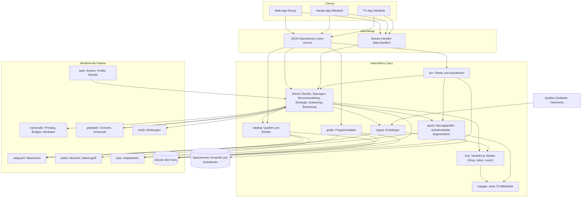
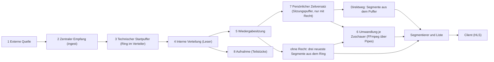
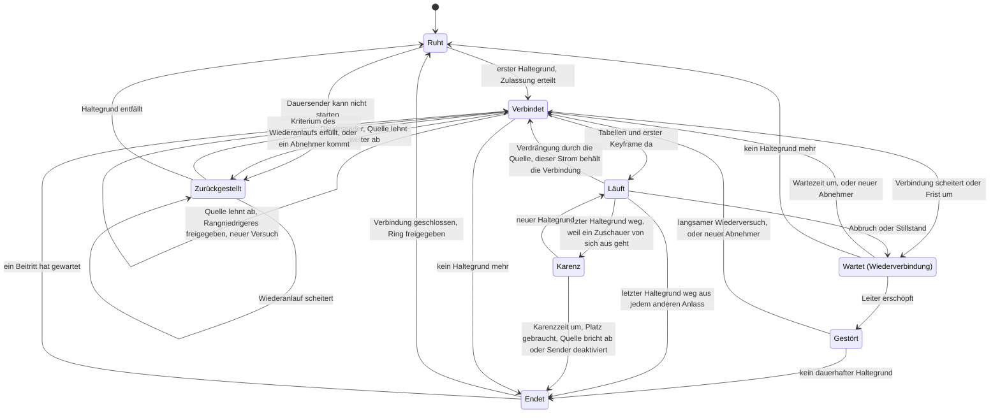

# Konzept 28 · Technische Architektur

Stand: 29. November 2026 · Fassung 4 · Status: Entwurf nach Gesamtreview und Zweitprüfung, nicht freigegeben

Dieses Dokument legt fest, wie Live-TV im bestehenden Go-Server gebaut wird: welche Bausteine es gibt,
wer wofür zuständig ist, wie die Daten fliessen und was bei Mangel und Fehlern geschieht. Die Einzelheiten
des Empfangs, der Verteilung und des schnellen Umschaltens stehen in `05-streaming-und-fast-zapping.md`,
die 18 Abläufe aus Auftrag Abschnitt 8.2 in `06-ablaeufe.md` (dort aus T-1 bis T-29 abgeleitet).
Alles hier ist **spezifiziert**, nichts ist gebaut. Wo eine Aussage auf bestehendem Code beruht, steht
«gebaut» mit Datei und Zeile (Stand `origin/main` 1220769b, Server 1.44.1).

Fassung 2 hat die zwei unabhängigen Reviews eingearbeitet (`anhang/reviews/review-1-architektur.md`, Befunde
RA-01 bis RA-26; `anhang/reviews/review-1-sicherheit.md`, Befunde RS-01 bis RS-24). Fassung 3 schliesst die
Lücken, die die Autoren der Folgedokumente (`06` bis `17`) beim Ausarbeiten gefunden haben. Was sich geändert
hat, steht in Abschnitt 13. Abschnitt 14 sammelt **alle massgeblichen Werte** an einer Stelle; wo ein anderes
Dokument eine andere Zahl nennt, gilt Abschnitt 14. Abschnitt 15 nennt, was in anderen Dokumenten nachzuziehen
ist.

Eingearbeitet ist auch die unabhängige **Nachprüfung der Quellen** (`anhang/nachpruefung-quellen.md`: 45
Aussagen, 26 bestätigt, 13 teilweise, 2 widerlegt, 3 nicht prüfbar). Wo sie eine Aussage dieses Dokuments
bestätigt, steht jetzt «belegt (Nachprüfung Nr. n)»; wo sie abweicht, ist der Text geändert (Abschnitt 13.4).
Alles, was sie nicht prüfen konnte, bleibt Annahme.

**Fassung 4** arbeitet drei Schlussreviews ein: das Gesamtreview (`anhang/reviews/review-4-gesamt.md`, RG-01
bis RG-22), die Zweitprüfung der Architektur (`anhang/reviews/review-5-architektur-zweitpruefung.md`, RB-01 bis
RB-21) und die Zweitprüfung der Sicherheit (`anhang/reviews/review-6-sicherheit-zweitpruefung.md`, RT-01 bis
RT-21), je nach den Entscheiden des Koordinators dazu. Die wichtigste Regel daraus: **Solange du eine Frage
nicht beantwortet hast, gilt die wortlauttreue Vorgabe,** also das, was dein Auftrag wörtlich verlangt. Meine
Empfehlung gilt erst mit deiner Antwort. Gibst du das Konzept ohne Einzelantworten frei, treten die Vorgaben in
Kraft, nicht die Empfehlungen. Was sich geändert hat, steht in Abschnitt 13.5; was andere Dokumente deshalb
nachziehen müssen, in Abschnitt 15.3.

Zwei Begriffe hält dieses Dokument auseinander. **«Konzept freigegeben»** heisst: Du hast das Konzept
angenommen. **«Baufreigabe einer Stufe»** heisst: Du hast den Bau dieser Stufe ausdrücklich beauftragt (Regel 11
in `CLAUDE.md`); vorher entsteht kein Code. Messpunkte, die «vor der Baufreigabe» einer Stufe vorliegen müssen,
sind Bedingungen für diesen zweiten Schritt. «Freigeben» ohne Zusatz meint in den Abschnitten 5 und 8 etwas
Technisches: einen Strom beenden und seinen Platz zurückgeben.

Kennungen: `T-n` tragende Entscheide (Abschnitt 2), `F-n` Fragen an dich (Abschnitt 12.3; fortlaufend über
`04` und `05`, andere Dateien zählen eigen und werden mit Dateinummer genannt, etwa «`03` F-4»), `O-n` offene
technische Punkte (Abschnitt 12.2), `M-n` Messpunkte (Liste in `05`, Abschnitt 10). Stufen nach
`18-umsetzungsplan.md` (V Messversuche, 0 Regeln, 1a und 1b Sender schauen, 2 Programmzeitschrift, 3 Empfang
und Umschalten, H Heimnetz-Quellen, 4 Timeshift, 5 Aufnahmen, 6 Serien, L, W, E); «Stufe 1» ohne Buchstaben
meint 1a und 1b.

## 1. Ziel und Grenzen

Der Server empfängt jeden Fernsehsender **höchstens einmal** von seiner Quelle, hält die letzten Sekunden
bereit und gibt den Strom an beliebig viele Abnehmer weiter: an Zuschauer (jeder mit eigener Sitzung, mit
dem Recht «Timeshift» auch mit eigenem Zeitversatz-Puffer, und nur wenn nötig mit eigener Umwandlung) und an
Aufnahmen (unverändert in Originalqualität). Das alles läuft **im einen Serverprozess** als neuer Dienst
`live`, nach dem Muster des Webradios (ein Relay je Sender: gebaut, `server/internal/radio/relay.go:20-24`),
mit FFmpeg nur als kurzlebigem Hilfsprozess. Es entsteht **kein** zweiter Container, kein zweites Benutzer-,
Rechte-, Job- oder Umwandlungssystem und keine externe Vermittlungssoftware.

Ausdrücklich **nicht** gebaut wird (Auftrag Abschnitt 16, wörtlich bindend): gemeinsamer Zeitversatz-Puffer,
serverweites Archiv, Catch-up, gemeinsam genutzte Umwandlungen, vorsorglich gestartete Umwandlungen, Mehrfachbild,
Tuner-Hardware, DRM-Umgehung, Verbindungslimits je Anbieter, automatische Übernahme von Aufnahmen in die
Bibliothek. Die Architektur bereitet nichts davon vor.

## 2. Tragende Entscheide

Jeder weitere Teil des Konzepts baut auf diesen Entscheiden auf. «Zu messen» nennt, was belegt sein muss;
die Messpunkte stehen in `05`, Abschnitt 10. Die Nummern T-1 bis T-26 sind dieselben wie in Fassung 1;
T-27 und T-28 kamen mit Fassung 2, T-29 mit Fassung 3.

Begriffe, einmal erklärt: **MPEG-TS** (kurz TS) ist das Transportformat des Fernsehens, ein Strom aus Paketen
zu 188 Byte. Ein **Keyframe** ist ein Bild, das ohne Vorgänger dekodiert werden kann; die Bilder von einem
Keyframe bis vor den nächsten heissen **Bildgruppe** (GOP). **HLS** ist das Abspielverfahren, das Slouchcat
schon nutzt: eine Wiedergabeliste mit kurzen Stücken (Segmenten), die der Player nacheinander holt.
**Umwandlung** (Transcoding) heisst neu kodieren; **Umpacken** (Remux) heisst nur die Verpackung wechseln.

### 2.1 Vorgaben, die auf deine Antwort warten

Wo dieses Konzept einen verbindlichen Entscheid auslegt, stuft oder von seinem Wortlaut abweichen möchte, steht
die **wortlauttreue** Variante als geltende Vorgabe; meine Empfehlung ist eine Frage an dich und gilt erst mit
deiner Antwort.

| Thema | Geltende Vorgabe bis zu deiner Antwort (wortlauttreu) | Frage |
|---|---|---|
| Rückspulgrenze (LTV-007) | Kein Zurückspulen vor den Zeitpunkt des Einschaltens. Das erste Bild darf älter sein (es stammt aus dem Startpuffer), bleibt aber nicht abrufbar. | F-7 |
| Form des Zeitversatz-Puffers (LTV-007, Auftrag 16) | Jede Sitzung hat ihre eigene Kopie. | F-8 |
| Speicherort des technischen Startpuffers (LTV-019) | wählbar: Arbeitsspeicher des Servers, RAM-Disk oder ein anderer Ordner. | F-2 |
| Verbindungen je Anbieter (LTV-017) | **Keine Zahl und kein Schalter je Quelle.** Vorladen, «automatisch» und Prüfungen sind nur global und je Sender einstellbar. Gegen Zugänge mit nur einer Verbindung schützt eine Laufzeitregel ohne Einstellung (Abschnitt 5.3). | F-3 |
| Dauerempfang (LTV-002) | Ein laufender Dauersender weicht keinem neuen Zuschauer, keiner neuen Aufnahme und keinem Vorladen. Reicht die Kapazität nicht, wird die **neue** Anfrage abgelehnt. | F-4 |
| Werkszustand des Vorladens (LTV-002, LTV-010) | Die Funktion ist vorhanden und ab Werk **an**, mit vorsichtigen Obergrenzen. | F-9 |
| Untertitel (LTV-004) | Untertitelauswahl gehört auf allen Clients zum Umfang. Erfüllt ist das erst mit Stufe E; vorher fehlt sie im Browser ganz und für Teletext-Untertitel überall (Abschnitt 7.4). | F-15 |
| Erkennung eingefrorener Streams (LTV-011) | gehört zum Umfang; mit Stufe 3 nur teilweise erfüllt, ganz erst mit der Stichprobe in Stufe E. | F-14 |
| Eindämmung von FFmpeg (Auftrag Abschnitt 10) | Ohne wirksame Sperre startet kein Live-FFmpeg; der Direktweg bleibt (Abschnitt 10.8). | `12` F-1 (`20` E-28-04) |
| Safari, iPhone, iPad (LTV-014) | vorgesehen wie die übrigen Browser; **ungeprüft, solange kein Gerät da ist**. | `20` E-28-12 |
| Fire TV (LTV-014 «berücksichtige») | wird berücksichtigt: Das Konzept sagt, was die TV-App auf Fire OS bräuchte (`05`, Abschnitt 4.3). Kein eigener Client, keine Zusage. | `20` (Auslegungen des Koordinators) |

### 2.2 Tabelle der Entscheide

| Nr. | Entscheid | Begründung | Verworfen | Zu messen |
|---|---|---|---|---|
| **T-1** | **Ein Dienst im Prozess.** Empfang, Verteilung, Sitzungen, Aufnahmen und der Aufnahme-Planer laufen als Dienst `live` im Serverprozess mit eigener Laufschleife, wie das Radio (`server/cmd/slouchcat/main.go:459-483`, `:569`). Das Jobsystem bekommt nur Stapelarbeit: Listen- und EPG-Import, Logos, Prüfungen ruhender Sender, Aufräumen. | Das Jobsystem tickt im Minutentakt, arbeitet mit Leases von 5 Minuten und bricht bei Pause ab (A3, Abschnitt 4): für sekundengenaue Starts und stundenlange Läufe ungeeignet. | Aufnahme als Job; eigener Prozess oder Container für Live-TV. | – |
| **T-2** | **Identität eines Eingangsstroms ist der Sender.** Je Sender läuft höchstens ein Eingangsstrom. Welche Quelle (Adresse, Zugangsdaten, Kopfzeilen) ihn gerade speist, ist ein Zustand dieses Stroms, kein Teil der Identität. | Erfüllt «einmal empfangen» (LTV-004) unabhängig vom Zugang; verhindert eine zweite Verbindung beim Wechsel auf eine Ersatzquelle. Gleiche Sender aus zwei Listen werden in der Senderverwaltung zusammengeführt (LTV-006). | Identität aus der normalisierten Adresse. | – |
| **T-3** | **Wer die Quelle holt: drei Wege.** **Weg G** (Go liest selbst): HTTP-TS, HLS mit TS-Segmenten, Xtream-Live (Stufe 1); UDP, RTP, Multicast (Stufe H). **Weg L** (Go-Bibliothek): RTSP und RTMP, Stufe L, vorbehaltlich F-1. **Weg W** (FFmpeg liest über den Go-Weiterleiter): DASH, HLS mit fMP4-Segmenten oder getrennter Tonspur. **Weg W gehört zu keiner der Stufen 1 bis 3.** Er kommt in der eigenen Stufe W (zuletzt) und nur, wenn M-10 ihn als dicht belegt (T-4). | Go behält Wiederverbindung, Ersatzquellen, Fehlermeldungen und den Netzschutz in der Hand. Weg G deckt die üblichen IPTV-Quellen ab und braucht keinen Prozess. Berichtete Langlauf-Schwächen von FFmpeg (Speicher, Zeitüberlauf) sind eine **Annahme** aus R1 und nicht für 7.1.4 geprüft (M-12); der Entscheid trägt auch ohne sie. | Alles über FFmpeg (R3 H5): ein Dauerprozess je Sender, Adresse und Zugangsdaten in der Argumentliste, kein Netzschutz. Alles in Go (auch DASH): viel eigener Protokollcode; bleibt die Alternative zu Weg W. | M-10, M-11, M-12, M-23 |
| **T-4** | **Die Regel «FFmpeg sieht keine Adresse» (ADR 0025) gilt für Live-TV fort:** FFmpeg bekommt nie eine Anbieter-Adresse, nie Zugangsdaten und nie eine Kopfzeile, weder in der Argumentliste noch in Daten, die es liest. Regelfall wie heute: nur `pipe:0` und `pipe:1`, festes Eingangsformat, `-protocol_whitelist pipe` (gebaut für das Radio, `server/internal/transcode/radio.go:75-82`). **Eine benannte Ausnahme (Weg W):** FFmpeg spricht ausschliesslich unverschlüsseltes HTTP mit dem Go-Weiterleiter auf `127.0.0.1`, über Adressen, die **direkt** auf den Weiterleiter zeigen (Ersatzpfad; keine Proxy-Einstellung nötig). Kein Tunnel. Go schreibt jede Adresse in Listen und Manifesten darauf um und beendet jedes TLS selbst. Der Prozess läuft in einer Sperre des Kernels. **Ehrlich gesagt, was die Sperre leistet:** Sie verbietet UDP und rohe Sockets und lässt TCP nur zu **einem Port** zu, aber zu **jeder Adresse** mit diesem Port: Die Netzregeln von Landlock kennen nur Ports, keine Adressen (belegt, Nachprüfung Nr. 34). UDP regelt Landlock erst in einer neueren Fassung seiner Schnittstelle; **immer zusätzlich**, auch auf neueren Kernen, verbietet ein Filter für Systemaufrufe (Seccomp) UDP und rohe Sockets (`12` 4.8, M-25). «FFmpeg erreicht nur den Weiterleiter» ist damit eng eingegrenzt und getestet (M-10), nicht bewiesen; das Restrisiko steht in `05` Abschnitt 2.6 und `12` R-3. **Die Sperre wird hart gesetzt:** Kann der Kernel sie nicht vollständig setzen, startet der Empfänger nicht; ein stilles Weiterlaufen ohne Sperre gibt es nicht. Ohne den Beleg M-10 wird Weg W nicht gebaut. | Regel 10 und Auftrag 10.3 («auch indirekt abgerufene Adressen dürfen den Schutz nicht umgehen»). Einzelheiten und Alternativen in `05`, Abschnitt 2.6. | FFmpeg öffnet die Quelle selbst mit `-protocol_whitelist`; Tunnel (`CONNECT`) durch den Weiterleiter (Fassung 1); Erreichen des Weiterleiters über eine Proxy-Einstellung (Fassung 2: hinge daran, dass FFmpeg sie in jeder Unteranfrage beachtet). | M-10, M-25 |
| **T-5** | **Netzschutz je Quelle mit festen Zielen.** Jede ausgehende Verbindung des Live-TV läuft über einen Go-Dialer, der die Adresse nach der Namensauflösung prüft (gebaut: `server/internal/netguard/netguard.go:73-82`). Öffentliche Adressen sind erlaubt. Eine lokale Adresse nur, wenn sie in den **festen Zielen dieser Quelle** liegt: einer Liste, die der Administrator beim Freigeben bestätigt. **Vorgabe ist je Eintrag eine einzelne Adresse mit einem einzelnen Port;** ein Netz oder ein Portbereich geht nur in engen Grenzen und mit zweiter Bestätigung (Abschnitt 10.9). Wird ein Ziel entzogen oder die Quelle entfernt oder geändert, enden ihre Verbindungen innert 5 Sekunden (T-29). Loopback, Link-Local, die Metadaten-Adressen und die eigenen Adressen des Servers sind **nie** freigebbar. Die Prüfung gilt für jede Verbindung der Quelle, auch Weiterleitungen, Unterlisten, Segmente und Schlüssel. Der bestehende ungeschützte Client (`netguard.go:118-128`) wird für Live-TV nicht verwendet. Abschnitt 10.9, `05` Abschnitt 2.3. | Der Administrator vertraut einem Gerät, nicht jeder Adresse in dessen Listen. Ein Ja-Nein-Schalter je Quelle (Fassung 1) hätte blinde Abrufe ins ganze Heimnetz erlaubt (RS-01, RA-19). | Globale Freigabe; Ja-Nein je Quelle; Freigabe durch Konten. | M-16 |
| **T-6** | **Internes Verteilformat ist unveränderter MPEG-TS.** Je empfangenem Sender hält ein **Verteiler** einen Ring aus TS-Paketen mit einem Verzeichnis der Keyframes (GOP-Index), den zuletzt gesehenen Programmtabellen (PAT/PMT) und einer fortlaufenden 64-Bit-Zeit. Es gibt keinen gemeinsamen Segmentvorrat. Ein **Zeitabschnitt** (neuer Aufnahmeteil, Neustart laufender Umwandlungen) beginnt nur bei geänderten Spuren, Codecs oder Bildparametern und bei Quellwechsel; ein blosser Zeitsprung der Quelle ist eine **Diskontinuität** ohne neuen Abschnitt. | TS ist das Format fast aller IPTV-Quellen, erhält alle Spuren (LTV-020), ist ohne Abschluss lesbar und lässt sich an Paketgrenzen schneiden. Enger gefasste Zeitabschnitte vermeiden Dutzende Aufnahmeteile bei Sendern mit Werbeeinblendungen (RA-15). | Gemeinsamer HLS-Segmentierer je Sender; fMP4 intern. | M-9, M-13 |
| **T-7** | **Der technische Startpuffer ist dieser Ring und nichts sonst.** Der Ring hält **15 Sekunden** Inhalt, bei Sendern mit langen Segmenten mehr: das Vierfache der Segmentdauer des Senders, **nie mehr als 30 Sekunden** (Konstante im Code) und nie mehr als 96 MiB. Die Länge ist **keine Einstellung**. Grund für die zweite Bedingung: In den Stufen 1 bis 3 und für jede Sitzung ohne Sitzungspuffer kommen die Segmente der Zuschauer aus dem Ring (T-10); er muss drei vollständige Segmente und das laufende fassen. Bis zu Segmenten von 7,5 Sekunden tut er das; darüber nicht mehr voll, über 10 Sekunden gar nicht (Rechnung und Folge in `05`, Abschnitt 3.6). Reserviert wird beim Start nach dem Muster des Radios: gespeicherte Bitrate × Ringlänge × 1,03 (`server/internal/radio/buffer.go:67-70`); die gespeicherte Bitrate ist der höchste gleitende Mittelwert über eine Ringlänge, und der Ring wird neu reserviert, wenn die Messung die Reservierung um mehr als 20 % übersteigt. Ein Ring wächst nie an Ort. Speicherort nach T-25 (Vorgabe wählbar, F-2). Ein neuer Abnehmer beginnt an der letzten **vollständigen** Bildgruppe; passt keine vollständige in den Ring, am neuesten Keyframe (dann ohne schnellen Start). Lesen kann man den Ring nur vorwärts; eine Leseschnittstelle nach Uhrzeit gibt es nicht. **Die Rückspulgrenze einer Sitzung ist der Zeitpunkt des Einschaltens** (Vorgabe, F-7); sie ist eine Regel des Fensters der Sitzung, nicht der Länge des Rings. | Erzwingt, was LTV-007 und LTV-013 verlangen: kein Archiv, kein Zurückspulen vor das Einschalten. Der Auftrag verlangt «kurzfristig» und «kein Archiv», aber keine Zahl; 15 Sekunden für alle Sender (Fassung 2 und 3) trugen das Fenster von drei Segmenten bei langen Bildgruppen nicht (RB-01). | Startpuffer über Minuten; zweite Konstante in Byte als Grenze des Inhalts; Start an bis zu drei Bildgruppen; Ringlänge als Einstellung nach unten (Fassung 3: bei 4 oder 6 Sekunden bricht die Wiedergabe ohne Sitzungspuffer). | M-1, M-2, M-3, M-13 |
| **T-8** | **Niemand kann den Empfang aufhalten.** Der Schreiber des Rings wartet nie. Jeder Leser kopiert seinen Bereich und prüft danach, ob der Bereich inzwischen überschrieben wurde; wenn ja, verwirft er die Kopie, bekommt eine Lücke und setzt am nächsten Keyframe fort. Leser sind: Schreiber von Sitzungspuffern und Aufnahmen (jeder mit eigenem, begrenztem Rückstau im Arbeitsspeicher, damit ein kurz stockender Datenträger keine Lücke reisst), Zuführer einer Umwandlung, und Segmentabrufe von Sitzungen ohne Zeitversatz (in Blöcken von 256 KiB, nie ein ganzes Segment im Speicher). Der Rückstau der Schreiber zählt gegen das Byte-Budget erst, wenn er gebraucht wird; jede Aufnahme hat darin einen Mindestteil, und die Puffer einer Umwandlung sind schon bei deren Zulassung reserviert (T-19). | Ein langsamer Client, ein langsamer Datenträger oder ein langsamer FFmpeg trifft nur sich selbst (LTV-004 «Backpressure»). Der Rückstau trennt die Grenze gegen ein Archiv (den Ring) von der Toleranz gegen Stockungen (RA-07). Er ist endlich: Stocken viele Aufnahmen auf demselben Netzspeicher zugleich, gibt es Lücken (Abschnitt 8.1; RB-08). | Push an Clients aus dem Ring; Sperre im Schreibpfad. | M-14 |
| **T-9** | **Eigener Sitzungstyp «Live-Sitzung».** Getrennt von `playback_sessions` (dort ist `item_id` Pflicht und zeigt auf `items`, A2 Abschnitt 1.3) und vom Radio. Eine Live-Sitzung gehört zu Anmeldung, Profil und Gerät; **Umschalten ist ein Vorgang innerhalb der Sitzung** («Einstellen» mit laufender Nummer), keine neue Sitzung. Dieselbe Sitzungsart spielt auch fertige Aufnahmen ab. Sitzungen, Aufnahmen, Planungen und Erinnerungen tragen zufällige Kennungen (ULID). | Keine Eingriffe in die Dateiwiedergabe; schnelles Umschalten ohne Neuanlage; Aufnahmen bleiben ausserhalb von `items` (Regel 2). | Sender als `items`; Wiederverwendung von `playback.Session`. | – |
| **T-10** | **Der persönliche Zeitversatz-Puffer liegt vor der Umwandlung und gehört einer Sitzung.** Mit wirksamem Recht «Timeshift» hat die Sitzung einen **Sitzungspuffer**: eine eigene Kopie des Quell-TS ab dem Einstellen, in Stückdateien mit Verzeichnis, auf dem Speicherort «Timeshift» (Vorgabe: eigene Kopie, F-8). Er wird beim Umschalten, beim Sitzungsende und beim Serverstart gelöscht. **Ohne wirksames Recht gibt es keinen Sitzungspuffer und kein rückwärts lesbares Fenster:** Die Sitzung bekommt nur die drei neuesten Segmente, direkt aus dem Ring; ältere Segmente beantwortet der Server mit 404. Der Ring ist dafür bemessen (T-7). Bei Sendern mit Segmenten über 10 Sekunden reicht er nicht: Dort läuft eine Sitzung ohne Sitzungspuffer über eine Umwandlung (`05`, Abschnitt 3.6). Der Sitzungspuffer auf Datenträger kommt mit Stufe 4. | Spulen, Qualitäts- und Tonspurwechsel wirken auf die ganze Vergangenheit; die Umwandlung läuft nur für das, was jemand ansieht. Das Recht wird im Server durchgesetzt, nicht nur in der Oberfläche (Regel 12, Auftrag 10.6, `03` DR-22; RA-08). | Puffer nach der Umwandlung; Fenster von 60 Sekunden ohne Recht (Fassung 1: im Player pausier- und rückspulbar); Puffer erst ab der ersten Pause (widerspricht LTV-007). | M-14 |
| **T-11** | **Auslieferung als HLS je Sitzung mit TS-Segmenten; die Wiedergabeliste baut Go.** Die Zieldauer einer Liste ist die aufgerundete grösste Segmentdauer des Senders und ändert sich innerhalb einer Liste nie (`05`, Abschnitt 4.4). Kein LL-HLS, kein DASH, kein fortlaufender Strom in der ersten Stufe. Das ist eine **Empfehlung unter Vorbehalt**: M-2 und M-3 müssen **vor der Baufreigabe der Stufe 1** vorliegen; M-4 vor der Baufreigabe der Stufe, in der die Apps Live-TV bekommen (`05` M-4, `18` D-7; bei E-28-01 (b) ist das 1a). **Für Safari, iPhone und iPad ist der Entscheid nicht gesichert:** Apples Vorgaben für HLS verlangen in einer Live-Liste mindestens sechs Segmente, einen Keyframe am Anfang jedes Segments und für HEVC das Segmentformat fMP4 (belegt, Nachprüfung Nr. 6 bis 8). Kurze Listen sind dort eine **bewusste Abweichung**, die M-5 messen müsste, sobald ein Apple-Gerät da ist (bedingt, Entscheid 2); HEVC-Sender brauchen dort die Umwandlung oder ein zweites Segmentformat (O-3). Für diese Clients gibt es zudem kein Testgerät (Abschnitt 12.1); sie sind vorgesehen wie die übrigen Browser, aber ungeprüft, solange kein Gerät da ist (`20` E-28-12). Der Segmentierer ist die eine Stelle, an der ein zweites Segmentformat (fMP4) anschliesst. | HLS spielen alle drei Clients; nur segmentbasierte Verfahren tragen Zeitversatz im Player (R2 Abschnitt 6). Vergleich in `05`, Abschnitt 4. | Ein Format fMP4 für alle; fortlaufender TS-Strom. | M-1 bis M-5 |
| **T-12** | **Direktweg ohne FFmpeg, wo der Strom zum Gerät passt.** Go schneidet die Segmente an Keyframes und setzt die Programmtabellen davor. Die Tonspurwahl geschieht durch Weglassen der anderen Ton-PIDs (PID: Kennung eines Teilstroms im TS) samt angepasster Tabelle, ausser das Gerät wählt Spuren selbst (`selectsTracks`, ADR 0041). **Für wen der Direktweg real ist, steht in Abschnitt 7.6.** Im Browser ist er eng: Der schlanke Bau von hls.js, den die App heute lädt, spielt in TS-Segmenten nur H.264 mit AAC (und MP2 oder MP3, wenn der Browser es meldet); HEVC und AC-3 liest erst der volle Bau, E-AC-3 und AAC-LATM liest keiner von beiden (belegt, Nachprüfung Nr. 11 und 13). **Vorgabe: Live-TV lädt den vollen Bau nicht;** diese Fälle gehen in die Ton- oder Bild-Umwandlung (O-22). Auf Geräten mit Media3 reicht der Direktweg deutlich weiter. | Keine unnötige Neukodierung (LTV-004), kein Prozessstart beim Umschalten. Wie oft der Direktweg bei deinen Sendern greift, zeigt erst M-2; davon hängt die Kapazität ab. | Umpacken je Zuschauer durch FFmpeg als Regelfall; voller Bau von hls.js für alle Seiten. | M-2, M-3 |
| **T-13** | **Umwandlung je Sitzung durch genau einen FFmpeg, TS hinein, TS heraus, nur über Pipes.** Eingang ist der Sitzungspuffer (mit Zeitversatz) oder ein Zuführer am Ring (ohne). Die Ausgabe schneidet derselbe Go-Segmentierer. Wiederverwendet werden Hardware-Erkennung (`server/internal/transcode/backend.go:140-223`), Videoketten je Backend (`pipeline.go:398`), Tonregeln (ADR 0041), Start und Beenden (`session.go:660-683`). Das Budget bekommt eine **neue Schnittstelle** (reservieren, umbuchen, freigeben): Die Reservierung gehört der **Live-Sitzung**, nicht dem Prozess, und wird beim Umschalten nur umgebucht. Die bestehende Regel «eine Umwandlung, die allein das Budget übersteigt, läuft, wenn sonst nichts Einheiten hält» (`manager.go:201-205`) gilt auch für Live und für den Anteil von Live (Abschnitt 7.6). `playback.Decide`, `transcode.Plan`, `transcode.Session` und `ffmpegArgs` bleiben **im Verhalten unverändert**, belegt durch die bestehenden Tests (Vergleich der Argumentlisten, Tests des Managers). | Kein zweites Umwandlungssystem. Der heutige Einstieg des Managers verlangt einen Plan mit Segmenten (`manager.go:180-182`) und taugt für Live nicht. Eine Reservierung je Prozess würde schnelles Umschalten mit sterbenden Prozessen blockieren (RA-12). | Live-Zweig in `transcode.Session`; gemeinsame Umwandlung je Sender. | M-8, M-9 |
| **T-14** | **Der Server entscheidet je Sitzung zwischen Original, Ton-Umwandlung und Bild-Umwandlung** mit einer eigenen Funktion im Paket `live`, aus den gemeldeten Gerätefähigkeiten (ADR 0041, additiv erweitert), den Grenzen des Profils und den **gespeicherten Streamparametern** des Senders. Die Parameter kommen aus den Programmtabellen (Go) und einer Probe mit `ffprobe` über eine Pipe aus dem Ring. **Die Fähigkeiten für Live-TV sind eine eigene Angabe:** Ein Client meldet, was sein Player **in TS-Segmenten** abspielt, nicht was der Browser grundsätzlich dekodiert. Aus den Angaben für die Dateiwiedergabe (dort fMP4) darf der Server nichts ableiten; sonst hielte er HEVC oder AC-3 im Browser für direkt spielbar, obwohl der Player sie in TS nicht liest. | Regel 12; `playback.Decide` wird durch Vergleich ganzer Entscheide getestet (`decide.go:318-326`). Gespeicherte Parameter sparen die Probe beim Umschalten. | Erweiterung von `playback.Decide`; Entscheid im Client. | M-7, M-8 |
| **T-15** | **Zeilensprung-Entfernung (Deinterlacing) ist ein neuer, abschaltbarer Baustein der Videokette**, nur von Live-TV eingeschaltet. Vorgabe: Der Server entfernt den Zeilensprung, ausser das Gerät meldet, dass es ihn sauber darstellt. **Ein Browser kann das nie melden; dort greift die Vorgabe immer**, bis M-6 etwas anderes belegt. | Im Server gibt es heute keinen solchen Filter (A2 Abschnitt 1.1), im Image sind sie vorhanden (M1). Folge für die Kapazität: Abschnitt 7.6. | Immer durchreichen. | M-6, M-8 |
| **T-16** | **Die Aufnahme zweigt am Verteiler ab,** mit eigenem Leser und eigenem Rückstau (T-8), unabhängig von jeder Sitzung. Laufende Aufnahmen sind vor Verdrängung geschützt; gegen ein gleichzeitiges Stocken des Speicherorts hilft nur der Rückstau, und der ist endlich (Abschnitt 8.1, 8.3). Go schreibt den Quell-TS des einen Programms unverändert in Teilstücke mit Verzeichnis auf den Speicherort «Aufnahmen». Ein neuer Teil beginnt nur mit einem neuen Zeitabschnitt (T-6), nach einem Neustart und nach einer Lücke des Speicherorts. Kein FFmpeg, kein Umwandlungsbudget. | LTV-008 und LTV-020. TS überlebt einen harten Abbruch (R5 Abschnitt 3). | Aufnahme aus einer Zuschauersitzung; über FFmpeg `-c copy`; als `items`. | M-14 |
| **T-17** | **Lebenszyklus über benannte Haltegründe.** Ein Eingangsstrom lebt, solange mindestens ein Haltegrund eingetragen ist. Jeder Haltegrund ist ein Eintrag mit Art und Besitzer. **Karenz gibt es nur, wenn ein Zuschauer von sich aus geht** (Sitzungsende durch den Client oder durch ausbleibenden Herzschlag); nicht beim Umschalten, nicht nach dem Ende einer Aufnahme, eines Zeitfensters oder einer Strategie, nicht nach einem Entzug. Ein Strom ohne Haltegrund belegt keinen Platz; vor jedem Verbindungsaufbau enden die Ströme derselben Quelle, die niemand mehr hält. **Ein laufender Dauersender (dauerhaft, oder Zeitplan in seinem Fenster) weicht keinem neuen Zuschauer, keiner neuen Aufnahme und keinem Vorladen** (Vorgabe, wortlauttreu zu LTV-002; F-4): Reicht die Kapazität nicht, wird die neue Anfrage abgelehnt. «Zurückgestellt» wird ein Dauersender nur, wenn er nicht starten kann (Mangel beim Start, oder die Quelle gibt ihm keine Verbindung); das wird gemeldet. **Für Quellen gibt es keine Einstellung zu Verbindungen** (LTV-017; F-3). Stattdessen reagiert der Server auf zwei beobachtete Muster: Lehnt eine Quelle eine weitere Verbindung ab oder trennt sie beim Aufbau einer zweiten die ältere, ruht vorsorglicher Empfang (Vorladen, automatisch, Prüfung) für diese Quelle von selbst für eine Frist. Trennt sie, öffnet der Server dort für diese Frist keine zweite Verbindung, und es gilt: Wer einen Auftrag erfüllt (Aufnahme, Zuschauer, Dauersender) und die Verbindung hat, behält sie; unter Gleichzeitigen gilt die Rangfolge Aufnahme, Zuschauer, Dauersender, automatisch, Vorladen; Vorsorgliches weicht immer. Eine Ablehnung in dieser Lage sperrt nichts; «Zugang prüfen» ist eine Quarantäne mit Wiederversuch. Die Wartezeit-Leiter wird erst nach 60 Sekunden gesundem Lauf zurückgesetzt. Abschnitt 5. | Fassung 1 hätte bei Zugängen mit einer einzigen erlaubten Verbindung beim Umschalten die Quelle gesperrt (RA-01). Fassung 3 löste das mit einem Schalter je Quelle; der ist nach dem Gesamtreview eine Verbindungsverwaltung je Anbieter und damit gegen LTV-017 (RG-03). Der zurückgestellte Dauerempfang war eine nicht ausgewiesene Abweichung von LTV-002 (RG-02). Bei Anbietern, die die ältere Verbindung trennen, hätten sich zwei gehaltene Ströme ohne Ende abgerissen (RB-03). Die Regel ist Fehlerbehandlung aus Beobachtung, keine Limitverwaltung. | Reiner Referenzzähler; Karenz nach jedem Verlassen; Vorgeladenes vor jedem Aufbau beenden; Schalter je Quelle (Fassung 3, jetzt nur Variante von F-3); Dauersender weicht Abnehmern (Fassung 3, jetzt nur Variante von F-4); Leiter beim ersten Keyframe zurücksetzen. | M-12, M-15, M-17, M-26 |
| **T-18** | **Empfangsstrategie: vier Arten und Vorladen, alle verbindlich und vollständig beschrieben** (Abschnitt 6): dauerhaft, zeitgesteuert, automatisch, bei Bedarf; dazu Vorladen der Nachbarsender. Gesteuert wird **global** (an oder aus, Obergrenzen) und **je Sender** über die Strategie. **Je Quelle gibt es keinen Schalter und keine Zahl** (Vorgabe, F-3). Vorladen ist ab Werk an, mit vorsichtigen Obergrenzen (Vorgabe, F-9). | LTV-002, LTV-010. Jeder vorsorgliche Empfang ist eine weitere Verbindung zum Anbieter, dessen Limit Slouchcat nicht kennt; dagegen steht die Laufzeitregel aus T-17. | Zwei Schalter je Quelle (Fassung 1); ein Schalter je Quelle (Fassung 3, jetzt Variante (b) von F-3); Werkszustand als Entscheid statt als Frage (RA-18). | M-17, M-26 |
| **T-19** | **Ein Zulassungsort, vier Grössen.** Die Stromverwaltung entscheidet über jeden Empfang, Sitzungspuffer und jede Aufnahme gegen: Zahl der Eingangsströme, Byte-Budget im Arbeitsspeicher, Platz auf den Speicherorten, Umwandlungseinheiten (bestehendes Budget, T-13). **Im Byte-Budget sind die Ringe beim Start reserviert** (höchstens drei Viertel des Budgets) **und die Puffer einer Umwandlung bei deren Zulassung;** der Rückstau der Schreiber zählt erst bei Gebrauch, mit einem Mindestteil je Aufnahme. **Ein laufender Dauersender weicht nach der Vorgabe keiner neuen Anforderung** (F-4). **Eine Aufnahme wird nie wegen des Rückstaus abgelehnt.** Dazu feste Serverdeckel unabhängig von den Grenzen der Konten und eine Drosselung des Umschaltens (Abschnitt 8.5). Rangfolge in Abschnitt 8.2; die Kapazität je Installationsgrösse steht in Abschnitt 7.6 und 8.1. | Ein einziges Zahlenbudget für Netz, Speicher und Encoder wäre falsch: es sind verschiedene Engpässe. Mit voll reserviertem Rückstau hätten zehn HD-Aufnahmen auf keiner Grösse ins Budget ab Werk gepasst (`13` H-1). Die Stream-Grenze eines Kontos ist ab Werk leer, also unbegrenzt (RS-10); der Server braucht eigene Deckel. | Eigenes Budget für Live-Umwandlungen; Rückstau beim Start reservieren (Fassung 2, unausgesprochen); kein Schutz der Dateiwiedergabe. | M-8, M-13, M-14 |
| **T-20** | **Empfang und Aufnahme laufen im Serverprozess, nicht in FFmpeg,** und sind damit von `nice 10` und `oom_score_adj 500` (gebaut: `server/internal/transcode/session.go:702-712`) nicht betroffen. FFmpeg-Empfänger des Wegs W starten in einer neuen Klasse «Empfang» ohne Zurückstufung. Umwandlungen für Zuschauer behalten die heutige Klasse. | Heute würde gerade der Empfänger unter Last zuerst Pakete verlieren und bei Speichermangel zuerst sterben (A2 Abschnitt 2.1). | Alle FFmpeg gleich behandeln. | M-12 |
| **T-21** | **Stream-Endpunkte tragen ein Token `lt`,** gebunden an Live-Sitzung und Einstell-Nummer (HMAC wie beim Radio, `server/internal/radio/token.go:11-30`; Schlüssel aus `secrets.Keyring.Derive("live-token")`). **Am Leben hält eine Sitzung nur ihr Herzschlag,** eine angemeldete Operation derselben Anmeldung; Segmentabrufe verlängern nichts. Der Herzschlag meldet «spielt» oder «Pause» und die Abspielstelle; diese Angabe dient nur der Anzeige. **Die Schauzeit zählt, was der Server ausliefert,** nie, was der Client meldet (Regel 12). Eine Sitzung, die längere Zeit keine Segmente holt, endet (Abschnitt 10.3). Jede Listenanfrage prüft, höchstens 30 Sekunden alt, das Recht und die Gültigkeit der Anmeldung. Ein ungültiges, fremdes oder abgelaufenes Token ergibt dieselbe 404-Antwort wie «kein Recht». Abschnitt 10.3. | Bestehende Token-Architektur (`st`, `rt`, `dt`). Ein erbeutetes Token darf eine Sitzung nicht unbegrenzt halten (RS-08); beim Radio verlängert jede Anfrage (`server/internal/radio/listen.go:561-571`). | Cookie-Prüfung an Segmenten; Verlängerung durch Segmentabruf. | M-5 |
| **T-22** | **Flüchtiges lebt im Arbeitsspeicher, Dauerhaftes in SQLite.** Flüchtig: Ringe, Verzeichnisse, Leser, Haltegründe, Wartezeit-Zähler, Messwerte, Einstell-Nummern. In SQLite: Quellen, Sender, Strategie, gespeicherte Streamparameter, Zustand je Quelle (nur bei Wechsel geschrieben), Sitzungszeilen (Anlage, Ende, Berührung höchstens einmal je Minute), Aufnahmen mit Teilen und Lücken. Die Nutzung je Sender für «automatisch» wird aus den Sitzungszeilen gerechnet, nicht eigens gespeichert. Abschnitt 4.2. | SQLite hat genau einen Schreiber (A3 Abschnitt 3). | Zustand je Segment in der Datenbank; Redis; eigene Nutzungstabelle (Fassung 1, RA-26). | – |
| **T-23** | **Statusänderungen kommen über Abfragen, nicht über einen neuen Push-Kanal.** Der Herzschlag der Sitzung (alle 10 Sekunden) liefert den Zustand zurück; der Player sieht Störungen ausserdem direkt an Liste und Segmenten. Kein SSE, kein WebSocket in der ersten Stufe. | Es gibt heute keinen Push-Kanal (A3 Abschnitt 6). | SSE je Sitzung; WebSocket. | – |
| **T-24** | **Paketzuschnitt** nach Abschnitt 3.2: neues Paket `internal/live` mit Unterpaketen, eigenes sqlc-Paket `liveq` mit depguard-Riegel, alle Prozessstarts in `internal/transcode`, alle Dateizugriffe über `paths`, Stream-Endpunkte als `http.Handler`. Kein Live-Paket fasst `items`, `media_files` oder `tracks` an. | Regeln 2, 3, 4, 6 und das Muster `wishq` (`server/.golangci.yml`, Regel `wishq`). | Live-TV im Paket `radio` oder `playback`. | – |
| **T-25** | **Drei Speicherorte, jeder vom Administrator gewählt.** Startpuffer: Arbeitsspeicher des Servers (ab Werk) oder ein Ordner (RAM-Disk empfohlen). Timeshift: ein Ordner, ab Werk `<cache>/live/timeshift`. Aufnahmen: eine eigens eingehängte, schreibbare Wurzel (Muster ADR 0029). Jeder Ordner trägt eine Markerdatei, hat einen Zustand und eine Mindestreserve (Abschnitt 14). Der Server schreibt nur relativ zu einer geprüften, geöffneten Wurzel und **nie an einen Ort, den der Administrator nicht gewählt hat**. Namen von Dateien und Ordnern bestehen nur aus Kennungen; Rechte 0700 und 0600; gelöscht wird Datei für Datei über `paths`. Abschnitt 10.10. | LTV-019; ein nicht eingehängtes Netzlaufwerk darf nie zu Schreiben auf die lokale Platte führen (gebaut für Podcasts, A2 Abschnitt 7.4). | Aufnahmen im Cache; stiller Ausweichordner (Fassung 1, RS-22). | M-14 |
| **T-26** | **Live-TV zählt zu den bestehenden Grenzen:** gleichzeitige Streams, Bitrate und Höhe je Konto und Profil sowie die tägliche Schauzeit (`03` DR-12). Dafür braucht es eine Kopplung in **beide** Richtungen zwischen `playback` und `live`, über gesetzte Rückrufe wie beim Radio (`main.go:471`): `playback` fragt `live` nach den aktiven Live-Sitzungen je Profil und Konto, `live` reserviert seinen Platz unter derselben Startsperre (`server/internal/playback/limits.go:147-201`). Das Radio zählt heute nur zur Schauzeit, nicht zu den Streams; das Muster trifft also nur zur Hälfte. | Kein zweites Limit-System; `playback` darf `liveq` wegen des depguard-Riegels nicht lesen (RA-22). | Getrennte Zählung für Live-TV. | – |
| **T-27** | **FFmpeg wird eingedämmt, und kein Paket der Quelle kann den Server beenden.** Jeder Live-FFmpeg und jede Probe startet über eine **Hülle** (ein Unterbefehl des Servers, der alles setzt und erst dann FFmpeg ausführt, sodass FFmpeg keinen Augenblick ohne Grenzen läuft) mit eigener, kleiner Umgebung (keine `SLOUCHCAT_*`-Variablen), festem Eingangsformat, Ressourcengrenzen und Argumenten, die nur Zahlen und Werte aus festen Listen enthalten. FFmpeg läuft in einer Sperre ohne Lesezugriff auf `/config` und ohne Netz: Landlock, hart gesetzt, und ein Filter für Systemaufrufe (Seccomp). **Vorgabe: Ohne wirksame Sperre startet kein Live-FFmpeg.** Fehlt sie auf dem Host, bleibt der Direktweg; Umwandlung und Probe über FFmpeg sind für Live-TV aus, und die Verwaltung zeigt «Eindämmung nicht verfügbar» mit dieser Folge. «Trotzdem erlauben» ist nur die ausdrückliche Wahl des Betreibers und eine Variante der Frage `12` F-1 (`20` E-28-04). Die Hülle bleibt von ihrem ersten Schritt bis zum Ersetzen durch FFmpeg an einen Betriebssystem-Faden gebunden, damit die Sperre sicher für FFmpeg gilt. Eine Betriebsart «so gut es geht», die ohne Kernel-Unterstützung unbemerkt nichts beschränkt, wird nicht verwendet. Jede Go-Routine des Live-Dienstes fängt Programmfehler an ihrer Wurzel ab und macht daraus einen Fehler der Quelle; alle Parser bekommen Fuzz-Tests. Abschnitt 10.8. | Live-TV gibt FFmpeg erstmals Video, Untertitel und Manifeste aus beliebigen Fremdquellen; heute erbt FFmpeg die ganze Umgebung und kann `secret.key` lesen (`session.go:662-683`, RS-03). Ein Indexfehler in einer Go-Routine ausserhalb des HTTP-Servers beendet den ganzen Prozess (RS-04). | Wie heute starten. | M-25 |
| **T-28** | **Jede Adresse einer Quelle und jede Stream-Adresse eines Senders ist ein Geheimnis.** Sie wird ganz verschlüsselt gespeichert; im Klartext steht daneben nur Schema, Host und Port. Zugangsdaten und Kopfzeilen einer Quelle gehen nur an eine **feste Menge von Ursprüngen** (ab Werk der Ursprung der eingetragenen Adresse: Schema, Host und Port), und keine API-Antwort gibt Adressen oder Kopfzeilen-Werte zurück, auch nicht maskiert. Eine Weiterleitung von `https` nach `http` bricht **immer** ab, auch bei Quellen ohne Zugangsdaten (`12` F-2); Geheimnisse einer `https`-Quelle gehen auch sonst nie an einen `http`-Ursprung. Wird eine Quelle entfernt oder geändert, verwirft der Empfänger die entschlüsselten Werte (T-29). Abschnitt 10.5. | Eine Erkennung «Adresse mit Zugangsdaten» nach Muster versagt bei unbekannten Namen und bei Xtream-Pfaden; Klartext landete in jeder Sicherung (RS-05). Ohne feste Ursprünge erntet ein gekaperter Listen-Host die Kopfzeilen (RS-06). | Nur erkannte Zugangsdaten verschlüsseln; Maskierung in der Oberfläche. | – |
| **T-29** | **Deaktivieren oder Verschwinden eines Senders beendet nichts Laufendes von selbst; Entfernen oder Ändern einer Quelle beendet ihre Empfänger.** Ein deaktivierter Sender ist sofort für alles Neue unsichtbar (404: kein Einstellen, kein Umschalten dorthin, keine neue Aufnahme, kein Vorladen, keine Prüfung). Laufende Aufnahmen laufen bis zu ihrem Ende (eine Sofortaufnahme höchstens bis zu ihrer Höchstdauer), laufende Wiedergaben, bis der Zuschauer geht, **spätestens bis das Token abläuft** (12 Stunden; für einen deaktivierten Sender wird es nicht erneuert). Wer Laufendes sofort beenden will, gibt in der Verwaltung den ausdrücklichen Befehl «sofort beenden», mit der Zahl der betroffenen Zuschauer und Aufnahmen und einer Bestätigung; eine so beendete Aufnahme ist «unvollständig, Sender deaktiviert». **Für die Quelle gilt das nicht:** Wird eine Quelle entfernt, werden ihre Adresse, Zugangsdaten, Ursprünge oder festen Ziele geändert oder wird ein Ziel entzogen, enden alle ihre Empfänger innert 5 Sekunden nach der Bestätigung; ein Empfänger verbindet nie mit einem Regelstand, der nicht mehr gilt. Ein Rechteentzug beendet die Wiedergabe innert 10 Sekunden. Abschnitt 5.3. | LTV-002.10 und .11 schützen laufende Wiedergaben und laufende Aufnahmen; Fassung 2 liess den Strom sofort enden (06 O-7, `07` 12.3). Einen einzelnen Stream beenden kann der Administrator schon heute (`server/internal/admin/streams.go:21-29`). Bewusste Abweichung vom Radio, das beim Ausblenden eines Senders auch laufende Hörer beendet (`server/internal/radio/listen.go:875-893`): Dort gibt es keine Aufnahmen. Die Ausnahme für die Quelle ist Sicherheit: Eine Quelle entfernt man, wenn ihr Zugang offengelegt oder ihre Liste gekapert ist; dann darf nichts weiterlaufen (RB-05, RT-06). Deaktivieren ist kein Sicherheitsmittel. | Strom endet sofort (Fassung 2); Deaktivieren wirkt erst nach dem Ende des Laufenden; auch Ströme einer entfernten Quelle laufen weiter (Fassung 3, unausgesprochen). | – |

## 3. Komponenten

### 3.1 Die dreizehn Verantwortlichkeiten des Auftrags

Der Auftrag (Abschnitt 8) nennt dreizehn Verantwortlichkeiten und stellt ausdrücklich frei, sie zusammenzufassen.
Sieben davon werden zu drei Bausteinen; für «Vorladen», «Timeshift» und «Streamüberwachung» wären eigene
Bausteine Overengineering.

| Verantwortlichkeit (Auftrag) | Zuordnung | Begründung |
|---|---|---|
| Source Manager | `live/catalog` (neu) mit Jobs für den Abgleich | Quellen, Import, Aktualisierung; Stapelarbeit gehört ins Jobsystem. |
| Channel Registry | `live/catalog` (zusammengefasst) | Sender und ihre Quellzeilen sind dasselbe Datenmodell (Quellzeile n:1 Sender, R3 Abschnitt 2). |
| Stream Manager | `live`: **Stromverwaltung** | Verzeichnis der laufenden Eingangsströme. |
| Stream Lifecycle Manager | `live`: Stromverwaltung (zusammengefasst) | Der Zustandsautomat **ist** die Verwaltung. |
| Stream Distributor | `live/hub`: **Verteiler** | Ring, Verzeichnis, Leser. |
| Input Buffer Manager | `live/hub` (zusammengefasst) | Der Ring ist der Eingangspuffer; es gibt keinen zweiten. |
| Preload Manager | kein eigener Baustein: ein Haltegrund «Vorladen» und eine Regel in der Stromverwaltung | Vorladen ist nur «Empfang ohne Abnehmer mit Ablauf». |
| Playback Session Manager | `live`: **Sitzungen** (neuer Sitzungstyp, T-9) | Nicht `playback`, siehe T-9. |
| Timeshift Manager | kein eigener Baustein: `live/spool` (Sitzungspuffer) und die Sitzung | Zeitversatz ist eine Eigenschaft des Sitzungspuffers. |
| Recording Manager | `live/dvr` (neu) | Regeln, Termine, Aufnahmen, Aufbewahrung. |
| EPG Manager | `live/guide` (neu) mit Jobs für den Import | Unabhängig vom Strom (LTV-005). |
| Stream Health Monitor | kein eigener Baustein: Messwerte im Verteiler, Bewertung in der Stromverwaltung, Meldung über `notify` | Die Signale fallen beim Empfang ohnehin an. |
| Resource Manager | bestehend: `transcode.Manager` (Umwandlungseinheiten); dazu die Zulassung in der Stromverwaltung (T-19) | Kein zweites Budget. |

### 3.2 Paketliste

| Paket | Verantwortung | Öffentliche Schnittstelle (in Worten) | Hängt ab von |
|---|---|---|---|
| `internal/live` (neu) | Der Dienst: Rechteprüfung (drei Schalter, 404), Live-Sitzungen mit Token und Herzschlag, Stromverwaltung mit Haltegründen und Zustandsautomat, Empfangsstrategie und Vorladen, Zulassung und Drosselung, Bewertung der Streamgüte, Meldungen, geordnetes Herunterfahren. | Für die API: Sender einstellen, Sitzung beenden, Herzschlag, Liste und Segment einer Sitzung, Qualität und Spur ändern. Für die Verwaltung: laufende Eingangsströme, Sitzungen ohne private Inhalte, Stopp, «läuft eine Aufnahme?». Für `auth` und `playback`: Sitzungen eines Kontos oder Profils beenden; aktive Live-Sitzungen zählen. Für `dvr`: Haltegrund «Aufnahme» setzen und lösen, Leser anmelden. | `live/*`, `transcode`, `playback` (nur Grenzen und Schauzeit), `netguard`, `paths`, `secrets`, `ratelimit`, `notify`, `jobs`, `store/liveq`, `model`, `logging` |
| `internal/live/mpegts` (neu) | Reine TS-Bibliothek ohne Ein- und Ausgabe; Anforderungen unten. | Zerlegen, Erkennen, Filtern, Schneiden. | nur Standardbibliothek |
| `internal/live/hub` (neu) | Verteiler je Sender: Ring, GOP-Index, Tabellen-Zwischenspeicher, Leser, Messwerte. Kein Netz, keine Datenbank. | Pakete annehmen; Leser ab der letzten vollständigen Bildgruppe anmelden; Bereich kopieren und nachprüfen; Messwerte lesen. | `live/mpegts` |
| `internal/live/ingest` (neu) | Empfänger je Protokoll (Wege G, L, später W), Wiederverbindung innerhalb einer Quelle, DRM-Erkennung, je Quelle ein eigener HTTP-Transport. | Eine Quelle öffnen und TS an einen Verteiler liefern, bis Abbruch; Fehler als stabile Codes. | `live/mpegts`, `live/hub`, `netguard`, `transcode` (nur Weg W), `golang.org/x/net/ipv4` (schon Abhängigkeit, `server/go.mod:21`) |
| `internal/live/spool` (neu) | Stückdateien mit Verzeichnis für Sitzungspuffer und Aufnahmeteile; Rückstau der Schreiber; Segmentierer; Bau der Wiedergabeliste; Zustand der Speicherorte (Marker, Platz, Schreibfehler). | Schreiben ab einem Leser; Segment nach Nummer lesen; Liste rendern; ältestes Stück verwerfen; Speicherort prüfen. | `live/mpegts`, `paths` |
| `internal/live/catalog` (neu) | Quellen, Listen-Import (M3U, Xtream) mit festen Grössengrenzen, Sender mit stabiler Kennung, Ersatzquellen, Gruppen, Logos, feste Ziele und Ursprünge einer Quelle. Einzelheiten in `03`, `07`, `15`. | Sender und ihre Quellen in Rangfolge liefern; Adressen und Zugangsdaten nur entschlüsselt im Speicher an `ingest` geben. | `netguard`, `secrets`, `ratelimit`, `jobs`, `store/liveq` |
| `internal/live/guide` (neu) | Programmdaten: Import, Zuordnung, Abfragen. Einzelheiten in `09`. | Jetzt und danach je Sender; Raster; Suche. | `netguard`, `jobs`, `store/liveq` |
| `internal/live/dvr` (neu) | Regeln, Termine, sekundengenauer Planer im Prozess, Aufnahmen mit Teilen und Lücken, Aufbewahrung, Kontingent. Einzelheiten in `11`. | Termin anlegen, ändern, absagen; laufende und fertige Aufnahmen eines Profils; Wiederaufnahme nach Neustart. | `live`, `live/spool`, `paths`, `notify`, `store/liveq` |
| `internal/store/liveq` (neu, erzeugt) | sqlc-Paket aller Live-TV-Tabellen. | – | nur von `internal/live/**` und `internal/store/**` importierbar (depguard, Muster `wishq`) |
| `internal/transcode` (erweitert) | Neue Datei `live.go`: Argumentlisten und Prozesshüllen für (a) Umwandlung einer Live-Sitzung, (b) Probe über Pipe, (c) später FFmpeg-Empfänger des Wegs W. Neue Schnittstelle des Budgets für Live (reservieren, umbuchen, freigeben). Baustein «Zeilensprung» in der Videokette. Start mit eigener Umgebung, Ressourcengrenzen und, wo möglich, Sperre (T-27). | Live-Umwandler starten (Schreiben hinein, Lesen heraus); Probe aus Bytes; Einheiten reservieren, umbuchen, freigeben. | wie heute; **importiert `live` nicht** |
| `internal/netguard` (erweitert) | Prüffunktion mit festen Zielen je Quelle; Liste der nie freigebbaren Adressen; ergänzte Präfixe (Abschnitt 10.9). | Dialer-Kontrolle für eine Quelle; Adresse prüfen. | – |
| `internal/playback` (erweitert um zwei Rückrufe) | Live-Sitzungen zählen bei den Stream-Grenzen und bei der Schauzeit mit; `live` reserviert einen Platz unter derselben Startsperre (T-26). | Platz reservieren und freigeben; Zähler-Rückruf setzen; Schauzeit melden. | – |
| `internal/api` (erweitert) | JSON-Operationen über den erzeugten strict server; Stream-Handler als `http.Handler` (Liste, Segment, Logo). Einzelheiten in `08`. | – | `live` |
| `internal/logging` (erweitert) | Neue Muster in der Schwärzung, Abschnitt 10.4. | – | – |
| `internal/admin`, `internal/auth`, `internal/jobs`, `internal/notify` (angeschlossen) | Übersicht und laufende Streams; Haken beim Entzug von Rechten und beim Löschen; neue Jobarten; neue Ereignisse. | – | – |

**Anforderungen an `live/mpegts`** (jede auch als feindlicher Testfall und Fuzz-Ziel, Vorbild
`server/internal/radio/hostile_test.go`):

1. **Referenzuhr beim Filtern:** Trägt eine weggelassene Tonspur die Referenzuhr (PCR), bleiben ihre Pakete
   mit Uhr erhalten, oder die Tabelle nennt eine andere PID und die Uhr zieht um.
2. **Keyframe ohne Kennzeichen:** Das Bildpaket wird bis zum ersten Bild-Element zusammengesetzt; Startcodes
   können über Paketgrenzen laufen.
3. **Offene Bildgruppen:** Einstiegspunkte mit Vorlaufbildern, die am Start nicht dekodierbar sind (HEVC-CRA,
   MPEG-2 ohne geschlossene Bildgruppe, H.264 mit Wiedereinstiegspunkt), werden gekennzeichnet; IDR und
   geschlossene Bildgruppen werden vorgezogen.
4. **Eingefügte Tabellen:** Die Zähler der eingefügten PAT- und PMT-Pakete passen zum übrigen Strom.
5. **Keine Fehlalarme:** Verschlüsselungskennzeichen zählen nur auf Bild- und Ton-PIDs und über eine
   Mindestdauer; Zählersprünge an Segmentgrenzen einer HLS-Quelle sind kein Paketverlust.
6. **Keine Speicheranforderung aus einem Längenfeld der Quelle ohne Obergrenze.**

**Eigene Bibliothek oder `mediacommon`?** Die Bibliothek `bluenviron/mediacommon` (Kandidat aus R1) liest TS
in dekodierte Zugriffseinheiten (Annahme, nicht am Quelltext geprüft). Slouchcat braucht das Gegenteil:
unveränderte Pakete mit Positionen. Deshalb eine eigene, kleine Bibliothek für die Paket-, Tabellen- und
PID-Ebene. Kommt mit F-1 (a) `mediacommon` ohnehin ins Projekt, wird für die Erkennung der Bildparameter
(Punkte 2 und 3) geprüft, ob deren Codec-Helfer die eigene Erkennung ersetzen (O-21).

Abhängigkeitsregeln, die der Bau als Lint oder Test festhält: `mpegts` und `hub` kennen weder Netz noch
Datenbank; `os/exec` bleibt in `transcode` (Regel 3); `live` importiert `systemq` nicht.

### 3.3 Komponentendiagramm

## 4. Datenfluss in acht Ebenen

### 4.1 Die Ebenen

Die Reihenfolge im Bild weicht bewusst von der Aufzählung des Auftrags ab: Der persönliche Zeitversatz (7)
liegt **vor** der Umwandlung (6). Das ist der Entscheid T-10.

| Ebene | Format | Besitzer | Lebensdauer | Speicherort | Grenze |
|---|---|---|---|---|---|
| 1 Externe Quelle | HTTP-TS, HLS, DASH, RTSP, RTMP, UDP, RTP, Multicast | Anbieter oder Gerät im Heimnetz | – | – | feste Ziele je Quelle (T-5); Verbindungslimit des Anbieters, das Slouchcat nicht kennt (LTV-017) |
| 2 Zentraler Empfang | TS-Bytestrom, ein Programm | `live/ingest`, je Sender einer | solange der Eingangsstrom lebt (T-17) | Arbeitsspeicher (Lesepuffer) | Obergrenze gleichzeitiger Eingangsströme; Stillstandsfrist; Grössen von Listen und Segmenten |
| 3 Technischer Startpuffer | TS-Pakete im Ring, GOP-Index, letzte Programmtabellen | Verteiler des Senders, **keinem Zuschauer** zugeordnet | wie Ebene 2; Inhalt höchstens eine Ringlänge alt (15, bei langen Segmenten bis 30 Sekunden) | nach T-25: Arbeitsspeicher oder gewählter Ordner (F-2) | 15 s hart; Byte-Budget über alle Ringe |
| 4 Interne Verteilung | Leser am Ring, nur vorwärts, kopieren und nachprüfen | Verteiler; je Abnehmer ein Leser | wie der Abnehmer | Arbeitsspeicher | überrundeter Leser setzt am nächsten Keyframe fort |
| 5 Wiedergabesitzung | Sitzungszeile, Token, Einstell-Nummer, Entscheid | `live` (Sitzungen), gehört Profil und Gerät | bis Stopp, Abmelden, Entzug, 60 s ohne Herzschlag, Höchstdauer oder Neustart | Arbeitsspeicher, Zeile in SQLite | Stream-Grenzen und Schauzeit (T-26); Serverdeckel (Abschnitt 8.5) |
| 6 Umwandlung je Zuschauer | TS hinein, TS heraus | die Sitzung; ein FFmpeg-Prozess | nur solange Segmente geholt werden; endet 60 s nach der letzten Anfrage (Vorbild `server/internal/transcode/manager.go:22`) | Pipes; Ausgabestücke mit Zeitversatz neben dem Sitzungspuffer (höchstens 5 Minuten), ohne Zeitversatz im Arbeitsspeicher (höchstens 8 MiB) | Umwandlungseinheiten (T-19); nie ohne Zuschauer |
| 7 Persönlicher Zeitversatz | Stückdateien mit Quell-TS und Verzeichnis | die Sitzung, ein Profil; nur mit Recht «Timeshift» | vom Einstellen bis zum Umschalten oder Sitzungsende; gelöscht beim Serverstart | Speicherort «Timeshift» (T-25) | Höchstdauer der Verwaltung (`03` DR-07: Vorgabe 60 Minuten); Deckel über alle Sitzungspuffer; Rückspulgrenze am Einschaltzeitpunkt (F-7) |
| 8 Aufnahme | Teilstücke mit Quell-TS des einen Programms, Verzeichnis je Teil | `live/dvr`, gehört einem Profil | bis das Profil löscht oder die Aufbewahrung greift | Speicherort «Aufnahmen» (T-25) | Kontingent je Konto, Mindestreserve, Obergrenze gleichzeitiger Eingangsströme |

### 4.2 Flüchtig oder dauerhaft

| Zustand | Wo | Bemerkung |
|---|---|---|
| Ringe, GOP-Index, Leser, Messwerte der Streamgüte | Arbeitsspeicher (Ring nach T-25 auch als Datei) | nach Neustart leer |
| Haltegründe, Zustand des Automaten, Wartezeit-Zähler, Quarantäne einer Quelle | Arbeitsspeicher | dauerhafte Haltegründe entstehen beim Start neu aus der Strategie |
| Live-Sitzung: Token-Bindung, Einstell-Nummer, Abspielstand, Verzeichnis des Sitzungspuffers | Arbeitsspeicher | Sitzungen überleben keinen Neustart (wie Radio, `server/internal/radio/listen.go:62-72`) |
| Live-Sitzung: Zeile mit Konto, Profil, Gerät, Sender, Beginn, Ende, Grund des Endes | SQLite | für Grenzen, Verwaltung, Schauzeit und die Nutzung für «automatisch»; Berührung höchstens einmal je Minute |
| Quellen, feste Ziele, Ursprünge, Sender, Rangfolge, Strategie, Zeitpläne | SQLite | `07-datenmodell.md`; Adressen verschlüsselt (T-28) |
| Gespeicherte Streamparameter je Sender und Quelle | SQLite | geschrieben bei Probe und bei geänderter Tabelle, nie fortlaufend |
| Zustand je Quelle (in Ordnung, gestört seit, Zugang prüfen, DRM) | SQLite | nur bei Wechsel geschrieben |
| Aufnahmen, Teile, Lücken, Regeln, Termine | SQLite | Fortschritt eines Teils alle 10 Sekunden (R5 Abschnitt 4.3) |

Regel für alle Schreiber: nie eine lange Transaktion. Importe schreiben in Stapeln von höchstens 500 Zeilen
(bestehende Jobregel, A3 Abschnitt 3).

## 5. Lebenszyklus eines Eingangsstroms

Begriff für diesen Abschnitt: **Dauersender** heisst ein Sender mit der Strategie «dauerhaft» und ein Sender mit
Zeitplan, solange sein Zeitfenster läuft. **Abnehmer** sind Zuschauer und Aufnahmen. **Vorsorglich** heissen
Vorladen, «automatisch» und Prüfungen.

### 5.1 Zustandsautomat

Dieser Abschnitt ist die **vollständige Quelle** für die Zustände und Übergänge; `06-ablaeufe.md` leitet seine
Tabellen daraus ab und fügt keinen Übergang hinzu.

Ereignisse, die **in jedem Zustand** gelten und im Bild fehlen, weil sie von überall nach «Endet» führen:

| Ereignis | Folge |
|---|---|
| Quelle entfernt; Adresse, Zugangsdaten, Ursprünge oder feste Ziele der Quelle geändert oder entzogen | Der Empfänger endet innert 5 Sekunden (5.3, T-29). Hat der Strom noch einen Haltegrund, verbindet er danach mit dem neuen Regelstand oder der nächsten Quelle der Rangfolge; ohne brauchbare Quelle endet er mit Fehlercode, ein Dauersender wird «zurückgestellt». |
| Befehl «sofort beenden» der Verwaltung | alle Haltegründe gelöst, «Endet» |
| Herunterfahren des Servers | eigener Abschluss (5.3) |

Zellen, die das Bild nicht eindeutig zeigt:

| Zustand | Ereignis | Folge |
|---|---|---|
| Verbindet, Wartet, Gestört, Läuft | Mangel, und nur vorsorgliche Haltegründe halten | Haltegründe enden, «Endet» (Rangfolge 8.2, Stufen 1 bis 3) |
| Verbindet, Wartet, Gestört, Läuft | Mangel, und ein Dauersender hält | nichts: Ein Dauersender weicht nach der Vorgabe nicht (F-4). Nur bei F-4 (a): «zurückgestellt», ein laufender Verbindungsversuch wird abgebrochen. |
| Wartet, Gestört | neuer Haltegrund Zuschauer oder Aufnahme | **ein Versuch sofort**, höchstens einer je Minute und Sender; danach weiter auf der Leiter |
| Zurückgestellt | Zulassung beim Wiederanlauf verweigert, oder die Quelle lehnt ab | bleibt «zurückgestellt», nächster Versuch nach 60 Sekunden, 5 Minuten, dann alle 15 Minuten; Zähler in der Verwaltung |
| Zurückgestellt | Rangfolge der Quellen geändert, Quelle entfernt | Haltegrund bleibt; der Wiederanlauf nimmt die dann ranghöchste Quelle; ohne Quelle «ruht» mit Fehlercode |
| Läuft | Ersatzquelle aktiv, kein Abnehmer, 10 Minuten um | «Verbindet» zur Hauptquelle (5.3, Rückkehr) |
| Endet | Beitritt eines Abnehmers während des Schliessens | Der Beitritt wartet (höchstens 1 Sekunde), dann «Verbindet» |
| Karenz | Neustart des Servers | nichts zu tun, alles ist flüchtig |
| Verbindet | Startfrist einer Sitzung um (5.3) | Diese Sitzung bekommt den Fehlercode, ihr Haltegrund endet; hält sonst niemand, «Endet» |

«Endet» dauert höchstens 1 Sekunde: Der Empfänger schliesst die Verbindung, der Ring wird freigegeben, das
Byte-Budget zurückgebucht. Ein Sender gilt auch dann als «läuft», wenn seine Bildgruppen länger sind, als der
Ring fasst (30 Sekunden): Aufnahmen laufen unverändert; Zuschauer bekommen einen solchen Sender nur über eine
Umwandlung oder mit Sitzungspuffer (`05`, Abschnitt 3.6), und die Verwaltung zeigt das an.

**«Zurückgestellt»** heisst: Der Haltegrund eines Dauersenders bleibt eingetragen, aber es gibt keine Verbindung
und keinen Ring, und der Strom belegt keinen Platz. Nach der Vorgabe entsteht der Zustand nur, wenn ein
Dauersender **nicht starten kann** (Regel in 5.3); ein laufender Dauersender wird nie zurückgestellt, solange
seine Quelle besteht. Jeder Eintritt
geht als Meldung an den Administrator.

### 5.2 Haltegründe

Ein Haltegrund ist ein Eintrag `(Art, Besitzer)` am Eingangsstrom. Die Stromverwaltung gleicht die Einträge
einmal je Minute mit ihren Besitzern ab: Ein Eintrag, dessen Besitzer nicht mehr existiert, wird entfernt und
als Fehler protokolliert (Auftrag Abschnitt 21, Punkt 8).

| Art | Besitzer | Entsteht | Endet | Geschützt bei Mangel |
|---|---|---|---|---|
| dauerhaft | der Sender | Strategie «dauerhaft»; beim Serverstart | Strategie geändert, Sender deaktiviert | **ja**, sobald er läuft (Vorgabe, F-4 (b)); bei F-4 (a) weicht er Abnehmern |
| Zeitplan | der Zeitplan-Eintrag | Beginn des Fensters; beim Serverstart, wenn im Fenster | Ende des Fensters | **ja**, sobald er läuft (Vorgabe, F-4 (b)); bei F-4 (a) weicht er Abnehmern |
| automatisch | die Regel aus Abschnitt 6.2 | Sender gehört zu den meistgenutzten und jemand schaut gerade Live-TV | 10 Minuten nach der letzten Live-Sitzung im Haushalt | nein |
| Vorladen | die Live-Sitzung, die umschaltet | Nachbarsender nach Abschnitt 6.3 | 3 Minuten nach dem letzten Umschalten oder Sitzungsende | nein, fällt früh |
| Zuschauer | die Live-Sitzung | Einstellen | Umschalten, Stopp, Entzug, Ablauf, Startfrist um | **ja** |
| Aufnahme | die Aufnahme | **Aufwärmzeit vor dem Beginn des Vorlaufs**, also vor dem Schreibbeginn: 30 Sekunden, einstellbar 10 bis 120 (derselbe Bezugspunkt wie `11` Abschnitt 3.3). Für Sender mit langer gespeicherter Bildgruppe verlängert der Server sie von selbst auf Bildgruppe plus 10 Sekunden, höchstens 120. | Ende mit Nachlauf, Absage, Kontingent | **ja** |
| Prüfung | der Prüfjob | Verfügbarkeitsprüfung eines ruhenden Senders | sobald der Strom «läuft», spätestens mit der Frist bis «läuft» (5.3) | nein |

Ein pausierter Zuschauer **mit** Sitzungspuffer hält den Strom weiter, denn sein Puffer füllt sich (wie beim
Radio, ADR 0025 Punkt 3); wie lange, steht in 10.3. **Karenz ist kein Haltegrund:** Ein Strom in Karenz hat
keinen Haltegrund, zählt bei der Zulassung nicht als belegt und ist das Erste, was bei Mangel weicht
(Abschnitt 8.2).

### 5.3 Regeln

**Start.** Der erste Haltegrund startet den Empfang mit der ranghöchsten Quelle, die nicht in Quarantäne ist.
Die Zulassung (T-19) wird vor dem Start geprüft. Der Strom gilt als «läuft», sobald Programmtabellen und der
erste Keyframe im Ring liegen.

**Fristen des Starts.** Fassung 3 kannte eine einzige Frist von 15 Sekunden bis zum ersten Segment. Das
widersprach langen Bildgruppen und dem Warten auf eine Umwandlung (Review 5, RB-02). Es gelten drei getrennte
Fristen; **G** ist die längste gespeicherte Bildgruppe des Senders, **S** seine gespeicherte Segmentdauer
(`05`, Abschnitt 4.4):

| Frist | Beginnt | Dauer | Folge, wenn sie abläuft |
|---|---|---|---|
| 1 · bis zum ersten Byte | mit dem Verbindungsversuch | 15 Sekunden je Versuch (Muster des Radios, `server/internal/radio/relay.go:56`) | Fehlversuch, nächste Stufe der Leiter |
| 2 · bis «läuft» (Tabellen und erster Keyframe) | mit dem ersten Byte | G plus 5 Sekunden, mindestens 15, höchstens 45; ohne gespeicherte Bildgruppe 30 | Fehlversuch «liefert nichts Brauchbares», nächste Stufe der Leiter |
| 3 · bis zum ersten Segment der Sitzung | sobald der Strom «läuft» **und** die Sitzung zugelassen ist | Direktweg: S plus 5 Sekunden, mindestens 10. Mit Umwandlung: Wartezeit auf Einheiten (bis 10 Sekunden) plus 5 Sekunden für den Start von FFmpeg plus 5 Sekunden | Die Sitzung bekommt einen Fehlercode, ihr Haltegrund und ihre Reservierung werden zurückgegeben. Die Sitzung selbst bleibt bestehen und kann neu einstellen. |

Für die Sitzung gilt dazu eine Gesamtfrist von 90 Sekunden seit dem Einstellen. Solange keine Frist abgelaufen
ist, meldet der Herzschlag den Zustand «startet» mit dem Grund («verbindet», «wartet auf Keyframe», «wartet auf
Umwandlung»). Ein schon empfangener Sender hat sein erstes Segment sofort (Anlauf aus dem Ring); die Fristen 1
und 2 entfallen dann. Die Prüfung eines ruhenden Senders endet mit Frist 2, nicht nach festen 10 Sekunden.
Rechnung für einen noch nicht empfangenen Sender im Direktweg, Verbindung 0,6 Sekunden, ungünstigster Fall
(erster Keyframe nach einer ganzen Bildgruppe, erstes Segment eine weitere später):

| Bildgruppe | bis zum ersten Segment | Frist 2 / Frist 3 | reicht? |
|---|---|---|---|
| 2 s | bis 4,6 s | 15 s / 10 s | ja |
| 6 s | bis 12,6 s | 15 s / 11 s | ja |
| 8 s | bis 16,6 s | 15 s / 13 s | ja |
| 12 s | bis 24,6 s | 17 s / 17 s | ja (ohne Sitzungspuffer läuft dieser Sender über eine Umwandlung, `05` 3.6) |

Die Fristen sind Abbruchgrenzen, keine Zielwerte; die Umschaltzeiten bleiben ungemessen (`05`, Abschnitt 5).

**Vor einem Verbindungsaufbau** enden zuerst die Ströme derselben Quelle, die **keinen Haltegrund** mehr haben
(Karenz, abgebrochenes Verbinden); der Server wartet deren Verbindungsende ab (höchstens 1 Sekunde).
«Dieselbe Quelle» heisst derselbe Eintrag in der Quellenverwaltung, also derselbe Zugang. Vorgeladenes,
automatisch Gehaltenes und Prüfungen enden **nicht** vorsorglich; sie laufen nebeneinander und weichen, sobald
die Quelle sich wehrt (nächster Absatz), bei Mangel (8.2) oder wenn ihre eigene Frist um ist.

**Quellen, die nur eine Verbindung zulassen.** Slouchcat kennt kein Limit eines Anbieters, zählt keine
Verbindungen je Quelle und hat dafür **keine Einstellung je Quelle** (LTV-017; Vorgabe, F-3). Es beobachtet
nur zwei Muster und reagiert darauf. Das ist Laufzeitverhalten: Es steht im Arbeitsspeicher, nicht in der
Datenbank, und ein Neustart vergisst es.

| Muster | Woran erkannt | Was der Server daraus schliesst |
|---|---|---|
| **A · Ablehnung** | Ein Verbindungsversuch wird abgelehnt (401, 403, 429 oder Abbruch vor dem ersten Byte), während eine andere Verbindung derselben Quelle offen ist oder in den letzten 10 Sekunden geschlossen wurde. | «Quelle lehnt eine weitere Verbindung ab». **Vorsorglicher Empfang für diese Quelle ruht** für eine Frist. |
| **B · Verdrängung** | Ein gehaltener Strom bricht innert 10 Sekunden ab, nachdem der Server **irgendeine** andere Verbindung zur selben Quelle aufgebaut hat (nicht nur eine vorsorgliche). | Dasselbe, und zusätzlich **Ein-Strom-Betrieb** für diese Quelle für dieselbe Frist. |

Die Frist ist 30 Minuten; tritt das Muster danach wieder auf, 6 Stunden, dann 24 Stunden. Sie fällt auf
30 Minuten zurück, wenn 7 Tage lang kein Muster auftrat oder der Administrator die Quelle ändert oder testet.
Die Diagnose der Verwaltung zeigt je Quelle den Zustand, seit wann und bis wann.

*Vorsorglicher Empfang ruht* heisst: kein Vorladen, kein «automatisch» und keine Prüfung neben einem laufenden
Empfang für Sender dieser Quelle. Laufende vorsorgliche Ströme der Quelle enden sofort.

*Ein-Strom-Betrieb* heisst: Der Server öffnet zu dieser Quelle **keine zweite Verbindung**, weil der Anbieter
sonst eine laufende trennt. Wer die eine Verbindung hat, entscheidet eine Regel mit zwei Teilen:

1. **Wer einen Auftrag erfüllt und die Verbindung schon hat, behält sie.** Aufträge sind: eine laufende
   Aufnahme, ein Zuschauer, der schaut, ein Dauersender, der läuft. Ein neuer Abnehmer bekommt «Quelle lehnt
   eine weitere Verbindung ab».
2. **Unter Gleichzeitigen und gegen Vorsorgliches gilt die Rangfolge** Aufnahme, Zuschauer, Dauersender,
   «automatisch», Prüfung und Vorladen. Sie entscheidet, wer zuerst verbindet, wenn mehrere zugleich warten
   (nach einem Neustart, nach dem Ende des bisherigen Stroms), und sie lässt Vorsorgliches immer weichen.

Ein neuer Zuschauer verdrängt also weder einen Zuschauer noch einen laufenden Dauersender, und ein startender
Dauersender stört keinen Zuschauer. Ob eine **beginnende Aufnahme** einen laufenden Zuschauer verdrängen darf,
ist die Frage F-5; ob sie einen laufenden Dauersender verdrängen darf, die Frage F-4. Bis zu deiner Antwort
gilt bei beiden: nein. Wer verliert, bekommt den Zustand «Quelle lehnt eine weitere Verbindung ab»: ein
Zuschauer als Fehlercode, eine Aufnahme als Grund ihres Scheiterns, ein Dauersender als «zurückgestellt».
Endet der Strom, der die Verbindung hatte, verbindet der nächste Wartende (erst freigeben, dann verbinden).

Im Augenblick, in dem Muster B zum ersten Mal auftritt, sind zwei Verbindungen im Spiel, und der Anbieter hat
schon eine getrennt. Der Server stellt dann den Stand nach dieser Regel her: Erfüllte der verdrängte Strom
einen Auftrag, schliesst der Server die neue Verbindung, und der verdrängte Strom verbindet **einmal sofort**,
ohne Wartezeit. War der verdrängte Strom vorsorglich, bleibt die neue. Danach gilt der Ein-Strom-Betrieb. So reissen sich zwei gehaltene Ströme
derselben Quelle nicht gegenseitig ab (Review 5, RB-03): Es gibt höchstens einen Wechsel.

**Ablehnungen der Quelle werden nach der Lage gedeutet:**

| Lage beim Verbindungsversuch | Deutung | Folge |
|---|---|---|
| Versuch für einen **Abnehmer oder Dauersender**, Muster A | «Quelle lehnt eine weitere Verbindung ab» | Der Server gibt **bei dieser Quelle** frei, was im Rang unter dem Anfragenden steht: Ströme ohne Haltegrund, Vorgeladenes, Prüfungen, automatisch Gehaltenes. Dann versucht er neu, nach 1 Sekunde und noch einmal nach 2 Sekunden (zusammen höchstens drei Versuche in 5 Sekunden): Manche Anbieter geben einen Platz erst kurz nach dem Schliessen frei. **Nie** beendet er dafür einen Strom mit Zuschauer oder Aufnahme, und nach der Vorgabe auch keinen laufenden Dauersender (F-4). Scheitern alle Versuche: Fehlercode «Quelle lehnt eine weitere Verbindung ab» an den Zuschauer; eine Aufnahme nach F-5; ein Dauersender wird «zurückgestellt». Keine Sperre, kein Zustand «Zugang prüfen». Vorsorglicher Empfang für die Quelle ruht. |
| **Vorsorglicher** Versuch (Vorladen, automatisch, Prüfung) wird abgelehnt, gleich mit welchem Code | kein Urteil über den Zugang | Der Versuch entfällt still, ohne Wiederholung. War dabei eine andere Verbindung derselben Quelle offen (Muster A), ruht vorsorglicher Empfang für die Quelle. Ein vorsorglicher Versuch setzt **nie** «Zugang prüfen». |
| Versuch für einen Abnehmer oder Dauersender, keine andere Verbindung derselben Quelle, Ablehnung 401 oder 403, zweimal in Folge im Abstand von mindestens 10 Sekunden | Zugang stimmt vermutlich nicht, oder der Zugang wird ausserhalb von Slouchcat genutzt | Quelle bekommt «Zugang prüfen» und wird übersprungen. Das ist eine **Quarantäne mit Wiederversuch**, keine Sperre bis zum Eingriff: Der Server versucht es von selbst nach 5 Minuten, nach 30 Minuten, dann stündlich, und sofort, wenn der Administrator die Quelle ändert oder testet oder die Liste sie neu liefert. Bei Xtream prüft er zusätzlich die Anmeldung an der Schnittstelle der Quelle: Gelingt sie, ist der Zugang gültig, und die Ablehnung gilt als Muster A. Von der Antwort liest er nur «angemeldet ja oder nein», nie die Verbindungszahlen darin (LTV-017). |
| 429 ohne andere Verbindung | zu viele Anfragen | Leiter wie bei einem Abbruch, keine Sperre. |

Weitere Fehler, die Wiederholen nicht heilt (erkanntes DRM, verschlüsselter Strom), beenden die Versuche für
diese Quelle mit dem passenden Zustand.

**Was das kostet, ehrlich gesagt.** Ohne Einstellung je Quelle merkt der Server erst am ersten Vorfall, dass
ein Zugang nur eine Verbindung zulässt. Bei einem Anbieter, der ablehnt, merkt es niemand (ein vorsorglicher
Versuch scheitert still). Bei einem Anbieter, der die ältere Verbindung trennt, **stockt das Bild eines
Zuschauers einmal kurz**, beim ersten Vorladen nach dem Start des Servers und danach frühestens nach Ablauf
der Frist wieder. Wer einen solchen Zugang hat, schaltet das Vorladen **für alle Quellen** aus; die Verwaltung
sagt das in einem Hinweis, sobald ein Muster erkannt ist. Ob ein Schalter oder eine Zahl je Quelle das besser
löst, ist die Frage F-3.

**Gleichzeitige Anfragen.** Das Verzeichnis der Eingangsströme hat eine Sperre; «suchen oder anlegen» ist ein
Schritt unter dieser Sperre, mit zweiter Prüfung nach dem Lesen der Quellen. Ein Strom, dem gerade jemand
beitritt, trägt einen Beitrittszähler, damit ihn die Aufräumschleife nicht beendet (gebaut für das Radio,
`server/internal/radio/listen.go:232-271`, `:280-300`). Anders als beim Radio, das einen endenden Relay mit
Fehler ablehnt, **wartet** ein Beitritt zu einem endenden Strom auf dessen Ende (Zustand «Endet», höchstens 1 Sekunde) und
startet ihn neu.
Zwanzig gleichzeitige Anfragen auf denselben Sender ergeben einen Eingangsstrom und zwanzig Haltegründe.

**Wiederverbindung.** Bricht die Quelle ab oder steht sie still (Abschnitt 9), folgen Versuche nach **einer**
Leiter je Strom: 1, 2, 5, 10, 20 Sekunden (gebaut für das Radio, `relay.go:53-62`). Jeder Versuch nimmt die
nächste Quelle der Rangfolge, die nicht in Quarantäne ist. **Zurückgesetzt wird die Leiter erst, wenn der Strom
60 Sekunden ohne Abbruch lief.** Das Radio setzt sie schon beim ersten Segment zurück
(`relay.go:220-228`) und kennt die gesunde Laufzeit nur für seine Fehlerzähler (`healthyAfter`, `relay.go:47`,
`:59`); für Live-TV wäre das falsch, weil eine Verbindung, die kurz liefert und wieder abreisst, die Wartezeit
nie wachsen liesse. Eine Verbindung, die nichts Brauchbares liefert, zählt als Fehlversuch. Nach der letzten
Stufe:

- Gibt es nur Haltegründe auf Abruf (Zuschauer, Vorladen, automatisch, Prüfung), endet der Strom mit einem
  Fehlercode. Zuschauer sehen eine verständliche Meldung und können neu einstellen.
- Gibt es einen dauerhaften Haltegrund (dauerhaft, Zeitplan, laufende Aufnahme), verlängert sich dieselbe
  Leiter: nach 60 Sekunden, dann alle 5 Minuten, ab der ersten Stunde alle 15 Minuten. Das ist eine
  begrenzte Rate und keine Schleife; die Zähler stehen in der Verwaltung. Nach 10 Minuten Ausfall geht eine
  Meldung an den Administrator (Abschnitt 10.2).

Für Vorladen und Prüfung gibt es keine Leiter: ein Versuch, dann Ende.

**Neuer Abnehmer auf einem wartenden oder gestörten Strom.** Stellt ein Zuschauer einen Sender ein, dessen
Strom gerade «wartet» oder «gestört» ist, oder beginnt dort eine Aufnahme, löst das **einen Versuch sofort**
aus, statt auf die nächste Stufe der Leiter zu warten (die bei einem Dauersender bis zu 15 Minuten entfernt
sein kann). Höchstens ein solcher Versuch je Minute und Sender; danach läuft die Leiter weiter. Für die
Sitzung gelten die Fristen des Starts.

**Ersatzquelle und Rückkehr.** Der Wechsel auf eine Ersatzquelle ist ein Wiederverbinden mit anderer Quelle im
selben Eingangsstrom, also ohne zweite Verbindung. Im Verteiler beginnt ein neuer Zeitabschnitt (T-6). Eine
gescheiterte Quelle kommt in Quarantäne (30 Sekunden, 5 Minuten, 30 Minuten, zurückgesetzt nach einem Erfolg).
Zurück zur ranghöheren Quelle geht es:

1. beim nächsten Start des Senders (immer zuerst die Hauptquelle);
2. bei laufendem Strom **ohne** Zuschauer und Aufnahme frühestens nach 10 Minuten, durch Neuverbinden;
3. bei laufendem Strom mit Zuschauer oder Aufnahme nie von selbst, nur auf Befehl des Administrators.

Eine Probeverbindung zur Hauptquelle neben dem laufenden Strom gibt es nicht.

**Freigabe.** Fällt der letzte Haltegrund weg, entscheidet der Anlass. **Karenz gibt es nur, wenn ein
Zuschauer von sich aus geht und gleich wiederkommen könnte.**

| Anlass | Folge für den Strom |
|---|---|
| Umschalten innerhalb einer Sitzung | sofort Ende, keine Karenz |
| Ende einer Sitzung durch den Client oder durch ausbleibenden Herzschlag (Stopp, App geschlossen, App länger als 30 Sekunden im Hintergrund, 60 Sekunden ohne Herzschlag); ebenso das Ende wegen gemeldeter Pause ohne Sitzungspuffer und wegen ausbleibender Segmentabrufe (10.3) | **Karenz:** Vorgabe 30 Sekunden, einstellbar 15 Sekunden bis 5 Minuten. Je Sitzung höchstens ein Strom in Karenz. |
| Ende einer Sitzung durch den Server: Entzug eines Rechts, Abmelden, Profil oder Konto gelöscht, Tageslimit erreicht, Stopp durch die Verwaltung, Höchstdauer des Tokens ohne Erneuerung | sofort Ende, keine Karenz: Dieser Zuschauer kommt nicht gleich wieder. |
| Ende einer Aufnahme (Nachlauf um, Absage, Kontingent) | sofort Ende. Folgt auf demselben Sender eine weitere Aufnahme, hält deren Haltegrund den Strom schon (Aufwärmzeit vor ihrem Vorlauf). |
| Ende eines Zeitfensters; Wechsel der Strategie weg von «dauerhaft»; Sender fällt aus der Liste «automatisch»; Frist von Vorladen um; Ende einer Prüfung | sofort Ende |
| Sender deaktiviert | nichts Laufendes mit Abnehmer endet (T-29); ein Strom in Karenz endet sofort; fällt später der letzte Haltegrund weg, sofort Ende ohne Karenz |

Ein Strom in Karenz endet vorzeitig, sobald irgendetwas den Platz oder eine Verbindung derselben Quelle
braucht. **Bricht die Quelle während der Karenz ab oder steht sie still, endet der Strom sofort:** keine
Wiederverbindung, keine Leiter, keine Quarantäne (es schaut niemand zu). Der Abbruch wird protokolliert.

**Zurückgestellt: wann, und wie es weitergeht.** Nach der Vorgabe (F-4 (b)) weicht ein **laufender**
Dauersender keinem neuen Zuschauer, keiner neuen Aufnahme und keinem Vorladen. «Zurückgestellt» wird ein
Dauersender nur in diesen Fällen:

| Ursache | Wann | Wiederanlauf, wenn |
|---|---|---|
| **Mangel beim Start:** Die Zulassung wird verweigert (Obergrenze der Eingangsströme, Byte-Budget), oder das Betriebssystem gibt den Speicher für den Ring nicht her. Typisch beim Hochfahren, wenn mehr Dauersender eingestellt sind, als die Grenzen tragen, und beim Beginn eines Zeitfensters. | beim Start des Dauersenders, nie später | die Zulassung **seit 60 Sekunden ununterbrochen** gelänge (geprüft bei jeder Freigabe und mindestens einmal je Minute) |
| **Die Quelle gibt die Verbindung nicht:** Ablehnung nach drei Versuchen (Muster A), oder im Ein-Strom-Betrieb hat ein anderer Auftrag die Verbindung (Muster B). | beim Start des Dauersenders; später nur, wenn seine Quelle entfernt oder geändert wird und keine andere bleibt | zu dieser Quelle **seit 60 Sekunden keine andere Verbindung** offen ist |

Regeln für den Wiederanlauf, damit er niemanden stört und nicht flattert (Review 5, RB-04):

1. Reihenfolge: der am längsten Zurückgestellte zuerst, höchstens zwei Starts je Sekunde.
2. Ein Wiederanlauf zählt wie ein **vorsorglicher** Versuch: Er gibt nichts frei, wiederholt nicht sofort und
   öffnet im Ein-Strom-Betrieb keine zweite Verbindung. Er kann also keinen Zuschauer und keine Aufnahme
   stören.
3. Scheitert er (Zulassung verweigert, Quelle lehnt ab), bleibt der Sender «zurückgestellt»; der nächste
   Versuch folgt nach 60 Sekunden, 5 Minuten, dann alle 15 Minuten. Die Verwaltung zeigt «zurückgestellt
   seit», die Ursache und die Zahl der Versuche.
4. Braucht ein Zuschauer oder eine Aufnahme genau diesen Sender, ist das ein gewöhnlicher Start für einen
   Abnehmer; der Haltegrund des Dauersenders hängt sich an den laufenden Strom.
5. Endet das Zeitfenster oder ändert sich die Strategie, entfällt der Haltegrund und der Strom «ruht».

Folge, die du kennen musst: Sind dauernd mehr Dauersender eingestellt, als die Grenzen tragen, bleiben die
zuletzt gestarteten dauerhaft zurückgestellt; beim Hochfahren entscheidet die Kanalnummer, wer zuerst startet.
Die Verwaltung meldet das beim Speichern der Strategie und im Betrieb. Automatisch gehaltene und vorgeladene
Sender werden nie zurückgestellt, sondern enden; sie kommen über ihre eigene Regel wieder.

*Nur bei F-4 (a), nicht in der Vorgabe:* Dann weicht ein laufender Dauersender ohne Abnehmer auch einem neuen
Zuschauer oder einer Aufnahme und wird «zurückgestellt» (Ursache «Mangel»); die Regeln für den Wiederanlauf
gelten gleich. `06` und `13` beschreiben diesen Fall nur als Variante.

**Neuer Zeitabschnitt oder höhere Bitrate, und das Byte-Budget deckt den neuen Ring nicht.** Ein neuer
Zeitabschnitt reserviert den Ring neu (T-7); ebenso die erste Probe eines Senders ohne gespeicherte Bitrate
und jede Messung, die die Reservierung um mehr als 20 % übersteigt. Braucht der Ring mehr als bisher und reicht
das Budget nicht, gilt:

1. Freigabe nach der Rangfolge 8.2, wie bei jedem Mangel.
2. Reicht es dann nicht, **behält der Strom seinen bisherigen Ring** und läuft weiter. Der Ring hält dann
   weniger als sein Soll; schlimmstenfalls hat der Sender keinen schnellen Start, und Zuschauer ohne
   Sitzungspuffer bekommen weniger als drei Segmente. Die Verwaltung zeigt «Startpuffer verkürzt».

Ein gehaltener Strom endet deswegen nie.

**Sender deaktiviert oder aus der Liste verschwunden (T-29).** Für alles Neue ist der Sender sofort
unsichtbar: kein Einstellen, kein Umschalten dorthin, keine neue Aufnahme, kein Vorladen, keine Prüfung.
Vorgeladenes, automatisch Gehaltenes, Dauerhaftes und Zeitgesteuertes dieses Senders endet sofort. Was einen
Abnehmer hat, läuft weiter, aber nicht unbegrenzt:

| Was läuft | Läuft bis |
|---|---|
| Wiedergabe | der Zuschauer umschaltet oder geht (zurück kann er nicht), **spätestens bis sein Token abläuft**: Die Erneuerung über den Herzschlag prüft, ob der Sender noch aktiv ist, und unterbleibt sonst. Das sind höchstens 12 Stunden. |
| geplante Aufnahme | ihr geplantes Ende mit Nachlauf |
| Sofortaufnahme | ihr Ende, höchstens die längste Dauer einer Sofortaufnahme (4 Stunden, `11`) |

Erst der ausdrückliche Befehl «sofort beenden» beendet auch Wiedergaben und Aufnahmen.

**Quelle entfernt oder geändert, Ziel entzogen: Das beendet die Empfänger.** T-29 gilt nur für das
Deaktivieren eines **Senders**. Sobald der Administrator eine **Quelle** entfernt, ihre Adresse, ihre
Zugangsdaten, ihre Ursprünge oder ihre festen Ziele ändert oder ein festes Ziel entzieht, enden **alle**
Empfänger dieser Quelle innert 5 Sekunden. Die Verwaltung nennt vorher die Zahl der betroffenen Zuschauer und
Aufnahmen und verlangt eine Bestätigung. Danach:

- Der Empfänger gibt die entschlüsselten Werte (Adresse, Zugangsdaten, Kopfzeilen) und seinen
  Verbindungsvorrat frei.
- Jede Quelle trägt eine Versionsnummer ihres Regelstands. Ein Empfänger prüft sie **bei jedem
  Verbindungsaufbau**, bei HLS-Quellen also auch je Liste und Segment; mit einem Stand, der nicht mehr in der
  Datenbank steht, verbindet er nie.
- Eine geänderte Quelle verbindet für gehaltene Ströme sofort neu mit dem neuen Stand. Bei einer entfernten
  Quelle geht der Strom auf die nächste Quelle der Rangfolge; gibt es keine, endet er: Zuschauer sehen «Sender
  nicht verfügbar», eine Aufnahme bekommt eine Lücke mit Grund und wird, wenn bis zu ihrem Ende keine Quelle
  kommt, unvollständig abgeschlossen.

Der Grund ist die Sicherheit: Wer eine Quelle entfernt, tut das oft, weil ihr Zugang offengelegt, ihre Liste
gekapert oder ein freigegebenes Gerät nicht mehr vertrauenswürdig ist. In genau diesem Fall darf nichts
weiterlaufen (Review 5, RB-05; Review 6, RT-06). **Deaktivieren eines Senders ist dagegen kein
Sicherheitsmittel:** Es lässt Laufendes bis zu 12 Stunden weiterlaufen. Die Verwaltung sagt das beim
Deaktivieren und bietet «sofort beenden» an.

**Entzug eines Rechts** beendet die Wiedergabe über den Haken in `auth`, Ziel innert 10 Sekunden (Abschnitt 9).

**Serverneustart.** Beim Start, in dieser Reihenfolge:

1. Speicherort «Timeshift» leeren, nur unter dem eigenen Marker und nur Dateien mit eigenen Namen (Abschnitt
   10.10); offene Live-Sitzungen der letzten Laufzeit als beendet eintragen (Grund «Neustart»).
2. Aufnahmen im Zustand «läuft» prüfen: Liegt das geplante Ende noch in der Zukunft, weiter aufnehmen mit
   neuem Teil und einer Lücke «Server lief nicht»; sonst als unvollständig abschliessen (`11-dvr.md`).
3. **Sender mit weiterzuführenden Aufnahmen verbinden sofort und ohne Staffelung:** verschiedene Quellen
   gleichzeitig, mehrere Sender derselben Quelle nacheinander ohne Pause. Jede Sekunde ist hier eine Lücke in
   einer Aufnahme.
4. Danach Dauersender, in der Reihenfolge der Kanalnummer, **gestaffelt** mit höchstens zwei Starts je Sekunde
   und nie zwei gleichzeitig bei derselben Quelle. Die Staffelung gilt nur hier. Reichen die Grenzen nicht für
   alle, sind die übrigen «zurückgestellt», und der Administrator bekommt eine Meldung mit ihrer Zahl.
5. «Automatisch» und «Vorladen» entstehen aus der Nutzung. Die Muster A und B sind vergessen; der Server lernt
   sie neu.

**Herunterfahren.** Heute wartet der Server zuerst bis 10 Sekunden auf offene Anfragen
(`server/cmd/slouchcat/main.go:68`, `shutdown`) und stoppt erst danach die Dienste (`main.go:569-574`). Eine
offene Wiedergabe hält ihre Anfrage lange offen; die 10 Sekunden sind also der Normalfall, und Docker beendet
nach 10 Sekunden hart, weil `compose.yaml` keine Stoppfrist setzt (nur `compose.updater.yaml:26`). Für Live-TV
gilt deshalb:

1. `live` bekommt beim Signal einen **eigenen Abschluss, der gleichzeitig mit dem Warten auf Anfragen
   beginnt**: neue Sitzungen ablehnen, Aufnahmeteile schliessen und den Stand schreiben (Ziel unter
   3 Sekunden), dann FFmpeg beenden. Er läuft vor dem Schliessen des Umwandlungs-Managers und der Datenbank.
2. Die Standard-Compose-Datei bekommt `stop_grace_period: 30s`. Das ist eine Änderung an `deploy/`, die mit
   der Stufe der Aufnahmen kommt (Stufe 5), nicht in einer freiwilligen Zusatzdatei.

## 6. Empfangsstrategie (LTV-002)

Alles in diesem Abschnitt ist verbindlicher Umfang (LTV-002.01 bis .13, LTV-010.04 bis .09) und gehört zu
Stufe 3, ausser «bei Bedarf» (Stufe 1). Der Werkszustand steht als Vorgabe fest und ist die Frage F-9.

### 6.1 Arten und Geltung

Es gibt eine **Vorgabe für alle Sender** und eine **Einstellung je Sender**, die die Vorgabe überschreibt
(LTV-002.05, .06).

| Art | Bedeutung | Haltegrund |
|---|---|---|
| bei Bedarf | Empfang startet, wenn jemand einstellt oder eine Aufnahme ihn braucht. | Zuschauer, Aufnahme |
| dauerhaft | Empfang rund um die Uhr, auch ohne Zuschauer. Kein Aufzeichnen (LTV-013): nur der Ring läuft. | dauerhaft |
| zeitgesteuert | Empfang in Zeitfenstern, die der Administrator je Sender festlegt (Wochentage, Beginn, Ende, in der Zeitzone des Servers). | Zeitplan |
| automatisch | Der Server hält viel genutzte Sender bereit, solange jemand Live-TV schaut (6.2). | automatisch |

Dazu kommt das **Vorladen** von Nachbarsendern (6.3), unabhängig von der Art eines Senders.

**Keine Einstellung je Quelle (Vorgabe, F-3).** Vorladen, «automatisch» und die Prüfung ruhender Sender haben
nur **globale** Einstellungen (an oder aus, Obergrenzen) und folgen der Strategie des einzelnen Senders. Einen
Schalter oder eine Zahl je Quelle gibt es nicht: LTV-017 schliesst jede Verwaltung von Verbindungen je Anbieter
aus, und wie viele Verbindungen sein Zugang erlaubt, verantwortet der Administrator selbst. Wer einen Zugang
mit nur einer Verbindung hat, schaltet das Vorladen global aus und setzt die Zahl der automatisch
bereitgehaltenen Sender auf 0. Die Verwaltung sagt das in einem Hinweis bei diesen Einstellungen und, sobald
der Server eines der Muster aus Abschnitt 5.3 erkennt, bei der betroffenen Quelle. Laufende Wiedergaben und
Aufnahmen schützt der Server auch ohne dieses Zutun (5.3).

### 6.2 Die Regel für «automatisch»

In einem Satz, so wie sie in der Verwaltung stehen soll: **«Solange jemand im Haushalt Live-TV schaut, hält
der Server die meistgenutzten Sender der letzten 14 Tage bereit, und noch 10 Minuten danach.»**

Genau:

1. Rangliste über alle Sender mit der Art «automatisch» (eigene Einstellung oder Vorgabe): zuerst die
   Favoriten der Profile, die gerade schauen (LTV-010.07; abschaltbar); danach nach der Zahl der Tage in den
   letzten 14 Tagen, an denen der Sender mindestens 30 Sekunden lief (über alle Profile, gerechnet aus den
   Sitzungszeilen); bei Gleichstand der zuletzt gesehene zuerst.
2. Bereitgehalten werden die ersten **N** Sender dieser Liste (N von 0 bis 10).
3. Der Haltegrund entsteht mit der ersten Live-Sitzung und endet 10 Minuten nach der letzten.
4. Die Liste wird höchstens einmal je Minute neu berechnet.
5. Nicht für Sender einer Quelle, für die vorsorglicher Empfang gerade ruht (Abschnitt 5.3).

Die Regel läuft nie rund um die Uhr (das ist «dauerhaft») und startet nie eine Umwandlung. Sie erfüllt
LTV-002.02 und LTV-010.06 («häufig genutzte Sender vorladen»).

### 6.3 Vorladen und Freigabe

Vorladen heisst: Der Eingangsstrom eines Nachbarsenders läuft in seinen Ring, ohne Sitzungspuffer und ohne
Umwandlung. Welche Sender und wie lange, steht in `05`, Abschnitt 6. Die Grenzen:

| Grenze | Bereich | Wert ab Werk (Vorgabe; Vorladen und N: F-9) |
|---|---|---|
| Vorladen je Sitzung und Richtung | 0, 1 oder 2 | 1 davor und 1 danach |
| Vorgeladene Sender insgesamt | 0 bis 16 | 4 |
| Automatisch bereitgehaltene Sender (N) | 0 bis 10 | 3 |
| Eingangsströme insgesamt | 1 bis 200 | 8 |
| Byte-Budget im Arbeitsspeicher (Ringe und Rückstau, Abschnitt 8.1) | 64 MB bis 8 GB | ein Achtel des Arbeitsspeichers, ab Werk höchstens 512 MB |
| Karenz nach Sitzungsende | 15 Sekunden bis 5 Minuten | 30 Sekunden |

Alle Werte sind **Annahmen** und werden nach M-13 und M-17 festgelegt; `15-administration.md` zeigt dieselben
Einstellungen. Vorladen ist ab Werk an (geltende Vorgabe; die Frage dazu ist F-9); «automatisch» wirkt nur für
Sender, denen der Administrator diese Strategie gibt. Vorladen und «automatisch» zählen zur Obergrenze der
Eingangsströme und weichen bei Mangel früh (Abschnitt 8.2). Vorsorgliche Umwandlung gibt es in keinem Fall
(LTV-010.X-01).

Die Vorgaben «8 Eingangsströme» und «20 Live-Sitzungen» (8.5) schliessen die grossen Szenarien des Auftrags
(20 und 50 Zuschauer verschiedener Sender) ab Werk aus. Das ist gewollt: Es sind Schutzwerte für die kleine
Installation, keine Kapazitätsaussage. Hebt der Administrator sie an, rechnet die Verwaltung vor, was das an
Eingang und Arbeitsspeicher kostet (`13`).

## 7. Individuelle Umwandlung (LTV-004)

### 7.1 Entscheid je Sitzung

Die Funktion im Paket `live` (T-14) bekommt: Streamparameter des Senders, Fähigkeiten des Geräts, wirksame
Grenzen des Profils, gewünschte Tonspur, Untertitel und Qualität. Sie liefert einen von drei Wegen und einen
stabilen Grund (Muster der Gründe: `server/internal/playback/decide.go`).

| Weg | Wann | Was läuft | Kosten im Budget |
|---|---|---|---|
| **Original** | Bild und Ton passen zum Gerät, Höhe und Bitrate liegen in den Grenzen, keine Qualität unter der Quelle gewählt. | nur Go (T-12) | keine |
| **Ton-Umwandlung** | Bild passt, Ton nicht (MP2, AC-3 oder AAC-LATM im Browser). | FFmpeg mit kopiertem Bild und neu kodiertem Ton | 0,25 (bestehender Satz für reine Tonarbeit, `server/internal/transcode/plan.go:123`; **Annahme**, M-8) |
| **Bild-Umwandlung** | Codec passt nicht (MPEG-2, HEVC ohne Unterstützung), Zeilensprung und das Gerät meldet keine saubere Darstellung, Grenze für Höhe oder Bitrate, gewählte Qualität, einzubrennende Untertitel, HDR ohne HDR-Gerät. | FFmpeg mit Videokette des Backends | wie heute nach Ausgabegrösse (1,5 bis 6, `plan.go:111-121`), Zuschlag für Zeilensprung auf der CPU nach M-8 |

Die Geräte melden ihre Fähigkeiten nach dem Muster der Dateiwiedergabe, aber als **eigene Angabe für
Live-TV** (T-14): was der Player in TS-Segmenten abspielt. Für den Browser mit dem schlanken Bau von hls.js
heisst das: H.264 und AAC, dazu MP2 oder MP3, wenn der Browser es meldet; nicht HEVC, nicht AC-3, nicht E-AC-3,
nicht AAC-LATM, nicht MPEG-2 (belegt, Nachprüfung Nr. 13). Dazu kommen **additive** Angaben (`08`, `16`):
Videocodec `mpeg2video`; Toncodecs `mp2` und `aac_latm`; ein Feld «stellt Zeilensprung sauber dar»;
Untertitelformate `dvb_subtitle` und `dvb_teletext`. Fehlt eine Angabe, gilt die vorsichtige Annahme (H.264
ohne Zeilensprung, AAC), wie heute (`decide.go:116-118`).

### 7.2 Bild

- **Kopieren** bei H.264 ohne Zeilensprung für alle Clients; bei HEVC, MPEG-2 und Zeilensprung nur, wenn das
  Gerät es für TS-Segmente meldet. **HEVC:** Apple-Geräte nehmen es nur in fMP4, nie in TS (belegt, Nachprüfung
  Nr. 8); der schlanke Bau von hls.js liest es in TS nicht (Nr. 13). Im Browser und auf Apple-Geräten wird HEVC
  deshalb umgewandelt, solange es kein zweites Segmentformat gibt (O-3). Media3 kopiert es bei
  Hardware-Decoder.
- **Umwandeln** auf H.264 nach der bestehenden Leiter der Qualitätsstufen, mit der bestehenden Videokette je
  Backend (`pipeline.go:398`) und dem bestehenden Tonemapping.
- **Zeilensprung** (T-15): vor dem Skalieren ein Filter je Backend. Vorgesehen, nach M-8 zu bestätigen: Software
  `bwdif`, QSV `deinterlace_qsv`, VAAPI `deinterlace_vaapi`, NVENC `bwdif_cuda`. Ausgabe mit der Bildrate der
  Quelle; die doppelte Bildrate ist eine spätere Option (O-4). Der Baustein kommt in die gemeinsame Videokette
  und ist für die Dateiwiedergabe aus; dass sich deren Argumentlisten nicht ändern, belegen die bestehenden
  Tests der Pipeline.
- **Hardware und Software-Rückfall** wie heute (`backend.go:140-223`). Live-TV führt keinen neuen Rückfall zur
  Laufzeit ein.

### 7.3 Ton

Regeln aus ADR 0041, angewandt auf TS als Ausgabe: AAC wird kopiert; AC-3 und E-AC-3 werden kopiert, wenn das
Gerät sie für TS-Segmente meldet, sonst neu kodiert; MP2 und AAC-LATM ebenso. Im Browser heisst das mit dem
schlanken Bau von hls.js: AC-3, E-AC-3 und AAC-LATM werden immer zu AAC umgewandelt (Ton-Umwandlung), MP2 nur
dann nicht, wenn der Browser MP3-Ton meldet (M-3). Ein Sender **ohne** Tonspur ist ein gültiger Fall (`05`,
Abschnitt 9.3).

### 7.4 Untertitel

Eine Aussage je Client und Stufe; `16`, `17` und `20` nennen dieselbe.

| Client | Stufe 1a bis vor Stufe E | ab Stufe E |
|---|---|---|
| Handy- und TV-App (Media3) | **Auswahl der Untertitelspur**, soweit Media3 das Format in HLS mit TS-Segmenten liest. Belegt ist das für Untertitel im Bildstrom (CEA-608/708; Nachprüfung Nr. 17). Für DVB-Untertitel (Bilder) ist es **Annahme** und wird in Stufe 1a gemessen (M-24). Der Server reicht die PID durch, das Gerät zeichnet. | dazu Teletext-Untertitel, die der Server nach WebVTT umsetzt (O-5) |
| Browser (hls.js, schlanker Bau) | **keine wählbaren Untertitel.** Der schlanke Bau lässt Untertitel-Spuren weg; ob er Untertitel im Bildstrom trotzdem zeigt, ist nicht belegt (M-3). | Teletext-Untertitel als WebVTT. DVB-Untertitel sind Bilder und lassen sich nicht in Text umsetzen; im Browser gäbe es sie nur eingebrannt (Variante der Frage F-15). |
| Safari, iPhone, iPad (ungeprüft, kein Gerät) | wie Browser; Untertitel im Bildstrom zeigt das System nach Annahme selbst | wie Browser |
| Teletext-Untertitel | **in keinem Client:** Media3 hat keinen Leser dafür (belegt, Nachprüfung Nr. 19), Browser und Safari nach Annahme auch nicht | in allen Clients über WebVTT (`libzvbi` ist im Image, M1) |
| Aufnahmen | behalten immer alle Spuren (T-16); beim Abspielen gilt dieselbe Tabelle | gleich |

**Was das für LTV-004 heisst.** LTV-004 verlangt «individuelle Untertitelauswahl» ohne Stufe. In den Stufen
vor E ist das **im Browser nicht erfüllt**, und für Sender, die Untertitel nur als Teletext führen (im
deutschsprachigen Rundfunk verbreitet; Annahme, M-2), **auf keinem Client**. Fassung 3 nannte die Anforderung
im Browser «erfüllt, aber teuer», weil sie vom Einbrennen ausging. Das war falsch: Einbrennen wird nach der
Vorgabe nicht gebaut. Die Lücke ist eine Abweichung in der Zeit, nicht im Umfang, und sie ist die Frage F-15.

**Einbrennen** (nur als Variante von F-15) wäre eine Bild-Umwandlung mit der bestehenden Überlagerung
(`pipeline.go:327`): 2 Einheiten je Zuschauer mit Untertiteln, auf der Referenz ab Werk also höchstens zwei
solche Zuschauer gleichzeitig (Abschnitt 7.6). Die Matrix je Client führt `16-client-kompatibilitaet.md`.

### 7.5 Qualitätswechsel, Spurwechsel, Pause

- **Qualität oder Tonspur ändern** erzeugt eine neue **Ausgabe-Generation** derselben Sitzung: FFmpeg startet
  an der aktuellen Stelle neu (oder endet, wenn der neue Entscheid «Original» ist), der Client lädt die Liste
  neu und setzt an derselben Uhrzeit fort. Die Reservierung der Sitzung wird umgebucht; der neue Prozess
  startet, ohne auf das Ende des alten zu warten (T-13). Ein Sitzungspuffer bleibt.
- **Pause** gibt es nur mit Recht «Timeshift». Im Direktweg läuft dann nichts ausser dem Schreiber des
  Sitzungspuffers. Mit Umwandlung gibt Go FFmpeg nur so viel Eingang, wie der Client abholt, plus einen Vorlauf
  von drei Segmenten; nach 60 Sekunden ohne Anfrage endet der Prozess, die Reservierung bleibt bei der Sitzung.
- **Spulen mit Umwandlung:** Eine Anfrage nach einem Segment ausserhalb des Erzeugten startet FFmpeg an dieser
  Stelle neu (Suchmodell der Dateiwiedergabe, ADR 0003), höchstens zweimal je Sitzung in 10 Sekunden
  (Abschnitt 8.5). Ob die Segmente verschiedener Läufe nahtlos passen, klärt M-9; der Rückfall steht in `05`,
  Abschnitt 4.5.
- **Fällt die Abspielstelle aus dem Fenster,** setzt die Wiedergabe am Fensteranfang fort; der Client zeigt das
  an.
- **Ohne Recht «Timeshift»** gibt es keine Pause und kein Spulen: Hält der Player trotzdem an, sind die
  Segmente danach weg (404), und er springt an die Live-Kante.

**Höchste Laufzeit einer Umwandlung.** Die Zeitstempel im TS laufen nach rund 26,5 Stunden über (`05`,
Abschnitt 3.4). FFmpeg behandelt den Überlauf laut einer Quelle von 2019 genau einmal; für die Fassung 7.1.4
ist es offen (Nachprüfung Nr. 29, M-22). Deshalb gilt für jeden FFmpeg, der an einem Strom hängt (Umwandlung
einer Sitzung, später der Empfänger des Wegs W):

1. **Kein Lauf geht über einen Überlauf der Quellzeit.** Go kennt den Zeitpunkt aus seiner entfalteten Zeit und
   startet den Prozess am ersten Keyframe danach neu.
2. **Kein Lauf dauert länger als 24 Stunden.** Danach startet ein neuer Prozess.

Beides ist eine neue Ausgabe-Generation, in der Liste mit einer Diskontinuität. Der neue Prozess beginnt am
nächsten Keyframe **der Quelle** (nicht an einer Grenze der Ausgabe) und startet, bevor der alte endet, wie
beim Qualitätswechsel; die Reservierung der Sitzung bleibt (T-13) und deckt die kurze Überlappung. Auf dem
Software-Backend mit einer einzigen Bild-Umwandlung (Abschnitt 7.6) gibt es keine Überlappung: Der alte Prozess
endet zuerst, das Bild steht für die Startzeit von FFmpeg. Wie lang der Sprung wirklich ist, ist ungemessen
(M-9, M-22). Der Server legt den Wechsel des Tokens (Abschnitt 10.3) in denselben Augenblick, damit eine lange
Sitzung mit Umwandlung nicht zweimal unterbrochen wird.

### 7.6 Für wen der Direktweg real ist, und was das für die Kapazität heisst

Fassung 1 klang, als sei der Direktweg der Normalfall für alle. Das stimmt nicht (RA-05).

| Sender liefert | Browser (hls.js) | iPhone, Safari (nativ) | Handy, Fernseher (Media3) |
|---|---|---|---|
| H.264 ohne Zeilensprung, AAC | **Original** | **Original** | **Original** |
| H.264 ohne Zeilensprung, MP2 | Ton-Umwandlung; Original nur, wenn der Browser MP3-Ton meldet und hls.js ihn durchreicht (M-3) | Ton-Umwandlung (Apples Vorgaben nennen MP2 nicht) | Original, wenn das Gerät den Ton dekodiert (M-7), sonst Ton-Umwandlung |
| H.264 ohne Zeilensprung, AAC-LATM | **Ton-Umwandlung** (hls.js liest LATM in TS nicht, belegt) | Ton-Umwandlung (Annahme) | Original, wenn das Gerät den Ton dekodiert (Media3 liest LATM, belegt) |
| H.264 ohne Zeilensprung, AC-3 oder E-AC-3 | **Ton-Umwandlung**: Der schlanke Bau liest AC-3 in TS nicht, E-AC-3 auch der volle nicht (belegt) | Original (Apples Vorgaben erlauben beide, belegt; Verhalten in TS: M-5) | Original mit passender Tonanlage, sonst Ton-Umwandlung |
| H.264 **mit** Zeilensprung (576i, 1080i) | **Bild-Umwandlung** (T-15), bis M-6 etwas anderes belegt | offen: Apple entfernt den Zeilensprung nach Annahme selbst (M-6); bis dahin Bild-Umwandlung | Original, wenn das Gerät es meldet (Fernseher meist, Handys eher nicht; Annahme, M-6) |
| MPEG-2 | Bild-Umwandlung (kein Browser-Player liest es, belegt) | Bild-Umwandlung (nicht in Apples Codecliste, belegt) | Original, wenn das Gerät MPEG-2 dekodiert (M-7) |
| HEVC | **Bild-Umwandlung** (schlanker Bau liest HEVC in TS nicht, belegt); Original nur mit dem vollen Bau und einem Browser, der HEVC dekodiert (O-22) | **Bild-Umwandlung**, oder zweites Segmentformat fMP4: HEVC in TS ist nach Apples Vorgaben nicht erlaubt (belegt; O-3) | Original bei Hardware-Decoder |
| Sender mit Segmenten über 10 Sekunden (sehr lange Bildgruppen), Sitzung **ohne** Sitzungspuffer | **Bild-Umwandlung** mit Segmenten im Raster von 2 Sekunden, weil der Ring drei so lange Segmente nicht fasst (`05`, Abschnitt 3.6) | Bild-Umwandlung | Bild-Umwandlung; mit Sitzungspuffer (Stufe 4, Recht «Timeshift») Original |

**«Nur Ton umwandeln, Bild kopieren» ist ein eigener, billiger Weg** und deckt im Browser den häufigen Fall
«H.264 ohne Zeilensprung, aber MP2 oder AC-3» ab. Er hilft **nicht**, sobald das Bild Zeilensprung hat: Dann
bleibt nach T-15 nur die Bild-Umwandlung, oder man reicht den Zeilensprung durch und nimmt Kammartefakte in
Kauf. Ob das im Browser erträglich aussieht, misst M-6; danach kann eine Einstellung «Zeilensprung im Browser
durchreichen» kommen (O-23). Wie viele deiner Sender Zeilensprung, MP2 oder MPEG-2 haben, weiss erst M-2.

**Kapazität der Referenz (Rechnung als Annahme).** CT 190 hat mit QSV ein Budget von 8 Einheiten
(`server/internal/transcode/manager.go:104-115`); gemessen trägt die Hardware vier Umwandlungen in 1080p
(`docs/perf/M1b.md`, laut A2). Live-TV darf ab Werk die Hälfte belegen (Abschnitt 8.1), also 4 Einheiten.

| Lage | Kosten je Zuschauer | Gleichzeitig auf CT 190 mit halbem Budget | mit ganzem Budget |
|---|---|---|---|
| Original (Direktweg) | 0 | begrenzt durch Netz, Arbeitsspeicher und Serverdeckel, nicht durch das Budget | gleich |
| Ton-Umwandlung | 0,25 | 16 nach Budget; ob zwei Kerne das tragen, ist offen (M-8) | 32 nach Budget |
| Bild-Umwandlung HD | 2 (`plan.go:120`) | **2** | 4 |
| Bild-Umwandlung auf eine kleinere Stufe | 1,5 (`plan.go:121`) | 2 | 5 |

Klartext: **Auf der Referenz können ab Werk höchstens zwei Personen gleichzeitig im Browser einen Sender mit
Zeilensprung oder MPEG-2 schauen;** die dritte bekommt «Der Server ist ausgelastet». Zwanzig Zuschauer
desselben Senders sind nur im Direktweg realistisch, also für H.264 ohne Zeilensprung mit AAC oder auf
Geräten, die den Strom selbst dekodieren. Das ist keine Schwäche des Entwurfs, sondern die Folge von LTV-004
(«jeder Zuschauer einen individuellen Transcoding-Prozess», keine gemeinsame Umwandlung). `13` rechnet die
drei Installationsgrössen aus.

**Kleines Budget (Software-Backend mit 2 Kernen, Klasse «klein»).** Dort ist das Budget 1 Einheit
(`manager.go:104-115`: Kerne geteilt durch 2), der Anteil für Live also 0,5 und damit kleiner als eine einzige
Bild-Umwandlung (Kosten 2). Es gilt die bestehende Regel des Managers auch für Live (T-13): Eine Umwandlung,
die allein das Budget übersteigt, läuft, **wenn sonst nichts Einheiten hält**. Auf dieser Klasse gibt es also
genau **eine** Bild-Umwandlung zur selben Zeit, für Live **oder** für einen Film, nie beides, und daneben
höchstens zwei Ton-Umwandlungen im Anteil für Live. Ob zwei Kerne eine Bild-Umwandlung mit Zeilensprung in
Echtzeit schaffen, ist offen (M-8). Allgemein: Der Anteil für Live ist nie kleiner als die Kosten einer
Umwandlung, solange keine Dateiwiedergabe Einheiten hält. Ungenutzte Einheiten der Dateiwiedergabe **borgt**
Live darüber hinaus nicht (Vorgabe; `13` führt das als Vorrangfrage P-7).

**Der Anteil für Live ist eine Obergrenze, kein Mindestanteil.** Die Dateiwiedergabe darf das ganze Budget
belegen. Laufen auf der Referenz zwei Filmumwandlungen (4 Einheiten), hat Live noch 4; laufen vier, hat Live
keine: Eine neue Live-Umwandlung wartet dann 10 Sekunden und meldet «ausgelastet», der Direktweg läuft weiter.
Das ist gewollt (kein Borgen, kein Verdrängen einer laufenden Wiedergabe) und eine Folge, die du kennen
solltest (`13` P-7).

**Rückfall «fMP4 je Sitzung»: was er kosten würde (Rechnung als Annahme).** Zeigt M-3, dass hls.js TS-Segmente
nicht zuverlässig spielt, bleibt als Rückfall ein FFmpeg je Browser-Sitzung, der nur umpackt (TS nach fMP4,
Bild und Ton kopiert). Dann braucht **jeder** Browser-Zuschauer einen Prozess, auch dort, wo heute der
Direktweg ohne Prozess gilt:

| Posten | Annahme | Folge auf der Referenz |
|---|---|---|
| Umwandlungseinheiten | 0,25 je Sitzung (Satz der Ton-Umwandlung, `plan.go:123`) | 16 Browser-Zuschauer im halben Budget, statt «nicht durch das Budget begrenzt» |
| Arbeitsspeicher | rund 40 MB je Prozess, dazu die Puffer der Umwandlung (2 × 8 MiB) | 20 Zuschauer: rund 1,1 GB zusätzlich |
| Prozessorlast | wenige Prozent eines Kerns je Prozess | auf zwei Kernen bei 16 Prozessen spürbar (M-8) |
| Umschaltzeit | Start des Prozesses und erstes Stück: 0,3 bis 0,6 s zusätzlich | Fall 1 und 2 (Ziel unter 1 Sekunde) wären im Browser auch im günstigen Fall knapp |
| Sperre des Prozesses | jeder dieser Prozesse braucht die Sperre (Abschnitt 10.8) | ohne Sperre gäbe es im Browser gar kein Live-TV |

Keine dieser Zahlen ist gemessen. Der Rückfall ist tragbar für einen Haushalt, aber er macht den Browser zum
teuersten Client; `13` rechnet ihn für die drei Installationsgrössen nach, falls M-3 ihn nötig macht.

## 8. Ressourcenverwaltung und Überlast

### 8.1 Vier Grössen, ein Ort

| Grösse | Was sie schützt | Wer zählt | Heute |
|---|---|---|---|
| Eingangsströme (Anzahl) | Bandbreite, Verbindungen | Stromverwaltung; Ströme ohne Haltegrund zählen nicht | neu |
| Byte-Budget im Arbeitsspeicher | Ringe (beim Start reserviert), Puffer der Umwandlungen (bei deren Zulassung reserviert) und Rückstau der Schreiber (bei Gebrauch gezählt) | Stromverwaltung; Muster der Reservierung gebaut beim Radio (`server/internal/radio/buffer.go:67-70`, `listen.go:245-254`) | neu, Muster gebaut |
| Platz je Speicherort | Deckel über alle Sitzungspuffer, Mindestreserve, Kontingent je Konto | `live/spool` und `live/dvr` | neu |
| Umwandlungseinheiten | CPU und GPU | `transcode.Manager` | gebaut: Budget je Backend, Warteschlange, Verdrängung von Downloads (`manager.go:176-261`, `download.go:207-246`) |

**Neue Schnittstelle des Umwandlungs-Managers** (T-13): reservieren (wartet wie eine Dateiwiedergabe bis 10
Sekunden in Ankunftsreihenfolge, `manager.go:27-28`, dann «ausgelastet»; verdrängt Offline-Downloads),
umbuchen (nur eine Erhöhung wartet), freigeben. Die Reservierung gehört der Live-Sitzung und bleibt über
Umschalten, Pause und Neustart von FFmpeg bestehen. Die Regeln der Dateiwiedergabe ändern sich nicht (O-7).
Empfang (Weg G, L) und Aufnahme brauchen **keine** Einheiten. Ein FFmpeg-Empfänger des Wegs W zählt mit 0,5
Einheiten **innerhalb** des Anteils für Live-TV (Annahme, M-11) und ist
nicht verdrängbar. So bleibt der Teil des Budgets, der die Dateiwiedergabe schützt, unangetastet (Fassung 2
zählte ihn ausserhalb und höhlte damit diesen Schutz aus, `13` H-5). Folge: Jeder solche Empfänger nimmt den
Zuschauern von Live-TV Umwandlungsplatz weg; ihre Zahl hat deshalb eine eigene Obergrenze (8.5).

**Was das Byte-Budget enthält, und wie es zählt** (beantwortet `13` O-2):

| Posten | Zählung | Grenze |
|---|---|---|
| Ringe | **beim Start reserviert:** Bitrate × Ringlänge × 1,03. Die Ringlänge ist 15 Sekunden, bei langen Segmenten bis 30 (T-7). HD mit 8 Mbit/s: 15,45 MB bei 15 Sekunden, 30,9 MB bei 30. | zusammen höchstens **drei Viertel** des Budgets, je Ring höchstens 96 MiB. Passt ein neuer Ring nicht hinein, greift die Rangfolge 8.2. |
| Puffer einer Umwandlung ohne Zeitversatz: Zuführer (bis 8 MiB) und Ausgabestücke (bis 8 MiB) | **bei der Zulassung der Umwandlung reserviert:** 16,8 MB je Umwandlung. Fassung 3 zählte sie «bei Gebrauch»; sie sind aber immer in Gebrauch, denn die Ausgabestücke sind die Segmente, die der Client gerade holt (RB-08). | aus dem Teil neben den Ringen. Passt die Reservierung nicht, wird die **Umwandlung** abgelehnt («ausgelastet»), nie eine Aufnahme. |
| Rückstau der Schreiber (Aufnahme: bis 64 MiB oder 60 Sekunden, das Kleinere; Sitzungspuffer: bis 16 MiB) | **bei Gebrauch gezählt, nicht reserviert.** Im Normalbetrieb ist ein Rückstau leer. **Jede laufende Aufnahme hat einen Mindestteil von 16 MiB** (rund 16 Sekunden HD), den ihr weder eine Umwandlung noch ein Sitzungspuffer nehmen kann. | der Rest des Budgets. Wird er knapp, bekommen zuerst die Aufnahmen ihre Mindestteile, dann teilen die Schreiber, die gerade stocken, den Rest zu gleichen Teilen; wer seinen Teil ausschöpft, bekommt eine Lücke (T-8). **Keine Aufnahme und keine Sitzung wird wegen des Rückstaus abgelehnt;** reicht das Budget nicht einmal für die Mindestteile, zeigt die Verwaltung «Byte-Budget knapp: Aufnahmen ohne Reserve». |
| Kopie beim Segmentabruf aus dem Ring | zählt nicht zum Budget | in Blöcken von 256 KiB, höchstens zwei gleichzeitige Segmentabrufe je Sitzung: bei 20 Sitzungen rund 10 MB |

**Rechnung für die Szenarien aus `13`** (Budget 512 MB, Ringe von 15 Sekunden, Annahme): Zehn HD-Aufnahmen
auf zehn Sendern reservieren 10 × 15,45 MB = 155 MB für die Ringe; alle zehn starten. Ihre Mindestteile sind
10 × 16,8 MB = 168 MB. Stockt der Datenträger für alle zugleich und läuft sonst nichts, bleiben 512 − 155 =
357 MB Rückstau, also 35,7 MB oder rund 36 Sekunden je Aufnahme statt 60. Laufen daneben acht
Ton-Umwandlungen (8 × 16,8 MB = 134 MB reserviert), bleiben 223 MB, also rund 22 Sekunden je Aufnahme. Fünf
UHD-Aufnahmen (20 Mbit/s): 193 MB Ringe, 319 MB Rückstau, 64 MB oder rund 25 Sekunden je Aufnahme.

**Was das heisst, ohne Beschönigung.** «Laufende Aufnahmen sind geschützt» (8.2) schützt vor Verdrängung,
nicht vor einem stockenden Datenträger. Liegen alle Aufnahmen auf demselben Netzspeicher (der Normalfall mit
`compose.live.yaml`), stocken sie **zugleich**. Baut ein Netzspeicher seine Verbindung in 15 bis 60 Sekunden
neu auf (Annahme, M-14), bekommen bei zehn gleichzeitigen Aufnahmen alle eine Lücke, sobald die Störung länger
als rund 36 Sekunden dauert. Das ist eine Kapazitätsgrenze der Installationsgrösse, keine Rechengrenze, an der
eine Aufnahme scheitert: Wer bei vielen gleichzeitigen Aufnahmen die volle Toleranz von 60 Sekunden will, hebt
das Budget an (zehn HD-Aufnahmen: 155 + 600 = 755 MB, also 768 MB); die Verwaltung rechnet es vor.

**Speicher ausserhalb der Ringe.** Nur die Ringe liegen ausserhalb der Speicherverwaltung von Go. Rückstau,
Zuführer und Ausgabestücke liegen im verwalteten Speicher; ohne Grenze darf der dort bis etwa zum Doppelten
des Gebrauchten wachsen. Der Server setzt deshalb beim Start eine Speichergrenze der Go-Laufzeit
(`GOMEMLIMIT`, wenn der Betreiber keine gesetzt hat) aus gemessener Grundlast plus dem Teil des Byte-Budgets
neben den Ringen. Ob das auf 4 GB mit dem Radio (bis 564 MB) trägt, misst M-13 (RB-20).

**Schutz der Dateiwiedergabe.** Live-Umwandlungen dürfen zusammen höchstens einen einstellbaren Anteil des
Budgets belegen, ab Werk die Hälfte. Was das für die Kapazität heisst, steht in Abschnitt 7.6. Sitzungspuffer
liegen ab Werk auf demselben Volume wie der Umwandlungs-Cache der Filme; ihr Deckel (Abschnitt 10.10)
verhindert, dass Live-TV dieses Volume füllt.

### 8.2 Rangfolge bei Mangel

Fehlt eine Grösse, gibt die Stromverwaltung in dieser Reihenfolge frei, bis es reicht:

0. **Ströme ohne Haltegrund** (Karenz, abgebrochenes Verbinden), ältester zuerst. Sie sind sofort beendbar
   und zählen bei der Zulassung gar nicht erst als belegt.
1. Vorgeladene Sender (jüngster zuerst).
2. Automatisch bereitgehaltene Sender (hinterster der Rangliste zuerst).
3. Laufende Prüfungen ruhender Sender und die Stichprobe mit Dekodieren.
4. Offline-Downloads, die Umwandlungseinheiten halten (bestehende Verdrängung), und zurückstellbare
   Hintergrundjobs (bestehende Rücksicht auf CPU-Last, `manager.go:371-410`).
5. Reicht es dann nicht: Die **neue** Anforderung wird abgelehnt. Ein Zuschauer sieht «Der Server ist
   ausgelastet»; eine Aufnahme scheitert nach F-5; ein Dauersender, der starten will, wird «zurückgestellt»
   (5.3).

**Nie** freigegeben werden: Eingangsströme mit Zuschauer oder laufender Aufnahme, Umwandlungen einer aktiven
Sitzung, laufende Aufnahmen (LTV-002.10, .11) und, nach der geltenden Vorgabe, **laufende Dauersender**
(LTV-002: Empfang «unabhängig davon, ob jemand zuschaut»).

*Variante F-4 (a), nicht in der Vorgabe:* Zwischen Stufe 4 und 5 stünde dann «Dauersender ohne Abnehmer»: Sie
würden «zurückgestellt» und kämen wieder, sobald Platz ist. Fassung 3 führte das als Regelfall; das war eine
nicht ausgewiesene Abweichung von LTV-002 (Review 4, RG-02).

Folge der Vorgabe, die du kennen solltest: Belegen Dauersender alle Eingangsströme (ab Werk 8), kann niemand
einen weiteren Sender schauen und keine Aufnahme auf einem anderen Sender beginnen, bis der Administrator die
Obergrenze anhebt oder Sender von «dauerhaft» nimmt. Die Verwaltung warnt beim Einstellen der Strategie, wenn
die Dauersender mehr als die Hälfte der Obergrenze belegen.

### 8.3 Einzelne Engpässe

| Engpass | Verhalten |
|---|---|
| Datenträger «Timeshift» voll oder Deckel erreicht | Der grösste Sitzungspuffer wird von hinten gekürzt (`03` DR-07). Reicht das nicht, bekommen neue Sitzungen keinen Sitzungspuffer und laufen ohne Zeitversatz aus dem Ring, mit Hinweis. Live läuft weiter. |
| Datenträger «Aufnahmen» voll oder Reserve unterschritten | Laufender Teil wird geschlossen, Lücke «Speicher voll», Wiederaufnahme mit neuem Teil, sobald Platz ist. Neue Aufnahmen starten nicht. Meldung. |
| Datenträger stockt kurz (Platte läuft an, Netzspeicher baut neu auf) | Der Rückstau des Schreibers fängt es auf (T-8): für Aufnahmen bis 64 MiB oder 60 Sekunden, für Sitzungspuffer bis 16 MiB. Erst danach entsteht eine Lücke. Stocken viele Aufnahmen zugleich, teilen sie den Rückstau; jede hat mindestens 16 MiB (Rechnung in 8.1). |
| CPU oder GPU ausgelastet | Neue Umwandlungen warten bis 10 Sekunden, dann Ablehnung. Laufende Umwandlungen, die langsamer als Echtzeit sind: mit Zeitversatz fallen sie hinter die Live-Kante zurück (nichts geht verloren); ohne Zeitversatz überspringen sie. Nach 30 Sekunden meldet die Sitzung «zu langsam» und schlägt eine tiefere Qualität vor. |
| Arbeitsspeicher knapp | Die Ringe sind beim Start reserviert, die Puffer der Umwandlungen bei deren Zulassung, der Rückstau zählt bei Gebrauch (Abschnitt 8.1); zusammen wachsen sie nie über das Byte-Budget, und die Go-Laufzeit hat eine Speichergrenze. Das Betriebssystem beendet bei Not zuerst FFmpeg-Umwandlungen (`oom_score_adj 500`). |
| Bandbreite zum Anbieter | Slouchcat kennt sie nicht. Anzeige der Summe der gemessenen Bitraten; Schutz nur über die Obergrenze der Eingangsströme. |
| Zu viele offene Verbindungen oder Dateien | Serverdeckel (8.5); die Compose-Datei hebt die Grenze offener Dateien an (Abschnitt 10.6). |
| Zu viele FFmpeg-Prozesse | Begrenzt durch die Einheiten, die Grenze für Neustarts (8.5) und, in einer gehärteten Compose-Datei, durch eine Prozessgrenze des Containers. |
| Quelle fehlerhaft oder nicht erreichbar | Abschnitt 5.3; kein Einfluss auf andere Sender. |

### 8.4 Prozessprioritäten

| Klasse | Wer | `nice` | `oom_score_adj` |
|---|---|---|---|
| Server | Go-Prozess mit Empfang (Weg G, L), Verteilern, Sitzungspuffern, Aufnahmen | 0 | unverändert |
| Empfang (neu, erst mit Weg W) | FFmpeg-Empfänger des Wegs W | 0 | 100 |
| Zuschauer | FFmpeg-Umwandlung einer Live-Sitzung, wie Dateiwiedergabe | 10 | 500 (gebaut, `session.go:702-712`) |
| Hintergrund | Download-Umwandlung, Trickplay, Probe, Stichprobe | 10 | 500 |

Die heutige Funktion setzt eine Klasse für alle; sie bekommt einen Parameter. Für die Dateiwiedergabe ändert
sich am Verhalten nichts.

### 8.5 Serverdeckel und Drosselung

Die Stream-Grenze eines Kontos ist ab Werk leer, also unbegrenzt (`server/migrations/00063_minimum_age_accounts.sql:41`).
Deshalb gelten unabhängig davon feste Grenzen des Servers (alle Werte Annahmen):

| Schutz | Wert |
|---|---|
| Einstellen (Umschalten) | je Sitzung und je Profil höchstens 1 je Sekunde, Stoss 5 (bestehendes Paket `ratelimit`); darüber antwortet der Server «zu schnell», der Client wiederholt |
| Live-Sitzungen insgesamt | Vorgabe 20, einstellbar 1 bis 200 |
| Gleichzeitige Segmentabrufe | höchstens 2 je Sitzung; ein dritter wartet |
| FFmpeg-Empfänger (Weg W) | Vorgabe 2, einstellbar 0 bis 8 |
| Ströme in Karenz | höchstens einer je Sitzung; weichen als Erste (8.2) |
| Sitzung ohne Segmentabruf | endet nach 15 Minuten; mit Sitzungspuffer nach der Höchstdauer des Zeitversatzes plus 15 Minuten (Abschnitt 10.3) |
| Gemeldete Pause ohne Sitzungspuffer | Sitzung endet nach 60 Sekunden (es gibt nichts zu puffern) |
| Sofortiger Versuch für einen neuen Abnehmer auf einem wartenden oder gestörten Strom | höchstens einer je Minute und Sender |
| Neustarts von FFmpeg | höchstens 2 je Sitzung in 10 Sekunden; weitere Segmentanfragen ausserhalb des Erzeugten warten |
| Sitzungspuffer | Deckel in Byte über alle zusammen (Abschnitt 10.10) |
| Ausgabestücke einer Umwandlung | 5 Minuten mit Zeitversatz (auf dem Datenträger), 8 MiB ohne (bei der Zulassung der Umwandlung im Byte-Budget reserviert) |

Abnahmeprüfungen dazu (`17`): Wer in 10 Sekunden durch 20 Sender schaltet, hält danach höchstens zwei
Eingangsströme, und ein zweites Profil kann sofort einen anderen Sender einstellen. Zehn Umschaltungen in
zehn Sekunden auf einem Testserver, der nur eine Verbindung annimmt und die zweite mit 403 ablehnt: Jede
gelingt, keine Quelle wird gesperrt. Nach 1000 Umschaltungen gibt es so viele Go-Routinen, offene Dateien und
Prozesse wie vorher. Dazu sechs Prüfungen, die Review 5 verlangt und die `17` aufnehmen muss:

1. Der Testserver **trennt bei einer zweiten Verbindung die ältere:** nach höchstens einem Wechsel stabil, ein
   Abnehmer mit Fehlercode, keine Schleife, danach Ein-Strom-Betrieb.
2. Der Testserver gibt einen Platz erst **3 Sekunden nach dem Schliessen** frei: Umschalten gelingt im dritten
   Versuch oder endet mit dem Fehlercode, ohne Sperre.
3. Der Zugang wird **ausserhalb von Slouchcat** genutzt (der Testserver lehnt ohne eigene offene Verbindung
   ab): «Zugang prüfen» löst sich nach dem Ende der Fremdnutzung von selbst.
4. Die **Quelle wird entfernt**, während ein Zuschauer schaut und eine Aufnahme läuft: innert 5 Sekunden keine
   Verbindung mehr zur Quelle, Aufnahme mit Lücke und Grund.
5. Wiedergabe **ohne Sitzungspuffer bei Bildgruppen von 10 Sekunden**, Client mit 10 Mbit/s: kein Segment
   bricht ab (oder die Sitzung läuft über die Umwandlung, wenn das Segment länger als 10 Sekunden ist).
6. **Kalter Start bei Bildgruppen von 8 Sekunden mit Umwandlung,** während die Einheiten 8 Sekunden belegt
   sind: Der Start gelingt, statt nach 15 Sekunden abzubrechen.

Offene Prioritätskonflikte, die du entscheiden musst, stehen als F-3, F-4 und F-5 in Abschnitt 12.3.

## 9. Fehlerfälle

| Fall | Erkennung | Verhalten | Wer merkt was |
|---|---|---|---|
| **Quelle weg** | Verbindungsfehler, HTTP-Fehler, Ende des Stroms | Wiederverbindung und Ersatzquelle nach 5.3. | Zuschauer: Bild steht kurz, Hinweis über den Herzschlag, danach weiter an der Live-Kante. Aufnahme: Lücke mit Grund. |
| **Eingefrorener Strom** | keine Daten oder kein Fortschritt der Zeitstempel für 10 Sekunden (Annahme, M-15). Bei HLS-Quellen, die stossweise liefern, gilt der grössere Wert aus 10 Sekunden und dem Anderthalbfachen der Zieldauer der Quelle; dazu: Liste rückt nicht vor | wie «Quelle weg». Ein stehendes Bild in einem sonst gültigen Strom erkennt erst die Stichprobe mit Dekodieren, die in Stufe E kommt (`05`, Abschnitt 9.4; `18` D-5). | wie oben |
| **Zeitsprung der Quelle bei gleichen Parametern** (Werbeeinblendung, Wiederverbindung zur selben Quelle) | Diskontinuität der Quelle, Sprung der Zeitstempel | **Diskontinuität**, kein neuer Zeitabschnitt: Marke in der Wiedergabeliste, Vermerk im Verzeichnis der Aufnahme, derselbe Aufnahmeteil. Ob eine laufende Umwandlung den Sprung ohne Neustart übernimmt, klärt M-9; sonst startet sie neu. | kurzer Bildsprung |
| **Wechselnde Streamparameter** | andere Menge der PIDs, anderer Codec, andere Bildgrösse, Zeilensprung; nicht schon eine neue Versionsnummer der Tabelle allein | **Neuer Zeitabschnitt:** Aufnahme beginnt einen neuen Teil, Sitzungen berechnen den Entscheid neu, laufende Umwandlungen starten neu, gespeicherte Parameter werden erneuert. | kurzer Bildsprung |
| **Start dauert** (Sender noch nicht empfangen, Umwandlung läuft an) | beim Einstellen liegt noch kein vollständiges Segment vor | Die Antwort auf «einstellen» wartet **bis 3 Sekunden** auf das erste Segment. Ist es dann da, kommt die Antwort mit Zustand «läuft»; sonst mit Zustand «startet» und derselben Listenadresse. Der Client holt die Liste erst, wenn Antwort oder Herzschlag «läuft» melden; der Herzschlag nennt bis dahin den Grund. Es gelten die **drei Fristen** aus Abschnitt 5.3 (erstes Byte, «läuft», erstes Segment; mit Umwandlung länger), zusammen höchstens 90 Sekunden. Läuft eine ab, bekommt die Sitzung einen Fehlercode, ihr Haltegrund und ihre Reservierung werden zurückgegeben; die Sitzung selbst bleibt und kann neu einstellen. Ein schon empfangener Sender antwortet sofort. | Zuschauer: Umschaltbild, danach Bild oder Fehlermeldung |
| **Einstellen wird überholt** (der Zuschauer schaltet weiter, während die Antwort auf das vorige Einstellen noch wartet) | neue Einstell-Nummer derselben Sitzung | Die wartende ältere Antwort endet sofort mit `409 live_superseded`; Haltegrund und Reservierung des älteren Einstellens werden zurückgegeben. Es gibt je Sitzung nie zwei wartende Einstellvorgänge. | niemand; der Client verwirft die überholte Antwort |
| **Quelle lässt nur eine Verbindung zu** | Muster A (Ablehnung) oder B (Verdrängung) aus Abschnitt 5.3 | Vorsorglicher Empfang für die Quelle ruht für eine Frist; bei Muster B zusätzlich Ein-Strom-Betrieb mit fester Rangfolge. Keine Sperre der Quelle. | Verlierer: «Quelle lehnt eine weitere Verbindung ab»; Verwaltung: Hinweis bei der Quelle |
| **Langsamer Client** | holt Segmente verspätet | Betrifft nur ihn: Fällt er aus seinem Fenster, antwortet der Server für alte Segmente 404 und der Player springt nach vorn (T-8). | nur dieser Client |
| **Langsamer Datenträger eines Abnehmers** | Rückstau des Schreibers läuft voll, danach wird der Leser überrundet | Lücke im Sitzungspuffer oder in der Aufnahme, Fortsetzung am nächsten Keyframe, Zähler in der Verwaltung. Der Empfang wartet nicht. | dieser Zuschauer: kurzer Sprung; diese Aufnahme: Lücke |
| **Ungültige Daten der Quelle lösen einen Programmfehler aus** | Abfangen an der Wurzel der Go-Routine (T-27) | Fehler der Quelle «liefert ungültige Daten», Quarantäne, Eintrag mit Aufrufstapel ohne Inhalt. Der Server und alle anderen Wiedergaben laufen weiter. | Zuschauer dieses Senders: Wiederverbindung oder Ersatzquelle |
| **Verwaiste Prozesse** | Jeder FFmpeg hängt am Kontext seines Besitzers und des Managers (`manager.go:86`, `:300-329`); Abgleich je Minute | Prozess ohne Besitzer wird beendet und protokolliert. | Verwaltung (Zähler) |
| **Verwaiste Dateien** | Start: Dateien im Timeshift-Ordner ohne Sitzung; Betrieb: ohne aktive Sitzung länger als 60 Sekunden | Timeshift: löschen nach Abschnitt 10.10. Aufnahmen: **nie** von selbst löschen; Teile ohne Datenbankzeile werden gemeldet. | Verwaltung |
| **Datenträger voll** | Schreibfehler «kein Platz», Mindestreserve unterschritten | Abschnitt 8.3. Jeder Schreibfehler ist ein Zustand des Speicherorts, kein Programmfehler. | Meldung an den Administrator |
| **Datenträger ausgefallen oder nicht eingehängt** | Marker fehlt oder falsch, Dateisystemtyp anders als beim Einrichten (gebaut als Prüfung für Podcast-Ordner, A2 Abschnitt 7.4), Schreibfehler | Speicherort «fehlt». **Timeshift:** Die betroffenen Sitzungspuffer enden; ihre Stücke werden nicht mehr ausgeliefert und gelöscht, soweit der Ort noch erreichbar ist. Die Sitzungen laufen ohne Zeitversatz aus dem Ring weiter; **eine zeitversetzte oder pausierte Wiedergabe springt an die Live-Kante** (neue Ausgabe-Generation, wie beim Entzug des Rechts «Timeshift»). Der Server weicht **nicht** von selbst auf einen anderen Ordner aus. Ist der Ort **60 Sekunden lang wieder in Ordnung**, beginnt für jede laufende Sitzung mit Recht ein neuer Sitzungspuffer; die Rückspulgrenze ist dieser Zeitpunkt. **Aufnahmen:** Lücke «Speicher fehlt», Wiederaufnahme mit neuem Teil, wenn der Ort zurück ist. Nie schreibt der Server in den leeren Einhängepunkt. | Meldung an den Administrator; Zuschauer: Hinweis «Zeitversatz gerade nicht möglich» über den Herzschlag |
| **Serverneustart** | – | Abschnitt 5.3. | Zuschauer: Sitzung endet, Client stellt neu ein. Aufnahme: Lücke. |
| **Update** | Der Updater prüft heute nichts (A3 Abschnitt 9) | Vor dem Update fragt die Verwaltung `live`, ob Aufnahmen laufen oder in den nächsten 15 Minuten beginnen. Wenn ja: Warnung mit ausdrücklicher Bestätigung (F-6). | Administrator |
| **Entzug eines Rechts während der Wiedergabe** | Haken in `auth` bei Änderung der drei Schalter, beim Abmelden, Löschen, Tageslimit (bestehende Wege `EndSession`, `EndAccount`, `EndProfile`, `server/internal/playback/sessions.go:1121-1187`) | Über den Haken endet die Sitzung sofort (Ziel: innert 10 Sekunden ist die Wiedergabe weg). Als Sicherung prüft jede Listenanfrage Recht und Anmeldung, höchstens 30 Sekunden alt. Danach: Token ungültig, Sitzungspuffer gelöscht, Haltegrund gelöst, jede Anfrage 404. Der Strom endet **ohne Karenz**, wenn ihn sonst niemand hält (5.3). | Zuschauer: Wiedergabe endet. Aufnahmen bei Entzug: `11`, `03` F-7. |
| **Entzug nur des Rechts «Timeshift»** | derselbe Haken | Sitzungspuffer wird gelöscht, die Sitzung läuft ohne Zeitversatz aus dem Ring weiter; eine zeitversetzte Wiedergabe springt an die Live-Kante. | Zuschauer |
| **Listen-Aktualisierung ändert die Adresse eines aktiven Senders** | Der Import ändert die Quellzeile | Die laufende Verbindung bleibt bestehen, solange sie liefert; die neue Adresse gilt ab der nächsten Verbindung. Liegt die neue Adresse ausserhalb der festen Ziele oder Ursprünge der Quelle, gilt für sie T-5 und T-28 neu. Verschwindet die Zeile eines Senders ganz aus der Liste, gilt T-29 wie beim Deaktivieren: Was einen Abnehmer hat, läuft weiter, solange die Verbindung hält; bricht sie ab, verbindet der Empfänger **nicht** mehr mit der verschwundenen Zeile, sondern mit der nächsten Quelle der Rangfolge, oder der Strom endet. Entfernt oder ändert dagegen der Administrator die **Quelle** selbst, gilt die übernächste Zeile. | niemand, solange die alte Verbindung hält |
| **Sender wird deaktiviert, während er läuft** | Befehl des Administrators | Für alles Neue sofort unsichtbar (404), auch für Umschalten dorthin. Vorgeladenes, automatisch, dauerhaft und zeitgesteuert Gehaltenes endet sofort. Laufende Aufnahmen laufen bis zu ihrem Ende (Sofortaufnahmen höchstens bis zu ihrer Höchstdauer), laufende Wiedergaben, bis der Zuschauer geht, spätestens bis das Token abläuft (12 Stunden): T-29. Nur der ausdrückliche Befehl «sofort beenden» beendet auch Wiedergaben und Aufnahmen. | ohne «sofort beenden»: niemand; mit: Zuschauer «Sender nicht verfügbar», Aufnahme «unvollständig, Sender deaktiviert» |
| **Quelle entfernt oder geändert, festes Ziel oder Ursprung entzogen** | Befehl des Administrators, nach Bestätigung mit der Zahl der betroffenen Zuschauer und Aufnahmen | **Alle Empfänger dieser Quelle enden innert 5 Sekunden;** entschlüsselte Werte und Verbindungsvorrat werden verworfen. Gehaltene Ströme verbinden mit dem neuen Regelstand oder der nächsten Quelle der Rangfolge neu; ohne Quelle enden sie (Abschnitt 5.3). | Zuschauer: kurze Unterbrechung oder «Sender nicht verfügbar»; Aufnahme: Lücke mit Grund |
| **Mehrere Zuschauer und Aufnahmen auf einem Sender** | – | Ein Eingangsstrom, ein Ring, je Abnehmer ein Leser. Ende eines Abnehmers löst nur seinen Haltegrund. | – |
| **Überlauf der Zeitstempel (alle 26,5 Stunden)** | Go entfaltet die 33-Bit-Zeit zu 64 Bit | Für Verzeichnis, Fenster und Aufnahmeschnitte unsichtbar. Für Player und FFmpeg: `05`, Abschnitt 3.4. | höchstens ein kurzer Sprung je Sender und Tag |

## 10. Integration

### 10.1 Jobs oder eigener Dienst

Begründung aus A3 (Abschnitt 4): Das Jobsystem hat einen Zeitplan je Jobart, tickt im Minutentakt und
arbeitet mit Leases von 5 Minuten; eine Pause der Jobart bricht laufende Jobs ab.

| Aufgabe | Wo | Warum |
|---|---|---|
| Empfang, Verteilung, Sitzungen, Sitzungspuffer | Dienst `live` | Langläufer mit Echtzeit; Muster Radio |
| Aufnahme-Planer (sekundengenau), laufende Aufnahmen | Dienst `live/dvr` | Jobs sind zu grob und brechen bei Pause ab |
| Zeitfenster des zeitgesteuerten Empfangs | Dienst `live` (Minutentakt genügt) | hängt am Zustand der Stromverwaltung |
| Listen-Abgleich je Quelle | Job: ein Planer-Job wählt die fälligen Quellen, je Quelle ein Abgleich-Job (Muster `podcast.poll` und `podcast.fetch`) | ein Zeitplan je Jobart, aber Intervall je Quelle verlangt |
| EPG-Import | Job, eigener Pool mit einem Arbeiter (`09`) | lange Stapelarbeit mit Fortschritt |
| Logos holen | Job (Muster `radio.logo.fetch`) | gedrosselt, unkritisch |
| Verfügbarkeitsprüfung ruhender Sender | Job, der bei `live` einen Haltegrund «Prüfung» anfordert | der Empfang selbst gehört dem Dienst |
| Termine aus Serienregeln berechnen | Job nach jedem EPG-Import, und beim Ändern einer Regel direkt | idempotent |
| Aufräumen | Zusatzaufgabe von `jobs.prune` | bestehender Weg |

Eine Pause der Jobarten hält Importe und Prüfungen an, **nie** Empfang oder Aufnahmen.

### 10.2 Benachrichtigungen

Längere Ausfälle melden sich über das bestehende Ereignis «Fehler» an die Administratoren, mit der Quelle als
Absender; die bestehende Entprellung (einmal je Absender und Stunde, A3 Abschnitt 5) verhindert Fluten.
Gemeldet wird: ein dauerhaft oder zeitgesteuert empfangener Sender oder der Sender einer laufenden oder in
30 Minuten beginnenden Aufnahme ist länger als 10 Minuten gestört; ein Speicherort ist voll oder fehlt. Welche
Sender eine Meldung auslösen, ist `15` F-19. Neue Ereignisse (Aufnahme fertig, Erinnerung) gehören in `11`
und `09`.

### 10.3 Rechte, Sichtbarkeit, Token

Die drei Schalter (Live-TV, Aufnahmen, Timeshift) je Konto und Profil prüft der Dienst `live`, nicht die
Middleware: Die kennt nur Sitzungsstufen (A3 Abschnitt 1). Ohne wirksames Recht antwortet **jede**
Live-Operation mit 404, auch die Stream-Handler. Sender sind keine Titel: kein Live-Paket liest `items`,
`media_files` oder `tracks`. Aufnahmen sind privat je Profil: Jede Abfrage trägt die Profil-Kennung der
Sitzung; die Zugriffsregel für Aufnahmen ist **eine** Abfrage in `liveq` mit allen Bedingungen (dazu F-10).

Für das Token `lt` (T-21) gilt:

| Regel | Festlegung |
|---|---|
| Was die Sitzung am Leben hält | nur der Herzschlag (alle 10 Sekunden), eine angemeldete JSON-Operation derselben Anmeldung (Cookie oder Bearer). 60 Sekunden ohne Herzschlag heissen Ende, auch wenn noch Segmente geholt werden. Der Herzschlag meldet «spielt» oder «Pause» und die Abspielstelle (`08`: Feld `playing`); fehlt die Angabe, gilt «spielt». Die Angabe ist eine Auskunft des Clients und entscheidet nichts ausser diesen zwei Fristen: Meldet eine Sitzung **ohne** Sitzungspuffer «Pause», endet sie nach 60 Sekunden wie beim Gehen des Zuschauers (es gibt nichts zu puffern). Holt eine Sitzung **keine Segmente** mehr, endet sie nach 15 Minuten, mit Sitzungspuffer nach der Höchstdauer des Zeitversatzes plus 15 Minuten; sonst hielte ein vergessener Tab einen Eingang und eine Verbindung beim Anbieter ohne Ende (RT-11). |
| Schauzeit | Gezählt wird die Dauer **jedes ausgelieferten, verschiedenen Segments** einer Sitzung (Muster des Radios, ADR 0025 Punkt 4), also was der Server beobachtet. Ein pausierter Player holt keine Segmente; die Pause zählt deshalb von selbst nicht (`03` DR-12). **Die Angabe «Pause» des Clients schaltet die Zählung nie ab** (Regel 12; Fassung 3 liess gemeldete Pausen ungezählt, und ein Client hätte so das Tageslimit umgangen: RT-04). Holt ein Player in der Pause Vorrat, zählt dieser Vorrat; das sind wenige Sekunden. |
| Prüfung je Listenanfrage | Token (HMAC zuerst, erst dann Zugriff auf Zustand), Einstell-Nummer, und höchstens 30 Sekunden alt: Recht und Gültigkeit der Anmeldung (Abmelden, Passwortwechsel, Rolle, Ablauf). Das Radio prüft die Anmeldung heute einmal je Minute (`server/internal/radio/listen.go:578-587`). Eine fertige Aufnahme hat eine abgeschlossene Liste, die der Player nur einmal lädt; dort prüft stattdessen der Herzschlag, höchstens 30 Sekunden alt, Recht, Anmeldung und die Zugriffsregel der Aufnahme (RT-10; `08`, `11`). |
| Höchstdauer je Einstellen | 12 Stunden (Annahme); ab 11 Stunden gibt der Herzschlag ein neues Token aus, **wenn der Sender noch aktiv ist** (T-29). Ein neues Token heisst eine neue Listenadresse, also ein Neuladen im Player und eine kurze, sichtbare Unterbrechung je 11 Stunden auf demselben Sender; bei Sitzungen mit Umwandlung fällt sie mit dem Neustart nach 24 Stunden zusammen (7.5). Eine Listenadresse ohne Token wäre unterbrechungsfrei, ist aber verworfen: Die Liste ist die Stelle, an der Recht und Anmeldung geprüft werden. |
| Schreibende Operationen | Einstellen, Beenden, Qualitäts- und Spurwechsel sind `POST` mit dem bestehenden CSRF-Kopf. Fehlt der Kopf, antwortet der Server wie überall mit **403** `csrf_header_missing` (gebaut, `server/internal/api/session.go:314-315`). Das widerspricht «404, nie 403» nicht: Jene Regel gilt für Unsichtbares (fehlendes Recht, fremde Kennung, ungültiges Token), nicht für eine formal unvollständige Anfrage. |
| Reihenfolge der Prüfungen | In jeder Live-Operation fest: Anmeldung, CSRF-Kopf (403 wie oben), Recht, Objekt (404), **erst dann** Drosselung, Serverdeckel und Zustände. Ein Profil ohne Recht bekommt also immer 404 und nie «zu schnell», «ausgelastet» oder einen anderen Code, der verriete, dass es Live-TV gibt und wie es ausgelastet ist. «Sitzung beendet» (410) gibt es nur für eigene Sitzungen; fremde und unbekannte Kennungen sind gleich «nicht gefunden» (RT-12). |
| Fehlerantwort | Ein ungültiges, fremdes, abgelaufenes oder widerrufenes Token ergibt bei allen Live-Routen dieselbe 404-Antwort mit gleichem Körper wie «kein Recht». Die gebauten Token-Routen antworten heute mit 401; Live-TV weicht davon bewusst ab, weil «unsichtbar heisst 404» gilt. |
| Kennungen | Sitzungen, Aufnahmen, Planungen, Erinnerungen: zufällig (ULID), nie fortlaufend. |
| Protokoll | `lt` steht in der Schwärzung der Abfrageparameter, nicht in der Liste der Schlüsselnamen (10.4). |

**Hintergrund und «Bildschirm aus».** Live-TV ist Bild. Eine Regel für die Handy- und die TV-App: Geht die
App in den Hintergrund oder geht der Bildschirm aus, hält der Player sofort an, und der Herzschlag läuft noch
**30 Sekunden** weiter. Kommt der Zuschauer in dieser Zeit zurück (Anruf, Blick in eine andere App), spielt die
Sitzung weiter, mit Recht «Timeshift» an der alten Stelle. Nach 30 Sekunden beendet der Client die Sitzung; der
Strom geht in die Karenz, und wer später zurückkommt, stellt neu ein. Fassung 3 nannte zwei Regeln, die sich
ausschlossen (sofort beenden und 60 Sekunden überstehen; RB-11). Ton im Hintergrund gibt es für Live-TV nicht
(das wäre Radio). Bild-in-Bild des Systems ist durch LTV-016 ausgeschlossen.

**Folge der 60 Sekunden ohne Herzschlag.** Stürzt die App ab oder wird der Fernseher am Netzschalter
ausgeschaltet, bleibt der Haltegrund «Zuschauer» 60 Sekunden bestehen, danach folgen 30 Sekunden Karenz. Die
Karenz weicht jeder neuen Anforderung sofort; die 60 Sekunden davor nicht. Bei einer Quelle, die nur eine
Verbindung zulässt, kann in dieser Minute niemand im Haushalt einen anderen Sender derselben Quelle
einstellen. Das ist der Preis dafür, dass ein kurzer Netzaussetzer keine Sitzung beendet.

**Offen** bleiben der Browser (ein Tab im Hintergrund drosselt seine Zeitgeber) und die Bildübertragung auf ein
anderes Gerät: Ob der Herzschlag dort weiterläuft, ist zu messen (M-3, M-5); bis dahin gilt die Regel der
60 Sekunden ohne Ausnahme (O-25).

Was die Verwaltung von Sitzungen und Aufnahmen sieht, legen `03` (DR-17), `12` und `15` fest.

### 10.4 Protokollierung

Heute schwärzt das Protokoll weder `username` und `password` in Abfragen noch Zugangsdaten im Pfad oder vor
dem Host (gebaut ist die Liste in `server/internal/logging/logging.go:63-75`). Für Live-TV gilt:

1. **Von einer Adresse steht im Protokoll nur Schema und Host** (`server/internal/netguard/netguard.go:132-138`).
   Ein Lint im Paket `live/**` verbietet, eine Adresse als Text oder beliebigen Wert zu protokollieren.
2. **Ergänzungen der Schwärzung** (vollständige Liste in `12-sicherheit.md`, Grundlage Review Sicherheit
   Abschnitt 7): Abfrageparameter `lt`, `username`, `user`, `password`, `pass`, `passwd`, `pwd` und Namen, die
   auf `token`, `key`, `secret`, `sig` oder `auth` enden; Muster für Zugangsdaten vor dem Host und für
   Xtream-Pfade (`/live/…`, `/movie/…`, `/series/…`, `/timeshift/…` und die Kurzform); Schlüsselnamen `cookie`,
   `sourceurl`, `streamurl`, `sourceheaders`, `livetoken`. **`lt` gehört nur zu den Abfrageparametern:** Die
   Schlüsselnamen werden nach Endung verglichen (`logging.go:200-207`), und «lt» träfe `default` und `result`.
3. **Zusammengesetzte Werte** (Kopfzeilen, Abfragewerte, Listen von Texten) werden Element für Element
   geschwärzt; heute gilt das nur für Fehler und Adressen (`logging.go:185-198`).
4. **Die Fehlerausgabe von FFmpeg geht bei Live-TV nie roh in eine Datei oder ins Protokoll** (bei der
   Dateiwiedergabe tut sie es, `session.go:305`, weil dort nur Pfade stehen). Sie bleibt im Speicher und läuft
   vor jeder Verwendung durch die Schwärzung.
5. Dasselbe gilt für den Fehlerring der Verwaltung und für «Text kopieren» in der Diagnose.

Jede Ergänzung steht auch im Test der Schwärzung (Regel 10). Sie gehört zu Stufe 0.

### 10.5 Geheimnisse der Quellen (T-28)

| Punkt | Festlegung |
|---|---|
| Speicherung | **Jede** Adresse einer Quelle und jede Stream-Adresse eines Senders wird ganz verschlüsselt gespeichert (bestehender Schlüsselbund, A2 Abschnitt 6.1). Daneben steht im Klartext nur `site` (Schema, Host, Port) für Anzeige, Suche und Protokoll. Benutzer, Passwort und alle Kopfzeilen-Werte ebenso. |
| Bindung an die Zeile | Neue verschlüsselte Werte binden Tabelle, Spalte und Zeile mit ein, damit ein in eine andere Zeile kopierter Wert nicht entschlüsselbar ist (festgelegt, Pflicht ab Stufe 1a wie `07` 6.2 und `12` SM-14; heute ist nur die Fassung gebunden, `server/internal/secrets/secrets.go:115-141`). |
| Antworten | Die API der Verwaltung liefert nur `site` und die **Namen** der Kopfzeilen. Felder für Adresse, Passwort und Kopfzeilen sind nur schreibbar; «leer» heisst unverändert. Die Maskierung geschieht im Server. `15-administration.md` (LA-03) beschreibt heute eine Maskierung nach Namen und ist anzupassen. |
| Adressen mit `benutzer:passwort@` | werden beim Anlegen in Benutzer und Passwort zerlegt und ohne Benutzerteil gespeichert. |
| Xtream | Stream- und EPG-Adressen baut der Server im Speicher nur aus dem Host, den der Administrator eingetragen hat. Host und Port aus der Antwort der Anmeldung werden nicht verwendet; weichen sie ab, zeigt die Verwaltung einen Hinweis. Der Import einer Xtream-Liste speichert je Sender nur die Kennung des Stroms. |
| Ursprünge | Zugangsdaten und Kopfzeilen einer Quelle hängen an einer festen Menge von Ursprüngen (Schema, Host, Port). Ab Werk nur der Ursprung der eingetragenen Adresse; der Administrator kann weitere ausdrücklich hinzufügen. Die Verwaltung schlägt Ursprünge der importierten Sender **einzeln** vor, mit der Zahl der Sender je Ursprung und dem Hinweis, dass die Liste sie nennt; «alle übernehmen» gibt es nicht. Verglichen wird immer Schema, Host **und** Port, nie nur der Host: Geheimnisse einer `https`-Quelle gehen nie an einen `http`-Ursprung, auch nicht an denselben Host (RT-14; Einzelheiten und eine mögliche eigene Bestätigung regelt `12`). Jede Anfrage an einen anderen Ursprung bekommt nur User-Agent und `Accept`. |
| Weiterleitungen | Eigene Prüfung bei jeder Weiterleitung: Wechselt der Ursprung, fallen alle Kopfzeilen ausser User-Agent, `Accept` und `Range` weg. Führt eine Weiterleitung von `https` nach `http`, bricht der Abruf **immer** ab, auch bei Quellen ohne Zugangsdaten: Eine unverschlüsselte Strecke liesse jeden dazwischen das Bild austauschen. Die Meldung lautet «Quelle leitet auf unverschlüsseltes HTTP um». Eingetragene `http`-Quellen bleiben erlaubt. Das ist strenger als Fassung 2 und folgt `12`; ob es so bleibt, fragt `12` F-2. |
| Kopfzeilen aus Listen | Aus M3U-Zusatzzeilen übernimmt der Import nur `User-Agent` und `Referer`, je höchstens 256 Zeichen, ohne Steuerzeichen. Alles andere wird verworfen und gezählt. |
| Sicherung | Mit der Regel oben enthält eine Sicherung ohne Geheimnisse keine Zugangsdaten mehr. Ohne `secret.key` sind die Adressen nach einer Wiederherstellung unlesbar und müssen neu eingegeben werden. Aufnahmen sind Mediendateien und nicht Teil der Sicherung (ADR 0009). Wie gross das EPG die Sicherung macht: `09` F-1 schlägt eine eigene Datei vor (O-8). |
| Einstellungen | eine Einzeilentabelle für Live-TV nach dem Muster `radio_config`. |
| Ersteinrichtung | kein neuer Pflichtschritt. Live-TV ist aus, bis der Administrator eine Quelle anlegt und Konten das Recht gibt (`03` F-1). |
| Nachweis | Jede Änderung an Quelle, festen Zielen und Ursprüngen schreibt einen Eintrag ins Protokoll der Verwaltung (wer, wann, was; ohne Geheimnisse). |

### 10.6 Betrieb

Die Standard-Compose-Datei bleibt im Netz, wie sie ist: Bridge-Netz, Port 8096, Medien nur lesbar
(`deploy/compose.yaml:29-40`). Live-TV über HTTP und HLS funktioniert damit.

**Änderungen an der Standard-Compose-Datei** (alle mit der Baustufe ausgewiesen, keine lockert etwas):

| Änderung | Stufe | Zweck |
|---|---|---|
| `stop_grace_period: 30s` | 5 | Aufnahmen sauber schliessen (Abschnitt 5.3) |
| `security_opt: no-new-privileges`, `cap_drop: ALL`, Prozessgrenze (`pids_limit`) | 0, vorbehaltlich F-12 (`18` Schritt 0.6) | Eindämmung (T-27) |
| höhere Grenze offener Dateien | 0 (`18` Schritt 0.6) | viele Sitzungen und Empfänger |

**Freiwillige Zusatzdateien** nach dem Muster `compose.podcasts.yaml`:

| Zusatzdatei (Arbeitsname) | Inhalt | Wann nötig |
|---|---|---|
| `compose.live.yaml` | schreibbares Volume für Aufnahmen | sobald Aufnahmen genutzt werden |
| `compose.live-udp.yaml` | veröffentlichte UDP-Ports für Unicast-Quellen | UDP oder RTP an eine feste Adresse des Servers (Stufe H) |
| `compose.live-hostnet.yaml` | Netzmodus «host» statt Bridge | Multicast: Der Beitritt zu einer Gruppe kommt aus dem Bridge-Netz nicht beim Heimnetz an (R3 Abschnitt 4.3; Stufe H) |

Eine eigene Zusatzdatei für eine RAM-Disk gibt es nicht mehr: Wer Startpuffer oder Zeitversatz im
Arbeitsspeicher will, hängt selbst eine RAM-Disk ein und wählt den Ordner in der Verwaltung. Für den
Zeitversatz rechnet die Verwaltung dabei vor, was hineinpasst (Fenster × Bitrate × Zuschauer; bei 8 Mbit/s
sind das 3,6 GB je Stunde und Zuschauer).

**Der Netzmodus «host» und veröffentlichte UDP-Ports sind benannte Lockerungen, keine blosse Betriebswahl.**
Sie brauchen eine neue Ausnahme in `02-grundsatzentscheide.md` (dort ist A-9 frei) mit diesen Folgen im
Wortlaut:

1. `127.0.0.1` ist dann das Loopback des Docker-Hosts. Alles, was dort lauscht, liegt hinter jeder Lücke der
   Abwehr.
2. Der Server bekommt die IPv6-Adressen des Hosts; die bekannte Lücke «weltweite IPv6-Adresse im Heimnetz ist
   nicht erkennbar» (`netguard.go:44-47`) wird wirksam.
3. Die Annahmen über vertrauenswürdige Proxys und die HTTPS-Variante ändern sich (`compose.yaml:3-7`, O-10).
4. Ein lauschender UDP-Socket ist für jedes Gerät im Netz erreichbar.

Im Netzmodus «host» gilt zusätzlich: Weg W ist gesperrt; `netguard` verweigert die eigenen Adressen des Hosts
(beim Start aus den Schnittstellen gelesen); die Zeile `ports:` der Compose-Datei ist dort wirkungslos (belegt,
Nachprüfung Nr. 41), die Zusatzdatei darf also keine Port-Abbildung erwarten. Ob Multicast statt über «host»
über ein eigenes Netz des Containers angeboten wird, ist F-11; dafür gilt: Der Host erreicht einen solchen
Container nicht direkt, und der Switch muss mehrere Hardware-Adressen an einem Anschluss dulden (belegt, Nr. 41).

**Dass Multicast im Bridge-Netz nicht ankommt, ist eine Annahme:** Die Dokumentation von Docker sagt dazu
nichts; die Aussage stützt sich auf Foren und R3. M-16 misst es auf CT 190, bevor eine Zusatzdatei entsteht.

Die Verwaltung zeigt bei einer Multicast-Quelle, die 10 Sekunden lang kein Paket erhält, den Hinweis
«vermutlich fehlt das Host-Netz».

### 10.7 Updater

Siehe Abschnitt 9 «Update» und F-6. Die Prüfung ist eine Frage der Verwaltung an `live` vor dem Auslösen;
der Updater-Begleiter selbst (ADR 0024) bleibt unverändert.

### 10.8 Eindämmung von FFmpeg und Schutz der Parser (T-27)

**FFmpeg.** Heute startet FFmpeg ohne eigene Umgebung, ohne Ressourcengrenzen und mit derselben Benutzerkennung
wie der Server (`server/internal/transcode/session.go:662-683`); es kann `/config/secret.key`, die Datenbank
und die Umgebung des Servers lesen. Für die Dateien des Haushalts ist das vertretbar. Live-TV gibt FFmpeg
Daten beliebiger Fremdquellen.

| Massnahme | Geht im heutigen Container? | Stufe |
|---|---|---|
| Eigene, kleine Umgebung für jeden Live-FFmpeg und jede Probe: `PATH`, Sprache, die Variablen der Hardware; keine `SLOUCHCAT_*` | ja, nur Code | 1 |
| Festes Eingangsformat (`-f mpegts`) und `-protocol_whitelist pipe`, auch für `ffprobe` | ja, nur Code | 1 |
| Argumente nur aus Ganzzahlen (PIDs, Indizes, Bitraten, Grössen) und Werten aus festen Listen (Codec, Filter, Backend). Kein Text aus Quelle, EPG oder Profil, auch nicht in einem Filter. Ein Test prüft jede erzeugte Argumentliste gegen erlaubte Muster. | ja, nur Code | 1 |
| **Hülle vor dem Programmstart:** Der Server startet nicht FFmpeg, sondern einen eigenen Unterbefehl. Der setzt die Umgebung, die Ressourcengrenzen (keine Speicherabbilder, höchstens 256 offene Dateien, Grenze für den Adressraum), «keine neuen Rechte», «stirb mit dem Server» und die Sperre und führt **erst dann** FFmpeg aus. So läuft FFmpeg keinen Augenblick ohne Grenzen. **Drei Bauregeln (RB-17, RT-02):** (1) Der Unterbefehl ist die erste Anweisung des Programms, vor jeder Initialisierung; er lädt weder Konfiguration noch `secret.key`. (2) Die Hülle bindet sich mit ihrem ersten Schritt an ihren Betriebssystem-Faden und gibt ihn nie mehr frei; alle Schritte und das Ersetzen durch FFmpeg geschehen auf **diesem** Faden. Sonst könnte die Go-Laufzeit die Routine dazwischen auf einen Faden ohne Sperre verschieben, und FFmpeg liefe ungesperrt, obwohl die Hülle «gesetzt» meldet. (3) Vor dem Ersetzen prüft die Hülle am eigenen Faden, dass «keine neuen Rechte» und der Filter für Systemaufrufe wirklich gesetzt sind, und bricht sonst ab. Eine Grenze der Prozesszahl je Benutzer setzt die Hülle **nicht**: Sie zählt alle Fäden der Benutzerkennung im Container und liesse FFmpeg unter Last scheitern (RT-16); die Fäden von FFmpeg begrenzt `-threads`, die Prozesse die Prozessgrenze des Containers. Ob eine Adressraum-Grenze mit QSV und NVENC verträglich ist, ist offen (M-25); sonst gilt sie nur für das Software-Backend. | ja, nur Code | 1 |
| `no-new-privileges`, alle Fähigkeiten entzogen, Prozessgrenze des Containers | braucht eine Änderung an `compose.yaml` (10.6, F-12) | 0 |
| **Sperre des Prozesses** (setzt die Hülle): Landlock ohne Lesezugriff auf `/config`, `/cache` und `/media` und ohne Schreibrecht; für Umwandlung und Probe keine Netzverbindung. Landlock regelt TCP nur nach Port, nicht nach Adresse, und UDP erst ab einer neueren Fassung seiner Schnittstelle (belegt, Nachprüfung Nr. 34). **Immer zusätzlich** ein Filter für Systemaufrufe (Seccomp), gebaut als **Erlaubnisliste**: Was nicht erlaubt ist, beendet den Prozess; die erste Regel prüft die Architektur; Umwandlung und Probe dürfen gar keinen Socket öffnen; Wege um den Filter herum (unter anderem `io_uring` und die 32-Bit-Aufrufe) sind nicht erlaubt (RT-03; die vollständige Liste führt `12` Abschnitt 4.8). **Vorgabe (RT-01): Ohne wirksame Sperre startet kein Live-FFmpeg.** Fehlt Landlock oder ist der Filter nicht setzbar, bricht die Hülle ab. Dann gibt es für Live-TV **den Direktweg, aber keine Umwandlung und keine Probe über FFmpeg**; Sender, die eine Umwandlung bräuchten, melden «auf diesem Server nicht abspielbar: Eindämmung nicht verfügbar». Die Betriebsart «so gut es geht» der Bibliothek `go-landlock` (`BestEffort`) beschränkt ohne Kernel-Unterstützung unbemerkt nichts (belegt, Nr. 35) und wird nicht verwendet. | braucht den Kernel: Dateiregeln nach der Bibliothek ab Linux 5.13 (belegt), Netzregeln nach Annahme ab 6.7 (Versionsnummer nicht nachgelesen). Was der Kernel von CT 190 und das Profil von Docker zulassen, misst M-25 **vor der Baufreigabe der Stufen 0 und 1a** | **Pflicht ab 1a** für jeden Live-FFmpeg (Vorgabe); Pflicht für Weg W in jedem Fall |
| Anzeige in der Verwaltung, wenn die Sperre fehlt: «Eindämmung nicht verfügbar» mit Grund **und Folge** («Live-TV läuft nur im Original; Sender, die eine Umwandlung brauchen, sind nicht abspielbar»). «Trotzdem erlauben» ist nur die ausdrückliche Wahl des Betreibers mit Bestätigung und Protokolleintrag, ab Werk aus; ob es diese Wahl überhaupt gibt, ist die Frage `12` F-1 (`20` E-28-04). Ohne setzbaren Filter für Systemaufrufe gibt es sie nie. | ja | 1a |
| Abgleich der FFmpeg-Fassung des Images mit bekannten Lücken bei jedem Release; Prüfung der Go-Abhängigkeiten auf bekannte Lücken in der CI | Betrieb und CI | 1 |

**Wo die Hülle unter Regel 3 liegt.** Regel 3 erlaubt `os/exec` nur im Paket `transcode`. Daran ändert sich
nichts: `transcode` startet weiterhin den Prozess (das eigene Programm mit dem Unterbefehl der Hülle, über
`exec.CommandContext` mit Argumentliste). Der Code der Hülle liegt ebenfalls in `internal/transcode`;
`cmd/slouchcat` ruft beim Unterbefehl nur diese Funktion auf. Die Hülle ersetzt sich am Ende selbst durch FFmpeg
(Systemaufruf `execve`, nicht `os/exec`). Der heutige Lint fängt das nicht: `forbidigo` kennt nur
`exec.Command`, `CommandContext` und `LookPath` (`server/.golangci.yml:129-134`). Er bekommt neue Muster für
`syscall.Exec`, `unix.Exec`, `syscall.ForkExec` und `os.StartProcess`, erlaubt nur in `internal/transcode`
(RB-17). Regel 3 bekommt dafür einen benannten Zusatz, wie sie ihn für den Updater schon hat (`12` O-1; `21`;
O-26). Ein Test prüft in einem Kindprozess, dass FFmpeg nach dem Start über die Hülle `/config/secret.key`
nicht lesen kann, und ein Lasttest mit 1000 Starts, dass **jeder** FFmpeg-Prozess die Sperre trägt.

**Umgebung.** FFmpeg liest die Umgebungsvariablen `http_proxy` und `no_proxy` selbst (belegt, Nachprüfung
Nr. 25). Die kleine Umgebung der Hülle enthält sie nie; sie werden auch nicht vom Server geerbt.

**Restrisiko, offen gesagt.** Ohne die Sperre kann Schadcode in FFmpeg die Geheimnisse des Servers lesen
**und schreiben:** Die Grenze der Dateigrösse verhindert nur das Verlängern einer Datei, nicht das
Überschreiben innerhalb ihrer Grösse (Annahme zur Wirkung der Grenze, RT-01). Ein Angreifer könnte also
`secret.key` lesen und in der Datenbank den Passwort-Hash des Eigentümers durch einen bekannten ersetzen. Darum
ist die Vorgabe «kein Live-FFmpeg ohne Sperre», nicht «weiterlaufen und anzeigen». Mit der Sperre bleibt, dass
FFmpeg rechnen und seine Ausgabe verfälschen kann. Die FFmpeg-Aufrufe der Dateiwiedergabe (Filme,
Untertitel, Bilder, Probe der Bibliothek) laufen weiter ohne Hülle; das ist Bestand, nicht Teil dieses
Konzepts, und steht in `12` als Empfehlung an den Bestand (RT-18).

**Go-Parser.** Empfang, Verteilung, Sitzungspuffer und Aufnahme laufen als Go-Routinen im Serverprozess und
verarbeiten Fremddaten. Heute gibt es ein Abfangen von Programmfehlern nur für HTTP-Anfragen und Jobs
(`server/internal/api/problem.go:83`, `server/internal/jobs/worker.go:189`); die Relays des Radios haben keines.

1. Jede Go-Routine von `live/ingest`, `live/hub`, `live/spool` und `live/dvr` fängt Programmfehler an ihrer
   Wurzel ab und macht daraus einen Fehler der Quelle mit Quarantäne.
2. Fuzz-Ziele für TS (Paket, Tabellen, Bildpakete), RTP, HLS-Listen, M3U, Xtream-Antworten, später Manifeste
   von DASH; die CI lässt sie eine feste Zeit laufen.
3. Keine Speicheranforderung aus einem Längenfeld der Quelle ohne Obergrenze.
4. Feste Grenzen für Listen und Antworten: `05`, Abschnitt 2.3.
5. Das Abfangen fängt nicht jeden Absturz: Ein Überlauf des Stapels, Speichernot und gleichzeitiges Schreiben
   in eine Zuordnungstabelle beenden den Prozess trotzdem. Deshalb: keine Rekursion über eine Tiefe, die die
   Quelle bestimmt (Schleife mit eigener Grenze), eine Speichergrenze der Go-Laufzeit (Abschnitt 8.1), und
   Fuzz-Läufe auch mit Prüfung auf gleichzeitige Zugriffe (RT-15; Einzelheiten in `12` Abschnitt 6.4).

### 10.9 Feste Ziele im Heimnetz (T-5; Stufe H)

| Punkt | Festlegung |
|---|---|
| Form der Freigabe | je Quelle eine **Liste fester Ziele**. **Vorgabe: je Eintrag eine einzelne Adresse und ein einzelner Port.** Ein kleines Netz oder ein Portbereich geht nur mit einer zweiten Bestätigung, die ausschreibt, was es umfasst («14 Adressen, 4 Ports»), höchstens 16 Adressen (IPv4 /28, IPv6 /124) und 16 Ports, und **nie**, wenn das Netz das Standard-Gateway des Heimnetzes oder des Containers enthält (RT-05; soweit `12` nichts Strengeres festlegt). Fassung 3 erlaubte /24 und 64 Ports; das hätte in einem üblichen Heimnetz wieder jedes Gerät geöffnet. Ein Hostname wird beim Freigeben aufgelöst; die Adressen werden angezeigt, bestätigt und gespeichert. Ändert sich die Auflösung, ist das eine neue Freigabe mit Rückfrage. Kommt die Liste der Quelle nicht selbst von einem festen Ziel, sagt die Bestätigung wörtlich, dass der Anbieter der Liste diese Ziele ansprechen lassen kann. |
| Prüfung | im Dialer, für **jede** Verbindung der Quelle (Liste, Sender, Weiterleitung, Unterliste, Segment, Schlüssel): öffentlich geht; lokal nur innerhalb der festen Ziele dieser Quelle. |
| Entzug eines festen Ziels; Quelle entfernt oder geändert | Laufende Verbindungen der Quelle enden nach Bestätigung des Administrators **innert 5 Sekunden**; eine laufende Aufnahme bekommt eine Lücke mit Grund (`12` SM-47). Das gilt für den Entzug eines Ziels oder Ursprungs ebenso wie für das Entfernen der Quelle und das Ändern ihrer Adresse oder Zugangsdaten (T-29, Abschnitt 5.3). Jede Quelle trägt eine Versionsnummer ihres Regelstands; der Empfänger prüft sie bei jedem Verbindungsaufbau und verbindet nie mit einem Stand, der nicht mehr in der Datenbank steht. |
| Nie freigebbar | Loopback (`127.0.0.0/8`, `::1`), `0.0.0.0/8`, unspezifiziert, Link-Local (`169.254.0.0/16`, `fe80::/10`, darin die Metadaten-Adressen), die eigenen Adressen des Containers und die Netze seiner Schnittstellen als Ganzes (das Gateway des Container-Netzes nur als einzelnes Ziel mit einzelnem Port und eigener Warnung), im Netzmodus «host» die Adressen des Hosts, der Port des Weiterleiters. Wer einen Dienst auf dem Docker-Host einbindet, gibt dessen Adresse im Heimnetz frei, nicht Loopback. |
| Sender aus einer Liste | erben die Freigabe nur, wenn ihr Ziel in den festen Zielen liegt. Sonst wird der Eintrag importiert, als «Ziel im Heimnetz nicht freigegeben» markiert und nie verbunden; der Import probiert keine Adresse aus. |
| Verbindungsvorrat | ein eigener HTTP-Transport je Quelle und Regelstand; bei geänderter Regel wird er geschlossen. Kein gemeinsamer Vorrat zwischen Quellen, sonst nutzt eine Quelle «nur öffentlich» eine offene Verbindung einer freigegebenen. Das gebaute Muster trennt aus diesem Grund zwei Transporte (`netguard.go:93-111`). |
| Bestehender ungeschützter Client | `netguard.Clients.For` (`netguard.go:118-128`) entscheidet mit einer eigenen Namensauflösung, getrennt von der Verbindung, und gibt einen Client ganz ohne Prüfung zurück. Für Live-TV wird er **nicht** verwendet. |
| Adressfilter | `netguard` bekommt weitere nie öffentliche Präfixe (lokales NAT64, Teredo, `192.0.0.0/24`, `240.0.0.0/4`, die IPv4-übersetzte Form). Das wirkt auch für Radio und Podcasts und ist eine Verschärfung. Bekannte Restlücken bleiben benannt: weltweite IPv6-Adressen im Heimnetz, die öffentliche Adresse des eigenen Anschlusses. |
| UDP, RTP, Multicast | immer lokale Quellen; das feste Ziel ist die Lausch-Adresse mit Port (und die Gruppe). `05`, Abschnitt 2.3. |
| Logos, EPG-Bilder | immer nur öffentlich, nie über eine Freigabe (`09`, Abschnitt 9). |

**Abgleich mit `02-grundsatzentscheide.md`:** Die Ausnahme A-3 sagt heute, die Freigabe gelte «nur für die
eingetragene Quelle, nicht für Adressen, auf die sie weiterleitet oder verweist». Wörtlich genommen bräche
das jede lokale HLS-Quelle (ihre Segmente sind «verwiesen»). Die festen Ziele lösen den Widerspruch: Ein
Verweis ist erlaubt, wenn er **innerhalb** der bestätigten Ziele liegt, sonst nicht. A-3 ist entsprechend zu
präzisieren.

### 10.10 Speicherorte (T-25)

| Punkt | Festlegung |
|---|---|
| Deckel über alle Sitzungspuffer | ab Werk der kleinere Wert aus 20 % des beim Einrichten freien Platzes und 50 GB (Annahme); einstellbar. |
| Kürzen am Deckel | Ist der Deckel erreicht, kürzt der Server den grössten Puffer von hinten, aber keinen unter 5 Minuten (Annahme, `10` O-2). Reicht das nicht, bekommen neue Sitzungen keinen Puffer. |
| Mindestreserve | je Speicherort, einstellbar. Ab Werk: Timeshift der grössere Wert aus 5 GB und 5 % des Datenträgers; Aufnahmen der grössere Wert aus 20 GB und 5 %; Ordner des Startpuffers 10 %. Unter der Reserve entstehen keine neuen Stücke und keine neuen Teile. |
| Kein stilles Ausweichen | Fehlt ein Speicherort, schreibt der Server nirgends sonst hin. Sitzungen laufen ohne Zeitversatz weiter, Aufnahmen bekommen eine Lücke. |
| Namen | Ordner und Dateien heissen nur nach Kennungen (ULID, Zahlen), nie nach Sender- oder Sendungstiteln. |
| Rechte | Ordner 0700, Dateien 0600. |
| Löschen | Datei für Datei über `paths.Remove` und leere Ordner über `paths.RemoveEmptyDir`: Diese beiden sind der einzige erlaubte Weg, löschen nie rekursiv und folgen keinem Symlink aus der Wurzel (`server/internal/paths/remove.go:9-13`; ein Lint verbietet das rekursive Löschen auf einer Wurzel). Die Namen kennt der Server aus seinem Verzeichnis; beim Start löscht er nur Dateien, deren Name seinem Muster entspricht, unter einer Wurzel mit eigener Markerdatei. Ein Symlink im Ordner bleibt unberührt. |
| Marker und Art | Markerdatei mit zufälliger Kennung und der beim Einrichten erkannte Dateisystemtyp je Speicherort; geprüft vor jedem neuen Stück. |
| Startpuffer in einem Ordner | Der Ring ist dann eine Datei fester Grösse je Sender in diesem Ordner. Stockt der Ordner, hat der Sender keinen schnellen Start; der Empfang läuft weiter. Die Verwaltung empfiehlt eine RAM-Disk und warnt bei einem Datenträger. |

## 11. Verworfene Architekturen

| Variante | Grund der Ablehnung |
|---|---|
| **FFmpeg als Dauerempfänger je Sender** (R3 H5) | Wiederverbindung als Blackbox ohne Rückmeldung; Adresse und Zugangsdaten in der Argumentliste; kein Netzschutz für nachgeladene Adressen; ein Prozess je Sender auch ohne Zuschauer. Dazu berichtete Langlaufprobleme (Annahme, M-12). |
| **Gemeinsamer HLS-Segmentvorrat je Sender als Verteilung und Zeitversatz** | Der Vorrat reicht so weit zurück wie der älteste Zuschauer: nach dem Wortlaut von Auftrag 16 ein gemeinsamer Puffer; «beim Umschalten löschen» wäre nicht erfüllt. Als Speicherform des Zeitversatzes steht die mildere Variante «einmal geschriebene Stücke mit Referenzliste» als Frage F-8. |
| **Zeitversatz nach der Umwandlung** | Vergangenheit bleibt in alter Qualität und Tonspur; die Umwandlung müsste in der Pause weiterlaufen. |
| **Externe Vermittlungssoftware** (Dispatcharr, Threadfin, TVHeadend) | durch Auftrag und Leitplanken ausgeschlossen. |
| **MediaMTX oder go2rtc im Container** | zweiter Serverprozess; ihr Kernnutzen wird nur für RTSP und RTMP gebraucht, dafür genügen ihre Bibliotheken (F-1). |
| **Redis oder ein anderer Zwischenspeicher für die Stücke** | zweiter Dienst; der Ring im Prozess leistet dasselbe. |
| **Live-Sender als `items` und Sitzungen in `playback_sessions`** | zöge Sichtbarkeit, Altersregeln, Suche und Startseite der Bibliothek auf Sender. |
| **Live-Zweig in der bestehenden Umwandlungs-Sitzung** | deren Plan kennt Dauer und alle Segmente vorab (A2 Abschnitt 2.7). |
| **Ein FFmpeg je Zuschauer auch im Direktweg** | Prozessstart in jeder Umschaltung; MPEG-2 und MP2 passen nicht in fMP4. Bleibt als Rückfall, falls M-3 bis M-5 TS-Segmente widerlegen. |
| **Tunnel (`CONNECT`) durch den Weiterleiter** (Fassung 1) | Der Weiterleiter sähe nur verschlüsselte Bytes: keine DRM-Prüfung, keine Grössengrenzen, keine Zertifikatsprüfung durch Go (RA-06, RS-02). |
| **Freigabe lokaler Ziele als Ja-Nein-Schalter** (Fassung 1) | öffnet das ganze Heimnetz für jede Adresse, die eine Liste nennt (RS-01). |
| **Sitzungspuffer von 60 Sekunden ohne Timeshift-Recht** (Fassung 1) | im Player pausier- und rückspulbar: das Recht wäre nur in der Oberfläche durchgesetzt (RA-08). |
| **Push-Kanal (SSE, WebSocket) für Zustände** | neuer Mechanismus ohne zwingenden Nutzen in der ersten Stufe (T-23). |
| **Aufnahme über die Sitzung eines Zuschauers** | vom Auftrag ausgeschlossen (8.1). |

## 12. Risiken, offene Punkte, Fragen

### 12.1 Risiken

| Risiko | Wirkung | Gegenmassnahme | Messpunkt |
|---|---|---|---|
| Der Direktweg greift bei deinen Sendern selten (Zeilensprung, MP2, MPEG-2) | wenige gleichzeitige Zuschauer im Browser (Abschnitt 7.6) | M-2 **vor der Baufreigabe der Stufe 1**; Ton-Umwandlung als billiger Weg; nach M-6 Durchreichen des Zeilensprungs als Wahl | M-2, M-6, M-8 |
| Safari und iPhone: Startregel und Apples Vorgaben für Live-Listen | Ein Player soll nicht näher als drei Zieldauern am Listenende beginnen (belegt, RFC 8216); Apple verlangt mindestens sechs Segmente je Live-Liste (belegt). Kurze Listen sind eine bewusste Abweichung; die Zielwerte der Fälle 1 und 2 sind dort vom Aufbau her gefährdet | M-5 mit Listen von einem, drei und sechs Segmenten; längerer Anlauf und längere Liste für diese Clients; hls.js auf dem iPhone als Ausweg (`05` Abschnitt 4.3) | M-5 |
| Für Safari, iPhone und iPad gibt es kein Testgerät (Entscheid 2 in `docs/planning/04-entscheidungen.md`, laut `17` H-8) | M-5 kann nicht laufen; alle Aussagen zu diesen Clients bleiben Annahmen oder Belege aus Dokumenten, keine Messung | Diese Clients sind **vorgesehen wie die übrigen Browser, aber ungeprüft, solange kein Gerät da ist.** Ob ein Gerät beschafft wird oder du auf die Zusage verzichtest, ist `20` E-28-12; entschieden ist es nicht. Die Baufreigabe der Stufe 1 hängt für Chrome und Firefox an M-3, nicht an M-5 (`17` O-11). | M-5 |
| Der Direktweg im Browser ist enger als gedacht (schlanker Bau von hls.js) | Sender mit AC-3, E-AC-3, LATM brauchen im Browser immer eine Ton-Umwandlung, Sender mit HEVC eine Bild-Umwandlung | Ton-Umwandlung ist billig (7.6); voller Bau als eigener Teil nur des Live-Players, falls M-2 viele solche Sender zeigt (O-22) | M-2, M-3, M-8 |
| Quellen kennzeichnen Keyframes nicht oder senden Bildparameter nur selten | kein Start am Keyframe, langes Umschalten | Erkennung in Stufen; Rückfall «Strom normalisieren» über FFmpeg mit Pipes (O-2) | M-2 |
| Zielwert «noch nicht empfangen unter 3 Sekunden» hängt an der Bildgruppen-Länge der Quelle | bei Quellen mit 4 Sekunden und mehr nicht erreichbar | offen benennen (`05`, Abschnitt 7); Länge je Sender messen und zeigen | M-1, M-2, M-21 |
| Unbekanntes Verbindungslimit des Anbieters (LTV-017), ohne Einstellung je Quelle | vorsorgliche Verbindungen stören laufende; bei Anbietern, die die ältere Verbindung trennen, stockt ein Bild einmal, bevor der Server es gelernt hat, und nach jedem Neustart wieder | Regeln in 5.3 (Muster A und B, Ruhen des vorsorglichen Empfangs, Ein-Strom-Betrieb, Leiter erst nach 60 Sekunden zurück); Hinweis «Vorladen global ausschalten»; Entscheid F-3 | **M-26 vor der Baufreigabe der Stufe 1**, M-17 |
| Anbieter verhält sich anders als die drei erwarteten Muster (lehnt ab, trennt die ältere, gibt verzögert frei) | die Regeln aus 5.3 greifen nicht oder zu spät | M-26 misst deine Anbieter in Stufe V; der einzige Rückfall ist F-3 (b) oder (c) | M-26 |
| Dauersender belegen nach der Vorgabe alle Eingangsströme (F-4 (b)) | niemand kann einen weiteren Sender schauen oder aufnehmen | Warnung beim Einstellen der Strategie; Obergrenze anheben; Entscheid F-4 | M-13 |
| Sender mit sehr langen Bildgruppen (Segmente über 10 Sekunden) | ohne Sitzungspuffer nur über eine Bild-Umwandlung abspielbar; langsamer Start | Ring bis 30 Sekunden (T-7); Kennzeichnung in der Verwaltung; mit Stufe 4 der Sitzungspuffer | M-2 (Verteilung der Bildgruppen), M-3, M-4 |
| Untertitel fehlen bis Stufe E im Browser ganz und für Teletext überall | LTV-004 in diesem Punkt bis dahin nicht erfüllt | Stufe E; Varianten in F-15 | M-2, M-24 |
| Sitzungspuffer schreibt für jeden Zuschauer mit Recht dauernd (LTV-007) | 20 Zuschauer desselben Senders schreiben zwanzigmal dasselbe (Rechnung in F-8) | Deckel und Höchstdauer; ohne Recht kein Plattenpuffer; Entscheid F-8 | M-14 |
| Ohne Sperre des Prozesses kann Schadcode in FFmpeg die Geheimnisse des Servers lesen und die Datenbank überschreiben | Zugangsdaten aller Anbieter offen; Übernahme des Eigentümer-Kontos möglich (10.8) | T-27: **ohne wirksame Sperre kein Live-FFmpeg** (Vorgabe); dann nur der Direktweg. «Trotzdem erlauben» nur als Variante von `12` F-1 | **M-25 vor der Baufreigabe der Stufen 0 und 1a** |
| Der Host kann die Sperre nicht (älterer Kernel, Profil des Containers) | keine Umwandlung für Live-TV: Sender mit Zeilensprung, MPEG-2, MP2 oder AC-3 sind im Browser nicht abspielbar | Anzeige mit Folge; Entscheid `12` F-1 | M-25 |
| TS-Segmente spielen nicht auf allen Clients gleich (HEVC, AC-3, Überlauf, Diskontinuität) | Umwandlung, wo sie nicht nötig wäre, oder Abbrüche | Segmentierer als eine austauschbare Stelle; Rückfall fMP4 über FFmpeg je Sitzung (Kosten in Abschnitt 7.6) | M-3, M-4, M-5 |
| Nahtloses Spulen mit Umwandlung über mehrere FFmpeg-Läufe gelingt mit TS nicht | sichtbare Sprünge beim Zurückspulen mit Umwandlung | Rückfall in `05`, Abschnitt 4.5 | M-9 |
| Weg W ist nicht belegbar dicht | DASH und HLS mit fMP4 fehlen (Abstrich an LTV-003) | eigene Stufe W; Alternative «Go liest selbst»; sonst Frage an dich (F-13) | M-10 |
| Deinterlacing auf der Referenzhardware zu teuer | wenige gleichzeitige Zuschauer bei Sendern mit Zeilensprung | Filter der GPU; Budgetkosten nach Messung | M-6, M-8 |
| Arbeitsspeicher: viele dauerhafte Sender | 100 HD-Sender brauchen rund 1,5 GB für die Ringe, bei langen Bildgruppen bis zum Doppelten (`05` Abschnitt 3.6) | Byte-Budget mit Reservierung aus dem Arbeitsspeicher abgeleitet; Ablehnung statt Wachstum; Ringe ausserhalb der Speicherverwaltung von Go | M-13 |
| Der Herzschlag fällt im Hintergrund oder bei Bildübertragung aus | Sitzung endet nach 60 Sekunden | messen; sonst Ausnahme für diese Lage | M-5 |
| Ein Schreiber in SQLite | lange Importe verzögern Sitzungs- und Aufnahmezeilen | Stapel bis 500 Zeilen; Zustände nur bei Wechsel | Lasttest in `17` |
| Langlauf des Go-Empfängers über Tage | Lecks bei dauerhaftem Empfang | Abgleich der Haltegründe; Zähler; Langzeittest über 7 Tage | M-12 |
| Heimnetz-Quellen über UDP | Jedes Gerät im Heimnetz kann Pakete einschleusen, auch mit gefälschtem Absender; das Bild sehen auch Profile mit Altersgrenze, und es wird aufgenommen | binden an eine Schnittstelle, Mengengrenzen, klarer Text in der Verwaltung; das Restrisiko bleibt (`05` Abschnitt 2.3) | M-16 |

### 12.2 Offene technische Punkte

| Nr. | Punkt | Gehört zu |
|---|---|---|
| O-1 | Genaue Form der additiven Fähigkeitsangaben der Geräte (Abschnitt 7.1). | `08`, `16` |
| O-2 | «Strom normalisieren»: FFmpeg zwischen Empfänger und Verteiler, nur Pipes, für Quellen ohne Keyframe-Kennzeichen. Bedarf nach M-2. | `05` |
| O-3 | HEVC für Apple-Geräte und den Browser: Die Nachprüfung hat belegt, dass es in TS-Segmenten dort nicht geht (Apple: nur fMP4; hls.js schlank: gar nicht). Vorgabe ist die Bild-Umwandlung. Offen bleibt, ob ein zweites Segmentformat (fMP4 über einen FFmpeg je Sitzung, nur Umpacken) sich lohnt; das hängt daran, wie viele HEVC-Sender M-2 zeigt. | `05`, `16` |
| O-4 | Zeilensprung-Entfernung mit doppelter Bildrate als Option. | `13` |
| O-5 | Teletext-Untertitel nach WebVTT. | Stufe E (`18` 4.12) |
| O-6 | entfällt; ersetzt durch F-8. | – |
| O-7 | Schnittstelle des Umwandlungs-Managers für Live (reservieren, umbuchen, freigeben; Anteil für Live) ohne Änderung an den Regeln der Dateiwiedergabe; Nachweis über die bestehenden Tests. | Bau |
| O-8 | Grösse des EPG und Sicherung: `09` F-1. | `07`, `09` |
| O-9 | Laufende und geplante Aufnahmen beim Entzug des Aufnahme-Rechts: `03` F-7. | `11` |
| O-10 | Zusatzdatei für den Netzmodus «host»: Zusammenspiel mit dem veröffentlichten Port, den Proxys und der HTTPS-Variante. | `15`, Bau |
| O-11 | Mehrere Programme in einem Strom (Multicast): je Sender ein eigener Socket auf derselben Gruppe. | `05` |
| O-12 | Grenze gleichzeitiger Aufnahmen: `15` F-21. | `11`, `13` |
| O-13 | Neue ADR (nächste freie Nummer 0046; vergibt der Bau): Ausnahme vom Nicht-Ziel, Empfang und Verteilung, Fortgeltung von ADR 0025 mit Weg W, feste Ziele im Heimnetz, Eindämmung von FFmpeg. | `21` |
| O-21 | Ersetzen die Codec-Helfer von `mediacommon` die eigene Erkennung der Bildparameter, falls die Bibliothek mit F-1 (a) kommt? | Bau |
| O-22 | Voller Bau von hls.js für Live-TV. Vorgabe: **nein**; AC-3 und HEVC gehen im Browser in die Umwandlung. Der volle Bau (als eigener Teil, den nur der Live-Player lädt) käme in Frage, wenn M-2 viele Sender mit AC-3 oder HEVC zeigt; er hilft bei E-AC-3 und LATM nicht. Vorher messen: Grösse des zusätzlichen Teils, HEVC und AC-3 in TS je Browser, Untertitel im Bildstrom im schlanken Bau (M-3). | `16` |
| O-23 | Einstellung «Zeilensprung im Browser durchreichen» nach M-6. | `13`, `15` |
| O-24 | Folgeänderungen in anderen Dateien: Präzisierung von A-3 und neue Ausnahme für den Netzmodus «host» in `02-grundsatzentscheide.md`; in `03-fachkonzept.md` DASH aus Stufe 3 in Stufe W; in `15-administration.md` die Freigabe im Heimnetz als feste Ziele statt als Schalter, die Kopfzeilen-Maskierung (LA-03). Der Schalter je Quelle aus Fassung 3 entfällt in der Vorgabe; die vollständige Liste der Folgeänderungen aus Fassung 4 steht in Abschnitt 15.3. | `02`, `03`, `15` |
| O-25 | Herzschlag im Browser-Tab im Hintergrund und bei Bildübertragung auf ein anderes Gerät: Regel der 60 Sekunden gilt ohne Ausnahme, bis M-3 und M-5 das Verhalten zeigen (10.3). | `16`, `17` |
| O-26 | Zusatz zu Regel 3 in `CLAUDE.md`: Die Hülle in `internal/transcode` darf sich durch FFmpeg ersetzen (10.8). | `21` |
| O-27 | Landlock im Go-Code: über `golang.org/x/sys/unix` (schon Abhängigkeit) oder die Bibliothek `go-landlock` (MIT, belegt). In jedem Fall hart setzen, nie «so gut es geht» (`12` O-2). | Bau |
| O-29 | Fire TV: Läuft die Android-TV-App auf Fire OS, und was bräuchte sie (`05`, Abschnitt 4.3)? Berücksichtigt, nicht zugesagt; kein Gerät. | `16`, `20` E-28-60 |
| O-30 | Prüfung der Anmeldung an der Schnittstelle einer Xtream-Quelle, um «Zugang falsch» von «Verbindung abgelehnt» zu trennen (5.3): welche Antwort als «angemeldet» gilt. Verbindungszahlen der Antwort werden nie gelesen. | Bau, `12` |
| O-31 | Speichergrenze der Go-Laufzeit (`GOMEMLIMIT`): Wert, Zusammenspiel mit dem Radio und mit einer Grenze, die der Betreiber selbst setzt (8.1). | Bau, `13` |
| O-32 | Die Muster A und B (5.3) stehen nur im Arbeitsspeicher; nach jedem Neustart lernt der Server sie neu. Ob sie über einen Neustart gemerkt werden sollen, hängt an F-3: Ein gespeicherter Zustand je Quelle wäre nahe an einem verwalteten Limit. | `20` E-28-69 |

(O-14 bis O-20 und O-28 stehen in `05`, Abschnitt 10.2; die Zählung geht hier mit O-29 weiter.)

### 12.3 Fragen an dich

Nur echte Weichen. Jede nennt Varianten und Folgen und am Ende **getrennt** zwei Dinge: die **geltende Vorgabe**,
also was ohne deine Antwort gebaut wird (wortlauttreu zu deinem Auftrag, oder mit dem Vermerk, was bis wann
nicht erfüllt ist), und meine **Empfehlung**, die erst mit deiner Antwort gilt. F-1 bis F-6 stammen aus
Fassung 1, F-7 bis F-13 aus Fassung 2, F-14 aus Fassung 3, F-15 aus Fassung 4. In Fassung 4 neu gefasst: F-3,
F-4, F-9. Die Nummern in `20` stehen hinter dem Titel.

**F-1 · RTSP und RTMP: mit neuen Go-Bibliotheken oder mit einer Ausnahme für FFmpeg?** → `20` E-28-54
LTV-003 verlangt beide Protokolle. Go spricht sie nicht von Haus aus.

- **(a) Go-Bibliotheken** (`gortsplib`, `gortmplib`, `mediacommon`; alle MIT, gepflegt, Grundlage von MediaMTX;
  R1 Abschnitt 5.6). Folge: drei neue Abhängigkeiten samt deren eigenen (unter anderem die `pion`-Pakete), die
  wir bei Updates mitpflegen. Vor dem Bau ist zu belegen, dass jede Bibliothek nur über den übergebenen Dialer
  verbindet (M-23); RTSP nur über TCP, ohne Rückfall auf UDP.
- **(b) FFmpeg öffnet RTSP und RTMP selbst**, als zweite benannte Ausnahme von ADR 0025. Folge: keine neue
  Abhängigkeit, aber zwei benannte Restrisiken: Zugangsdaten in der Argumentliste, und ein RTSP-Server kann
  FFmpeg an eine Adresse weiterleiten, die Go nicht geprüft hat (widerspricht dem Wortlaut von Auftrag 10.3).
- **(c) Später.** Bis dahin fehlt dieser Teil von LTV-003.

**Geltende Vorgabe bis zu deiner Antwort:** (a). Sie erfüllt LTV-003 ohne neue Ausnahme von einer bestehenden
Regel. **Empfehlung:** (a), in der späten Stufe L.

**F-2 · Speicherort des technischen Startpuffers.** → `20` E-28-10
LTV-019 verlangt einen einstellbaren Speicherort auch für den kurzfristigen Streampuffer.

- **(a) Wortlauttreu (Vorgabe in diesem Dokument):** Der Administrator wählt «Arbeitsspeicher des Servers»
  (ab Werk), eine RAM-Disk oder einen anderen Ordner. Folge: Der Ring braucht zwei Bauformen (Speicher und
  Datei). Auf einer SSD wären das bei 20 dauerhaft empfangenen Sendern rund 1,7 TB Schreiblast je Tag
  (20 × 1 MB/s × 86'400 s) ohne Nutzen; auf einer HDD oder einem Netzspeicher wird das Umschalten langsamer
  als ohne Puffer. Die Verwaltung warnt davor.
- **(b) Nur Arbeitsspeicher.** Einstellbar ist nur die Grösse. Das ist eine **Abweichung** vom Wortlaut von
  LTV-019 (LTV-019.01, .04). Folge: eine Bauform, kein Fehlgriff möglich.

**Geltende Vorgabe bis zu deiner Antwort (wortlauttreu):** (a). **Empfehlung:** (b). Die Wahl des Speicherorts
bleibt für Timeshift und Aufnahmen, wo sie etwas bewirkt.

**F-3 · Verbindungen beim Anbieter: bleibt es bei «nichts je Quelle»?** → `20` E-28-02 (dort mit E-28-29 zu einer Frage zusammengeführt)
LTV-017 schliesst eine Verwaltung von Anbieterlimits aus, und die Leitplanken des Konzepts verbieten auch ein
vom Administrator eingetragenes Limit als Konfliktregel. Der Entwurf arbeitet deshalb ohne jede Einstellung je
Quelle: Er beobachtet, ob eine Quelle eine weitere Verbindung ablehnt oder die ältere trennt, lässt dann
vorsorglichen Empfang für diese Quelle ruhen und hält dort nötigenfalls nur einen Strom (Abschnitt 5.3). Was
er **nicht** kann: es vor dem ersten Vorfall wissen.

- **(a) Nichts je Quelle.** Vorladen, «automatisch» und Prüfungen sind nur global und je Sender einstellbar.
  Folgen: Bei einem Zugang mit einer Verbindung, dessen Anbieter die ältere Verbindung trennt, stockt ein Bild
  einmal kurz, bevor der Server es gelernt hat, und nach jedem Neustart wieder. Wer das vermeiden will, muss
  das Vorladen für **alle** Quellen ausschalten. Schauen mehr Personen verschiedene Sender, als der Anbieter
  erlaubt, bekommt die letzte «Quelle lehnt eine weitere Verbindung ab». Eine geplante Aufnahme kann aus
  demselben Grund scheitern.
- **(b) Zusätzlich ein Schalter je Quelle** «Vorladen für Sender dieser Quelle: an/aus». Folge: Der
  Administrator nimmt eine einzelne knappe Quelle vom vorsorglichen Empfang aus, die anderen behalten ihn; kein
  Stocken beim Lernen. In der Sache unterscheidet der Schalter Zugänge mit einer von Zugängen mit mehreren
  Verbindungen; das Gesamtreview wertet ihn deshalb als Verbindungskontingent je Anbieter (RG-03). Er
  **berührt LTV-017** und kann nur von dir kommen. Er bräuchte eine Spalte, ein Feld der API und eine Zeile in
  der Verwaltung.
- **(c) Zusätzlich eine Verbindungszahl je Quelle** «höchstens N gleichzeitige Empfänge» (leer heisst
  unbegrenzt). Keine Abos, keine Laufzeiten, keine Verteilung auf mehrere Zugänge. Folge: Der Server lehnt
  klar ab, bevor etwas gestört wird, und Aufnahmen können Plätze reservieren. Das **ändert LTV-017**.

**Geltende Vorgabe bis zu deiner Antwort (wortlauttreu):** (a). **Empfehlung:** (b), weil ein Haushalt mit
einem knappen und einem grosszügigen Zugang sonst für beide auf das Vorladen verzichten muss; (c) nur, wenn dir
Reservierungen für Aufnahmen wichtig sind.

**F-4 · Vorrang: Dauerempfang gegen neue Zuschauer und Aufnahmen.** → `20` E-28-30
LTV-002 verlangt permanenten Empfang «unabhängig davon, ob jemand zuschaut». Die Obergrenze der Eingangsströme
ist erreicht, weil Dauersender laufen, die gerade niemand schaut. Jemand stellt einen anderen Sender ein, oder
eine Aufnahme auf einem anderen Sender beginnt.

- **(a) Der Abnehmer geht vor.** Ein Dauersender ohne Abnehmer wird «zurückgestellt» und kommt wieder, sobald
  Platz ist (Regeln in 5.3). Folge: Zuschauer und Aufnahmen bekommen fast immer Platz. Der Dauerempfang ist
  dann nicht mehr lückenlos; bei Dauerlast wartet ein zurückgestellter Sender lange, und unter mehreren kommt
  der am längsten Zurückgestellte zuerst wieder. Das ist eine **Abweichung** vom Wortlaut von LTV-002.
- **(b) Dauerhaft bleibt dauerhaft.** Ein laufender Dauersender weicht niemandem. Der Zuschauer bekommt «Der
  Server ist ausgelastet», die Aufnahme scheitert mit diesem Grund. Folge: Wer viele Dauersender einstellt,
  muss die Obergrenze der Eingangsströme entsprechend setzen; die Verwaltung warnt.

In beiden Varianten gleich: «Zurückgestellt» gibt es für einen Dauersender, der gar nicht **starten** kann
(etwa beim Hochfahren). Und an einer Quelle, die nur eine Verbindung zulässt, gilt «wer hat, behält» (5.3): Bei
(b) behält ein laufender Dauersender seine Verbindung gegen jeden neuen Abnehmer; bei (a) gibt er sie an
Zuschauer und Aufnahmen ab.

**Geltende Vorgabe bis zu deiner Antwort (wortlauttreu):** (b). **Empfehlung:** (a).

**F-5 · Vorrang: beginnende Aufnahme gegen Wiedergaben.** → `20` E-28-40
Verfeinert `03` F-4. Eine geplante Aufnahme beginnt, die Obergrenze der Eingangsströme ist durch Zuschauer auf
anderen Sendern erreicht.

- **(a) Die Aufnahme reserviert.** Ab 2 Minuten vor Beginn hält der Server einen Platz frei: Wer in dieser
  Zeit einen **weiteren** Sender einstellen will, wird abgelehnt. Eine laufende Wiedergabe wird nie beendet.
  Ist trotz Reservierung kein Platz, scheitert die Aufnahme mit Grund und Meldung.
- **(b) Die Aufnahme verdrängt** die jüngste Wiedergabe auf einem anderen Sender.
- **(c) Wer zuerst kommt.**

Dazu gehört: Nach der Vorgabe zu F-4 weicht auch ein laufender Dauersender der Aufnahme nicht. Die
Reservierung hält deshalb nur Plätze frei, die bis zum Beginn frei werden.

**Geltende Vorgabe bis zu deiner Antwort (wortlauttreu, LTV-002.10 schützt laufende Wiedergaben):** (a).
**Empfehlung:** (a) (entspricht `03` F-4 (a), mit Reservierung).

**F-6 · Update, während eine Aufnahme läuft.** → `20` E-28-48

- **(a) Warnen und bestätigen lassen.**
- **(b) Sperren,** bis keine Aufnahme läuft.
- **(c) Nichts tun** wie heute.

**Geltende Vorgabe bis zu deiner Antwort:** (a). **Empfehlung:** (a). (b) kann Sicherheitsupdates bei
Serienaufnahmen über Tage blockieren.

**F-7 · Wo liegt die Rückspulgrenze einer Sitzung?** → `20` E-28-35
LTV-007: «Ein Benutzer kann nicht auf Inhalte zurückspulen, die vor seinem Einschalten ausgestrahlt wurden.»
Damit das Bild sofort steht, beginnt jede Wiedergabe mit einem **Anlauf** aus dem Startpuffer: der letzten
vollständigen Bildgruppe und dem Anfang der laufenden, also Bildern von bis zu zwei Bildgruppen vor dem
Tastendruck (bei 2 Sekunden je Bildgruppe bis 4 Sekunden; hart begrenzt durch die Länge des Rings, also
auf 15 Sekunden, bei Sendern mit langen Bildgruppen auf höchstens 30). Ohne Anlauf gäbe es
kein sofortiges Bild.

- **(a) Grenze am Tastendruck (Vorgabe in diesem Dokument, wortlauttreu).** Der Anlauf wird einmal gezeigt.
  Sobald die Liste Segmente nach dem Tastendruck enthält, spätestens nach einer Ringlänge (15 bis 30 Sekunden),
  fallen die Segmente des Anlaufs heraus und sind nicht mehr abrufbar; die Zeitleiste beginnt beim Tastendruck. Ehrliche Grenze: In
  diesen ersten Sekunden kann ein Player den Anlauf aus seinem eigenen Speicher noch einmal zeigen; der Server
  liefert ihn danach nie wieder.
- **(b) Grenze am ersten gezeigten Bild.** Der Anlauf bleibt Teil des Fensters und ist rückspulbar. Einfacher
  (keine Sonderbehandlung), aber bis zu zwei Bildgruppen, höchstens eine Ringlänge, liegen vor dem Tastendruck.

Dazu gehört: Braucht Safari für einen schnellen Start einen längeren Anlauf (M-5), zeigt es bei (a) ein
älteres erstes Bild, verschiebt aber die Grenze nicht; bei (b) wüchse der rückspulbare Teil vor dem
Tastendruck.

**Geltende Vorgabe bis zu deiner Antwort (wortlauttreu):** (a). **Empfehlung:** (a).

**F-8 · Speicherform des persönlichen Zeitversatzes.** → `20` E-28-36
LTV-007 verlangt «jeder Zuschauer besitzt seinen eigenen Timeshift-Puffer»; Auftrag 16 schliesst «gemeinsame
Timeshift-Puffer» aus. Rechnung bei 8 Mbit/s (1 MB je Sekunde, 3,6 GB je Stunde) und der Höchstdauer von
60 Minuten (`03` DR-07), für Zuschauer **desselben** Senders, alle mit Recht «Timeshift»:

| Zuschauer desselben Senders | (a) eigene Kopie: Schreiblast | (a) Platz bei vollen Puffern | (b) einmal geschrieben: Schreiblast | (b) Platz höchstens |
|---|---|---|---|---|
| 1 | 1 MB/s | 3,6 GB | 1 MB/s | 3,6 GB |
| 5 | 5 MB/s | 18 GB | 1 MB/s | 3,6 GB |
| 20 | 20 MB/s (72 GB je Stunde) | 72 GB | 1 MB/s | 3,6 GB |

Schauen die Zuschauer **verschiedene** Sender, sind beide Formen gleich teuer.

- **(a) Eigene Kopie je Sitzung (Vorgabe in diesem Dokument, wortlauttreu).** Einfach und robust: Jeder Puffer
  gehört einer Sitzung und wird mit ihr gelöscht. Für einen Haushalt mit bis zu fünf Zuschauern tragbar; für
  zwanzig Zuschauer desselben Senders die zwanzigfache Kopie.
- **(b) Einmal geschriebene Stücke je Sender, je Sitzung eine Referenzliste.** Jeder Zuschauer sieht nur
  seinen Bereich ab seinem Einschalten; ein Stück wird gelöscht, wenn keine Sitzung es mehr nennt. Meine
  Einschätzung, ob das «kein gemeinsamer Puffer» verletzt: **In der Wirkung für den Zuschauer nein** (jeder
  hat sein eigenes Fenster ab seinem Einschalten). **In der Speicherform ja:** Es gibt einen Vorrat je Sender,
  der so weit zurückreicht wie der älteste Zuschauer; «beim Senderwechsel wird der Puffer gelöscht» gilt nur
  noch für die Liste, nicht für die Daten, solange ein anderer sie hält; ein Fehler in der Zugriffsregel
  öffnete sofort das Zurückspulen vor das eigene Einschalten. Ob der Ausschluss die Speicherform meint, kannst
  nur du sagen. Die rechtliche Seite eines gemeinsamen Vorrats ist ungeklärt (24, N-19).
- **(c) Eigene Kopie, dazu eine Obergrenze gleichzeitiger Sitzungen mit Zeitversatz.** Wer darüber liegt,
  schaut ohne Zeitversatz.

**Geltende Vorgabe bis zu deiner Antwort (wortlauttreu):** (a). **Empfehlung:** (a) für die erste Stufe mit
Zeitversatz, mit dem Deckel aus Abschnitt 10.10; (c) als einfache Bremse, falls M-14 es verlangt. (b) nur,
wenn du die Speicherform ausdrücklich zulässt.

**F-9 · Was ist ab Werk eingeschaltet: Vorladen, «automatisch», Vorgabe der Strategie?** → `20` E-28-29 (dort: Werkszustand)
Die Funktionen sind verbindlich (LTV-002, LTV-010), und gebaut wird in jedem Fall alles aus Abschnitt 6. Der
Auftrag sagt nicht, was nach der Installation an ist. Jeder vorsorgliche Empfang ist eine weitere Verbindung
zum Anbieter.

- **(a) Alles aus, bis der Administrator es einschaltet.** Vorgabe der Strategie «bei Bedarf», Vorladen 0,
  N = 0. Folge: sicher bei knappen Zugängen; den Zielwert «vorgeladen» und die schnellen Umschaltungen gibt es
  erst nach bewusstem Einschalten.
- **(b) An, aber nur für Quellen, die der Administrator dafür vorsieht.** Setzt den Schalter je Quelle aus
  F-3 (b) voraus und entfällt ohne ihn.
- **(c) Vorladen an, mit vorsichtigen Obergrenzen.** Vorgabe der Strategie «bei Bedarf»; Vorladen 1 davor und
  1 danach, höchstens 4 insgesamt; «automatisch» mit N = 3 für Sender, denen der Administrator diese Strategie
  gibt. Folge: schnelles Umschalten ohne Zutun. Bei Zugängen mit einer Verbindung fangen die Regeln aus 5.3
  die Störung ein, bei Anbietern, die die ältere Verbindung trennen, erst nach einem kurzen Stocken. Die
  Verwaltung zeigt beim Anlegen einer Quelle den Hinweis, das Vorladen bei einem solchen Zugang global
  auszuschalten.

**Geltende Vorgabe bis zu deiner Antwort:** (c). LTV-010 verlangt das Vorladen als Funktion, und nichts im
Auftrag schaltet sie ab Werk ab. **Empfehlung:** (c), solange F-3 bei (a) bleibt; wählst du F-3 (b), dann (b).

**F-10 · Sieht das Hauptprofil Aufnahmen eines Profils, dem es nachträglich eine Altersgrenze setzt?** → `20` E-28-07
Nach `02` A-6 und `03` DR-02 sieht das Hauptprofil die Aufnahmen seiner Profile **mit Altersgrenze**; Profile
ohne Altersgrenze bleiben ganz privat. Das Hauptprofil kann aber einem erwachsenen Profil desselben Kontos
jederzeit eine Altersgrenze setzen (gebaut: `server/internal/auth/profiles.go:204-225`) und sähe dann dessen
bisherige Aufnahmen. Das Sicherheits-Review nennt das eine stillschweigende Lockerung (RS-09).

- **(a) Hinnehmen,** als benannte Ausnahme mit diesem Wortlaut: Wer eine Altersgrenze hat, dessen Aufnahmen
  sieht das Hauptprofil, auch die älteren.
- **(b) Nur Aufnahmen ab dem Zeitpunkt der Grenze.** Jede Aufnahme merkt sich beim Anlegen, ob ihr Profil
  eine Altersgrenze hatte; nur solche sieht das Hauptprofil.
- **(c) Hinweis an das Profil.** Wie (a), aber das betroffene Profil bekommt beim Setzen der Grenze eine
  Meldung «Das Hauptprofil kann ab jetzt deine Aufnahmen sehen».

**Geltende Vorgabe bis zu deiner Antwort:** (b), mit der Gegenrichtung im nächsten Absatz (so in `07` 4.3).
**Empfehlung:** (b); sie hält A-6 ohne Lücke. Gehört fachlich zu `03` und `11`; hier steht sie, weil die
Zugriffsregel (eine Abfrage in `liveq`) davon abhängt.

**Grenze dieser Frage, offen gesagt** (Review 6, RT-07): Das Hauptprofil kann heute die PIN jedes Profils
ersetzen oder entfernen, ohne die alte zu kennen (gebaut, `server/internal/auth/profiles.go:464-497`), und
danach in das Profil wechseln. «Aufnahmen erwachsener Profile bleiben privat» gilt also nur gegenüber den
anderen Profilen, nicht gegenüber dem Hauptprofil. Das ist bestehendes Verhalten und wird in Konzept 28 nicht
geändert; `12` führt es als Restrisiko und `20` als Frage an dich.

**Gegenrichtung** (`07` F-3, review-2 RD-18): Entfernt das Hauptprofil die Altersgrenze später wieder (etwa bei
Volljährigkeit), gilt bis zur Antwort die Vorgabe aus `07` 4.3: Das Hauptprofil sieht eine Aufnahme nur, wenn sie
mit Altersgrenze entstand **und** das Profil heute noch eine hat. Beide Richtungen stehen zusammen in `20` E-28-07.

**F-11 · Multicast: Netzmodus «host» oder eigenes Netz des Containers?** → `20` E-28-34

- **(a) Netzmodus «host»** als benannte Ausnahme mit den vier Folgen aus Abschnitt 10.6. Einfach einzurichten.
- **(b) Eigenes Netz** (`macvlan` oder `ipvlan`): Der Container bekommt eine eigene Adresse im Heimnetz, das
  Loopback des Hosts bleibt getrennt. Mehr Einrichtung; ob es auf deinem Aufbau (Docker im Proxmox-Container)
  geht, ist zu messen (M-16).

**Geltende Vorgabe bis zu deiner Antwort:** (b), wenn M-16 es auf deinem Aufbau bestätigt, sonst (a). Beide
erfüllen LTV-003. **Empfehlung:** dieselbe.

**F-12 · Härtung der Standard-Compose-Datei für alle?** → `20` E-28-03
`no-new-privileges`, alle Fähigkeiten entzogen und eine Prozessgrenze ändern nichts an den Funktionen, sind
aber eine Änderung an der Installation jedes Nutzers.

- **(a) In `compose.yaml` für alle.**
- **(b) Nur in der Zusatzdatei für Live-TV.**

**Geltende Vorgabe bis zu deiner Antwort:** (a), sobald M-25 und ein Probelauf der ganzen Prüfreihe mit
diesen Einstellungen grün sind. **Empfehlung:** (a).

**F-13 · DASH und HLS mit fMP4, falls Weg W nicht dicht zu belegen ist.** → `20` E-28-55
Weg W wird nur gebaut, wenn die Sperre des Prozesses verfügbar ist und M-10 zeigt, dass FFmpeg keine andere
Verbindung öffnet (`05` Abschnitt 2.6).

- **(a) Nur mit Sperre.** Auf Hosts ohne die nötige Kernel-Funktion gibt es DASH und HLS mit fMP4 nicht; die
  Verwaltung sagt es.
- **(b) Go liest selbst** (eigener Leser für Manifeste, FFmpeg nur über Pipes zum Umpacken). Keine Ausnahme
  von ADR 0025, aber deutlich mehr eigener Code für seltene Quellarten.
- **(c) Auch ohne Sperre,** mit dem benannten Restrisiko, dass ein unbekannter Codepfad von FFmpeg den
  Netzschutz umgeht.
- **(d) Gar nicht** (Abstrich an LTV-003).

**Geltende Vorgabe bis zu deiner Antwort:** (a). Fehlt die Sperre oder scheitert M-10, gilt (b): (d) widerspräche
dem Wortlaut von LTV-003, und (c) ist unsicher. **Empfehlung:** (a), und (b) erst, wenn sich zeigt, dass du
solche Quellen wirklich hast (M-2).

Die Frage, ob FFmpeg für Live-TV **umwandeln** darf, wenn der Host keine Sperre kann, steht nicht hier, sondern
in `12` F-1 (`20` E-28-04). Geltende Vorgabe dort und hier (Abschnitt 10.8): nein.

**F-14 · «Erkennung eingefrorener Streams» (LTV-011): Was gilt in welcher Stufe als erfüllt?** → `20` E-28-31
Ein Strom kann auf zwei Arten einfrieren. Erstens steht der Transport: Es kommen keine Daten, die Uhr im Strom
bleibt stehen oder die Liste einer HLS-Quelle rückt nicht vor. Das erkennt der Server am Strom selbst.
Zweitens steht nur das **Bild**: Die Quelle sendet weiter gültige Daten mit fortschreitender Zeit, aber immer
dasselbe Bild (oder Schwarz, oder Stille). Das ist **ohne Dekodieren nicht sicher erkennbar** (`05` Abschnitt
9.1); der Testplan nennt es eine Lücke (`17` Abschnitt 11).

- **(a) Zwei Schritte (Vorgabe in diesem Dokument).** Stufe 3 erkennt den Stillstand des Transports und zeigt
  für das stehende Bild nur einen Verdacht. Die Stichprobe mit Dekodieren kommt als eigener, späterer Schritt,
  wenn M-20 Filter und Kosten bestätigt. Folge: LTV-011 gilt nach Stufe 3 erst als **teilweise** erfüllt; ein
  Sender mit Standbild wechselt bis dahin nicht von selbst auf die Ersatzquelle.
- **(b) Stichprobe schon in Stufe 3.** Folge: LTV-011 ist mit Stufe 3 erfüllt; die Stufe wird grösser, und
  jede Stichprobe kostet einen kurzen FFmpeg-Lauf (auf der Klasse «klein» spürbar).
- **(c) Nur der Stillstand des Transports, dauerhaft.** Das wäre ein Abstrich an LTV-011, den nur du
  beschliessen kannst.

**Geltende Vorgabe bis zu deiner Antwort:** (a). Die Anforderung fällt damit nicht weg, sie wird später fertig:
LTV-011 ist in diesem Punkt bis Stufe E **nicht** erfüllt. Das ist eine Abweichung in der Zeit, die du mit (b)
aufheben kannst. **Empfehlung:** (a).

**F-15 · Untertitel: Was gilt, bis Stufe E da ist?** → `20` E-28-56
LTV-004 verlangt «individuelle Untertitelauswahl», LTV-014 im Player «Untertitelauswahl», beide ohne Stufe.
Nach diesem Entwurf gibt es sie in Stufe 1a nur in den Apps und nur für Formate, die Media3 liest; im Browser
gar nicht, und für Teletext-Untertitel auf keinem Client (Abschnitt 7.4).

- **(a) Stufung wie beschrieben.** Teletext-Untertitel als WebVTT in Stufe E, für alle Clients. Folge: Bis
  dahin fehlen Untertitel im Browser ganz und Teletext-Untertitel überall. DVB-Untertitel (Bilder) gibt es im
  Browser auch danach nicht.
- **(b) Stufe E vorziehen.** Die Umsetzung von Teletext nach WebVTT kommt vor dem Release der Stufe 1a. Folge:
  Stufe 1a wird grösser und später fertig.
- **(c) Einbrennen im Browser als Rückfall.** Wer im Browser Untertitel wählt, bekommt eine Bild-Umwandlung
  mit eingebrannten Untertiteln (2 Einheiten). Folge: auf der Referenz höchstens zwei solche Zuschauer
  gleichzeitig; deckt als einzige Variante auch DVB-Untertitel im Browser.
- **(d) Voller Bau von hls.js für Live-TV** (O-22). Folge: bringt im Browser nur Untertitel im Bildstrom und
  fertige Textspuren, weder DVB- noch Teletext-Untertitel; der Live-Player wird grösser.

**Geltende Vorgabe bis zu deiner Antwort (wortlauttreu):** Untertitelauswahl gehört für alle Clients zum
Umfang und wird gebaut; der Zeitpunkt ist (a), und bis Stufe E gilt LTV-004 in diesem Punkt als **nicht
erfüllt**. **Empfehlung:** (a), dazu (b), falls M-2 zeigt, dass deine Sender Untertitel vor allem als Teletext
führen.

## 13. Änderungen gegenüber den früheren Fassungen

Jeder Befund beider Reviews, mit dem, was daraus wurde. «05» meint `05-streaming-und-fast-zapping.md`.

### 13.1 Review Architektur

| Befund | Schwere | Änderung |
|---|---|---|
| RA-01 Karenz, Verbindungslimit, Sperre bei 401/403 | kritisch | Behoben. T-17 und Abschnitt 5.3 neu: keine Karenz beim Umschalten; «erst freigeben, dann verbinden» je Quelle; Ablehnungen nach der Lage gedeutet, keine Sperre bei offener Nachbarverbindung; Ruhen vorsorglichen Empfangs nach Störung. Abnahmeprüfung in 8.5. |
| RA-02 Karenz fehlt in der Rangfolge | hoch | Behoben. Abschnitt 8.2 Stufe 0; Ströme ohne Haltegrund zählen nicht als belegt (5.2, 8.1). |
| RA-03 LTV-007 umgedeutet | hoch | Behoben. Vorgabe wortlauttreu (T-7, 2.1), Frage F-7; Menge korrigiert (letzte vollständige Bildgruppe, bis zu zwei vor dem Tastendruck); 05 Abschnitt 3.7. |
| RA-04 Grenzen des Rings widersprüchlich | hoch | Behoben. Eine Grenze (15 s), Reservierung aus der Bitrate, kein Wachsen an Ort, Regel für lange Bildgruppen (T-7, 5.1; 05 Abschnitt 3.1, 3.6). |
| RA-05 Direktweg überzeichnet | hoch | Behoben. T-12 und T-15 eingeschränkt; neuer Abschnitt 7.6 mit Tabelle je Client und Kapazität der Referenz; M-2 vor der Baufreigabe der Stufe 1; Kostensatz der Ton-Umwandlung auf 0,25 als Annahme. |
| RA-06 Tunnel im Weg W | hoch | Behoben. Kein Tunnel, Umschreiben aller Adressen, TLS nur in Go (T-4; 05 Abschnitt 2.6); Weg W in eine eigene späte Stufe hinter M-10 (T-3). |
| RA-07 Nur 15 s Toleranz für Schreiber | hoch | Behoben. Eigener Rückstau je Schreiber (T-8, 8.3; 05 Abschnitt 3.5); M-14 erweitert. |
| RA-08 Zeitversatz ohne Recht | hoch | Behoben. T-10: ohne Recht kein Sitzungspuffer, nur drei Segmente aus dem Ring, ältere 404; Plattenpuffer erst in Stufe 4. |
| RA-09 Kosten von T-10 nicht abgewogen | hoch | Behoben. Vorgabe eigene Kopie; Frage F-8 mit Rechnung für 1, 5 und 20 Zuschauer und Einschätzung zur Referenzliste; O-6 entfällt. |
| RA-10 Startregel von Safari | hoch | Behoben als benanntes Risiko mit Messpunkt (12.1; 05 Abschnitt 4.3, 7; M-5 vor der Baufreigabe der Stufe 1); Einstellungen für hls.js festgelegt (05 Abschnitt 5.3). |
| RA-11 Herunterfahren | mittel | Übernommen. Abschnitt 5.3: eigener Abschluss gleichzeitig mit dem Warten; `stop_grace_period` in der Standard-Compose-Datei (10.6). |
| RA-12 Budget beim Umschalten | mittel | Übernommen. T-13, 8.1: Reservierung gehört der Sitzung; neue Schnittstelle des Managers; neuer Prozess wartet nicht auf den alten. |
| RA-13 Nebenläufigkeit im Ring, Speicherverwaltung | mittel | Übernommen. T-8 und 05 Abschnitt 3.5 (kopieren und nachprüfen, Index unter Lesesperre, Signal als ersetzter Kanal); Ringe ausserhalb der Speicherverwaltung von Go (05 Abschnitt 3.1); Beitritt zu endendem Strom wartet (5.3); Abnahmeprüfung 1000 Umschaltungen (8.5). |
| RA-14 Arbeitsspeicher nicht gerechnet | mittel | Übernommen. Tabelle in 05 Abschnitt 3.6; Budget aus dem Arbeitsspeicher abgeleitet (6.3); Zusatzdatei für die RAM-Disk gestrichen (10.6). Die Szenarien rechnet `13`. |
| RA-15 Zu viele Zeitabschnitte | mittel | Übernommen. T-6: Zeitabschnitt nur bei geänderten Spuren, Codecs, Bildparametern und Quellwechsel; sonst Diskontinuität (Abschnitt 9; 05 Abschnitt 3.3, 3.4). |
| RA-16 TS-Bibliothek unterschätzt | mittel | Übernommen. Sechs Anforderungen an `live/mpegts` und Begründung «eigene Bibliothek» in 3.2; O-21. |
| RA-17 Untertitel zu optimistisch | mittel | Übernommen. Abschnitt 7.4 neu; O-22; Matrix in `16`. |
| RA-18 Werkszustand als Entscheid | mittel | Übernommen. T-18 beschreibt nur noch die Funktionen; Frage F-9; ein Schalter je Quelle (6.1). **Nicht übernommen:** «automatisch» ohne eigene Art je Sender, weil LTV-002.02 und .06 die Art je Sender verlangen. |
| RA-19 Lokale Ausnahme zu breit | mittel | Behoben mit RS-01: feste Ziele (T-5, 10.9). |
| RA-20 Bereiche der Umschaltkette | mittel | Übernommen. 05 Abschnitt 5.1 und 5.2: Summen aus den Zeilen, Annahmen genannt. |
| RA-21 «Belegte» Schwächen von FFmpeg | niedrig | Übernommen. T-3 und Abschnitt 11: «berichtet (Annahme, M-12)». Löst zugleich W-4. |
| RA-22 Haken für Stream-Grenzen | niedrig | Übernommen. T-26 und 3.2: Kopplung in beide Richtungen, Radio zählt nur zur Schauzeit. |
| RA-23 VOD-Nähte doch berührt | niedrig | Übernommen. T-13, 7.2, 8.4: «im Verhalten unverändert, belegt durch die bestehenden Tests». |
| RA-24 18 Abläufe fehlen | niedrig | Übernommen. Verweis auf `06-ablaeufe.md` im Kopf. |
| RA-25 Eingefrorene Streams | niedrig | Übernommen als Stufe: Stichprobe mit Dekodieren in einer späteren Stufe, bis dahin nur Stillstand der Zeit (Abschnitt 9; 05 Abschnitt 9.4). Seit Fassung 3 ist das eine eigene Frage (F-14); die frühere Angabe «keine eigene Frage» war überholt (RB-19). |
| RA-26 Kleinere Unstimmigkeiten | niedrig | Übernommen: 10 s gelten für den Haken, 30 s für die Sicherung (Abschnitt 9); FFmpeg-Empfänger **innerhalb** des Live-Anteils (8.1; das Protokoll nannte bis Fassung 3 fälschlich «ausserhalb», RB-19); Nutzungstabelle gestrichen (T-22); Delta-Listen erst mit Zeitversatz (05 Abschnitt 4.4). |
| Abschnitt 5 «streichen oder verschieben» | – | Übernommen: Tunnel, Weg W spät, Weg L spät, planmässiger Ersatz erst nach M-12, Plattenpuffer ohne Zeitversatz, Delta-Listen, ein Schalter je Quelle, Nutzungstabelle, zwei statt drei Leitern, RAM-Disk-Zusatzdatei, eine Konstante, Stichprobe später. |
| Widersprüche der Recherche W-4, W-6, W-10 | – | W-4 aufgelöst durch RA-21 und den Vorbehalt «für 7.1.4 nicht geprüft» an jeder FFmpeg-Aussage. W-6 aufgelöst in 05 Abschnitt 5.3 (Startpunkt vom Server, `liveSyncDurationCount` 2). W-10 bleibt offen als F-3; der Entwurf arbeitet ohne Limit. |

### 13.2 Review Sicherheit

| Befund | Schwere | Änderung |
|---|---|---|
| RS-01 Freigabe lokaler Ziele nicht eng | hoch | Behoben. T-5 und Abschnitt 10.9: feste Ziele, nie freigebbare Adressen, Prüfung jeder Verbindung, kein `Clients.For`, Nachweis im Protokoll; 05 Abschnitt 2.3. Abgleich mit `02` A-3 als O-24. |
| RS-02 Weg W nicht dicht | hoch | Behoben. T-4 und 05 Abschnitt 2.6: kein Tunnel, Umschreiben, keine durchgereichten Weiterleitungen, Manifest zuerst in Go, Sperre des Prozesses als Bedingung, gesperrt im Netzmodus «host», M-10 als feindliche Testmenge mit Mitschrift der Verbindungen; eigene späte Stufe. **Teilweise widersprochen:** `tcp` bleibt in der Protokoll-Liste, siehe 13.3. |
| RS-03 FFmpeg mit Zugriff auf Geheimnisse | hoch | Behoben, soweit im Container möglich. T-27 und Abschnitt 10.8, mit der Trennung «geht heute», «braucht den Kernel», «braucht eine Compose-Änderung» und dem benannten Restrisiko; F-12. |
| RS-04 Kaputtes Paket beendet den Server | hoch | Behoben. T-27, Abschnitt 10.8 und 9: Abfangen an der Wurzel jeder Go-Routine, Fuzz-Ziele, keine unbegrenzte Speicheranforderung. |
| RS-05 Adressen im Klartext | hoch | Behoben. T-28 und Abschnitt 10.5: jede Adresse verschlüsselt, nur `site` im Klartext, Antworten ohne Adressen, Xtream nur gegen den eingetragenen Host. |
| RS-06 Kopfzeilen an fremde Hosts | hoch | Behoben. T-28 und Abschnitt 10.5: feste Ursprünge, eigene Prüfung bei Weiterleitungen, kein Wechsel von `https` nach `http`, aus Listen nur zwei Kopfzeilen, Zerlegen von `benutzer:passwort@`; 05 Abschnitt 2.4. |
| RS-07 Schwärzung reicht nicht | mittel | Übernommen. Abschnitt 10.4; vollständige Liste in `12`. |
| RS-08 Token: Lebensdauer, Bindung, Widerruf | mittel | Übernommen. T-21 und Abschnitt 10.3. Risiko «Herzschlag im Hintergrund» benannt (M-5). |
| RS-09 Hauptprofil und Altersgrenze | mittel | Als Frage F-10 aufgenommen, keine stille Festlegung. |
| RS-10 Umschalten als Hebel | mittel | Übernommen. Abschnitt 8.5: Drosselung, Serverdeckel, höchstens ein Karenz-Strom, Grenze für Neustarts. |
| RS-11 Wiederverwendete Verbindungen | mittel | Übernommen. Abschnitt 10.9: ein Transport je Quelle und Regelstand. |
| RS-12 UDP, RTP, Multicast | mittel | Übernommen. 05 Abschnitt 2.3; Risiko in 12.1 mit dem Satz, dass die Absenderprüfung nicht gegen Fälschung schützt. |
| RS-13 Netzmodus «host» nicht benannt | mittel | Übernommen. Abschnitt 10.6 nennt ihn eine Lockerung mit vier Folgen; Weg W dort gesperrt; F-11; O-24 für die Ausnahme in `02`. |
| RS-14 Grenzen für M3U, Xtream, HLS | mittel | Übernommen. 05 Abschnitt 2.3 mit Zahlen als Annahme. |
| RS-15 XMLTV | mittel | Nicht in 04 oder 05: betrifft `09-epg.md`. Hier nur der Verweis. |
| RS-16 Argumente und Filtergraph | mittel | Übernommen. T-27 und Abschnitt 10.8. |
| RS-17 Kopfzeilen nur maskiert, wenn der Name geheim klingt | mittel | Übernommen in Abschnitt 10.5; die Stelle selbst steht in `15` (O-24). |
| RS-18 Lücken im Adressfilter | niedrig | Übernommen. Abschnitt 10.9. |
| RS-19 401 oder 404, Kennungen | niedrig | Übernommen. T-9, T-21, Abschnitt 10.3. |
| RS-20 Verschlüsselte Werte nicht an die Zeile gebunden | niedrig | Übernommen als Empfehlung in Abschnitt 10.5. |
| RS-21 Logos durch FFmpeg | niedrig | Übernommen. 05 Abschnitt 2.3. |
| RS-22 Speicherorte | mittel | Übernommen. T-25 und Abschnitt 10.10. **Teilweise widersprochen:** kein rekursives Löschen über `os.Root.RemoveAll`, siehe 13.3. |
| RS-23 Programmsuche | niedrig | Nicht in 04 oder 05: betrifft `09-epg.md`. |
| RS-24 Abhängigkeiten, FFmpeg-Fassung, Test-Dialer | niedrig | Übernommen. F-1 (Nachweis des Dialers, RTSP nur TCP), Abschnitt 10.8 (Abgleich der Fassung, Prüfung in der CI). Dass kein Test-Schalter in ein Release gelangt, gehört nach `12` und `17`. |
| Stillschweigende Lockerungen SL-1 bis SL-5 | – | SL-1 geschlossen (RS-01). SL-2 geschlossen (RS-02). SL-3 in 04 geschlossen, in `15` anzupassen (O-24). SL-4 als benannte Lockerung ausgewiesen (10.6, F-11). SL-5 als Frage F-10. |

### 13.3 Wo ich einem Befund widerspreche

| Befund | Widerspruch | Begründung |
|---|---|---|
| RS-02 Punkt 2 und Auftrag zur Überarbeitung: `tcp` nicht in der Protokoll-Liste von Weg W | `tcp` bleibt, `https`, `tls`, `httpproxy`, `crypto`, `data`, `file` fallen weg. | **Inzwischen belegt** (Nachprüfung Nr. 24, Quelltext von FFmpeg 7.1.4): Die untere Schicht von `http` heisst `tcp` und wird gegen dieselbe Liste geprüft; ohne `tcp` scheitert jede HTTP-Verbindung mit «not on whitelist». Dass `tcp` nicht missbraucht wird, sichert nicht die Liste, sondern die Sperre des Prozesses. `crypto` entfällt, weil der Weiterleiter Segmente mit Transportverschlüsselung selbst entschlüsselt. |
| RS-22 Punkt (c): rekursives Löschen über `os.Root.RemoveAll` | Nicht übernommen. Gelöscht wird Datei für Datei über `paths`. | Das Repo verbietet `Remove` und `RemoveAll` auf einer Wurzel ausserhalb von `paths` per Lint, und `paths` löscht bewusst nie rekursiv (`server/internal/paths/remove.go:9-13`; `server/.golangci.yml`, Regel `forbidigo`). Der Server kennt alle Namen seiner Stücke aus dem eigenen Verzeichnis; rekursives Löschen ist nicht nötig. Das Ziel des Befunds (nie über Symlinks, nie die Wurzel, nur unter dem Marker) ist damit strenger erfüllt. |
| RA-18 Vereinfachung: «automatisch» ohne eigene Art je Sender | Nicht übernommen. | LTV-002.02 und LTV-002.06 verlangen «automatisch» als eine der Strategien, global und je Sender wählbar. Der Rest von RA-18 ist übernommen. |
| RS-08 Punkt 1: Segmentabrufe verlängern nie | Übernommen, aber mit benanntem Risiko. | Das Radio hat sich bewusst anders entschieden, weil ein gesperrtes iPhone Stücke weiter holt, während seine Zeitgeber schlafen (ADR 0025, Punkt 4). Für Bild ist das seltener, aber bei Wiedergabe im Hintergrund oder über Bildübertragung möglich. Deshalb M-5 und die Risikozeile in 12.1. |

### 13.4 Fassung 2 → 3: Rückmeldungen der Folgedokumente und Nachprüfung der Quellen

Grundlage: die Sammelliste der Folgeautoren (`06` O-1 bis O-12; `07` 12.3; `08` 9.3; `10`; `11`; `12`
Abschnitt 13; `13` Abschnitt 12; `16` Abschnitt 10; `17` Abschnitt 11) und `anhang/nachpruefung-quellen.md`.
Was ein anderes Dokument betrifft, steht in Abschnitt 15.

| Rückmeldung | Änderung in 04 und 05 |
|---|---|
| `06` O-1 Vorladen gegen «erst freigeben, dann verbinden» | Gelöst. Abschnitt 5.3: Was vor einem Aufbau endet, hängt am Schalter der Quelle. Schalter aus: nichts Vorsorgliches, Ströme ohne Haltegrund enden vorher. Schalter an: Vorgeladenes läuft nebeneinander und weicht erst bei einer Ablehnung. T-17 neu gefasst; `05` Abschnitt 6. |
| `06` O-2 Karenz nach Ende von Aufnahme, Zeitfenster, Strategie | Gelöst. Tabelle «Freigabe» in 5.3: Karenz nur, wenn ein Zuschauer von sich aus geht; sonst sofort «ruht». |
| `06` O-3 Karenz nach Rechteentzug | Gelöst. Keine Karenz (5.3, Abschnitt 9). |
| `06` O-4 Dauerhafter Strom weicht bei Mangel | Gelöst. Neuer Zustand «zurückgestellt» im Automaten (5.1), Regel für den Wiederanlauf (5.3: 60 Sekunden frei, oder ein Abnehmer kommt); 8.2 Stufe 5. |
| `06` O-5 Quelle bricht in der Karenz ab | Gelöst. Strom endet sofort, ohne Wiederverbindung (5.1, 5.3). |
| `06` O-6 Neuer Zeitabschnitt, Budget deckt den neuen Ring nicht | Gelöst. Erst Rangfolge, sonst bleibt der bisherige Ring; nie endet deswegen ein gehaltener Strom (5.3; `05` 3.6). |
| `06` O-7, `07` 12.3 Sender deaktiviert bei laufender Aufnahme | Gelöst. Neuer Entscheid T-29: Deaktivieren beendet nichts Laufendes; «sofort beenden» ist ein eigener Befehl (5.3, Abschnitt 9). Der Satz aus Fassung 2 («endet der Strom sofort») ist gestrichen. |
| `06` O-8 Ausfall des Speicherorts «Timeshift» | Gelöst. Abschnitt 9: Puffer enden, zeitversetzte Wiedergabe springt an die Live-Kante, kein Ausweichen, neuer Puffer 60 Sekunden nach Rückkehr des Orts. |
| `06` O-9 Antwort auf «einstellen» und erstes Segment | Gelöst. Abschnitt 9 («Start dauert») und `05` 4.4: wartet bis 3 Sekunden, sonst Zustand «startet»; Abbruch nach 15 Sekunden. |
| `06` O-10, `17` H-6 Bezugspunkt der Aufwärmzeit | Gelöst. Ein Bezugspunkt: vor dem Beginn des **Vorlaufs** (5.2), wie `11` 3.3. |
| `06` O-11, `17` H-10 Wie der Server von einer Pause erfährt | Gelöst. Herzschlag meldet «spielt» oder «Pause»; die Schauzeit zählt ausgelieferte Segmente (T-21, 10.3). |
| `06` O-12 Gestaffelte Starts und laufende Aufnahmen | Gelöst. Aufnahmen verbinden sofort und ohne Staffelung; die Staffelung gilt nur für dauerhaft und Zeitfenster (5.3). |
| `13` H-1, O-2, P-9 Byte-Budget und Rückstau der Aufnahmen | Gelöst. T-19 und 8.1: nur Ringe werden reserviert; Rückstau zählt bei Gebrauch und teilt sich den Rest; keine Aufnahme scheitert daran. Rechnung für zehn HD- und fünf UHD-Aufnahmen. |
| `13` Kopie eines Segments je Abruf zählt nirgends | Gelöst. 8.1: blockweise 256 KiB, höchstens zwei Abrufe je Sitzung, ausserhalb des Budgets (rund 10 MB bei 20 Sitzungen). |
| `13` H-8, O-3 Software-Backend mit 2 Kernen | Gelöst. 7.6 «Kleines Budget»: Die bestehende Ausnahme des Managers gilt auch für Live; eine Bild-Umwandlung zur selben Zeit. |
| `13` H-5 Weg W und der geschützte Teil des Budgets | Gelöst. 8.1: Der Empfänger zählt **innerhalb** des Anteils für Live; eigene Obergrenze (8.5). |
| `13` H-3 Ringe ohne Faktor 1,03 | Gelöst. `05` 3.6: 77, 309, 773, 1545 MB. |
| `13` H-4, `17` H-11 Langlauf 72 Stunden und 7 Tage | Gelöst. Eine Aussage in `05` M-12: 72 Stunden sind das Tor zur Baufreigabe der Stufe 3, 7 Tage die Abnahme der Stufe 3. |
| `13` H-2 Vorgaben schliessen grosse Szenarien aus | Übernommen als Klarstellung in 6.3: Schutzwerte, keine Kapazitätsaussage. |
| `12` Punkt 1 Landlock nur Port und TCP | Gelöst. T-4, 10.8, `05` 2.6 ehrlich gefasst: eingeengt auf einen Port, nicht auf den Weiterleiter; Restrisiko benannt. |
| `12` O-5 Wie FFmpeg den Weiterleiter erreicht | Gelöst, anders als vorgeschlagen: nicht über eine Proxy-Einstellung, sondern über Adressen, die direkt auf den Weiterleiter zeigen (Ersatzpfad). So hängt nichts daran, dass FFmpeg eine Proxy-Angabe in jeder Unteranfrage beachtet (`05` 2.6). |
| `12` Punkt 3, F-2 `https` nach `http` | Übernommen: immer abbrechen (T-28, 10.5, `05` 2.4). Die Frage an Marco bleibt `12` F-2. |
| `12` Punkt 4, O-1 Grenzen vor dem Programmstart, Ort der Hülle | Gelöst. T-27 und 10.8: Hülle setzt alles vor dem Start von FFmpeg; Code in `internal/transcode`; Zusatz zu Regel 3 (O-26). |
| `12` O-8, `07`/`08` Grösse einer Senderliste | Entschieden: 200 MiB für Abruf und Hochladen (Abschnitt 14). |
| `16` iPad: nativ oder hls.js | Gelöst in `05` 4.3: Das iPad folgt der bestehenden Weiche der App (hls.js, wo die klassische Medienschnittstelle vorhanden ist); das iPhone nativ. Beides ungeprüft (kein Gerät). |
| `16` HE-AAC, AV1, schlanker Bau ohne Messpunkt | Gelöst. `05` M-3 und M-7 erweitert; O-22 neu gefasst. |
| `16` Hintergrund und «Bildschirm aus» | Gelöst für die Apps (10.3): Sitzung endet; für Browser und Bildübertragung offen (O-25). |
| `17` H-2 Update-Warnfenster | Entschieden: 15 Minuten (Abschnitt 14); `15` ist anzupassen. |
| `17` H-3 403 bei fehlendem CSRF-Kopf | Klargestellt in 10.3: 403 ist dort richtig und gebaut; «404, nie 403» gilt für Unsichtbares. |
| `17` H-4, `10` O-1, `13` H-7 Höchstdauer und Deckel des Zeitversatzes | Bestätigt: 60 Minuten; Deckel der kleinere Wert aus 20 % und 50 GB (Abschnitt 14); `15` ist anzupassen. |
| `10` Punkt 5 Mindestreserve für Aufnahmen fehlt in 04 | Gelöst. 10.10 und Abschnitt 14: 20 GB oder 5 %. |
| `17` H-8 kein iPhone, iPad, Mac vorhanden | Übernommen. T-11, 12.1, `05` 4.3 und 8.3: diese Clients sind ungeprüft und nicht zugesagt. |
| `17` H-7 Schwellen des Benchmarks | `05` 8.5 nennt sie weiter «Vorschlag»; verbindlich werden sie mit deiner Bestätigung (`17` O-8). |
| `17` Stehendes Bild ohne Dekodieren nicht erkennbar | Als Frage F-14; `05` 9.4 entsprechend. |
| `08` Token `lt`: 404 gegen 401 der gebauten Routen | Bestätigt: 404 (10.3); die Abweichung von den gebauten Routen ist dort benannt. |
| Nachprüfung Nr. 16 Media3 `DefaultLoadControl` | Korrigiert. `05` 5.1 bis 5.3: Start 1000 ms, nach Stocken 2000 ms, Vorlauf 50 Sekunden sind die Werte von 1.11.1; W-5 ist entschieden. Die Rechnung der Fälle 1 und 2 nennt statt 2500 ms höchstens 1000 ms und sagt, wann der Startpuffer überhaupt Wartezeit kostet. Vorgabe: kein eigener Ladepuffer. |
| Nachprüfung Nr. 7, 6, 8 Apples Vorgaben (sechs Segmente, Keyframe am Anfang, HEVC nur fMP4) | T-11 und T-12 angepasst; `05` 4.3 und 4.4: kurze Listen sind auf Apple-Geräten eine bewusste Abweichung, M-5 misst 1, 3 und 6 Segmente; HEVC dort nur umgewandelt oder als fMP4 (O-3). Bis zu sechs Segmente für native Apple-Player sind als `05` O-28 offen. |
| Nachprüfung Nr. 11, 13 schlanker Bau von hls.js | T-12, T-14, 7.1 bis 7.3, 7.6, O-22: HEVC, AC-3, E-AC-3 und LATM gehen im Browser in die Umwandlung; der volle Bau ist nicht Teil der Vorgabe. |
| Nachprüfung Nr. 12 Untertitel im Bildstrom im schlanken Bau | 7.4: «vermutlich nicht» gestrichen; zu messen (M-3). |
| Nachprüfung Nr. 9, 10 hls.js `lowLatencyMode`, kein Sprung zur Live-Kante ab Werk | `05` 5.3: `lowLatencyMode` aus (stand schon); neu `liveMaxLatencyDurationCount` für Sitzungen ohne Zeitversatz; Verhalten am Fensteranfang ist M-3. |
| Nachprüfung Nr. 34, 35 Landlock und UDP, «so gut es geht» | T-4, T-27, 10.8: Sperre wird hart gesetzt oder der Zustand ausgewiesen; UDP je nach Kernel über Landlock oder den Filter für Systemaufrufe; Kernel-Versionen als nicht nachgelesen gekennzeichnet. |
| Nachprüfung Nr. 29 Überlauf der Zeitstempel in FFmpeg | 7.5: kein Lauf über einen Überlauf, kein Lauf länger als 24 Stunden; `05` 3.4; M-22. |
| Nachprüfung Nr. 24 `tcp` in der Protokoll-Liste | 13.3 und `05` 2.6: belegt; M-10 prüft es nicht mehr. |
| Nachprüfung Nr. 25 `http_proxy` in der Umgebung | 10.8: Die Umgebung der Hülle enthält die Variablen nie. |
| Nachprüfung Nr. 27 HLS-Leser von FFmpeg | `05` 2.6: Er nimmt nur `http`, `https`, `file`, `data` an (belegt für 7.1.4); zusammen mit der Liste `http,tcp` bleibt `http`. |
| Nachprüfung Nr. 41 Multicast im Bridge-Netz | 10.6: Annahme mit Messpunkt M-16; `ports:` ist im Netzmodus «host» wirkungslos. |
| Nachprüfung Nr. 1, 4, 5 Startregel, Diskontinuitäts-Zählung, Uhrzeit je Segment | `05` 4.3 und 4.4: Startregel belegt (RFC 8216); die Zählung der Diskontinuitäten steht immer in der Liste; die Uhrzeit an jedem Segment. |

Restebereinigung nach Konsolidierung 1 (ohne neue Fassungsnummer): Stufen auf den Schnitt von `18` gezogen (T-3:
UDP, RTP, Multicast in Stufe H, RTSP/RTMP in L, Weg W in W; 10.6, 10.8: Compose-Härtung in Stufe 0; T-11: M-4
und M-5 bedingt; 10.9 Stufe H; O-5 Stufe E); Seccomp immer (T-4, 10.8, 15.1); Anzeige «Eindämmung nicht
verfügbar» (10.8); Entzug fester Ziele schliesst Verbindungen (10.9, `12` SM-47); W-11 nur teilweise belegt
(15.1); Schalter je Quelle heisst «Vorladen für Sender dieser Quelle: an/aus» (T-17, T-18, 5.3, 6.1, F-9, 15.1);
Gegenrichtung zu F-10; Verweise der Fragen auf `20`. Quelle: `20` Teil E (U-1 bis U-10), Rückmeldungen von `12`,
`18`, `11`, Koordinator.

### 13.5 Fassung 3 → 4: Gesamtreview und zwei Zweitprüfungen

Grundlage: `anhang/reviews/review-4-gesamt.md` (RG), `anhang/reviews/review-5-architektur-zweitpruefung.md`
(RB), `anhang/reviews/review-6-sicherheit-zweitpruefung.md` (RT) und die Entscheide des Koordinators dazu. Jeder
RB-Befund steht hier, von RG und RT jeder, der 04 oder 05 betrifft. Was andere Dokumente deshalb nachziehen
müssen, steht in Abschnitt 15.3. Die Nummern T-1 bis T-29, F-1 bis F-14, O-1 bis O-28 und M-1 bis M-25 sind
unverändert; neu sind F-15, O-29 bis O-32 und M-26.

**Review 5, Architektur (Zweitprüfung)**

| Befund | Schwere | Änderung in 04 und 05 |
|---|---|---|
| RB-01 Der 15-Sekunden-Ring trägt drei Segmente nicht | hoch | Behoben. T-7, T-10: Ring 15 Sekunden, bei langen Segmenten das Vierfache der Segmentdauer, höchstens 30; keine Einstellung mehr. `05` 3.6 mit Rechnung für Bildgruppen von 1 bis 12 Sekunden und der Aussage, ab wann ein Sender nur noch mit Umwandlung oder Sitzungspuffer läuft (über 10 Sekunden). Empfehlung «Ring auf 6 Sekunden» gestrichen. Prüfregel in `05` 3.7 auf «kein Segment vor dem Anlauf». Vom Vorschlag abweichend: nicht «Anlauf plus drei Segmente» als Formel, sondern «vier Segmentdauern» (dasselbe Mass, einfacher zu prüfen). |
| RB-02 Abbruch nach 15 Sekunden gegen lange Bildgruppen und Umwandlung | hoch | Behoben. 5.3 «Fristen des Starts»: drei getrennte Fristen (erstes Byte, «läuft», erstes Segment; mit Umwandlung länger), Gesamtfrist 90 Sekunden, Grund im Herzschlag. Prüfung ruhender Sender endet mit der Frist bis «läuft». Aufwärmzeit wirksam mindestens Bildgruppe plus 10 Sekunden. |
| RB-03 Verdrängungs-Pingpong | hoch | Behoben. 5.3: Muster B (Abbruch innert 10 Sekunden nach **irgendeiner** anderen Verbindung derselben Quelle), Ein-Strom-Betrieb für eine Frist, Regel «wer einen Auftrag erfüllt und die Verbindung hat, behält sie», höchstens ein Wechsel. Leiter erst nach 60 Sekunden gesundem Lauf zurück. Vom Vorschlag abweichend: Die Regel gilt für eine Frist und für alle Ströme der Quelle, nicht nur für den einen Vorfall, damit sie auch das Vorladen stoppt. |
| RB-04 Wiederanlauf eines zurückgestellten Dauersenders | hoch | Behoben, und entschärft durch RG-02: Nach der Vorgabe wird ein **laufender** Dauersender gar nicht mehr zurückgestellt. Für den Fall «kann nicht starten» in 5.3: zwei Ursachen mit je eigenem Kriterium, Wiederanlauf zählt als vorsorglich, Leiter nach Fehlschlag, der am längsten Zurückgestellte zuerst. Folge in F-4 genannt. |
| RB-05 T-29 hält Ströme einer gelöschten Quelle am Leben | hoch | Behoben. T-29 gilt nur für das Deaktivieren eines Senders und hat eine Obergrenze (Token 12 Stunden, Höchstdauer der Sofortaufnahme). Entfernen oder Ändern einer Quelle und Entzug eines Ziels beenden die Empfänger innert 5 Sekunden; Versionsnummer des Regelstands (5.3, Abschnitt 9, 10.9). Sicherheitsfolge benannt. |
| RB-06 Untertitel im Browser als erfüllt bezeichnet | hoch | Behoben. 7.4 neu: eine Aussage je Client und Stufe; «erfüllt, aber teuer» gestrichen; Einbrennen nur Variante; neue Frage F-15 mit Kapazitätsfolge. |
| RB-07 Neuer Zuschauer auf gestörtem Strom; Zustand nach dem Abbruch | mittel | Behoben. 5.1 und 5.3: ein Versuch sofort, höchstens einer je Minute. Eine Lesart für das Ende des Startversuchs: Fehlercode, Haltegrund und Reservierung zurück, Sitzung bleibt (Abschnitt 9). `08` zieht nach (15.3). |
| RB-08 Rückstau ohne Vorrang, teils dauernd belegt | mittel | Behoben. T-8, T-19, 8.1: Puffer einer Umwandlung bei deren Zulassung reserviert; Mindestteil von 16 MiB je Aufnahme; Rechnung neu; Satz zur gleichzeitigen Stockung eines Netzspeichers. |
| RB-09 «Zugang prüfen» sperrt bei Fremdnutzung | mittel | Behoben. 5.3: Quarantäne mit Wiederversuch (5 Minuten, 30 Minuten, stündlich) statt Sperre; Prüfung der Anmeldung bei Xtream, ohne Verbindungszahlen zu lesen (O-30). |
| RB-10 «Einmal sofort neu» bei verzögerter Freigabe | mittel | Behoben. 5.3: Versuche nach 1 und 2 Sekunden, höchstens drei in 5 Sekunden. Neuer Messpunkt M-26 in Stufe V (`05` 10.1). |
| RB-11 Herzschlag und Hintergrund | mittel | Behoben. 10.3: eine Regel (Client beendet nach 30 Sekunden im Hintergrund); Folge der 60 Sekunden benannt; Pause ohne Sitzungspuffer endet nach 60 Sekunden. |
| RB-12 Lücken im Zustandsautomaten | mittel | Behoben für 04: 5.1 ist die vollständige Quelle, mit Zustand «Endet», den drei Übergängen aus `06` und einer Tabelle der bisher ungeregelten Zellen. `06` 2.3 und die Zuordnung in `10` 13 stehen in 15.3. |
| RB-13 Zieldauer bei veränderlichen Segmenten | mittel | Behoben. T-11, `05` 4.4: aufgerundete grösste Segmentdauer, fest je Ausgabe-Generation; «höchstens 10 Sekunden» gestrichen. |
| RB-14 Stillstand nach 10 Sekunden gegen HLS-Quellen | mittel | Behoben. Abschnitt 9, `05` 2.2 und 9.2: Schwelle aus der Zieldauer der Quelle; der HLS-Empfänger schreibt sofort in den Ring, ohne Takten. |
| RB-15 Überholte Einstellvorgänge, leere Liste | mittel | Behoben. Abschnitt 9: `409 live_superseded`; der Client lädt die Liste erst bei «läuft»; leere Liste trotzdem in M-3 und M-4. |
| RB-16 Ring ohne gespeicherte Bitrate zu klein | niedrig | Behoben. T-7, 5.3: neu reservieren nach der ersten Probe und ab 20 % über der Reservierung. |
| RB-17 Hülle vor FFmpeg | niedrig | Behoben. 10.8: erste Anweisung des Programms, Bindung an den Betriebssystem-Faden, Prüfung am eigenen Faden, neue Lint-Muster, zwei Tests. |
| RB-18 Neustart nach 24 Stunden und Token-Wechsel | niedrig | Übernommen: 7.5 (neuer Prozess ab Quell-Keyframe, Überlappung, Diskontinuität; ohne Überlappung auf der Klasse «klein»), 10.3 (Unterbrechung je 11 Stunden benannt, bei Umwandlung mit dem Neustart zusammengelegt). **Nicht übernommen:** Listenadresse ohne Token, weil die Liste die Stelle ist, an der Recht und Anmeldung geprüft werden. |
| RB-19 Protokoll und Kopf | niedrig | Behoben: Kopf nennt T-29; RA-25 und RA-26 in 13.1 berichtigt. |
| RB-20 Rückstau im Speicher von Go | niedrig | Übernommen. 8.1: Speichergrenze der Go-Laufzeit; M-13; O-31. |
| RB-21 Wortwahl in `06` | niedrig | Betrifft `06`; steht in 15.3. 04 und 05 sind nach dem Review hier sauber. |
| Abschnitt 6: Media3 und `EXT-X-START` | – | `05` 5.1 Zeile 9 nennt die zwei Bedingungen (erstes Segment ganz geladen; Startpunkt aus der Liste) als Annahme, M-4. |
| Abschnitt 7: Budget-Teilung | – | 7.6: Der Anteil für Live ist eine Obergrenze, kein Mindestanteil; Folge mit Zahlen. |
| Abschnitt 9: Rückfall «fMP4 je Sitzung» ohne Kosten | – | 7.6: Kostenrechnung als Annahme. |
| Abschnitt 10: sechs Abnahmeprüfungen | – | 8.5 nennt sie; `17` nimmt sie auf (15.3). |

**Review 4, Gesamtreview** (nur was 04 und 05 betrifft)

| Befund | Schwere | Änderung in 04 und 05 |
|---|---|---|
| RG-01 Was ohne Antwort gilt | kritisch | Übernommen. Kopf, 2.1 und 12.3: Es gilt die wortlauttreue Vorgabe; jede Frage nennt Vorgabe und Empfehlung getrennt. |
| RG-02 Dauerempfang gegen den Wortlaut entschieden | kritisch | Behoben. T-17, T-19, 5.1 bis 5.3, 8.2, F-4: Ein laufender Dauersender weicht nicht; «zurückgestellt» nur, wenn er nicht starten kann; «Abnehmer geht vor» nur als Variante F-4 (a). |
| RG-03 Schalter je Quelle | kritisch | Behoben. T-17, T-18, 5.3, 6.1, 6.2, `05` 6 und 9.5: kein Schalter und keine Zahl je Quelle; Laufzeitregel statt Einstellung; F-3 neu mit drei Varianten, F-9 nur noch Werkszustand. |
| RG-04 Vorgaben nicht wortlauttreu | hoch | Für die Fragen dieses Dokuments geprüft: F-14 und F-15 tragen den Vermerk «bis Stufe E nicht erfüllt»; Safari, iPhone, iPad heissen «vorgesehen, ungeprüft ohne Gerät» (T-11, 12.1, `05` 4.3, 8.3). |
| RG-05 Untertitel | hoch | wie RB-06. |
| RG-06 Wortlaut «Freigabe» | hoch | Kopf: «Konzept freigegeben» und «Baufreigabe einer Stufe» getrennt erklärt; «freigeben» im technischen Sinn benannt. Die Messpunkte nennen durchgehend die Baufreigabe einer Stufe. |
| RG-08 Auslegungen sind keine Entscheide | hoch | Fire TV: «berücksichtigt», mit einer Aussage als Annahme in `05` 4.3 und O-29. Safari, iPhone, iPad: nirgends mehr «entschieden» oder «nicht zugesagt». Plattform-Streams und Download von Aufnahmen kommen in 04 und 05 nicht vor. |
| RG-09 Änderungen an bestehenden Funktionen | mittel | Die Verschärfung von `netguard` (10.9) wirkt auch für Radio und Podcasts; das bleibt so benannt und gehört als Frage nach `20` (15.3). |
| RG-10 Alte Namen | mittel | In 04 und 05 gibt es den Schalter je Quelle nur noch als Variante von F-3. |
| RG-14 Komplexität, Einstellungen | mittel | Eine Einstellung weniger: Die Ringlänge ist fest (T-7). Über die übrigen entscheidet die Frage in `20`; Abschnitt 14 nennt je Wert, ob er einstellbar ist. |
| RG-19 Werte ausserhalb von Abschnitt 14 | niedrig | Nachgetragen (14.12). |
| RG-07, RG-11 bis RG-13, RG-15 bis RG-18, RG-20 bis RG-22 | – | Betreffen 04 und 05 nicht. |

**Review 6, Sicherheit (Zweitprüfung)** (nur was 04 und 05 betrifft)

| Befund | Schwere | Änderung in 04 und 05 |
|---|---|---|
| RT-01 Umwandlung ohne Sperre | hoch | Übernommen als Vorgabe. T-27, 10.8, 12.1: Ohne wirksame Sperre startet kein Live-FFmpeg; der Direktweg bleibt; Anzeige mit Folge; «trotzdem erlauben» nur als Variante von `12` F-1. Restrisiko um das Schreiben ergänzt. M-25 vor der Baufreigabe der Stufen 0 und 1a (`05` 10.1). |
| RT-02 Bindung an den Betriebssystem-Faden | mittel | Übernommen (10.8, mit RB-17). |
| RT-03 Filter für Systemaufrufe | mittel | Kern in 10.8 (Erlaubnisliste, Architekturprüfung, kein Socket für Umwandlung und Probe); die vollständige Liste führt `12`. Ohne setzbaren Filter kein Live-FFmpeg. |
| RT-04 Gemeldete Pause umgeht die Schauzeit | mittel | Behoben. T-21, 10.3: Die Schauzeit zählt jedes ausgelieferte Segment; die Angabe des Clients schaltet nichts ab. Strenger als der Vorschlag (kein freier Vorrat je Pause). |
| RT-05 Freigabe bis /24 und 64 Ports | mittel | Behoben. T-5, 10.9, 14.9: Vorgabe Einzeladresse und Einzelport; Netz höchstens 16 Adressen und 16 Ports, zweite Bestätigung, nie mit Gateway; Netze des Containers nie. |
| RT-06 Entfernte Quelle läuft weiter | mittel | wie RB-05. |
| RT-07 Hauptprofil kann jede PIN ersetzen | mittel | Bestand, nicht in Konzept 28 geändert. F-10 nennt die Grenze offen und verweist auf `12` und `20`. |
| RT-08 Weiterleiter als Allzweck-Proxy | mittel | Behoben in `05` 2.6: nur genau umgeschriebene Adressen, Vorlagen nur mit Ziffern, Ziel aus der Tabelle, Inhaltstyp; M-10 erweitert. |
| RT-09 Fehlende benannte Ausnahmen | niedrig | Betrifft `02` und ADR 0046 (15.3); 04 nennt den Zusatz zu Regel 3 als O-26. |
| RT-10 Aufnahmen als abgeschlossene Liste | niedrig | 10.3: Der Herzschlag prüft dort Recht, Anmeldung und Zugriffsregel. Einzelheiten in `08` und `11` (15.3). |
| RT-11 Herzschlag ohne Segmentabruf | niedrig | Behoben. 10.3, 8.5: Sitzung endet nach 15 Minuten ohne Segmentabruf (mit Sitzungspuffer: Höchstdauer plus 15 Minuten). Die Bindung der Gerätekennung an die Anmeldung gehört nach `08`. |
| RT-12 Reihenfolge der Prüfungen | niedrig | Übernommen (10.3). |
| RT-14 Ursprünge als «Hosts» | niedrig | 10.5: Ursprung ist Schema, Host und Port; Geheimnisse einer `https`-Quelle nie an `http`; Vorschläge einzeln. `15` zieht nach. |
| RT-15 Abfangen fängt nicht jeden Absturz | niedrig | 10.8, Punkt 5 der Go-Parser. |
| RT-16 Grenze der Prozesszahl je Benutzer | niedrig | 10.8: wird nicht gesetzt; `-threads` und die Prozessgrenze des Containers. |
| RT-18 Übrige FFmpeg-Aufrufe ohne Hülle | mittel | Nicht Teil von Konzept 28; 10.8 nennt es beim Restrisiko, `12` führt die Empfehlung an den Bestand. |
| RT-20 Bindung an die Zeile «Empfehlung» | niedrig | 10.5: festgelegt, Pflicht ab Stufe 1a. |
| RT-13, RT-17, RT-19, RT-21 | niedrig | Betreffen `09`, `12`, `15` und `17`; in 15.3 vermerkt. |

Letzte Angleichung (ohne neue Fassungsnummer): O-29 → `20` E-28-60, O-32 → `20` E-28-69.

## 14. Massgebliche Werte

Diese Tabelle ist die **eine Quelle** für alle Zahlen des Empfangs, der Verteilung, der Sitzungen und der
Speicherorte. Nennt ein anderes Dokument einen anderen Wert, gilt dieser hier; die Abweichungen stehen in
Abschnitt 15. **Status:** *gebaut* = gilt heute schon im Code; *belegt* = an einer Quelle nachgeprüft;
*Vorgabe* = festgelegt, einstellbar in den genannten Grenzen; *Annahme* = Startwert, den ein Messpunkt
bestätigen muss; *Frage* = hängt an deiner Antwort.

### 14.1 Empfang und Lebenszyklus

| Name | Wert | Einheit | Status | Wo verwendet |
|---|---|---|---|---|
| Eingangsströme insgesamt, ab Werk | 8 (einstellbar 1 bis 200) | Anzahl | Annahme (M-13) | 6.3, 8.1; `13`, `15` |
| Wartezeiten der Wiederverbindung (Leiter) | 1, 2, 5, 10, 20 | Sekunden | gebaut als Muster (`radio/relay.go:53-62`), Vorgabe | 5.3; `06`, `11` |
| Verlängerte Leiter bei dauerhaftem Haltegrund | 60, dann alle 300, ab der ersten Stunde alle 900 | Sekunden | Vorgabe | 5.3 |
| Quarantäne einer gescheiterten Quelle | 30, 300, 1800 | Sekunden | Annahme | 5.3 |
| Zustand «Endet» (Verbindung schliessen, Ring freigeben) | höchstens 1 | Sekunde | Annahme | 5.1 |
| Zwei Ablehnungen bis «Zugang prüfen» | 2 im Abstand von mindestens 10 | Anzahl, Sekunden | Annahme | 5.3 |
| Erkennung «Ablehnung» (Muster A): andere Verbindung derselben Quelle offen oder eben geschlossen | 10 | Sekunden | Annahme (M-26) | 5.3 |
| Erkennung «Verdrängung» (Muster B): Abbruch nach dem Aufbau einer anderen Verbindung derselben Quelle | innert 10 | Sekunden | Annahme (M-26) | 5.3; `06`, `17` |
| **Frist, für die vorsorglicher Empfang einer Quelle ruht** (und bei Muster B der Ein-Strom-Betrieb gilt) | **30 Minuten; bei Wiederholung 6 Stunden, dann 24 Stunden;** zurück auf 30 Minuten nach 7 Tagen ohne Muster oder nach Ändern oder Testen der Quelle. Nur im Arbeitsspeicher. | – | Annahme (M-17, M-26) | 5.3; `05` 6; `06`, `13`, `15`, `17` |
| Versuche nach einer Ablehnung für einen Abnehmer oder Dauersender | nach 1 und nach 2; zusammen höchstens 3 Versuche in 5 | Sekunden | Annahme (M-26) | 5.3; `06` |
| Wiederversuch einer Quelle mit «Zugang prüfen» | nach 5 Minuten, 30 Minuten, dann stündlich | – | Annahme | 5.3; `06`, `15` |
| Zurücksetzen der Wartezeit-Leiter | nach 60 ohne Abbruch | Sekunden | Vorgabe (Muster `radio/relay.go:47`, `:59`) | 5.3 |
| Sofortiger Versuch für einen neuen Abnehmer auf einem wartenden oder gestörten Strom | höchstens 1 je Minute und Sender | – | Annahme | 5.1, 5.3, 8.5; `06`, `08` |
| Abwarten des Verbindungsendes vor einem neuen Aufbau | höchstens 1 | Sekunde | Annahme | 5.3 |
| **Karenz nach Sitzungsende durch den Zuschauer** | **30** (einstellbar 15 bis 300) | Sekunden | Vorgabe | 5.3, 6.3; `06`, `08`, `15` |
| Karenz in allen anderen Fällen | 0 | Sekunden | Vorgabe | 5.3 |
| Ströme in Karenz je Sitzung | höchstens 1 | Anzahl | Vorgabe | 5.3, 8.5 |
| Wiederanlauf eines zurückgestellten Dauersenders | Ursache Mangel: Zulassung gelänge seit 60 Sekunden ununterbrochen. Ursache Quelle: seit 60 Sekunden keine andere Verbindung zur Quelle. Nach einem Fehlschlag: 60 Sekunden, 5 Minuten, dann alle 15 Minuten. Der am längsten Zurückgestellte zuerst. | – | Annahme | 5.3; `06`, `13`, `15` |
| Staffelung nach Neustart (nur dauerhaft und Zeitfenster) | höchstens 2, in der Reihenfolge der Kanalnummer | Starts je Sekunde | Annahme | 5.3 |
| **Aufwärmzeit vor dem Beginn des Vorlaufs einer Aufnahme** | **30** (einstellbar 10 bis 120); wirksam mindestens die gespeicherte Bildgruppe plus 10, höchstens 120 | Sekunden | Vorgabe | 5.2; `11` 3.3, `15` |
| Reservierung eines Platzes vor einer Aufnahme | 2 | Minuten | Frage (F-5) | 12.3 |
| Abgleich der Haltegründe | 60 | Sekunden | Vorgabe | 5.2 |
| Rückkehr zur Hauptquelle ohne Abnehmer, frühestens | 10 | Minuten | Annahme | 5.3 |
| Stillstand: keine Daten oder Uhr steht | 10; bei HLS-Quellen der grössere Wert aus 10 und dem Anderthalbfachen der Zieldauer der Quelle | Sekunden | Annahme (M-15) | 9; `05` 9.2 |
| **Startfrist 1:** bis zum ersten Byte, je Verbindungsversuch | 15 | Sekunden | gebaut als Muster (`radio/relay.go:56`), Vorgabe | 5.3; `05` 2.3; `06`, `08` |
| Antwort auf «einstellen» wartet auf das erste Segment | bis 3 | Sekunden | Annahme (M-1) | 9; `05` 4.4; `06`, `08` |
| **Startfrist 2:** vom ersten Byte bis «läuft» (Tabellen und erster Keyframe) | gespeicherte Bildgruppe plus 5, mindestens 15, höchstens 45; ohne gespeicherte Bildgruppe 30 | Sekunden | Annahme (M-1, M-2) | 5.3; `06`, `08`, `17` |
| **Startfrist 3:** von «läuft» und Zulassung bis zum ersten Segment der Sitzung | Direktweg: gespeicherte Segmentdauer plus 5, mindestens 10. Mit Umwandlung: Wartezeit auf Einheiten (bis 10) plus 5 für den Start von FFmpeg plus 5 | Sekunden | Annahme (M-1) | 5.3; `06`, `08`, `17` |
| Gesamtfrist einer Sitzung vom Einstellen bis zum ersten Segment | 90 | Sekunden | Annahme | 5.3; `08` |
| Empfänger einer Quelle enden nach Entfernen oder Ändern der Quelle und nach Entzug eines Ziels oder Ursprungs | innert 5 | Sekunden | Vorgabe | T-29, 5.3, 10.9; `07`, `12`, `17` |
| Wiedergabe auf einem deaktivierten Sender läuft höchstens | bis das Token abläuft: 12 | Stunden | Vorgabe | T-29, 5.3; `06`, `08` |

### 14.2 Strategie, Vorladen, Prüfungen

| Name | Wert | Einheit | Status | Wo verwendet |
|---|---|---|---|---|
| Vorgabe der Strategie ab Werk | «bei Bedarf» | – | Vorgabe (F-9) | 6.1 |
| Vorladen je Sitzung und Richtung | 0, 1 oder 2; **ab Werk 1** (Vorladen ist ab Werk an) | Sender | Vorgabe (F-9) | 6.3; `05` 6; `15` |
| Vorgeladene Sender insgesamt | 4 (0 bis 16) | Anzahl | Annahme (M-17) | 6.3 |
| Automatisch bereitgehaltene Sender (N) | 0 bis 10; ab Werk 3 (wirkt nur für Sender mit der Strategie «automatisch») | Anzahl | Annahme (F-9) | 6.2, 6.3; `15` |
| Einstellung je Quelle für Vorladen oder Verbindungen | **keine** | – | Vorgabe (F-3) | T-17, T-18, 6.1; `07`, `08`, `15`, Mockup |
| Zeitraum der Nutzung für «automatisch» | 14 | Tage | Annahme | 6.2 |
| Mindest-Sehdauer, damit ein Tag zählt | 30 | Sekunden | Annahme | 6.2 |
| Nachlauf von «automatisch» nach der letzten Live-Sitzung | 10 | Minuten | Annahme | 5.2, 6.2 |
| Verweilen vor dem Vorladen | 2 | Sekunden | Annahme | `05` 6 |
| Halt von Vorladen nach dem letzten Umschalten | 3 | Minuten | Annahme | 5.2; `05` 6 |
| Prüfung eines ruhenden Senders | endet, sobald der Strom «läuft», spätestens mit den Startfristen 1 und 2 | – | Annahme | 5.2, 5.3; `05` 9.5 |
| Gleichzeitige Prüfungen, Pause dazwischen | 1; 5 | Anzahl; Sekunden | Annahme | `05` 9.5 |
| Prüfung vor einer Aufnahme | 30 | Minuten vorher | Annahme | `05` 9.5 |

### 14.3 Ring und Byte-Budget

| Name | Wert | Einheit | Status | Wo verwendet |
|---|---|---|---|---|
| **Inhalt des Rings (technischer Startpuffer)** | **15; bei langen Segmenten das Vierfache der Segmentdauer, höchstens 30.** Keine Einstellung. | Sekunden | Vorgabe, 30 als harte Konstante | T-7; `05` 3.6; `07`, `08`, `10`, `12`, `13`, `15` |
| Grösse eines Rings | höchstens 96 | MiB | Annahme | T-7; `05` 3.6 |
| Reservierung eines Rings | gespeicherte Bitrate × Ringlänge × 1,03; die gespeicherte Bitrate ist der höchste gleitende Mittelwert über eine Ringlänge | – | Vorgabe (Faktor gebaut: `radio/buffer.go:25`) | T-7; `05` 3.1 |
| Reservierung ohne gespeicherte Bitrate | für 8 Mbit/s = 15,45 | MB | Annahme | `05` 3.1 |
| Neu reservieren, wenn die gemessene Bitrate die Reservierung übersteigt um mehr als | 20 | % | Annahme | 5.3; `05` 3.6 |
| Byte-Budget ab Werk | ein Achtel des Arbeitsspeichers, höchstens 512 (einstellbar 64 bis 8192) | MB | Annahme (M-13) | 6.3, 8.1; `13` |
| Anteil der Ringe am Byte-Budget | höchstens drei Viertel | – | Vorgabe | 8.1 |
| Rückstau eines Aufnahme-Schreibers | bis 64 MiB oder 60 Sekunden, das Kleinere; bei Gebrauch gezählt | – | Annahme (M-14) | T-8, 8.1; `11`, `13` |
| Rückstau eines Sitzungspuffer-Schreibers | bis 16 | MiB | Annahme (M-14) | T-8; `10` |
| Zuführer und Ausgabestücke einer Umwandlung ohne Zeitversatz | je bis 8, zusammen 16,8 MB; **bei der Zulassung der Umwandlung reserviert** | MiB | Annahme | 4.1, 8.1; `13` |
| Mindestteil des Rückstaus je laufender Aufnahme | 16 | MiB | Annahme (M-14) | 8.1; `11`, `13` |
| Block beim Lesen aus dem Ring | 256 | KiB | Annahme | 8.1; `05` 3.5 |
| Schwelle für «Zeitsprung» (Diskontinuität) | 2 | Sekunden | Annahme | `05` 3.4 |
| Anlauf einer Sitzung | letzte vollständige Bildgruppe und die laufende | – | Vorgabe | T-7; `05` 3.7; `10` |
| Anlauf bleibt abrufbar | höchstens eine Ringlänge: 15, bei langen Segmenten bis 30 | Sekunden | Vorgabe (F-7) | `05` 3.7; `10`, `17` |

### 14.4 Sitzung, Token, Serverdeckel

| Name | Wert | Einheit | Status | Wo verwendet |
|---|---|---|---|---|
| **Herzschlag** | **10** | Sekunden | Vorgabe | T-23, 10.3; `08` |
| **Sitzungsende ohne Herzschlag** | **60** | Sekunden | Vorgabe | 10.3; `06`, `08`, `12` |
| Nachprüfung von Recht und Anmeldung je Listenanfrage | höchstens 30 alt | Sekunden | Vorgabe | 10.3 |
| Ziel: Wiedergabe weg nach einem Entzug | 10 | Sekunden | Annahme | 9 |
| **Laufzeit eines Tokens je Einstellen** | **12**; neues Token über den Herzschlag ab 11, nur solange der Sender aktiv ist | Stunden | Annahme | 10.3; `08` |
| Live-Sitzungen insgesamt, ab Werk | 20 (1 bis 200) | Anzahl | Annahme | 8.5; `13` |
| Einstellen (Umschalten) | 1 je Sekunde, Stoss 5, je Sitzung und je Profil | – | Annahme | 8.5; `08` |
| Gleichzeitige Segmentabrufe je Sitzung | 2 | Anzahl | Annahme | 8.1, 8.5 |
| Fenster ohne Sitzungspuffer (ohne Recht «Timeshift», und für alle in den Stufen 1 bis 3) | 3 neueste Segmente aus dem Ring. Bei Segmenten über 7,5 Sekunden zeitweise nur 2; über 10 Sekunden nur über eine Umwandlung. Für native Apple-Player bis 6, falls M-5 es verlangt (dann als Frage, `05` O-28). | Segmente | Vorgabe, Annahme für Apple | T-10; `05` 3.6, 4.4; `10`, `16` |
| Sitzung endet ohne Segmentabruf | nach 15; mit Sitzungspuffer nach der Höchstdauer des Zeitversatzes plus 15 | Minuten | Annahme | 10.3, 8.5; `08`, `10` |
| Sitzung ohne Sitzungspuffer endet nach gemeldeter Pause | 60 | Sekunden | Annahme | 10.3; `08` |
| Handy- und TV-App im Hintergrund: Client beendet die Sitzung | nach 30 | Sekunden | Annahme | 10.3; `05` 5.3; `16` |
| Stream gilt als aktiv (bestehende Zählung) | Anfrage in den letzten 2 | Minuten | gebaut (`playback/limits.go:22`) | T-26 |

### 14.5 Segmente, Stücke, Aufnahmeteile

| Name | Wert | Einheit | Status | Wo verwendet |
|---|---|---|---|---|
| Segment im Direktweg | mindestens 2; an Keyframes der Quelle; keine Obergrenze (eine Bildgruppe wird nie geteilt). Über 10 ohne Sitzungspuffer kein Direktweg. | Sekunden | Annahme (O-19) | `05` 3.6, 4.4 |
| Zieldauer einer Wiedergabeliste | aufgerundete grösste gespeicherte Segmentdauer des Senders, mindestens 2; fest je Ausgabe-Generation | Sekunden | Vorgabe (RFC 8216) | `05` 4.4; `16` |
| Segment mit Umwandlung | Raster 2 | Sekunden | Annahme (M-9) | `05` 4.4 |
| **Stück des Sitzungspuffers** | **rund 60**, endet am ersten Keyframe danach | Sekunden | Annahme (aus `10`, hier bestätigt) | `10` 3 |
| Schreibblock von Sitzungspuffer und Aufnahme | 1 | MiB | Annahme | `10`, `11` |
| Ausgabestücke einer Umwandlung mit Zeitversatz | höchstens 5 | Minuten | Annahme | 4.1, 8.5 |
| Aufnahme: Sichern auf den Datenträger und Stand in die Datenbank | alle 10 | Sekunden | Annahme (aus R5, `11`) | 4.2; `11` |
| Aufnahmeteil: feste Länge | keine; neuer Teil nur bei neuem Zeitabschnitt, Neustart, Lücke des Speicherorts | – | Vorgabe | T-16; `11` |
| Verwaiste Timeshift-Dateien im Betrieb | löschen nach 60 ohne Sitzung | Sekunden | Annahme | 9 |

### 14.6 Zeitversatz und Speicherorte

| Name | Wert | Einheit | Status | Wo verwendet |
|---|---|---|---|---|
| **Höchstdauer des Zeitversatzes je Zuschauer, ab Werk** | **60** (einstellbar 15, 30, 60, 120, 240) | Minuten | Vorgabe (`03` DR-07) | 4.1; `10`, `13`, `15` |
| **Deckel über alle Sitzungspuffer, ab Werk** | **der kleinere Wert aus 20 % des beim Einrichten freien Platzes und 50 GB** | – | Annahme (M-14) | 10.10; `10`, `13`, `15` |
| Kleinste Länge, auf die der Deckel einen Puffer kürzt | 5 | Minuten | Annahme (`10` O-2) | 10.10 |
| **Mindestreserve «Timeshift»** | der grössere Wert aus 5 GB und 5 % | – | Vorgabe | 10.10; `15` |
| **Mindestreserve «Aufnahmen»** | der grössere Wert aus 20 GB und 5 % | – | Vorgabe | 10.10; `11`, `15` |
| **Mindestreserve Ordner des Startpuffers** | 10 % | – | Vorgabe | 10.10; `15` |
| Neuer Sitzungspuffer nach Rückkehr des Speicherorts | nach 60 in Ordnung | Sekunden | Annahme | 9 |
| Rechte der Ordner und Dateien | 0700 und 0600 | – | Vorgabe | 10.10 |

### 14.7 Umwandlung

| Name | Wert | Einheit | Status | Wo verwendet |
|---|---|---|---|---|
| Anteil von Live am Umwandlungsbudget, ab Werk | die Hälfte (einstellbar 0 bis 100 %) | – | Annahme | 7.6, 8.1; `13` |
| Kosten Ton-Umwandlung | 0,25 | Einheiten | Annahme (M-8); Satz gebaut (`plan.go:123`) | 7.1 |
| Kosten Bild-Umwandlung HD / auf eine kleinere Stufe | 2 / 1,5 | Einheiten | gebaut (`plan.go:120-121`) | 7.1 |
| Kosten FFmpeg-Empfänger (Weg W), im Anteil von Live | 0,5 | Einheiten | Annahme (M-11) | 8.1 |
| FFmpeg-Empfänger (Weg W) insgesamt | 2 (0 bis 8) | Anzahl | Annahme | 8.5 |
| Warten auf Einheiten | 10 | Sekunden | gebaut (`manager.go:27-28`) | 8.1 |
| FFmpeg endet ohne Segmentanfrage | nach 60 | Sekunden | gebaut als Muster (`manager.go:22`), Vorgabe | 4.1, 7.5 |
| Vorlauf des Eingangs bei Pause | 3 | Segmente | Annahme | 7.5 |
| Neustarts von FFmpeg je Sitzung | höchstens 2 in 10 | Anzahl, Sekunden | Annahme | 8.5 |
| Meldung «zu langsam» | nach 30 Rückstand | Sekunden | Annahme | 8.3 |
| Höchste Laufzeit eines FFmpeg an einem Strom | 24; nie über einen Überlauf der Quellzeit | Stunden | Vorgabe (M-22) | 7.5 |
| Offene Dateien eines Live-FFmpeg | 256 | Anzahl | Annahme (M-25) | 10.8 |

### 14.8 Meldungen und Betrieb

| Name | Wert | Einheit | Status | Wo verwendet |
|---|---|---|---|---|
| **Meldeschwelle für einen Ausfall** | **10** | Minuten | Annahme | 5.3, 10.2; `05` 9.2; `15` |
| Entprellung der Meldung | einmal je Quelle und Stunde | – | gebaut (A3 Abschnitt 5) | 10.2 |
| Sender einer bald beginnenden Aufnahme zählt für die Meldung | Beginn in den nächsten 30 | Minuten | Annahme | 10.2 |
| **Warnfenster vor einem Update** | **Aufnahme läuft oder beginnt in den nächsten 15** | Minuten | Vorgabe (F-6) | 9; `15`, `17` |
| Stoppfrist des Containers | 30 (ab Stufe 5; heute Vorgabe von Docker: 10) | Sekunden | Vorgabe | 5.3, 10.6; `17` |
| Eigener Abschluss von `live` beim Herunterfahren | Ziel unter 3 | Sekunden | Annahme | 5.3 |
| Langlauf des Empfängers | 72 als Tor zur Baufreigabe der Stufe 3; 7 Tage als Abnahme der Stufe 3 | Stunden; Tage | Vorgabe | `05` M-12; `13`, `17` |

### 14.9 Grenzen für Abrufe, Listen und Hochladen

| Name | Wert | Einheit | Status | Wo verwendet |
|---|---|---|---|---|
| **Senderliste (M3U): Abruf und Hochladen** | **200** | MiB | Annahme | `05` 2.3; `12`, `15` |
| Senderliste: Zeile / Merkmal / Einträge / Dauer des Imports | 64 KiB / 4 KiB / 200'000 / 10 Minuten | – | Annahme | `05` 2.3; `12` |
| Xtream-Antwort | 200 MiB; Schachtelung höchstens 32 | – | Annahme | `05` 2.3; `12` |
| Schreiben beim Import | Stapel von 500 | Zeilen | gebaut (Jobregel) | 4.2 |
| HLS-Wiedergabeliste | 1 | MiB | gebaut als Muster (`radio/hlssrc.go:25`) | `05` 2.3 |
| HLS-Segment / Kopfstück / Schlüssel | 64 MiB / 1 MiB / genau 16 Byte | – | Annahme (Schlüssel und Kopfstück nach `12`) | `05` 2.3; `12` |
| HLS: Nachladen frühestens | der grössere Wert aus 1 Sekunde und der halben Zieldauer | – | Annahme | `05` 2.3 |
| HLS: Zieldauer / Varianten / Tiefe der Unterlisten / Sprünge mit Weiterleitungen | höchstens 60 s / 32 / 3 / 5 | – | Annahme (5 Sprünge gebaut als Muster) | `05` 2.3 |
| HLS: Sprung in der Segmentfolge, ab dem neu begonnen wird | mehr als 10 | Segmente | gebaut als Muster (`radio/hlssrc.go:29-31`) | `05` 2.3 |
| Segmentfehler in Folge bis zum Abbruch | 3 | Anzahl | Annahme | `05` 2.2 |
| Kopfzeilen aus Senderlisten | nur `User-Agent` und `Referer`, je höchstens 256 | Zeichen | Vorgabe | 10.5 |
| Feste Ziele im Heimnetz | **Vorgabe: einzelne Adresse und einzelner Port.** Netz oder Portbereich nur mit zweiter Bestätigung: höchstens 16 Adressen (IPv4 /28, IPv6 /124) und 16 Ports, nie mit dem Standard-Gateway darin | – | Vorgabe (RT-05; soweit `12` nichts Strengeres festlegt) | 10.9; `02`, `07`, `12`, `15` |
| UDP: Port; Mengengrenze | ab 1024; das Doppelte der gemessenen Bitrate | – | Annahme (M-16) | `05` 2.3 |

### 14.10 Player

| Name | Wert | Einheit | Status | Wo verwendet |
|---|---|---|---|---|
| hls.js `liveSyncDurationCount` | 2 | Segmente | gebaut im Radio (`web/src/app/radio/engine.ts:138`), Annahme für Live (M-3) | `05` 5.3; `16` |
| hls.js `lowLatencyMode` | aus (ab Werk an, belegt) | – | Vorgabe | `05` 5.3 |
| hls.js `maxBufferLength` / `backBufferLength` | 12 / 30 | Sekunden | Annahme (M-3) | `05` 5.3; `16` |
| hls.js `liveMaxLatencyDurationCount` | ohne Zeitversatz 4; mit Zeitversatz unbegrenzt (Standard) | Segmente | Annahme (M-3) | `05` 5.3; `10`, `16` |
| hls.js `maxLiveSyncPlaybackRate` | 1 (kein Aufholen) | – | Vorgabe | `05` 5.3 |
| Media3 Startpuffer / nach Stocken | 1000 / 2000 (Standard von 1.11.1; zählt in Sendezeit; Vorgabe: kein eigener Ladepuffer) | Millisekunden | belegt; ob ein kleinerer Wert nötig ist: M-4 | `05` 5.1, 5.3; `16` |
| Media3 Vorlauf | 50 (Standard von 1.11.1, belegt) | Sekunden | belegt | `05` 5.3 |
| Media3 Geschwindigkeit bei Live | 1,0 (kein Aufholen) | – | Vorgabe | `05` 5.3 |

### 14.11 Überwachung und Benchmark

| Name | Wert | Einheit | Status | Wo verwendet |
|---|---|---|---|---|
| Bild- oder Ton-PID ohne Daten: Warnung / wie Stillstand | 15 / 60 | Sekunden | Annahme (M-15) | `05` 9.2 |
| Zählerfehler: Warnung | mehr als 1 % über 30 | Sekunden | Annahme (M-15) | `05` 9.2 |
| Bitrate bricht ein: Warnung | unter 20 % des Mittels über 30 | Sekunden | Annahme (M-15) | `05` 9.2 |
| Verdacht «stehendes Bild» | Bildpakete unter 5 % über 60 | Sekunden | Annahme (M-15) | `05` 9.2 |
| Verschlüsselungskennzeichen zählt | auf Bild- oder Ton-PID über 5 | Sekunden | Annahme | `05` 9.1 |
| Benchmark: Umschaltungen je Messreihe | 5 zum Aufwärmen, 50 gewertet | Anzahl | Vorgabe | `05` 8.5; `17` |
| Benchmark: Abnahme eines Zielwerts | Median darunter, 95. Perzentil höchstens das Doppelte, Fehlerquote höchstens 2 % | – | **Frage** (deine Bestätigung, `17` O-8) | `05` 8.5; `13`, `17` |

### 14.12 Werte aus anderen Dokumenten, hier zur Vollständigkeit

Review 4 (RG-19) hat drei Werte gefunden, die ausserhalb dieser Tabelle standen. Sie gehören fachlich zu
anderen Dokumenten; damit Abschnitt 14 die eine Quelle bleibt, stehen sie auch hier.

| Name | Wert | Einheit | Status | Wo verwendet |
|---|---|---|---|---|
| Längste Dauer einer Sofortaufnahme | 4 (einstellbar 1 bis 12) | Stunden | Annahme; nicht vom Auftrag verlangt, als Schutz | T-29, 5.3; `07`, `11`, `15` |
| Vorlauf einer Erinnerung | 0, 5, 15 oder 30 | Minuten | Vorgabe (`03` DR-08) | `03`, `07`, `08`, `09` |
| Kontingent für Aufnahmen je Konto, ab Werk | 100 | GB | Frage (`20` E-28-39) | `11`, `15`, `20` |

## 15. Hinweise an die Konsolidierung

Was hier steht, ist in **anderen** Dokumenten nachzuziehen. Dieses Dokument ändert dort nichts. «Massgeblich»
nennt, was gilt.

### 15.1 Zahlen und Regeln, die ein anderes Dokument anders nennt

| Dokument, Stelle | Dort steht | Massgeblich |
|---|---|---|
| `15` LA-15 (3.15), Beispieldaten in `14` | Höchstdauer des Zeitversatzes 2 Stunden; Gesamtgrenze 64 GB; Rechenhilfe «2 Stunden etwa 7,2 GB» | 60 Minuten ab Werk; Deckel der kleinere Wert aus 20 % und 50 GB (14.6). Rechenhilfe: 60 Minuten bei 8 Mbit/s sind 3,6 GB. |
| `15` Reiter «Strategie» | «Nicht mehr gebrauchten Empfang beenden nach 60 s» | Karenz 30 Sekunden, einstellbar 15 Sekunden bis 5 Minuten, und nur nach Sitzungsende durch den Zuschauer (14.1). |
| `15` Reiter «Strategie» | Vorladen «1 davor und danach» und «höchstens 3» als Vorgabe ab Werk | Vorladen ab Werk an: 1 davor, 1 danach, höchstens 4 insgesamt (Vorgabe, F-9). **Einen Schalter je Quelle gibt es in der Vorgabe nicht** (F-3); die Zeile aus Fassung 3, die ihn in `15` vermisste, ist überholt (15.3). |
| `15` LA-27 | Warnung, wenn eine Aufnahme in den nächsten 30 Minuten beginnt | 15 Minuten (14.8). |
| `15` LA-03, `09` F-4 | Schalter «Ziele im Heimnetz erlauben» | Liste fester Ziele mit Bestätigung (T-5, 10.9); kein Schalter. |
| `15` LA-03 | Kopfzeilen-Werte maskiert, wenn der Name geheim klingt | Kein Wert geht je an den Client, auch nicht maskiert; nur die Namen (T-28, 10.5; so auch `07`, `08`). |
| `15` LA-03 | Hochladen einer Senderliste höchstens 20 MB | 200 MiB für Abruf und Hochladen (14.9; löst `12` O-8). |
| `15` LA-03 Schritt 2 | Meldung nennt die Adresse im Heimnetz | Nur für die selbst eingetippte Adresse; für Einträge einer Liste der eine Zustand «Ziel im Heimnetz nicht freigegeben» (`12` O-10, 10.9). |
| `15` Speicherorte (3.16) | Startpuffer als RAM-Disk mit eigenem Pfad als Normalfall | Ab Werk «Arbeitsspeicher des Servers»; Ordner wählbar (T-25); ob die Wahl bleibt, ist F-2. |
| `15` F-20 | «100 GB, etwa 17 Stunden HD bei 8 Mbit/s» | 8 Mbit/s sind 3,6 GB je Stunde: 100 GB sind 27,8 Stunden (`13` H-6). |
| `11` 3.3, `06`, `17` AK-L-012 | Aufwärmzeit | Bezugspunkt ist der Beginn des Vorlaufs (wie `11`); `06` O-10 und `17` H-6 sind damit erledigt. |
| `06` O-1 bis O-12 und die Stellen «offen in 04» | zwölf offene Punkte | alle entschieden (13.4); `06` ist nachzuführen, auch der Zustand «zurückgestellt» im Automaten und T-29 in Ablauf 16. |
| `13` 3.4, O-2, P-9 | Rückstau voll reserviert; zehn HD-Aufnahmen passen nicht | Rückstau zählt bei Gebrauch (8.1); die Rechnung in `13` 3.4 ist neu zu fassen, P-9 entfällt als Frage. |
| `13` O-3, 3.5 | Software-Backend: «0 oder 1» Bild-Umwandlung | genau eine, wenn sonst nichts Einheiten hält (7.6). |
| `13` H-5 | FFmpeg-Empfänger ausserhalb des Anteils von Live | innerhalb (8.1). |
| `13` M-1, `17` Abschnitt 7 | Langlauf | 72 Stunden Tor zur Baufreigabe der Stufe 3, 7 Tage Abnahme der Stufe 3 (14.8; `05` M-12). |
| `12` 4.8, O-5; `12` Abschnitt 7 des Reviews (Muster für die Schwärzung); `16` Zeile zu Weg W; `17` | Ersatz**name** `*.src.slouchcat.invalid` und Proxy-Einstellung | Ersatz**pfad** auf dem Weiterleiter (`http://127.0.0.1:<Port>/<Zufall>/…`), keine Proxy-Einstellung (`05` 2.6). Das Schwärzungsmuster für den Ersatznamen entfällt; der Ersatzpfad ist kein Geheimnis eines Anbieters. |
| `12` Zeile 430 und Massnahme SM-09 | «UDP regelt Landlock nicht» | UDP regelt Landlock erst ab einer neueren Fassung der Schnittstelle (Nachprüfung Nr. 34). Der Filter für Systemaufrufe (Seccomp) gilt immer, zusätzlich zu Landlock (`12` 4.8), bis M-25 anderes zeigt. |
| `12` 4.x, SM-22 | Sperre «wo möglich» | nie die Betriebsart «so gut es geht» der Bibliothek; hart setzen oder Zustand ausweisen (T-27; Nachprüfung Nr. 35). Kernel-Versionen «5.13» und «6.7»: nur 5.13 ist belegt. |
| `12` SM-40, `17` H-3 | 403 bei fehlendem CSRF-Kopf | richtig und gebaut; kein Widerspruch zu «404, nie 403» (10.3). `17` kann den Hinweis schliessen. |
| `12` Tabelle der Grenzen | Schlüssel «genau 16 Byte», Kopfstück 1 MiB | übernommen (14.9); `05` nannte «höchstens 64 Byte». |
| `16` Zeilen 112 und 303 | Media3: 50'000 / 50'000 / 2500 / 5000 ms | 1000 ms Start, 2000 ms nach Stocken, Vorlauf 50 Sekunden (belegt, Nachprüfung Nr. 16); W-5 ist entschieden. |
| `16` Matrix B und C, Zeilen zu HEVC, AC-3, E-AC-3, LATM im Browser; Zeilen 190, 205 | teils «zu messen (M-3)», «vermutlich nicht im schlanken Bau» | schlanker Bau: kein HEVC, kein AC-3 in TS; E-AC-3 und LATM in keinem Bau (belegt). Untertitel im Bildstrom: nicht belegt, messen. Vorgabe: kein voller Bau (O-22). |
| `16` Zeile 201 | «hls.js setzt an der Live-Kante fort (belegt)» | ab Werk springt hls.js nicht (Abstand unbegrenzt); Live-TV setzt `liveMaxLatencyDurationCount` für Sitzungen ohne Zeitversatz (14.10); Verhalten am Fensteranfang: M-3. |
| `16` iPad | «iPhone und iPad» zusammen nativ | iPad folgt der Weiche der App (hls.js, wo die klassische Medienschnittstelle da ist); iPhone nativ (`05` 4.3). |
| `16` 9, `05` 8.3 gegen `17` H-8 | iPhone als Gerät der Abnahme | kein Gerät vorhanden: Safari, iPhone, iPad sind vorgesehen wie die übrigen Browser, aber ungeprüft, solange kein Gerät da ist (12.1; `20` E-28-12). |
| `10` | Verhalten, wenn das Segment unter der Abspielstelle gelöscht ist (`10` O-3) | hls.js: zu messen (M-3), ab Werk kein Sprung; Media3: Fehler «hinter dem Fenster», die App setzt am Fensteranfang fort (belegt, Nachprüfung Nr. 18). |
| `10` 4 | Anlauf als «Stück 0» | passt zu F-7 (a); Wert «rund 60 Sekunden je Stück» ist in 14.5 bestätigt. |
| `03` Stufentabelle, `16` | DASH in Stufe 3 | DASH und HLS mit fMP4 in Stufe W (T-3). |
| `02` A-3 | Freigabe «nur für die eingetragene Quelle, nicht für Verweise» | feste Ziele: Verweise innerhalb der bestätigten Ziele sind erlaubt (10.9). Dazu eine neue Ausnahme für den Netzmodus «host» und veröffentlichte UDP-Ports (10.6). |
| `CLAUDE.md` Regel 3 (über `21`) | `os/exec` nur in `transcode` | Zusatz: Die Hülle in `internal/transcode` darf sich durch FFmpeg ersetzen (10.8, O-26). |
| `24` Zeile 128 | FFmpeg `max_reload` 1000 | 100 (Nachprüfung Nr. 27); betrifft keinen Entscheid, weil Go die Listen lädt. |
| `24` W-4, W-5, W-6, W-11 | offen | W-5 entschieden (Nachprüfung), W-6 entschieden (`05` 5.3), W-11 nur teilweise: belegt ist die Startregel (RFC 8216 gelesen), die DRM-Grenze bleibt Annahme (`12` R-10, O-6; `05` O-16; Nachprüfung Abschnitt 5; OT-28-17), W-4 bleibt als Vorbehalt je Aussage. |

### 15.2 Fehler oder Lücken anderer Dokumente, die nicht 04 und 05 betreffen

| Dokument, Stelle | Befund | Massgeblich oder Vorschlag |
|---|---|---|
| `09` 3.2, `12` O-9 | EPG-Abruf mit dem bestehenden lokalen Client ohne Prüfung | Für Live-TV nie der ungeprüfte Client; wenn `09` F-4 das Heimnetz erlaubt, dann mit festen Zielen (T-5). |
| `09`, `12`, `17` (Nachprüfung Nr. 32) | Die Tiefengrenze von Go für XML gilt nur für das Einlesen ganzer Elemente, nicht für das Lesen Zeichen für Zeichen | Der EPG-Import braucht in seiner Leseschleife eine eigene Grenze für Tiefe und Menge. |
| `09`, `11` (Nachprüfung Nr. 40) | `dd_progid` als Teil des XMLTV-Formats | steht nicht in der Formatbeschreibung; als verbreitete Gewohnheit behandeln. |
| `09` 6.3, `11` O-1 | Abgleich prüft nur künftige Verweise | Für «laufende Aufnahmen verlängern» muss er auch laufende prüfen (`11`). |
| `09` 6.3 gegen `11` | nicht eindeutiger Termin: aussetzen oder zur alten Zeit laufen | `11` legt fest: läuft zur alten Zeit; `09` nachziehen. |
| `09` 7.2 gegen `03` F-8 (a) | «höchstens eine je Tag» | widerspricht der Empfehlung in `03`; dort entscheiden. |
| `09`, `14` gegen `03` | Vorlauf der Erinnerung; Kennung der Erinnerung als Zahl | `07` und `08` folgen `03` und nehmen eine zufällige Kennung (T-9). |
| `09` gegen `07` | Zeiten in Sekunden gegen Millisekunden | `07` entscheidet; die bestehenden Tabellen des Servers rechnen in Millisekunden. |
| `15` gegen `03` | neue Sender ab Werk inaktiv gegen aktiv | fachliche Frage (`15` F-14); nicht Sache dieses Dokuments. |
| `14` gegen `03` DR-21 | Fortschritt, wenn das Hauptprofil eine Aufnahme eines Profils abspielt | `03` DR-21: keiner; `14` F-5 fragt es noch. |
| `14` LD-02, LD-03 gegen `11` | Felder, die `11` nicht kennt | `07` modelliert sie nicht; in `14` oder `11` klären. |
| `07` gegen `11` | abgesagter Serientermin bleibt als «übersprungen» | `07` hat recht; sonst legt `11` ihn neu an. |
| `12` F-4 | Zugangsdaten der Quellen in einer Sicherung ohne Geheimnisse | offen, Frage an Marco in `12`; 10.5 verweist darauf. |
| `17` O-2, R3 | Blender-Filme als Testquelle | `05` 8.2 bleibt bei selbst erzeugten Strömen; fremde Filme nie in der CI. |
| `13` P-7, P-8 | Darf Live ungenutzte Einheiten der Filme borgen? Folge des Vorrangs des Empfangs für Filme auf dem Software-Backend | echte Vorrangfragen für `20`; Vorgabe hier: kein Borgen (7.6), Empfang ohne Zurückstufung (T-20). |
| `10` F-1, `11` F-1, `11` F-2, `07` F-1, `07` F-2, `08` F-1, `12` F-1 bis F-4 | neue Fragen der Folgeautoren | gehören nach `20`; sie berühren keinen Entscheid dieses Dokuments ausser `11` F-2 (Deduplizierung) mit F-8 und `12` F-2 mit T-28. |
| alle Dokumente | Nummern `F-n` und `O-n` zählen je Dokument eigen | bei Verweisen immer mit Dateinummer; `20` vergibt die endgültigen Nummern. |

### 15.3 Fassung 4: was andere Dokumente nachziehen müssen

Arbeitsgrundlage der Schlussbereinigung. Je Zeile: Dokument, Stelle, was jetzt gilt. Zeilenangaben stammen aus
den Reviews (Stand 28. November 2026, 15:03) und können sich verschoben haben. Wo `12-sicherheit.md` etwas
strenger regelt als dieses Dokument, gilt `12`.

| Dokument | Stelle | Was jetzt gilt (Quelle in 04 oder 05) |
|---|---|---|
| `06` | Zustandsdiagramm 2.1 und Tabelle 2.3 (Zeilen 78 bis 186) | aus 04 5.1 neu ableiten: Zustand «Endet»; die Tabelle der Zellen (Mangel in «Verbindet», neuer Abnehmer auf «Wartet» oder «Gestört», «Zurückgestellt» mit Fehlschlag, Quelle entfernt, Rückkehr zur Hauptquelle). `06` fügt keinen Übergang hinzu. |
| `06` | Zeilen 139 bis 140, 172, N-7 (Zeile 1656), Diagramme mit «zurückgestellt» | Ein laufender Dauersender weicht bei Mangel **nicht** (Vorgabe F-4 (b)). «Zurückgestellt» nur, wenn er nicht starten kann. «Abnehmer geht vor» nur als Variante (a) zeigen (04 5.3, 8.2). |
| `06` | alle Abläufe mit dem Schalter je Quelle; Zeilen 542, 571 bis 572 | Schalter entfällt. Stattdessen Muster A und B, Ruhen des vorsorglichen Empfangs, Ein-Strom-Betrieb, drei Versuche in 5 Sekunden (04 5.3). |
| `06` | 3.1 und Zeilen 263 bis 277, 516 bis 553 | drei Startfristen statt 15 Sekunden; der Client lädt die Liste erst bei «läuft»; überholtes Einstellen endet mit `409 live_superseded` (04 5.3, Abschnitt 9). |
| `06` | Zeilen 161, 177 | neuer Abnehmer auf wartendem oder gestörtem Strom: ein Versuch sofort; Ende des Startversuchs ist ein Fehlercode, nicht «wird wiederhergestellt» (04 5.3). |
| `06` | Ablauf zum Deaktivieren (16) | Obergrenzen für Laufendes (Token 12 Stunden, Höchstdauer der Sofortaufnahme); neuer Ablauf «Quelle entfernt oder geändert»: Empfänger enden innert 5 Sekunden (T-29, 04 5.3). |
| `06` | Zeilen 300, 353 bis 354 | «Belegt» durch «gestützt auf» ersetzen; bei Zielwerten «zu prüfen (M-1)» (RB-21). |
| `07` | `live_sources.preload_enabled` (Zeile 381) | entfällt in der Vorgabe; nur bei F-3 (b). |
| `07` | `live_config.ring_seconds` (Zeile 279) | entfällt: Die Ringlänge ist keine Einstellung (T-7). |
| `07` | 10.3 und 10.4 (Zeilen 1908 bis 1930) | Entfernen einer Quelle beendet ihre Empfänger innert 5 Sekunden; neue Spalte «Versionsnummer des Regelstands» je Quelle, die jede Änderung an Adresse, Zugangsdaten, Ursprüngen und Zielen erhöht (04 5.3, 10.9). |
| `07` | gespeicherte Streamparameter je Sender | dazu: längste Bildgruppe, grösste Segmentdauer, Bitrate als höchster gleitender Mittelwert über eine Ringlänge (T-7, 04 5.3). |
| `07` | feste Ziele | Vorgabe einzelne Adresse und einzelner Port; Netz höchstens 16 Adressen, Bereich höchstens 16 Ports (04 10.9, 14.9). |
| `07` | Zustand je Quelle | «Zugang prüfen» ist eine Quarantäne mit Zeitpunkt des nächsten Versuchs. Die Muster A und B stehen **nicht** in der Datenbank (04 5.3, O-32). |
| `08` | `preloadEnabled` (Zeile 927) | entfällt in der Vorgabe; nur bei F-3 (b). |
| `08` | Einstellung «Ring 4 bis 15 s» (Zeile 1216) | entfällt (T-7). |
| `08` | Zeilen 627 bis 633, 646 bis 647 | Zustand `starting` mit Grund; Ende des Startversuchs: Fehlercode, Haltegrund und Reservierung zurück, Sitzung bleibt; `reconnecting` nur für eine laufende Wiedergabe, deren Quelle abbricht; `409 live_superseded`; Liste erst bei `live` (04 Abschnitt 9). |
| `08` | `LiveHeartbeatRequest.playing` (Zeilen 602 bis 606) | dient nur der Anzeige. Die Schauzeit zählt jedes ausgelieferte Segment, gleich was der Client meldet (04 10.3). |
| `08` | Erneuerung des Tokens (Zeile 1411) | nur, solange der Sender aktiv ist; sonst läuft das Token aus (T-29). |
| `08` | Sitzungsende | neu: nach 60 Sekunden gemeldeter Pause ohne Sitzungspuffer; nach 15 Minuten ohne Segmentabruf (mit Sitzungspuffer: Höchstdauer plus 15 Minuten). Gerätekennung an die Anmeldung binden (RT-11). |
| `08` | 3.1 Fehlerantworten | Reihenfolge: Anmeldung, CSRF, Recht, Objekt, dann Grenzen und Zustände; 410 nur für eigene Sitzungen (04 10.3, RT-12). |
| `08` | Diagnose einer Quelle (lesend) | neue Felder: «vorsorglicher Empfang ruht» und «Ein-Strom-Betrieb», je mit seit und bis; bei «zurückgestellt» Ursache und Zahl der Versuche (04 5.3). |
| `08` | Wiedergabe einer Aufnahme | Der Herzschlag prüft Recht, Anmeldung und Zugriffsregel der Aufnahme (RT-10). |
| `10` | Zeile 171 | Fenster ohne Sitzungspuffer: drei Segmente, soweit der Ring sie hält; Segmente über 10 Sekunden nur über eine Umwandlung (`05` 3.6). |
| `10` | Abschnitt 4 (Stück 0, Anlauf) | Der Anlauf bleibt höchstens eine Ringlänge abrufbar: 15, bei langen Segmenten bis 30 Sekunden (`05` 3.7). |
| `10` | Abschnitt 13 (Sitzungsautomat) | Zuordnung der fünf Zustände zu denen in `08` ergänzen, darunter «startet» und «Quelle weg» (RB-12). |
| `10` | Zeile 136 (lange Pause) | Eine Sitzung ohne Segmentabruf endet nach der Höchstdauer des Zeitversatzes plus 15 Minuten (04 10.3). |
| `10` | Zeilen 62, 68 | App im Hintergrund: Sitzungsende nach 30 Sekunden, nicht sofort (04 10.3). |
| `11` | 3.3 Aufwärmzeit | wirksam mindestens die gespeicherte Bildgruppe plus 10 Sekunden (04 5.2). |
| `11` | Aufnahme und Dauersender | Nach der Vorgabe F-4 (b) weicht ein laufender Dauersender einer beginnenden Aufnahme nicht; die Aufnahme scheitert mit «ausgelastet» (04 8.2, F-5). |
| `11` | Zeilen 413, 444 | Mindestteil des Rückstaus 16 MiB je Aufnahme; gleichzeitige Stockung eines Netzspeichers gibt Lücken (04 8.1). Aufnahme auf deaktiviertem Sender: bis zum geplanten Ende oder zur Höchstdauer; Quelle entfernt: Lücke, Ersatzquelle, sonst unvollständig (04 5.3). |
| `12` | 6.3, F-1, R-1 (Zeilen 644 bis 646, 1154, 1190 bis 1200) | Vorgabe: kein Live-FFmpeg ohne wirksame Sperre; Direktweg bleibt; R-1 um das Schreiben ergänzen (T-27, 04 10.8). |
| `12` | 6.3, 4.8 | Hülle: erste Anweisung des Programms, Bindung an den Betriebssystem-Faden, Prüfung am eigenen Faden; keine Grenze der Prozesszahl je Benutzer (04 10.8). Die vollständige Liste des Filters für Systemaufrufe bleibt in `12`. |
| `12` | 4.5 (Zeile 387), SM-01 | feste Ziele: Einzeladresse und Einzelport; Netz höchstens 16 Adressen und 16 Ports, nie mit Gateway (04 10.9). |
| `12` | SM-47, Zeile 837 | gilt auch für das Entfernen und Ändern einer Quelle; «Sender deaktiviert» bleibt kein Entzug (T-29). |
| `12` | 4.8 (Ersatzpfade), R-3 | Der Weiterleiter beantwortet nur genau umgeschriebene Adressen (`05` 2.6). |
| `12` | 9.x | Schauzeit nach Beobachtung des Servers; Reihenfolge der Prüfungen; Sitzungsende ohne Segmentabruf (04 10.3). |
| `12` | neue Zeile | Die Prüfung der Xtream-Anmeldung liest keine Verbindungszahlen (04 5.3, O-30). Die Laufzeitzustände je Quelle sind kein Geheimnis und keine Einstellung. |
| `13` | Zeile 258, Zeile 645, M-7 | Dauersender weicht nicht (Vorgabe); «zurückgestellt» nur beim Start; Variante (a) getrennt rechnen. |
| `13` | 1.1, Zeilen 113 bis 116, 461 | Ring 15 bis 30 Sekunden je nach Segmentdauer; 24 HD-Ringe im Budget nur bei kurzen Bildgruppen, bei 30 Sekunden 12 (`05` 3.6). |
| `13` | 3.4 (Zeilen 366 bis 398) | Byte-Budget: Puffer der Umwandlung bei Zulassung reserviert, Mindestteil je Aufnahme; Rechnung neu (04 8.1). |
| `13` | 3.5 | dazu: Kosten des Rückfalls «fMP4 je Sitzung»; Bild-Umwandlung bei Segmenten über 10 Sekunden; Einbrennen von Untertiteln nur als Variante (04 7.4, 7.6). |
| `13` | Messpunkte | M-26 (Verhalten der Anbieter bei einer zweiten Verbindung) in Stufe V; M-2 mit der Verteilung der Bildgruppenlängen; Speichergrenze der Go-Laufzeit in M-13. |
| `15` | LA-03, LA-09, LA-13 | Schalter je Quelle entfernen. Dafür: Hinweis «Zugang mit nur einer Verbindung: Vorladen für alle Quellen ausschalten», und je Quelle die Diagnose (Muster, seit, bis). |
| `15` | Einstellungen | Ringlänge entfernen (T-7). |
| `15` | LA-01, LA-09, LA-12 | «zurückgestellt» mit Ursache und Zahl der Versuche; Warnung, wenn Dauersender mehr als die Hälfte der Eingangsströme belegen (04 8.2). |
| `15` | Sender deaktivieren, Quelle entfernen | Deaktivieren: Hinweis «kein Sicherheitsmittel, Laufendes läuft bis zu 12 Stunden weiter» und «sofort beenden». Quelle entfernen oder ändern: Bestätigung mit der Zahl der betroffenen Zuschauer und Aufnahmen (04 5.3). |
| `15` | Schritt 2 und 2a (Zeilen 324, 334 bis 335) | Ursprung ist Schema, Host und Port; Vorschläge einzeln; feste Ziele als Einzeladresse mit Port, Netz nur mit zweiter Bestätigung (04 10.5, 10.9). |
| `15` | Systemzustand | «Eindämmung nicht verfügbar» mit der Folge «Live-TV nur im Original»; je Sender «nur mit Umwandlung abspielbar» und «lange Bildgruppen» (04 10.8, `05` 3.6). |
| `16` | Matrix E (Zeilen 213 bis 222), Zeile 241 | Untertitel wie 04 7.4: Apps mit Spurwahl, Browser keine bis Stufe E, Teletext nirgends bis Stufe E; «erfüllt, aber teuer» streichen. |
| `16` | Zeile 23, Matrix der Clients | Safari, iPhone, iPad: «vorgesehen, ungeprüft ohne Gerät». Fire TV: «berücksichtigt», mit der Aussage aus `05` 4.3. |
| `16` | Zeilen 236, 243 bis 244 | Fenster und Ring wie `05` 3.6; Wechsel des Tokens ist eine kurze Unterbrechung je 11 Stunden; Hintergrund 30 Sekunden. |
| `17` | neue Abnahmeprüfungen | die sechs aus 04 8.5; dazu aus Review 6: 1000 Starts über die Hülle, Versuche am Filter für Systemaufrufe vorbei, dauerhaft gemeldete Pause gegen die Schauzeit, Quelle entfernt bei laufender Wiedergabe und Aufnahme, Netz mit Gateway wird abgewiesen. |
| `17` | AK-L-008, AK-L-083, Prüfungen zu «zurückgestellt bei Mangel», AK-L-012 | Schalter je Quelle entfällt; ein Messergebnis ändert keinen Werkszustand; «zurückgestellt» nur beim Start; Aufwärmzeit mit Untergrenze aus der Bildgruppe. |
| `17` | Prüfregel zum Anlauf (`05` 3.7) | «kein Segment, das vor dem Anlauf der Sitzung beginnt» statt «nicht älter als Einstellen minus 15 Sekunden». |
| `18` | Stufe V (2.2) | neuer Versuch M-26; M-2 mit der Verteilung der Bildgruppen; M-25 vor der Baufreigabe der Stufen 0 und 1a. |
| `18` | 4.5 und Stufentabelle | Spalte und Feld für den Schalter je Quelle nur bei F-3 (b); Lint-Muster für das Ersetzen des Prozesses in Stufe 0; Sperre ist ab Stufe 1a Pflicht für jede Umwandlung. |
| `20` | E-28-02 und E-28-29 | zu einer Frage zusammenführen (F-3: nichts, Schalter, Zahl je Quelle); Werkszustand getrennt (F-9, Vorgabe «an mit vorsichtigen Obergrenzen»). |
| `20` | E-28-30 | Vorgabe (b) steht jetzt auch in 04; der Zusatz «die Abläufe zeichnen schon (a)» entfällt, sobald `06` nachgezogen ist. Neue Folge von (a): Reihenfolge der Wiederanläufe. |
| `20` | E-28-56 | mit F-15: Teletext in allen Clients, Kapazitätsfolge des Einbrennens, vier Varianten. |
| `20` | E-28-04, E-28-12, E-28-35 | Vorgabe «keine Umwandlung ohne Sperre»; Apple «vorgesehen, ungeprüft»; Anlauf bis 30 Sekunden bei langen Bildgruppen. |
| `20` | neue Fragen oder Punkte | Verschärfung von `netguard` wirkt auch für Radio und Podcasts (RG-09); Fire TV (O-29); Merken der Muster A und B über einen Neustart (O-32). |
| Mockup, `19` | Quellenverwaltung, Diagnose | Schalter je Quelle entfernen; Hinweis und Diagnoseanzeige zeigen. «3sat zurückgestellt»: als «kann nicht starten: Obergrenze der Eingangsströme erreicht», nicht als «weicht einem Zuschauer». |
| Mockup, `14` | Player im Browser | keine Untertitelauswahl bis Stufe E; Zustand «startet» mit Grund. |
| `02`, ADR 0046 | Abschnitt 4 | A-3 mit Einzeladresse und Einzelport; benannte Ausnahmen für Weg W und den Zusatz zu Regel 3 (RT-09). |
| `03` | LTV-004.17, LTV-014.52; Regeln zum Dauerempfang | Untertitel wie 04 7.4; Dauerempfang wie T-17. |
| `09` | Import | Mengengrenze je Sender und Tag, Reserve des Cache-Volumes (RT-13); betrifft 04 und 05 nicht. |
| `21` | Regel 3 | Zusatz mit den neuen Lint-Mustern (04 10.8, O-26). |

Restebereinigung nach Konsolidierung 1, Nachtrag: Deutung der Ablehnungen heisst «Quelle lehnt eine weitere Verbindung ab» (T-17, 5.3; `20` U-18).
