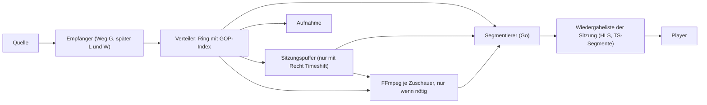

# Konzept 28 · Streaming und schnelles Umschalten

Stand: 28. November 2026 · Fassung 3 · Status: Entwurf nach Review 1 und Abgleich mit den Folgedokumenten, nicht freigegeben

Dieses Dokument beschreibt den Weg eines Fernsehsenders von der Quelle bis zum Bild: wie der Server jede Art
von Quelle empfängt, wie er den Strom intern verteilt, in welcher Form er ihn an Browser, Handy und Fernseher
ausliefert, woraus sich die Umschaltzeit zusammensetzt und wie sie gemessen wird. Es führt die tragenden
Entscheide T-1 bis T-29 aus `04-architektur.md` aus und ändert keinen davon. Fassung 2 hat die Reviews
eingearbeitet, Fassung 3 die Rückmeldungen der Folgedokumente und die Nachprüfung der Quellen
(`anhang/nachpruefung-quellen.md`). Was sich geändert hat, steht in `04`, Abschnitt 13; **alle massgeblichen
Zahlen stehen in `04`, Abschnitt 14**. Wo hier ein Wert steht, ist es derselbe.

Einordnung jeder Aussage: **gebaut** (mit Datei und Zeile, Stand `origin/main` 1220769b), **spezifiziert**
(dieses Konzept), **Empfehlung**, **Annahme**, **offen** (F-n, O-n), **zu messen** (M-n). Nichts hier ist
gebaut. **Kein Zielwert gilt als erreicht**; die vier Zielwerte des Auftrags sind Grössen, die der Benchmark
in Abschnitt 8 prüft. Angaben aus den Recherche-Berichten, die dort nicht nachgelesen wurden, stehen hier als
Annahme. Aussagen über das Verhalten von FFmpeg stammen aus der Dokumentation der neuesten Version oder aus
Kenntnis des Quelltexts und sind für die Fassung 7.1.4 des Images **nicht geprüft** (Widerspruch W-4 der
Recherche); sie gelten als Annahme, bis der genannte Messpunkt vorliegt.

«Belegt (Nachprüfung Nr. n)» heisst: Ein unabhängiger Prüfer hat die Aussage an der Quelle gelesen
(`anhang/nachpruefung-quellen.md`). Nicht geprüft und damit weiter Annahme sind unter anderem: das
Startverhalten von Safari, MP2, AC-3 und LATM in den Medienschnittstellen der Browser, die Kernel-Versionen für
Landlock und die meisten Vergleichssysteme.

Begriffe, einmal erklärt: **MPEG-TS** (TS) ist ein Strom aus Paketen zu 188 Byte. **PID** ist die Kennung
eines Teilstroms darin (Bild, eine Tonspur, Untertitel). **PAT** und **PMT** sind die Tabellen, die sagen,
welche PIDs zu einem Programm gehören. **Keyframe** ist ein Bild, das ohne Vorgänger dekodierbar ist;
**Bildgruppe** (GOP) reicht von einem Keyframe bis vor den nächsten. **HLS** ist eine Wiedergabeliste mit
kurzen Stücken (Segmenten). **SSRF** heisst: Jemand bringt den Server dazu, Adressen im Heimnetz abzurufen.
**DRM** ist Kopierschutz mit Lizenzserver.

## 1. Überblick

Vier Sätze für das Ganze: Go empfängt jeden Sender einmal und hält die letzten Sekunden bereit. Wer
einschaltet, bekommt einen Anlauf aus der letzten vollständigen Bildgruppe; deshalb steht das Bild sofort.
Passt der Strom zum Gerät, schneidet Go ihn nur in Stücke; sonst wandelt ein FFmpeg für genau diesen
Zuschauer um. Wer das Recht «Timeshift» hat, bekommt dazu seinen eigenen Puffer auf dem Datenträger;
Aufnahmen hängen am selben Empfang und wissen nichts von Zuschauern.

## 2. Empfänger je Protokoll

### 2.1 Drei Wege (T-3)

| Weg | Wer liest das Netz | FFmpeg beteiligt | Für | Stufe |
|---|---|---|---|---|
| **G** | Go, über den geschützten Dialer | nein | HTTP-TS, HLS mit TS-Segmenten, Xtream-Live | 1 |
| **G** | Go, lauschender Socket | nein | UDP, RTP, Multicast | 3 |
| **L** | Go mit einer Protokoll-Bibliothek, über den geschützten Dialer | nein | RTSP, RTMP (vorbehaltlich F-1) | spät |
| **W** | FFmpeg, aber nur unverschlüsseltes HTTP zum Go-Weiterleiter auf `127.0.0.1` | ja, als Empfänger; Ausgabe TS auf `pipe:1` | DASH; HLS mit fMP4-Segmenten oder getrennter Tonspur | **eigene späte Stufe, nur nach M-10** |

Alle Wege liefern denselben Rohstoff an den Verteiler: einen TS-Bytestrom mit genau einem Programm.

**Klar gesagt:** DASH und HLS mit fMP4 sind in den Stufen 1 bis 3 **nicht** enthalten. `03-fachkonzept.md`
führt DASH in Stufe 3; diese Zuordnung ist zu ändern (`04`, O-24). Sie kommen erst, wenn Weg W belegbar dicht
ist (2.6), sonst gilt F-13.

### 2.2 Übersicht je Protokoll

| Protokoll | Weg | Netzschutz | Zugangsdaten und Kopfzeilen | Wiederverbindung | DRM |
|---|---|---|---|---|---|
| **HTTP-TS** (Dauerstrom, auch Xtream `.ts`) | G | Go-Dialer prüft jede aufgelöste Adresse, auch nach jeder Weiterleitung (höchstens 5, nur `http` und `https`) | setzt Go, nur für die festen Ursprünge der Quelle (2.4) | Go, Leiter nach `04` Abschnitt 5.3; Stillstand nach 10 s ohne Daten | keine Kennzeichnung möglich; verschlüsselte Bild- oder Tonpakete erkennt der Verteiler am Kennzeichen im Paketkopf und meldet «verschlüsselt» |
| **HLS, TS-Segmente** | G | wie oben, für Liste, jede Unterliste, jedes Segment und jeden Schlüssel einzeln | wie oben | Go lädt die Liste nach; Segmentfehler: nächstes Segment, nach 3 Fehlern in Folge Abbruch | Go liest die Liste: Regel in 2.5; geprüft bei jedem Nachladen |
| **Xtream-Live** | G | Abfragen der Schnittstelle über den geschützten HTTP-Client; die Ströme sind HTTP-TS (bevorzugt) oder HLS | Benutzer und Passwort verschlüsselt; die Stream-Adresse entsteht erst beim Verbinden im Speicher, **nur aus dem Host, den der Administrator eingetragen hat** | wie HTTP-TS oder HLS | wie HTTP-TS oder HLS |
| **UDP** (Unicast) | G | kein ausgehender Verbindungsaufbau: Der Server lauscht. Regeln in 2.3 | keine | zustandslos: 10 s ohne Paket gilt als Stillstand | – |
| **RTP** | G | wie UDP; Go entfernt den RTP-Kopf und zählt Lücken. **Der Empfänger sendet nichts**, auch keine Rückmeldungen (RTCP). | keine | wie UDP | – |
| **Multicast** | G | wie UDP; Beitritt zur Gruppe auf der gewählten Netzschnittstelle, wo die Quelle es zulässt nur von einer bestimmten Absenderadresse | keine | wie UDP; Beitritt wird beim Wiederaufbau erneuert | – |
| **RTSP** | L (F-1) | Go-Dialer; **nur TCP**, kein Rückfall auf UDP; Weiterleitungen des Servers verbindet Go selbst und prüft sie; nennt der Server eine andere Zieladresse für den Datenkanal, wird abgelehnt | im Speicher; Anmeldung führt die Bibliothek | Go, Leiter | kein DRM in diesem Protokoll |
| **RTMP** | L (F-1) | Go-Dialer (TCP, bei `rtmps` mit TLS) | im Speicher | Go, Leiter | verschlüsselte Varianten (`rtmpe`) werden abgelehnt |
| **HLS, fMP4 oder getrennter Ton** | W | Weiterleiter holt alles selbst über den geschützten Dialer (2.6) | setzt der Weiterleiter, nur für die festen Ursprünge | Go startet den Prozess neu (Leiter), wenn er abbricht oder 10 s nichts liefert | Go liest jede Liste, bevor FFmpeg sie sieht |
| **DASH ohne DRM** | W | wie oben | wie oben | wie oben | Go liest jedes Manifest zuerst selbst: jede `ContentProtection` führt zur Ablehnung |

Was nicht in der Tabelle steht, wird nicht empfangen: SRT (im Image nicht vorhanden, M1), `rtmpe`, `file`,
`ftp`, `gopher`, `mms`, Plattform-Streams (YouTube, Twitch), alles mit DRM. Für RTP mit eigener
Sitzungsbeschreibung, Fehlerkorrektur nach SMPTE 2022 und TS-Pakete mit 204 Byte gilt: nicht unterstützt in
der ersten Stufe mit UDP (O-15).

### 2.3 Netzschutz im Einzelnen

**Grundsatz (T-5).** Öffentliche Adressen sind erlaubt. Eine lokale Adresse nur, wenn sie in den **festen
Zielen der Quelle** liegt; Loopback, Link-Local, die Metadaten-Adressen und die eigenen Adressen des Servers
nie. Die Regel und ihre Form stehen in `04`, Abschnitt 10.9. Die Prüfung sitzt am Verbindungsaufbau, nach der
Namensauflösung, und sieht so jede Adresse, die wirklich angewählt wird, auch nach Weiterleitungen und bei
einem Namen, der zwischen zwei Anfragen auf eine andere Adresse zeigt. Der Kern ist gebaut:
`server/internal/netguard/netguard.go:73-82`; abgelehnt werden heute Loopback, private Bereiche, Link-Local,
Multicast, CGNAT und die IPv6-Präfixe mit eingebetteter IPv4-Adresse (`netguard.go:34-54`). Das Radio nutzt
denselben Schutz für Ströme, Listen und Segmente (`server/internal/radio/reader.go:53-81`).

| Punkt | Regel (spezifiziert) |
|---|---|
| Jede Verbindung | Liste, Sender, Weiterleitung, Unterliste, Segment und Schlüssel sind je eine eigene Anfrage über den Dialer **dieser** Quelle. Eine Quelle kann den Server weder über eine Weiterleitung noch über eine Segmentadresse an ein Ziel schicken, das nicht öffentlich ist und nicht zu ihren festen Zielen gehört. |
| Verbindungsvorrat | ein HTTP-Transport je Quelle und Regelstand, geschlossen bei geänderter Regel. Kein geteilter Vorrat: Sonst bekäme eine Quelle «nur öffentlich» eine offene Verbindung, die für eine freigegebene Quelle zum selben Gerät aufgebaut wurde, ohne dass die Prüfung noch einmal läuft. |
| Weiterleitungen | höchstens 5, jede neu geprüft, nur `http` und `https` (gebaut als Muster: `reader.go:32-38`, `:70-78`). Wechselt der Ursprung, fallen die Geheimnisse weg (2.4). Eine Weiterleitung von `https` nach `http` bricht **immer** ab. |
| HLS: Takt und Ketten | Nachladen frühestens nach dem grösseren Wert aus 1 Sekunde und der halben Zieldauer; Zieldauer höchstens 60 Sekunden; höchstens 32 Varianten; Unterlisten höchstens 3 Ebenen tief, zusammen mit Weiterleitungen höchstens 5 Sprünge. Eine Liste mit Zieldauer 0 oder eine Kette im Kreis bricht mit einem stabilen Fehlercode ab. |
| Grössen und Fristen | Wiedergabeliste höchstens 1 MiB (gebaut: `radio/hlssrc.go:25`), Segment höchstens 64 MiB (Annahme; das Radio hat 2 MiB für Ton, `hlssrc.go:27`), Kopfstück höchstens 1 MiB, Schlüssel genau 16 Byte bei Transportverschlüsselung (wie `12`), Kopf der Antwort innert 15 s, Lesestillstand 10 s. |
| Senderlisten und Xtream (Import) | M3U höchstens 200 MiB (ein Wert für Abruf und Hochladen), Zeile höchstens 64 KiB, höchstens 200'000 Einträge, Merkmal höchstens 4 KiB, ungültige Zeichen werden ersetzt, Import höchstens 10 Minuten. Xtream-Antworten werden streamend gelesen, höchstens 200 MiB, Schachtelung höchstens 32 tief. Geschrieben wird in Stapeln von 500 Zeilen. Alle Zahlen sind Annahmen; Einzelheiten in `15` und `12`. |
| Sprünge in der Segmentfolge | Macht die Quelle einen Sprung von mehr als 10 Segmenten, beginnt der Empfänger am Ende neu (gebaut als Muster: `hlssrc.go:29-31`). |
| Inhalt statt Etikett | Was eine Antwort ist (TS, HLS-Liste, Senderliste, HTML-Fehlerseite), entscheidet Go am Inhalt der ersten Bytes, nie an Endung oder Typangabe (R3 Abschnitt 1.3; gebaut als Muster im Radio, `hlssrc.go:20-22`). |
| IPv6 und weitere Präfixe | `netguard` bekommt weitere nie öffentliche Präfixe (`04`, Abschnitt 10.9). Eine weltweit gültige IPv6-Adresse eines Geräts im Heimnetz ist nicht erkennbar und wird nicht abgelehnt; diese Lücke besteht heute schon (`netguard.go:44-47`). Im Bridge-Netz ohne IPv6 ist sie praktisch geschlossen, im Netzmodus «host» nicht. |
| UDP, RTP, Multicast | Es gibt keinen Verbindungsaufbau nach aussen, also greift der Dialer nicht. Stattdessen: nur als festes Ziel der Quelle; der Socket bindet an die Adresse **einer gewählten Schnittstelle**, nie an alle; Port ab 1024; Gruppenadresse muss im Multicast-Bereich liegen; Beitritt wo möglich nur für eine bestimmte Absenderadresse; der Empfänger sendet nichts; Obergrenze für Pakete und Bytes je Sekunde beim Doppelten der gemessenen Bitrate, Überschuss wird verworfen und gezählt. **Ehrlich gesagt: Eine Absenderadresse lässt sich im selben Netz fälschen.** Die Prüfung des Absenders hält Irrläufer ab, keinen Angreifer im Heimnetz. Eine UDP-Quelle vertraut jedem Gerät im selben Netz; das Bild sehen auch Profile mit Altersgrenze, und es wird aufgenommen. Die Verwaltung sagt das wörtlich; empfohlen wird ein eigenes Netz für Multicast. |
| Logos und EPG-Bilder | laufen nicht über den Empfänger, sondern über den bestehenden geschützten Abruf mit Grössengrenze (Muster `radio/logo.go`), **immer nur öffentlich**, gedrosselt und erst, wenn ein Sender aktiv ist. Ein Bild wird zuerst mit den Decodern von Go vollständig gelesen; nur was das besteht, geht zum Skalieren an FFmpeg (Empfehlung). |

### 2.4 Zugangsdaten, Kopfzeilen, User-Agent

Die Regeln stehen als T-28 in `04`, Abschnitt 10.5. Für den Empfang heisst das:

- **Im Speicher, kurz vor dem Verbinden:** Adresse, Benutzer, Passwort und Kopfzeilen werden erst dann
  entschlüsselt. In Weg G und L gibt es keinen Prozess; in Weg W steht in der Argumentliste nur ein Ersatzpfad
  (2.6). In keinem Fall erscheint eine Anbieter-Adresse, ein Passwort oder eine Kopfzeile in
  `/proc/<pid>/cmdline`.
- **Nur an die festen Ursprünge:** Zugangsdaten und Kopfzeilen gehen nur an Schema, Host und Port, die für die
  Quelle bestätigt sind (ab Werk der Host der eingetragenen Adresse). Nennt eine Liste einen Sender oder ein
  Segment auf einem anderen Host, bekommt dieser nur User-Agent und `Accept`. Das gilt auch für jeden Sender
  einer Senderliste: Seine Adresse erbt die Kopfzeilen der Quelle nur, wenn ihr Host zu den Ursprüngen gehört.
- **Weiterleitungen:** Die Standardbibliothek von Go entfernt bei einem Wechsel des Hosts nur `Authorization`
  und `Cookie`. Der Empfänger setzt deshalb eine eigene Prüfung: Wechselt der Ursprung, fallen alle Kopfzeilen
  ausser User-Agent, `Accept` und `Range` weg. **Führt eine Weiterleitung von `https` nach `http`, bricht der
  Abruf immer ab,** auch bei Quellen ohne Zugangsdaten: Auf einer unverschlüsselten Strecke könnte jeder
  dazwischen das Bild austauschen. Eingetragene `http`-Quellen bleiben erlaubt; verboten ist nur der stille
  Wechsel. Fassung 2 brach nur bei Quellen mit Geheimnissen ab; die strengere Regel folgt `12` (dort Frage
  F-2).
- **Kopfzeilen aus der Liste:** Aus Zusatzzeilen einer Senderliste übernimmt der Import nur `User-Agent` und
  `Referer` (je höchstens 256 Zeichen). Alles andere, auch `Authorization` und `Cookie`, wird verworfen.
- **User-Agent:** je Quelle einstellbar (kein Geheimnis), Vorgabe `Slouchcat/<Version>`.
- **Protokoll und Antworten:** Von einer Quelle steht im Protokoll nur Schema und Host
  (`netguard.go:132-138`). Kein Endpunkt liefert je eine Quelladresse oder den Wert einer Kopfzeile, auch
  nicht an die Verwaltung.

### 2.5 DRM erkennen und ablehnen

Der Server lehnt ab und versucht nichts zu umgehen. Regel für HLS, geprüft beim Anlegen, beim Start und bei
jedem Nachladen der Liste:

| Befund in der Liste | Entscheid |
|---|---|
| kein `EXT-X-KEY`, oder `METHOD=NONE` | spielen |
| `METHOD=AES-128`, Schlüsselformat fehlt oder ist `identity`, Schlüsseladresse ist `http` oder `https` | spielen: Das ist Transportverschlüsselung, den Schlüssel gibt die Quelle jedem angemeldeten Abrufer. Go holt ihn über den geschützten Dialer und entschlüsselt selbst (Standardbibliothek). |
| `METHOD=SAMPLE-AES`, `SAMPLE-AES-CTR`, `SAMPLE-AES-CENC`; Schlüsselformat ungleich `identity`; Schlüsseladresse mit `skd://` oder als `data:` | ablehnen, Quelle bekommt den Zustand «DRM» |
| `EXT-X-SESSION-KEY` mit denselben Merkmalen | ablehnen |
| Hinweise der Senderliste auf Lizenzdaten (`#KODIPROP` mit `license_type` oder `license_key`) | beim Import als «DRM, nicht unterstützt» markieren; Schlüssel werden nie gespeichert |

Für DASH: Jedes Element `ContentProtection` bei den gewählten Darstellungen führt zur Ablehnung. Die Optionen
von FFmpeg zum Entschlüsseln mit vorgegebenem Schlüssel setzt der Server nie, und es gibt kein Eingabefeld
dafür.

Die Unterscheidung stammt aus R3 Abschnitt 5. Die Aussagen zur HLS-Spezifikation über die Arten der
Verschlüsselung und die Regeln zu DRM sind **auch in der Nachprüfung nicht nachgelesen** (dort «Quelle nicht
abgerufen; rechtlich zu klären») und gelten als **Annahme**, bis `12-sicherheit.md` sie belegt. Belegt ist
nur, dass Media3 `AES-128` spielt und `SAMPLE-AES` nicht (Nachprüfung Nr. 17); das betrifft den Empfang nicht,
weil der Server selbst entschlüsselt. Der Grenzfall `SAMPLE-AES` mit `identity` wird vorsichtig abgelehnt
(O-16).

### 2.6 Entscheid: Gilt «FFmpeg sieht keine Adresse» weiter?

**Ausgangslage (gebaut).** Heute bekommt FFmpeg nie eine Netzadresse: Jede Argumentliste nennt einen absoluten
Pfad oder eine Pipe (A2 Abschnitt 0, Punkt 3). Für das Radio ist das als Regel festgehalten (ADR 0025,
Punkt 2; `server/internal/transcode/radio.go:18-21`, `:79`).

**Entscheid (T-4).** Die Regel gilt für Live-TV fort:

> FFmpeg bekommt nie eine Anbieter-Adresse, nie Zugangsdaten und nie eine Kopfzeile, weder in der
> Argumentliste noch in Daten, die es liest, und es öffnet keine Verbindung, die nicht Go gewählt und geprüft
> hat.

Daraus folgt:

1. **Umwandlung, Probe, Normalisierung:** nur Pipes, festes Eingangsformat (`-f mpegts`),
   `-protocol_whitelist pipe`, wie beim Radio. Keine Ausnahme.
2. **Empfang in Weg G und L:** kein FFmpeg.
3. **Empfang in Weg W: die eine benannte Ausnahme,** enger als in Fassung 1 und in Fassung 3 genauer gefasst.

**Weg W (spezifiziert; wird nur gebaut, wenn M-10 ihn belegt).**

Fassung 1 liess FFmpeg für absolute `https`-Adressen einen Tunnel durch den Weiterleiter bauen. Beide Reviews
haben gezeigt, dass der Weiterleiter dann nur verschlüsselte Bytes sieht: keine DRM-Prüfung, keine
Grössengrenzen, keine Zertifikatsprüfung durch Go (RA-06, RS-02). Seit Fassung 2 gibt es keinen Tunnel; Fassung 3
legt fest, wie FFmpeg den Weiterleiter erreicht (Ersatzpfad) und was die Sperre wirklich leistet:

| Punkt | Festlegung |
|---|---|
| Was FFmpeg spricht | ausschliesslich unverschlüsseltes HTTP mit dem Go-Weiterleiter auf `127.0.0.1`. Der Weiterleiter lehnt `CONNECT` mit 403 ab. |
| Ersatzpfad | Jede Adresse, die FFmpeg zu sehen bekommt, zeigt **direkt auf den Weiterleiter**: `http://127.0.0.1:<Port>/<Zufall>/…`. Je Host, der in Listen oder Manifesten vorkommt, vergibt der Weiterleiter einen eigenen zufälligen Pfadanfang und merkt sich, wofür er steht. FFmpeg sieht keinen echten Host, auch nicht in seiner Fehlerausgabe. **Eine Proxy-Einstellung braucht es nicht.** Fassung 2 arbeitete mit einem Ersatznamen als Host und liess offen, wie FFmpeg damit zum Weiterleiter findet (`12` O-5); die Antwort «über eine Proxy-Einstellung» hätte daran gehangen, dass FFmpeg sie in jeder Unteranfrage beachtet. |
| Umschreiben | Der Weiterleiter holt jede Liste und jedes Manifest selbst und schreibt **jede** Adresse darin auf einen Ersatzpfad um, bevor FFmpeg sie liest: bei HLS die Adresszeilen und die Adress-Merkmale von Schlüssel, Kopfstück, Tonspuren und Bildlisten; bei DASH Basisadresse, Ortsangabe, die Vorlagen für Segmente und Kopfstück, einzelne Segmentadressen. Auch relative Adressen werden zu vollständigen Ersatzpfaden. Was er nicht sicher umschreiben kann, lehnt er ab. |
| TLS | endet immer in Go, mit dessen Zertifikatsprüfung. FFmpeg prüft Zertifikate nach unserem Wissen ab Werk nicht (Annahme). |
| Weiterleitungen | folgt der Weiterleiter selbst, geprüft wie in 2.3. FFmpeg bekommt nie eine Antwort «weitergeleitet». |
| Prüfung des Inhalts | Der Weiterleiter liest jede Liste und jedes Manifest (DRM-Regel 2.5, Grössengrenzen 2.3). Ein DASH-Manifest mit Dokumenttyp- oder Entitätsangabe wird verworfen, bevor der XML-Leser von FFmpeg es sieht. Segmente mit Transportverschlüsselung entschlüsselt der Weiterleiter selbst und nimmt die Schlüsselzeile aus der Liste. |
| Argumentliste | Ersatzpfad als Eingang, festes Eingangsformat (`-f hls` oder `-f dash`), `-protocol_whitelist http,tcp`, Auswahl der Spuren nur über Zahlen, `-c copy -f mpegts pipe:1`. Kein `https`, `tls`, `httpproxy`, `crypto`, `data`, `file`. Der HLS-Leser von FFmpeg 7.1.4 nimmt in Listen ohnehin nur `http`, `https`, `file` und `data` an (belegt, Nachprüfung Nr. 27); mit der Liste bleibt davon `http`. |
| Warum `tcp` in der Liste bleibt | Belegt am Quelltext von FFmpeg 7.1.4 (Nachprüfung Nr. 24): Die untere Schicht von `http` heisst `tcp` und wird gegen dieselbe Liste geprüft; ohne `tcp` scheitert jede HTTP-Verbindung, auch die zum Weiterleiter. Dass `tcp` nicht für anderes taugt, sichert die nächste Zeile, nicht die Liste. |
| **Sperre des Prozesses** | Der FFmpeg-Empfänger läuft in einer Sperre des Kernels, die die Hülle vor dem Start setzt (`04`, Abschnitt 10.8): kein Lesezugriff auf `/config`, Schreiben nirgends, kein UDP und keine rohen Sockets, TCP nur zu **einem Port**, dem des Weiterleiters. **Was das heisst und was nicht:** Landlock regelt TCP nach Port, nicht nach Adresse (belegt, Nachprüfung Nr. 34). FFmpeg kann damit keine Verbindung zu einem anderen Port öffnen, wohl aber zu einem **anderen Rechner auf demselben Port**. Der Weiterleiter lauscht auf einem zufälligen hohen Port; dass im Heimnetz oder im Internet zufällig etwas Brauchbares auf genau diesem Port antwortet, ist unwahrscheinlich, aber nicht ausgeschlossen (Restrisiko, `12` R-3). **Die Sperre wird hart gesetzt:** Fehlt dem Kernel ein Teil, startet der Empfänger nicht. Ohne diese Sperre bleibt Weg W aus (F-13). |
| Zugang zum Weiterleiter | Der Weiterleiter beantwortet nur Ersatzpfade, die er selbst vergeben hat; ein Ersatzpfad ist ein zufälliges Geheimnis des einen Empfängers und stirbt mit ihm. Alles andere: 404. Er lehnt `CONNECT` und jede Anfrage in Proxy-Form ab. |
| Netzmodus «host» | Weg W ist dort gesperrt: `127.0.0.1` wäre das Loopback des Docker-Hosts, und Ersatzpfade stünden in dessen Prozessliste. |
| Fehlerausgabe und Umgebung | Die Fehlerausgabe wird nie roh gespeichert oder protokolliert (`04`, Abschnitt 10.4); sie enthält ohnehin nur Ersatzpfade. Die Umgebung des Prozesses enthält weder `http_proxy` noch `no_proxy`; FFmpeg liest beide sonst selbst (belegt, Nachprüfung Nr. 25). |
| Langläufer | Ein FFmpeg-Empfänger wird sofort ersetzt, wenn sein Speicherbedarf eine Grenze überschreitet, spätestens nach 24 Stunden und nie über einen Überlauf der Quellzeit hinweg (`04`, Abschnitt 7.5). Ob er öfter ersetzt werden muss, zeigt M-12 (O-20). |

**Der Beleg M-10** ist eine feindliche Testmenge: absolute `http`-, `https`-, `tcp`-, `file`- und
`data`-Adressen, Adressen im Heimnetz als Zahlen, Weiterleitungen auf lokale Adressen, Unterlisten in drei
Ebenen, Schlüssel und Kopfstücke auf fremden Hosts, relative Adressen mit `..`. Bestanden ist er, wenn die
Mitschrift **aller** Verbindungsversuche des FFmpeg-Prozesses nur `127.0.0.1` mit dem Port des Weiterleiters
zeigt, und zwar **schon ohne Sperre**: Die Sperre ist die zweite Sicherung, nicht die erste.

**Was dabei eine Annahme bleibt:** dass der HLS- und der DASH-Leser von FFmpeg 7.1.4 mit umgeschriebenen
Listen und Manifesten (auch mit Vorlagen für Segmentnummern und Zeiten) zurechtkommen; dass der DASH-Leser für
Live-Manifeste stabil genug ist und in Manifesten wie der HLS-Leser nur die genannten Arten von Adressen
annimmt (M-11); welche Regeln der Kernel von CT 190 und das Profil von Docker zulassen (M-25).

**Ehrliche Zusammenfassung.** «FFmpeg öffnet keine Verbindung, die Go nicht gewählt hat» ist mit diesem Aufbau
dreifach gesichert, aber nicht bewiesen: (1) FFmpeg kennt nur Adressen des Weiterleiters; (2) die
Protokoll-Liste lässt nur `http` über `tcp` zu; (3) die Sperre lässt nur einen Port zu. Übrig bleibt ein
gekaperter FFmpeg, der einen fremden Rechner auf genau diesem Port anwählt. Er hat dabei keine Geheimnisse des
Servers und keine Zugangsdaten der Quelle, kann aber Daten der Sendung nach aussen tragen oder einen einzelnen
Port im Heimnetz ansprechen. Wer das nicht tragen will, wählt in F-13 die Variante «Go liest selbst».

**Alternativen, falls Weg W nicht belegbar dicht ist** (F-13): (a) nur mit Sperre anbieten; (b) Go liest auch
DASH und HLS mit fMP4 selbst und gibt FFmpeg die Daten über Pipes zum Umpacken, dann gilt ADR 0025 ohne jede
Ausnahme, zum Preis von deutlich mehr eigenem Protokollcode; (c) gar nicht anbieten, als Abstrich an LTV-003,
der von dir kommen müsste.

**RTSP und RTMP** sind kein Teil dieser Ausnahme. Für sie steht die Frage F-1 in `04`, Abschnitt 12.3.

### 2.7 Vom Empfänger zum Verteiler

Jeder Empfänger tut vor der Übergabe drei Dinge, alle in Go mit der Bibliothek `live/mpegts` (Anforderungen in
`04`, Abschnitt 3.2):

1. **Paketgrenzen finden** (Synchronbyte im Abstand von 188 Byte, dreimal bestätigt) und nach einem Abbruch
   neu finden. Halbe Pakete werden verworfen.
2. **Ein Programm auswählen.** Enthält der Strom mehrere Programme (bei Multicast üblich), bleibt nur das
   Programm des Senders; die Programmtabelle wird auf dieses eine Programm neu geschrieben. Alle PIDs dieses
   Programms bleiben erhalten (Bild, alle Tonspuren, Untertitel, Teletext, Daten), damit die Aufnahme nichts
   verliert (LTV-020).
3. **Diskontinuität oder Zeitabschnitt melden** (3.4).

Jede Go-Routine eines Empfängers fängt Programmfehler an ihrer Wurzel ab: Ein Paket, das den Leser zum Absturz
brächte, beendet den Empfang dieses Senders mit dem Fehler «Quelle liefert ungültige Daten» und Quarantäne,
nicht den Server (T-27).

## 3. Interne Verteilung

### 3.1 Aufbau des Verteilers

Je empfangenem Sender gibt es einen Verteiler (T-6). Er besteht aus:

| Teil | Inhalt | Grösse |
|---|---|---|
| **Ring** | TS-Pakete in Ankunftsreihenfolge in einem festen Bereich, im Kreis beschrieben. Jede Stelle hat eine fortlaufende 64-Bit-Position, die nie zurückspringt. | einmal je Zeitabschnitt angelegt: gespeicherte Bitrate × 15 s × 1,03; ohne gespeicherte Bitrate für 8 Mbit/s (rund 15,5 MB). Ein Ring wächst nie an Ort; bei einem neuen Zeitabschnitt wird neu reserviert. |
| **GOP-Index** | je Keyframe: Position im Ring, entfaltete Zeit, Uhrzeit der Ankunft, Zeitabschnitt, Art des Einstiegspunkts | so viele Einträge, wie Keyframes im Ring liegen |
| **Tabellen-Zwischenspeicher** | letzte PAT und PMT als fertige Pakete | wenige hundert Byte |
| **Messwerte** | Bytes je Sekunde, Zählerfehler je PID, letzte Ankunft, Fortschritt der Zeitstempel je PID, Bildgruppen-Länge, Verschlüsselungskennzeichen | fest |
| **Leser** | je Abnehmer eine Position | fest |

**Wo der Ring liegt** (T-25, F-2): ab Werk im Arbeitsspeicher des Servers, als Bereich ausserhalb der
Speicherverwaltung von Go (anonyme Speicherabbildung). So zählt er genau gegen das Byte-Budget, und die
Speicherbereinigung von Go muss ihn weder durchsuchen noch mit Reserve einplanen; der Server setzt heute keine
Speichergrenze für Go (keine Fundstelle für `GOMEMLIMIT` in `server/` und `deploy/`). Wählt der Administrator
einen Ordner, ist der Ring eine Datei fester Grösse je Sender in diesem Ordner, mit denselben Regeln; der
Empfänger schreibt dann über einen kleinen Zwischenspeicher und lässt den Ring aus, wenn der Ordner stockt
(der Sender hat so lange keinen schnellen Start, der Empfang und die Abnehmer am aktuellen Rand laufen aus dem
Zwischenspeicher weiter).

Der Ring gibt es ab Stufe 1, weil ohne ihn nichts zu verteilen ist. Seine Rolle als **Startpuffer für
vorgehaltene Sender** (dauerhaft, automatisch, vorgeladen) und der wählbare Speicherort kommen mit Stufe 3.

### 3.2 Keyframes erkennen

Ein Eintrag im GOP-Index entsteht, wenn ein Bildpaket als wahlfreier Einstiegspunkt erkannt ist:

1. zuerst über das Kennzeichen im Paketkopf (`random_access_indicator`);
2. fehlt es, durch Lesen des Bildpakets **bis zum ersten Bild-Element**: Davor stehen Trenner, Zusatzdaten und
   Bildparameter, und das erste Bild-Element liegt oft mehrere TS-Pakete hinter dem Anfang; Startcodes können
   über Paketgrenzen laufen. Gesucht wird bei H.264 ein IDR-Bild oder ein Bild mit Wiedereinstiegs-Kennzeichen,
   bei HEVC ein IRAP-Bild, bei MPEG-2 ein Sequenzkopf mit I-Bild;
3. ein Einstiegspunkt zählt nur, wenn die Bildparameter (bei H.264 SPS und PPS, bei HEVC zusätzlich VPS, bei
   MPEG-2 der Sequenzkopf) im selben Bild mitkommen;
4. **offene Bildgruppen** werden gekennzeichnet: Ein Einstiegspunkt, nach dem Bilder folgen, die auf frühere
   verweisen (HEVC-CRA, MPEG-2 ohne geschlossene Bildgruppe, H.264 mit Wiedereinstiegspunkt), ergibt am Start
   kurz nicht dekodierbare Bilder. Geschlossene Einstiegspunkte werden für den Start vorgezogen, wenn einer im
   Ring liegt.

Quellen, die Punkt 3 selten oder nie erfüllen, bekommen keinen schnellen Start. Für sie ist der Rückfall
«Strom normalisieren» vorgesehen (`04`, O-2): ein FFmpeg zwischen Empfänger und Verteiler, nur über Pipes
(der Filter `dump_extra` ist im Image vorhanden, M1). Wie häufig solche Quellen sind, zeigt M-2.

### 3.3 Programmtabellen

Ein neuer Abnehmer bekommt immer zuerst PAT und PMT aus dem Zwischenspeicher und dann die Pakete ab seinem
Startpunkt. Die Zähler der eingefügten Tabellenpakete werden an den Strom angepasst, sonst zählte die eigene
Überwachung Fehler. Eine neue **Versionsnummer** der PMT allein löst nichts aus: Sie ändert sich auch, wenn nur
Beschreibungen wechseln (Annahme, M-2). Massgeblich ist, ob sich die Menge der PIDs, ein Codec oder die
Bildparameter geändert haben (3.4).

### 3.4 Zeitbasis, Überlauf, Diskontinuität, Zeitabschnitt

- **Zeitstempel im TS** sind 33 Bit breit bei 90'000 Schritten je Sekunde und laufen nach rund 26,5 Stunden
  über (Rechnung: 2³³ ÷ 90'000 s). Go **entfaltet** sie je Sender zu einer 64-Bit-Zeit. GOP-Index, Fenster des
  Zeitversatzes, Schnitte von Aufnahmen und alle Dauern rechnen nur mit dieser Zeit.
- **Die Pakete selbst bleiben unverändert** (Originalqualität). Im Direktweg kommt der Überlauf also beim
  Player an. Ob hls.js, Safari und Media3 den Überlauf mitten in einem Segment ohne Störung verkraften, ist zu
  messen (M-22). Rückfall: eine Diskontinuität am ersten Keyframe nach dem Überlauf.
- **FFmpeg sieht nie einen Überlauf.** FFmpeg behandelt ihn laut einer Quelle von 2019 genau einmal (ein
  zweiter nach rund 53 Stunden bräche); für 7.1.4 ist es offen (Nachprüfung Nr. 29, M-22). Regel: Kein
  FFmpeg-Lauf geht über einen Überlauf der Quellzeit (Go kennt den Zeitpunkt und startet den Prozess am ersten
  Keyframe danach neu), und kein Lauf dauert länger als 24 Stunden (`04`, Abschnitt 7.5).
- **Diskontinuität:** ein Sprung der Zeit bei gleichen Parametern. Sie entsteht bei einer neuen Verbindung zur
  selben Quelle, bei einer Diskontinuität der Quelle (bei HLS: `EXT-X-DISCONTINUITY`, bei Sendern mit
  Werbeeinblendungen mehrmals je Stunde) und bei einem Zeitsprung von mehr als 2 Sekunden gegen die Erwartung
  (Annahme). Folgen: in der Wiedergabeliste `EXT-X-DISCONTINUITY`; die Aufnahme bleibt **im selben Teil** und
  vermerkt den Sprung im Verzeichnis; eine laufende Umwandlung läuft weiter, wenn FFmpeg den Sprung im
  TS-Eingang sauber übernimmt (M-9), sonst startet sie neu.
- **Zeitabschnitt:** ein Stück Strom mit gleichen Spuren und Parametern. Ein neuer beginnt nur bei geänderter
  Menge der PIDs, geändertem Codec, geänderten Bildparametern (Grösse, Zeilensprung) und bei einem Wechsel der
  Quelle. Folgen: die Aufnahme beginnt einen neuen Teil; Sitzungen berechnen ihren Entscheid neu; laufende
  Umwandlungen starten neu; der Ring wird neu reserviert; eine neue Probe läuft. **Reicht das Byte-Budget für
  den grösseren Ring nicht,** gibt die Stromverwaltung nach der Rangfolge frei; reicht auch das nicht, behält
  der Strom seinen bisherigen Ring und hat einen kürzeren Startpuffer. Ein gehaltener Strom endet deswegen nie
  (`04`, Abschnitt 5.3).
- **Uhrzeit:** Jeder Indexeintrag trägt die Uhrzeit der Ankunft. Daraus entsteht in der Wiedergabeliste
  `EXT-X-PROGRAM-DATE-TIME`, mit dem alle drei Player die Stelle als Uhrzeit kennen.

### 3.5 Leser, Rückstau und der langsame Abnehmer

**Leseprotokoll (T-8).** Der Schreiber wartet nie und nimmt keine Sperre, die ein Leser halten könnte.

1. Ein Leser kopiert den Bereich ab seiner Position in eigenen Speicher.
2. Danach prüft er die Schreibposition: Hat der Schreiber den Bereich inzwischen überschrieben, verwirft der
   Leser die Kopie und meldet «überrundet».
3. Ein überrundeter Leser bekommt einen neuen Startpunkt am nächsten Keyframe; bei seinem Abnehmer steht dann
   eine Diskontinuität oder eine Lücke.
4. Der GOP-Index wird unter einer kurzen Lesesperre gelesen; der Schreiber hält die Sperre nur zum Eintragen
   und Verwerfen eines Eintrags.
5. «Neue Daten» ist ein Kanal, der geschlossen und ersetzt wird (Muster gebaut:
   `server/internal/transcode/manager.go:95`, `:275-278`), kein Signal je Leser.

**Wer liest:**

| Leser | Eigener Rückstau im Arbeitsspeicher | Wenn er nicht nachkommt |
|---|---|---|
| Schreiber einer Aufnahme | bis 64 MiB oder 60 Sekunden bei der gespeicherten Bitrate, das Kleinere; gezählt gegen das Byte-Budget, **sobald er gebraucht wird** (nicht beim Start reserviert, `04` Abschnitt 8.1) | erst wenn der Rückstau voll ist: Lücke «Datenträger zu langsam» in der Aufnahme |
| Schreiber eines Sitzungspuffers | bis 16 MiB | Diskontinuität im Sitzungspuffer |
| Zuführer einer Umwandlung ohne Zeitversatz | bis 8 MiB | Sprung nach vorn; die Sitzung meldet «zu langsam» |
| Segmentabruf einer Sitzung ohne Zeitversatz | keiner: Der Server liest und sendet in Blöcken von 256 KiB und prüft jeden Block nach; nie liegt ein ganzes Segment im Speicher. Höchstens zwei Abrufe je Sitzung gleichzeitig. Zählt nicht zum Byte-Budget (bei 20 Sitzungen rund 10 MB). | Block schon überschrieben: Die Antwort ist 404 oder bricht ab, der Player nimmt das nächste Segment |

Der Rückstau gehört genau einem Abnehmer und ist nur für ihn lesbar. Er trennt zwei Dinge, die Fassung 1
vermischt hatte: die Grenze gegen ein Archiv (15 Sekunden im Ring) und die Toleranz gegen einen Datenträger,
der kurz stockt (eine anlaufende Platte, ein Netzspeicher, der neu verbindet).

Ein langsamer **Client im Netz** kann nichts aufhalten: Er holt Segmente per HTTP, und jede Antwort ist eine
Kopie. Holt er zu langsam, fällt er aus seinem eigenen Fenster (404 für zu alte Segmente, der Player springt
nach vorn). Das ist der Abwurf «nur dieses Clients», den der Auftrag verlangt.

### 3.6 Grenzen

| Grenze | Wert | Art |
|---|---|---|
| Alter der Daten im Ring | höchstens 15 s | **die eine** harte Konstante; nach unten einstellbar (mindestens 4 s), nie höher |
| Grösse eines Rings | Bitrate × 15 s × 1,03, beim Start reserviert | folgt aus der Konstante; keine zweite Grenze in Byte |
| Byte-Budget | empfohlen ein Achtel des Arbeitsspeichers, ab Werk höchstens 512 MB. **Ringe** sind beim Start reserviert und dürfen zusammen höchstens drei Viertel belegen; **Rückstau** zählt bei Gebrauch und teilt sich den Rest (`04` Abschnitt 8.1). | einstellbar; Zulassung der Ringe mit Reservierung wie beim Radio (`server/internal/radio/buffer.go:67-70`, `listen.go:245-254`) |
| Wartezeit des Schreibers auf Abnehmer | null | Regel |

**Lange Bildgruppen.** «Letzte vollständige Bildgruppe» setzt voraus, dass eine in 15 Sekunden passt. Regel:

| Bildgruppe der Quelle | Was im Ring liegt | Start eines neuen Abnehmers |
|---|---|---|
| bis rund 7 s | mindestens eine vollständige und die laufende | an der letzten vollständigen: sofort ein ganzes Segment |
| 7 bis 15 s | zeitweise nur die laufende | am neuesten Keyframe; das erste Segment ist erst fertig, wenn die Bildgruppe endet («kein schneller Start») |
| über 15 s | zeitweise kein Keyframe | Warten auf den nächsten Keyframe der Quelle |

Der Sender gilt in allen drei Fällen als «läuft»; die Verwaltung zeigt die gemessene Bildgruppen-Länge und
«kein schneller Start».

**Arbeitsspeicher (Rechnung, Annahme).** Ein Ring hält 15 Sekunden und wird mit dem Faktor 1,03 reserviert:
bei 8 Mbit/s 15,45 MB, bei 20 Mbit/s (UHD) 38,6 MB.

| Empfangene Sender (HD, 8 Mbit/s) | Ringe | Eingang |
|---|---|---|
| 5 | 77 MB | 40 Mbit/s |
| 20 | 309 MB | 160 Mbit/s |
| 50 | 773 MB | 400 Mbit/s |
| 100 | 1545 MB | 800 Mbit/s |

Auf der Referenz (4 GB Arbeitsspeicher, daneben bis 564 MB für das Radio, `deploy/compose.yaml:39-40`) fasst
ein Budget von 512 MB rechnerisch 33 HD-Ringe (512 ÷ 15,45); weil Ringe höchstens drei Viertel belegen dürfen,
sind es **24** (384 ÷ 15,45), und ab Werk begrenzt ohnehin die Obergrenze von 8 Eingangsströmen. Wer mehr
dauerhaft empfangen will, hebt Obergrenze und Budget an, verkürzt den Ring (bei 6 Sekunden: 6,2 MB je
HD-Sender) oder braucht mehr Arbeitsspeicher; bei 100 Sendern begrenzt der Eingang. Die Szenarien des Auftrags
rechnet `13-ressourcen-und-performance.md`; die wirklichen Werte bringt M-13.

### 3.7 Der technische Startpuffer, der Anlauf und die Rückspulgrenze

Der technische Startpuffer **ist** der Ring (T-7). Sein Zweck: Ein neuer Abnehmer findet sofort eine
vollständige Bildgruppe vor und muss nicht auf den nächsten Keyframe der Quelle warten.

**Der Anlauf.** Eine Sitzung beginnt mit der letzten vollständigen Bildgruppe und dem Anfang der laufenden.
Das erste Bild liegt damit bis zu zwei Bildgruppen **vor** dem Tastendruck (bei 2 Sekunden je Bildgruppe bis
4 Sekunden, hart begrenzt auf 15 Sekunden). Ohne Anlauf gäbe es kein sofortiges Bild. Fassung 1 nannte hier
«höchstens zwei Bildgruppen» und begann doch an bis zu drei; das ist korrigiert.

**Die Rückspulgrenze (Vorgabe, F-7).** Die Grenze einer Sitzung ist der **Zeitpunkt des Einschaltens**, nicht
der Anfang des Anlaufs:

1. Die Segmente des Anlaufs stehen nur so lange in der Liste, bis sie Segmente enthält, die nach dem
   Tastendruck beginnen, höchstens 15 Sekunden.
2. Danach beginnt das Fenster der Sitzung am ersten Segment, das nach dem Tastendruck anfängt. Die Segmente
   des Anlaufs beantwortet der Server mit 404, für immer.
3. Die Zeitleiste der Oberfläche beginnt beim Tastendruck.

Was der Server nicht verhindern kann: In den ersten Sekunden hat der Player den Anlauf in seinem eigenen
Speicher und kann ihn noch einmal zeigen. Der Server liefert ihn danach nicht wieder.

**Die Trennung vom persönlichen Zeitversatz ist durch den Aufbau erzwungen:**

| Mittel | Wirkung |
|---|---|
| Eine harte Obergrenze (15 s) als Konstante im Code | Der Ring kann kein Archiv werden, auch nicht durch Fehlkonfiguration. |
| Flüchtig: im Arbeitsspeicher oder als Ringdatei, die im Kreis überschrieben und beim Ende des Empfangs gelöscht wird | Nach Neustart und nach Ende des Empfangs ist nichts mehr da. |
| Die Schnittstelle des Verteilers kennt für neue Abnehmer genau einen Einstieg: «ab der letzten vollständigen Bildgruppe». Es gibt keine Funktion «lies ab Uhrzeit». | Kein Codepfad kann ältere Daten anfordern. |
| Leser bewegen sich nur vorwärts. | Ein Abnehmer kann nicht zurückgreifen. |
| Ein Sitzungspuffer gehört einer Sitzung, beginnt mit dem Einstellen und wird beim Umschalten gelöscht. Er wird nie aus einem anderen Sitzungspuffer gefüllt. | Zwei Zuschauer desselben Senders teilen nur den Ring, nie den Zeitversatz. |
| Der Server liefert einer Sitzung nur Segmente aus **ihrem** Fenster; dessen untere Grenze ist die Rückspulgrenze. | Auch ein direkter Aufruf mit erfundener Segmentnummer bekommt 404. |
| Ohne Recht «Timeshift» besteht das Fenster aus den drei neuesten Segmenten. | Kein Zurückspulen ohne Recht, im Server durchgesetzt (T-10). |
| Prüfungen im Testplan (`17`): Kein Abnehmer erhält je ein Paket, das älter ist als «Zeitpunkt des Einstellens minus 15 Sekunden»; 20 Sekunden nach dem Einstellen liefert keine Anfrage der Sitzung mehr ein Segment, das vor dem Tastendruck beginnt; ein Sender, der seit einer Stunde dauerhaft empfangen wird, gibt einem neuen Zuschauer höchstens den Anlauf. | Nachweis für LTV-007.11, .13 und LTV-013. |

## 4. Auslieferung je Client

### 4.1 Die Varianten

| Variante | Kurz |
|---|---|
| **HLS mit TS-Segmenten** | Wiedergabeliste; Segmente sind Ausschnitte des TS-Stroms. Im Browser packt hls.js sie im Hintergrund in das Format um, das der Browser abspielt. |
| **HLS mit fMP4-Segmenten** | Wiedergabeliste; Segmente im MP4-Format mit einem Kopfstück. So arbeitet Slouchcat heute bei Filmen und beim Radio (ADR 0003, ADR 0025). |
| **Fortlaufender TS-Strom** («progressiv») | eine einzige lange HTTP-Antwort ohne Liste. |
| **LL-HLS** | HLS mit Teilstücken unter einem Segment und gehaltenen Anfragen, für geringe Verzögerung zur Sendung. |
| **DASH** | anderes Listenformat mit MP4-Segmenten. |

### 4.2 Vergleich

Bewertung: ++ sehr gut, + gut, o mittel, – schwach. Alles **Annahme** auf Grundlage von R1 und R2, bis die
Messpunkte vorliegen.

| Kriterium | HLS-TS | HLS-fMP4 | fortlaufender TS | LL-HLS | DASH |
|---|---|---|---|---|---|
| **Kompatibilität Web** (hls.js) | + (hls.js packt um; der schlanke Bau liest in TS nur H.264, AAC und MP2/MP3; HEVC und AC-3 erst der volle Bau, E-AC-3 und LATM keiner (belegt, Nachprüfung Nr. 13)) | ++ (gebaut und erprobt) | – (braucht eine zweite Bibliothek, `mpegts.js`; kein MPEG-2; Beleg R2) | + | – (dritte Bibliothek) |
| **Kompatibilität Safari und iPhone** (nativ) | + (H.264; HEVC nur in fMP4 (belegt, Nachprüfung Nr. 8)); **Startregel offen, 4.3** | ++; Startregel ebenso offen | – (auf dem iPhone nur über einen Umweg ab iOS 17.1, Beleg R2) | + | – (kein natives DASH) |
| **Kompatibilität Media3** (Handy, TV) | ++ (auch MPEG-2, MP2, AC-3, wenn das Gerät sie dekodiert; Beleg R2 für die Formate) | ++ | ++ (Beleg R2) | + (nur Apples Form) | + (kein TS in DASH, Beleg R2) |
| **Umschaltzeit** | + (kein Prozess im Direktweg) | o (Prozessstart je Zuschauer auch ohne Umwandlung) | ++ (keine Liste, keine Segmentgrenze) | + | o |
| **Stabilität** | ++ | ++ | o (kein Wiederaufsetzen ausser neuer Anfrage) | o (gehaltene Anfragen, Proxys) | + |
| **Zeitversatz im Player** | ++ | ++ | – (kein Live-Fenster, kein Spulen; Beleg R2) | ++ | ++ |
| **Sicherheit** | ++ (Token je Anfrage, kein Prozess) | + (ein FFmpeg je Zuschauer) | o (eine lange Anfrage: Entzug wirkt nur durch Abbruch) | + | + |
| **Aufwand im Server** | o (Segmentierer in Go) | o bis – (FFmpeg je Zuschauer; MPEG-2 und MP2 passen nicht hinein) | + | – (FFmpeg kann Apples LL-HLS nicht schreiben, Beleg R1) | – |
| **Aufwand in den Clients** | + (eine Weiche wie heute) | ++ (wie heute) | – (zwei Wege je Client) | o | – |

### 4.3 Empfehlung je Client

**Die Empfehlung gilt unter Vorbehalt.** M-2 (deine Quellen), M-3 (hls.js) und M-4 (Media3) müssen **vor der
Baufreigabe der Stufe** vorliegen, in der der jeweilige Client Live-TV bekommt. Vorher ist T-11 nicht
freigegeben. **Für Safari, iPhone und iPad gibt es kein Testgerät** (`17` H-8): M-5 kann nicht laufen, und
diese Clients gelten als ungeprüft und nicht zugesagt, bis ein Gerät da ist. Was unten zu ihnen steht, ist aus
Dokumenten belegt oder Annahme, nicht gemessen.

| Client | Empfehlung | Begründung | Alternative, falls Messungen widersprechen | Vor der Baufreigabe zu messen |
|---|---|---|---|---|
| **Web: Chrome, Edge, Firefox** (hls.js 1.7.3, heute als `hls.js/light` geladen) | **HLS mit TS-Segmenten** | Direktweg ohne Prozess; Zeitversatz im Player; eine Bibliothek, die schon da ist | HLS-fMP4 über einen FFmpeg je Sitzung | M-1, M-3 |
| **Safari auf dem Mac** | HLS mit TS-Segmenten, über hls.js wie die anderen Browser | einstellbarer Startpunkt | natives HLS | M-5 |
| **iPhone** (natives HLS; ungeprüft) | **HLS mit TS-Segmenten** für H.264; HEVC wird umgewandelt | natives HLS spielt H.264 in TS (belegt, Nachprüfung Nr. 8); HEVC dort nur in fMP4 (belegt) | hls.js über die neuere Medienschnittstelle ab iOS 17.1 (belegt, Nr. 15); HLS-fMP4 für HEVC (`04`, O-3) | M-1, M-5 |
| **iPad** (ungeprüft) | wie die Web-App heute entscheidet: hls.js, wo die klassische Medienschnittstelle vorhanden ist (auf dem iPad nach Annahme der Fall), sonst natives HLS | eine Weiche für alle Seiten der App (`web/src/features/player/capabilities.ts`, laut `16`); Fassung 2 führte das iPad fälschlich mit dem iPhone als «nativ» | natives HLS | M-5 |
| **Android-Handy** (Media3 1.11.1) | **HLS mit TS-Segmenten** | Media3 liest TS in HLS (Beleg R2); Zeitversatz über das Live-Fenster | fortlaufender TS nur als Schnellstart wäre ein zweiter Weg ohne Zeitversatz: nicht verfolgen, ausser M-1 zeigt einen grossen Abstand | M-1, M-4, M-7 |
| **Android TV** (Media3 1.11.1) | **HLS mit TS-Segmenten** | wie Handy; Fernseher können oft MPEG-2, MP2 und Zeilensprung selbst (Annahme) | wie Handy | M-1, M-4, M-6, M-7 |

**Benanntes Risiko: Startregel und Apples Vorgaben auf Safari und iPhone.** Zwei Dinge sind belegt:

- Nach der HLS-Spezifikation (RFC 8216, 6.3.3) soll ein Player bei einer Live-Liste kein Segment wählen, das
  weniger als drei Zieldauern vor dem Listenende beginnt (Nachprüfung Nr. 1).
- Apples Vorgaben für HLS verlangen in einer Live-Liste **mindestens sechs Segmente**, einen Keyframe am
  Anfang jedes Segments, die Uhrzeit in jeder Live-Liste und für HEVC das Segmentformat fMP4; empfohlen sind
  Segmente von 6 Sekunden (Nachprüfung Nr. 6 bis 8).

Eine Sitzungsliste enthält beim Einschalten nur den Anlauf, also ein bis zwei Segmente, und ohne Recht
«Timeshift» höchstens drei. **Das ist auf Apple-Geräten eine bewusste Abweichung von Apples Vorgaben.** Eine
Vorgabe ist keine Wiedergabegarantie in beide Richtungen: Der native Player kann kurze Listen spielen, er kann
aber auch warten, bis genug Segmente da sind (bei 2 Sekunden Zieldauer und sechs Segmenten rund 12 Sekunden).
**Die Zielwerte der Fälle 1 und 2 sind auf dem iPhone damit nicht nur unbelegt, sondern vom Aufbau her
gefährdet.** M-5 misst genau das: Zeit bis zum Bild bei einer Liste mit einem, drei und sechs Segmenten.
Vorbereitete Auswege:

1. kurze Segmente in der Startphase (eine Bildgruppe je Segment und eine kleine Zieldauer, O-19);
2. ein längerer Anlauf für diesen Client (mehr Segmente aus dem Ring; zeigt ein älteres erstes Bild, verschiebt
   aber bei der Vorgabe F-7 (a) die Rückspulgrenze nicht);
3. hls.js statt des nativen Players auf dem iPhone ab iOS 17.1, wo es einen einstellbaren Startpunkt hat.
4. für native Apple-Player bis zu sechs Segmente in der Liste, auch ohne Recht «Timeshift», soweit der Ring sie
   hält (15 Sekunden); das vergrössert dort das Fenster, in dem der Player zurückspringen kann, auf höchstens
   diese 15 Sekunden.

**Nicht verfolgt in der ersten Stufe:** LL-HLS (senkt die Verzögerung zur Sendung, nicht die Umschaltzeit auf
einen schon empfangenen Sender; hoher Aufwand), DASH (kein Gewinn, auf dem iPhone nicht nativ), fortlaufender
Strom (kein Zeitversatz), WebRTC (Codecs passen nicht, kein Weg in Media3; R2).

Der Segmentierer ist die eine Stelle, an der ein zweites Format anschliesst; Liste, Token, Sitzung und Puffer
bleiben gleich.

**Zum Web: der schlanke Bau von hls.js.** Die App lädt heute `hls.js/light`. Belegt ist (Nachprüfung Nr. 11
und 13): Er lässt getrennte Tonspuren, Untertitel-Spuren und die «erweiterten Codecs in TS» weg, das sind
HEVC und AC-3. E-AC-3 und AAC-LATM liest auch der volle Bau in TS nicht, MPEG-2 keiner. Er spielt in TS also
H.264 mit AAC, dazu MP2 oder MP3, wenn der Browser es meldet. Folgen:

- Die Spurwahl für Ton löst der Server (T-12); dafür braucht Live-TV den vollen Bau nicht.
- **Vorgabe: Live-TV lädt den vollen Bau nicht.** Sender mit AC-3, E-AC-3 oder LATM bekommen im Browser eine
  Ton-Umwandlung, Sender mit HEVC eine Bild-Umwandlung (`04`, Abschnitt 7.6).
- Der volle Bau als eigener Teil, den nur der Live-Player lädt, bleibt eine Option, wenn M-2 viele Sender mit
  AC-3 oder HEVC zeigt (`04` O-22). Vorher zu messen: wie viel grösser der Teil ist und ob der Browser HEVC und
  AC-3 dann wirklich abspielt.
- Ob der schlanke Bau Untertitel im Bildstrom zeigt, ist nicht belegt (M-3).

### 4.4 Die Wiedergabeliste einer Sitzung

Go baut die Liste je Anfrage (Muster gebaut: `server/internal/radio/playlist.go:24-66`).

| Merkmal | Festlegung |
|---|---|
| Fenster **mit** wirksamem Recht «Timeshift» (Stufe 4) | von der Rückspulgrenze (3.7) bis zum neuesten vollständigen Segment, aus dem Sitzungspuffer; höchstens die Höchstdauer der Verwaltung (`03` DR-07: Vorgabe 60 Minuten). |
| Fenster **ohne** Recht | die **drei neuesten** Segmente, direkt aus dem Ring und nur soweit sie dort noch liegen (15 Sekunden; bei langen Bildgruppen sind es weniger als drei); in den ersten Sekunden dazu der Anlauf. Ältere Segmente: 404. Das ist das Mindeste, was hls.js und Media3 zum Spielen brauchen (M-3, M-4). Für native Apple-Player sind drei eine bewusste Abweichung von Apples Vorgabe «mindestens sechs»; verlangt M-5 es, bekommen sie bis zu sechs, soweit der Ring sie hält. Kein Sitzungspuffer, keine Datei. |
| Segmentgrenzen, Direktweg | an Keyframes der Quelle; aufeinanderfolgende Bildgruppen werden zusammengefasst, bis ein Segment mindestens 2 Sekunden lang ist (Annahme), höchstens 10 Sekunden. |
| Segmentgrenzen, Umwandlung | festes Raster von 2 Sekunden, verankert am Beginn des Zeitabschnitts; FFmpeg setzt an jeder Rastergrenze einen Keyframe. |
| Jedes Segment | beginnt mit PAT und PMT und einem Keyframe. Die Tabellen am Anfang sind Pflicht der Spezifikation; der Keyframe ist für Apple-Geräte Pflicht, für hls.js und Media3 Empfehlung (belegt, Nachprüfung Nr. 6). |
| Uhrzeit | `EXT-X-PROGRAM-DATE-TIME` an **jedem** Segment (für Apple-Geräte Pflicht in jeder Live-Liste, belegt, Nachprüfung Nr. 5). |
| Diskontinuität | `EXT-X-DISCONTINUITY` an jeder Diskontinuität, jeder Grenze eines Zeitabschnitts und einer Ausgabe-Generation; die Zählung der Diskontinuitäten (`EXT-X-DISCONTINUITY-SEQUENCE`) steht **immer** in der Liste, wie beim Radio (`playlist.go:37-42`). |
| Startpunkt | bestimmt der Server: beim Einstellen der Anfang des Anlaufs; nach einem Qualitäts- oder Spurwechsel die Stelle, an der der Zuschauer war. Er steht in der Liste (`EXT-X-START`) **und** in der Antwort auf «einstellen», damit hls.js ihn ausdrücklich setzen kann (5.3). |
| Antwort auf «einstellen» | Liegt schon ein vollständiges Segment vor (Sender empfangen oder vorgeladen), antwortet der Server sofort. Sonst wartet er **bis 3 Sekunden** darauf; ist es dann da, kommt die Antwort mit dem Zustand «läuft», sonst mit «startet» und derselben Listenadresse. Die Liste bleibt leer, bis das erste Segment da ist; nach 15 Sekunden ohne Segment endet der Versuch mit einem Fehlercode (`04`, Abschnitt 9). |
| Lange Listen | Delta-Listen wie beim Radio (`CAN-SKIP-UNTIL`) kommen erst mit dem Zeitversatz (Stufe 4); vorher sind die Listen drei Segmente lang. Kein gehaltenes Nachladen. Die Liste einer Sitzung mit Zeitversatz trägt keine Angabe der Listenart: Eine Liste, aus der vorn Segmente herausfallen, darf sie nach der Spezifikation nicht tragen (belegt, Nachprüfung Nr. 3). |
| Übergeordnete Liste | eine Variante mit Angabe der Codecs, Bildgrösse und Bildrate aus den gespeicherten Streamparametern, damit Media3 ohne Blick ins erste Segment vorbereiten kann (Annahme, M-4). |
| Aufnahmen | dieselbe Bauweise; eine fertige Aufnahme bekommt eine abgeschlossene Liste, eine laufende eine wachsende. |
| Adressen | Segment und Liste tragen das Token `lt` als Abfrageparameter, nie im Pfad (wie `rt` beim Radio). Falsches oder fremdes Token: dieselbe 404-Antwort wie ohne Recht (`04`, Abschnitt 10.3). |

### 4.5 Spulen mit Umwandlung, und der Rückfall

Betrifft nur Sitzungen mit Zeitversatz (Stufe 4). Im Direktweg ist jedes Segment der Liste ein Ausschnitt des
Sitzungspuffers; Spulen ist ein gewöhnlicher Sprung im Player.

Mit Umwandlung gibt es die Segmente der Vergangenheit erst, wenn sie jemand verlangt. Vorgesehen ist das
Suchmodell der Dateiwiedergabe (ADR 0003): Die Liste nennt alle Segmente des Fensters im festen Raster. Eine
Anfrage nach einem Segment, das nicht erzeugt ist und nicht kurz bevorsteht, beendet FFmpeg und startet es an
dieser Rastergrenze neu, mit dem Sitzungspuffer ab dem Keyframe davor als Eingang; höchstens zweimal je
Sitzung in 10 Sekunden (`04`, Abschnitt 8.5). Damit die Segmente verschiedener Läufe nahtlos passen, behält
FFmpeg die Zeitstempel der Quelle bei.

Das ist der anspruchsvollste Teil und **nicht belegt**: Bei der Dateiwiedergabe trägt das MP4-Format die
absolute Zeit; hier wäre es TS. Zu messen (M-9): Bleiben die Zeitstempel über Neustarts gleich? Setzen alle
Backends Keyframes genau im Raster? Verkraften die Player den Übergang ohne Diskontinuität? Übernimmt FFmpeg
einen Zeitsprung im Eingang ohne Neustart?

**Rückfall, falls M-9 scheitert:** Jeder Neustart von FFmpeg ist eine neue Ausgabe-Generation mit
`EXT-X-DISCONTINUITY`, wie beim Radio (gebaut: `server/internal/radio/relay.go:350-369`). Die Liste einer
Sitzung mit Umwandlung enthält dann nur, was erzeugt ist, und ein Sprung in die Vergangenheit ist eine
Operation der Sitzung («spiele ab Uhrzeit»), nach der der Client die Liste neu lädt. Der Zuschauer sieht beim
Spulen eine kurze Unterbrechung statt eines nahtlosen Sprungs. Der Zeitversatz selbst bleibt vollständig. Im
Direktweg ändert sich nichts.

## 5. Die Umschalt-Kette

### 5.1 Abschnitte

Gemessen wird vom Tastendruck bis zum ersten dargestellten Bild des neuen Senders. Alle Bereiche sind
**Annahmen**; nichts davon ist gemessen, und keine Summe ist eine Zusage.

| Nr. | Abschnitt | Einflussgrösse | Stellschraube | Geschätzter Bereich (Annahme) | Was die Stellschraube kostet |
|---|---|---|---|---|---|
| 1 | Tastendruck bis Anfrage beim Server | Laufzeit im Netz | **eine** Operation «einstellen» in der bestehenden Sitzung; offene Verbindung weiterverwenden | 5 bis 50 ms im Heimnetz, 30 bis 150 ms unterwegs | – |
| 2 | Rechte, Grenzen, Drosselung prüfen | Sitzung im Speicher; Konto und Profil lädt jede Anfrage ohnehin (A3 Abschnitt 1) | Platz bei den Stream-Grenzen und Reservierung der Umwandlung bleiben beim Umschalten bestehen | 1 bis 5 ms | wer schneller als einmal je Sekunde schaltet, wird gebremst (`04`, Abschnitt 8.5) |
| 3 | Empfang herstellen | schon empfangen, vorgeladen oder neu; Protokoll; Weiterleitungen; **bei derselben Quelle zuerst das Ende der alten Verbindung** (`04`, Abschnitt 5.3) | dauerhaft, automatisch, Vorladen | 0 (empfangen oder vorgeladen); neu: 0,1 bis 0,6 s für HTTP mit TLS, je Weiterleitung eine Laufzeit mehr; dazu bis 0,1 s für das Schliessen der alten Verbindung | Verbindungen zum Anbieter, Bandbreite, Arbeitsspeicher |
| 4 | Streamparameter kennen | gespeichert oder nicht | Parameter je Sender speichern; Probe im Hintergrund | 0 (gespeichert); sonst Tabellen aus den ersten Paketen und eine Probe: 0,3 bis 1 s | veraltete Parameter: Korrektur durch eine neue Ausgabe-Generation |
| 5 | Keyframe und erstes vollständiges Segment | Bildgruppen-Länge der Quelle; ob die Quelle beim Verbinden einen Schub liefert | Start an der letzten vollständigen Bildgruppe aus dem Ring | 0 (Ring vorhanden); neu bei HTTP-TS: Warten auf den ersten Keyframe (0 bis 1 Bildgruppe) und bis diese Bildgruppe vollständig ist (1 Bildgruppe); neu bei HLS-Quellen: Laden des neuesten Quellsegments (6 s bei 8 Mbit/s sind 6 MB: rund 1 s bei 50 Mbit/s Anbindung) | Verzögerung zur Live-Kante: ein bis zwei Bildgruppen |
| 6 | Erste Segmente bereitstellen | Kopie aus dem Ring | ohne Zeitversatz: keine Datei; mit Zeitversatz: Antwort aus dem Arbeitsspeicher, gleichzeitig schreiben | 1 bis 10 ms | – |
| 7 | Umwandlung starten (nur wenn nötig) | Prozessstart, Eingangsanalyse, Start der Hardware, erstes Segment kodieren | feste Eingangsangabe und kleine Analysewerte dank gespeicherter Parameter; Anlauf als Schub (FFmpeg kodiert die ersten Sekunden schneller als Echtzeit); der neue Prozess wartet nicht auf das Ende des alten | Bild: 0,6 bis 1,8 s. Vergleichswert, gebaut und gemessen für Dateien: erstes Segment rund 0,87 s nach dem Start (QSV, 1080p, `docs/perf/wiedergabestart.md`). Nur Ton: 0,2 bis 0,6 s | kleine Analysewerte können Tonspuren übersehen; kurze Bildgruppen kosten Qualität je Bitrate |
| 8 | Liste und erstes Segment zum Client | zwei Anfragen (drei mit übergeordneter Liste); Segmentgrösse gleich Bitrate mal Dauer | erstes Segment so kurz wie eine Bildgruppe; Liste schon in der Antwort auf «einstellen» mitgeben (O-17) | 2 MB (8 Mbit/s, 2 s) brauchen 0,16 s bei 100 Mbit/s, 0,5 s bei 30 Mbit/s, 1,6 s bei 10 Mbit/s | – |
| 9 | Puffer des Players vor dem Start | Einstellung des Players; auf Apple-Geräten Startregel und Vorgaben (4.3) | hls.js: Start nach dem ersten Segment; Media3: Standard 1000 ms (belegt für 1.11.1, Nachprüfung Nr. 16). **Der Wert zählt in Sendezeit, nicht in Wartezeit:** Liegt ein erstes Segment mit mindestens 1 Sekunde Bild vor, ist er erfüllt, sobald es geladen ist. Er kostet Wartezeit nur, wenn das erste Segment kürzer ist oder die Daten in Echtzeit eintreffen (Umwandlung nach dem Anlauf). | hls.js 0; Media3 0 bis 1,0 s; Safari nativ: offen, möglicherweise mehrere Zieldauern | zu klein: Stockungen kurz nach dem Start; erstes Segment unter 1 Sekunde: Media3 wartet auf das zweite |
| 10 | Decoder und erstes Bild | Neuanlage oder Wiederverwendung; Umpacken in hls.js | Player-Instanz behalten; gleicher Codec bleibt im Decoder | 0,05 bis 0,3 s; Vergleichswert der TV-App für Dateien: erstes Bild nach 127 bis 288 ms (`docs/perf/K26-android-tv.md`, laut R1) | – |

### 5.2 Die vier Fälle des Auftrags

Die Summen sind aus den Zeilen von 5.1 gerechnet, nicht geschätzt. «Günstig» heisst: Netz mit Kabel, Segment
unter 2 MB, Player beginnt nach dem ersten Segment. «Ungünstig» heisst: WLAN mit 30 Mbit/s, Decoder neu
angelegt, und der Startpuffer von Media3 kostet seine vollen 1000 ms (erstes Segment zu kurz oder Daten nur in
Echtzeit). Fassung 2 rechnete hier mit 2500 ms; dieser Wert war falsch (Nachprüfung Nr. 16). Liegt das erste
Segment mit mindestens 1 Sekunde Bild ganz vor, entfällt die Wartezeit des Startpuffers, und die ungünstige
Summe von Fall 1 sinkt auf rund 0,9 s.

| Fall | Abschnitte | Summe günstig | Summe ungünstig | Zielwert | Hängt vor allem an |
|---|---|---|---|---|---|
| **1 · bereits empfangen und kompatibel** | 1, 2, 6, 8, 9, 10 | 5 + 1 + 1 + 160 + 0 + 50 ms ≈ **0,2 s** | 50 + 5 + 10 + 500 + 1000 + 300 ms ≈ **1,9 s** (ohne Wartezeit des Startpuffers ≈ 0,9 s) | unter 1 s | **Netz des Clients** (8) und **Startpuffer des Players** (9). Rechnerisch ist der Zielwert im Heimnetz mit Kabel erreichbar, im WLAN knapp, und auf Media3 nur, wenn das erste Segment mindestens 1 Sekunde Bild trägt: Das begrenzt, wie kurz Segmente in der Startphase sein dürfen (O-19). Gemessen ist nichts davon (M-1, M-4). Auf Apple-Geräten offen (4.3). |
| **2 · vorgeladen** | wie Fall 1, wenn die Parameter gespeichert sind | ≈ 0,2 s | ≈ 1,9 s | unter 1 s | wie Fall 1; dazu, ob Vorladen eingeschaltet und für die Quelle erlaubt ist (F-9) |
| **3 · noch nicht empfangen** | zusätzlich 3, 4, 5 | Fall 1 (0,2 s) plus Verbindung (0,1 bis 0,6 s), Parameter gespeichert. HTTP-TS mit Schub oder HLS-Quelle mit kurzen Segmenten: ≈ **0,3 bis 0,8 s**; HLS-Quelle mit Segmenten von 6 s: plus rund 1 s für das Quellsegment ≈ **1,3 bis 1,8 s**; HTTP-TS ohne Schub, Bildgruppe 2 s: plus 2 bis 4 s (Warten auf den Keyframe, dann eine ganze Bildgruppe) ≈ **2,3 bis 4,8 s** | Summe ungünstig aus Fall 1 plus 0,7 s Verbindung, 1 s Probe und bis zwei Bildgruppen | unter 3 s | **Bildgruppen-Länge und Verhalten der Quelle**, nicht der Server |
| **4 · neue Umwandlung nötig** | Fall 1 oder 3, zusätzlich 7 | auf empfangenem Sender: 0,2 + 0,6 ≈ **0,8 s** | auf nicht empfangenem Sender, ungünstig: über 6 s | unter 5 s | Backend (GPU oder CPU), Zeilensprung, Fall 3 |

Zwischen Fall 1 und Fall 4 liegt die **Ton-Umwandlung** (Bild wird kopiert): Fall 1 plus 0,2 bis 0,6 Sekunden
(Annahme). Für Browser ist das bei Sendern mit MP2- oder AC-3-Ton der Normalfall (`04`, Abschnitt 7.6) und
gehört deshalb als eigener Fall in den Benchmark.

Für Fall 3 gibt es eine weitere Stellschraube, die nur eine Messung rechtfertigen kann (M-21): in den ersten
Sekunden **Teilstücke** unter einer Bildgruppe ausliefern, damit der Player nicht auf das Ende der ersten
Bildgruppe wartet. Ohne Beleg wird es nicht gebaut.

### 5.3 Die Seite des Players

Gemeinsam für alle: **eine** Player-Instanz und ein Bildelement über alle Umschaltungen; den Startpunkt gibt
der Server vor; kein automatisches Aufholen zur Live-Kante durch schnelleres Abspielen; alle 10 Sekunden ein
Herzschlag, ohne den die Sitzung nach 60 Sekunden endet (`04`, T-21).

**Startpunkt in hls.js (löst den Widerspruch W-6 der Recherche).** R1 schlug `liveSyncDurationCount` 1 vor,
R2 den Wert 2 wie im Radio; die Dokumentation von hls.js warnt unter drei Segmenten vor Stockungen. Festlegung:
Der Startpunkt kommt **nicht** aus diesem Wert, sondern vom Server. Die Antwort auf «einstellen» nennt die
Startstelle, und der Client setzt sie ausdrücklich (`startPosition`); die Liste trägt denselben Wert als
`EXT-X-START` für Player ohne eigene Einstellung. `liveSyncDurationCount` bleibt **2**, wie im Radio gebaut
(`web/src/app/radio/engine.ts:138`); er wirkt nur noch, wenn der Player nach einer Störung selbst an die
Live-Kante zurückfindet und beim Knopf «zurück zu Live». Der Wert 1 ist verworfen. Ob 2 bei Listen von drei
Segmenten trägt, misst M-3.

| Player | Umschalten | Einstellungen (Empfehlung, zu messen) |
|---|---|---|
| **hls.js** (Web) | `loadSource` mit der neuen Liste auf derselben Instanz; kein Abbau des Bildelements. Ob das schneller ist als ein Neuaufbau, steht in der Dokumentation nicht (Nachprüfung Nr. 14): M-3. | `startPosition` aus der Antwort auf «einstellen»; `liveSyncDurationCount: 2`; `lowLatencyMode: false` (ab Werk an, belegt; das Radio setzt es schon aus, `engine.ts:139`); `startFragPrefetch: true`; `maxLiveSyncPlaybackRate: 1`; `maxBufferLength: 12`; `backBufferLength: 30`. **Neu:** `liveMaxLatencyDurationCount: 4` für Sitzungen **ohne** Zeitversatz. Ab Werk ist dieser Abstand unbegrenzt, hls.js springt dann nie von selbst an die Live-Kante (belegt, Nachprüfung Nr. 10); ohne Zeitversatz soll es das, weil ältere Segmente weg sind. Mit Zeitversatz bleibt der Abstand unbegrenzt, und der Client setzt selbst am Fensteranfang fort, wenn das Segment unter der Abspielstelle herausfällt (Verhalten von hls.js dort: M-3; `10` O-3). |
| **Media3** (Handy, TV) | `setMediaItem` und `prepare` auf derselben `ExoPlayer`-Instanz, Oberfläche bleibt. Ob der Decoder bei gleichem Codec weiterläuft, hängt am Gerät (M-4). | Ladepuffer: Die Standardwerte von 1.11.1 sind Start 1000 ms, nach Stocken 2000 ms, Vorlauf 50 Sekunden (belegt, Nachprüfung Nr. 16; der Widerspruch W-5 der Recherche ist damit entschieden). **Vorgabe: diese Standardwerte**, also kein eigener Ladepuffer. Der Startpuffer zählt in Sendezeit (5.1, Zeile 9); mit einem ersten Segment von mindestens 1 Sekunde kostet er keine Wartezeit. Ein kleinerer Wert (500 ms) kommt nur, wenn M-4 zeigt, dass er nötig ist und ohne Stockungen trägt. `LiveConfiguration` mit kleinster und grösster Geschwindigkeit 1,0 (belegt, Nr. 18); Fehler «hinter dem Live-Fenster» abfangen und am Fensteranfang fortsetzen (belegt); Vorbereitung ohne erstes Segment über die übergeordnete Liste mit Codecs (Annahme, nicht geprüft). |
| **Safari und iPhone** (nativ) | neue Adresse am Bildelement; die Plattform baut ihre Kette neu auf (Dauer: M-5). | nur über die Liste: Startpunkt, Segmentdauer, Zahl der Segmente (Risiko in 4.3). Der erste Start braucht eine Geste des Nutzers (Annahme). |

Auf Android hält die App **keinen** zweiten Player für Nachbarsender bereit: Decoder sind auf Fernsehern knapp.
Vorgeladen wird nur im Server.

**Hintergrund und «Bildschirm aus».** Geht die Handy- oder TV-App in den Hintergrund oder geht der Bildschirm
aus, hält der Player an und der Client beendet die Sitzung; spätestens endet sie nach 60 Sekunden ohne
Herzschlag. Kommt der Zuschauer zurück, stellt die App neu ein. Ton im Hintergrund gibt es für Live-TV nicht.
Für den Browser-Tab im Hintergrund und für die Bildübertragung auf ein anderes Gerät ist offen, ob der
Herzschlag weiterläuft (`04`, Abschnitt 10.3, O-25).

## 6. Vorladen

Vorladen ist verbindlicher Umfang (LTV-002.07, LTV-010.05, .08) und gehört zu Stufe 3. Es heisst: Der
Eingangsstrom eines Senders läuft in seinen Ring, ohne Sitzungspuffer und ohne Umwandlung (LTV-010.X-01).
Es wirkt nur für Quellen, bei denen der Administrator «weitere gleichzeitige Verbindungen erlaubt» gesetzt
hat (`04`, Abschnitt 6.1). Ob Vorladen ab Werk an ist, ist F-9.

| Frage | Regel (spezifiziert; Zahlen sind Annahmen) |
|---|---|
| **Welche Sender** | 1. Die Nachbarn in der Liste, in der der Zuschauer gerade umschaltet (alle Sender nach Kanalnummer, eine Gruppe oder seine Favoriten, in deren Reihenfolge); der Client nennt beim Einstellen die Liste, ohne Angabe gilt die Kanalnummer. 2. Richtung zählt: Nach «weiter» zuerst der nächste in dieser Richtung. 3. Der zuvor gesehene Sender («zurück»-Taste). Häufig genutzte Sender und Favoriten der aktiven Zuschauer (LTV-010.06, .07) deckt die Art «automatisch» ab (`04`, Abschnitt 6.2). |
| **Wie viele** | je Sitzung 0, 1 oder 2 je Richtung; insgesamt höchstens 4 (einstellbar 0 bis 16); immer innerhalb der Obergrenze aller Eingangsströme. |
| **Mehrere derselben Quelle** | erlaubt und der Normalfall: Zwei Nachbarn einer Liste kommen meist aus derselben Quelle. Vorgeladene Sender derselben Quelle laufen **nebeneinander**; ein neuer Verbindungsaufbau beendet vorher nur Ströme ohne Haltegrund, nie Vorgeladenes (`04`, Abschnitt 5.3). Das gilt nur bei Quellen mit dem Schalter «weitere gleichzeitige Verbindungen erlaubt»; ohne ihn gibt es dort kein Vorladen. |
| **Ab wann** | erst wenn der Zuschauer 2 Sekunden auf einem Sender geblieben ist. Wer schnell durchschaltet, löst kein Vorladen für jeden gestreiften Sender aus. |
| **Wie lange** | Der Haltegrund «Vorladen» endet 3 Minuten nach dem letzten Umschalten dieser Sitzung. Öffnet der Zuschauer die Senderliste oder die Einblendung zum Umschalten, meldet der Client das, und das Vorladen beginnt wieder. |
| **Wann abgebaut** | wenn der Sender kein Nachbar mehr ist (sofort, ohne Karenz), wenn die 3 Minuten um sind, wenn die Sitzung endet, bei Mangel, und **sobald die Quelle eine Verbindung ablehnt**, die ein Zuschauer oder eine Aufnahme braucht (`04`, Abschnitt 5.3). Nicht vorsorglich vor jedem Aufbau: Das stand in Fassung 2 und hätte zwei vorgeladene Nachbarn derselben Quelle unmöglich gemacht. |
| **Für welche Clients** | für alle gleich. Der Client entscheidet nichts, er meldet nur Liste und Richtung (Regel 12). |
| **Bei Mangel** | Vorladen weicht nach den Strömen ohne Haltegrund als Erstes (`04`, Abschnitt 8.2). Eine Vorlade-Anforderung, für die kein Platz ist, entfällt still. |
| **Bei Störung** | Ein vorgeladener Sender, dessen Quelle nicht antwortet oder ablehnt, wird nicht wiederholt versucht; der Versuch entfällt still und setzt nie den Zustand «Zugang prüfen». Lehnt die Quelle ab oder bricht kurz danach ein gehaltener Strom derselben Quelle ab, ruht vorsorglicher Empfang für diese Quelle 30 Minuten (`04`, Abschnitt 5.3). |

Was Vorladen bringt und kostet, zeigt M-17: Median der Umschaltzeit mit und ohne, gegen zusätzliche
Verbindungen und Bandbreite.

## 7. Zielkonflikte

| Konflikt | Zusammenhang | Haltung dieses Konzepts |
|---|---|---|
| **Umschaltzeit gegen Verzögerung zur Sendung** | Wer sofort ein Bild will, beginnt an einer vergangenen Bildgruppe und liegt ein bis zwei Bildgruppen hinter der Quelle (bei 2 Sekunden: 2 bis 4 Sekunden). Wer näher an die Live-Kante will, wartet länger auf das erste Bild. | Umschaltzeit geht vor. Die Quelle selbst liegt bei IPTV ohnehin Sekunden hinter der Ausstrahlung. Kein Aufholen durch schnelleres Abspielen. |
| **Umschaltzeit gegen Vorrat im Player** | Ein Anlauf aus nur einer vollständigen Bildgruppe lässt dem Player wenig Vorrat; ein längerer Anlauf zeigt ein älteres erstes Bild. Apples Vorgaben verlangen sechs Segmente je Live-Liste (4.3). | Vorgabe eine vollständige Bildgruppe; die Länge des Anlaufs ist je Client einstellbar und wird nach M-1 und M-5 festgelegt (Fehlerquote und Stockungen mitmessen). |
| **Umschaltzeit gegen Bildqualität** | Eine neue Umwandlung startet schneller mit kurzem erstem Segment und kurzen Bildgruppen; beides kostet Qualität je Bitrate. | Raster 2 Sekunden als Mittelweg. Im Direktweg kein Konflikt. |
| **Umschaltzeit gegen Ressourcen** | Schnell ist nur, was schon empfangen wird. Dauerhaft, automatisch und Vorladen kosten Verbindungen, Bandbreite und Arbeitsspeicher. | Der Administrator kauft Geschwindigkeit bewusst ein (F-9). Die Verwaltung zeigt, was es kostet. |
| **Schnelles Umschalten gegen den Zugang beim Anbieter** | Jede Verbindung, die über das Nötige hinaus offen bleibt, kann bei knappen Zugängen eine andere verdrängen. | Keine Karenz beim Umschalten; vor jedem Verbindungsaufbau enden zuerst die Ströme derselben Quelle, die keinen Haltegrund mehr haben (`04`, Abschnitt 5.3). Kostet beim Zurückschalten einen neuen Verbindungsaufbau. |
| **Kopieren gegen Startpunkt** | Ohne Neukodierung bestimmt die Quelle, wo ein Segment beginnen kann. | hingenommen; Sender mit langen Bildgruppen sind Kandidaten für «dauerhaft» oder «automatisch». |
| **Persönlicher Zeitversatz gegen Datenträger** | Jeder Zuschauer mit Recht schreibt seinen eigenen Puffer (LTV-007). | Preis der Vorgabe; Rechnung und Varianten in F-8. |
| **Netzschutz gegen Protokollbreite** | Volle Kontrolle hat nur Go; FFmpeg kann mehr Protokolle. | Go für das Übliche; FFmpeg nur hinter dem Weiterleiter und nur mit Sperre (2.6); RTSP und RTMP nach F-1. |

**Was vom Server abhängt und was nicht.** Die vier Zielwerte des Auftrags sind zu prüfende Grössen
(LTV-010.32):

- **Fall 1 und 2 (unter 1 Sekunde)** liegen in der Hand von Server und Client, solange das Netz des Clients
  ein Segment in Bruchteilen einer Sekunde lädt **und** der Player mit einem kleinen Startpuffer stabil läuft.
  Auf Safari und dem iPhone ist das offen (4.3). Über eine langsame Verbindung von unterwegs hängen sie an der
  Bandbreite des Clients.
- **Fall 3 (unter 3 Sekunden)** hängt an der Quelle: an ihrer Bildgruppen-Länge, an der Zeit für den
  Verbindungsaufbau und daran, ob sie beim Verbinden einen Schub ab einem Keyframe liefert. Bei Quellen mit
  Bildgruppen von 4 Sekunden und mehr ist der Zielwert ohne Vorladen **nicht erreichbar**, gleich was der
  Server tut.
- **Fall 4 (unter 5 Sekunden)** hängt an der Hardware des Servers und, wenn der Sender nicht empfangen wird,
  zusätzlich an Fall 3.

Die Verwaltung zeigt deshalb je Sender die gemessene Bildgruppen-Länge.

## 8. Benchmark (LTV-010)

Der Benchmark ist so festgelegt, dass ihn jemand anderes wiederholen kann und dasselbe misst. Ergebnisse
kommen nach `docs/perf/28-live-tv.md`.

### 8.1 Referenzhardware

| Klasse | Gerät | Zweck |
|---|---|---|
| **Referenz** | Testinstanz CT 190: 2 virtuelle Kerne, 4 GB Arbeitsspeicher, Intel UHD 630 mit QSV (`docs/perf/M10.md`, `docs/perf/M1b.md`) | gilt für die Zielwerte |
| **klein** | 2 Kerne ohne nutzbare GPU (Software-Backend), 4 GB Arbeitsspeicher, etwa CT 190 mit `SLOUCHCAT_HW=software` | zeigt, was ohne GPU geht (Fall 4, Zeilensprung) |
| **gross** | Rechner mit mindestens 8 Kernen, 16 GB Arbeitsspeicher und NVENC, etwa der Entwicklungsrechner aus `docs/perf/M1b.md` | zeigt die obere Grenze und viele gleichzeitige Zuschauer |

Je Lauf werden Prozessor, Arbeitsspeicher, GPU, Datenträger des Sitzungspuffers, Server-Version und Backend
notiert.

### 8.2 Testquellen

Nur selbst erzeugt; keine fremden Senderlisten, keine Anbieterkonten (R3 Abschnitt 8). Ein Testbild mit
laufender Uhr und Bildzähler im Bild und Ton, als Endlosstrom. Jede Quelle hat eine **festgelegte**
Bildgruppen-Länge (Szenenwechsel-Erkennung aus).

| Kennung | Bild | Ton | Bildgruppe | Bitrate |
|---|---|---|---|---|
| Q-A | H.264, 1080p25, ohne Zeilensprung | AAC | 1 s | 8 Mbit/s |
| Q-B | H.264, 1080p25 | AAC | 2 s | 8 Mbit/s |
| Q-C | H.264, 1080p25 | AAC | 4 s | 8 Mbit/s |
| Q-D | H.264, 1080p25 | AAC | 10 s | 8 Mbit/s |
| Q-E | H.264, 1080i50 (Zeilensprung) | MP2 | 1 s | 10 Mbit/s |
| Q-F | MPEG-2, 576i50 | MP2 | 0,5 s | 4 Mbit/s |
| Q-G | HEVC, 2160p50 | E-AC-3 | 2 s | 20 Mbit/s |
| Q-H | H.264, 720p50 | AC-3 und zweite Tonspur AAC | 2 s | 5 Mbit/s |

Jede Quelle wird über jedes Eingangsprotokoll angeboten, das die Stufe unterstützt: HTTP-TS (kleiner
Testserver in Go, der mehrere Abrufer bedient und wahlweise einen Schub ab Keyframe liefert oder nicht), HLS
mit TS-Segmenten (Segmente 2 und 6 Sekunden), später UDP, RTP, Multicast, RTSP und RTMP (über einen Testserver
wie MediaMTX, nur im Testaufbau, nie im Produkt), HLS mit fMP4 und DASH. Der Testserver kennt zudem die
Betriebsart **«nur eine Verbindung»**: Er nimmt eine Verbindung an und lehnt jede weitere mit 403 ab; damit
laufen die Abnahmeprüfungen aus `04`, Abschnitt 8.5. Fehlerbilder für die Überwachung (Abschnitt 9) erzeugt
derselbe Aufbau: Quelle anhalten, Netz kappen, Liste einfrieren, Tonspur weglassen, Paketverlust einstreuen.

### 8.3 Clients

| Client | Gerät |
|---|---|
| Chrome (aktuell) | Desktop |
| Firefox (aktuell) | Desktop |
| Safari auf dem iPhone (aktuelles iOS), im Browser und als installierte App | iPhone |
| Android-Handy-App | Pixel (das Gerät, mit dem K27 geprüft wurde) |
| Android-TV-App | ein Fernseher oder eine Box mit Android TV; Modell notieren |

**Für Safari, iPhone und iPad gibt es kein Gerät** (Entscheid 2 des Projekts, laut `17` H-8). Die Zeile
«iPhone» bleibt als Soll stehen; bis ein Gerät da ist, gelten diese Clients als ungeprüft, und keine Abnahme
hängt an ihnen. Welche Clients in welcher Stufe dazukommen, ist `03` F-6.

### 8.4 Netzbedingungen

| Profil | Bedingung |
|---|---|
| N-1 Heimnetz Kabel | 1 Gbit/s, Laufzeit unter 2 ms |
| N-2 Heimnetz WLAN | 5 GHz, gemessene Datenrate notieren |
| N-3 unterwegs gut | künstlich begrenzt: 20 Mbit/s, 40 ms Laufzeit, 0,1 % Verlust |
| N-4 unterwegs knapp | künstlich begrenzt: 8 Mbit/s, 80 ms Laufzeit, 0,5 % Verlust |

Die Abnahme der Zielwerte gilt für N-1 und N-2. N-3 und N-4 werden gemessen und ausgewiesen. Jeder Lauf geht
einmal direkt an den Server und einmal über den Reverse-Proxy, den du nutzt (M-18).

### 8.5 Messmethode

- **Beginn (t0):** der Zeitpunkt, zu dem die App den Befehl erhält (Tastendruck, Klick, Taste der
  Fernbedienung), gemessen in der App mit ihrer monotonen Uhr.
- **Ende (t1):** das erste **dargestellte** Bild des neuen Senders.
  - Web: der erste Aufruf von `requestVideoFrameCallback` nach dem Wechsel, dessen Bildzeit zur neuen Quelle
    gehört.
  - Android: `onRenderedFirstFrame` von Media3 nach dem Wechsel.
  - Safari auf dem iPhone: `requestVideoFrameCallback`, wo vorhanden, sonst das Ereignis «spielt» zusammen mit
    der Gegenprobe unten.
- **Gegenprobe:** Je Client und Fall wird ein Lauf mit einer Kamera mit hoher Bildrate gefilmt (Tastendruck
  und Bildschirm im selben Bild). Weicht die Kamera um mehr als 100 ms von der App-Messung ab, gilt die
  Kamera. Die laufende Uhr im Testbild zeigt zugleich die Verzögerung zur Quelle und, wie weit das erste Bild
  vor dem Tastendruck liegt.
- **Zerlegung:** Der Server meldet in der Antwort auf «einstellen» seine Teilzeiten im Kopf `Server-Timing`;
  der Client notiert Liste geladen, erstes Segment geladen, erstes Bild. So lässt sich jede Summe den
  Abschnitten aus 5.1 zuordnen.
- **Ablauf je Messreihe:** 5 Umschaltungen zum Aufwärmen (verworfen), dann **50 gewertete** Umschaltungen im
  Wechsel zwischen zwei Sendern derselben Art, dazwischen 5 Sekunden Verweilen. Für Fall 3 ist der Zielsender
  vor jeder Umschaltung sicher nicht empfangen; für Fall 2 ist er sicher vorgeladen.
- **Fälle:** 1, 2, 3, 4 und zusätzlich «Ton-Umwandlung» (5.2).
- **Auswertung:** Median, 90. und 95. Perzentil, Höchstwert; **Fehlerquote** (kein Bild innert 10 Sekunden
  oder Fehlermeldung) und Zahl der Stockungen in den ersten 10 Sekunden nach dem Bild.
- **Abnahme eines Zielwerts:** Der Zielwert gilt als eingehalten, wenn in N-1 und N-2 der **Median** darunter
  liegt, das **95. Perzentil** höchstens das Doppelte beträgt und die Fehlerquote höchstens 2 % ist. Diese
  drei Schwellen sind ein **Vorschlag**. `17-test-und-abnahme.md` rechnet mit ihnen; verbindlich werden sie
  erst mit deiner Bestätigung (`17` O-8).

### 8.6 Protokollformat

Eine Zeile je Messreihe in `docs/perf/28-live-tv.md`, Rohdaten als CSV daneben:

| Spalte | Inhalt |
|---|---|
| Datum, Server-Version, Commit | – |
| Hardware-Klasse, Backend | Referenz, klein, gross; QSV, NVENC, VAAPI, Software |
| Quelle | Kennung aus 8.2, Eingangsprotokoll |
| Client | Name, Version, Gerät, Betriebssystem |
| Netz | Profil aus 8.4, direkt oder über Proxy |
| Fall | 1, 2, 3, 4, Ton-Umwandlung |
| Weg | Original, Ton-Umwandlung, Bild-Umwandlung |
| Anzahl | gewertete Umschaltungen |
| Median, p90, p95, Höchstwert | in Millisekunden |
| Fehlerquote, Stockungen | in Prozent und Anzahl |
| Teilzeiten | Mediane der Abschnitte: Server bis erstes Segment bereit, Liste, erstes Segment, erstes Bild |
| Verzögerung zur Quelle, Alter des ersten Bildes | aus der Uhr im Testbild |
| Bemerkung | Abweichungen, Kamera-Gegenprobe |

## 9. Überwachung des Stroms (LTV-011)

Dieser Abschnitt behandelt nur, was sich **am Strom** erkennen lässt. Zustände, Meldungen und Anzeige in der
Verwaltung führen `04` (Abschnitt 5 und 10.2) und `15-administration.md` aus.

### 9.1 Signale

| Signal | Woran erkannt | Ohne Dekodieren? | Bedeutung |
|---|---|---|---|
| Bytefluss | Bytes je Sekunde, Zeit seit dem letzten Paket | ja | Quelle weg oder hängt |
| Paketgrenzen | Synchronbyte geht verloren | ja | kaputter Strom, falsches Format |
| Paketverlust | Zähler je PID springt (Continuity Counter). **Nicht** gezählt werden Sprünge an Segmentgrenzen einer HLS-Quelle und an eigenen Diskontinuitäten. | ja | Verlust im Netz (vor allem UDP), kaputte Quelle |
| Fortschritt der Uhr | Referenzuhr (PCR) und Zeitstempel je PID schreiten nicht fort, obwohl Pakete kommen | ja | eingefrorener Strom: Quelle sendet Füllpakete oder dieselben Daten |
| Bild fehlt | PMT nennt eine Bild-PID, aber es kommen dort keine Daten | ja | Störung |
| Ton fehlt | PMT nennt eine Ton-PID, aber es kommen dort keine Daten | ja | Störung. **Nennt die PMT keine Ton-PID, ist das kein Fehler** (9.3). |
| Keyframe-Abstand | Abstand der Einträge im GOP-Index | ja | Kennzahl für die Verwaltung |
| Bitrate | Bytes gegen die Referenzuhr | ja | Kennzahl; Einbruch als Warnung |
| Codec, Bildgrösse, Bildrate | PMT (Codec) und die gespeicherte Probe (Grösse, Rate, Zeilensprung) | Codec ja; Grösse und Rate brauchen die Probe | Änderung gegenüber dem gespeicherten Stand |
| Verschlüsselung | Kennzeichen im Paketkopf, **nur auf Bild- und Ton-PIDs und über mindestens 5 Sekunden**; eine verschlüsselte Daten-PID zählt nicht | ja | Quelle nicht nutzbar |
| HLS: Liste rückt nicht vor | gleiche Segmentfolge über mehrere Nachladungen | ja | eingefrorene Quelle |
| HLS und DASH: DRM erscheint | Regel 2.5 beim Nachladen | ja | Quelle wird gesperrt |
| **Stehendes Bild in gültigem Strom** | der Encoder der Quelle sendet weiter gültige Bilder mit fortschreitender Zeit, aber immer denselben Inhalt | **nein** | nur als Verdacht erkennbar: Die Bildpakete werden über längere Zeit sehr klein. Sicher erst mit Dekodieren (9.4). |
| **Schwarzbild, Stille** | – | **nein** | wie oben |

### 9.2 Schwellen (Annahmen als Startwerte, M-15)

| Ereignis | Schwelle | Folge |
|---|---|---|
| keine Daten | 10 s | Stillstand: Wiederverbindung nach `04`, Abschnitt 5.3 |
| Uhr schreitet nicht fort | 10 s | wie Stillstand |
| Bild- oder Ton-PID ohne Daten, obwohl angekündigt | 15 s | Warnung; nach 60 s wie Stillstand |
| Zählerfehler | mehr als 1 % der Pakete über 30 s | Warnung, **kein** Wechsel von selbst (bei UDP oft ein Problem des Heimnetzes) |
| Bitrate bricht ein | unter 20 % des gespeicherten Mittels über 30 s | Warnung |
| Verdacht «stehendes Bild» | Bildpakete unter 5 % der üblichen Grösse über 60 s | Vermerk in der Diagnose; kein Wechsel von selbst |
| Parameter geändert | sofort | neue Probe, neuer Zeitabschnitt |
| Ausfall eines Senders mit dauerhaftem Haltegrund | 10 min | Meldung an den Administrator, höchstens einmal je Quelle und Stunde |

Kein Schwellwert löst mehr als einen Wechsel je Quarantäne-Frist aus.

### 9.3 Sender ohne Ton

Ein Sender ohne Tonspur (Wetterkamera, Infokanal) ist legitim. Regel: Massgeblich ist die PMT. Kündigt sie
keinen Ton an, erwartet die Überwachung keinen. Die erste Probe hält fest, welche Spuren der Sender hat;
verschwindet später eine Tonspur aus der PMT, ist das eine Warnung «Sender hat sich verändert», kein
Ausfall. Der Administrator kann je Sender «hat keinen Ton» fest eintragen, wenn eine Quelle Ton ankündigt,
aber nie liefert.

### 9.4 Stichprobe mit Dekodieren: eine spätere Stufe

LTV-011 verlangt die «Erkennung eingefrorener Streams». Ein Strom kann auf zwei Arten einfrieren, und nur eine
davon ist am Strom selbst erkennbar. Dieses Konzept teilt die Anforderung deshalb in zwei Schritte; **ob das
genügt, ist die Frage F-14 in `04`, Abschnitt 12.3.** Bis zu deiner Antwort gilt:

- **Stillstand der Zeit** (keine Daten, Uhr steht, Liste rückt nicht vor): erkannt am Strom, ab der Stufe mit
  der erweiterten Überwachung (Stufe 3).
- **Stehendes Bild, Schwarzbild oder Stille in einem sonst gültigen Strom:** nur durch Dekodieren sicher
  erkennbar. Das kommt als **eigener, späterer Schritt** nach Stufe 3 und nur, wenn M-20 zeigt, dass die
  Filter im Image sind und die Kosten tragbar. **Bis dahin erkennt Slouchcat diese Lage nicht sicher**; die
  Verwaltung zeigt nur den Verdacht aus 9.2.

Vorgesehen für diesen Schritt: FFmpeg dekodiert wenige Sekunden **aus dem Ring** über eine Pipe und wertet mit
Filtern für Bildstillstand, Schwarzbild und Stille aus. Das braucht keine zweite Verbindung zum Anbieter.
Regeln: nur für Sender, die gerade empfangen werden; nur bei Verdacht nach 9.2 oder höchstens alle 15 Minuten
je dauerhaft empfangenem Sender; nie mehr als eine Stichprobe gleichzeitig; niedrigste Priorität; fällt bei
Mangel früh weg.

### 9.5 Prüfungen ohne Zuschauer

| Lage | Prüfung | Verbindung zum Anbieter |
|---|---|---|
| Sender wird gerade empfangen | laufend aus den Messwerten des Verteilers | keine zusätzliche |
| Sender ruht | kurzer Empfang mit Haltegrund «Prüfung»: verbinden, auf Tabellen und ersten Keyframe warten, höchstens 10 Sekunden, schliessen. Füllt zugleich die gespeicherten Streamparameter. | eine, kurz |

Regeln für ruhende Sender, damit Prüfungen nicht zur Last werden:

1. Nur für Quellen mit dem Schalter «weitere gleichzeitige Verbindungen erlaubt», und nur für Sender, die es
   verdienen: Favoriten irgendeines Profils; Sender mit einer Aufnahme in den nächsten 24 Stunden (zusätzlich
   30 Minuten vor Beginn); Sender mit Zeitplan vor Beginn des Fensters. Alle übrigen nur, wenn der
   Administrator es je Quelle einschaltet, und dann höchstens einmal je Tag und Sender in einem Nachtfenster.
2. Nie mehr als eine Prüfung gleichzeitig, dazwischen mindestens 5 Sekunden.
3. **Keine Prüfung bei einer Quelle, von der gerade empfangen wird.** Slouchcat kennt das Verbindungslimit
   des Anbieters nicht (LTV-017); eine Prüfverbindung könnte einem Zuschauer den Strom wegnehmen.
4. Eine Liste mit 10'000 Sendern wird nicht reihum geprüft: Bei 10 Sekunden je Sender wären das 28 Stunden
   Dauerlast beim Anbieter.
5. Ein Import probiert keine Adresse aus.

### 9.6 Meldewege

| Empfänger | Weg | Inhalt |
|---|---|---|
| Zuschauer | Herzschlag der Sitzung und die Zeichen im Strom | Zustand in Worten: «Verbindung wird wiederhergestellt», «Ersatzquelle», «Sender nicht verfügbar», «Quelle lehnt weitere Verbindung ab», mit stabilem Code |
| Verwaltung | Abfrage wie heute | je Sender und Quelle: Zustand, seit wann, letzter Fehlercode, Zahl der Wiederverbindungen und Wechsel, Messwerte; Hinweis «vermutlich Verbindungslimit des Anbieters» |
| Administrator | bestehende Benachrichtigung «Fehler», entprellt | längere Ausfälle nach 9.2; Speicherorte |
| Protokoll | `slog` über die Schwärzung | technische Fehler mit Sender-Kennung, Quelle nur als Schema und Host |

Eine Bewertung der Güte über die Zeit (Verlauf, Rangliste der Quellen) gibt es nicht; der Auftrag schliesst
sie aus (LTV-011).

## 10. Messpunkte und offene Punkte

### 10.1 Messpunkte

Die Liste gilt für `04` und `05`. «Vor» nennt, wann der Messpunkt vorliegen muss. **«Baufreigabe der Stufe»
heisst: Ohne dieses Ergebnis wird die Stufe nicht zum Bau freigegeben und der genannte Entscheid nicht als
tragend bestätigt.** Nichts hier ist gemessen.

| Nr. | Was | Womit | Vor |
|---|---|---|---|
| **M-1** | Umschaltzeit je Fall, Client und Netz, mit Fehlerquote und Stockungen | Benchmark Abschnitt 8 | Abnahme jeder Stufe mit Wiedergabe |
| **M-2** | Deine wirklichen Quellen: Anteil H.264 ohne Zeilensprung mit AAC (also Direktweg im Browser), Zeilensprung, MPEG-2, MP2, AC-3; Bildgruppen-Länge, Bitrate, Keyframe-Kennzeichen, Bildparameter je Keyframe, offene Bildgruppen, Schub beim Verbinden, Verhalten bei einer zweiten Verbindung. Nur Kennzahlen, keine Inhalte und keine Adressen ins Repo. | kleines Messwerkzeug auf Grundlage von `live/mpegts` | **Baufreigabe der Stufe 1** (T-11, T-12) |
| **M-3** | hls.js 1.7.3 **im schlanken Bau** mit TS-Segmenten: H.264 mit AAC und HE-AAC, MP2 (als MP3-Ton, je Browser); Diskontinuitäten; ausdrücklicher Startpunkt; Listen von drei Segmenten mit `liveSyncDurationCount` 2 und `liveMaxLatencyDurationCount` 4; Verhalten, wenn das Segment unter der Abspielstelle fehlt (404); `loadSource` gegen Neuaufbau; Startzeit mit und ohne `startFragPrefetch`; Untertitel im Bildstrom; Herzschlag im Tab im Hintergrund. **Im vollen Bau** zusätzlich HEVC und AC-3 in TS je Browser und die Grösse des zusätzlichen Teils (nur für O-22). **Nicht** zu messen, weil belegt: E-AC-3, AAC-LATM und MPEG-2 liest hls.js in TS nie. | Testquellen 8.2, Chrome und Firefox | **Baufreigabe der Stufe 1** (T-11, T-12) |
| **M-4** | Media3 1.11.1 mit HLS-TS: Start mit dem Standard-Startpuffer (1000 ms) und mit 500 ms, je mit Stockungen in den ersten 10 Sekunden; Start mit und ohne übergeordnete Liste; Wiederverwendung des Decoders; Verhalten hinter dem Fenster; lange Listen | Pixel und Android-TV-Gerät | **Baufreigabe der Stufe**, in der die Android-Apps Live-TV bekommen (`03` F-6) |
| **M-5** | Safari (Mac, iPhone, iPad, installierte App) mit HLS-TS: **Zeit bis zum Bild bei einer Liste mit einem, drei und sechs Segmenten** (Startregel und Apples Vorgabe, 4.3); Startpunkt aus der Liste; AC-3 in TS; Diskontinuitäten; Dauer des Umschaltens; welchen Weg die App auf dem iPad wählt; Herzschlag im Hintergrund und bei Bildübertragung. HEVC in TS ist nicht mehr zu messen (belegt: nicht erlaubt). | Testquellen 8.2; **ein Gerät gibt es heute nicht** | Zusage für Safari, iPhone, iPad; bis dahin sind diese Clients ungeprüft. Keine andere Baufreigabe hängt daran. |
| **M-6** | Zeilensprung je Client: Kammartefakte bei 1080i50 und 576i50, auch im Browser | Q-E, Q-F auf allen Clients | Festlegung der Vorgabe in T-15; `04` O-23 |
| **M-7** | Decoder je Gerät: MPEG-2, MP2, AAC-LATM, HE-AAC, AC-3, E-AC-3, HEVC, AV1 | Abfrage der Gerätefähigkeiten, Gegenprobe mit Testquellen | Festlegung der Fähigkeitsangaben (`04`, O-1) |
| **M-8** | Live-Umwandlung: Zeit bis zum ersten Segment an der Pipe mit kleinen Analysewerten; je Backend; Filter gegen Zeilensprung je Backend und ihre Kosten; **Kosten der Ton-Umwandlung** (wie viele trägt die Referenz wirklich?) | CT 190 (QSV), Entwicklungsrechner (NVENC), Software | Bau der Stufe mit Umwandlung; Budgetwerte in `04`, Abschnitt 7.6 |
| **M-9** | Nahtlose Segmente über mehrere FFmpeg-Läufe mit TS: gleiche Zeitstempel, Keyframes im Raster je Backend, Verhalten der Player; Zeitsprung im Eingang ohne Neustart | Testquellen, alle drei Player | Bau des Spulens mit Umwandlung (Stufe 4); sonst Rückfall 4.5 |
| **M-10** | Weg W ist dicht: feindliche Testmenge (2.6); die Mitschrift aller Verbindungsversuche des FFmpeg-Prozesses zeigt nur `127.0.0.1` mit dem Port des Weiterleiters, mit und ohne Sperre; FFmpeg kommt mit umgeschriebenen Listen und Manifesten zurecht. (Dass `tcp` in der Protokoll-Liste nötig ist, ist belegt und wird nicht mehr geprüft.) | Image, Testaufbau | **Baufreigabe von Weg W**; ohne Beleg kein Weg W |
| **M-11** | FFmpeg-Leser für DASH mit Live-Manifest und für HLS mit fMP4 und getrenntem Ton: Stabilität, Auswahl der Darstellung, Nachladen | Testquellen | Baufreigabe von Weg W |
| **M-12** | Langlauf in zwei Läufen. **72 Stunden:** Go-Empfänger mit gehaltenem Strom (Arbeitsspeicher, Routinen, offene Dateien, Lücken); das ist das Tor zur **Baufreigabe der Stufe 3** und erfüllt «mehrere Tage» des Auftrags als Mindestmass. **7 Tage:** derselbe Lauf mit dauerhaft empfangenen Sendern auf dem Stand der Stufe 3; das ist die **Abnahme** des dauerhaften Empfangs (LTV-002.01). Für Weg W zusätzlich: FFmpeg-Empfänger über 30 Stunden, Speicherwachstum, Ersatz nach 24 Stunden. | CT 190 | Baufreigabe der Stufe 3 (72 Stunden); Abnahme der Stufe 3 (7 Tage); Baufreigabe von Weg W |
| **M-13** | Ring: Arbeitsspeicher und Rechenzeit je Sender bei 8 und 20 Mbit/s; 5, 20, 50, 100 Sender; Kosten des Kopierens beim Lesen | CT 190 | Festlegung der Vorgaben in `04`, Abschnitt 6.3 |
| **M-14** | Sitzungspuffer und Aufnahmen: Schreiblast je Zuschauer auf SSD, HDD, RAM-Disk, Netzspeicher; 5 und 20 Zuschauer; Einfluss auf eine gleichzeitige Dateiwiedergabe; **Netzspeicher 30 Sekunden getrennt und anlaufende Platte: reicht der Rückstau?** | CT 190, NAS | Baufreigabe der Stufen 4 und 5; F-8 |
| **M-15** | Schwellen der Überwachung: Fehlalarme und übersehene Störungen | Fehlerbilder aus 8.2 | Bau der erweiterten Überwachung |
| **M-16** | UDP und Multicast im Container: **kommt der Beitritt zu einer Gruppe im Bridge-Netz wirklich nicht an?** (bisher nur aus Foren belegt); Bridge mit veröffentlichtem Port, Host-Netz, eigenes Netz des Containers (`macvlan`, `ipvlan`) auf deinem Aufbau; Paketverlust unter Last | CT 190 und Heimnetz | Bau der Stufe mit UDP; F-11 |
| **M-17** | Vorladen: Gewinn an Umschaltzeit gegen zusätzliche Verbindungen und Bandbreite; Verhalten am Testserver «nur eine Verbindung» | Benchmark mit und ohne | Vorgabe für Vorladen; F-9 |
| **M-18** | Verhalten hinter dem Reverse-Proxy (Nginx Proxy Manager, Caddy): Abruf der Segmente, Zwischenpufferung | dein Aufbau | Abnahme der ersten Stufe |
| **M-19** | Lange Wiedergabelisten (60 Minuten und mehr): Zeit zum Einlesen auf einem schwachen Fernseher; Wirkung der Delta-Listen | Android-TV-Gerät | Bau des Zeitversatzes |
| **M-20** | Filter für Bildstillstand, Schwarzbild und Stille im Image und Kosten einer Stichprobe | Image, CT 190 | Bau der Stichprobe 9.4 |
| **M-21** | Teilstücke unter einer Bildgruppe in der Startphase: verkraften alle drei Player Segmente ohne Keyframe am Anfang? | Q-C, Q-D | nur falls Fall 3 sonst verfehlt wird |
| **M-22** | Zeitüberlauf nach 26,5 Stunden: Verhalten der Player im Direktweg; Verhalten von FFmpeg 7.1.4 beim ersten und beim zweiten Überlauf (rund 53 Stunden), als Gegenprobe zur Regel «kein Lauf über einen Überlauf» | Testquelle mit vorgestelltem Zeitstempel | Bau der ersten Stufe |
| **M-23** | RTSP und RTMP nach dem Entscheid zu F-1: verbindet jede Bibliothek nur über den übergebenen Dialer (Test mit einem Dialer, der alles ablehnt)? Stabilität, Umsetzung nach TS | Testserver | Baufreigabe der Stufe mit RTSP und RTMP |
| **M-24** | Untertitel: DVB-Untertitel und Teletext in Media3 über HLS-TS; Umsetzung von Teletext nach WebVTT | Testquelle mit Untertiteln | Stufe mit Untertiteln |
| **M-25** | Eindämmung: Welche Fassung der Landlock-Schnittstelle bietet der Kernel von CT 190 (Dateien, TCP nach Port, UDP)? Lässt das Profil von Docker die Aufrufe zu? Greift der Filter für Systemaufrufe gegen UDP und rohe Sockets? Bricht die Hülle ab, wenn ein Teil fehlt? Verträgt sich eine Grenze des Adressraums mit QSV und NVENC? Läuft die ganze Prüfreihe mit `no-new-privileges`, entzogenen Fähigkeiten und Prozessgrenze? | CT 190, Entwicklungsrechner | Baufreigabe der Stufe 1 (T-27); Baufreigabe von Weg W |

### 10.2 Offene Punkte dieses Dokuments

Die Nummern setzen die Liste aus `04`, Abschnitt 12.2 fort.

| Nr. | Punkt |
|---|---|
| O-14 | Auswahl der Variante bei HLS-Quellen mit mehreren Qualitäten: Vorgabe ist die höchste (die Aufnahme verlangt Originalqualität); eine Obergrenze je Quelle wäre eine Einstellung des Administrators. |
| O-15 | RTP mit eigener Sitzungsbeschreibung, Fehlerkorrektur nach SMPTE 2022, Umordnen vertauschter Pakete, TS mit 204 Byte: in der ersten Stufe mit UDP nicht unterstützt; Bedarf nach M-2 und M-16. |
| O-16 | HLS mit `SAMPLE-AES` und Schlüsselformat `identity`: vorsichtig abgelehnt; rechtliche Einordnung der Grenze zwischen Transportverschlüsselung und DRM gehört in `12-sicherheit.md`. |
| O-17 | Die erste Wiedergabeliste schon in der Antwort auf «einstellen» mitgeben, um eine Anfrage zu sparen: Nutzen nach M-1, Form in `08-api.md`. |
| O-18 | entfällt: Ohne Tunnel setzt der Weiterleiter die Kopfzeilen für jeden Abruf selbst (2.6). |
| O-19 | Mindestlänge eines Segments im Direktweg (2 Sekunden), kurze Segmente in der Startphase für Safari (für Media3 nicht unter 1 Sekunde, sonst wartet dessen Startpuffer auf das zweite Segment), und Verhalten, wenn eine Quelle mitten im Betrieb längere Bildgruppen sendet als die angekündigte Zieldauer der Liste. |
| O-20 | Ersatz eines FFmpeg-Empfängers (Weg W): Die Regel steht (spätestens nach 24 Stunden, nie über einen Überlauf der Quellzeit, sofort bei zu viel Speicher). Offen ist, ob er öfter nötig ist und wie lang die Lücke beim Ersatz wird (M-12). |
| O-28 | Bis zu sechs Segmente für native Apple-Player ohne Recht «Timeshift» (4.3, Ausweg 4): Das erweitert dort die Rückspulmöglichkeit auf höchstens 15 Sekunden und berührt damit LTV-005. Nur einzuführen, wenn M-5 es verlangt, und dann als Frage an dich. |
