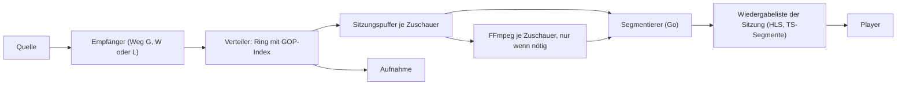

# Konzept 28 · Streaming und schnelles Umschalten

Stand: 28. November 2026 · Fassung 1 · Status: Entwurf, nicht freigegeben

Dieses Dokument beschreibt den Weg eines Fernsehsenders von der Quelle bis zum Bild: wie der Server jede Art
von Quelle empfängt, wie er den Strom intern verteilt, in welcher Form er ihn an Browser, Handy und Fernseher
ausliefert, woraus sich die Umschaltzeit zusammensetzt und wie sie gemessen wird. Es führt die tragenden
Entscheide T-1 bis T-26 aus `04-architektur.md` aus und ändert keinen davon.

Einordnung jeder Aussage: **gebaut** (mit Datei und Zeile, Stand `origin/main` 1220769b), **spezifiziert**
(dieses Konzept), **Empfehlung**, **Annahme**, **offen** (F-n, O-n), **zu messen** (M-n). Nichts hier ist
gebaut. **Kein Zielwert gilt als erreicht**; die vier Zielwerte des Auftrags sind Grössen, die der Benchmark
in Abschnitt 8 prüft. Angaben aus den Recherche-Berichten, die dort nicht nachgelesen wurden, stehen hier als
Annahme.

Begriffe, einmal erklärt: **MPEG-TS** (TS) ist ein Strom aus Paketen zu 188 Byte. **PID** ist die Kennung
eines Teilstroms darin (Bild, eine Tonspur, Untertitel). **PAT** und **PMT** sind die Tabellen, die sagen,
welche PIDs zu einem Programm gehören. **Keyframe** ist ein Bild, das ohne Vorgänger dekodierbar ist;
**Bildgruppe** (GOP) reicht von einem Keyframe bis vor den nächsten. **HLS** ist eine Wiedergabeliste mit
kurzen Stücken (Segmenten). **SSRF** heisst: Jemand bringt den Server dazu, Adressen im Heimnetz abzurufen.
**DRM** ist Kopierschutz mit Lizenzserver.

## 1. Überblick

Vier Sätze genügen für das Ganze: Go empfängt jeden Sender einmal und hält die letzten Sekunden im
Arbeitsspeicher. Wer einschaltet, bekommt seinen eigenen Puffer, der mit den letzten vollständigen
Bildgruppen aus diesem Speicher beginnt; deshalb steht das Bild sofort. Passt der Strom zum Gerät, schneidet
Go ihn nur in Stücke; sonst wandelt ein FFmpeg für genau diesen Zuschauer um. Aufnahmen hängen am selben
Empfang und wissen nichts von Zuschauern.

## 2. Empfänger je Protokoll

### 2.1 Drei Wege (T-3)

| Weg | Wer liest das Netz | FFmpeg beteiligt | Für |
|---|---|---|---|
| **G** | Go, über den geschützten Dialer | nein | HTTP-TS, HLS mit TS-Segmenten, Xtream-Live, UDP, RTP, Multicast |
| **W** | FFmpeg, aber jede Verbindung läuft über den Go-Weiterleiter auf `127.0.0.1` | ja, als Empfänger; Ausgabe TS auf `pipe:1` | DASH; HLS mit fMP4-Segmenten oder getrennter Tonspur |
| **L** | Go mit einer Protokoll-Bibliothek, über den geschützten Dialer | nein | RTSP, RTMP (vorbehaltlich F-1) |

Alle drei liefern denselben Rohstoff an den Verteiler: einen TS-Bytestrom mit genau einem Programm.

### 2.2 Übersicht je Protokoll

| Protokoll | Weg | Netzschutz | Zugangsdaten und Kopfzeilen | Wiederverbindung | DRM |
|---|---|---|---|---|---|
| **HTTP-TS** (Dauerstrom, auch Xtream `.ts`) | G | Go-Dialer prüft jede aufgelöste Adresse, auch nach jeder Weiterleitung (höchstens 5, nur `http` und `https`) | setzt Go; nie in einer Argumentliste | Go, Leiter nach `04` Abschnitt 5.3; Stillstand nach 10 s ohne Daten | keine Kennzeichnung möglich; verschlüsselte Pakete erkennt der Verteiler am Kennzeichen im Paketkopf und meldet «verschlüsselt» |
| **HLS, TS-Segmente** | G | wie oben, für Liste, jede Unterliste, jedes Segment und jeden Schlüssel einzeln | setzt Go; an fremde Hosts nur der User-Agent (2.4) | Go lädt die Liste nach; Segmentfehler: nächstes Segment, nach 3 Fehlern in Folge Abbruch | Go liest die Liste: Regel in 2.5; geprüft bei jedem Nachladen |
| **HLS, fMP4 oder getrennter Ton** | W | Weiterleiter prüft jede Verbindung (2.6) | setzt der Weiterleiter für den Ursprung der Quelle | FFmpeg lädt nach; bricht der Prozess ab oder liefert er 10 s nichts, startet Go ihn neu (Leiter) | Weiterleiter liest jede durchgereichte Liste: Regel in 2.5 |
| **DASH ohne DRM** | W | wie oben | wie oben | wie oben | Go lädt das Manifest zuerst selbst und bei jedem Nachladen über den Weiterleiter: jede `ContentProtection` führt zur Ablehnung |
| **RTSP** | L (F-1) | Go-Dialer; nur TCP (Bild und Ton im selben Kanal); Weiterleitungen des Servers verbindet Go selbst und prüft sie | im Speicher; Anmeldung führt die Bibliothek | Go, Leiter | kein DRM in diesem Protokoll |
| **RTMP** | L (F-1) | Go-Dialer (TCP, bei `rtmps` mit TLS) | im Speicher | Go, Leiter | kein DRM in der unterstützten Form; verschlüsselte Varianten (`rtmpe`) werden abgelehnt |
| **UDP** (Unicast) | G | kein ausgehender Verbindungsaufbau: Der Server lauscht. Nur mit Freigabe «lokale Quelle», nur Ports ab 1024, erwartete Absenderadresse je Quelle | keine | zustandslos: 10 s ohne Paket gilt als Stillstand; der Socket bleibt offen | – |
| **RTP** | G | wie UDP; Go entfernt den RTP-Kopf und zählt Lücken in der Paketfolge | keine | wie UDP | – |
| **Multicast** | G | wie UDP; Beitritt zur Gruppe auf der gewählten Netzschnittstelle, auf Wunsch nur von einer Absenderadresse | keine | wie UDP; Beitritt wird beim Wiederaufbau erneuert | – |
| **Xtream-Live** | G | Abfragen der Schnittstelle (Anmeldung, Kategorien, Sender) über den geschützten HTTP-Client; die Ströme sind HTTP-TS (bevorzugt) oder HLS | Benutzer und Passwort verschlüsselt gespeichert; die Stream-Adresse entsteht erst beim Verbinden im Speicher | wie HTTP-TS oder HLS | wie HTTP-TS oder HLS |

Was nicht in der Tabelle steht, wird nicht empfangen: SRT (im Image nicht vorhanden, M1), `rtmpe`, `file`,
`ftp`, `gopher`, `mms`, Plattform-Streams (YouTube, Twitch), alles mit DRM.

Für RTP mit eigenem Aufbau der Sitzung über eine SDP-Datei, Fehlerkorrektur nach SMPTE 2022 und TS-Pakete mit
204 Byte gilt: nicht unterstützt in der ersten Stufe (O-15).

### 2.3 Netzschutz im Einzelnen

**Grundsatz (T-5).** Jede Quelle trägt eine Regel: «nur öffentliche Adressen» (Vorgabe) oder «lokale Adressen
erlaubt» (setzt nur der Administrator, je Quelle). Die Prüfung sitzt am Verbindungsaufbau, nach der
Namensauflösung. So sieht sie jede Adresse, die wirklich angewählt wird, auch nach Weiterleitungen und bei
einem Namen, der zwischen zwei Anfragen auf eine andere Adresse zeigt. Das ist gebaut:
`server/internal/netguard/netguard.go:73-82`; abgelehnt werden Loopback, private Bereiche, Link-Local,
Multicast, CGNAT und die IPv6-Präfixe mit eingebetteter IPv4-Adresse (`netguard.go:34-54`). Das Radio nutzt
denselben Schutz für Ströme, Listen und Segmente (`server/internal/radio/reader.go:53-81`).

Für Live-TV kommt dazu (spezifiziert):

| Punkt | Regel |
|---|---|
| Regel je Quelle | `netguard` bekommt eine Prüffunktion mit Regel statt der festen Ablehnung; die bestehenden Aufrufer behalten ihr Verhalten. |
| Weiterleitungen | höchstens 5, jede neu geprüft, nur `http` und `https` (gebaut als Muster: `reader.go:31-38`, `:70-78`). |
| Verschachtelte Listen | jede Unterliste, jedes Segment, jede Schlüsseladresse ist eine eigene Anfrage über denselben Dialer. Eine Quelle mit der Regel «öffentlich» kann den Server nicht über eine Segmentadresse ins Heimnetz schicken. |
| Grössen und Fristen | Liste höchstens 1 MiB (gebaut: `radio/hlssrc.go:25`), Segment höchstens 64 MiB (Annahme; das Radio hat 2 MiB für Ton, `hlssrc.go:27`), Schlüssel höchstens 64 Byte, Kopf der Antwort innert 15 s, Lesestillstand 10 s. |
| Sprünge in der Segmentfolge | Macht die Quelle einen Sprung von mehr als 10 Segmenten, beginnt der Empfänger am Ende neu, statt alles nachzuladen (gebaut als Muster: `hlssrc.go:29-31`). |
| Inhalt statt Etikett | Was eine Antwort ist (TS, HLS-Liste, Senderliste, HTML-Fehlerseite), entscheidet Go am Inhalt der ersten Bytes, nie an Endung oder Typangabe (R3 Abschnitt 1.3; gebaut als Muster im Radio, `hlssrc.go:20-22`). |
| IPv6 | Eine weltweit gültige IPv6-Adresse eines Geräts im Heimnetz ist nicht erkennbar und wird nicht abgelehnt. Diese Lücke besteht heute schon und ist dokumentiert (`netguard.go:44-47`); sie gilt hier unverändert. |
| UDP, RTP, Multicast | Es gibt keinen Verbindungsaufbau nach aussen, also greift der Dialer nicht. Stattdessen: nur mit Freigabe «lokale Quelle»; Lausch-Adresse und Port aus der Quelle, Port ab 1024; Pakete von anderen Absendern als dem eingetragenen werden verworfen; Gruppenadresse muss im Multicast-Bereich liegen. Das Risiko ist hier nicht der Abruf fremder Adressen, sondern eingeschleuste Pakete aus dem Heimnetz (`12-sicherheit.md`). |
| Logos und EPG-Bilder | laufen nicht über den Empfänger, sondern über den bestehenden geschützten Abruf mit Grössengrenze (Muster `radio/logo.go`, A2 Abschnitt 4.4). |

### 2.4 Zugangsdaten, Kopfzeilen, User-Agent

- **Speicherung:** Adresse mit Zugangsdaten, Benutzer und Passwort einer Xtream-Quelle und frei eingetragene
  Kopfzeilen liegen verschlüsselt in der Datenbank (bestehender Schlüsselbund, A2 Abschnitt 6.1). Entschlüsselt
  wird nur im Speicher, unmittelbar vor dem Verbinden.
- **Argumentliste:** In Weg G und L gibt es keinen Prozess. In Weg W steht in der Argumentliste nur ein
  Ersatzname (2.6). In keinem Fall erscheint eine Anbieter-Adresse, ein Passwort oder eine Kopfzeile in
  `/proc/<pid>/cmdline`.
- **Weitergabe nur an den Ursprung:** Zugangsdaten und geheime Kopfzeilen (Authorization, Cookie und alle
  frei eingetragenen) gehen nur an Schema, Host und Port der Quelle. Leitet die Quelle auf einen anderen Host
  weiter oder nennt die Liste Segmente auf einem anderen Host, bekommt dieser nur den User-Agent. Die
  Standardbibliothek von Go entfernt bei Weiterleitungen nur Authorization und Cookie; frei eingetragene
  Kopfzeilen entfernt der Empfänger selbst.
- **User-Agent:** je Quelle einstellbar (kein Geheimnis), Vorgabe `Slouchcat/<Version>`.
- **Protokoll:** Von einer Quelle steht im Protokoll nur Schema und Host (gebaut als Hilfsfunktion:
  `netguard.go:132-138`). Die Ergänzungen der Schwärzung stehen in `04`, Abschnitt 10.4.
- **Antworten an Clients:** Kein Endpunkt für Profile liefert je eine Quelladresse. Die Verwaltung zeigt
  Adressen mit geschwärzten Zugangsdaten.

### 2.5 DRM erkennen und ablehnen

Der Server lehnt ab und versucht nichts zu umgehen. Regel für HLS, geprüft beim Anlegen, beim Start und bei
jedem Nachladen der Liste (die Liste kann später Schutz bekommen):

| Befund in der Liste | Entscheid |
|---|---|
| kein `EXT-X-KEY`, oder `METHOD=NONE` | spielen |
| `METHOD=AES-128`, Schlüsselformat fehlt oder ist `identity`, Schlüsseladresse ist `http` oder `https` | spielen: Das ist Transportverschlüsselung, den Schlüssel gibt die Quelle jedem angemeldeten Abrufer. Go holt ihn über den geschützten Dialer und entschlüsselt selbst (Standardbibliothek). |
| `METHOD=SAMPLE-AES`, `SAMPLE-AES-CTR`, `SAMPLE-AES-CENC`; Schlüsselformat ungleich `identity`; Schlüsseladresse mit `skd://` oder als `data:` | ablehnen, Quelle bekommt den Zustand «DRM» |
| `EXT-X-SESSION-KEY` mit denselben Merkmalen | ablehnen |
| Hinweise der Senderliste auf Lizenzdaten (`#KODIPROP` mit `license_type` oder `license_key`) | beim Import als «DRM, nicht unterstützt» markieren; Schlüssel werden nie gespeichert |

Für DASH: Jedes Element `ContentProtection` bei den gewählten Darstellungen führt zur Ablehnung. Die Optionen
von FFmpeg zum Entschlüsseln mit vorgegebenem Schlüssel (`cenc_decryption_key`, vorhanden laut Hilfetext) setzt
der Server nie, und es gibt kein Eingabefeld dafür.

Die Unterscheidung stammt aus R3 Abschnitt 5; die Aussagen zur HLS-Spezifikation sind dort nicht nachgelesen
und gelten hier als **Annahme**, bis `12-sicherheit.md` sie belegt. Der Grenzfall `SAMPLE-AES` mit `identity`
wird vorsichtig abgelehnt (O-16).

### 2.6 Entscheid: Gilt «FFmpeg sieht keine Adresse» weiter?

**Ausgangslage (gebaut).** Heute bekommt FFmpeg nie eine Netzadresse: Jede Argumentliste nennt einen absoluten
Pfad oder eine Pipe (A2 Abschnitt 0, Punkt 3). Für das Radio ist das als Regel festgehalten (ADR 0025,
Punkt 2: «ffmpeg liest nur `pipe:0` und schreibt nur `pipe:1`»; `server/internal/transcode/radio.go:18-21`,
`:79`). Darauf stützt sich auch das Sicherheitsreview der Dateiwiedergabe.

**Entscheid (T-4).** Die Regel gilt für Live-TV fort, in dieser Fassung:

> FFmpeg bekommt nie eine Anbieter-Adresse, nie Zugangsdaten und nie eine Kopfzeile in die Argumentliste, und
> es öffnet keine Verbindung, die nicht Go gewählt und geprüft hat.

Daraus folgt:

1. **Umwandlung, Probe, Normalisierung:** nur Pipes, `-protocol_whitelist pipe`, wie beim Radio. Keine
   Ausnahme.
2. **Empfang in Weg G und L:** kein FFmpeg.
3. **Empfang in Weg W: die eine benannte Ausnahme.** FFmpeg darf HTTP sprechen, aber nur zum
   **Go-Weiterleiter**.

**Weg W im Einzelnen (spezifiziert, vor dem Bau zu belegen mit M-10 und M-11).**

- Der Weiterleiter ist ein kleiner HTTP-Proxy im Serverprozess, gebunden an `127.0.0.1` auf einem zufälligen
  Port. Er nimmt nur Anfragen mit dem Einmalkennwort des jeweiligen Empfängers an.
- FFmpeg bekommt als Eingang einen **Ersatznamen**: `http://<zufall>.src.slouchcat.invalid/…` (die Endung
  `.invalid` ist reserviert und nie auflösbar). Der Weiterleiter übersetzt diesen Namen auf die echte
  Basisadresse der Quelle, holt die Antwort selbst über den geschützten Dialer, setzt die Kopfzeilen der Quelle
  und reicht den Inhalt durch. Relative Adressen in Listen und Manifesten zeigen damit wieder auf den
  Ersatznamen.
- Absolute Adressen in Listen und Manifesten: Für `http` holt der Weiterleiter selbst (ohne Geheimnisse, ausser
  es ist der Ursprung der Quelle). Für `https` baut FFmpeg über den Weiterleiter einen Tunnel auf (`CONNECT`);
  der Weiterleiter wählt die Verbindung über den geschützten Dialer. In beiden Fällen entscheidet Go, wohin
  eine Verbindung geht.
- Argumentliste: Ersatzname, Adresse des Weiterleiters, `-protocol_whitelist http,https,tcp,tls,httpproxy,crypto`,
  Auswahl der Spuren, `-c copy -f mpegts pipe:1`. Die Umgebung des Prozesses setzt `http_proxy` auf denselben
  Weiterleiter und leert `no_proxy`, damit auch ein Codepfad, der die Option nicht weiterreicht, beim
  Weiterleiter landet.
- Der Weiterleiter liest jede durchgereichte Liste und jedes Manifest mit (DRM-Regel 2.5, Grössengrenzen).
- Die Fehlerausgabe dieses FFmpeg kann Adressen aus Manifesten enthalten. Sie wird nie roh gespeichert oder
  protokolliert (`04`, Abschnitt 10.4).
- Ein FFmpeg-Empfänger ist ein Langläufer mit den bekannten Schwächen (R1 Abschnitt 5.5). Er wird deshalb
  planmässig ersetzt: spätestens nach 12 Stunden (Annahme), bevorzugt in einem Augenblick ohne Zuschauer und
  Aufnahme, und sofort, wenn sein Speicherbedarf eine Grenze überschreitet. Der Wechsel ist ein neuer
  Zeitabschnitt wie bei einer Wiederverbindung.

**Was dabei nicht belegt ist (Annahmen aus Kenntnis des FFmpeg-Quelltexts, im Image 7.1.4 zu prüfen):**
dass der HLS- und der DASH-Leser die Proxy-Angabe an jede Unteranfrage weitergeben; dass `https` über den
Proxy getunnelt wird; dass beide Leser in Listen nur `http`, `https`, `crypto` und `data` annehmen und etwa
`tcp://` oder `file:` ablehnen. Der Hilfetext der lokalen Version 6.1.1 nennt die Option `-http_proxy`
(«set HTTP proxy to tunnel through»); das belegt die Option, nicht das Verhalten. **Ohne den Nachweis M-10
wird Weg W nicht gebaut.**

**Restrisiko der Ausnahme.** FFmpeg sieht zur Laufzeit Adressen, die in fremden Manifesten stehen (nicht in
der Argumentliste), und es verarbeitet Netzdaten in C-Code. Es kann aber keine Verbindung an Go vorbei
öffnen, sofern M-10 das bestätigt.

**Alternative, falls M-10 scheitert oder du die Ausnahme nicht willst.** Go liest auch DASH und HLS mit fMP4
selbst (eigener Leser für Manifeste und Segmentvorlagen, zwei Datenströme für Bild und Ton) und gibt FFmpeg
die Daten über Pipes zum Umpacken nach TS. Dann gilt die Regel von ADR 0025 ohne jede Ausnahme. Preis:
deutlich mehr eigener Protokollcode und Pflege (Schätzung: mehr als das Vierfache des Weiterleiters), für
Quellarten, die bei IPTV selten sind. Die zweite Alternative ist, DASH und HLS mit fMP4 in einer späteren
Stufe oder gar nicht anzubieten; das wäre ein Abstrich an LTV-003 und müsste von dir kommen.

**RTSP und RTMP** sind kein Teil dieser Ausnahme. Für sie steht die Frage F-1 in `04`, Abschnitt 12.3:
Go-Bibliotheken (Empfehlung) oder eine zweite Ausnahme mit zwei benannten Restrisiken.

### 2.7 Vom Empfänger zum Verteiler

Jeder Empfänger tut vor der Übergabe drei Dinge, alle in Go mit der Bibliothek `live/mpegts`:

1. **Paketgrenzen finden** (Synchronbyte im Abstand von 188 Byte, dreimal bestätigt) und nach einem Abbruch
   neu finden. Halbe Pakete werden verworfen.
2. **Ein Programm auswählen.** Enthält der Strom mehrere Programme (bei Multicast üblich), bleibt nur das
   Programm des Senders; die Programmtabelle wird auf dieses eine Programm neu geschrieben. Alle PIDs dieses
   Programms bleiben erhalten (Bild, alle Tonspuren, Untertitel, Teletext, Daten), damit die Aufnahme nichts
   verliert (LTV-020).
3. **Zeitabschnitt melden.** Jede neue Verbindung, jeder Quellwechsel und jede Diskontinuität der Quelle
   (bei HLS: `EXT-X-DISCONTINUITY`) beginnt im Verteiler einen neuen Zeitabschnitt (3.4).

## 3. Interne Verteilung

### 3.1 Aufbau des Verteilers

Je empfangenem Sender gibt es einen Verteiler (T-6). Er besteht aus:

| Teil | Inhalt | Grösse |
|---|---|---|
| **Ring** | TS-Pakete in Ankunftsreihenfolge, als fester Byte-Bereich im Arbeitsspeicher, einmal angelegt und im Kreis beschrieben. Jede Stelle hat eine fortlaufende 64-Bit-Position, die nie zurückspringt. | Startwert 8 MiB, wächst mit der gemessenen Bitrate bis höchstens 64 MiB |
| **GOP-Index** | je Keyframe: Position im Ring, entfaltete Zeit, Uhrzeit der Ankunft, Zeitabschnitt | so viele Einträge, wie Keyframes im Ring liegen |
| **Tabellen-Zwischenspeicher** | letzte PAT und PMT als fertige Pakete, mit Versionsnummer | wenige hundert Byte |
| **Messwerte** | Bytes je Sekunde, Zählerfehler je PID, letzte Ankunft, Fortschritt der Zeitstempel je PID, Bildgruppen-Länge, Verschlüsselungskennzeichen | fest |
| **Cursor** | je Abnehmer eine Position und ein Signal «neue Daten» | fest |

Der Schreiber (der Empfänger) ist die einzige Routine, die in den Ring schreibt. Er wartet auf niemanden.

### 3.2 Keyframes erkennen

Ein Eintrag im GOP-Index entsteht, wenn ein Bildpaket als wahlfreier Einstiegspunkt erkannt ist:

1. zuerst über das Kennzeichen im Paketkopf (`random_access_indicator`), das Sender dafür setzen;
2. fehlt es, durch einen Blick in den Anfang des Bildpakets: bei H.264 ein IDR-Bild oder ein Bild mit
   Wiedereinstiegs-Kennzeichen, bei HEVC ein IRAP-Bild, bei MPEG-2 ein Sequenzkopf mit I-Bild;
3. ein Einstiegspunkt zählt nur, wenn die Bildparameter (bei H.264 SPS und PPS, bei HEVC zusätzlich VPS, bei
   MPEG-2 der Sequenzkopf) im selben Bild mitkommen. Sonst könnte ein Decoder dort nicht beginnen.

Quellen, die Punkt 3 selten oder nie erfüllen, bekommen keinen schnellen Start. Für sie ist der Rückfall
«Strom normalisieren» vorgesehen (`04`, O-2): ein FFmpeg zwischen Empfänger und Verteiler, nur über Pipes,
der die Bildparameter vor jedem Keyframe wiederholt (der Filter `dump_extra` ist im Image vorhanden, M1).
Wie häufig solche Quellen sind, zeigt M-2.

### 3.3 Programmtabellen

Ein neuer Abnehmer bekommt immer zuerst PAT und PMT aus dem Zwischenspeicher und dann die Pakete ab seinem
Startpunkt. Ändert sich die Version der PMT oder die Liste der PIDs, meldet der Verteiler «Parameter
geändert»; das löst eine neue Probe und einen neuen Zeitabschnitt aus (`04`, Abschnitt 9).

### 3.4 Zeitbasis, Überlauf, Zeitabschnitte

- **Zeitstempel im TS** sind 33 Bit breit bei 90'000 Schritten je Sekunde und laufen nach rund 26,5 Stunden
  über (Rechnung: 2³³ ÷ 90'000 s). Go **entfaltet** sie je Sender zu einer 64-Bit-Zeit (Zeitstempel plus
  Überlaufzähler, gegen die Uhr des Servers auf Plausibilität geprüft). GOP-Index, Fenster des Zeitversatzes,
  Schnitte von Aufnahmen und alle Dauern rechnen nur mit dieser Zeit.
- **Die Pakete selbst bleiben unverändert** (Originalqualität). Im Direktweg kommt der Überlauf also beim
  Player an, in der Umwandlung bei FFmpeg. Ob hls.js, Safari und Media3 den Überlauf mitten in einem Segment
  ohne Störung verkraften, ist zu messen (M-22). Rückfall: Der Verteiler beginnt am ersten Keyframe
  nach dem Überlauf einen neuen Zeitabschnitt. Das wäre je Sender ein kurzer Sprung alle 26,5 Stunden.
- **Zeitabschnitt:** ein Stück Strom mit durchgehender Zeit und gleichen Parametern. Ein neuer beginnt bei
  neuer Verbindung, Quellwechsel, Diskontinuität der Quelle, einem Zeitsprung von mehr als 2 Sekunden gegen
  die Erwartung (Annahme) und bei geänderter PMT. Folgen für Abnehmer: in der Wiedergabeliste
  `EXT-X-DISCONTINUITY`, in der Aufnahme ein neuer Teil, ein laufender FFmpeg bekommt das Ende seiner Eingabe
  und wird für den nächsten Abschnitt neu gestartet. **Kein FFmpeg-Lauf geht über eine Abschnittsgrenze.**
- **Uhrzeit:** Jeder Indexeintrag trägt die Uhrzeit der Ankunft. Daraus entsteht in der Wiedergabeliste
  `EXT-X-PROGRAM-DATE-TIME`, mit dem alle drei Player die Stelle als Uhrzeit kennen (Zeitleiste, Abgleich mit
  dem EPG, Sprung «zurück zu Live»).

### 3.5 Cursor und langsamer Abnehmer

Abnehmer des Rings sind nur Sitzungspuffer und Aufnahmen (T-8). Jeder hat eine eigene Routine, die an ihrem
Cursor liest und auf ihren Datenträger schreibt.

- Liegt ein Cursor an der Schreibstelle, wartet die Routine auf das Signal «neue Daten».
- Wird ein Cursor **überrundet** (der Schreiber hat seine Stelle überschrieben), bekommt der Abnehmer den
  Fehler «überrundet» und einen neuen Startpunkt am nächsten Keyframe. Im Sitzungspuffer steht dann eine
  Diskontinuität, in der Aufnahme eine Lücke mit Grund «Datenträger zu langsam». Ein Zähler erscheint in der
  Verwaltung.
- Der Schreiber weiss von alledem nichts. Andere Abnehmer sind nicht betroffen.

Ein langsamer **Client im Netz** hängt gar nicht am Ring: Er holt Segmente per HTTP aus seinem eigenen
Sitzungspuffer. Holt er zu langsam, fällt er aus seinem eigenen Fenster (404 für zu alte Segmente, der Player
springt nach vorn). Das ist der Abwurf «nur dieses Clients», den der Auftrag verlangt.

### 3.6 Grenzen

| Grenze | Wert | Art |
|---|---|---|
| Alter der Daten im Ring | höchstens 15 s | harte Konstante |
| Grösse eines Rings | höchstens 64 MiB | harte Konstante |
| Inhalt | zwei vollständige Bildgruppen und die laufende; was darüber hinausgeht, wird überschrieben | Regel |
| Summe aller Ringe | Byte-Budget, ab Werk 512 MB | einstellbar; Zulassung mit Reservierung wie beim Radio (`server/internal/radio/buffer.go:67-70`, `listen.go:245-254`) |
| Abnehmer je Verteiler | keine eigene Grenze; begrenzt über Stream-Grenzen der Konten und die Zahl der Aufnahmen | – |
| Wartezeit des Schreibers auf Abnehmer | null | Regel |

Rechenbeispiel (Annahme: 2-Sekunden-Bildgruppen): Ein Sender mit 8 Mbit/s belegt für zwei vollständige
Bildgruppen und die laufende im Mittel 5 Sekunden, also rund 5 MB; ein UHD-Sender mit 20 Mbit/s rund 12,5 MB.
Zwanzig HD-Sender liegen bei rund 100 MB, hundert bei rund 500 MB. Die wirklichen Werte bringt M-13.

### 3.7 Der technische Startpuffer und seine Trennung vom Zeitversatz

Der technische Startpuffer **ist** der Ring (T-7). Sein einziger Zweck: Ein neuer Abnehmer findet sofort
vollständige Bildgruppen vor und muss nicht auf den nächsten Keyframe der Quelle warten.

Die Trennung vom persönlichen Zeitversatz ist nicht nur eine Regel, sondern durch den Aufbau erzwungen:

| Mittel | Wirkung |
|---|---|
| Harte Obergrenzen (15 s, 64 MiB) als Konstanten im Code, nicht einstellbar | Der Ring kann kein Archiv werden, auch nicht durch Fehlkonfiguration. |
| Nur im Arbeitsspeicher, nie in einer Datei | Nach Neustart und nach Ende des Empfangs ist nichts mehr da. |
| Die Schnittstelle des Verteilers kennt genau einen Einstieg: «ab den letzten vollständigen Bildgruppen». Es gibt keine Funktion «lies ab Uhrzeit» und keine «lies ab Position» für neue Abnehmer. | Kein Codepfad kann ältere Daten anfordern. |
| Cursor bewegen sich nur vorwärts. | Ein Abnehmer kann nicht zurückgreifen. |
| Der Sitzungspuffer gehört einer Sitzung, beginnt mit dem Einstellen und wird beim Umschalten gelöscht. Er wird nie aus einem anderen Sitzungspuffer gefüllt. | Zwei Zuschauer desselben Senders teilen nur den Ring, nie den Zeitversatz. |
| Der Server liefert einer Sitzung nur Segmente aus **ihrem** Puffer; die Nummer des ältesten Segments ist die Rückspulgrenze. | Auch ein direkter Aufruf mit erfundener Segmentnummer bekommt 404. |
| Prüfung im Testplan: Kein Abnehmer erhält je ein Paket, das älter ist als «Zeitpunkt des Einstellens minus 15 Sekunden»; ein Sender, der seit einer Stunde dauerhaft empfangen wird, gibt einem neuen Zuschauer höchstens diese 15 Sekunden. | Nachweis für LTV-007 und LTV-013 (`17-test-und-abnahme.md`). |

Klarstellung wie in `04`: Das erste Bild liegt um den Inhalt des Startpuffers **vor** dem Tastendruck. Das
ist der Zweck des Startpuffers nach LTV-007 und LTV-010. Der «Einschaltpunkt» ist der Anfang des ersten
ausgelieferten Segments.

## 4. Auslieferung je Client

### 4.1 Die Varianten

| Variante | Kurz |
|---|---|
| **HLS mit TS-Segmenten** | Wiedergabeliste; Segmente sind Ausschnitte des TS-Stroms. Im Browser packt hls.js sie im Hintergrund in das Format um, das der Browser abspielt. |
| **HLS mit fMP4-Segmenten** | Wiedergabeliste; Segmente im MP4-Format mit einem Kopfstück. So arbeitet Slouchcat heute bei Filmen und beim Radio (ADR 0003, ADR 0025). |
| **Fortlaufender TS-Strom** («progressiv») | eine einzige lange HTTP-Antwort ohne Liste. |
| **LL-HLS** | HLS mit Teilstücken unter einem Segment und gehaltenen Anfragen, für geringe Verzögerung zur Sendung. |
| **DASH** | anderes Listenformat mit MP4-Segmenten. |

### 4.2 Vergleich

Bewertung: ++ sehr gut, + gut, o mittel, – schwach. Alles **Annahme** auf Grundlage von R1 und R2, bis die
Messpunkte vorliegen.

| Kriterium | HLS-TS | HLS-fMP4 | fortlaufender TS | LL-HLS | DASH |
|---|---|---|---|---|---|
| **Kompatibilität Web** (hls.js) | + (hls.js packt um; HEVC und AC-3 in TS unsicher, M-3) | ++ (gebaut und erprobt) | – (braucht eine zweite Bibliothek, `mpegts.js`; kein MPEG-2; Beleg R2) | + | – (dritte Bibliothek) |
| **Kompatibilität Safari und iPhone** (nativ) | + (H.264; HEVC nach Annahme nur in fMP4) | ++ | – (auf dem iPhone nur über einen Umweg ab iOS 17.1, Beleg R2) | + | – (kein natives DASH) |
| **Kompatibilität Media3** (Handy, TV) | ++ (auch MPEG-2, MP2, AC-3, DVB-Untertitel, wenn das Gerät sie dekodiert; Beleg R2 für die Formate) | ++ | ++ (Beleg R2) | + (nur Apples Form) | + (kein TS in DASH, Beleg R2) |
| **Umschaltzeit** | + (kein Prozess im Direktweg) | o (Prozessstart je Zuschauer auch ohne Umwandlung) | ++ (keine Liste, keine Segmentgrenze) | + | o |
| **Stabilität** | ++ | ++ | o (kein Wiederaufsetzen ausser neuer Anfrage; Stau im Netz wirkt bis zum Server) | o (gehaltene Anfragen, Proxys) | + |
| **Zeitversatz im Player** | ++ | ++ | – (kein Live-Fenster, kein Spulen; Beleg R2 für Media3 und `mpegts.js`) | ++ | ++ |
| **Sicherheit** | ++ (Token je Anfrage, kein Prozess) | + (Token je Anfrage; ein FFmpeg je Zuschauer) | o (eine lange Anfrage: Entzug wirkt nur durch Abbruch) | + | + |
| **Aufwand im Server** | o (Segmentierer in Go, klein) | o bis – (FFmpeg je Zuschauer; MPEG-2 und MP2 passen nicht hinein, also mehr Umwandlung) | + | – (Teilstücke, gehaltene Anfragen; FFmpeg kann Apples LL-HLS nicht schreiben, Beleg R1) | – |
| **Aufwand in den Clients** | + (eine Weiche: hls.js oder nativ, wie heute) | ++ (wie heute) | – (zwei Wege je Client) | o | – |

### 4.3 Empfehlung je Client

| Client | Empfehlung | Begründung | Alternative, falls Messungen widersprechen | Vorher zu messen |
|---|---|---|---|---|
| **Web: Chrome, Edge, Firefox** (hls.js 1.7.3, heute als `hls.js/light` geladen) | **HLS mit TS-Segmenten** | Direktweg ohne Prozess; Zeitversatz im Player; eine Bibliothek, die schon da ist | HLS-fMP4 über einen FFmpeg je Sitzung, wenn hls.js TS mit den vorkommenden Codecs, Diskontinuitäten oder dem Zeitüberlauf nicht sauber spielt | M-1, M-3 |
| **Safari auf dem Mac** | HLS mit TS-Segmenten, über hls.js wie die anderen Browser | gleiches Verhalten wie Chrome, einstellbarer Startpunkt | natives HLS | M-5 |
| **iPhone und iPad** (natives HLS) | **HLS mit TS-Segmenten** für H.264; HEVC wird bis zur Messung umgewandelt | natives HLS spielt TS (Annahme); der Startpunkt lässt sich nur über die Liste steuern | HLS-fMP4 über FFmpeg je Sitzung für HEVC (`04`, O-3) | M-1, M-5 |
| **Android-Handy** (Media3 1.11.1) | **HLS mit TS-Segmenten** | Media3 liest TS in HLS (Beleg R2); Zeitversatz über das Live-Fenster | fortlaufender TS nur als Schnellstart wäre ein zweiter Weg ohne Zeitversatz: nicht verfolgen, ausser M-1 zeigt einen grossen Abstand | M-1, M-4, M-7 |
| **Android TV** (Media3 1.11.1) | **HLS mit TS-Segmenten** | wie Handy; dazu können Fernseher oft MPEG-2, MP2 und Zeilensprung selbst (Annahme), was Umwandlungen spart | wie Handy | M-1, M-4, M-6, M-7 |

**Nicht verfolgt in der ersten Stufe:** LL-HLS (senkt die Verzögerung zur Sendung, nicht die Umschaltzeit auf
einen schon empfangenen Sender; hoher Aufwand), DASH (kein Gewinn, auf dem iPhone nicht nativ), fortlaufender
Strom (kein Zeitversatz), WebRTC (Codecs passen nicht, kein Weg in Media3; R2).

Das ist **keine endgültige Festlegung**. Der Segmentierer ist die eine Stelle, an der ein zweites Format
anschliesst; Liste, Token, Sitzung und Puffer bleiben gleich. Der Bau der ersten Stufe beginnt erst, wenn M-3,
M-4 und M-5 die Empfehlung für die jeweiligen Clients bestätigt haben.

Ein Hinweis zum Web: Die App lädt heute den schlanken Bau von hls.js. Die Spurwahl für Ton löst der Server
(T-12: er lässt die anderen Tonspuren weg), also braucht Live-TV dafür keine Zusatzfunktionen des vollen
Baus. Ob der schlanke Bau TS mit allen vorkommenden Tonformaten umpackt, gehört zu M-3.

### 4.4 Die Wiedergabeliste einer Sitzung

Go baut die Liste je Anfrage aus dem Verzeichnis des Sitzungspuffers (Muster gebaut:
`server/internal/radio/playlist.go:24-66`).

| Merkmal | Festlegung |
|---|---|
| Fenster | vom ältesten Segment des Sitzungspuffers bis zum neuesten vollständigen. Mit Timeshift-Recht bis zur Höchstdauer der Verwaltung, ohne Recht 60 Sekunden. |
| Segmentgrenzen, Direktweg | an Keyframes der Quelle; aufeinanderfolgende Bildgruppen werden zusammengefasst, bis ein Segment mindestens 2 Sekunden lang ist (Annahme), höchstens 10 Sekunden. |
| Segmentgrenzen, Umwandlung | festes Raster von 2 Sekunden, verankert am Beginn des Zeitabschnitts; FFmpeg setzt an jeder Rastergrenze einen Keyframe. |
| Jedes Segment | beginnt mit PAT und PMT und einem Keyframe. |
| Uhrzeit | `EXT-X-PROGRAM-DATE-TIME` am ersten Segment und nach jeder Diskontinuität. |
| Diskontinuität | `EXT-X-DISCONTINUITY` an jeder Grenze eines Zeitabschnitts und einer Ausgabe-Generation; Zählung wie beim Radio (`playlist.go:37-42`). |
| Startpunkt | bestimmt der Server über `EXT-X-START`: beim Einstellen der Anfang der Liste; nach einem Qualitäts- oder Spurwechsel die Stelle, an der der Zuschauer war. |
| Lange Listen | Delta-Listen wie beim Radio (`CAN-SKIP-UNTIL`), damit zwei Stunden Zeitversatz nicht bei jedem Nachladen ganz übertragen werden. Kein gehaltenes Nachladen. |
| Übergeordnete Liste | eine Variante mit Angabe der Codecs, Bildgrösse und Bildrate aus den gespeicherten Streamparametern, damit Media3 ohne Blick ins erste Segment vorbereiten kann (Annahme, M-4). |
| Aufnahmen | dieselbe Bauweise; eine fertige Aufnahme bekommt eine abgeschlossene Liste, eine laufende eine wachsende. |
| Adressen | Segment und Liste tragen das Token `lt` als Abfrageparameter, nie im Pfad (wie `rt` beim Radio). |

### 4.5 Spulen mit Umwandlung, und der Rückfall

Im Direktweg ist jedes Segment der Liste ein Ausschnitt des Sitzungspuffers; Spulen ist ein gewöhnlicher
Sprung im Player.

Mit Umwandlung gibt es die Segmente der Vergangenheit erst, wenn sie jemand verlangt. Vorgesehen ist das
Suchmodell der Dateiwiedergabe (ADR 0003): Die Liste nennt alle Segmente des Fensters im festen Raster. Eine
Anfrage nach einem Segment, das nicht erzeugt ist und nicht kurz bevorsteht, beendet FFmpeg und startet es an
dieser Rastergrenze neu, mit dem Sitzungspuffer ab dem Keyframe davor als Eingang. Damit die Segmente
verschiedener Läufe nahtlos aneinanderpassen, behält FFmpeg die Zeitstempel der Quelle bei.

Das ist der anspruchsvollste Teil und **nicht belegt**: Bei der Dateiwiedergabe trägt das MP4-Format die
absolute Zeit; hier wäre es TS. Zu messen (M-9): Bleiben die Zeitstempel über Neustarts gleich? Setzen alle
Backends Keyframes genau im Raster? Verkraften die Player den Übergang ohne Diskontinuität?

**Rückfall, falls M-9 scheitert:** Jeder Neustart von FFmpeg ist eine neue Ausgabe-Generation mit
`EXT-X-DISCONTINUITY`, wie beim Radio (gebaut: `server/internal/radio/relay.go:350-369`). Die Liste einer
Sitzung mit Umwandlung enthält dann nur, was erzeugt ist, und ein Sprung in die Vergangenheit ist eine
Operation der Sitzung («spiele ab Uhrzeit»), nach der der Client die Liste neu lädt. Der Zuschauer sieht beim
Spulen eine kurze Unterbrechung statt eines nahtlosen Sprungs. Der Zeitversatz selbst (Pause, Zurück,
Vor bis Live) bleibt vollständig; nur das Gefühl beim Spulen ist schlechter. Im Direktweg ändert sich nichts.

## 5. Die Umschalt-Kette

### 5.1 Abschnitte

Gemessen wird vom Tastendruck bis zum ersten dargestellten Bild des neuen Senders. Alle Bereiche sind
**Annahmen**; nichts davon ist gemessen.

| Nr. | Abschnitt | Einflussgrösse | Stellschraube | Geschätzter Bereich (Annahme) | Was die Stellschraube kostet |
|---|---|---|---|---|---|
| 1 | Tastendruck bis Anfrage beim Server | Laufzeit im Netz; ob der Client erst stoppt und dann startet | **eine** Operation «einstellen» in der bestehenden Sitzung; offene Verbindung weiterverwenden | 5 bis 50 ms im Heimnetz, 30 bis 150 ms unterwegs | – |
| 2 | Rechte und Grenzen prüfen | Sitzung im Speicher; Konto und Profil lädt jede Anfrage ohnehin (A3 Abschnitt 1) | Platz bei den Stream-Grenzen bleibt beim Umschalten bestehen, keine neue Reservierung | 1 bis 5 ms | – |
| 3 | Empfang herstellen | schon empfangen, vorgeladen oder neu; Protokoll; Weiterleitungen des Anbieters | dauerhaft, automatisch, Vorladen (`04`, Abschnitt 6) | 0 (empfangen oder vorgeladen); neu: 0,1 bis 0,6 s für HTTP mit TLS, je Weiterleitung eine Laufzeit mehr; HLS zusätzlich Liste und Segment | Verbindungen zum Anbieter, Bandbreite, Arbeitsspeicher |
| 4 | Streamparameter kennen | gespeichert oder nicht | Parameter je Sender speichern; Probe im Hintergrund; Prüfjobs füllen den Speicher vor | 0 (gespeichert); sonst Tabellen aus den ersten Paketen und eine Probe: 0,3 bis 1 s | veraltete Parameter: Korrektur durch eine neue Ausgabe-Generation |
| 5 | Keyframe | Bildgruppen-Länge der Quelle; ob die Quelle beim Verbinden einen Schub liefert | Start an den letzten vollständigen Bildgruppen aus dem Ring | 0 (Ring vorhanden); neu: Warten auf den ersten Keyframe (0 bis 1 Bildgruppe) und bis diese Bildgruppe vollständig ist (1 Bildgruppe), ausser die Quelle liefert einen Schub (HLS-Quellen tun es mit ihren Segmenten) | Verzögerung zur Live-Kante: zwei bis drei Bildgruppen |
| 6 | Sitzungspuffer anlegen, erste Segmente bereitstellen | Datenträger | erste Segmente aus dem Arbeitsspeicher beantworten, gleichzeitig schreiben | 5 bis 30 ms auf SSD; auf HDD und Netzspeicher mehr | – |
| 7 | Umwandlung starten (nur wenn nötig) | Prozessstart, Eingangsanalyse, Start der Hardware, erstes Segment kodieren | feste Eingangsangabe und kleine Analysewerte dank gespeicherter Parameter; Schub aus dem Sitzungspuffer (FFmpeg kodiert die ersten Sekunden schneller als Echtzeit); kurzes erstes Segment | 0,6 bis 1,8 s. Vergleichswert, gebaut und gemessen für Dateien: erstes Segment rund 0,87 s nach dem Start (QSV, 1080p, `docs/perf/wiedergabestart.md`) | kleine Analysewerte können Tonspuren übersehen; kurze Bildgruppen kosten Qualität je Bitrate |
| 8 | Liste und erstes Segment zum Client | zwei Anfragen (drei mit übergeordneter Liste); Segmentgrösse gleich Bitrate mal Dauer | erstes Segment so kurz wie eine Bildgruppe; Liste schon in der Antwort auf «einstellen» mitgeben (O-17) | 2 MB (8 Mbit/s, 2 s) brauchen 0,16 s bei 100 Mbit/s, 0,5 s bei 30 Mbit/s, 1,6 s bei 10 Mbit/s | – |
| 9 | Puffer des Players vor dem Start | Einstellung des Players | hls.js: Start nach dem ersten Segment; Media3: Startpuffer 0,5 bis 1 s statt der Vorgabe | 0 bis 2,5 s (Vorgabe von Media3 für 1.11.1 ungeprüft) | zu klein: Stockungen kurz nach dem Start |
| 10 | Decoder und erstes Bild | Neuanlage oder Wiederverwendung; Umpacken in hls.js | Player-Instanz behalten; gleicher Codec bleibt im Decoder | 0,05 bis 0,3 s; Vergleichswert der TV-App für Dateien: erstes Bild nach 127 bis 288 ms (`docs/perf/K26-android-tv.md`, laut R1) | – |

### 5.2 Die vier Fälle des Auftrags

| Fall | Abschnitte, die zählen | Summe (Annahme, Heimnetz) | Zielwert | Hängt vor allem an |
|---|---|---|---|---|
| **1 · bereits empfangen und kompatibel** | 1, 2, 6, 8, 9, 10 | 0,3 bis 1,0 s | unter 1 s | Segmentgrösse und Netz des Clients (Abschnitt 8), Startpuffer des Players (9) |
| **2 · vorgeladen** | wie Fall 1, wenn die Parameter gespeichert sind | 0,3 bis 1,0 s | unter 1 s | wie Fall 1; dazu: ob Vorladen erlaubt und eingeschaltet ist |
| **3 · noch nicht empfangen** | zusätzlich 3, 4, 5 | 1 bis 2 s bei HLS-Quellen und Quellen mit Schub; 2 bis 5 s bei HTTP-TS ohne Schub und Bildgruppen von 2 s; mehr bei längeren Bildgruppen | unter 3 s | **Bildgruppen-Länge und Verhalten der Quelle**, nicht der Server |
| **4 · neue Umwandlung nötig** | Fall 1 oder 3, zusätzlich 7 | 1 bis 3 s auf empfangenem Sender; 2 bis 7 s auf nicht empfangenem | unter 5 s | Backend (GPU oder CPU), Zeilensprung, Fall 3 |

Zwischen Fall 1 und Fall 4 liegt die **Ton-Umwandlung** (Bild wird kopiert): Sie braucht einen Prozessstart,
aber keinen Encoder für das Bild. Annahme: Fall 1 plus 0,2 bis 0,6 s. Für Browser ist das bei Sendern mit
MP2- oder AC-3-Ton der Normalfall und gehört deshalb als eigener Fall in den Benchmark.

Für Fall 3 gibt es eine weitere Stellschraube, die nur eine Messung rechtfertigen kann (M-21): in den ersten
Sekunden **Teilstücke** unter einer Bildgruppe ausliefern, damit der Player nicht auf das Ende der ersten
Bildgruppe wartet. Solche Stücke beginnen nicht alle mit einem Keyframe; ob alle drei Player das beim
fortlaufenden Abspielen verkraften, ist offen. Ohne Beleg wird es nicht gebaut.

### 5.3 Die Seite des Players

Gemeinsam für alle: **eine** Player-Instanz und ein Bildelement über alle Umschaltungen; den Startpunkt gibt
der Server über die Liste vor; kein automatisches Aufholen zur Live-Kante durch schnelleres Abspielen (der
Zuschauer soll bleiben, wo er ist; «zurück zu Live» ist ein Knopf).

| Player | Umschalten | Einstellungen (Empfehlung, zu messen) |
|---|---|---|
| **hls.js** (Web) | `loadSource` mit der neuen Liste auf derselben Instanz; kein Abbau des Bildelements. Die Möglichkeit ist belegt (R1, R2); wie schnell es gegenüber einem Neuaufbau ist: M-3. | `lowLatencyMode: false` (Vorgabe ist an, Beleg R2; das Radio setzt es schon aus, `web/src/app/radio/engine.ts:139`); `startFragPrefetch: true`; `maxLiveSyncPlaybackRate: 1`; `maxBufferLength` 10 bis 15 s statt 30; `backBufferLength` 30 s (weiter zurück lädt der Player aus dem Sitzungspuffer nach); Startpunkt aus `EXT-X-START`; Arbeit im Hintergrund-Thread an (Vorgabe). |
| **Media3** (Handy, TV) | `setMediaItem` und `prepare` auf derselben `ExoPlayer`-Instanz, Oberfläche bleibt. Ob der Decoder bei gleichem Codec weiterläuft, hängt am Gerät (M-4); die TV-App wertet das Ereignis dazu schon aus (R2). | `DefaultLoadControl` mit Startpuffer 500 bis 1000 ms und 1500 bis 2000 ms nach einem Stocken; Vorlauf 15 bis 30 s; `LiveConfiguration` mit kleinster und grösster Geschwindigkeit 1,0 (kein Aufholen; Beleg R2 für die Einstellung); Fehler «hinter dem Live-Fenster» abfangen und am Fensteranfang fortsetzen (Beleg R2 für den Fehler); Vorbereitung ohne erstes Segment über die übergeordnete Liste mit Codecs (Annahme). Heute setzt die App keine dieser Einstellungen (R2 Abschnitt 1). |
| **Safari und iPhone** (nativ) | neue Adresse am Bildelement; die Plattform baut ihre Kette neu auf (Dauer: M-5). | nur über die Liste: Startpunkt, Segmentdauer, Zahl der Segmente. Der erste Start braucht eine Geste des Nutzers (Annahme). |

Auf Android hält die App **keinen** zweiten Player für Nachbarsender bereit: Decoder sind auf Fernsehern knapp.
Vorgeladen wird nur im Server.

## 6. Vorladen

Vorladen heisst: Der Eingangsstrom eines Senders läuft in seinen Ring, ohne Sitzungspuffer und ohne
Umwandlung (LTV-010: keine vorsorgliche Umwandlung). Ab Werk ist es **aus** (`04`, T-18) und je Quelle
einzeln zu erlauben, weil jeder vorgeladene Sender eine weitere Verbindung zum Anbieter ist.

| Frage | Regel (spezifiziert; Zahlen sind Annahmen als Startwerte) |
|---|---|
| **Welche Sender** | 1. Die Nachbarn in der Liste, in der der Zuschauer gerade umschaltet (alle Sender, eine Gruppe oder seine Favoriten, in deren Reihenfolge); der Client nennt beim Einstellen die Liste. 2. Richtung zählt: Nach «weiter» zuerst die nächsten in dieser Richtung, dann einer zurück. 3. Der zuvor gesehene Sender («zurück»-Taste). Häufig genutzte Sender und Favoriten deckt nicht das Vorladen ab, sondern «automatisch» (`04`, Abschnitt 6.2). |
| **Wie viele** | je Sitzung 2 (einstellbar 0 bis 4); insgesamt höchstens 4 (einstellbar 0 bis 16); immer innerhalb der Obergrenze aller Eingangsströme. |
| **Ab wann** | erst wenn der Zuschauer 2 Sekunden auf einem Sender geblieben ist. Wer schnell durchschaltet, löst kein Vorladen für jeden gestreiften Sender aus. |
| **Wie lange** | Der Haltegrund «Vorladen» endet 3 Minuten nach dem letzten Umschalten dieser Sitzung. Wer eine Stunde denselben Sender schaut, hält keine Nachbarn offen. Öffnet der Zuschauer die Senderliste oder die Einblendung zum Umschalten, meldet der Client das, und das Vorladen beginnt wieder. |
| **Wann abgebaut** | wenn der Sender kein Nachbar mehr ist (mit der normalen Karenz von 30 Sekunden), wenn die 3 Minuten um sind, wenn die Sitzung endet, bei Mangel sofort. |
| **Für welche Clients** | für alle gleich; der Nutzen ist am Fernseher am grössten. Der Client entscheidet nichts, er meldet nur Liste und Richtung (Regel 12). |
| **Bei Mangel** | Vorladen ist das Erste, was weicht (`04`, Abschnitt 8.2). Eine Vorlade-Anforderung, für die kein Platz ist, entfällt still; sie blockiert und verzögert nichts. |
| **Bei Störung** | Ein vorgeladener Sender, dessen Quelle nicht antwortet, wird nicht wiederholt versucht (keine Leiter für Vorladen): ein Versuch, dann Ende. |

Was Vorladen bringt und kostet, zeigt M-17: Median der Umschaltzeit mit und ohne, gegen zusätzliche
Verbindungen und Bandbreite.

## 7. Zielkonflikte

| Konflikt | Zusammenhang | Haltung dieses Konzepts |
|---|---|---|
| **Umschaltzeit gegen Verzögerung zur Sendung** | Wer sofort ein Bild will, beginnt an einer vergangenen Bildgruppe und liegt zwei bis drei Bildgruppen hinter der Quelle (bei 2 Sekunden: 4 bis 6 Sekunden). Wer näher an die Live-Kante will, wartet länger auf das erste Bild. | Umschaltzeit geht vor. Die Quelle selbst liegt bei IPTV ohnehin Sekunden hinter der Ausstrahlung. Einstellbar: Start an nur einer vollständigen Bildgruppe (weniger Verzögerung, weniger Vorrat im Player). Kein Aufholen durch schnelleres Abspielen. |
| **Umschaltzeit gegen Bildqualität** | Eine neue Umwandlung startet schneller mit kurzem erstem Segment und kurzen Bildgruppen; beides kostet Qualität je Bitrate. | Raster 2 Sekunden als Mittelweg; nur das erste Segment darf kürzer sein. Im Direktweg kein Konflikt: Die Qualität ist die der Quelle. |
| **Umschaltzeit gegen Ressourcen** | Schnell ist nur, was schon empfangen wird. Dauerhaft, automatisch und Vorladen kosten Verbindungen, Bandbreite und Arbeitsspeicher, auch wenn niemand schaut. | Ab Werk sparsam («bei Bedarf»); der Administrator kauft Geschwindigkeit bewusst ein. Die Verwaltung zeigt, was es kostet. |
| **Kurze Segmente gegen Stabilität** | Weniger als etwa drei Segmente Vorrat erhöhen die Gefahr von Stockungen (Warnung in der Dokumentation von hls.js, Beleg R1). | Der Vorrat kommt aus dem Ring: Beim Start liegen zwei vollständige Bildgruppen bereit. Ob das reicht, zeigt M-1 (Fehlerquote und Stockungen mitmessen). |
| **Kopieren gegen Startpunkt** | Ohne Neukodierung bestimmt die Quelle, wo ein Segment beginnen kann. | hingenommen; Sender mit langen Bildgruppen sind Kandidaten für «dauerhaft» oder «automatisch». |
| **Persönlicher Zeitversatz gegen Datenträger** | Jeder Zuschauer schreibt seinen eigenen Puffer (LTV-007). | Preis der Vorgabe; begrenzt durch Höchstdauer und Deckel (`04`, O-6, M-14). |
| **Netzschutz gegen Protokollbreite** | Volle Kontrolle hat nur Go; FFmpeg kann mehr Protokolle. | Go für das Übliche, FFmpeg nur hinter dem Weiterleiter (2.6), RTSP und RTMP nach F-1. |

**Was vom Server abhängt und was nicht.** Die vier Zielwerte des Auftrags sind zu prüfende Grössen. Dieses
Konzept sagt klar:

- **Fall 1 und 2 (unter 1 Sekunde)** liegen in der Hand von Server und Client, solange das Netz des Clients
  ein Segment in Bruchteilen einer Sekunde lädt. Über eine langsame Verbindung von unterwegs hängen sie an
  der Bandbreite des Clients, nicht am Server.
- **Fall 3 (unter 3 Sekunden)** hängt an der Quelle: an ihrer Bildgruppen-Länge, an der Zeit für den
  Verbindungsaufbau und daran, ob sie beim Verbinden einen Schub ab einem Keyframe liefert. Bei Quellen mit
  Bildgruppen von 4 Sekunden und mehr ist der Zielwert ohne Vorladen **nicht erreichbar**, gleich was der
  Server tut. Die Länge bestimmt der Encoder des Anbieters.
- **Fall 4 (unter 5 Sekunden)** hängt an der Hardware des Servers (GPU oder CPU, Zeilensprung) und, wenn der
  Sender nicht empfangen wird, zusätzlich an Fall 3.

Die Verwaltung zeigt deshalb je Sender die gemessene Bildgruppen-Länge, damit sichtbar ist, welche Sender
langsam umschalten **müssen**.

## 8. Benchmark (LTV-010)

Der Benchmark ist so festgelegt, dass ihn jemand anderes wiederholen kann und dasselbe misst. Ergebnisse
kommen nach `docs/perf/28-live-tv.md`.

### 8.1 Referenzhardware

| Klasse | Gerät | Zweck |
|---|---|---|
| **Referenz** | Testinstanz CT 190: 2 virtuelle Kerne, 4 GB Arbeitsspeicher, Intel UHD 630 mit QSV (`docs/perf/M10.md`, `docs/perf/M1b.md`) | gilt für die Zielwerte |
| **klein** | 2 Kerne ohne nutzbare GPU (Software-Backend), 4 GB Arbeitsspeicher, etwa CT 190 mit `SLOUCHCAT_HW=software` | zeigt, was ohne GPU geht (Fall 4, Zeilensprung) |
| **gross** | Rechner mit mindestens 8 Kernen, 16 GB Arbeitsspeicher und NVENC, etwa der Entwicklungsrechner aus `docs/perf/M1b.md` | zeigt die obere Grenze und viele gleichzeitige Zuschauer |

Je Lauf werden Prozessor, Arbeitsspeicher, GPU, Datenträger des Sitzungspuffers, Server-Version und Backend
notiert.

### 8.2 Testquellen

Nur selbst erzeugt; keine fremden Senderlisten, keine Anbieterkonten (R3 Abschnitt 8). Ein Testbild mit
laufender Uhr und Bildzähler im Bild (FFmpeg-Quelle `testsrc2` mit eingeblendeter Zeit) und Ton, als
Endlosstrom. Jede Quelle hat eine **festgelegte** Bildgruppen-Länge (Szenenwechsel-Erkennung aus).

| Kennung | Bild | Ton | Bildgruppe | Bitrate |
|---|---|---|---|---|
| Q-A | H.264, 1080p25, ohne Zeilensprung | AAC | 1 s | 8 Mbit/s |
| Q-B | H.264, 1080p25 | AAC | 2 s | 8 Mbit/s |
| Q-C | H.264, 1080p25 | AAC | 4 s | 8 Mbit/s |
| Q-D | H.264, 1080p25 | AAC | 10 s | 8 Mbit/s |
| Q-E | H.264, 1080i50 (Zeilensprung) | MP2 | 1 s | 10 Mbit/s |
| Q-F | MPEG-2, 576i50 | MP2 | 0,5 s | 4 Mbit/s |
| Q-G | HEVC, 2160p50 | E-AC-3 | 2 s | 20 Mbit/s |
| Q-H | H.264, 720p50 | AC-3 und zweite Tonspur AAC | 2 s | 5 Mbit/s |

Jede Quelle wird über jedes Eingangsprotokoll angeboten, das die Stufe unterstützt: HTTP-TS (kleiner
Testserver in Go, der mehrere Abrufer bedient und wahlweise einen Schub ab Keyframe liefert oder nicht), HLS
mit TS-Segmenten (Segmente 2 und 6 Sekunden), HLS mit fMP4, DASH, UDP, RTP, Multicast (mit Host-Netz), RTSP
und RTMP (über einen Testserver wie MediaMTX, nur im Testaufbau, nie im Produkt). Fehlerbilder für die
Überwachung (Abschnitt 9) erzeugt derselbe Aufbau: Quelle anhalten, Netz kappen, Liste einfrieren, Tonspur
weglassen, Paketverlust einstreuen.

### 8.3 Clients

| Client | Gerät |
|---|---|
| Chrome (aktuell) | Desktop |
| Firefox (aktuell) | Desktop |
| Safari auf dem iPhone (aktuelles iOS), im Browser und als installierte App | iPhone |
| Android-Handy-App | Pixel (das Gerät, mit dem K27 geprüft wurde) |
| Android-TV-App | ein Fernseher oder eine Box mit Android TV; Modell notieren |

Safari auf dem Mac und ein Tablet sind erwünscht, aber nicht Bedingung der Abnahme.

### 8.4 Netzbedingungen

| Profil | Bedingung |
|---|---|
| N-1 Heimnetz Kabel | 1 Gbit/s, Laufzeit unter 2 ms |
| N-2 Heimnetz WLAN | 5 GHz, gemessene Datenrate notieren |
| N-3 unterwegs gut | künstlich begrenzt: 20 Mbit/s, 40 ms Laufzeit, 0,1 % Verlust |
| N-4 unterwegs knapp | künstlich begrenzt: 8 Mbit/s, 80 ms Laufzeit, 0,5 % Verlust |

Die Abnahme der Zielwerte gilt für N-1 und N-2. N-3 und N-4 werden gemessen und ausgewiesen, weil dort das
Netz des Clients die Umschaltzeit bestimmt. Jeder Lauf geht einmal direkt an den Server und einmal über den
Reverse-Proxy, den du nutzt (M-18).

### 8.5 Messmethode

- **Beginn (t0):** der Zeitpunkt, zu dem die App den Befehl erhält (Tastendruck, Klick, Taste der
  Fernbedienung), gemessen in der App mit ihrer monotonen Uhr.
- **Ende (t1):** das erste **dargestellte** Bild des neuen Senders.
  - Web: der erste Aufruf von `requestVideoFrameCallback` nach dem Wechsel, dessen Bildzeit zur neuen Quelle
    gehört.
  - Android: `onRenderedFirstFrame` von Media3 nach dem Wechsel.
  - Safari auf dem iPhone: `requestVideoFrameCallback`, wo vorhanden, sonst das Ereignis «spielt» zusammen mit
    der Gegenprobe unten.
- **Gegenprobe:** Je Client und Fall wird ein Lauf mit einer Kamera mit hoher Bildrate gefilmt (Tastendruck
  und Bildschirm im selben Bild). Weicht die Kamera um mehr als 100 ms von der App-Messung ab, gilt die
  Kamera, und die App-Messung wird korrigiert oder verworfen. Die laufende Uhr im Testbild zeigt zugleich die
  Verzögerung zur Quelle.
- **Zerlegung:** Der Server meldet in der Antwort auf «einstellen» seine Teilzeiten (Prüfung, Empfang,
  Parameter, erste Segmente bereit) im Kopf `Server-Timing`; der Client notiert Liste geladen, erstes Segment
  geladen, erstes Bild. So lässt sich jede Summe den Abschnitten aus 5.1 zuordnen.
- **Ablauf je Messreihe:** 5 Umschaltungen zum Aufwärmen (verworfen), dann **50 gewertete** Umschaltungen im
  Wechsel zwischen zwei Sendern derselben Art, dazwischen 5 Sekunden Verweilen. Für Fall 3 ist der Zielsender
  vor jeder Umschaltung sicher nicht empfangen (Karenz abwarten oder Empfang gezielt beenden); für Fall 2 ist
  er sicher vorgeladen.
- **Fälle:** 1, 2, 3, 4 und zusätzlich «Ton-Umwandlung» (5.2).
- **Auswertung:** Median, 90. und 95. Perzentil, Höchstwert; **Fehlerquote** (kein Bild innert 10 Sekunden
  oder Fehlermeldung) und Zahl der Stockungen in den ersten 10 Sekunden nach dem Bild.
- **Abnahme eines Zielwerts:** Der Zielwert gilt als eingehalten, wenn in N-1 und N-2 der **Median** darunter
  liegt, das **95. Perzentil** höchstens das Doppelte beträgt und die Fehlerquote höchstens 2 % ist. Diese
  drei Schwellen sind ein Vorschlag; die verbindliche Fassung steht in `17-test-und-abnahme.md`.

### 8.6 Protokollformat

Eine Zeile je Messreihe in `docs/perf/28-live-tv.md`, Rohdaten als CSV daneben:

| Spalte | Inhalt |
|---|---|
| Datum, Server-Version, Commit | – |
| Hardware-Klasse, Backend | Referenz, klein, gross; QSV, NVENC, VAAPI, Software |
| Quelle | Kennung aus 8.2, Eingangsprotokoll |
| Client | Name, Version, Gerät, Betriebssystem |
| Netz | Profil aus 8.4, direkt oder über Proxy |
| Fall | 1, 2, 3, 4, Ton-Umwandlung |
| Weg | Original, Ton-Umwandlung, Bild-Umwandlung |
| Anzahl | gewertete Umschaltungen |
| Median, p90, p95, Höchstwert | in Millisekunden |
| Fehlerquote, Stockungen | in Prozent und Anzahl |
| Teilzeiten | Mediane der Abschnitte: Server bis erstes Segment bereit, Liste, erstes Segment, erstes Bild |
| Verzögerung zur Quelle | aus der Uhr im Testbild |
| Bemerkung | Abweichungen, Kamera-Gegenprobe |

## 9. Überwachung des Stroms (LTV-011)

Dieser Abschnitt behandelt nur, was sich **am Strom** erkennen lässt. Zustände, Meldungen und Anzeige in der
Verwaltung führen `04` (Abschnitt 5 und 10.2) und `15-administration.md` aus.

### 9.1 Signale

| Signal | Woran erkannt | Ohne Dekodieren? | Bedeutung |
|---|---|---|---|
| Bytefluss | Bytes je Sekunde, Zeit seit dem letzten Paket | ja | Quelle weg oder hängt |
| Paketgrenzen | Synchronbyte geht verloren | ja | kaputter Strom, falsches Format |
| Paketverlust | Zähler je PID springt (Continuity Counter) | ja | Verlust im Netz (vor allem UDP), kaputte Quelle |
| Fortschritt der Uhr | Referenzuhr (PCR) und Zeitstempel je PID schreiten nicht fort, obwohl Pakete kommen | ja | eingefrorener Strom: Quelle sendet Füllpakete oder dieselben Daten |
| Bild fehlt | PMT nennt eine Bild-PID, aber es kommen dort keine Daten | ja | Störung |
| Ton fehlt | PMT nennt eine Ton-PID, aber es kommen dort keine Daten | ja | Störung. **Nennt die PMT keine Ton-PID, ist das kein Fehler** (9.3). |
| Keyframe-Abstand | Abstand der Einträge im GOP-Index | ja | Kennzahl für die Verwaltung; sehr lange Abstände erklären langsames Umschalten |
| Bitrate | Bytes gegen die Referenzuhr | ja | Kennzahl; Einbruch als Warnung |
| Codec, Bildgrösse, Bildrate | PMT (Codec) und die gespeicherte Probe (Grösse, Rate, Zeilensprung) | Codec ja; Grösse und Rate brauchen die Probe | Änderung gegenüber dem gespeicherten Stand |
| Verschlüsselung | Kennzeichen im Paketkopf | ja | Quelle nicht nutzbar |
| HLS: Liste rückt nicht vor | gleiche Segmentfolge über mehrere Nachladungen | ja | eingefrorene Quelle |
| HLS und DASH: DRM erscheint | Regel 2.5 beim Nachladen | ja | Quelle wird gesperrt |
| **Stehendes Bild in gültigem Strom** | der Encoder der Quelle sendet weiter gültige Bilder mit fortschreitender Zeit, aber immer denselben Inhalt | **nein** | nur als Verdacht erkennbar: Die Bildpakete werden über längere Zeit sehr klein. Sicher erst mit Dekodieren (9.4). |
| **Schwarzbild, Stille** | – | **nein** | wie oben |

### 9.2 Schwellen (Annahmen als Startwerte, M-15)

| Ereignis | Schwelle | Folge |
|---|---|---|
| keine Daten | 10 s | Stillstand: Wiederverbindung nach `04`, Abschnitt 5.3 |
| Uhr schreitet nicht fort | 10 s | wie Stillstand |
| Bild- oder Ton-PID ohne Daten, obwohl angekündigt | 15 s | Warnung; nach 60 s wie Stillstand (Wechsel auf die Ersatzquelle) |
| Zählerfehler | mehr als 1 % der Pakete über 30 s | Warnung, **kein** Wechsel von selbst (bei UDP oft ein Problem des Heimnetzes, das die Ersatzquelle genauso träfe) |
| Bitrate bricht ein | unter 20 % des gespeicherten Mittels über 30 s | Warnung |
| Verdacht «stehendes Bild» | Bildpakete unter 5 % der üblichen Grösse über 60 s | Vermerk in der Diagnose; kein Wechsel von selbst |
| Parameter geändert | sofort | neue Probe, neuer Zeitabschnitt |
| Ausfall eines Senders mit dauerhaftem Haltegrund | 10 min | Meldung an den Administrator, höchstens einmal je Quelle und Stunde |

Kein Schwellwert löst mehr als einen Wechsel je Quarantäne-Frist aus; damit gibt es weder Endlosschleifen noch
Flattern zwischen zwei schlechten Quellen.

### 9.3 Sender ohne Ton

Ein Sender ohne Tonspur (Wetterkamera, Infokanal) ist legitim. Regel: Massgeblich ist die PMT. Kündigt sie
keinen Ton an, erwartet die Überwachung keinen. Die erste Probe hält fest, welche Spuren der Sender hat;
verschwindet später eine Tonspur aus der PMT, ist das eine Warnung «Sender hat sich verändert», kein
Ausfall. Der Administrator kann je Sender «hat keinen Ton» fest eintragen, wenn eine Quelle Ton ankündigt,
aber nie liefert.

### 9.4 Stichprobe mit Dekodieren

Für die zwei Zustände, die der Strom allein nicht verrät (stehendes Bild, Schwarzbild oder Stille), ist eine
sparsame Stichprobe vorgesehen: FFmpeg dekodiert wenige Sekunden **aus dem Ring** über eine Pipe und wertet
mit Filtern für Bildstillstand, Schwarzbild und Stille aus. Das braucht keine zweite Verbindung zum Anbieter.
Regeln: nur für Sender, die gerade empfangen werden; nur bei Verdacht nach 9.2 oder höchstens alle 15 Minuten
je dauerhaft empfangenem Sender; nie mehr als eine Stichprobe gleichzeitig; niedrigste Priorität; fällt bei
Mangel als Erstes weg. Ob die nötigen Filter im Image sind und was eine Stichprobe kostet, ist zu messen
(M-20). Bis dahin gilt: Stehendes Bild in einem gültigen Strom wird **nicht** sicher erkannt; das Konzept
behauptet es nicht.

### 9.5 Prüfungen ohne Zuschauer

| Lage | Prüfung | Verbindung zum Anbieter |
|---|---|---|
| Sender wird gerade empfangen (dauerhaft, Zeitplan, automatisch, vorgeladen, Zuschauer, Aufnahme) | laufend aus den Messwerten des Verteilers | keine zusätzliche |
| Sender ruht | kurzer Empfang mit Haltegrund «Prüfung»: verbinden, auf Tabellen und ersten Keyframe warten, höchstens 10 Sekunden, schliessen. Füllt zugleich die gespeicherten Streamparameter. | eine, kurz |

Regeln für ruhende Sender, damit Prüfungen nicht zur Last werden:

1. Ab Werk nur für Sender, die es verdienen: Favoriten irgendeines Profils; Sender mit einer Aufnahme in den
   nächsten 24 Stunden (zusätzlich 30 Minuten vor Beginn, damit bei einer Störung noch Zeit für die
   Ersatzquelle und eine Meldung bleibt); Sender mit Zeitplan vor Beginn des Fensters. Alle übrigen nur,
   wenn der Administrator es je Quelle einschaltet, und dann höchstens einmal je Tag und Sender in einem
   Nachtfenster.
2. Nie mehr als eine Prüfung gleichzeitig, dazwischen mindestens 5 Sekunden.
3. **Keine Prüfung bei einer Quelle, von der gerade empfangen wird.** Slouchcat kennt das Verbindungslimit
   des Anbieters nicht (LTV-017); eine Prüfverbindung könnte einem Zuschauer den Strom wegnehmen.
4. Eine Liste mit 10'000 Sendern wird nicht reihum geprüft: Bei 10 Sekunden je Sender wären das 28 Stunden
   Dauerlast beim Anbieter.
5. Je Quelle abschaltbar.

### 9.6 Meldewege

| Empfänger | Weg | Inhalt |
|---|---|---|
| Zuschauer | Herzschlag der Sitzung und die Zeichen im Strom | Zustand in Worten: «Verbindung wird wiederhergestellt», «Ersatzquelle», «Sender nicht verfügbar», mit stabilem Code |
| Verwaltung | Abfrage wie heute | je Sender und Quelle: Zustand, seit wann, letzter Fehlercode, Zahl der Wiederverbindungen und Wechsel, Messwerte |
| Administrator | bestehende Benachrichtigung «Fehler», entprellt | längere Ausfälle nach 9.2; Speicherorte |
| Protokoll | `slog` über die Schwärzung | technische Fehler mit Sender-Kennung, Quelle nur als Schema und Host |

Eine Bewertung der Güte über die Zeit (Verlauf, Rangliste der Quellen) gibt es nicht; der Auftrag schliesst
sie aus (LTV-011).

## 10. Messpunkte und offene Punkte

### 10.1 Messpunkte

Die Liste gilt für `04` und `05`. «Vor Stufe» nennt, wann der Messpunkt vorliegen muss; die Stufen legt
`18-umsetzungsplan.md` fest.

| Nr. | Was | Womit | Vor |
|---|---|---|---|
| **M-1** | Umschaltzeit je Fall, Client und Netz | Benchmark Abschnitt 8 | Abnahme jeder Stufe mit Wiedergabe |
| **M-2** | Deine wirklichen Quellen: Bildgruppen-Länge, Bitrate, Codecs, Zeilensprung, Keyframe-Kennzeichen, Bildparameter je Keyframe, Schub beim Verbinden. Nur Kennzahlen, keine Inhalte und keine Adressen ins Repo. | kleines Messwerkzeug auf Grundlage von `live/mpegts` | Bau der ersten Stufe |
| **M-3** | hls.js 1.7.3 (schlanker Bau) mit TS-Segmenten: H.264, HEVC, AAC, MP2, AC-3; Diskontinuitäten; Zeitüberlauf; Startpunkt aus der Liste; `loadSource` gegen Neuaufbau; Startzeit mit und ohne `startFragPrefetch` | Testquellen 8.2, Chrome und Firefox | Bau der ersten Stufe |
| **M-4** | Media3 1.11.1 mit HLS-TS: Vorgaben des Ladepuffers; Start mit und ohne übergeordnete Liste; Wiederverwendung des Decoders; Verhalten hinter dem Fenster; lange Listen | Pixel und Android-TV-Gerät | Bau der ersten Stufe |
| **M-5** | Safari (Mac, iPhone, installierte App) mit HLS-TS: Start, Startpunkt, HEVC, AC-3, Diskontinuitäten, Pause, Dauer des Umschaltens | Testquellen 8.2 | Bau der ersten Stufe |
| **M-6** | Zeilensprung je Client: Kammartefakte bei 1080i50 und 576i50 | Q-E, Q-F auf allen Clients | Festlegung der Vorgabe in T-15 |
| **M-7** | Decoder je Gerät: MPEG-2, MP2, AAC-LATM, AC-3, E-AC-3, HEVC | Abfrage der Gerätefähigkeiten, Gegenprobe mit Testquellen | Festlegung der Fähigkeitsangaben (`04`, O-1) |
| **M-8** | Live-Umwandlung: Zeit bis zum ersten Segment an der Pipe mit kleinen Analysewerten; je Backend; Filter gegen Zeilensprung je Backend und ihre Kosten | CT 190 (QSV), Entwicklungsrechner (NVENC), Software | Bau der Stufe mit Umwandlung; Budgetwerte |
| **M-9** | Nahtlose Segmente über mehrere FFmpeg-Läufe mit TS: gleiche Zeitstempel, Keyframes im Raster je Backend, Verhalten der Player | Testquellen, alle drei Player | Bau des Spulens mit Umwandlung; sonst Rückfall 4.5 |
| **M-10** | Weg W: Nutzt FFmpeg 7.1.4 den Weiterleiter für **jede** Unteranfrage (Listen, Segmente, Schlüssel, Weiterleitungen, `https` als Tunnel)? Feindliche Listen mit lokalen Adressen, `file:`, `tcp:`, `data:`; ein Lauschposten im Testnetz darf keine direkte Verbindung sehen | Image 1.44.x, Testaufbau | Bau von Weg W; ohne Beleg kein Weg W |
| **M-11** | FFmpeg-Leser für DASH mit Live-Manifest und für HLS mit fMP4 und getrenntem Ton: Stabilität, Auswahl der Darstellung, Nachladen | Testquellen | Bau von Weg W |
| **M-12** | Langlauf: Go-Empfänger über 7 Tage (Arbeitsspeicher, Routinen, offene Dateien); FFmpeg-Empfänger über 30 Stunden mit und ohne planmässigen Ersatz | CT 190 | Abnahme der Stufe mit dauerhaftem Empfang |
| **M-13** | Ring: Arbeitsspeicher und Rechenzeit je Sender bei 8 und 20 Mbit/s; 5, 20, 50, 100 Sender | CT 190 | Festlegung der Vorgaben in `04`, Abschnitt 6.3 |
| **M-14** | Sitzungspuffer und Aufnahmen: Schreiblast je Zuschauer auf SSD, HDD, RAM-Disk, Netzspeicher; 5 und 20 Zuschauer; Einfluss auf eine gleichzeitige Dateiwiedergabe | CT 190 | Festlegung der Deckel; `04`, O-6 |
| **M-15** | Schwellen der Überwachung: Fehlalarme und übersehene Störungen | Fehlerbilder aus 8.2 | Bau der Überwachung |
| **M-16** | UDP und Multicast im Container: Bridge mit veröffentlichtem Port, Host-Netz; Paketverlust unter Last; Grösse des Empfangspuffers | CT 190 und Heimnetz | Bau der Stufe mit UDP |
| **M-17** | Vorladen: Gewinn an Umschaltzeit gegen zusätzliche Verbindungen und Bandbreite | Benchmark mit und ohne | Vorgabe für Vorladen |
| **M-18** | Verhalten hinter dem Reverse-Proxy (Nginx Proxy Manager, Caddy): Abruf der Segmente, Zwischenpufferung | dein Aufbau | Abnahme der ersten Stufe |
| **M-19** | Lange Wiedergabelisten (zwei Stunden): Zeit zum Einlesen auf einem schwachen Fernseher; Wirkung der Delta-Listen | Android-TV-Gerät | Bau des Zeitversatzes |
| **M-20** | Filter für Bildstillstand, Schwarzbild und Stille im Image und Kosten einer Stichprobe | Image, CT 190 | Bau der Stichprobe 9.4 |
| **M-21** | Teilstücke unter einer Bildgruppe in der Startphase: verkraften alle drei Player Segmente ohne Keyframe am Anfang? | Q-C, Q-D | nur falls Fall 3 sonst verfehlt wird |
| **M-22** | Zeitüberlauf nach 26,5 Stunden: Verhalten der Player im Direktweg und von FFmpeg in der Umwandlung | Testquelle mit vorgestelltem Zeitstempel | Bau der ersten Stufe |
| **M-23** | RTSP und RTMP nach dem Entscheid zu F-1: Bibliotheken (Stabilität, Umsetzung nach TS) oder FFmpeg direkt (Verhalten bei Weiterleitungen) | Testserver | Bau der Stufe mit RTSP und RTMP |
| **M-24** | Untertitel: DVB-Untertitel und Teletext in Media3 über HLS-TS; Umsetzung von Teletext nach WebVTT | Testquelle mit Untertiteln | Stufe mit Untertiteln |

### 10.2 Offene Punkte dieses Dokuments

Die Nummern setzen die Liste aus `04`, Abschnitt 12.2 fort.

| Nr. | Punkt |
|---|---|
| O-14 | Auswahl der Variante bei HLS-Quellen mit mehreren Qualitäten: Vorgabe ist die höchste (die Aufnahme verlangt Originalqualität); eine Obergrenze je Quelle wäre eine Einstellung des Administrators. |
| O-15 | RTP mit SDP-Datei, Fehlerkorrektur nach SMPTE 2022, Umordnen vertauschter Pakete, TS mit 204 Byte: in der ersten Stufe nicht unterstützt; Bedarf nach M-2 und M-16. |
| O-16 | HLS mit `SAMPLE-AES` und Schlüsselformat `identity`: vorsichtig abgelehnt; rechtliche Einordnung der Grenze zwischen Transportverschlüsselung und DRM gehört in `12-sicherheit.md`. |
| O-17 | Die erste Wiedergabeliste schon in der Antwort auf «einstellen» mitgeben, um eine Anfrage zu sparen: Nutzen nach M-1, Form in `08-api.md`. |
| O-18 | Quellen mit geheimen Kopfzeilen **und** absoluten `https`-Adressen in Manifesten (nur Weg W): Der Weiterleiter kann in einen Tunnel keine Kopfzeilen setzen. Solche Quellen werden in Weg W nicht unterstützt, ausser die Adressen liegen relativ zum Manifest. |
| O-19 | Mindestlänge eines Segments im Direktweg (2 Sekunden) und Verhalten, wenn eine Quelle mitten im Betrieb längere Bildgruppen sendet als die angekündigte Zieldauer der Liste. |
| O-20 | Planmässiger Ersatz eines FFmpeg-Empfängers (Weg W): Abstand und Wahl des Augenblicks nach M-12. |
