# Konzept 28 · Abläufe und Sequenzdiagramme

Stand: 28. November 2026 · Fassung 2 · Status: Entwurf nach Konsolidierung 1, nicht freigegeben

Dieses Dokument zeichnet, was `04-architektur.md` und `05-streaming-und-fast-zapping.md` in **Fassung 3**
festlegen: den Lebenszyklus eines Eingangsstroms, die 18 Situationen aus Auftrag Abschnitt 8.2, drei weitere
Abläufe und die Stellen, an denen zwei Dinge gleichzeitig geschehen. Es fügt **keine** Regel hinzu. Jeder
Schritt geht auf einen Entscheid `T-n` (T-1 bis T-29) oder einen Abschnitt in `04` oder `05` zurück; Zahlen
stammen aus `04` Abschnitt 14 «Massgebliche Werte». Die zwölf Lücken der Fassung 1 (`06` O-1 bis O-12) hat
`04` Fassung 3 geregelt (`04` 13.4); was dort weiterhin offen ist, steht als Frage `F-n` oder offener Punkt
`O-n` von `04` und `05` im Diagramm und gesammelt in Abschnitt 6. Alles hier ist **spezifiziert**, nichts
ist gebaut. Stufen nach `18-umsetzungsplan.md` (1a, 1b, 2, 3, H, 4 Timeshift, 5 Aufnahmen, 6, L, W, E).

Kennungen wie in `04`: `T-n` tragende Entscheide, `F-n` Fragen an dich aus `04` (fremde Dateien mit
Dateinummer, etwa «`03` F-7»), `O-n` offene Punkte aus `04` und `05`, `M-n` Messpunkte, `DR-n` Detailregeln
aus `03`, `LTV-nnn.mm` Anforderungen aus `03`. Zahlen (Sekunden, Grössen) sind die Annahmen aus `04` und `05`,
keine Zusagen.

Begriffe, einmal erklärt: Ein **Eingangsstrom** ist der eine Empfang eines Senders von seiner Quelle. Ein
**Haltegrund** ist ein Eintrag «wer braucht diesen Strom gerade» (Art und Besitzer); solange einer da ist,
läuft der Strom. **Karenz** ist eine kurze Nachlaufzeit ohne Haltegrund, damit ein Wiedereinstieg sofort Bild
hat. Der **Ring** ist der technische Startpuffer im Verteiler (höchstens 15 Sekunden). Der
**Sitzungspuffer** ist der persönliche Zeitversatz-Puffer einer Sitzung (nur mit Recht «Timeshift»).

## 1. Teilnehmer

### 1.1 Namen in allen Diagrammen

Die Teilnehmer folgen den Paketen und Bausteinen aus `04`, Abschnitt 3. Ein Diagramm zeigt nur die
Teilnehmer, die darin vorkommen, aber immer mit demselben Kürzel und Namen.

| Kürzel | Name im Diagramm | Paket (`04` 3.2) | Aufgabe in den Abläufen |
|---|---|---|---|
| `CL` | Client | Web-App, Handy-App, TV-App | stellt ein, holt Liste und Segmente, schickt alle 10 s den Herzschlag. `CL1`, `CL2` sind zwei Clients; `CLV` ist der Client einer Person in der Verwaltung (Administrator oder Hauptprofil). |
| `API` | API und Handler | `internal/api` | JSON-Operationen über den strict server; Stream-Handler (Liste, Segment) als `http.Handler`. |
| `SES` | Sitzung | `internal/live` | Live-Sitzung (T-9): drei Schalter, Token `lt`, Einstell-Nummer, Herzschlag, Entscheid Original, Ton- oder Bild-Umwandlung (T-14). |
| `ZUL` | Zulassung | `internal/live` (Teil der Stromverwaltung) | vier Grössen (Eingangsströme, Byte-Budget, Platz, Umwandlungseinheiten), Serverdeckel, Drosselung, Rangfolge bei Mangel (T-19, `04` 8). |
| `STR` | Stromverwaltung | `internal/live` | Verzeichnis der Eingangsströme, Haltegründe, Zustandsautomat, Empfangsstrategie, Vorladen (T-17, T-18). |
| `EMP` | Empfang | `internal/live/ingest` | Empfänger je Protokoll, Wiederverbindung, eigener Dialer und Transport je Quelle (T-3, T-5). Im späten Weg W liest FFmpeg nur über **Ersatzpfade** `http://127.0.0.1:<Port>/<Zufall>/…` vom Go-Weiterleiter, ohne Proxy-Einstellung (`05` 2.6); kein Diagramm hier zeigt Weg W. |
| `VT` | Verteiler | `internal/live/hub` | Ring, GOP-Index, Tabellen, Leser, Messwerte (T-6 bis T-8). |
| `SP` | Sitzungspuffer | `internal/live/spool` | persönlicher Zeitversatz-Puffer einer Sitzung auf dem Speicherort «Timeshift» (T-10). |
| `SEG` | Segmentierer | `internal/live/spool` | schneidet Segmente, baut die Wiedergabeliste der Sitzung (T-11, T-12). |
| `UW` | Umwandlung | `internal/transcode` (erweitert), gesteuert von `live` | FFmpeg je Sitzung über Pipes, Probe, Budget mit reservieren, umbuchen, freigeben (T-13, T-27). |
| `AUF` | Aufnahme-Schreiber | `internal/live/dvr` mit `live/spool` | eigener Leser am Verteiler, schreibt Teilstücke auf den Speicherort «Aufnahmen» (T-16). |
| `PL` | Planer | `internal/live/dvr` | sekundengenauer Aufnahme-Planer im Prozess (T-1). |
| `UEB` | Überwachung | Messwerte in `live/hub`, Bewertung in `internal/live` | erkennt Stillstand, Abbruch, Parameterwechsel (`05` 9). |
| `PB` | playback-Grenzen | `internal/playback` (zwei Rückrufe) | Stream-Grenzen und Schauzeit je Konto und Profil, Startsperre (T-26). |
| `AU` | auth | `internal/auth` | Haken bei Änderung der Schalter, Abmelden, Löschen, Tageslimit (`04` 9). |
| `CAT` | catalog | `internal/live/catalog` | Quellen, Sender, Rangfolge der Ersatzquellen, entschlüsselte Adressen nur im Speicher (T-28). |
| `JOB` | Jobs | `internal/jobs` | Stapelarbeit: Listen-Abgleich, Prüfjobs (`04` 10.1). |
| `NTF` | notify | `internal/notify` | Meldungen an Administrator und Profile, entprellt (`04` 10.2). |
| `Q` | Quelle | ausserhalb | Anbieter oder Gerät im Heimnetz. `Q1`, `Q2` sind Haupt- und Ersatzquelle eines Senders. |
| `DB` | SQLite | `internal/store/liveq` | Dauerhaftes (T-22). |
| `DSK` | Datenträger | Speicherorte «Timeshift» und «Aufnahmen» (T-25) | Stückdateien, Teilstücke, Markerdatei. |

### 1.2 Farben: wer den Strom gerade braucht

Jedes Diagramm färbt die Abschnitte nach dem Haltegrund, um den es gerade geht, und nennt ihn zusätzlich in
einer Notiz (für die Ansicht ohne Farbe):

| Farbe | Bedeutung | Haltegrund (`04` 5.2) |
|---|---|---|
| Grau | vorsorglicher Empfang ohne Abnehmer | dauerhaft, Zeitplan, automatisch, Prüfung |
| Gelb | Vorladen eines Nachbarsenders | Vorladen |
| Blau | aktiver Zuschauer mit Live-Sitzung | Zuschauer |
| Grün | persönlicher Sitzungspuffer (Timeshift) | **kein eigener Haltegrund:** hängt am Haltegrund Zuschauer seiner Sitzung (`04` 5.2: «Ein pausierter Zuschauer hält den Strom weiter») |
| Rot | aktive Aufnahme | Aufnahme |

## 2. Lebenszyklus eines Eingangsstroms

### 2.1 Zustandsdiagramm

Die Zustände und Übergänge sind die aus `04` 5.1 (Fassung 3, mit dem neuen Zustand «zurückgestellt»).
Ergänzt sind die Übergänge, die `04` nur im Text von 5.3 nennt: die Deutung von Ablehnungen, die
«Gegenrichtung», der Wegfall vorsorglicher Haltegründe bei Mangel und das Herunterfahren. Jeder Übergang ist
in Tabelle 2.3 mit seiner Stelle belegt.

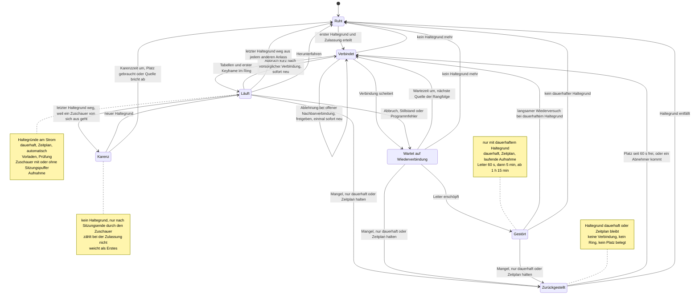

### 2.2 Haltegründe im Lebenszyklus

| Art | Besitzer | Entsteht | Endet | Danach ohne weiteren Haltegrund | Leiter bei Störung | Bei Mangel |
|---|---|---|---|---|---|---|
| dauerhaft | Sender | Strategie «dauerhaft», beim Serverstart | Strategie geändert, Sender deaktiviert (T-29) | sofort Ruht | verlängert (dauerhafter Haltegrund) | Rangfolge 5: zurückgestellt, F-4 |
| Zeitplan | Zeitplan-Eintrag | Beginn des Fensters, beim Serverstart im Fenster | Ende des Fensters, Sender deaktiviert | sofort Ruht | verlängert | Rangfolge 5: zurückgestellt, F-4 |
| automatisch | Regel `04` 6.2 | Sender unter den ersten N und jemand schaut Live-TV; nur mit Schalter der Quelle | 10 min nach der letzten Live-Sitzung im Haushalt, Sender fällt aus der Liste, Sender deaktiviert | sofort Ruht | nur auf Abruf: endet nach der Leiter | Rangfolge 2: endet |
| Vorladen | Live-Sitzung, die umschaltet | 2 s Verweilen, Nachbar nach `05` 6; nur mit Schalter der Quelle | 3 min nach letztem Umschalten, Sitzungsende, kein Nachbar mehr, Mangel, Ablehnung einer Verbindung derselben Quelle für einen Abnehmer, Sender deaktiviert | sofort Ruht | keine: ein Versuch | Rangfolge 1: endet |
| Prüfung | Prüfjob | Verfügbarkeitsprüfung eines ruhenden Senders | nach höchstens 10 s | sofort Ruht | keine: ein Versuch | Rangfolge 3: endet |
| Zuschauer | Live-Sitzung | Einstellen | Umschalten, Stopp, Ablauf, Entzug, Stopp durch die Verwaltung | Stopp durch den Client oder 60 s ohne Herzschlag: **Karenz**. Umschalten und jedes Ende durch den Server: sofort Ruht | nur auf Abruf: endet nach der Leiter mit Fehlercode | **geschützt** |
| Sitzungspuffer | – (am Haltegrund Zuschauer) | mit dem Einstellen, nur mit Recht «Timeshift»; nach Rückkehr des Speicherorts neu (3.13) | Umschalten, Sitzungsende, Entzug von «Timeshift», Ausfall des Speicherorts, Serverstart | – | – | wird gekürzt, nie der Strom beendet (`04` 8.3) |
| Aufnahme | Aufnahme | Aufwärmzeit 30 s (10 bis 120) **vor dem Beginn des Vorlaufs** | Ende mit Nachlauf, Absage, Kontingent, «sofort beenden» | sofort Ruht | verlängert | **geschützt** |

### 2.3 Zustand × Ereignis

| Zustand | Ereignis | Folgezustand | Regel |
|---|---|---|---|
| Ruht | erster Haltegrund, Zulassung erteilt | Verbindet | `04` 5.3 «Start»; vorher enden Ströme derselben Quelle **ohne Haltegrund** |
| Ruht | erster Haltegrund, Zulassung verweigert | Ruht (Anfrage abgelehnt) | `04` 8.2 Stufe 6 |
| Verbindet | Programmtabellen und erster Keyframe im Ring | Läuft | `04` 5.3; bei Bildgruppen über 15 s «läuft» ohne schnellen Start (`05` 3.6) |
| Verbindet | Versuch für Zuschauer, Aufnahme, dauerhaft oder Zeitplan wird abgelehnt (401, 403, 429), während eine andere Verbindung derselben Quelle offen ist oder vor höchstens 10 s geschlossen wurde | Verbindet: bei dieser Quelle nach Rangfolge freigeben (ohne Haltegrund, Vorgeladenes, Prüfungen, automatisch; für Zuschauer und Aufnahme auch dauerhaft und Zeitplan ohne Abnehmer, die zurückgestellt werden), einmal sofort neu | `04` 5.3, Tabelle der Ablehnungen |
| Verbindet | zweiter Versuch nach Limitverdacht scheitert | Ruht für diesen Abnehmer, Fehlercode «Quelle lehnt weitere Verbindung ab»; vorsorglicher Empfang der Quelle ruht 30 min | `04` 5.3 |
| Verbindet | vorsorglicher Versuch (Vorladen, automatisch, Prüfung) wird abgelehnt | Ruht, Versuch entfällt still; war eine andere Verbindung offen, ruht vorsorglicher Empfang der Quelle 30 min; nie «Zugang prüfen» | `04` 5.3 |
| Verbindet | 401 oder 403 ohne Nachbarverbindung, zweimal im Abstand von mindestens 10 s, Versuch für einen Abnehmer oder Auftrag | Wartet (Quelle «Zugang prüfen», übersprungen) | `04` 5.3 |
| Verbindet | Verbindungsfehler, 429 ohne Nachbarverbindung | Wartet | `04` 5.3 |
| Verbindet | DRM oder verschlüsselter Strom erkannt | Wartet (Quelle mit Zustand «DRM» übersprungen) | `04` 5.3, `05` 2.5 |
| Verbindet | 15 s ohne erstes Segment für eine einstellende Sitzung | Startversuch der Sitzung endet mit Fehlercode | `04` 9 «Start dauert» |
| Verbindet, Wartet | letzter Haltegrund weg | Ruht | `04` 5.1 |
| Läuft | Abbruch, 10 s keine Daten, Uhr steht 10 s, HLS-Liste rückt nicht vor | Wartet | `04` 5.3, `05` 9.2 |
| Läuft | Programmfehler beim Lesen der Quelle | Wartet, Quelle in Quarantäne | T-27, `04` 9 |
| Läuft | Strom mit Zuschauer oder Aufnahme bricht innert 10 s nach einer vorsorglichen Verbindung zur selben Quelle ab | Verbindet ohne Wartezeit; vorsorgliche Ströme der Quelle enden, vorsorglicher Empfang ruht 30 min | `04` 5.3 «Gegenrichtung» |
| Läuft | Parameter oder Quelle wechseln | Läuft, neuer Zeitabschnitt; reicht das Byte-Budget für den neuen Ring nicht, nach Rangfolge freigeben, sonst bisherigen Ring behalten («Startpuffer verkürzt») | T-6, `04` 5.3, `05` 3.4 |
| Läuft | letzter Haltegrund weg: Stopp durch den Client, App geschlossen oder im Hintergrund, 60 s ohne Herzschlag | Karenz | T-17, `04` 5.3 «Freigabe» |
| Läuft | letzter Haltegrund weg: Umschalten, Entzug, Abmelden, Löschen, Tageslimit, Stopp durch die Verwaltung, Token abgelaufen; Ende einer Aufnahme; Ende eines Zeitfensters; Strategiewechsel; Ende von «automatisch», Vorladen oder Prüfung | Ruht, sofort | `04` 5.3 «Freigabe» |
| Läuft | Sender deaktiviert | Läuft weiter, solange Zuschauer oder Aufnahme halten; vorsorgliche Haltegründe (Vorladen, automatisch, dauerhaft, Zeitplan) enden sofort; danach ohne Haltegrund sofort Ruht | T-29 |
| Läuft | Befehl «sofort beenden» | Ruht; Zuschauer «Sender nicht verfügbar», Aufnahme «unvollständig, Sender deaktiviert» | T-29 |
| Läuft | Mangel, nur Haltegründe Vorladen, automatisch oder Prüfung | Ruht (Haltegrund endet) | `04` 8.2 Stufen 1 bis 3 |
| Läuft, Wartet, Gestört | Mangel, nur Haltegründe dauerhaft oder Zeitplan | Zurückgestellt | `04` 5.1, 5.3, 8.2 Stufe 5 |
| Läuft, alle | Herunterfahren | Ruht | `04` 5.3 |
| Wartet | Wartezeit der Leiter um (1, 2, 5, 10, 20 s) | Verbindet, nächste Quelle ohne Quarantäne | `04` 5.3 |
| Wartet | Leiter erschöpft, nur Haltegründe auf Abruf | Gestört, dann Ruht mit Fehlercode | `04` 5.3 |
| Wartet | Leiter erschöpft, dauerhafter Haltegrund | Gestört | `04` 5.3 |
| Gestört | verlängerte Leiter fällig (60 s, 5 min, ab 1 h 15 min) | Verbindet | `04` 5.3 |
| Gestört | 10 min Ausfall | Gestört, Meldung an den Administrator | `04` 5.3, 10.2 |
| Gestört | kein dauerhafter Haltegrund mehr | Ruht | `04` 5.1 |
| Karenz | neuer Haltegrund | Läuft | `04` 5.1 |
| Karenz | Karenzzeit um (Vorgabe 30 s, 15 s bis 5 min) | Ruht | `04` 5.3, 14.1 |
| Karenz | Platz oder eine Verbindung derselben Quelle gebraucht | Ruht, vorzeitig | `04` 5.3, 8.2 Stufe 0 |
| Karenz | Quelle bricht ab oder steht still | Ruht, sofort; keine Leiter, keine Quarantäne, Abbruch protokolliert | `04` 5.3 |
| Zurückgestellt | die fehlende Grösse ist seit 60 s ununterbrochen frei (geprüft bei jeder Freigabe, mindestens je Minute) | Verbindet, nach Kanalnummer, höchstens 2 Starts je Sekunde | `04` 5.3 |
| Zurückgestellt | ein Zuschauer oder eine Aufnahme braucht den Sender | Verbindet, sofort (gewöhnlicher Start) | `04` 5.3 |
| Zurückgestellt | Zeitfenster endet, Strategie ändert sich, Sender deaktiviert | Ruht | `04` 5.1, 5.3 |

## 3. Die 18 Situationen des Auftrags

### 3.1 Benutzer startet einen noch nicht empfangenen Sender

**Ausgangslage.** Sender K ruht, niemand hält ihn. Das Profil hat das Recht «Live-TV» (wirksam auf Konto und
Profil); Strategie «bei Bedarf». **Der Benutzer sieht:** nach dem Tippen ein kurzes Warten, dann Bild; der
Zielwert «unter 3 Sekunden» (Fall 3) hängt vor allem an der Bildgruppen-Länge der Quelle (`05` 5.2, 7).

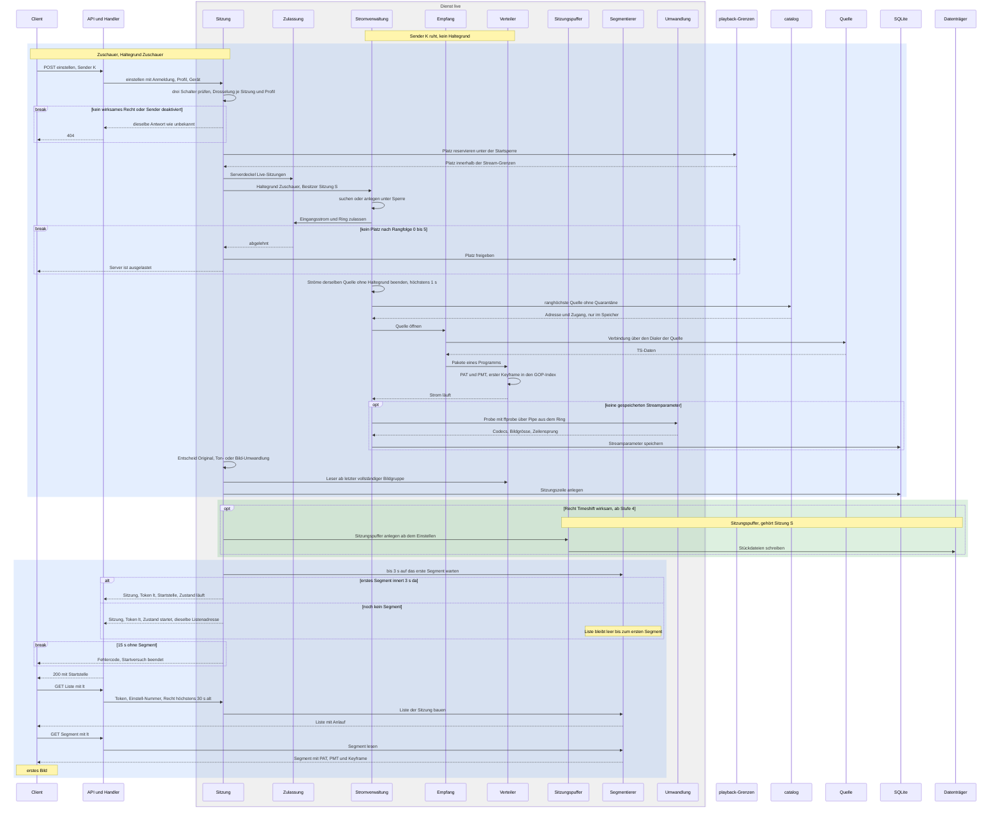

**Sichergestellt.** Der Sender wird genau einmal empfangen; das Recht prüft der Server vor allem anderen, und
ohne Recht gibt es nur 404. Die Stream-Grenze des Kontos ist reserviert, bevor eine Verbindung aufgeht. Passt
der Strom zum Gerät, läuft kein FFmpeg (Weg «Original»); sonst geht es weiter wie in 3.4. Mit Recht
«Timeshift» beginnt der Sitzungspuffer beim Einstellen. Die Antwort auf «einstellen» wartet bis 3 Sekunden
auf das erste Segment, sonst kommt sie mit Zustand «startet»; nach 15 Sekunden ohne Segment endet der Versuch
(`04` 9 «Start dauert», `05` 4.4). **Belegt:** T-2, T-5, T-7, T-9, T-10, T-12, T-14,
T-17, T-19, T-21, T-26; LTV-002.03, LTV-004.01, .07, .08, .10, LTV-012.06, .13. **Fehlerzweige:** kein Recht
(404); Grenze des Kontos erreicht (bestehende Meldung von `playback`); kein Platz (3.14); Verbindung scheitert
oder Quelle lehnt ab (Leiter und Deutung, 3.9 und 2.3); DRM (Quelle übersprungen); keine vollständige
Bildgruppe in 15 s (Start am neuesten Keyframe, ohne schnellen Start).

### 3.2 Benutzer startet einen bereits empfangenen Sender

**Ausgangslage.** Sender K läuft schon: dauerhaft, vorgeladen, in Karenz oder weil ein anderes Profil schaut.
Der Ring hält bis zu 15 Sekunden mit mindestens einer vollständigen Bildgruppe; die Streamparameter sind
gespeichert. **Der Benutzer sieht:** fast sofort Bild (Fall 1 und 2, Zielwert unter 1 Sekunde; hängt am
Startpuffer des Players und am Netz, `05` 5.2).

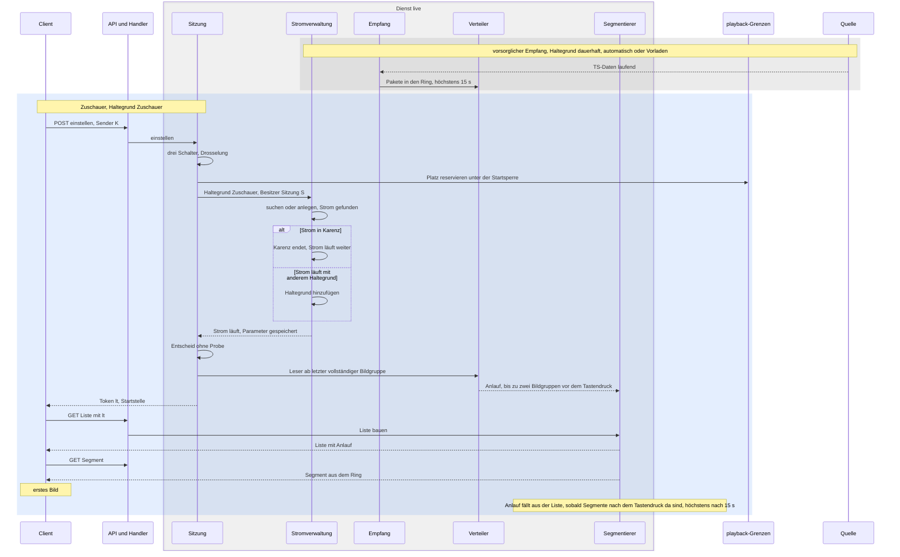

**Sichergestellt.** Keine neue Verbindung, keine Probe, kein Warten auf einen Keyframe der Quelle. Der
Anlauf aus dem Ring ist einmal sichtbar, danach antwortet der Server für seine Segmente mit 404; die
Rückspulgrenze ist der Tastendruck (Vorgabe F-7 (a)). Ein Strom, der seit einer Stunde dauerhaft läuft, gibt
einem neuen Zuschauer höchstens den Anlauf. **Belegt:** T-6, T-7, T-17, T-22; LTV-004.02, LTV-007.11, .13,
LTV-013; Zielwerte Fall 1 und 2 (LTV-010). **Fehlerzweige:** wie 3.1 bis zum Haltegrund; Strom endet gerade
(Beitritt wartet auf das Ende und startet neu, 4.1); Bildgruppen 7 bis 15 s (Start am neuesten Keyframe, kein
schneller Start).

### 3.3 Mehrere Benutzer schauen denselben Sender

**Ausgangslage.** Zwei Profile, ein Profil mit Recht «Timeshift» und eines ohne, stellen denselben Sender
ein. **Sie sehen:** beide dasselbe Programm, jedes mit eigener Wiedergabe, eigener Qualität und eigener
Tonspur; nur wer «Timeshift» hat, kann pausieren.

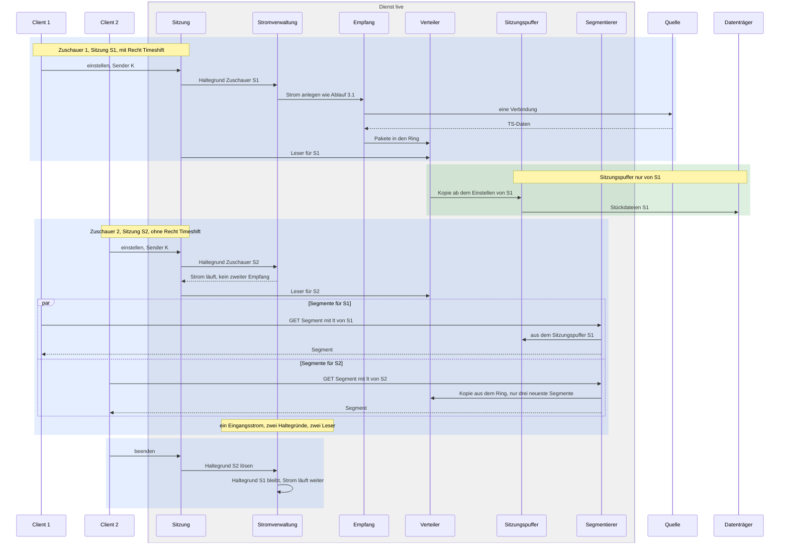

**Sichergestellt.** Ein Eingangsstrom, beliebig viele Haltegründe und Leser; zwanzig Zuschauer ergeben einen
Empfang. Jede Sitzung hat eigene Liste, eigenes Token, eigenen Entscheid. Zwei Zuschauer teilen nur den Ring,
nie den Zeitversatz: Jeder Sitzungspuffer ist eine eigene Kopie (Vorgabe F-8 (a)) und wird nie aus einem
anderen gefüllt. Das Ende eines Zuschauers löst nur seinen Haltegrund. **Belegt:** T-2, T-6, T-8, T-9, T-10;
LTV-004.02 bis .05, .07, .34, .37, LTV-007.01, .03, DR-24. **Fehlerzweige:** Grenze gleichzeitiger Ströme des
Kontos erreicht (Meldung beim zweiten Profil); Deckel aller Sitzungspuffer erreicht (neue Sitzung läuft ohne
Zeitversatz, `04` 8.3); Umwandlung nötig (3.4, je Sitzung eigener Prozess).

### 3.4 Ein Benutzer benötigt individuelles Transcoding

**Ausgangslage.** Der Sender sendet zum Beispiel H.264 mit Zeilensprung und MP2-Ton; der Browser kann beides
nicht sauber (`04` 7.6). **Der Benutzer sieht:** Bild nach Fall 4 (Zielwert unter 5 Sekunden), sonst wie
immer. Andere Zuschauer desselben Senders merken nichts.

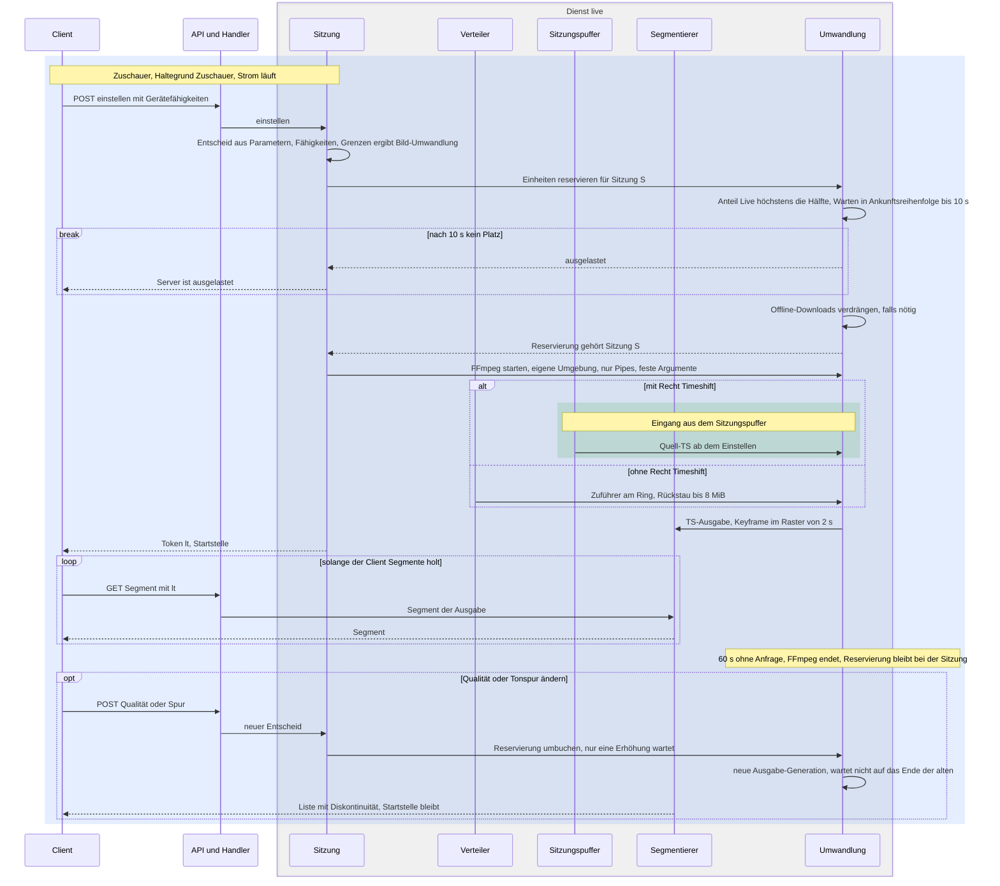

**Sichergestellt.** Genau ein FFmpeg je Sitzung, nie gemeinsam genutzt, nie vorsorglich, nur über Pipes; die
Reservierung gehört der Sitzung und übersteht Umschalten, Pause und Neustart von FFmpeg. Die Dateiwiedergabe
behält mindestens die Hälfte des Budgets. Mit Zeitversatz liegt der Puffer **vor** der Umwandlung, sodass ein
Qualitätswechsel auf die ganze Vergangenheit wirkt. **Belegt:** T-4, T-10, T-13, T-14, T-15, T-19, T-27;
LTV-004.09, .12 bis .19, LTV-004.X-01, LTV-012.08. **Fehlerzweige:** Budget nach 10 s nicht frei
(«ausgelastet»); FFmpeg langsamer als Echtzeit (mit Zeitversatz fällt er zurück, ohne überspringt er, nach
30 s «zu langsam», `04` 8.3); Parameterwechsel (neuer Zeitabschnitt, FFmpeg startet neu); Hardware fehlt
(Software-Rückfall wie heute, kein neuer Rückfall zur Laufzeit).

### 3.5 Ein Benutzer wechselt den Sender

**Ausgangslage.** Sitzung S schaut Sender A (Einstell-Nummer n) und schaltet auf Sender B. A und B kommen
aus derselben Quelle, deren Zugang vielleicht nur eine Verbindung erlaubt. **Der Benutzer sieht:** ein
Umschalten ohne neuen Player; bei vorgeladenem oder empfangenem B Fall 1 und 2, sonst Fall 3.

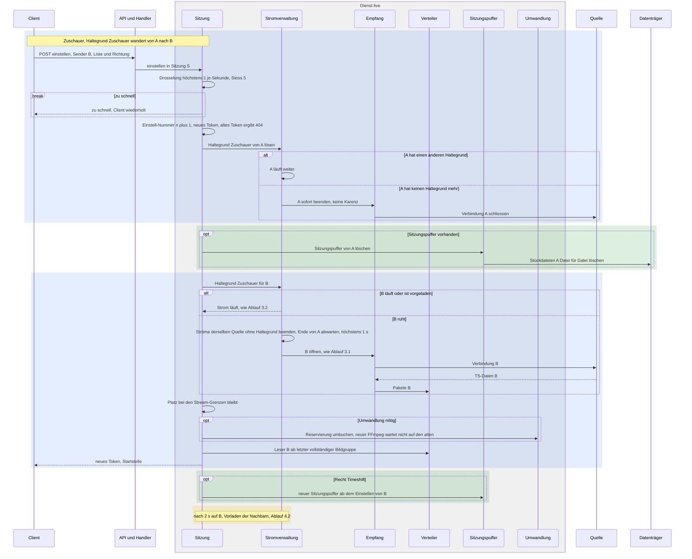

**Sichergestellt.** Umschalten ist ein Vorgang **in** der Sitzung, keine neue Sitzung; Stream-Platz und
Umwandlungsreservierung bleiben. Beim Umschalten gibt es keine Karenz, und vor der neuen Verbindung schliesst
die alte derselben Quelle: Der Server bleibt mit Zugängen verträglich, die nur eine Verbindung erlauben, ohne
ein Limit zu kennen. Vorgeladenes derselben Quelle bleibt dabei stehen (es gibt es nur bei Quellen mit dem
Schalter «Vorladen für Sender dieser Quelle: an», `04` 5.3). Der Puffer von A ist gelöscht. **Belegt:** T-9, T-10, T-13, T-17, T-21; LTV-007.08,
LTV-002.09, LTV-004.33, LTV-017 (kein Limit verwaltet), Abnahmeprüfung `04` 8.5 (20 Sender in 10 s, höchstens
zwei Eingangsströme danach). **Fehlerzweige:** zu schnell (Client wiederholt); B lehnt ab, während A noch
schliesst (Limitverdacht, einmal sofort neu, keine Sperre); kein Platz für B (Ablehnung, A ist dann schon
beendet: Folge der Reihenfolge in `04` 5.3).

### 3.6 Ein Benutzer pausiert und verwendet Timeshift

**Ausgangslage.** Sitzung S mit wirksamem Recht «Timeshift» (Stufe 4) schaut Sender K; der Sitzungspuffer
läuft seit dem Einstellen. **Der Benutzer sieht:** Pause, Zurückspulen bis zum Zeitpunkt des Einschaltens,
Vorspulen bis Live, Sprung zu Live.

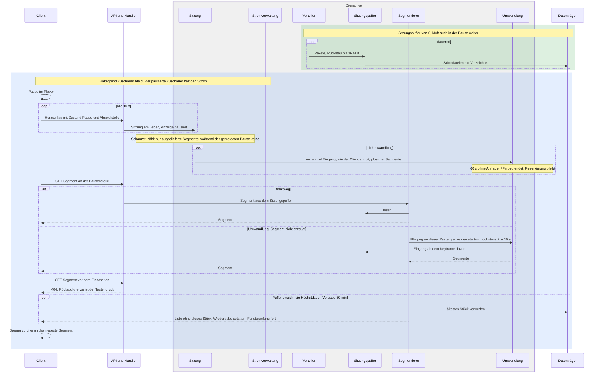

**Sichergestellt.** Die Pause hält den Eingangsstrom nicht an; der Puffer gehört nur dieser Sitzung und
beginnt beim Einstellen; die Liste reicht höchstens von der Rückspulgrenze bis zum neuesten Segment, jede
Anfrage ausserhalb ist 404. Ohne Recht «Timeshift» gibt es keinen Sitzungspuffer: Die Liste nennt die drei
neuesten Segmente aus dem Ring, hält der Player an, sind sie danach 404 und er springt an die Live-Kante
(T-10). Der Herzschlag meldet «spielt» oder «Pause»; die Schauzeit zählt die ausgelieferten, verschiedenen
Segmente, die Pause zählt also nicht (`04` 10.3, `03` DR-12). **Belegt:** T-7, T-8, T-10, T-13, T-21;
LTV-007.01 bis .07, .10, .11, .14, DR-07, DR-12, DR-22. **Fehlerzweige:**
nahtloses Spulen mit Umwandlung nicht belegt (M-9), Rückfall `05` 4.5: jeder Neustart ist eine neue
Ausgabe-Generation, «spiele ab Uhrzeit» als Operation; Deckel oder Speicherort voll (grösster Puffer wird von
hinten gekürzt); Speicherort fällt aus (3.13); Herzschlag fehlt 60 s (Sitzungsende, 3.11).

### 3.7 Eine Aufnahme startet bei einem bereits empfangenen Sender

**Ausgangslage.** Ein Profil hat eine Aufnahme auf Sender K geplant; K läuft, weil jemand schaut. **Der
Benutzer sieht:** in «Meine Aufnahmen» die laufende Aufnahme; der Zuschauer merkt nichts.

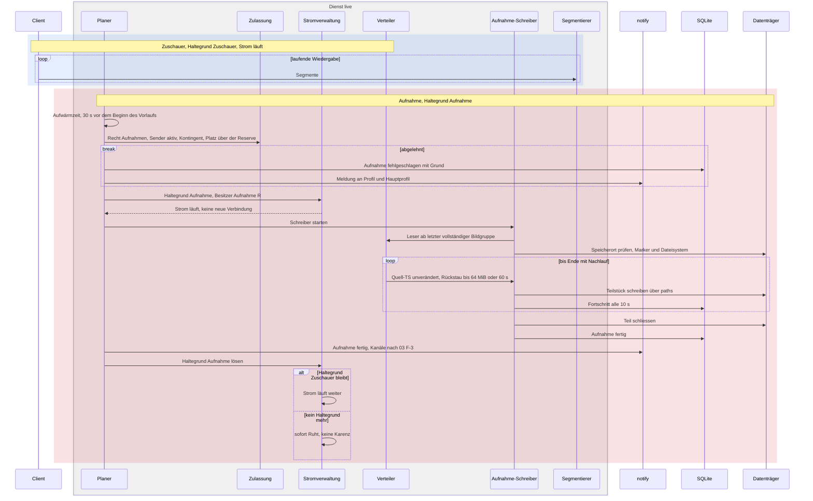

**Sichergestellt.** Die Aufnahme hängt am Eingangsstrom, nicht an der Sitzung des Zuschauers, und öffnet
keine zweite Verbindung. Sie schreibt den Quell-TS unverändert mit allen Spuren; kein FFmpeg, kein
Umwandlungsbudget. **Belegt:** T-1, T-6, T-8, T-16, T-22, T-25; LTV-008.23, .24, .25, LTV-004.06, LTV-020.01,
.02, .05, LTV-Q-08.26. **Fehlerzweige:** Kontingent voll oder Speicherort unter der Reserve (abgelehnt und
gemeldet, `03` DR-06); Recht «Aufnahmen» entzogen (`03` F-7); Speicherort fällt aus (3.13); Quelle fällt aus
(3.9); Sender wird deaktiviert (die Aufnahme läuft bis zu ihrem Ende, T-29; nur «sofort beenden» bricht sie
ab, dann «unvollständig, Sender deaktiviert»). Nach dem Ende ohne weiteren Haltegrund ruht der Strom sofort;
folgt eine weitere Aufnahme auf demselben Sender, hält deren Haltegrund ihn schon (`04` 5.3).

### 3.8 Eine Aufnahme startet ohne angemeldeten Benutzer

**Ausgangslage.** Nachts, niemand angemeldet, keine Live-Sitzung. Sender K ruht. Eine geplante Aufnahme
wird fällig. **Der Benutzer sieht:** am Morgen die fertige Aufnahme, oder eine Meldung mit Grund.

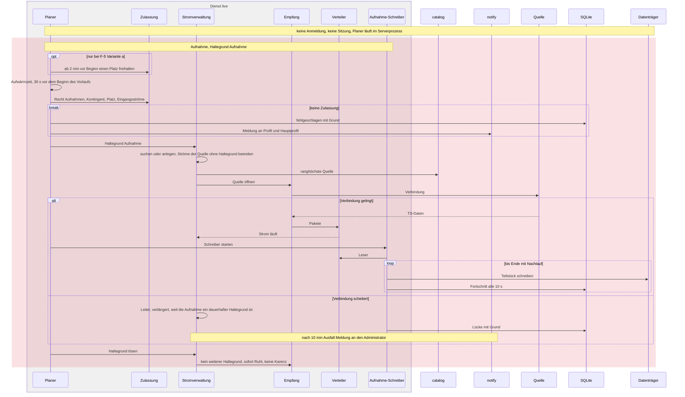

**Sichergestellt.** Aufnahmen brauchen weder Anmeldung noch Sitzung noch Client; sie zählen nicht zu den
Stream-Grenzen des Kontos (`03` DR-12) und laufen unabhängig vom Jobsystem. Der Empfang startet rechtzeitig
vor dem Beginn. **Belegt:** T-1, T-16, T-17, T-19; LTV-008.15, .25, LTV-002.08, .11, DR-11, DR-12.
**Fehlerzweige:** Zulassung verweigert (Vorrang offen: F-5 und `03` F-4; Vorgabe nach `04` 8.2 Stufe 6:
abgelehnt mit Grund); Quelle nicht erreichbar (verlängerte Leiter, Lücke); Sender deaktiviert oder fehlt
(`03` DR-16, «Sender nicht verfügbar»); Quelle lehnt ab, während eine andere Verbindung derselben Quelle
offen ist (bei dieser Quelle wird Vorsorgliches freigegeben, dauerhaft Empfangenes ohne Abnehmer
zurückgestellt, dann einmal sofort neu, `04` 5.3). Die Aufwärmzeit von 30 Sekunden (10 bis 120) zählt vor
dem Beginn des Vorlaufs (`04` 5.2, 14.1; wie `11` 3.3).

### 3.9 Eine Streamquelle fällt aus

**Ausgangslage.** Sender K läuft mit einem Zuschauer und einer Aufnahme; die Quelle bricht ab oder liefert
10 Sekunden nichts. Es gibt keine Ersatzquelle (sonst 3.10). **Der Benutzer sieht:** das Bild steht kurz,
der Hinweis «Verbindung wird wiederhergestellt», danach Bild an der Live-Kante oder «Sender nicht
verfügbar».

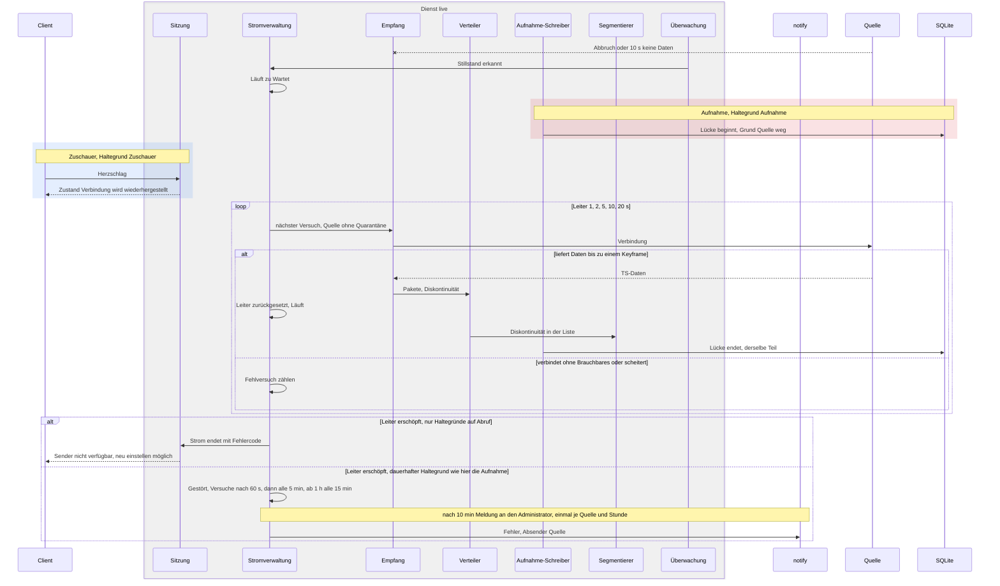

**Sichergestellt.** Die Wiederverbindung ist begrenzt und wird mit wachsendem Abstand versucht, nie als
Schleife. Eine Wiederverbindung zur selben Quelle ist eine Diskontinuität, kein neuer Zeitabschnitt: Die
Aufnahme bleibt im selben Teil und vermerkt die Lücke. Andere Sender sind nicht betroffen. **Belegt:** T-6,
T-17, T-23; LTV-011.02, .03, .13, .16, .17, .20, LTV-020.12, LTV-008.26. **Fehlerzweige:** 401 oder 403
(Deutung nach Lage, 2.3); DRM erscheint beim Nachladen einer HLS-Liste (Quelle gesperrt); Programmfehler durch
ungültige Daten (Quarantäne, Server läuft weiter, T-27); Aufnahme endet während der Störung (Haltegrund weg,
Strom endet, wenn sonst nichts hält).

### 3.10 Ein Ersatzstream wird verwendet

**Ausgangslage.** Sender K hat eine Hauptquelle Q1 und eine Ersatzquelle Q2 in der Rangfolge. Q1 bricht ab,
während jemand schaut und eine Aufnahme läuft. **Der Benutzer sieht:** einen kurzen Bildsprung und den
Hinweis «Ersatzquelle».

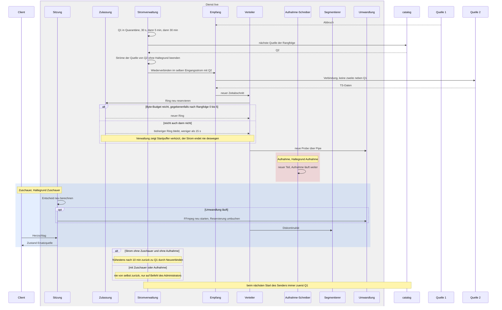

**Sichergestellt.** Der Wechsel ist ein Wiederverbinden mit anderer Quelle **im selben** Eingangsstrom, also
ohne zweite Verbindung; Identität ist der Sender, nicht die Adresse. Eine Probeverbindung zur Hauptquelle
neben dem laufenden Strom gibt es nicht. Die Aufnahme bricht nicht ab, sie beginnt einen neuen Teil.
**Belegt:** T-2, T-6, T-16, T-17; LTV-003.22, LTV-004.32, LTV-011.09, .10, LTV-020.13, .14. **Fehlerzweige:**
neuer Ring passt nicht ins Byte-Budget (Rangfolge, sonst bisheriger, kürzerer Ring, `04` 5.3); alle Quellen
in Quarantäne (Leiter wie 3.9); Q2 auf einem anderen Zugang mit Limit (Deutung der Ablehnung);
Q2 hat andere Spuren (Entscheid und Tonspur neu, `05` 3.4).

### 3.11 Der letzte Zuschauer beendet die Wiedergabe

**Ausgangslage.** Sitzung S ist die einzige, die Sender K hält. Der Benutzer tippt «Beenden», schliesst die
App oder verliert die Verbindung. **Der Benutzer sieht:** Die Wiedergabe endet; kehrt er in der Karenzzeit
zurück, steht das Bild sofort.

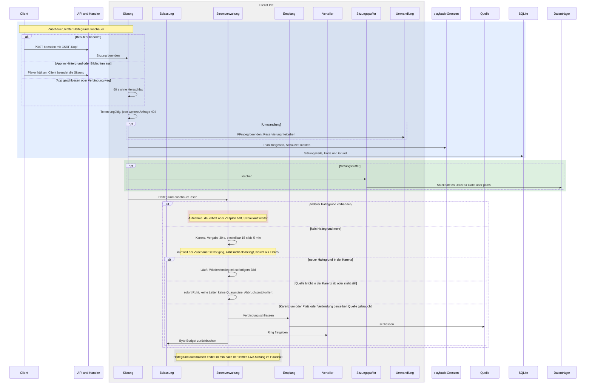

**Sichergestellt.** Das Ende eines Zuschauers räumt alles ab, was ihm gehört (Token, Puffer, FFmpeg,
Reservierung, Stream-Platz); andere Haltegründe bleiben unberührt. Ein Strom ohne Haltegrund belegt keinen
Platz und wird spätestens nach der Karenz beendet. **Belegt:** T-10, T-13, T-17, T-21, T-26; LTV-002.09,
LTV-004.27, .33, .37, LTV-007.09. Karenz gibt es nur in diesem Fall, wenn der Zuschauer selbst geht; endet
die Sitzung durch den Server (Entzug, Abmelden, Tageslimit, Stopp durch die Verwaltung), ruht der Strom
sofort (3.15). **Fehlerzweige:** Herzschlag fällt im Browser-Tab im Hintergrund oder bei Bildübertragung aus
(Sitzung endet nach 60 s; offen als `04` O-25, M-3, M-5); Quelle bricht in der Karenz ab (Strom endet
sofort, keine Wiederverbindung).

### 3.12 Slouchcat startet neu

**Ausgangslage.** Der Server ist beendet worden (Herunterfahren nach 4.3, Absturz oder Stromausfall) und
startet wieder. Es gab Sitzungen, Sitzungspuffer, laufende Aufnahmen und dauerhaft empfangene Sender.
**Der Benutzer sieht:** die Wiedergabe bricht ab; der Client stellt neu ein; laufende Aufnahmen zeigen eine
Lücke «Server lief nicht».

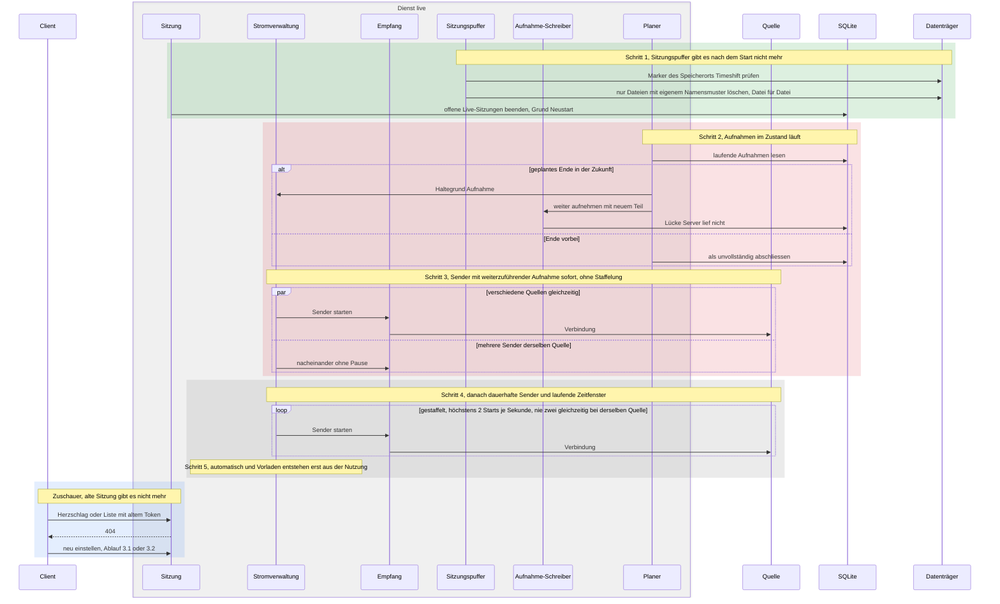

**Sichergestellt.** Nach einem Neustart gibt es keinen alten Sitzungspuffer und keinen Startpuffer mehr;
gelöscht wird nur unter dem eigenen Marker und nur, was dem eigenen Namensmuster entspricht. Aufnahmen werden
nie gelöscht: Erhaltene Teile bleiben abspielbar, die Lücke ist benannt. Dauerhafte und zeitgesteuerte
Sender laufen von selbst wieder an. **Belegt:** T-7, T-17, T-22, T-25; LTV-002.12, LTV-008.26, LTV-019.19,
LTV-020.20. **Fehlerzweige:** Speicherort fehlt beim Start (keine Löschung, kein Ausweichen, 3.13); Quelle
nicht erreichbar (Leiter, für Aufnahmen verlängert). Die Staffelung gilt nur für dauerhafte Sender und
Zeitfenster; Sender mit weiterzuführenden Aufnahmen verbinden sofort, weil jede Sekunde eine Lücke ist
(`04` 5.3).

### 3.13 Ein Datenträger fällt aus

**Ausgangslage.** Der Speicherort «Timeshift» oder «Aufnahmen» verschwindet: Netzspeicher getrennt, Platte
nicht eingehängt, Schreibfehler. **Der Benutzer sieht:** beim Zeitversatz den Hinweis «Zeitversatz gerade
nicht möglich»; bei Aufnahmen eine Lücke «Speicher fehlt». Live läuft weiter.

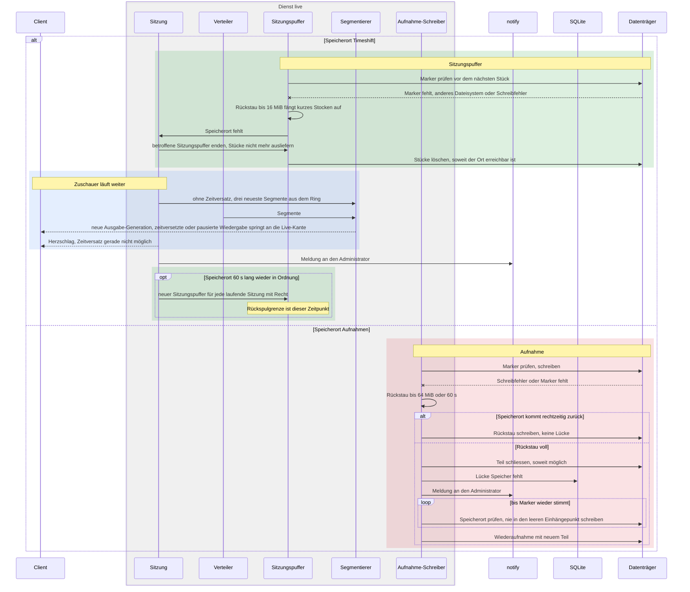

**Sichergestellt.** Ein fehlender Speicherort ist ein Zustand, kein Programmfehler; der Server weicht nie
auf einen anderen Ordner aus und schreibt nie in einen leeren Einhängepunkt. Beim Speicherort «Timeshift»
enden die Puffer, die Wiedergabe springt an die Live-Kante, und 60 Sekunden nach der Rückkehr des Orts
beginnt je Sitzung mit Recht ein neuer Puffer mit neuer Rückspulgrenze (`04` 9, 14.6). Der Empfang wartet nicht auf den
Datenträger (T-8). Ein voller Speicherort verhält sich ähnlich: Timeshift kürzt zuerst den grössten Puffer,
Aufnahmen schliessen den Teil mit Lücke «Speicher voll», neue Aufnahmen starten nicht (`04` 8.3). Liegt der
Startpuffer in einem Ordner, der stockt, hat der Sender nur keinen schnellen Start. **Belegt:** T-8, T-16,
T-25; LTV-019.20, .21, .22, LTV-020.12, LTV-008.26. **Fehlerzweige:** Datenträger nur langsam statt weg
(Rückstau, dann Lücke oder Diskontinuität, 3.17); Speicherort fehlt schon beim Serverstart (3.12).

### 3.14 Die Serverressourcen sind erschöpft

**Ausgangslage.** Die Obergrenze der Eingangsströme oder das Byte-Budget ist erreicht; ein Profil stellt
einen weiteren, nicht empfangenen Sender ein. **Der Benutzer sieht:** entweder Bild wie in 3.1 oder «Der
Server ist ausgelastet». Niemand, der schon schaut oder aufnimmt, wird unterbrochen.

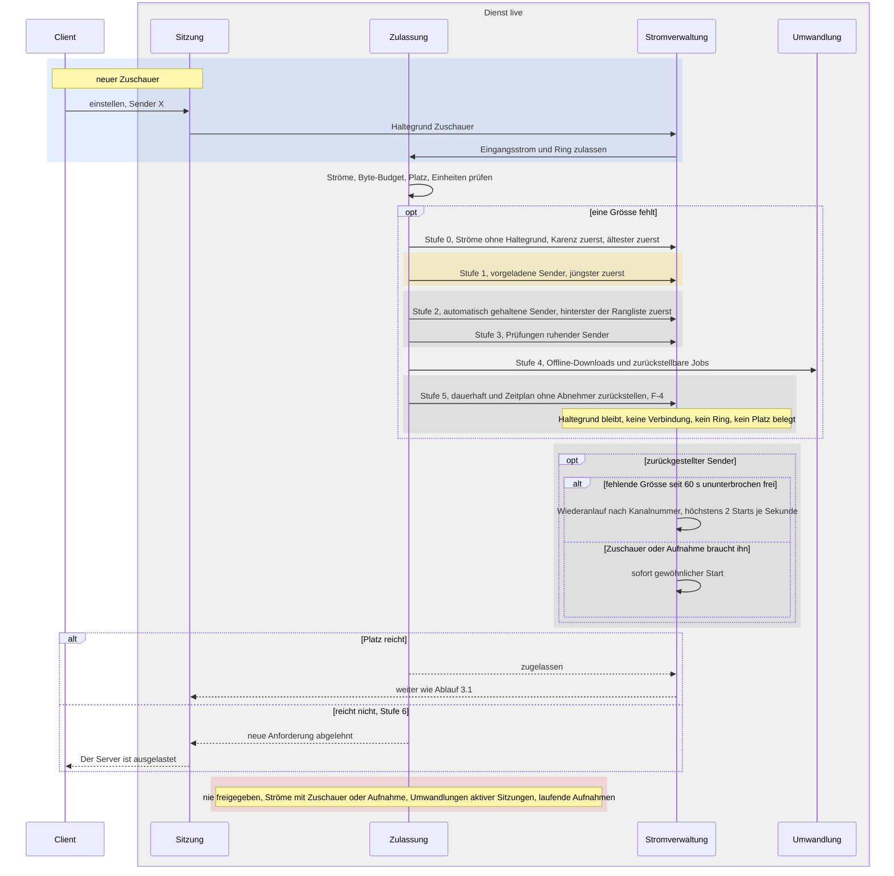

**Sichergestellt.** Es gibt genau einen Ort, der zulässt und freigibt, mit fester Rangfolge; Vorsorgliches
weicht zuerst, Laufendes nie. Dauerhafte und zeitgesteuerte Sender werden nicht beendet, sondern
zurückgestellt; die 60 Sekunden verhindern, dass Durchschalten sie im Sekundentakt verdrängt und zurückholt
(`04` 5.3). Der Rückstau der Schreiber zählt erst bei Gebrauch; keine Aufnahme und keine Sitzung wird wegen
des Rückstaus abgelehnt (`04` 8.1). Unabhängig von den Grenzen der Konten gelten Serverdeckel (Live-Sitzungen,
Drosselung, Neustarts von FFmpeg). Eine fällige Aufnahme bei Mangel: Vorrang offen (F-5, `03` F-4), nach
`04` 8.2 Stufe 6 bis dahin Ablehnung mit Grund und Meldung. **Belegt:** T-13, T-17, T-19; LTV-002.02, .10,
.11, LTV-004.20, LTV-017.01, DR-11. **Fehlerzweige:** Umwandlungseinheiten fehlen (warten bis 10 s, dann
Ablehnung, 3.4); CPU ausgelastet bei laufenden Umwandlungen («zu langsam» nach 30 s); Arbeitsspeicher knapp
(Ringe wachsen nicht, das Betriebssystem beendet zuerst FFmpeg-Umwandlungen).

### 3.15 Eine Benutzerberechtigung wird während der Wiedergabe entzogen

**Ausgangslage.** Ein Profil schaut; der Administrator schaltet «Live-TV» am Konto aus, oder das Hauptprofil
am Profil, oder die Anmeldung endet (Abmelden, Passwortwechsel, Tageslimit). **Der Benutzer sieht:** Die
Wiedergabe endet mit einer verständlichen Meldung, Ziel innert 10 Sekunden; danach ist der Bereich
unsichtbar.

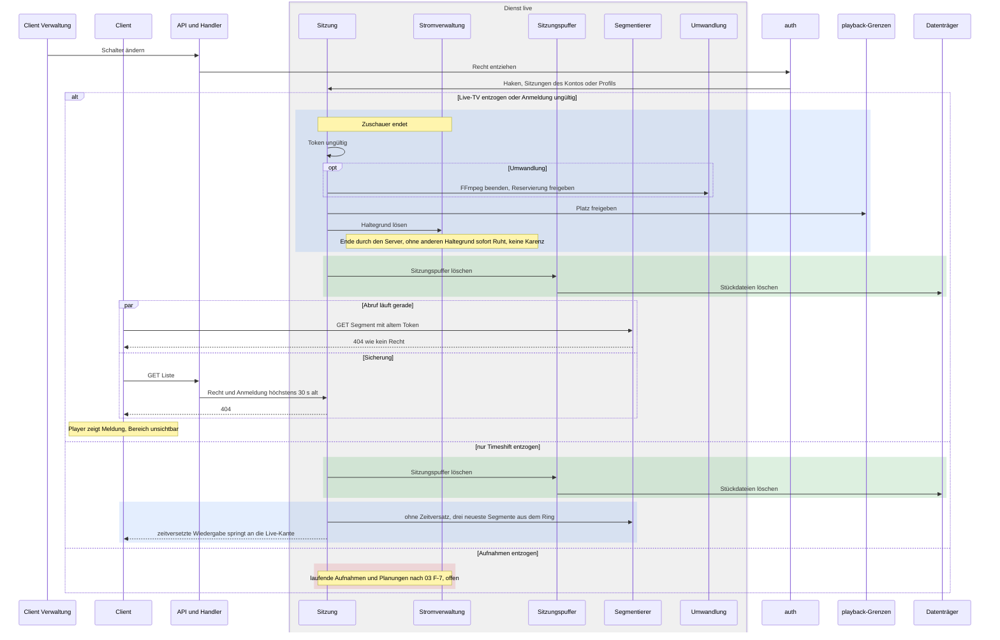

**Sichergestellt.** Der Server setzt den Entzug durch, nicht der Client. Der Haken beendet sofort; als
Sicherung prüft jede Listenanfrage Recht und Anmeldung höchstens 30 Sekunden alt, und ein ungültiges Token
ergibt bei allen Live-Routen dieselbe 404-Antwort wie «kein Recht». Andere Zuschauer desselben Senders laufen
weiter. **Belegt:** T-10, T-21, T-26; LTV-012.11, .12, .13, `03` 2.4. **Fehlerzweige:** Segmentanfrage
zwischen Entzug und Haken (spätestens die nächste Listenanfrage ist 404); Hauptprofil spielt Aufnahme eines
Profils mit Altersgrenze und verliert selbst «Live-TV» (`03` DR-03); Verlust des Rechts «Aufnahmen» bei
laufender Aufnahme (`03` F-7, O-9).

### 3.16 Eine M3U-Aktualisierung ändert die URL eines aktiven Senders

**Ausgangslage.** Sender K läuft (Zuschauer, eventuell Aufnahme). Der Listen-Abgleich der Quelle liefert für
K eine neue Stream-Adresse. **Der Benutzer sieht:** nichts, solange die alte Verbindung hält.

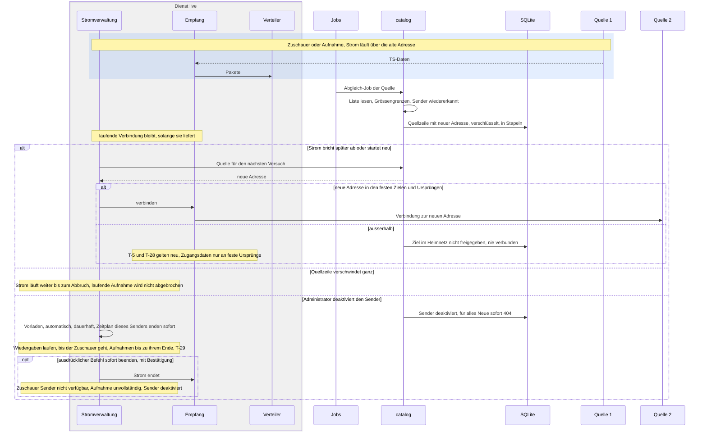

**Sichergestellt.** Ein aktiver Strom wechselt die Adresse erst an einem sicheren Punkt, nämlich bei der
nächsten Verbindung; die Identität bleibt der Sender (Favoriten, Planungen bleiben). Netzschutz und feste
Ursprünge gelten für die neue Adresse neu, der Import probiert keine Adresse aus. Deaktivieren oder
Verschwinden eines Senders beendet nichts Laufendes von selbst; nur «sofort beenden» tut das (T-29).
**Belegt:** T-2, T-5, T-17, T-28, T-29; LTV-002.10, .11, LTV-018.05, .06, .13, .14, .17. **Fehlerzweige:** fehlerhafte oder auffällig kurze Liste (alter Stand
bleibt, LTV-018.14, .22); Liste nicht erreichbar (nichts ändert sich); neue Adresse mit DRM-Hinweis (beim
Import markiert).

### 3.17 Ein langsamer Client gefährdet die interne Streamverteilung

**Ausgangslage.** Sender K hat drei Abnehmer: einen schnellen Client, einen Client im schwachen WLAN und eine
Aufnahme auf einem stockenden Netzspeicher. **Die Benutzer sehen:** Der schnelle Client merkt nichts; der
langsame springt nach vorn; die Aufnahme bekommt erst nach 64 MiB oder 60 Sekunden eine Lücke.

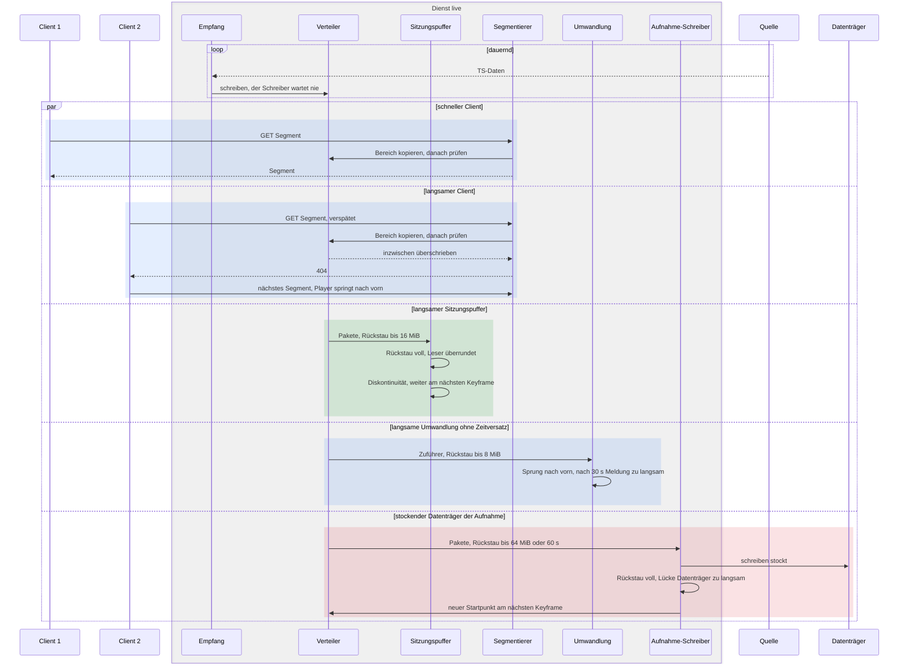

**Sichergestellt.** Niemand kann den Empfang aufhalten: Der Schreiber des Rings wartet nie und nimmt keine
Sperre, die ein Leser halten könnte; jeder Leser kopiert in Blöcken von 256 KiB und prüft danach. Jeder
Rückstau gehört genau einem Abnehmer und hat eine feste Grenze; er zählt erst bei Gebrauch gegen das
Byte-Budget, und stocken mehrere zugleich, teilen sie sich den Rest des Budgets (mindestens ein Viertel) zu
gleichen Teilen (`04` 8.1). Der Abwurf trifft nur den langsamen
Abnehmer. **Belegt:** T-8, T-19; LTV-004.28, .29, .30, .36. **Fehlerzweige:** langsamer Client mit Zeitversatz
(liest aus seinem eigenen Sitzungspuffer und fällt höchstens aus seinem eigenen Fenster); Zähler der
Überrundungen in der Verwaltung.

### 3.18 Mehrere Aufnahmeprozesse und Zuschauer benötigen denselben Sender

**Ausgangslage.** Zwei Profile verschiedener Konten nehmen dieselbe Sendung auf Sender K auf, zwei weitere
schauen. **Die Benutzer sehen:** jede Aufnahme in den eigenen «Meine Aufnahmen», jeder Zuschauer seine
Wiedergabe.

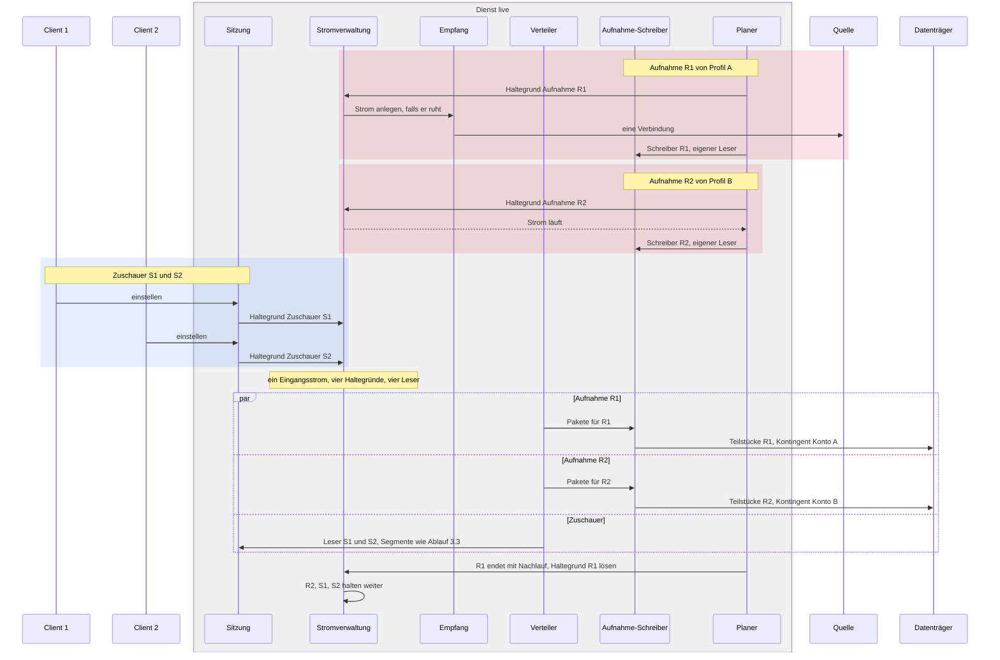

**Sichergestellt.** Beliebig viele Aufnahmen und Zuschauer teilen einen Eingangsstrom; jede Aufnahme hat
eigenen Leser, eigenen Rückstau und eigene, private Teilstücke im Kontingent ihres Kontos. Zwei Aufnahmen
desselben oder verschiedener Sender zur selben Zeit sind kein Konflikt. Ein Quellwechsel gibt allen
Aufnahmen zugleich einen neuen Teil. Bei Mangel wird keiner dieser Abnehmer verdrängt. **Belegt:** T-2, T-8,
T-16, T-17, T-19; LTV-004.02, .06, .26, LTV-008.10, LTV-002.10, .11, DR-11. **Fehlerzweige:** Kontingent eines
Kontos voll (nur diese Aufnahme abgelehnt); eine Aufnahme hat einen stockenden Datenträger (nur sie bekommt
eine Lücke, 3.17).

## 4. Zusätzliche Abläufe

### 4.1 Gleichzeitige Erstanfragen zweier Benutzer auf denselben Sender

**Ausgangslage.** Sender K ruht; zwei Clients stellen ihn im selben Augenblick ein. Ein dritter kommt, während
der Strom gerade endet. **Sichergestellt ist:** genau ein Eingangsstrom, kein verlorener und kein doppelter.

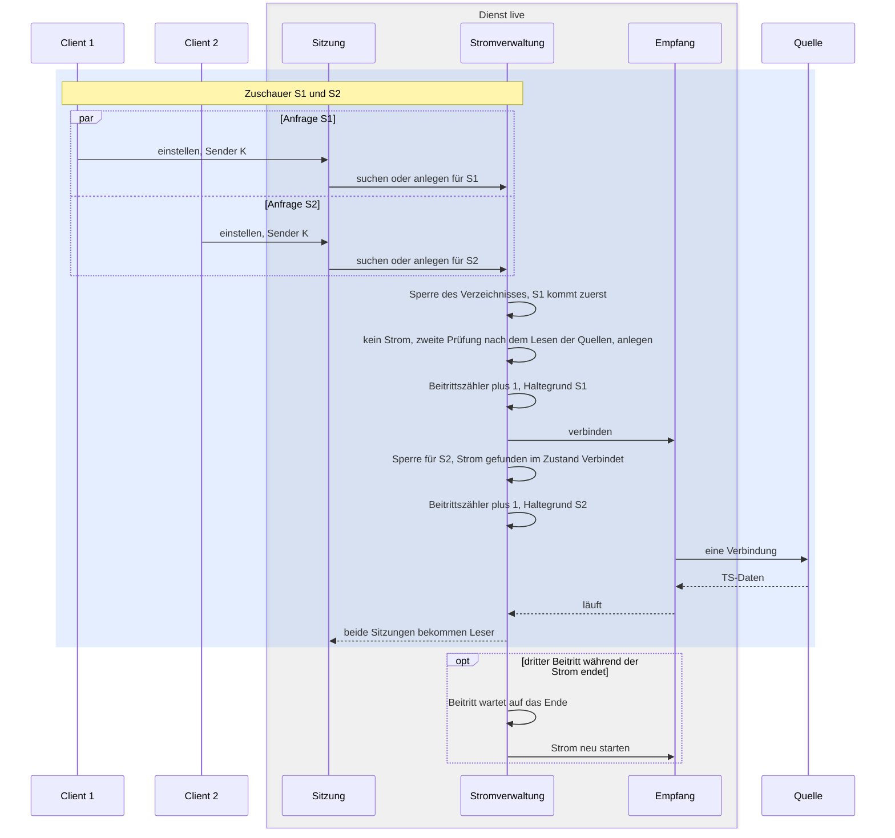

**Sichergestellt.** «Suchen oder anlegen» ist ein Schritt unter einer Sperre mit zweiter Prüfung; der
Beitrittszähler schützt den Strom vor der Aufräumschleife. Anders als beim Radio wird ein Beitritt zu einem
endenden Strom nicht abgelehnt, sondern wartet und startet neu. Zwanzig gleichzeitige Anfragen ergeben einen
Strom und zwanzig Haltegründe. **Belegt:** T-2, T-17; LTV-004.22 bis .26. **Fehlerzweige:** Zulassung
verweigert (beide bekommen «ausgelastet»); Verbindung scheitert (beide Haltegründe sehen dieselbe Leiter).

### 4.2 Vorladen eines Nachbarsenders und sein Abbau

**Ausgangslage.** Sitzung S schaltet in der Liste «nach Kanalnummer» von Sender 4 auf 5 und bleibt dort. Die
Quelle hat «Vorladen für Sender dieser Quelle: an», Vorladen ist eingeschaltet (Werkszustand F-9).
**Der Benutzer sieht:** Beim nächsten Umschalten auf 6 steht das Bild sofort (Fall 2).

```mermaid
sequenceDiagram
  participant CL as Client
  box rgba(128,128,128,0.08) Dienst live
    participant SES as Sitzung
    participant ZUL as Zulassung
    participant STR as Stromverwaltung
    participant EMP as Empfang
    participant VT as Verteiler
  end
  participant Q as Quelle

  rect rgba(66,135,245,0.14)
    Note over CL,SES: Zuschauer auf Sender 5
    CL->>SES: einstellen, Sender 5, Liste Kanalnummer, Richtung weiter
    SES->>SES: 2 s Verweilen abwarten
  end
  rect rgba(255,193,7,0.18)
    Note over STR,VT: Vorladen, Haltegrund Vorladen, Besitzer Sitzung S
    SES->>STR: Nachbarn 6 in Richtung weiter, dazu 4 als zuvor gesehen
    STR->>STR: Schalter der Quelle an, kein Ruhen nach Störung
    STR->>ZUL: höchstens je Richtung und insgesamt 4, innerhalb der Obergrenze
    alt kein Platz
      ZUL-->>STR: Vorladen entfällt still
    else zugelassen
      STR->>STR: nur Ströme derselben Quelle ohne Haltegrund beenden
      Note over STR: Vorgeladenes derselben Quelle, etwa Sender 4, läuft nebeneinander weiter
      STR->>EMP: Sender 6 öffnen, ein Versuch, keine Leiter
      EMP->>Q: Verbindung
      Q-->>EMP: TS-Daten
      EMP->>VT: Ring ohne Sitzungspuffer und ohne Umwandlung
    end
  end
  alt Zuschauer schaltet auf 6
    rect rgba(66,135,245,0.14)
      CL->>SES: einstellen, Sender 6
      SES->>STR: Haltegrund Zuschauer, Strom läuft, wie Ablauf 3.2
    end
  else Abbau
    rect rgba(255,193,7,0.18)
      Note over STR: sofort, wenn 6 kein Nachbar mehr ist
      Note over STR: 3 min nach dem letzten Umschalten oder beim Sitzungsende
      Note over STR: bei Mangel, Rangfolge 1, oder Sender deaktiviert
      STR->>EMP: Strom beenden, keine Karenz
      EMP->>Q: schliessen
    end
  else Quelle lehnt eine Verbindung für einen Zuschauer oder eine Aufnahme ab
    rect rgba(255,193,7,0.18)
      STR->>EMP: Vorgeladenes dieser Quelle beenden, dann einmal sofort neu für den Abnehmer
      STR->>STR: vorsorglicher Empfang dieser Quelle ruht 30 min
    end
  else Vorladen selbst wird abgelehnt oder gehaltener Strom bricht kurz danach ab
    rect rgba(255,193,7,0.18)
      STR->>STR: Versuch entfällt still, nie Zugang prüfen, vorsorglicher Empfang ruht 30 min
    end
  end
```

**Sichergestellt.** Vorladen ist nur Empfang in den Ring: kein Sitzungspuffer, keine Umwandlung, keine
Leiter, keine Karenz; wer schnell durchschaltet, löst kein Vorladen aus; der Client meldet nur Liste und
Richtung, der Server entscheidet. Mehrere vorgeladene Sender derselben Quelle laufen nebeneinander; ein neuer
Verbindungsaufbau beendet vorher nur Ströme ohne Haltegrund, Vorgeladenes weicht erst bei einer Ablehnung,
bei Mangel oder nach seiner Frist (`04` 5.3, `05` 6). **Belegt:** T-17, T-18, T-19; LTV-002.07, LTV-010.05,
.08, LTV-010.X-01, LTV-017. **Fehlerzweige:** Quelle ohne den Schalter (kein Vorladen); Mangel (Vorladen weicht nach den
Strömen ohne Haltegrund als Erstes).

### 4.3 Herunterfahren in 10 Sekunden

**Ausgangslage.** Docker sendet das Stoppsignal; heute beendet Docker nach 10 Sekunden hart, weil die
Standard-Compose-Datei keine Stoppfrist setzt. Es laufen Wiedergaben und eine Aufnahme. **Der Benutzer sieht:**
die Wiedergabe endet; die Aufnahme ist bis zum Abschluss sauber geschrieben.

```mermaid
sequenceDiagram
  participant CL as Client
  participant API as API und Handler
  box rgba(128,128,128,0.08) Dienst live
    participant SES as Sitzung
    participant STR as Stromverwaltung
    participant AUF as Aufnahme-Schreiber
    participant UW as Umwandlung
  end
  participant DB as SQLite
  participant DSK as Datenträger

  Note over API,DSK: Stoppsignal
  par HTTP wartet bis 10 s auf offene Anfragen
    API->>API: keine neuen Verbindungen, offene Anfragen abwarten
  and eigener Abschluss von live beginnt gleichzeitig
    rect rgba(66,135,245,0.14)
      SES->>SES: neue Sitzungen ablehnen
      CL->>API: einstellen
      API-->>CL: abgelehnt
    end
    rect rgba(220,53,69,0.14)
      AUF->>DSK: Aufnahmeteile schliessen
      AUF->>DB: Stand schreiben, Ziel unter 3 s
    end
    SES->>UW: FFmpeg beenden
    STR->>STR: Empfang beenden
  end
  Note over UW,DB: erst danach schliessen Umwandlungs-Manager und Datenbank
  Note over API,DSK: nach 10 s beendet Docker hart, ab Stufe 5 stop_grace_period 30 s
```

**Sichergestellt.** Der Abschluss von `live` wartet nicht, bis die HTTP-Anfragen fertig sind, sondern
beginnt gleichzeitig; Aufnahmeteile sind vor den 10 Sekunden geschlossen, und Datenbank und
Umwandlungs-Manager schliessen erst danach. Was der harte Abbruch trotzdem trifft, behandelt der Neustart
(3.12) als Lücke. **Belegt:** `04` 5.3 «Herunterfahren», 10.6; LTV-008.26, LTV-020.20. **Fehlerzweige:**
Abschluss braucht länger als 10 s (bis Stufe 5 harter Abbruch, danach 30 s Frist); Absturz ohne Signal (nur
3.12).

## 5. Nebenläufigkeit

Stellen, an denen zwei Dinge gleichzeitig geschehen können, und die Regel aus `04` oder `05` (Fassung 3), die
sie ordnet.

| Nr. | Was gleichzeitig geschieht | Regel | Stelle |
|---|---|---|---|
| N-1 | zwei Erstanfragen auf denselben Sender | «suchen oder anlegen» unter der Sperre des Verzeichnisses, zweite Prüfung nach dem Lesen der Quellen | `04` 5.3, Ablauf 4.1 |
| N-2 | Abbau eines Stroms gegen neuen Abnehmer | Beitrittszähler schützt vor der Aufräumschleife; Beitritt zu einem endenden Strom wartet auf das Ende und startet neu | `04` 5.3 |
| N-3 | Karenz gegen neuen Haltegrund | neuer Haltegrund beendet die Karenz, Strom läuft weiter | `04` 5.1 |
| N-4 | Karenz gegen Abbruch der Quelle | Strom endet sofort, keine Leiter, keine Quarantäne | `04` 5.3 |
| N-5 | neue Verbindung gegen Ströme derselben Quelle | vorher enden nur Ströme **ohne Haltegrund** (Ende abwarten höchstens 1 s); Vorgeladenes und automatisch Gehaltenes bleibt | `04` 5.3, `05` 6 |
| N-6 | zwei Vorladungen derselben Quelle | laufen nebeneinander (nur mit Schalter der Quelle) | `04` 5.3, `05` 6 |
| N-7 | Ablehnung für einen Abnehmer gegen vorsorglichen Empfang derselben Quelle | bei dieser Quelle nach Rangfolge freigeben (ohne Haltegrund, Vorgeladenes, Prüfungen, automatisch; für Zuschauer und Aufnahme auch dauerhaft und Zeitplan ohne Abnehmer, zurückgestellt), einmal sofort neu; nie ein Strom mit Zuschauer oder Aufnahme; vorsorglicher Empfang ruht 30 min | `04` 5.3 |
| N-8 | Abbruch eines gehaltenen Stroms kurz nach einer vorsorglichen Verbindung | «vermutlich Verbindungslimit»: vorsorgliche Ströme der Quelle enden, gehaltener Strom verbindet sofort neu | `04` 5.3 |
| N-9 | Schreiber des Rings gegen Leser | Schreiber wartet nie; Leser kopiert, prüft danach, verwirft bei Überrundung und setzt am nächsten Keyframe fort; GOP-Index unter kurzer Lesesperre; «neue Daten» als ersetzter Kanal | T-8, `05` 3.5 |
| N-10 | mehrere stockende Schreiber gegen das Byte-Budget | Rückstau zählt bei Gebrauch; der Rest des Budgets wird zu gleichen Teilen geteilt; wer seinen Teil ausschöpft, bekommt eine Lücke; niemand wird abgelehnt | `04` 8.1 |
| N-11 | Quellwechsel gegen Aufnahme | neuer Zeitabschnitt, Aufnahme beginnt einen neuen Teil, bricht nicht ab | T-6, T-16, Ablauf 3.10 |
| N-12 | neuer Zeitabschnitt gegen volles Byte-Budget | Rangfolge 8.2, sonst behält der Strom seinen bisherigen Ring («Startpuffer verkürzt»); ein gehaltener Strom endet nie deswegen | `04` 5.3 |
| N-13 | Quell- oder Parameterwechsel gegen laufende Umwandlung | Sitzung berechnet den Entscheid neu, FFmpeg startet neu | `05` 3.4 |
| N-14 | Rechteentzug gegen Segmentabruf | Haken beendet die Sitzung, Token ungültig, jede Anfrage 404; Sicherung: Listenanfrage prüft Recht höchstens 30 s alt; Strom ohne anderen Haltegrund ruht sofort | T-21, `04` 9, 10.3 |
| N-15 | Entzug von «Timeshift» oder Ausfall des Speicherorts gegen zeitversetzte Wiedergabe | Sitzungspuffer endet, Sitzung läuft aus dem Ring, Sprung an die Live-Kante (neue Ausgabe-Generation); nach Rückkehr des Orts nach 60 s neuer Puffer | `04` 9 |
| N-16 | Qualitäts- oder Spurwechsel gegen laufenden FFmpeg | neue Ausgabe-Generation; Reservierung umgebucht; neuer Prozess wartet nicht auf das Ende des alten | T-13, `04` 7.5 |
| N-17 | Spulen mit Umwandlung, mehrere Anfragen ausserhalb des Erzeugten | höchstens 2 Neustarts von FFmpeg je Sitzung in 10 s, weitere Anfragen warten | `04` 8.5 |
| N-18 | schnelles Umschalten gegen Vorladen und Verbindungen | Drosselung 1 je Sekunde, Stoss 5; Vorladen erst nach 2 s Verweilen; keine Karenz beim Umschalten | `04` 8.5, `05` 6 |
| N-19 | Einstellen gegen langsamen Start | Antwort wartet bis 3 s auf das erste Segment, sonst Zustand «startet»; Abbruch nach 15 s | `04` 9 |
| N-20 | neue Umwandlungen gegeneinander | Reservieren wartet bis 10 s in Ankunftsreihenfolge, dann «ausgelastet» | `04` 8.1 |
| N-21 | Start der Stream-Grenze gegen Dateiwiedergabe | `live` reserviert seinen Platz unter derselben Startsperre wie `playback` | T-26 |
| N-22 | Listen-Abgleich gegen aktiven Strom | laufende Verbindung bleibt; neue Adresse gilt ab der nächsten Verbindung | `04` 9 |
| N-23 | Deaktivieren eines Senders gegen laufende Wiedergabe und Aufnahme | nichts Laufendes endet; Vorsorgliches dieses Senders endet sofort; «sofort beenden» ist ein eigener, bestätigter Befehl | T-29 |
| N-24 | zurückgestellter Sender gegen neuen Abnehmer oder freien Platz | Abnehmer startet ihn sofort; sonst Wiederanlauf erst nach 60 s ununterbrochen freiem Platz | `04` 5.3 |
| N-25 | Haltegrund gegen verschwundenen Besitzer | Abgleich einmal je Minute, verwaiste Einträge entfernt und protokolliert | `04` 5.2 |
| N-26 | lange Importe gegen Sitzungs- und Aufnahmezeilen | ein Schreiber in SQLite; Stapel bis 500 Zeilen; Zustände nur bei Wechsel | T-22, `04` 4.2 |
| N-27 | Herunterfahren gegen offene Anfragen | Abschluss von `live` beginnt gleichzeitig mit dem Warten; neue Sitzungen abgelehnt | `04` 5.3, Ablauf 4.3 |
| N-28 | Serverstart: weiterzuführende Aufnahmen gegen dauerhafte Sender | Aufnahmen zuerst, sofort, ohne Staffelung (verschiedene Quellen gleichzeitig, dieselbe Quelle nacheinander); danach dauerhaft und Zeitfenster gestaffelt, höchstens 2 Starts je Sekunde, nie zwei gleichzeitig bei derselben Quelle | `04` 5.3 |
| N-29 | beginnende Aufnahme gegen neue Zuschauer bei voller Obergrenze | **offen: F-5** (a) reserviert ab 2 min vor Beginn; ohne Antwort `04` 8.2 Stufe 6 (Ablehnung mit Grund) | `04` 8.2, F-5 |

## 6. Was nach `04` Fassung 3 offen bleibt

Die zwölf Lücken der Fassung 1 dieses Dokuments sind in `04` Fassung 3 geregelt (13.4); dieses Dokument
zeichnet die Regeln. Offen bleiben nur die Weichen, die `04`, `05` und `03` selbst als offen führen und die
in den Abläufen sichtbar werden:

| Punkt | Wo es in den Abläufen auffällt | Stelle |
|---|---|---|
| F-4 Vorrang Zuschauer gegen Empfang ohne Abnehmer (gezeichnet ist die Vorgabe «zurückstellen») | 2.1, 3.14 | `04` 12.3 |
| F-5 Vorrang beginnende Aufnahme gegen Wiedergaben | 3.8, 3.14, N-29 | `04` 12.3, `03` F-4 |
| F-7 Rückspulgrenze am Tastendruck (gezeichnet ist die Vorgabe (a)) | 3.2, 3.6 | `04` 12.3 |
| F-8 eigene Kopie des Zeitversatzes je Sitzung (gezeichnet ist die Vorgabe (a)) | 3.3 | `04` 12.3 |
| F-9 Werkszustand von Vorladen, «automatisch» und Schalter je Quelle | 4.2 | `04` 12.3 |
| Laufende Aufnahmen und Planungen beim Entzug des Rechts «Aufnahmen» | 3.15 | `03` F-7, `04` O-9 |
| Herzschlag im Browser-Tab im Hintergrund und bei Bildübertragung | 3.11 | `04` O-25, M-3, M-5 |
| Bis zu sechs Segmente für native Apple-Player ohne Recht «Timeshift» | 3.6 | `05` O-28, M-5 |
| Nahtloses Spulen mit Umwandlung über mehrere FFmpeg-Läufe (sonst Rückfall «spiele ab Uhrzeit») | 3.6 | M-9, `05` 4.5 |

## 7. Änderungen gegenüber der vorigen Fassung

Fassung 1 → 2, Grundlage `04` und `05` Fassung 3 (Abschnitt 13.4, 14, 15.1) und
`.omc/research/live-tv/KONSOLIDIERUNG.md`.

- Kopf, Einleitung: Bezug auf `04`/`05` Fassung 3, T-1 bis T-29, Werte aus `04` 14, Stufen nach `18`.
- Teilnehmer: Weg W mit Ersatzpfad beim Go-Weiterleiter statt Ersatzname, keine Proxy-Einstellung
  (`04` 15.1, `05` 2.6).
- 2.1 Zustandsdiagramm neu: Zustand «zurückgestellt» mit Wiederanlauf; Karenz nur, wenn der Zuschauer selbst
  geht; Quellabbruch in der Karenz beendet sofort; Ablehnung gibt bei der Quelle Vorsorgliches frei
  (`06` O-1, O-2, O-3, O-4, O-5).
- 2.2 und 2.3 neu: Haltegründe mit Freigabe je Anlass, T-29, Aufwärmzeit vor dem Vorlauf, neuer
  Zeitabschnitt bei knappem Budget, «einstellen» mit 3 s und 15 s (`06` O-6, O-7, O-9, O-10).
- 3.1: Warten bis 3 s auf das erste Segment, Zustand «startet», Abbruch nach 15 s (`06` O-9).
- 3.5, 3.8, 3.10, 4.2: vor einem Aufbau enden nur Ströme ohne Haltegrund; Vorgeladenes derselben Quelle läuft
  nebeneinander und weicht bei Ablehnung (`06` O-1).
- 3.6: Herzschlag meldet «spielt» oder «Pause»; Schauzeit zählt ausgelieferte Segmente (`06` O-11).
- 3.7, 3.8: Aufwärmzeit 30 s vor dem Beginn des Vorlaufs; nach dem Ende sofort «ruht» (`06` O-2, O-10).
- 3.10: neuer Ring nach Rangfolge, sonst bisheriger Ring «Startpuffer verkürzt» (`06` O-6).
- 3.11: Hintergrund und «Bildschirm aus» beenden die Sitzung (Apps); Quellabbruch in der Karenz (`06` O-5,
  `04` 10.3).
- 3.12: Aufnahmen verbinden sofort ohne Staffelung, Staffelung nur für dauerhaft und Zeitfenster (`06` O-12).
- 3.13: Puffer enden, Sprung an die Live-Kante, neuer Puffer 60 s nach Rückkehr des Orts (`06` O-8).
- 3.14: Stufe 5 stellt zurück; Wiederanlauf; Rückstau zählt bei Gebrauch (`06` O-4, `13` H-1).
- 3.15: Ende durch den Server ohne Karenz (`06` O-3).
- 3.16: T-29, Deaktivieren beendet nichts Laufendes, «sofort beenden» als eigener Befehl (`06` O-7,
  `07` 12.3).
- 3.17: Lesen in Blöcken von 256 KiB, Teilung des Rückstaus (`04` 8.1).
- 5: Nebenläufigkeit neu gefasst (N-1 bis N-29).
- 6: Liste «offen in 04» ersetzt durch die Weichen, die `04`, `05` und `03` selbst offen führen.
- Restebereinigung nach Konsolidierung 1: Schalter je Quelle heisst «Vorladen für Sender dieser Quelle: an/aus»
  (Ablauf 3 und Ablauf zum Vorladen; Koordinator zu RM-01).
