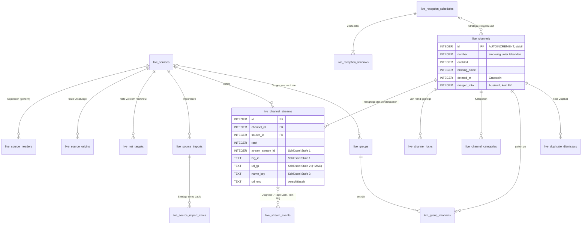
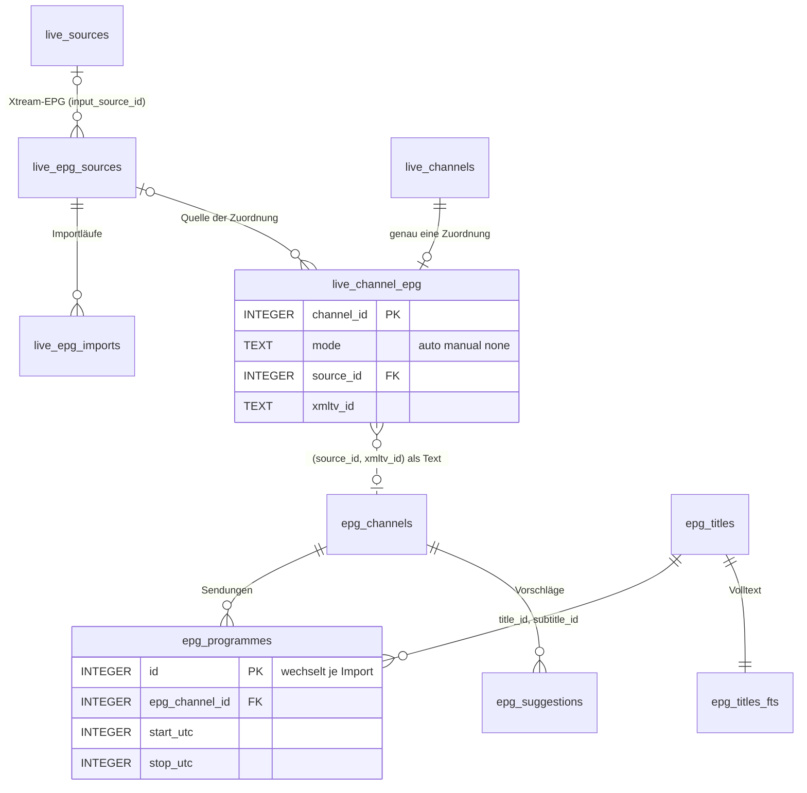
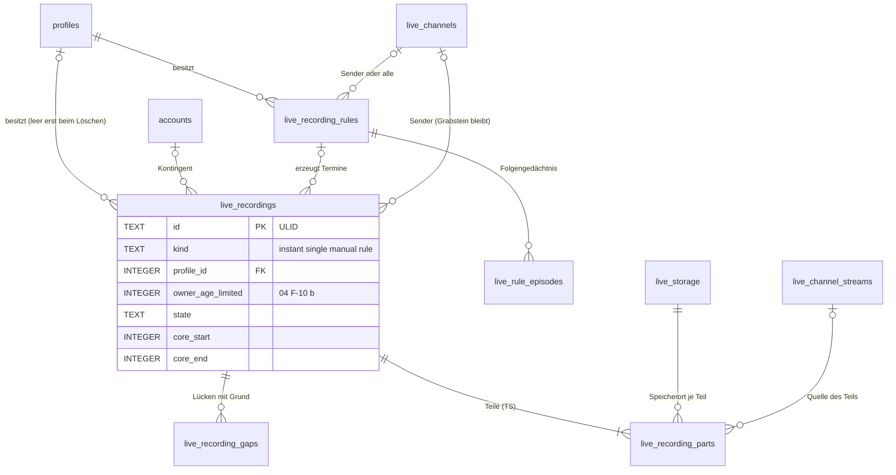
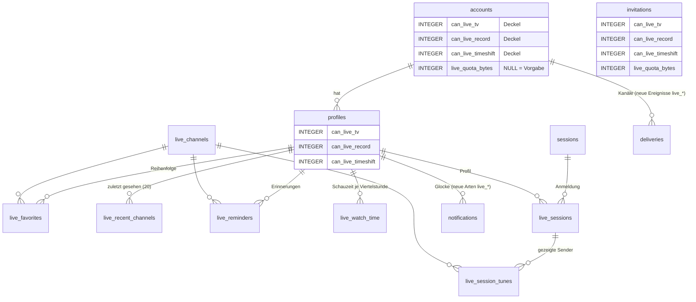

# Konzept 28 · Datenmodell

Stand: 29. November 2026 · Fassung 3 · Status: Entwurf nach Gesamtreview, nicht freigegeben

Dieses Dokument ist die **einzige Quelle** für Tabellen, Spalten, Schlüssel und Aufräumregeln von Live-TV.
Die Fachdokumente (`09-epg.md` Abschnitt 13, `11-dvr.md` Abschnitt 14.1, `10-timeshift.md`, `14-oberflaeche.md`,
`15-administration.md`) enthalten Bedarfslisten und Vorschläge; sie sind hier zusammengeführt. Massgeblich sind
der Auftrag und die Leitplanken, dann `04-architektur.md` Fassung 4 (T-1 bis T-29, Abschnitt 14 «Massgebliche
Werte»), wo es strenger ist `12-sicherheit.md` Fassung 3, dann `03-fachkonzept.md`, für Stufen
`18-umsetzungsplan.md`; jeder Widerspruch steht in Abschnitt 12.3. Die Schnittstellen stehen in `08-api.md`.
Fassung 2 arbeitete Review 2 ein (Abschnitt 13), Fassung 3 die Schlussreviews 4, 5 und 6 (Abschnitt 14).

**Was ohne deine Antwort gilt:** Solange eine Frage offen ist, beschreibt dieses Dokument die **wortlauttreue
Vorgabe** des Auftrags, bei Sicherheitsfragen die sichere Variante. Spalten, die erst eine Empfehlung oder eine
andere Variante bräuchte, stehen nur als Hinweis «käme mit Variante …» im Text, nie im SQL.

**Stufen** heissen wie in `18` 4.13: 1a «Schauen», 1b «Senderverwaltung erweitert», 2 Programm, 3 Empfang und
Umschalten, H Heimnetz und UDP, 4 Timeshift, 5 Aufnahmen, 6 Serien, L RTSP/RTMP, W DASH/fMP4, E Ergänzungen.

Alles hier ist **spezifiziert**, nichts ist gebaut. «Gebaut» mit Datei und Zeile bezieht sich auf den Stand des
Arbeitsbaums (Server 1.44.1, letzte Migration 00086). Es entsteht keine Migration; die SQL-Blöcke sind
ausdrücklich **Entwurf, keine Migration**. Nummern (ab 00087) vergibt erst der Bau.

Kennungen dieses Dokuments: `O-n` offene technische Punkte, `F-n` Fragen an dich (zählen eigen), `W-n`
Widersprüche zwischen den Dokumenten (Abschnitt 12.3). Kennungen anderer Dateien tragen die Dateinummer
(«`04` T-22», «`03` DR-16»).

Begriffe, einmal erklärt: Eine **Tabelle** ist eine Liste gleich gebauter Zeilen in der Datenbank. Ein
**Primärschlüssel** ist die Spalte, die eine Zeile eindeutig benennt. Ein **Fremdschlüssel** ist ein Verweis
auf eine Zeile einer anderen Tabelle; die Datenbank sorgt dafür, dass er nie ins Leere zeigt, und legt fest,
was beim Löschen der Zielzeile geschieht (mitlöschen, leeren oder verbieten). Ein **Index** ist ein
Inhaltsverzeichnis, das eine bestimmte Abfrage schnell macht. Eine **CHECK-Bedingung** ist eine Regel, die die
Datenbank bei jedem Schreiben prüft. **ULID** ist eine zufällige, 26 Zeichen lange Kennung, die sich nicht
erraten lässt.

---

## 1. Grundsätze

### 1.1 Was wo liegt

| Ort | Inhalt | Sicherung | Schema-Pflege | Herkunft |
|---|---|---|---|---|
| `slouchcat.db` (bestehende Datei) | alles, was der Haushalt einrichtet oder besitzt: Quellen, Sender, Gruppen, Zuordnungen, Rechte, Favoriten, Erinnerungen, Planungen, Aufnahmen mit Teilen und Lücken, Sitzungszeilen, Einstellungen, Diagnose der letzten 7 Tage | ja, mit dem bestehenden Archiv (gebaut: `server/internal/admin/backup.go:33-40`) | Migrationen nach Vorlage, nur vorwärts (Regel 5, `server/migrations/TEMPLATE.sql.txt`) | spezifiziert |
| `epg.db` (neue Datei, `<cache>/live/epg.db`) | Programmdaten: EPG-Kanäle, Sendungen, Titelwörterbuch mit Volltextsuche, Zwischentabelle des Imports, Zustand der Sendungsbilder, Zuordnungsvorschläge | **nein** | keine Migration: passt `PRAGMA user_version` nicht, löscht der Server die Datei und importiert neu | Vorgabe von `09` 8.7 bis zur Antwort auf `09` F-1 |
| Arbeitsspeicher | alles Flüchtige (Abschnitt 1.3) | – | – | `04` T-22 |
| Speicherorte (Dateien) | Ringe (falls Ordner), Sitzungspuffer, Aufnahmeteile mit Index, Zwischenablage von Uploads und Abrufen | nie | – | `04` T-25 |

Wählst du bei `09` F-1 die Variante (b) «alles in einer Datei», wandern die Tabellen aus Abschnitt 3.7 unverändert
in `slouchcat.db`, bekommen eine Migration und landen in der Sicherung; sonst ändert sich nichts an diesem Dokument.

### 1.2 Verhältnis zu `items`

Sender, Sendungen und Aufnahmen sind **keine Titel**. Keine Live-TV-Tabelle verweist auf `items`, `media_files`
oder `tracks`, und keine Abfrage von Live-TV nennt sie (Regel 2, `04` T-24). Damit greift weder `visible_items`
noch der Analyzer `itemsaccess` (gebaut: `server/tools/itemsaccess/itemsaccess.go:28`, `:45`); stattdessen:

- **eigenes sqlc-Paket `liveq`** über `server/queries/live/` mit dem Schema aus `server/migrations` (Muster
  `wishq`, gebaut: `server/sqlc.yaml:62-73`) und einem **depguard-Riegel** «nur `internal/live/**` und
  `internal/store/**`» (Muster gebaut: `server/.golangci.yml`, Regel `wishq`);
- **eigenes sqlc-Paket `epgq`** über `server/queries/epg/` mit eigenem Schema-Ordner (kein `migrations`, weil
  Neuaufbau statt Migration) und Riegel «nur `internal/live/guide/**` und `internal/store/**`» (`09` 8.7);
- **ein neuer Test** `TestLiveQueriesNoTitleTables` prüft jede Datei unter `queries/live/` und `queries/epg/`
  auf `items`, `media_files`, `tracks` (der Analyzer erfasst `store/**` nicht, weil `store` erlaubt ist;
  Vorbild `TestScopedQueriesJoinVisibleItems`, gebaut: `server/queries/scoped/README.md`);
- `liveq` importiert `systemq` nicht, und kein anderes Paket importiert `liveq`. Was `auth`, `admin`, `playback`,
  `notify` von Live-TV brauchen, fragen sie den Dienst `live` über gesetzte Rückrufe (`04` T-26, Muster Radio
  `server/cmd/slouchcat/main.go:471`).

### 1.3 Dauerhaft oder flüchtig: die Entitäten aus Auftrag 14.1

| Entität (Auftrag 14.1) | Dauerhaft in SQLite | Flüchtig im Arbeitsspeicher | Begründung | Tabelle(n) |
|---|---|---|---|---|
| Streamquellen | ja, dazu Versionsnummer des Regelstands und Quarantäne «Zugang prüfen» mit Zeitpunkt des nächsten Versuchs | Transport je Quelle und Regelstand, Muster A und B, «vorsorglicher Empfang ruht bis …», Ein-Strom-Betrieb, Zähler der Ablehnungen | Einrichtung des Administrators; Geheimnisse verschlüsselt (T-28); Laufzeitzustände sind keine Einstellung (unten) | `live_sources`, `live_source_headers`, `live_source_origins`, `live_net_targets`, `live_source_imports`, `live_source_import_items` |
| Sender | ja | – | stabile Kennung für Favoriten, Planungen, URLs | `live_channels`, `live_channel_locks`, `live_channel_categories` |
| Alternative Senderquellen | ja | aktive Quelle eines laufenden Stroms | Rangfolge ist Einrichtung; welche gerade speist, ist Zustand des Stroms (T-2) | `live_channel_streams` |
| Sendergruppen | ja | – | Ordnung für Zuschauer | `live_groups` |
| Senderzuordnungen | ja | Abbildung `(source_id, xmltv_id)` → Zeile in `epg.db` | Gruppen, EPG, Duplikat-Entscheide | `live_group_channels`, `live_channel_epg`, `live_duplicate_dismissals` |
| EPG-Quellen | ja | – | Einrichtung | `live_epg_sources`, `live_epg_imports` |
| EPG-Programme | **nur in `epg.db`** (wiederbeschaffbar) | Zwischenspeicher «jetzt/als Nächstes» (nur falls `09` M-5 ihn verlangt) | fremde, flüchtige Massendaten (`09` 8.6) | `epg_channels`, `epg_programmes`, `epg_titles`, `epg_titles_fts`, `epg_stage`, `epg_images`, `epg_suggestions` |
| Empfangsstrategien | ja (Vorgabe und Einstellung je Sender) | Haltegründe, Rangliste «automatisch» | Einrichtung; die Wirkung ist Laufzeit (`04` 5.2) | `live_config`, `live_channels.strategy` |
| Empfangszeitpläne | ja | Haltegrund «Zeitplan» | Einrichtung | `live_reception_schedules`, `live_reception_windows` |
| Aktive Eingangsstreams | **nein** | Ring, GOP-Index, Leser, Haltegründe, Automat (`04` 5.1) samt dem Zustand «zurückgestellt» eines Dauersenders, der **nicht starten kann** (Ursache, Zahl der Versuche), Karenz, Messwerte | Neustart beginnt leer; permanente Haltegründe entstehen aus der Strategie (`04` 4.2) | – (nur Zustand je Senderquelle bei Wechsel: `live_channel_streams.state`) |
| Wiedergabesitzungen | Zeile mit Konto, Profil, Gerät, Sender, Beginn, Ende, Grund; ein Eintrag je gezeigtem Sender | Token-Bindung, Einstell-Nummer, Entscheid, Ausgabe-Generation, Abspielstand | Grenzen, Verwaltung, Schauzeit, Rangliste «automatisch» (`04` T-22) | `live_sessions`, `live_session_tunes`, `live_recent_channels`, `live_watch_time` |
| Timeshift-Sitzungen | **nein** (nur ein Stück-Verzeichnis auf dem Speicherort) | Verzeichnis des Sitzungspuffers, Fenster, Rückspulgrenze | Puffer stirbt mit der Sitzung und beim Start (`04` T-10, `10` 2) | – (Speicherort in `live_storage`) |
| Aufnahmen | ja | Schreiber, Rückstau | Besitz des Profils | `live_recordings`, `live_recording_parts`, `live_recording_gaps` |
| Aufnahmeplanungen | ja (ein Termin ist eine Aufnahmezeile im Zustand «geplant», `11` 2.1) | Zeitgeber-Liste des Planers | übersteht Neustart | `live_recordings` |
| Serienaufnahme-Regeln | ja | – | Besitz des Profils | `live_recording_rules`, `live_rule_episodes` |
| Speicherlimits | ja | gemessener freier Platz | Einrichtung | `live_storage`, `live_config`, `accounts.live_quota_bytes` |
| Favoriten | ja | – | Besitz des Profils | `live_favorites` |
| Sendungserinnerungen | ja | – (Zeitpunkt liegt als Job in der Warteschlange) | Besitz des Profils | `live_reminders` |
| Technische Streamzustände | Zustand je Senderquelle **nur bei Wechsel**; gespeicherte Streamparameter; Ereignisse der letzten 7 Tage | Messwerte der Güte, Zähler der Leiter | `04` T-22, `15` LA-13 (7 Tage) | `live_channel_streams.state`, `.params`, `live_stream_events` |
| Berechtigungen | ja (drei Schalter je Konto, Profil, Einladung; Kontingent je Konto) | – | Muster `can_request` (gebaut: `server/migrations/00067_wishes_rights.sql:22-24`) | Spalten in `accounts`, `profiles`, `invitations` |

**Laufzeitzustände je Quelle: flüchtig.** «Vorsorglicher Empfang ruht bis …» und «Ein-Strom-Betrieb bis …»
(`04` 5.3, Muster A und B) stehen nur im Arbeitsspeicher des Dienstes `live`, nicht in `live_sources`. Gründe:
(1) `04` 14.1 legt es so fest («Nur im Arbeitsspeicher»). (2) LTV-017 schliesst jede Verwaltung von Verbindungen je
Anbieter aus; ein gespeicherter Zustand je Quelle wäre nahe an einer Einstellung je Quelle, die die Vorgabe der
Frage `04` F-3 (`20` E-28-02) gerade nicht hat. (3) Der Zustand ist billig neu zu lernen: Nach einem Neustart
wiederholt sich höchstens der erste Vorfall (eine Ablehnung oder ein einmal stockendes Bild), dann ruht der
vorsorgliche Empfang wieder. Ob er über einen Neustart gemerkt werden soll, ist `04` O-32 (Frage in `20`); bis
dahin bleibt er flüchtig. Dauerhaft ist dagegen die Quarantäne «Zugang prüfen» (`access_state`,
`access_retry_at`), weil sie den Administrator betrifft und `04` 4 sie als Zustand je Quelle in SQLite führt.

### 1.4 Konventionen aus dem Bestand

| Punkt | Festlegung | Beleg (gebaut) |
|---|---|---|
| Zeit | Unix-**Millisekunden** als `INTEGER`, UTC. Auch in `epg.db` (Abweichung von `09`, das Sekunden schreibt: W-12). Wanduhr-Angaben (Uhrzeit eines Zeitplans) als Minute des Tages plus Name der Zeitzone. | `server/migrations/00069_wishes.sql:4`, `00038_radio.sql:2` |
| Tabellen | `STRICT`; Verbindungstabellen `WITHOUT ROWID` | `00038_radio.sql` (`radio_favorites`) |
| Kennung, die Clients in URLs und Favoriten halten | `INTEGER PRIMARY KEY AUTOINCREMENT` (nie wiederverwendet) | `00038_radio.sql`, Kopfkommentar zu `radio_stations` |
| Kennung, die nicht erratbar sein darf (Sitzung, Aufnahme, Planung, Regel, Erinnerung) | `TEXT PRIMARY KEY CHECK (length(id) = 26)`, ULID (`04` T-9) | `00032_playback_prefs.sql` (`playback_sessions`), `00038_radio.sql` (`radio_listen_sessions`) |
| Schalter | `INTEGER … CHECK (x IN (0, 1))` | überall |
| Geschlossene Wertelisten | `CHECK (x IN (…))`; eine neue Liste verlangt Tabellenneubau | `00070_wishes_notifications.sql:1-4` |
| Offene Ereignisarten | `kind TEXT CHECK (kind <> '' AND kind NOT GLOB '*[^a-z_]*')` ohne Liste | `00069_wishes.sql:144` |
| Vom Administrator von Hand geänderte Felder | eigene Sperrtabelle `…_locks (id, field)`; der Abgleich überschreibt gesperrte Felder nie | `00038_radio.sql` (`radio_station_locks`) |
| Einstellungen eines Bereichs | Einzeilentabelle `id = 1` mit Vorgaben und eingefügter Zeile | `00038_radio.sql` (`radio_config`) |
| Verschlüsselte Werte | `TEXT` im Format `v1:<base64url>` aus `secrets.Keyring.Encrypt` (Abweichung von `09`, das `BLOB` schreibt: W-13); neu `v2:` mit Bindung an die Zeile (`12` 5.1) und der Platzhalter `v0:` «Zugang fehlt» (Abschnitt 6.3) | `server/internal/secrets/secrets.go:115-122` |
| Fremdschlüssel | jede Kindspalte eines Fremdschlüssels hat einen Index, dessen erste Spalte sie ist (ohne Bedingung auf eine andere Spalte); ein Schematest gleicht `PRAGMA foreign_key_list` mit `PRAGMA index_list` ab (RD-04). Ausnahme: die Einzeilentabelle `live_config` | SQLite prüft beim Löschen der Elternzeile jede Kindtabelle über diese Spalte (Annahme aus der SQLite-Dokumentation, nicht im Repo) |
| CHECK mit nullbaren Spalten | Vergleiche mit `IS`, nicht `=`: `(a IS 'x') = (b IS NOT NULL)`, weil `NULL = …` als bestanden gilt (RD-22) | SQLite-Verhalten (Annahme) |
| Geschlossene Wertelisten späterer Stufen | Werte der Stufen L, W, 5 und 6 stehen schon in der Liste, wenn die Tabelle sonst später neu gebaut werden müsste (`live_channel_streams.scheme`, `.format`, `live_sessions.kind`, `notifications`, `deliveries`); geschrieben wird ein Wert erst mit seinem Erzeuger | Muster `00070_wishes_notifications.sql:6-10` |

---

## 2. Entity-Relationship-Diagramme

Vier Teildiagramme. Spalten stehen nur, wo sie die Beziehung tragen; die vollständigen Spalten stehen in
Abschnitt 3. `epg.db` hat keine Fremdschlüssel nach `slouchcat.db` (zwei Dateien); die gestrichelte Linie ist
ein Verweis über Text.

### 2.1 Quellen und Sender



### 2.2 EPG



### 2.3 Aufnahmen und Planung



### 2.4 Rechte, Profil-Daten, Sitzungen



---

## 3. Tabellen

Für jede Tabelle: Zweck, Stufe (nach `03`, Lesart), Spalten als SQL, Schlüssel, Löschverhalten, Indizes mit der
Abfrage, der sie dienen, Zugehörigkeit zu Konto und Profil. Spalten, die erst eine spätere Stufe braucht, sind
im Kommentar mit «Stufe n» markiert; sie kommen dann per `ALTER TABLE … ADD COLUMN` (Muster gebaut:
`00067_wishes_rights.sql:5-7`), nicht vorher (Abschnitt 11.2).

> **Entwurf, keine Migration.** Die SQL-Skizzen zeigen Form und Regeln. Rahmen jeder späteren Migration:
> `-- +goose NO TRANSACTION`, `PRAGMA foreign_keys=OFF`, `BEGIN`, Änderungen, `COMMIT`,
> `PRAGMA foreign_key_check`, `PRAGMA foreign_keys=ON` (Vorlage gebaut: `server/migrations/TEMPLATE.sql.txt`).

### 3.1 Einstellungen und Speicherorte

**`live_config`** · eine Zeile, alle globalen Einstellungen der Seiten LA-09, LA-10, LA-13, LA-14, LA-15, LA-16
(Muster `radio_config`). Stufe 1a, Spalten späterer Stufen wie markiert. Jeder Wert und jeder Bereich folgt
`04` Abschnitt 14; wo `15` anders lautet, steht es in Abschnitt 12.3.

```sql
-- Entwurf, keine Migration
CREATE TABLE live_config (
    id                       INTEGER PRIMARY KEY CHECK (id = 1),
    -- Empfang (04 6.1-6.3, 8.5; F-9 offen: Vorgaben nach Empfehlung 04 F-9 (b))
    default_strategy         TEXT    NOT NULL DEFAULT 'on_demand'
                             CHECK (default_strategy IN ('on_demand', 'permanent', 'automatic', 'scheduled')),
    default_schedule_id      INTEGER REFERENCES live_reception_schedules (id),            -- Stufe 3
    preload_per_direction    INTEGER NOT NULL DEFAULT 1 CHECK (preload_per_direction BETWEEN 0 AND 2), -- Stufe 3
    preload_max              INTEGER NOT NULL DEFAULT 4 CHECK (preload_max BETWEEN 0 AND 16),         -- Stufe 3
    automatic_keep           INTEGER NOT NULL DEFAULT 3 CHECK (automatic_keep BETWEEN 0 AND 10),      -- Stufe 3
    automatic_favorites      INTEGER NOT NULL DEFAULT 1 CHECK (automatic_favorites IN (0, 1)),        -- Stufe 3
    max_ingests              INTEGER NOT NULL DEFAULT 8 CHECK (max_ingests BETWEEN 1 AND 200),
    ring_budget_mb           INTEGER CHECK (ring_budget_mb IS NULL OR ring_budget_mb BETWEEN 64 AND 8192),
                             -- NULL: ein Achtel des Arbeitsspeichers, höchstens 512 MB (04 14.3)
    grace_seconds            INTEGER NOT NULL DEFAULT 30 CHECK (grace_seconds BETWEEN 15 AND 300),
                             -- Karenz nur, wenn ein Zuschauer von sich aus geht; sonst 0 (04 14.1)
    max_sessions             INTEGER NOT NULL DEFAULT 20 CHECK (max_sessions BETWEEN 1 AND 200),
    transcode_share_pct      INTEGER NOT NULL DEFAULT 50 CHECK (transcode_share_pct BETWEEN 0 AND 100), -- 04 14.7
    startbuffer_mode         TEXT    NOT NULL DEFAULT 'memory'
                             CHECK (startbuffer_mode IN ('memory', 'folder')),
                             -- Stufe 4 und nur bei 04 F-2 (a); bei F-2 (b) entfällt die Spalte (18 D-3)
    -- Überwachung (04 5.3, 10.2, 14.2, 14.8; 15 LA-13)
    idle_check_hours         INTEGER DEFAULT 6 CHECK (idle_check_hours IS NULL OR idle_check_hours IN (6, 24)),
                             -- NULL: aus. Stufe 3
    alert_after_minutes      INTEGER NOT NULL DEFAULT 10 CHECK (alert_after_minutes IN (5, 10, 15, 30, 60)),
    alert_used_only          INTEGER NOT NULL DEFAULT 1 CHECK (alert_used_only IN (0, 1)),           -- 15 F-19
    -- Programmdaten (09 2.6, 2.7, 9). Stufe 2
    epg_days                 INTEGER NOT NULL DEFAULT 7 CHECK (epg_days BETWEEN 1 AND 14),
    epg_lookback_hours       INTEGER NOT NULL DEFAULT 24 CHECK (epg_lookback_hours BETWEEN 6 AND 72),
    epg_images               INTEGER NOT NULL DEFAULT 1 CHECK (epg_images IN (0, 1)),
    -- Timeshift (03 DR-07, 04 10.10). Stufe 4
    timeshift_max_minutes    INTEGER NOT NULL DEFAULT 60
                             CHECK (timeshift_max_minutes IN (15, 30, 60, 120, 240)),
    timeshift_cap_bytes      INTEGER CHECK (timeshift_cap_bytes IS NULL OR timeshift_cap_bytes > 0),
                             -- NULL: kleiner aus 20 % des beim Einrichten freien Platzes und 50 GB
    -- Aufnahmen (11 1, 3.3, 8.3; 15 LA-14). Stufe 5
    dvr_pre_minutes          INTEGER NOT NULL DEFAULT 2 CHECK (dvr_pre_minutes BETWEEN 0 AND 30),
    dvr_post_minutes         INTEGER NOT NULL DEFAULT 10 CHECK (dvr_post_minutes BETWEEN 0 AND 60),
    dvr_retention_suggestion INTEGER CHECK (dvr_retention_suggestion IS NULL
                                            OR dvr_retention_suggestion IN (7, 14, 30, 90)),
                             -- nur Vorschlag im Planer (03 F-10 a); NULL: «bis ich lösche»
    dvr_instant_max_hours    INTEGER NOT NULL DEFAULT 4 CHECK (dvr_instant_max_hours BETWEEN 1 AND 12),
    dvr_follow_epg           INTEGER NOT NULL DEFAULT 1 CHECK (dvr_follow_epg IN (0, 1)),
    dvr_warmup_seconds       INTEGER NOT NULL DEFAULT 30 CHECK (dvr_warmup_seconds BETWEEN 10 AND 120),
    default_quota_bytes      INTEGER NOT NULL DEFAULT 100000000000 CHECK (default_quota_bytes >= 0),
                             -- 100 GB, 03 F-2 (a); Einheit GB = 10^9 (Annahme)
    updated_at               INTEGER NOT NULL
) STRICT;
INSERT INTO live_config (id, updated_at) VALUES (1, 0);   -- konstante Zeit wie radio_config (00038:183-185)
```

- `default_schedule_id` ohne Löschweitergabe: Ein Zeitplan, der Vorgabe ist, lässt sich nicht löschen (409,
  `08`). Die Regel «Strategie `scheduled` braucht einen Zeitplan» prüft der Dienst für die Vorgabe; für Sender
  prüft sie die Datenbank (`live_channels`).
- **Was hier nicht steht (Review 4, SC-2, SC-4, RG-14):** Die Länge des Rings ist keine Einstellung mehr (T-7:
  15 Sekunden, bei langen Segmenten das Vierfache der Segmentdauer, höchstens 30; `04` 14.3). Die Zahl
  gleichzeitiger Prüfungen ist eine Konstante (1, `04` 14.2). Eine Höchstzahl gleichzeitiger Aufnahmen verlangt
  der Auftrag nicht; die Spalte `dvr_max_concurrent` käme nur mit Variante (B) der Frage `20` E-28-49, die
  wortlauttreue Vorgabe ist «keine Grenze». Kein Vorladen und keine Verbindungszahl je Quelle (3.2).
- **Warum die übrigen Einstellungen bleiben:** Jede Spalte hier nennt `04` 14 ausdrücklich als «einstellbar» mit
  Bereich (Eingangsströme, Byte-Budget, Karenz, Sitzungen, Anteil der Umwandlung, Vorladen, «automatisch»,
  Aufwärmzeit, längste Sofortaufnahme) oder der Auftrag verlangt sie als Einstellung (Strategie, Zeitpläne,
  Timeshift-Höchstdauer, Vor- und Nachlauf, Fristen, Speicherorte, Limits, Reserve, Intervalle, EPG-Zeitraum).
  Ob einige davon feste Werte werden, ist die Feinschliff-Frage aus RG-14 (`20`); jede gestrichene Spalte wird
  dann eine Konstante mit dem Wert aus `04` 14, ohne Änderung an anderen Tabellen. `dvr_instant_max_hours`
  (SC-10) verlangt der Auftrag nicht; es bleibt als Schutz, weil T-29 für eine Sofortaufnahme auf einem
  deaktivierten Sender eine Obergrenze braucht (`04` 14.12).

**`live_storage`** · die Speicherorte (T-25): je Rolle genau einer aktiv; ein alter Aufnahme-Ort bleibt «nur
lesen», bis er leer ist (`15` F-17 (A)). Stufe 4 (Timeshift und, nur bei `04` F-2 (a), Startpuffer als Ordner;
`18` D-3), Rolle `recordings` ab Stufe 5.

```sql
-- Entwurf, keine Migration
CREATE TABLE live_storage (
    id             INTEGER PRIMARY KEY,
    role           TEXT    NOT NULL CHECK (role IN ('startbuffer', 'timeshift', 'recordings')),
    status         TEXT    NOT NULL DEFAULT 'active' CHECK (status IN ('active', 'read_only')),
    path           TEXT    NOT NULL CHECK (path GLOB '/*' AND length(path) <= 1024),
    marker_id      TEXT    NOT NULL CHECK (length(marker_id) = 26),   -- Inhalt der Markerdatei
    fs_type        TEXT    NOT NULL,                                  -- beim Einrichten erkannt
    device_no      INTEGER,                                           -- Gerätenummer, gegen leeren Einhängepunkt
    reserve_bytes  INTEGER NOT NULL CHECK (reserve_bytes >= 0),
    reserve_pct    INTEGER CHECK (reserve_pct IS NULL OR reserve_pct BETWEEN 0 AND 50),
    cap_bytes      INTEGER CHECK (cap_bytes IS NULL OR cap_bytes > 0), -- Aufnahmen: «insgesamt höchstens»
    health         TEXT    NOT NULL DEFAULT 'ready'
                   CHECK (health IN ('ready', 'low', 'full', 'missing', 'unwritable')),
    health_since   INTEGER NOT NULL,
    checked_at     INTEGER NOT NULL,
    created_at     INTEGER NOT NULL,
    CHECK (status = 'active' OR role = 'recordings')
) STRICT;
CREATE UNIQUE INDEX live_storage_active ON live_storage (role) WHERE status = 'active';
```

- Mindestreserve ist der **grössere** Wert aus `reserve_bytes` und `reserve_pct` des Datenträgers: Timeshift 5 GB
  und 5 %, Aufnahmen 20 GB und 5 %, Ordner des Startpuffers 0 und 10 % (`04` 14.6; erledigt W-9). Vorgabe für
  Timeshift ohne Wahl: `<cache>/live/timeshift`, die Zeile legt der Server beim ersten Start der Stufe 4 an.
- `path` ist zugleich eine registrierte Wurzel des Pakets `paths` (Regel 4); geschrieben wird nur relativ zu
  einem beim Prüfen geöffneten Verzeichnis (`11` 10.3).
- Löschen: nie automatisch. Ein Ort «nur lesen» wird entfernt, wenn kein Teil mehr auf ihn zeigt
  (`live_recording_parts.storage_id` ohne Löschweitergabe verhindert vorher das Löschen).

### 3.2 Quellen

**`live_sources`** · eine Quelle des Administrators (LA-02, LA-03): M3U-Adresse, M3U-Datei, Xtream oder
Einzelstrom. Stufe 1a; `refresh_minutes`, `refresh_at_minute`, `next_refresh_at`, `guard_incomplete` Stufe 1b
(automatische Aktualisierung, zurückgehaltene Liste, `18` 4.3); `listen_interface` Stufe H. **Keine Einstellung
je Quelle für Vorladen oder Verbindungen** (`04` 14.2, F-3; LTV-017): Vorladen und «automatisch» gibt es nur global
(`live_config`) und je Sender (`live_channels.strategy`). Ein Schalter «Vorladen für Sender dieser Quelle»
(`preload_enabled`) käme nur mit Variante (b) der Frage `04` F-3 (`20` E-28-02); eine Verbindungszahl je Quelle
nur mit Variante (c).

```sql
-- Entwurf, keine Migration
CREATE TABLE live_sources (
    id                INTEGER PRIMARY KEY AUTOINCREMENT,
    kind              TEXT    NOT NULL CHECK (kind IN ('m3u_url', 'm3u_file', 'xtream', 'single')),
    name              TEXT    NOT NULL CHECK (length(name) BETWEEN 1 AND 200),
    enabled           INTEGER NOT NULL DEFAULT 1 CHECK (enabled IN (0, 1)),
    url_enc           TEXT    CHECK (url_enc IS NULL OR url_enc GLOB 'v[0-9]*:*'),  -- ganze Adresse, T-28
    site              TEXT    CHECK (site IS NULL OR length(site) <= 300),          -- Schema, Host, Port
    username_enc      TEXT    CHECK (username_enc IS NULL OR username_enc GLOB 'v[0-9]*:*'),
    password_enc      TEXT    CHECK (password_enc IS NULL OR password_enc GLOB 'v[0-9]*:*'),
    user_agent_enc    TEXT    CHECK (user_agent_enc IS NULL OR user_agent_enc GLOB 'v[0-9]*:*'), -- RD-19
    file_sha256       TEXT    CHECK (file_sha256 IS NULL OR length(file_sha256) = 64), -- m3u_file
    listen_interface  TEXT    CHECK (listen_interface IS NULL OR length(listen_interface) <= 64), -- Stufe H
    refresh_minutes   INTEGER CHECK (refresh_minutes IS NULL OR refresh_minutes BETWEEN 60 AND 10080),
                      -- NULL: nur von Hand
    refresh_at_minute INTEGER CHECK (refresh_at_minute IS NULL OR refresh_at_minute BETWEEN 0 AND 1439),
    next_refresh_at   INTEGER,
    etag              TEXT,
    last_modified     TEXT,
    content_sha256    TEXT    CHECK (content_sha256 IS NULL OR length(content_sha256) = 64),
    new_enabled       INTEGER NOT NULL DEFAULT 1 CHECK (new_enabled IN (0, 1)),   -- 03 DR-16 (W-6)
    take_groups       INTEGER NOT NULL DEFAULT 1 CHECK (take_groups IN (0, 1)),
    take_numbers      INTEGER NOT NULL DEFAULT 1 CHECK (take_numbers IN (0, 1)),
    guard_incomplete  INTEGER NOT NULL DEFAULT 1 CHECK (guard_incomplete IN (0, 1)),
    import_state      TEXT    NOT NULL DEFAULT 'never'
                      CHECK (import_state IN ('never', 'running', 'ok', 'unchanged', 'failed', 'held')),
    import_error      TEXT    CHECK (import_error IS NULL OR import_error NOT GLOB '*[^a-z0-9_]*'),
    last_import_at    INTEGER,
    last_success_at   INTEGER,
    access_state      TEXT    NOT NULL DEFAULT 'ok' CHECK (access_state IN ('ok', 'check')),
    access_since      INTEGER,
    access_retry_at   INTEGER,                -- «Zugang prüfen» ist Quarantäne: nächster Versuch (04 5.3, 14.1)
    rules_rev         INTEGER NOT NULL DEFAULT 1 CHECK (rules_rev >= 1),
                      -- Versionsnummer des Regelstands (04 5.3, 10.9; 12 SM-47): +1 bei jeder Änderung an Adresse,
                      -- Zugangsdaten, Kopfzeilen, Ursprüngen und festen Zielen
    host_mismatch     INTEGER NOT NULL DEFAULT 0 CHECK (host_mismatch IN (0, 1)),  -- Xtream, 04 10.5
    created_at        INTEGER NOT NULL,
    updated_at        INTEGER NOT NULL,
    CHECK ((kind = 'm3u_file') = (url_enc IS NULL)),
    CHECK ((kind = 'm3u_file') = (file_sha256 IS NOT NULL)),
    CHECK ((username_enc IS NULL) = (password_enc IS NULL)),
    CHECK (kind <> 'xtream' OR username_enc IS NOT NULL),
    CHECK (kind NOT IN ('single', 'm3u_file') OR refresh_minutes IS NULL),
    CHECK ((access_state IS 'check') = (access_retry_at IS NOT NULL))
    -- In einer Sicherung ohne Geheimnisse stehen statt der Werte Platzhalter 'v0:' (Abschnitt 6.3); alle Regeln
    -- hier bleiben damit gültig (RD-08).
) STRICT;
CREATE INDEX live_sources_due ON live_sources (next_refresh_at)
    WHERE enabled = 1 AND refresh_minutes IS NOT NULL;           -- Planer-Job: fällige Quellen
```

- `import_error` ist ein stabiler Code (zum Beispiel `fetch_timeout`, `not_a_playlist`, `held_incomplete`), nie
  freier Text mit Adresse; die Verwaltung übersetzt ihn (Regel 9, Regel 10).
- **`rules_rev` (RB-05, RT-06):** Jede Schreiboperation, die Adresse, Zugangsdaten, Kopfzeilen, Ursprünge oder
  feste Ziele der Quelle ändert oder ein Ziel entzieht, erhöht `rules_rev` in derselben Transaktion. Der Dienst
  `live` hält je Quelle den gültigen Stand im Speicher (nach dem Commit gesetzt); ein Empfänger prüft ihn bei
  **jedem** Verbindungsaufbau (bei HLS je Liste und Segment) und verbindet nie mit einem Stand, der nicht mehr gilt.
  Nach dem Commit enden die Empfänger der Quelle innert 5 Sekunden (`04` 14.1; Abschnitt 10.3). Der Import einer
  Liste ändert `rules_rev` nicht: Er ändert Senderquellen, nicht die Regeln der Quelle (`04` 9 «Listen-
  Aktualisierung ändert die Adresse»).
- **«Zugang prüfen»** ist eine Quarantäne, keine Sperre: `access_retry_at` nennt den nächsten Versuch (5 Minuten,
  30 Minuten, dann stündlich; sofort nach Ändern, Testen oder neuer Liste). Die Muster A und B setzen den Zustand
  nie; sie stehen nicht in der Datenbank (1.3).
- Die Datei einer `m3u_file`-Quelle liegt im Cache unter `<cache>/live/sources/source-<id>.bin` (Muster der
  Zwischenablage, `09` 2.3); `file_sha256` erkennt «unverändert».
- Löschverhalten: hartes Löschen auf Befehl des Administrators (Abschnitt 10.3). Geheimnisse, Kopfzeilen,
  Ursprünge, Ziele, Importläufe und Senderquellen gehen mit (Fremdschlüssel mit Löschweitergabe).

**`live_source_headers`** · eigene Kopfzeilen je Quelle (LTV-003.18). Werte geheim, Namen nicht (T-28: die API
liefert nur Namen). Stufe 1a.

```sql
-- Entwurf, keine Migration
CREATE TABLE live_source_headers (
    source_id  INTEGER NOT NULL REFERENCES live_sources (id) ON DELETE CASCADE,
    name       TEXT    NOT NULL COLLATE NOCASE
               CHECK (length(name) BETWEEN 1 AND 64 AND name NOT GLOB '*[^A-Za-z0-9-]*'),
    value_enc  TEXT    NOT NULL CHECK (value_enc GLOB 'v[0-9]*:*'),
    position   INTEGER NOT NULL CHECK (position >= 0),
    PRIMARY KEY (source_id, name)
) STRICT, WITHOUT ROWID;
```

Verbotene Namen (`Host`, `Content-Length`, `Transfer-Encoding`, `Connection`, `Range`) weist der Dienst ab; die
Liste ist Code, nicht Schema.

**`live_source_origins`** · feste Ursprünge (Schema, Host, Port), an die Zugangsdaten und Kopfzeilen gehen
(T-28, `04` 10.5). Ab Werk der Ursprung der eingetragenen Adresse. Stufe 1a.

```sql
-- Entwurf, keine Migration
CREATE TABLE live_source_origins (
    source_id   INTEGER NOT NULL REFERENCES live_sources (id) ON DELETE CASCADE,
    origin      TEXT    NOT NULL CHECK (origin GLOB 'http*://*' AND length(origin) <= 300),
    added_by    TEXT    NOT NULL CHECK (added_by IN ('default', 'admin')),
    created_at  INTEGER NOT NULL,
    PRIMARY KEY (source_id, origin)
) STRICT, WITHOUT ROWID;
```

**`live_net_targets`** · feste Ziele im Heimnetz (T-5, `04` 10.9, `12` 4.5): **ab Werk je Eintrag eine Adresse
mit einem Port**; ein kleines Netz (höchstens /28 bei IPv4, /124 bei IPv6, also 16 Adressen) oder ein Portbereich
(höchstens 16 Ports) nur mit zweiter Bestätigung. Höchstens 16 Einträge je Quelle. Stufe H (`18` D-4). Wählst du
bei `09` F-4 (a) auch EPG-Adressen im Heimnetz, bekommt die Tabelle mit dieser Antwort eine zweite Besitzerspalte
`epg_source_id`; vorher steht sie nicht im Schema (RD-30).

```sql
-- Entwurf, keine Migration
CREATE TABLE live_net_targets (
    id             INTEGER PRIMARY KEY,
    source_id      INTEGER NOT NULL REFERENCES live_sources (id) ON DELETE CASCADE,
    family         INTEGER NOT NULL CHECK (family IN (4, 6)),
    address        TEXT    NOT NULL CHECK (length(address) BETWEEN 7 AND 39),  -- Netzadresse, normalisiert
    prefix_len     INTEGER NOT NULL,
    port_from      INTEGER NOT NULL CHECK (port_from BETWEEN 1 AND 65535),
    port_to        INTEGER NOT NULL CHECK (port_to BETWEEN port_from AND 65535 AND port_to - port_from < 16),
    hostname       TEXT    CHECK (hostname IS NULL OR length(hostname) <= 253), -- Anzeige, woraus aufgelöst
    confirmed_by   INTEGER REFERENCES accounts (id) ON DELETE SET NULL,
    confirmed_at   INTEGER NOT NULL,
    wide_confirmed_at INTEGER,                  -- zweite Bestätigung für Netz oder Portbereich (RT-05)
    CHECK ((family = 4 AND prefix_len BETWEEN 28 AND 32) OR (family = 6 AND prefix_len BETWEEN 124 AND 128)),
    CHECK (((family = 4 AND prefix_len < 32) OR (family = 6 AND prefix_len < 128) OR port_to > port_from)
           = (wide_confirmed_at IS NOT NULL))
) STRICT;
CREATE INDEX live_net_targets_source ON live_net_targets (source_id);
CREATE INDEX live_net_targets_confirmed_by ON live_net_targets (confirmed_by) WHERE confirmed_by IS NOT NULL;
```

Das Schema hält Form und Grösse: Netz höchstens /28 bzw. /124, Bereich höchstens 16 Ports, und ein Netz oder
Bereich nur mit `wide_confirmed_at`. Was das Schema nicht prüfen kann, prüft der Dienst beim Speichern und
`netguard` bei jeder Verbindung: höchstens 16 Einträge je Quelle; nie ein Netz, das das Standard-Gateway des
Heimnetzes oder des Containers enthält; nie die nie freigebbaren Adressen und die Netze der eigenen
Container-Schnittstellen (das Gateway des Container-Netzes nur als einzelne Adresse mit einem Port); ein
Hostname wird beim Freigeben aufgelöst und als Adressen gespeichert (`12` 4.5). Jede Änderung oder jeder Entzug
erhöht `live_sources.rules_rev`.

**`live_source_imports`** · ein Importlauf einer Quelle (LA-02 «die letzten fünf Läufe», LA-04) und, als Lauf
mit `outcome = 'preview'`, die Vorschau eines Tests (S-3: kein zweiter Speicher im Arbeitsspeicher). Die letzten 10
Läufe je Quelle bleiben (Muster `09` 13.1); eine Vorschau lebt 1 Stunde oder bis zum Übernehmen. Die Vorschau einer
noch nicht gespeicherten Quelle hat `source_id` leer und trägt die verschlüsselte Eingabe des Tests nicht: Beim
Übernehmen schickt die Verwaltung das Formular noch einmal mit (`08` 3.7). Stufe 1a; `held` und `apply_held`
Stufe 1b.

```sql
-- Entwurf, keine Migration
CREATE TABLE live_source_imports (
    id            INTEGER PRIMARY KEY,
    source_id     INTEGER REFERENCES live_sources (id) ON DELETE CASCADE,
    trigger       TEXT    NOT NULL CHECK (trigger IN ('schedule', 'manual', 'create', 'upload', 'apply_held', 'test')),
    started_at    INTEGER NOT NULL,
    finished_at   INTEGER,
    outcome       TEXT    NOT NULL CHECK (outcome IN ('running', 'ok', 'unchanged', 'failed', 'held', 'preview')),
    entries_seen  INTEGER,
    counters      TEXT    NOT NULL DEFAULT '{}' CHECK (json_valid(counters)),
                  -- new, changed, missing, duplicates, faulty, unchanged, blocked_local, drm, vod_skipped
    error         TEXT    CHECK (error IS NULL OR error NOT GLOB '*[^a-z0-9_]*'),
    error_line    INTEGER,                                  -- Zeile der Datei, ohne Inhalt
    CHECK (source_id IS NOT NULL OR outcome = 'preview')
) STRICT;
CREATE INDEX live_source_imports_source ON live_source_imports (source_id, started_at DESC);
CREATE INDEX live_source_imports_preview ON live_source_imports (started_at) WHERE outcome = 'preview'; -- Aufräumen
```

**`live_source_import_items`** · die Einträge eines Laufs je Gruppe von LA-04 (neu, geändert, verschwunden,
mögliche Duplikate, fehlerhaft). Höchstens 5'000 Zeilen je Lauf (Annahme); die Zähler in `counters` sind
vollständig, die Liste nicht. Einträge gibt es nur für den **letzten** Lauf je Quelle und für Vorschauen; ältere
Läufe behalten nur ihre Zähler (S-9). Stufe 1a.

```sql
-- Entwurf, keine Migration
CREATE TABLE live_source_import_items (
    import_id   INTEGER NOT NULL REFERENCES live_source_imports (id) ON DELETE CASCADE,
    seq         INTEGER NOT NULL CHECK (seq >= 1),
    kind        TEXT    NOT NULL CHECK (kind IN ('new', 'changed', 'missing', 'duplicate', 'faulty')),
    channel_id  INTEGER REFERENCES live_channels (id),
    stream_id   INTEGER REFERENCES live_channel_streams (id) ON DELETE SET NULL,
    entry_name  TEXT    CHECK (entry_name IS NULL OR length(entry_name) <= 500),
    line        INTEGER,
    detail      TEXT    CHECK (detail IS NULL OR json_valid(detail)),
                -- Codes: name_changed, url_changed, logo_changed, identity_conflict (7.1), lock_kept …
    excluded    INTEGER NOT NULL DEFAULT 0 CHECK (excluded IN (0, 1)),   -- Vorschau: «übernehmen» abgewählt
    PRIMARY KEY (import_id, seq)
) STRICT, WITHOUT ROWID;
CREATE INDEX live_source_import_items_kind ON live_source_import_items (import_id, kind, seq);
CREATE INDEX live_source_import_items_channel ON live_source_import_items (channel_id) WHERE channel_id IS NOT NULL;
CREATE INDEX live_source_import_items_stream ON live_source_import_items (stream_id) WHERE stream_id IS NOT NULL;
```

`detail` enthält nie eine Adresse, einen Pfad oder eine Kopfzeile, nur Codes, Zahlen und Namen aus der Liste.

### 3.3 Sender und Senderquellen

**`live_channels`** · der Sender mit stabiler Kennung (LTV-006.19). Zeilen werden **nie** gelöscht: deaktiviert,
verschwunden, zusammengeführt und gelöscht sind Markierungen (Abschnitt 7, 10.4). Deaktivieren und Verschwinden
beenden nichts Laufendes (T-29). Stufe 1a; `strategy` und `schedule_id` Stufe 3.

```sql
-- Entwurf, keine Migration
CREATE TABLE live_channels (
    id             INTEGER PRIMARY KEY AUTOINCREMENT,
    name           TEXT    NOT NULL CHECK (length(name) BETWEEN 1 AND 200),
    name_norm      TEXT    NOT NULL,          -- gefaltet für Suche und Duplikate (Regeln 09 5.1)
    sort_key       TEXT    NOT NULL,
    number         INTEGER CHECK (number IS NULL OR number BETWEEN 1 AND 9999),
    country        TEXT    CHECK (country IS NULL OR length(country) = 2),          -- ISO 3166-1
    language       TEXT    CHECK (language IS NULL OR length(language) BETWEEN 2 AND 3), -- ISO 639 (W-16)
    enabled        INTEGER NOT NULL DEFAULT 1 CHECK (enabled IN (0, 1)),
    disabled_at    INTEGER,                   -- «deaktiviert seit» (T-29): Anzeige und 12-Stunden-Grenze
    missing_since  INTEGER,                   -- keine Senderquelle mehr in ihren Listen (LTV-018.05)
    deleted_at     INTEGER,                   -- Grabstein: gelöscht oder zusammengeführt
    merged_into    INTEGER,                   -- nur Auskunft für die Diagnose, kein Fremdschlüssel (S-8)
    no_audio       INTEGER NOT NULL DEFAULT 0 CHECK (no_audio IN (0, 1)),   -- LTV-011.15
    no_video       INTEGER NOT NULL DEFAULT 0 CHECK (no_video IN (0, 1)),
    strategy       TEXT    CHECK (strategy IS NULL
                                  OR strategy IN ('on_demand', 'permanent', 'automatic', 'scheduled')), -- Stufe 3
    schedule_id    INTEGER REFERENCES live_reception_schedules (id),                                  -- Stufe 3
    logo_mode      TEXT    NOT NULL DEFAULT 'source' CHECK (logo_mode IN ('source', 'url', 'upload')),
    logo_url_enc   TEXT    CHECK (logo_url_enc IS NULL OR logo_url_enc GLOB 'v[0-9]*:*'),
    logo_state     TEXT    NOT NULL DEFAULT 'none' CHECK (logo_state IN ('none', 'queued', 'ok', 'failed')),
    logo_hash      TEXT,
    logo_tried_at  INTEGER,
    bitrate_kbps   INTEGER CHECK (bitrate_kbps IS NULL OR bitrate_kbps > 0), -- für die Prognose (11 4.2)
    created_at     INTEGER NOT NULL,
    updated_at     INTEGER NOT NULL,
    CHECK (merged_into IS NULL OR deleted_at IS NOT NULL),
    CHECK ((strategy IS 'scheduled') = (schedule_id IS NOT NULL)),      -- IS statt =, RD-22
    CHECK ((logo_mode IS 'url') = (logo_url_enc IS NOT NULL)),
    CHECK (deleted_at IS NULL OR (number IS NULL AND enabled = 0)),
    CHECK ((enabled = 0) = (disabled_at IS NOT NULL))
) STRICT;
CREATE UNIQUE INDEX live_channels_number ON live_channels (number) WHERE number IS NOT NULL;
                                              -- Zifferneingabe, «Nummer 12 hat schon 3sat»
CREATE INDEX live_channels_order ON live_channels (number, sort_key) WHERE deleted_at IS NULL;
                                              -- Senderliste nach Nummer, ohne Nummer nach Name (15 F-15)
CREATE INDEX live_channels_norm ON live_channels (name_norm) WHERE deleted_at IS NULL;
                                              -- Suche und Duplikat-Vorschläge
CREATE INDEX live_channels_strategy ON live_channels (strategy) WHERE strategy IS NOT NULL;
                                              -- LA-09 «Ausnahmen je Sender», Start permanenter Sender
CREATE INDEX live_channels_schedule ON live_channels (schedule_id) WHERE schedule_id IS NOT NULL;
                                              -- Fremdschlüssel; «3 Sender nutzen ‹Abends›»

CREATE VIEW live_visible_channels AS                -- Spalten ausdrücklich, neu angelegt je Stufe (11.2)
    SELECT id, name, name_norm, sort_key, number, country, language, no_audio, no_video,
           logo_mode, logo_state, logo_hash, bitrate_kbps, created_at, updated_at
    FROM live_channels
    WHERE enabled = 1 AND missing_since IS NULL AND deleted_at IS NULL;
```

- **Sichtbarkeit** für Profile ist genau `live_visible_channels` (03 DR-16, LTV-015.08: alle Sender des Angebots,
  keine Rechte je Sender). Jede Zuschauer-Abfrage auf Sender liest die Sicht, nie die Tabelle (Abschnitt 5).
- Ein verschwundener Sender behält seine Nummer (die Eindeutigkeit gilt weiter), ein Grabstein gibt sie frei.
- **`disabled_at` (T-29):** gesetzt beim Deaktivieren und beim Grabstein, geleert beim Aktivieren. Das Token einer
  Wiedergabe wird für einen deaktivierten Sender nicht erneuert (`04` 10.3); damit endet jede Wiedergabe auf ihm
  spätestens 12 Stunden nach `disabled_at`. Der Abgleich der Haltegründe (alle 60 Sekunden) beendet zur Sicherheit
  jede Wiedergabe, die danach noch läuft, mit `ended_by = 'channel'`. Die Verwaltung zeigt «deaktiviert seit»
  und die Zahl der noch laufenden Wiedergaben und Aufnahmen (`08` `AdminLiveChannel.running`).
- Löschverhalten: Die Zeile bleibt immer. Alle Fremdschlüssel auf `live_channels` sind «verbieten» (Vorgabe von
  SQLite ohne `ON DELETE`); was ein Markieren auslöst, steht in Abschnitt 10.4.

**`live_channel_locks`** · Felder, die der Administrator von Hand gepflegt hat (LTV-018.07 bis .10, .23; Muster
`radio_station_locks`). Stufe 1a.

```sql
-- Entwurf, keine Migration
CREATE TABLE live_channel_locks (
    channel_id  INTEGER NOT NULL REFERENCES live_channels (id),
    field       TEXT    NOT NULL CHECK (field IN ('name', 'logo', 'number', 'country', 'language',
                                                  'categories', 'groups', 'streams')),
    locked_at   INTEGER NOT NULL,
    PRIMARY KEY (channel_id, field)
) STRICT, WITHOUT ROWID;
```

**`live_channel_categories`** · Senderkategorien aus der festen Liste von `15` F-16 (A). Mehrere je Sender
(LTV-006.15). Stufe 1a.

```sql
-- Entwurf, keine Migration
CREATE TABLE live_channel_categories (
    channel_id  INTEGER NOT NULL REFERENCES live_channels (id),
    category    TEXT    NOT NULL CHECK (category IN ('general', 'news', 'sports', 'movies_series',
                                                     'documentary', 'kids', 'music', 'culture',
                                                     'regional', 'entertainment', 'other')),
    PRIMARY KEY (channel_id, category)
) STRICT, WITHOUT ROWID;
CREATE INDEX live_channel_categories_category ON live_channel_categories (category, channel_id); -- Filter
```

Wählst du bei `15` F-16 (B) frei anlegbare Kategorien, wird daraus eine eigene Tabelle mit Kennung; der Wechsel
braucht einen Neubau dieser Tabelle.

**`live_channel_streams`** · eine Senderquelle (Quellzeile): ein Eintrag einer Liste oder ein Einzelstrom, mit
Rangfolge je Sender (LTV-003.20, .21; T-2). Trägt die Merkmale der Wiedererkennung (Abschnitt 7), die
verschlüsselte Adresse und den technischen Zustand. Stufe 1a.

```sql
-- Entwurf, keine Migration
CREATE TABLE live_channel_streams (
    id                 INTEGER PRIMARY KEY AUTOINCREMENT,
    channel_id         INTEGER NOT NULL REFERENCES live_channels (id),
    source_id          INTEGER NOT NULL REFERENCES live_sources (id) ON DELETE CASCADE,
    rank               INTEGER NOT NULL CHECK (rank >= 1),            -- 1 = Hauptquelle
    -- Wiedererkennung (Abschnitt 7)
    xtream_stream_id   INTEGER CHECK (xtream_stream_id IS NULL OR xtream_stream_id > 0),
    tvg_id             TEXT    CHECK (tvg_id IS NULL OR length(tvg_id) BETWEEN 1 AND 200),
    url_fp             TEXT    CHECK (url_fp IS NULL OR length(url_fp) = 64),
                       -- HMAC-SHA256 (Schlüssel «live-url-fp») der normalisierten Adresse ohne Zugangsdaten
    name_in_source     TEXT    NOT NULL CHECK (length(name_in_source) BETWEEN 1 AND 500),
    name_key           TEXT    NOT NULL,      -- normalisierter Name | normalisierte Gruppe
    group_in_source    TEXT    CHECK (group_in_source IS NULL OR length(group_in_source) <= 500),
    number_in_source   INTEGER,
    tvg_shift_minutes  INTEGER CHECK (tvg_shift_minutes IS NULL OR tvg_shift_minutes BETWEEN -720 AND 720),
    -- Adresse (T-28)
    url_enc            TEXT    CHECK (url_enc IS NULL OR url_enc GLOB 'v[0-9]*:*'),
                       -- NULL nur bei Xtream: die Adresse baut der Server aus Host und stream_id (04 10.5)
    site               TEXT    CHECK (site IS NULL OR length(site) <= 300),
    scheme             TEXT    NOT NULL CHECK (scheme IN ('http', 'https', 'udp', 'rtp', 'rtsp', 'rtmp')),
                       -- udp, rtp ab Stufe H, rtsp, rtmp ab Stufe L (Liste vorab, 1.4)
    list_user_agent_enc TEXT   CHECK (list_user_agent_enc IS NULL OR list_user_agent_enc GLOB 'v[0-9]*:*'), -- RD-19
    list_referer_enc   TEXT    CHECK (list_referer_enc IS NULL OR list_referer_enc GLOB 'v[0-9]*:*'),
    logo_url_enc       TEXT    CHECK (logo_url_enc IS NULL OR logo_url_enc GLOB 'v[0-9]*:*'),
    -- technischer Zustand, nur bei Wechsel geschrieben (04 T-22)
    state              TEXT    NOT NULL DEFAULT 'unknown'
                       CHECK (state IN ('unknown', 'ok', 'failing', 'drm', 'encrypted',
                                        'local_not_allowed', 'unsupported')),
    state_since        INTEGER NOT NULL,
    last_error         TEXT    CHECK (last_error IS NULL OR last_error NOT GLOB '*[^a-z0-9_]*'),
    last_ok_at         INTEGER,
    format             TEXT    CHECK (format IS NULL OR format IN ('ts', 'hls', 'dash')),  -- dash ab Stufe W
    params             TEXT    CHECK (params IS NULL OR json_valid(params)),
                       -- gespeicherte Streamparameter (T-14): Codecs, Bild, Zeilensprung, Bildrate,
                       -- Spuren mit Sprache und Codec, Untertitel; dazu (T-7, 04 5.3, 14.3): längste
                       -- Bildgruppe, grösste Segmentdauer, Bitrate als höchster gleitender Mittelwert über
                       -- eine Ringlänge
    params_at          INTEGER,
    -- Abgleich
    seen_at            INTEGER NOT NULL,      -- letzter Import, der den Eintrag lieferte
    missing_since      INTEGER,
    created_at         INTEGER NOT NULL,
    updated_at         INTEGER NOT NULL,
    CHECK (url_enc IS NOT NULL OR xtream_stream_id IS NOT NULL)
) STRICT;
CREATE UNIQUE INDEX live_channel_streams_xtream ON live_channel_streams (source_id, xtream_stream_id)
    WHERE xtream_stream_id IS NOT NULL;                                   -- Stufe 1 der Wiedererkennung
CREATE INDEX live_channel_streams_tvg ON live_channel_streams (source_id, tvg_id) WHERE tvg_id IS NOT NULL;
CREATE INDEX live_channel_streams_fp ON live_channel_streams (source_id, url_fp) WHERE url_fp IS NOT NULL;
CREATE INDEX live_channel_streams_name ON live_channel_streams (source_id, name_key);
CREATE INDEX live_channel_streams_channel ON live_channel_streams (channel_id, rank, id); -- Rangfolge
CREATE INDEX live_channel_streams_tvg_all ON live_channel_streams (tvg_id) WHERE tvg_id IS NOT NULL;
                                                                         -- Duplikat-Vorschlag über Quellen
```

- Eine Rangfolge ohne Eindeutigkeit, weil SQLite eine Eindeutigkeit beim Umordnen nicht aufschieben kann; die
  Reihenfolge ist `(rank, id)`, der Dienst schreibt beim Umordnen alle Ränge einer Senderquelle neu in einer
  Transaktion.
- Löschverhalten: mit der Quelle weg (Löschweitergabe). Mit dem Grabstein des Senders löscht der Dienst die
  Senderquellen ausdrücklich (Geheimnisse weg, Abschnitt 10.4).
- `params` ist JSON, weil die Spurenliste veränderlich ist und nur als Ganzes gelesen wird; Abfragen filtern nie
  darin (Annahme; braucht die Verwaltung einen Filter nach Codec, kommt eine Spalte dazu). Aus `params` leitet der
  Dienst Ringlänge, Startfristen 2 und 3, Zieldauer und Aufwärmzeit ab (`04` 14.1, 14.3, 14.5) und die Anzeigen
  «nur mit Umwandlung abspielbar» und «lange Bildgruppen» der Verwaltung (`08` 3.8).

### 3.4 Gruppen, Duplikate, Zeitpläne

**`live_groups`** · Sendergruppen aus Listen und eigene (LTV-006.02, .03; LA-08). Stufe 1b.

```sql
-- Entwurf, keine Migration
CREATE TABLE live_groups (
    id           INTEGER PRIMARY KEY AUTOINCREMENT,
    name         TEXT    NOT NULL CHECK (length(name) BETWEEN 1 AND 200),
    source_id    INTEGER REFERENCES live_sources (id),
    source_key   TEXT    CHECK (source_key IS NULL OR length(source_key) <= 500), -- group-title oder Xtream-Kategorie
    name_locked  INTEGER NOT NULL DEFAULT 0 CHECK (name_locked IN (0, 1)),       -- eigener Name bleibt
    visible      INTEGER NOT NULL DEFAULT 1 CHECK (visible IN (0, 1)),
    position     INTEGER NOT NULL CHECK (position >= 0),
    created_at   INTEGER NOT NULL,
    updated_at   INTEGER NOT NULL,
    CHECK ((source_id IS NULL) = (source_key IS NULL))
) STRICT;
CREATE UNIQUE INDEX live_groups_source ON live_groups (source_id, source_key) WHERE source_id IS NOT NULL;
CREATE INDEX live_groups_order ON live_groups (position, id);
```

- Wird die Quelle gelöscht, macht der Dienst ihre Gruppen in derselben Transaktion zu eigenen Gruppen
  (`source_id` und `source_key` leer); der Fremdschlüssel ohne Aktion fängt ein Vergessen ab. Eine Gruppe aus
  einer Quelle lässt sich nicht löschen, solange die Quelle sie liefert (`15` LA-08), nur ausblenden.

**`live_group_channels`** · Mitgliedschaft (LTV-006.04). Stufe 1b.

```sql
-- Entwurf, keine Migration
CREATE TABLE live_group_channels (
    group_id    INTEGER NOT NULL REFERENCES live_groups (id) ON DELETE CASCADE,
    channel_id  INTEGER NOT NULL REFERENCES live_channels (id),
    origin      TEXT    NOT NULL CHECK (origin IN ('source', 'manual')),
    PRIMARY KEY (group_id, channel_id)
) STRICT, WITHOUT ROWID;
CREATE INDEX live_group_channels_channel ON live_group_channels (channel_id);
```

Hat ein Sender die Sperre `groups`, fasst der Import seine Mitgliedschaften nicht an (LTV-018.09).

**`live_duplicate_dismissals`** · «Kein Duplikat» merkt sich das Paar (LA-07). Stufe 1b.

```sql
-- Entwurf, keine Migration
CREATE TABLE live_duplicate_dismissals (
    channel_a   INTEGER NOT NULL REFERENCES live_channels (id),
    channel_b   INTEGER NOT NULL REFERENCES live_channels (id),
    created_at  INTEGER NOT NULL,
    CHECK (channel_a < channel_b),
    PRIMARY KEY (channel_a, channel_b)
) STRICT, WITHOUT ROWID;
CREATE INDEX live_duplicate_dismissals_b ON live_duplicate_dismissals (channel_b);   -- Fremdschlüssel
```

Vorschläge selbst werden nicht gespeichert: Sie entstehen je Anfrage aus `name_norm`, `tvg_id` und `url_fp`
(LA-07) und schliessen die Paare dieser Tabelle aus.

**`live_reception_schedules`** und **`live_reception_windows`** · benannte Zeitpläne mit Fenstern (LA-09
«Zeitpläne»). Stufe 3.

```sql
-- Entwurf, keine Migration
CREATE TABLE live_reception_schedules (
    id          INTEGER PRIMARY KEY AUTOINCREMENT,
    name        TEXT    NOT NULL UNIQUE CHECK (length(name) BETWEEN 1 AND 100),
    tz          TEXT    NOT NULL CHECK (length(tz) BETWEEN 1 AND 64),   -- IANA-Name, Vorgabe Server-TZ
    created_at  INTEGER NOT NULL,
    updated_at  INTEGER NOT NULL
) STRICT;

CREATE TABLE live_reception_windows (
    id            INTEGER PRIMARY KEY,
    schedule_id   INTEGER NOT NULL REFERENCES live_reception_schedules (id) ON DELETE CASCADE,
    weekdays      INTEGER NOT NULL CHECK (weekdays BETWEEN 1 AND 127),   -- Bit 0 = Montag
    start_minute  INTEGER NOT NULL CHECK (start_minute BETWEEN 0 AND 1439),
    end_minute    INTEGER NOT NULL CHECK (end_minute BETWEEN 1 AND 1440 AND end_minute <> start_minute)
                  -- end_minute < start_minute: endet am Folgetag
) STRICT;
CREATE INDEX live_reception_windows_schedule ON live_reception_windows (schedule_id);
```

Löschen eines benutzten Zeitplans: Der Dienst setzt in derselben Transaktion die betroffenen Sender auf
«Standard» (`strategy` und `schedule_id` leer, `15` LA-09), dann löscht er. Der Fremdschlüssel ohne Aktion
verhindert ein Löschen ohne diesen Schritt; die CHECK-Regel in `live_channels` verhindert einen halben Zustand.

### 3.5 EPG in `slouchcat.db`

Übernommen aus `09` 13.1 mit drei Änderungen: Zeiten in Millisekunden (W-12), verschlüsselte Adresse als
`TEXT` (W-13), Heimnetz über `live_net_targets` statt `allow_local` (W-4). Stufe 2.

```sql
-- Entwurf, keine Migration
CREATE TABLE live_epg_sources (
    id               INTEGER PRIMARY KEY AUTOINCREMENT,
    kind             TEXT    NOT NULL CHECK (kind IN ('file', 'url', 'xtream')),
    name             TEXT    NOT NULL CHECK (length(name) BETWEEN 1 AND 200),
    position         INTEGER NOT NULL CHECK (position >= 0),     -- nur für die automatische Zuordnung
    enabled          INTEGER NOT NULL DEFAULT 1 CHECK (enabled IN (0, 1)),
    url_enc          TEXT    CHECK (url_enc IS NULL OR url_enc GLOB 'v[0-9]*:*'),
    site             TEXT    CHECK (site IS NULL OR length(site) <= 300),
    input_source_id  INTEGER REFERENCES live_sources (id) ON DELETE CASCADE,   -- kind 'xtream'
    file_sha256      TEXT    CHECK (file_sha256 IS NULL OR length(file_sha256) = 64), -- kind 'file'
    naive_tz         TEXT    NOT NULL DEFAULT 'UTC',
    shift_minutes    INTEGER NOT NULL DEFAULT 0 CHECK (shift_minutes BETWEEN -720 AND 720),
    preferred_lang   TEXT    CHECK (preferred_lang IS NULL OR length(preferred_lang) BETWEEN 2 AND 3),
    every_minutes    INTEGER CHECK (every_minutes IS NULL OR every_minutes BETWEEN 60 AND 10080),
                     -- Vorgabe 1440 (09 2.5; W-14)
    next_fetch_at    INTEGER,
    etag             TEXT,
    last_modified    TEXT,
    content_sha256   TEXT    CHECK (content_sha256 IS NULL OR length(content_sha256) = 64),
    last_success_at  INTEGER,                                    -- «Programmdaten vom …»
    last_attempt_at  INTEGER,
    state            TEXT    NOT NULL DEFAULT 'new'
                     CHECK (state IN ('new', 'ok', 'unchanged', 'failed', 'held', 'running')),
    state_reason     TEXT    CHECK (state_reason IS NULL OR state_reason NOT GLOB '*[^a-z0-9_]*'),
    created_at       INTEGER NOT NULL,
    updated_at       INTEGER NOT NULL,
    CHECK ((kind = 'url') = (url_enc IS NOT NULL)),
    CHECK ((kind = 'xtream') = (input_source_id IS NOT NULL)),
    CHECK ((kind = 'file') = (file_sha256 IS NOT NULL)),
    CHECK (kind <> 'file' OR every_minutes IS NULL)
) STRICT;
CREATE INDEX live_epg_sources_due ON live_epg_sources (next_fetch_at)
    WHERE enabled = 1 AND every_minutes IS NOT NULL;        -- livetv.epg.poll
CREATE INDEX live_epg_sources_input ON live_epg_sources (input_source_id)
    WHERE input_source_id IS NOT NULL;                       -- Fremdschlüssel (RD-04)

CREATE TABLE live_epg_imports (
    id               INTEGER PRIMARY KEY,
    source_id        INTEGER NOT NULL REFERENCES live_epg_sources (id) ON DELETE CASCADE,
    started_at       INTEGER NOT NULL,
    finished_at      INTEGER,
    outcome          TEXT    NOT NULL CHECK (outcome IN ('running', 'ok', 'unchanged', 'failed', 'held')),
    bytes_packed     INTEGER,
    bytes_unpacked   INTEGER,
    channels_seen    INTEGER,
    programmes_kept  INTEGER,
    counters         TEXT    NOT NULL DEFAULT '{}' CHECK (json_valid(counters)),
    error            TEXT    CHECK (error IS NULL OR error NOT GLOB '*[^a-z0-9_]*'),
    error_offset     INTEGER                                  -- Byte-Position (09 3.6)
) STRICT;
CREATE INDEX live_epg_imports_source ON live_epg_imports (source_id, started_at DESC);

CREATE TABLE live_channel_epg (
    channel_id      INTEGER PRIMARY KEY REFERENCES live_channels (id),
    mode            TEXT    NOT NULL CHECK (mode IN ('auto', 'manual', 'none')),
    reason          TEXT    CHECK (reason IS NULL OR reason IN ('xtream_id', 'tvg_id', 'suggestion', 'admin')),
    source_id       INTEGER REFERENCES live_epg_sources (id) ON DELETE CASCADE,
    xmltv_id        TEXT    CHECK (xmltv_id IS NULL OR length(xmltv_id) BETWEEN 1 AND 500),
    shift_minutes   INTEGER NOT NULL DEFAULT 0 CHECK (shift_minutes BETWEEN -720 AND 720),
    shift_origin    TEXT    NOT NULL DEFAULT 'none' CHECK (shift_origin IN ('none', 'list', 'admin')),
    orphaned_since  INTEGER,                                 -- xmltv_id fehlte im letzten Import
    updated_at      INTEGER NOT NULL,
    CHECK ((mode = 'none') = (source_id IS NULL AND xmltv_id IS NULL)),
    CHECK ((source_id IS NULL) = (xmltv_id IS NULL))
) STRICT;
CREATE INDEX live_channel_epg_target ON live_channel_epg (source_id, xmltv_id); -- Import: welche Sender hängen dran
```

- `live_channel_epg` mit Löschweitergabe von der EPG-Quelle: Quelle weg heisst Zuordnung weg, Sender «ohne
  Zuordnung» (`09` 5.4). Vom Sender ohne Aktion: Der Grabstein löscht die Zuordnung ausdrücklich.
- Ein Sender ohne Zeile hat keine Zuordnung; `mode = 'none'` heisst «bewusst ohne EPG» (`09` 5.3).
- Wird eine EPG-Quelle gelöscht, löscht der Dienst danach in `epg.db` ihre `epg_channels` (Löschweitergabe auf
  Sendungen und Vorschläge); beim Start gleicht die Prune-Aufgabe die `source_id` beider Dateien ab (RD-23).

### 3.6 Profil-Daten: Favoriten, zuletzt gesehen, Erinnerungen

**`live_favorites`** · Senderfavoriten je Profil in eigener Reihenfolge (DR-14, Muster gebaut:
`00038_radio.sql`, `radio_favorites`). Stufe 1a.

```sql
-- Entwurf, keine Migration
CREATE TABLE live_favorites (
    profile_id  INTEGER NOT NULL REFERENCES profiles (id) ON DELETE CASCADE,
    channel_id  INTEGER NOT NULL REFERENCES live_channels (id),
    position    INTEGER NOT NULL CHECK (position >= 0),
    created_at  INTEGER NOT NULL,
    PRIMARY KEY (profile_id, channel_id)
) STRICT, WITHOUT ROWID;
CREATE INDEX live_favorites_channel ON live_favorites (channel_id);   -- Zusammenführen, Zählung «12 Favoriten»
```

Gelesen über `live_visible_channels`: Ein deaktivierter oder verschwundener Favorit bleibt gespeichert, erscheint
nicht und kommt mit dem Sender zurück (DR-16). Anders als beim Radio löscht ein Sender seine Favoriten nie mit
(Radio: F-18, `00038_radio.sql`).

**`live_recent_channels`** · «Zuletzt gesehen», je Profil die letzten 20 (DR-15). Ein Eintrag entsteht mit dem
ersten ausgelieferten Segment eines Senders (Abschnitt 3.8); «Liste leeren» löscht die Zeilen des Profils.
Stufe 1a.

```sql
-- Entwurf, keine Migration
CREATE TABLE live_recent_channels (
    profile_id  INTEGER NOT NULL REFERENCES profiles (id) ON DELETE CASCADE,
    channel_id  INTEGER NOT NULL REFERENCES live_channels (id),
    watched_at  INTEGER NOT NULL,
    PRIMARY KEY (profile_id, channel_id)
) STRICT, WITHOUT ROWID;
CREATE INDEX live_recent_channels_profile ON live_recent_channels (profile_id, watched_at DESC);
CREATE INDEX live_recent_channels_channel ON live_recent_channels (channel_id);   -- Fremdschlüssel, Zusammenführen
```

Die Grenze 20 hält der Dienst beim Schreiben ein (älteste Zeile über 20 löschen, in derselben Transaktion).

**`live_reminders`** · Sendungserinnerungen je Profil (DR-08, `09` 10). Übernommen aus `09` 13.1 mit ULID statt
Zahl (W-3), Vorlauf nach `03` DR-08 (W-2), Millisekunden. Stufe 2.

```sql
-- Entwurf, keine Migration
CREATE TABLE live_reminders (
    id                     TEXT    PRIMARY KEY CHECK (length(id) = 26),
    profile_id             INTEGER NOT NULL REFERENCES profiles (id) ON DELETE CASCADE,
    account_id             INTEGER NOT NULL REFERENCES accounts (id) ON DELETE CASCADE,
    lead_minutes           INTEGER NOT NULL DEFAULT 5 CHECK (lead_minutes IN (0, 5, 15, 30)),
    remind_at              INTEGER NOT NULL,
    state                  TEXT    NOT NULL DEFAULT 'planned'
                           CHECK (state IN ('planned', 'sent', 'missed', 'cancelled', 'dropped')),
    channel_id             INTEGER NOT NULL REFERENCES live_channels (id),
    -- Programmverweis (Spaltengruppe P, Abschnitt 3.10)
    epg_source_id          INTEGER,
    epg_xmltv_id           TEXT,
    prog_start_utc         INTEGER NOT NULL,
    prog_stop_utc          INTEGER,
    prog_title             TEXT    NOT NULL CHECK (length(prog_title) BETWEEN 1 AND 500),
    prog_title_norm        TEXT    NOT NULL,
    prog_subtitle          TEXT,
    prog_episode_ns        TEXT,
    prog_episode_onscreen  TEXT,
    prog_ext_id            TEXT,
    prog_match_state       TEXT    NOT NULL DEFAULT 'exact'
                           CHECK (prog_match_state IN ('exact', 'moved_auto', 'ambiguous', 'missing')),
    created_at             INTEGER NOT NULL,
    updated_at             INTEGER NOT NULL
) STRICT;
CREATE UNIQUE INDEX live_reminders_once ON live_reminders (profile_id, channel_id, prog_start_utc, prog_title_norm)
    WHERE state = 'planned';                                                     -- RD-20: nur offene eindeutig
CREATE INDEX live_reminders_profile ON live_reminders (profile_id, prog_start_utc); -- LS-13
CREATE INDEX live_reminders_channel ON live_reminders (channel_id, prog_start_utc); -- reconcile, Fremdschlüssel
CREATE INDEX live_reminders_account ON live_reminders (account_id);                 -- Fremdschlüssel
```

- Der Zeitpunkt selbst liegt als Job `livetv.reminder.fire` in der Warteschlange (`09` 10.3); ein Index
  `(state, remind_at)` wie in `09` ist deshalb nicht nötig.
- **Entfernen durch das Profil löscht die Zeile** (kein `cancelled`); `cancelled` setzt nur das System (Sender
  gelöscht). Setzt ein Profil dieselbe Erinnerung neu, entsteht eine neue offene Zeile (RD-20). Kollidiert beim
  Verschieben (`moved_auto`) oder Zusammenführen eine Erinnerung mit einer offenen gleichen, gilt
  `UPDATE OR IGNORE`, danach wird das Doppel gelöscht (RD-11).
- `dropped`: Die Sendung fällt aus dem Programm (DR-08 «Hinweis Sendung nicht mehr im Programm»). Höchstens 200
  offene je Profil prüft der Dienst (`09` 10.1).

### 3.7 EPG in `epg.db`

Übernommen aus `09` 13.2 mit Millisekunden (W-12) und einer neuen Tabelle `epg_suggestions` (Vorschläge der
Zuordnung, «unsicher» in LA-11). `PRAGMA user_version` trägt die Fassung; passt sie nicht, wird die Datei neu
gebaut. Stufe 2.

```sql
-- Entwurf, keine Migration (epg.db wird neu gebaut, nie migriert)
PRAGMA user_version = 1;

CREATE TABLE epg_channels (
    id             INTEGER PRIMARY KEY,
    source_id      INTEGER NOT NULL,                -- live_epg_sources.id (andere Datei, kein Fremdschlüssel)
    xmltv_id       TEXT    NOT NULL,
    display_names  TEXT    NOT NULL CHECK (json_valid(display_names)),
    name_norm      TEXT    NOT NULL,
    icon_url       TEXT,                            -- nur Vorschlag für die Senderverwaltung (09 9)
    last_seen_at   INTEGER NOT NULL,
    UNIQUE (source_id, xmltv_id)
) STRICT;
CREATE INDEX epg_channels_norm ON epg_channels (name_norm);     -- Vorschläge Stufe 3 und 4, Suche LA-11

CREATE TABLE epg_titles (
    id         INTEGER PRIMARY KEY,
    kind       TEXT NOT NULL CHECK (kind IN ('title', 'subtitle')),
    text       TEXT NOT NULL,
    text_norm  TEXT NOT NULL,
    UNIQUE (kind, text)
) STRICT;
CREATE INDEX epg_titles_norm ON epg_titles (kind, text_norm);   -- Serienregel: gleicher normalisierter Titel

CREATE VIRTUAL TABLE epg_titles_fts USING fts5(
    text, content = 'epg_titles', content_rowid = 'id',
    tokenize = 'unicode61 remove_diacritics 2', prefix = '2 3'
);  -- Auslöser für Einfügen und Löschen wie gebaut in 00015_discover.sql:140-159

CREATE TABLE epg_programmes (
    id                INTEGER PRIMARY KEY,           -- wechselt bei jedem Import, nie referenziert
    epg_channel_id    INTEGER NOT NULL REFERENCES epg_channels (id) ON DELETE CASCADE,
    start_utc         INTEGER NOT NULL,              -- ms
    stop_utc          INTEGER,                       -- ms; NULL: Ende unbekannt
    flags             INTEGER NOT NULL DEFAULT 0,    -- end_derived, end_unknown, time_derived,
                                                     -- time_ambiguous, shifted, overlap (09 4)
    title_id          INTEGER NOT NULL REFERENCES epg_titles (id),
    subtitle_id       INTEGER REFERENCES epg_titles (id),
    title_norm        TEXT    NOT NULL,
    description       TEXT,
    categories        TEXT,                          -- bis 10, getrennt durch U+001F
    episode_ns        TEXT,
    episode_onscreen  TEXT,
    ext_prog_id       TEXT,                          -- dd_progid
    is_new            INTEGER NOT NULL DEFAULT 0 CHECK (is_new IN (0, 1)),
    year              INTEGER,
    icon_url          TEXT,
    CHECK (stop_utc IS NULL OR stop_utc > start_utc)
) STRICT;
CREATE INDEX epg_programmes_channel_start ON epg_programmes (epg_channel_id, start_utc); -- Raster, jetzt/danach
CREATE INDEX epg_programmes_title_start ON epg_programmes (title_id, start_utc);         -- Suche, Serien
CREATE INDEX epg_programmes_stop ON epg_programmes (stop_utc);                           -- Aufräumen
CREATE INDEX epg_programmes_subtitle ON epg_programmes (subtitle_id) WHERE subtitle_id IS NOT NULL; -- Fremdschlüssel

CREATE TABLE epg_stage (                             -- zu Beginn jedes Imports einer Quelle geleert
    source_id         INTEGER NOT NULL,
    epg_channel_id    INTEGER NOT NULL,
    start_utc         INTEGER NOT NULL,
    stop_utc          INTEGER,
    flags             INTEGER NOT NULL,
    title             TEXT    NOT NULL,
    subtitle          TEXT,
    title_norm        TEXT    NOT NULL,
    description       TEXT,
    categories        TEXT,
    episode_ns        TEXT,
    episode_onscreen  TEXT,
    ext_prog_id       TEXT,
    is_new            INTEGER NOT NULL,
    year              INTEGER,
    icon_url          TEXT
) STRICT;
CREATE INDEX epg_stage_channel ON epg_stage (source_id, epg_channel_id, start_utc);

CREATE TABLE epg_images (
    url_sha256   TEXT PRIMARY KEY CHECK (length(url_sha256) = 64),
    state        TEXT NOT NULL CHECK (state IN ('ok', 'failed')),
    bytes        INTEGER,
    fetched_at   INTEGER NOT NULL,
    retry_after  INTEGER
) STRICT;

CREATE TABLE epg_suggestions (                       -- Vorschläge der Zuordnung, nach jedem Import neu
    channel_id      INTEGER NOT NULL,                -- live_channels.id (andere Datei)
    epg_channel_id  INTEGER NOT NULL REFERENCES epg_channels (id) ON DELETE CASCADE,
    rank            INTEGER NOT NULL CHECK (rank BETWEEN 50 AND 90),   -- 09 5.1 Stufen 3 bis 5
    reason          TEXT    NOT NULL CHECK (reason IN ('name_unique', 'name_multi', 'name_similar')),
    PRIMARY KEY (channel_id, epg_channel_id)
) STRICT, WITHOUT ROWID;
CREATE INDEX epg_suggestions_rank ON epg_suggestions (rank DESC, channel_id);  -- «alle Rang 90 übernehmen»
CREATE INDEX epg_suggestions_epg ON epg_suggestions (epg_channel_id);          -- Fremdschlüssel
```

Keine Eindeutigkeit auf `(epg_channel_id, start_utc)`: Überlappungen mit gleichem Beginn sind erlaubt (`09` 4).

### 3.8 Sitzungen, Schauzeit, Diagnose

**`live_sessions`** · eine Live-Sitzung (T-9): ein Profil auf einem Gerät, Umschalten ist ein Vorgang darin.
Persistiert nur, was `04` T-22 nennt; alles Übrige ist im Arbeitsspeicher. Stufe 1a; `recording_id` Stufe 5.

```sql
-- Entwurf, keine Migration
CREATE TABLE live_sessions (
    id            TEXT    PRIMARY KEY CHECK (length(id) = 26),               -- ULID
    session_id    INTEGER REFERENCES sessions (id) ON DELETE SET NULL,
                  -- SET NULL, nicht CASCADE: der Bestand löscht abgelaufene Anmeldungen (auth.sql:67-74), die
                  -- Zeile soll 14 Tage bleiben (RD-12)
    account_id    INTEGER NOT NULL REFERENCES accounts (id) ON DELETE CASCADE,
    profile_id    INTEGER NOT NULL REFERENCES profiles (id) ON DELETE CASCADE,
    device_id     TEXT    CHECK (device_id IS NULL OR length(device_id) <= 64),
                  -- aus der Anmeldung, nie aus der Anfrage (RT-11): Gerät des App-Bearers, im Browser die
                  -- Kennung im Cookie der Anmeldung
    kind          TEXT    NOT NULL CHECK (kind IN ('live', 'recording')),
    channel_id    INTEGER REFERENCES live_channels (id),                       -- zuletzt gezeigter Sender
    recording_id  TEXT    REFERENCES live_recordings (id) ON DELETE SET NULL,  -- Stufe 5
    tune_seq      INTEGER NOT NULL DEFAULT 0 CHECK (tune_seq >= 0),
    started_at    INTEGER NOT NULL,
    last_seen_at  INTEGER NOT NULL,                                            -- höchstens einmal je Minute
    ended_at      INTEGER,
    ended_by      TEXT    CHECK (ended_by IS NULL OR ended_by IN (
                      'client', 'logout', 'revoked', 'limit', 'watch_limit', 'admin', 'expired',
                      'channel', 'source', 'paused', 'idle', 'restart', 'shutdown')),
    CHECK ((ended_at IS NULL) = (ended_by IS NULL))
) STRICT;
CREATE INDEX live_sessions_profile ON live_sessions (profile_id, ended_at);
CREATE INDEX live_sessions_account ON live_sessions (account_id, ended_at);
                                              -- Stream-Grenzen (T-26), Entzug, offene beenden, Fremdschlüssel
CREATE INDEX live_sessions_session ON live_sessions (session_id) WHERE session_id IS NOT NULL;   -- Fremdschlüssel
CREATE INDEX live_sessions_recording ON live_sessions (recording_id) WHERE recording_id IS NOT NULL; -- Stufe 5
CREATE INDEX live_sessions_channel ON live_sessions (channel_id) WHERE channel_id IS NOT NULL;   -- Fremdschlüssel
CREATE INDEX live_sessions_ended ON live_sessions (ended_at) WHERE ended_at IS NOT NULL; -- Aufräumen
```

- **Ein Gerät, eine Sitzung (RD-10):** Legt dasselbe Profil mit derselben `device_id` eine neue Sitzung an, beendet
  der Dienst unter derselben Startsperre die offene alte (`ended_by = 'client'`), bevor die Stream-Grenze zählt.
  Sonst sperrte eine verlorene Sitzung ohne Herzschlag ein Konto mit einem erlaubten Strom bis zu 60 Sekunden.
  `device_id` kommt aus der Anmeldung, damit kein Gerät mit einer fremden Kennung die Sitzung eines anderen
  Geräts beenden kann (RT-11).
- **Wann eine Sitzung endet** (`04` 10.3, 14.4; flüchtig gemessen, hier nur das Ergebnis): 60 Sekunden ohne
  Herzschlag (`expired`); ohne Sitzungspuffer 60 Sekunden nach gemeldeter Pause (`paused`); **15 Minuten ohne
  Segmentabruf**, mit Sitzungspuffer nach der Höchstdauer des Zeitversatzes plus 15 Minuten (`idle`, RT-11); Quelle
  entfernt oder geändert und keine andere Quelle (`source`, 10.3); Sender gelöscht, «sofort beenden» oder
  12 Stunden nach dem Deaktivieren (`channel`).

- `ended_by` folgt den Werten von `playback_sessions.stopped_by` und `radio_listen_sessions.ended_by` (gebaut:
  `00032_playback_prefs.sql`, `00038_radio.sql`) mit `channel` (Sender weg, deaktiviert), `source`, `paused`,
  `idle`, `restart` und `shutdown`.
- Die Werteliste `kind` nennt `recording` schon in Stufe 1, damit die Tabelle in Stufe 5 nicht neu gebaut werden
  muss (Muster «alle Arten auf einmal», gebaut: `00070_wishes_notifications.sql:6-10`); einen Wert ohne
  Erzeuger schreibt niemand.

**`live_session_tunes`** · ein **gezeigter** Sender einer Sitzung. Geschrieben wird erst mit dem ersten
ausgelieferten Mediensegment, nicht beim Tastendruck: Wer durchschaltet, erzeugt keine Zeilen (DR-15 «gezählt ab
dem ersten sichtbaren Bild»; der Server sieht das Bild nicht, das erste Segment ist die nächste beobachtbare
Grösse, Annahme). Quelle für die Rangliste «automatisch» (`04` 6.2, Tage mit mindestens 30 Sekunden in 14
Tagen). Stufe 1a.

```sql
-- Entwurf, keine Migration
CREATE TABLE live_session_tunes (
    session_id   TEXT    NOT NULL REFERENCES live_sessions (id) ON DELETE CASCADE,
    seq          INTEGER NOT NULL CHECK (seq >= 1),
    channel_id   INTEGER NOT NULL REFERENCES live_channels (id),
    shown_at     INTEGER NOT NULL,                -- erstes ausgeliefertes Segment
    ended_at     INTEGER,
    PRIMARY KEY (session_id, seq)
) STRICT, WITHOUT ROWID;
CREATE INDEX live_session_tunes_channel ON live_session_tunes (channel_id, shown_at); -- Rangliste «automatisch»
```

**`live_watch_time`** · Schauzeit je Profil und Viertelstunde, für das Tageslimit (DR-12) und die Statistik
ohne Sender (`03` DR-12, LTV-Q-12.16). Muster gebaut: `radio_listen_time` (`00038_radio.sql`,
`server/queries/app/radio_listen.sql:64-74`). Das Tageslimit hängt heute an `progress_days` und damit an `items`
(V1 L-5); `playback.watchTime` bekommt die Live-Zeit über den Rückruf aus T-26 dazu. Stufe 1a.

```sql
-- Entwurf, keine Migration
CREATE TABLE live_watch_time (
    profile_id  INTEGER NOT NULL REFERENCES profiles (id) ON DELETE CASCADE,
    quarter     INTEGER NOT NULL,                 -- Server-ms / 900000
    played_ms   INTEGER NOT NULL CHECK (played_ms BETWEEN 0 AND 900000),
    PRIMARY KEY (profile_id, quarter)
) STRICT, WITHOUT ROWID;
```

Gezählt wird, was der **Server beobachtet**: die Dauer jedes ausgelieferten, verschiedenen Segments einer
Sitzung, auch beim Abspielen einer Aufnahme (`04` 10.3, `12` 9.2, SM-50, RT-04; Regel 12; Muster Radio
`api/openapi.yaml:12080-12083`). Die Angabe «Pause» des Clients im Herzschlag schaltet die Zählung **nie** ab; sie
dient nur der Anzeige und der Drosselung einer Umwandlung. Ein pausierter Player holt keine Segmente, also zählt
die Pause von selbst nicht (`03` DR-12); holt er in der Pause noch Vorrat, zählt dieser mit. Geschrieben wird
gesammelt höchstens einmal je Minute und Sitzung.

**`live_stream_events`** · Diagnose-Ereignisse der letzten 7 Tage (LA-13: Ausfälle, Wiederverbindungen,
Quellwechsel, Protokoll; «kein historisches Bewertungssystem», LTV-011.X-01). Offene Art ohne Liste (Muster
`wish_events`). Stufe 1a.

```sql
-- Entwurf, keine Migration
CREATE TABLE live_stream_events (
    id          INTEGER PRIMARY KEY,
    at          INTEGER NOT NULL,
    channel_id  INTEGER,                    -- blosse Zahlen ohne Fremdschlüssel (RD-04, S-10): ein Verweis
    stream_id   INTEGER,                    -- ins Leere ist bei Diagnose harmlos und spart beim Löschen
    source_id   INTEGER,                    -- einer Quelle den Vollscan dieser Tabelle
    kind        TEXT    NOT NULL CHECK (kind <> '' AND kind NOT GLOB '*[^a-z_]*'),
                -- outage_start, outage_end, reconnect, source_switch, source_rejected, access_check,
                -- drm_detected, frozen, no_audio, params_changed, check_ok, check_failed, storage_state,
                -- deferred (Dauersender kann nicht starten, mit Ursache und Versuch), resumed,
                -- precaution_resting (vorsorglicher Empfang ruht, mit «bis»), single_stream,
                -- source_removed, ended_now (T-29 «sofort beenden»)
    code        TEXT    CHECK (code IS NULL OR code NOT GLOB '*[^a-z0-9_]*'),
    detail      TEXT    CHECK (detail IS NULL OR json_valid(detail))
                -- Versuch n von m, Host, HTTP-Status, Dauer; nie Adresse, Pfad, Abfrage oder Zugangsdaten
) STRICT;
CREATE INDEX live_stream_events_at ON live_stream_events (at);                  -- Protokoll, Aufräumen
CREATE INDEX live_stream_events_channel ON live_stream_events (channel_id, at); -- Diagnose eines Senders, HeatGrid
```

Die Ereignisse enthalten Sender und Quelle, nie Konto, Profil oder Sendungstitel (`15` Abschnitt 4). Sie sind
Protokoll, nicht Zustand: Den gerade geltenden Laufzeitzustand einer Quelle («ruht bis», «Ein-Strom-Betrieb bis»,
Muster) liefert der Dienst aus dem Arbeitsspeicher (`08` 3.9 `getLiveDiagnostics`); nach einem Neustart gibt es
ihn nicht mehr, die Ereignisse bleiben 7 Tage.

### 3.9 Aufnahmen und Regeln

**`live_recording_rules`** · Serien- und wiederkehrende Regeln (LTV-008.05, .06; `11` 14.1). Stufe 6.

```sql
-- Entwurf, keine Migration
CREATE TABLE live_recording_rules (
    id                 TEXT    PRIMARY KEY CHECK (length(id) = 26),
    kind               TEXT    NOT NULL CHECK (kind IN ('series', 'recurring')),
    profile_id         INTEGER NOT NULL REFERENCES profiles (id) ON DELETE CASCADE,
    account_id         INTEGER NOT NULL REFERENCES accounts (id) ON DELETE CASCADE,
    channel_id         INTEGER REFERENCES live_channels (id),
    all_channels       INTEGER NOT NULL DEFAULT 0 CHECK (all_channels IN (0, 1)),
    name               TEXT    NOT NULL CHECK (length(name) BETWEEN 1 AND 200),
    -- Serie (09 7.3): Auswahl nach gleichem normalisiertem Titel, nie nach Suchwort
    title_norm         TEXT,
    epg_source_id      INTEGER,                          -- Quelle der Folgenmerkmale (Vergleich nur innerhalb)
    origin_prog_start  INTEGER,                          -- Ausgangssendung (11 14.1)
    match_onscreen     INTEGER NOT NULL DEFAULT 0 CHECK (match_onscreen IN (0, 1)),  -- Stufe C, 09 7.1
    match_subtitle     INTEGER NOT NULL DEFAULT 0 CHECK (match_subtitle IN (0, 1)),  -- Stufe D
    -- wiederkehrend (11 3.5)
    weekdays           INTEGER CHECK (weekdays IS NULL OR weekdays BETWEEN 1 AND 127),
    start_minute       INTEGER CHECK (start_minute IS NULL OR start_minute BETWEEN 0 AND 1439),
    duration_minutes   INTEGER CHECK (duration_minutes IS NULL OR duration_minutes BETWEEN 1 AND 720),
    tz                 TEXT    CHECK (tz IS NULL OR length(tz) BETWEEN 1 AND 64),
    -- beide
    pre_minutes        INTEGER NOT NULL CHECK (pre_minutes BETWEEN 0 AND 30),
    post_minutes       INTEGER NOT NULL CHECK (post_minutes BETWEEN 0 AND 60),
    retention_days     INTEGER CHECK (retention_days IS NULL OR retention_days IN (7, 14, 30, 90)),
    keep_last          INTEGER CHECK (keep_last IS NULL OR keep_last BETWEEN 1 AND 50),
    state              TEXT    NOT NULL DEFAULT 'active' CHECK (state IN ('active', 'suspended', 'channel_gone')),
    created_at         INTEGER NOT NULL,
    updated_at         INTEGER NOT NULL,
    CHECK (kind <> 'series' OR (title_norm IS NOT NULL AND ((channel_id IS NOT NULL) <> (all_channels = 1)))),
    CHECK (kind <> 'recurring' OR (channel_id IS NOT NULL AND all_channels = 0 AND weekdays IS NOT NULL
                                   AND start_minute IS NOT NULL AND duration_minutes IS NOT NULL
                                   AND tz IS NOT NULL AND title_norm IS NULL))
) STRICT;
CREATE INDEX live_recording_rules_profile ON live_recording_rules (profile_id, kind);    -- LS-11 Reiter
CREATE INDEX live_recording_rules_series ON live_recording_rules (title_norm)
    WHERE kind = 'series' AND state = 'active';                                          -- livetv.dvr.expand
CREATE INDEX live_recording_rules_channel ON live_recording_rules (channel_id) WHERE channel_id IS NOT NULL;
CREATE INDEX live_recording_rules_account ON live_recording_rules (account_id);         -- Fremdschlüssel
CREATE UNIQUE INDEX live_recording_rules_once ON live_recording_rules (profile_id, title_norm, ifnull(channel_id, 0))
    WHERE kind = 'series';                                   -- RD-10: dieselbe Serie nicht zweimal je Profil
CREATE UNIQUE INDEX live_recording_rules_recurring_once
    ON live_recording_rules (profile_id, channel_id, weekdays, start_minute, duration_minutes)
    WHERE kind = 'recurring';                                -- 11 2.5
```

Ein zweites, gleiches Anlegen (doppelter OK-Druck, Wiederholung der App) trifft eine dieser Eindeutigkeiten; der
Dienst antwortet dann 200 mit der bestehenden Zeile statt 201 (`08` 3.5, 3.6).

`suspended` ist der Zustand «ruht» nach `03` F-7 (a); `channel_gone`: der Sender der Regel ist gelöscht oder
zusammengeführt (Abschnitt 10.4). Felder aus `14` LD-02 und LD-03, die `11` nicht kennt (Zeitfenster und
Wochentage einer Serie, «nur Erstausstrahlungen», Schalter «Folgen nicht doppelt aufnehmen», Ende einer
Wiederholung), sind **nicht** modelliert; sie sind eine Frage an dich (`11` O-6, hier O-3).

**`live_rule_episodes`** · Folgengedächtnis einer Regel (`11` 2.4). Stufe 6.

```sql
-- Entwurf, keine Migration
CREATE TABLE live_rule_episodes (
    rule_id        TEXT    NOT NULL REFERENCES live_recording_rules (id) ON DELETE CASCADE,
    epg_source_id  INTEGER NOT NULL,
    system         TEXT    NOT NULL CHECK (system IN ('xmltv_ns', 'dd_progid', 'onscreen', 'subtitle')),
    value          TEXT    NOT NULL CHECK (length(value) BETWEEN 1 AND 500),
    recorded_at    INTEGER NOT NULL,
    PRIMARY KEY (rule_id, epg_source_id, system, value)
) STRICT, WITHOUT ROWID;
```

**`live_recordings`** · Termin und Aufnahme in einer Zeile (`11` 2.1). Privat je Profil; Kontingent je Konto.
Stufe 5; `rule_id`, `rule_key` Stufe 6.

```sql
-- Entwurf, keine Migration
CREATE TABLE live_recordings (
    id                     TEXT    PRIMARY KEY CHECK (length(id) = 26),
    kind                   TEXT    NOT NULL CHECK (kind IN ('instant', 'single', 'manual', 'rule')),
    profile_id             INTEGER REFERENCES profiles (id) ON DELETE SET NULL,  -- leer nur während «deleting»
    account_id             INTEGER REFERENCES accounts (id) ON DELETE SET NULL,
    owner_age_limited      INTEGER NOT NULL CHECK (owner_age_limited IN (0, 1)), -- 04 F-10 (b), beim Anlegen
    channel_id             INTEGER REFERENCES live_channels (id),
    channel_name           TEXT    NOT NULL,                                     -- Kopie beim Anlegen
    channel_number         INTEGER,
    rule_id                TEXT    REFERENCES live_recording_rules (id) ON DELETE SET NULL, -- Stufe 6
    rule_key               TEXT,                                                 -- Stufe 6, Bildung unten (RD-09)
    rev                    INTEGER NOT NULL DEFAULT 0 CHECK (rev >= 0),          -- jede Änderung +1 (RD-15)
    -- Zeiten
    core_start             INTEGER NOT NULL,
    core_end               INTEGER,                    -- NULL: «bis ich stoppe»
    max_end                INTEGER,                    -- harte Grenze einer offenen Sofortaufnahme
    pre_minutes            INTEGER NOT NULL CHECK (pre_minutes BETWEEN 0 AND 30),
    post_minutes           INTEGER NOT NULL CHECK (post_minutes BETWEEN 0 AND 60),
    prev_core_start        INTEGER,                    -- vor der letzten Anpassung an das EPG (LS-11)
    adjusted_at            INTEGER,
    -- Angaben der Sendung (Kopie, DR-20)
    title                  TEXT    NOT NULL CHECK (length(title) BETWEEN 1 AND 500),
    subtitle               TEXT,
    description            TEXT    CHECK (description IS NULL OR length(description) <= 4000),
    categories             TEXT,
    year                   INTEGER,
    image_key              TEXT    CHECK (image_key IS NULL OR length(image_key) = 64),  -- epg_images.url_sha256
    -- Programmverweis (Spaltengruppe P, Abschnitt 3.10); leer bei instant ohne EPG und manual
    epg_source_id          INTEGER,
    epg_xmltv_id           TEXT,
    prog_start_utc         INTEGER,
    prog_stop_utc          INTEGER,
    prog_title             TEXT,
    prog_title_norm        TEXT,
    prog_subtitle          TEXT,
    prog_episode_ns        TEXT,
    prog_episode_onscreen  TEXT,
    prog_ext_id            TEXT,
    prog_match_state       TEXT    CHECK (prog_match_state IS NULL
                                          OR prog_match_state IN ('exact', 'moved_auto', 'ambiguous', 'missing')),
    -- Zustand (11 3.6)
    state                  TEXT    NOT NULL CHECK (state IN ('scheduled', 'suspended', 'waiting', 'recording',
                                                             'recording_gap', 'completed', 'incomplete', 'failed',
                                                             'cancelled', 'deleting')),
    fail_reason            TEXT    CHECK (fail_reason IS NULL OR fail_reason IN (
                                       'quota_full', 'server_busy', 'channel_unavailable', 'source_unreachable',
                                       'source_rejected', 'source_encrypted', 'storage_full', 'storage_missing',
                                       'server_not_running')),
                           -- source_rejected: «Quelle lehnt eine weitere Verbindung ab» (04 5.3, F-5)
    cancel_reason          TEXT    CHECK (cancel_reason IS NULL OR cancel_reason IN (
                                       'profile', 'right_revoked', 'channel_deleted', 'skipped', 'merged')),
    conflicts              INTEGER NOT NULL DEFAULT 0 CHECK (conflicts BETWEEN 0 AND 63),   -- Bits K-1 bis K-6
    acked_warnings         INTEGER NOT NULL DEFAULT 0 CHECK (acked_warnings BETWEEN 0 AND 255),
    expected_bytes         INTEGER CHECK (expected_bytes IS NULL OR expected_bytes >= 0),
    bytes                  INTEGER NOT NULL DEFAULT 0 CHECK (bytes >= 0),   -- Summe gesicherter Stände der Teile
    files_missing          INTEGER NOT NULL DEFAULT 0 CHECK (files_missing IN (0, 1)), -- nach Wiederherstellung
    -- Aufbewahrung (E-4, 11 8.2)
    retention_days         INTEGER CHECK (retention_days IS NULL OR retention_days IN (7, 14, 30, 90)),
    keep                   INTEGER NOT NULL DEFAULT 0 CHECK (keep IN (0, 1)),
    -- Fortschritt des besitzenden Profils (DR-21, 11 6.3)
    position_ms            INTEGER CHECK (position_ms IS NULL OR position_ms >= 0),
    watched                INTEGER NOT NULL DEFAULT 0 CHECK (watched IN (0, 1)),
    played_at              INTEGER,
    created_at             INTEGER NOT NULL,
    updated_at             INTEGER NOT NULL,
    started_at             INTEGER,
    ended_at               INTEGER,
    CHECK (state <> 'failed' OR fail_reason IS NOT NULL),
    CHECK (state <> 'cancelled' OR cancel_reason IS NOT NULL),
    CHECK (profile_id IS NOT NULL OR state = 'deleting'),
    CHECK (core_end IS NOT NULL OR (kind = 'instant' AND max_end IS NOT NULL)),
    CHECK (core_end IS NULL OR core_end > core_start),
    CHECK (kind <> 'single' OR (prog_title IS NOT NULL AND prog_start_utc IS NOT NULL)),
    CHECK ((kind = 'rule') = (rule_key IS NOT NULL))
) STRICT;
CREATE INDEX live_recordings_profile ON live_recordings (profile_id, state, core_start DESC); -- LS-08, LS-11
CREATE INDEX live_recordings_due ON live_recordings (core_start)
    WHERE state IN ('scheduled', 'waiting', 'recording', 'recording_gap');                  -- Planer beim Start
CREATE INDEX live_recordings_account ON live_recordings (account_id);                       -- Kontingent, LA-16
CREATE UNIQUE INDEX live_recordings_rule_key ON live_recordings (rule_id, rule_key) WHERE rule_id IS NOT NULL;
CREATE INDEX live_recordings_channel ON live_recordings (channel_id, core_start);         -- reconcile, Grabstein, FK
CREATE INDEX live_recordings_rule ON live_recordings (rule_id, core_start) WHERE rule_id IS NOT NULL; -- LS-11, FK
CREATE UNIQUE INDEX live_recordings_single_once ON live_recordings (profile_id, channel_id, prog_start_utc, prog_title_norm)
    WHERE kind = 'single' AND state NOT IN ('cancelled', 'deleting');           -- RD-10: doppelt gesendet = eine
CREATE UNIQUE INDEX live_recordings_manual_once ON live_recordings (profile_id, channel_id, core_start, core_end)
    WHERE kind = 'manual' AND state NOT IN ('cancelled', 'deleting');           -- 11 2.5
CREATE UNIQUE INDEX live_recordings_instant_once ON live_recordings (profile_id, channel_id)
    WHERE kind = 'instant' AND state IN ('waiting', 'recording', 'recording_gap'); -- eine laufende je Sender
CREATE INDEX live_recordings_retention ON live_recordings (ended_at)
    WHERE retention_days IS NOT NULL AND keep = 0 AND state IN ('completed', 'incomplete');  -- livetv.dvr.retention
CREATE INDEX live_recordings_deleting ON live_recordings (updated_at) WHERE state = 'deleting'; -- livetv.dvr.purge
```

- `cancelled` mit `cancel_reason = 'skipped'` ist ein ausgelassener Termin einer Regel ohne Daten; er bleibt bis
  zum Ende seines Termins stehen, damit `livetv.dvr.expand` ihn nicht neu anlegt (W-17), und wird dann gelöscht.
  Ein abgesagter Einzeltermin ohne Daten wird sofort gelöscht (`11` 3.6). `merged`: ein Doppel, das beim
  Zusammenführen wegfiel (RD-11).
- **`rule_key` (RD-09)** wird aus Merkmalen gebildet, die eine Verschiebung überleben: `ext:<prog_ext_id>` oder
  `ns:<prog_episode_ns>`, wenn die Quelle sie liefert; sonst `t:<Titelprüfsumme>:<lokales Datum des Kerns>`
  (Serie) bzw. `d:<lokales Datum>` (wiederkehrend). Der Sender steht **nicht** im Schlüssel. Ändern
  `livetv.epg.reconcile` oder das Zusammenführen einen Termin, setzen sie `rule_key` in derselben Transaktion neu;
  so legt `livetv.dvr.expand` nach einer Verschiebung keinen zweiten Termin an und ein ausgelassener bleibt aus.
- **`rev` (RD-15):** Jede Änderung eines Termins (PATCH, reconcile, Zusammenführen, Absage) erhöht `rev`. Der
  Zeitgeber des Planers trägt `rev` und startet nur mit `… WHERE id = @id AND state = 'scheduled' AND rev = @rev`;
  trifft das keine Zeile, liest er neu und plant neu. reconcile und PATCH schreiben nur `WHERE state = 'scheduled'`
  (nie in `waiting`, `11` 2.1 «nie nach Beginn des Vorlaufs»).
- `profile_id` und `account_id` werden nur geleert, nachdem die Zeile in der Löschtransaktion auf `deleting`
  gesetzt wurde (Abschnitt 10.1); die CHECK-Regel hält das fest.
- **`owner_age_limited`** setzt der Dienst beim Anlegen nach **der einen** Definition «Profil mit Altersgrenze»
  (Abschnitt 4.4): `min(profiles.max_rating, accounts.max_rating) < 18`. Die Zugriffsregel des Hauptprofils
  verlangt zusätzlich, dass die Grenze **heute** noch besteht (RD-18, F-3). Wählst du bei `04` F-10 (a) oder (c),
  fällt die Spalte weg und es zählt nur die heutige Grenze.
- **Bild (RD-24):** `image_key` zeigt auf ein Bild im Bilderordner von Live-TV (`<cache>/images/live/epg/`). Die
  Prune-Aufgabe des EPG schont jedes Bild, auf das eine Aufnahme zeigt; geht der Cache verloren, zeigt die
  Aufnahme das Senderlogo (Cache ist wiederbeschaffbar, `09` 8.7). Kein Kopieren in den Aufnahmeordner.
- Die Konfliktbits: 1 = K-1 Kontingent, 2 = K-2 Platz, 4 = K-3 Serverdeckel, 8 = K-4 Sender, 16 = K-5 kein EPG
  mehr, 32 = K-6 Recht (`11` 4.1). `acked_warnings` merkt sich, welche Hinweise das Profil mit «OK» ausgeblendet
  hat (LS-12).

**`live_recording_parts`** · die Teile einer Aufnahme (`11` 5.2). Pfad ist nicht gespeichert, sondern folgt aus
Speicherort, Kennung der Aufnahme und Nummer (`<path>/<recording_id>/<seq:06>.ts` und `.idx`, `11` 10.2).
Stufe 5.

```sql
-- Entwurf, keine Migration
CREATE TABLE live_recording_parts (
    recording_id  TEXT    NOT NULL REFERENCES live_recordings (id) ON DELETE CASCADE,
    seq           INTEGER NOT NULL CHECK (seq BETWEEN 1 AND 999999),
    storage_id    INTEGER NOT NULL REFERENCES live_storage (id),
    stream_id     INTEGER REFERENCES live_channel_streams (id) ON DELETE SET NULL,  -- Quelle des Teils
    started_at    INTEGER NOT NULL,
    ended_at      INTEGER,
    first_pts     INTEGER,                    -- entfaltete 64-Bit-Zeit (05 3.4)
    last_pts      INTEGER,
    bytes         INTEGER NOT NULL DEFAULT 0 CHECK (bytes >= 0),   -- gesicherter Stand (nach fdatasync)
    data_errors   INTEGER NOT NULL DEFAULT 0 CHECK (data_errors >= 0),
    params        TEXT    CHECK (params IS NULL OR json_valid(params)),  -- Streamparameter des Zeitabschnitts
    state         TEXT    NOT NULL DEFAULT 'open' CHECK (state IN ('open', 'closed', 'hung', 'missing')),
    PRIMARY KEY (recording_id, seq)
) STRICT, WITHOUT ROWID;
CREATE INDEX live_recording_parts_storage ON live_recording_parts (storage_id);   -- Belegung je Speicherort
CREATE INDEX live_recording_parts_stream ON live_recording_parts (stream_id) WHERE stream_id IS NOT NULL; -- RD-04
CREATE INDEX live_recording_parts_open ON live_recording_parts (state) WHERE state IN ('open', 'hung'); -- Start
```

**`live_recording_gaps`** · Lücken mit Zeit und Grund (LTV-008.22, `11` 5.5). Stufe 5.

```sql
-- Entwurf, keine Migration
CREATE TABLE live_recording_gaps (
    recording_id  TEXT    NOT NULL REFERENCES live_recordings (id) ON DELETE CASCADE,
    seq           INTEGER NOT NULL CHECK (seq >= 1),
    started_at    INTEGER NOT NULL,
    ended_at      INTEGER,                    -- NULL: Lücke läuft
    reason        TEXT    NOT NULL CHECK (reason IN ('source_interrupted', 'source_switched', 'source_unreachable',
                                                     'source_encrypted', 'storage_full', 'storage_missing',
                                                     'disk_too_slow', 'server_not_running', 'stopped_by_admin',
                                                     'channel_disabled', 'source_removed')),
    after_part    INTEGER,                    -- Teil davor
    PRIMARY KEY (recording_id, seq),
    CHECK (ended_at IS NULL OR ended_at >= started_at)
) STRICT, WITHOUT ROWID;
```

Neu gegenüber `11`: `stopped_by_admin` (LA-12 «Beenden»: «Aufnahmen bekommen eine Lücke», die Aufnahme verbindet
neu), `channel_disabled` (T-29 «sofort beenden»: die Aufnahme endet als «unvollständig, Sender deaktiviert») und
`source_removed` (Quelle entfernt oder geändert: Lücke, dann Ersatzquelle; kommt bis zum Ende keine, unvollständig;
`04` 5.3).

### 3.10 Die Spaltengruppe «Programmverweis» (P)

Einmal definiert für `live_reminders` und `live_recordings` (`09` 6.2): `epg_source_id`, `epg_xmltv_id`,
`prog_start_utc`, `prog_stop_utc`, `prog_title`, `prog_title_norm`, `prog_subtitle`, `prog_episode_ns`,
`prog_episode_onscreen`, `prog_ext_id`, `prog_match_state`. Der Sender ist die Spalte `channel_id` der Tabelle.
In der API heisst eine Sendung `programmeRef` (`08` 4.2): Sender-Kennung, Beginn in Millisekunden und eine kurze
Prüfsumme des normalisierten Titels.

### 3.11 Erweiterungen bestehender Tabellen

**Rechte** · drei Schalterpaare und das Kontingent (Abschnitt 4).

Jeder Schalter kommt mit seiner Stufe (`18` 4.3, 4.7, 4.8): «Live-TV» 1a, «Timeshift» 4, «Aufnahmen» und das
Kontingent 5. Die Werkseinstellung läuft je Stufe für den neuen Schalter.

```sql
-- Entwurf, keine Migration. Stufe 1a (Schalter «Live-TV»):
ALTER TABLE accounts    ADD COLUMN can_live_tv INTEGER NOT NULL DEFAULT 0 CHECK (can_live_tv IN (0, 1));
ALTER TABLE profiles    ADD COLUMN can_live_tv INTEGER NOT NULL DEFAULT 0 CHECK (can_live_tv IN (0, 1));
ALTER TABLE invitations ADD COLUMN can_live_tv INTEGER NOT NULL DEFAULT 0 CHECK (can_live_tv IN (0, 1));
-- Werkseinstellung bei Einführung nach 03 F-1 (a), solange du nichts anderes sagst. Ein Profil gilt nur dann
-- als «ohne Altersgrenze», wenn weder es selbst noch sein Konto eine hat (eine Definition, 4.4; RD-05):
UPDATE accounts SET can_live_tv = 1 WHERE role = 'admin';
UPDATE profiles SET can_live_tv = 1
WHERE max_rating = 18 AND account_id IN (SELECT id FROM accounts WHERE max_rating = 18);
-- Stufe 4: can_live_timeshift auf allen drei Tabellen, gleiche Werkseinstellung.
-- Stufe 5: can_live_record auf allen drei Tabellen, gleiche Werkseinstellung; dazu:
ALTER TABLE accounts    ADD COLUMN live_quota_bytes INTEGER CHECK (live_quota_bytes IS NULL OR live_quota_bytes >= 0);
ALTER TABLE invitations ADD COLUMN live_quota_bytes INTEGER CHECK (live_quota_bytes IS NULL OR live_quota_bytes >= 0);
```

**Kein Auslöser** koppelt diese Spalten an `max_rating` (anders als `00086_wishes_rights_follow_rating.sql:86-120`;
A-5, LTV-015). Ein neues Profil bekommt seine Werte vom Dienst mit derselben Funktion wie die Werkseinstellung:
mit Altersgrenze (nach 4.4) alles aus (DR-01), ohne nach `03` F-1. Ein Test mit einem Konto `max_rating = 12`
prüft, dass dessen Profile aus bleiben.

**`notifications`** (Neubau) · neue Arten der Glocke. Die Tabelle hat eine geschlossene Liste und verlangt
`item_id` oder `wish_id` (gebaut: `00070_wishes_notifications.sql:27-42`). Neu: Arten `live_*`, Spalten
`live_ref` (Kennung der Erinnerung, Aufnahme oder Regel, **ohne** Fremdschlüssel, damit der Eintrag das Löschen
seines Ziels überlebt) und `live_detail` (JSON). Alle Arten in **einem** Neubau in Stufe 2, auch die der Stufen 5
und 6 (Muster 00070); der Vertrag nimmt einen Wert erst mit seinem Erzeuger auf (ADR 0009).

**Wer was sieht:** Ein Eintrag beim besitzenden Profil trägt Titel, Sender und Zeiten. Die Meldung «Kontingent
voll» an das **Hauptprofil** ist eine eigene Art `live_quota_rejected_profile` (RD-07): `live_detail` nennt nur den
Profilnamen und «Kontingent voll», **Titel, Sender und Zeiten nur bei `owner_age_limited = 1`** und heute
wirksamer Grenze (4.3); `dedupe_key = 'live:<recording_id>:quota_primary'`. Dieselbe Regel gilt für `deliveries`
(Betreff und Text ohne Titel). Ein Test sucht die Bytes des Titels in der Meldung an das Hauptprofil eines
erwachsenen Profils und darf nichts finden.

**Wiederholte Meldungen (RD-25):** `live_schedule_moved` und `live_schedule_conflict` sind Upserts auf denselben
`dedupe_key` (`created_at` neu, `read_at` leer), damit eine zweite Verschiebung wieder erscheint; alle anderen
Arten melden je Ziel einmal.

```sql
-- Entwurf, keine Migration (Stufe 2, Neubau nach Vorlage, jede Zeile kopiert)
CREATE TABLE notifications_new (
    id          INTEGER PRIMARY KEY,
    profile_id  INTEGER NOT NULL REFERENCES profiles(id) ON DELETE CASCADE,
    kind        TEXT    NOT NULL CHECK (kind IN (
                    'new_episode', 'wish_available', 'wish_season_available', 'wish_approved',
                    'wish_declined', 'wish_failed',
                    'live_reminder', 'live_reminder_dropped',
                    'live_recording_done', 'live_recording_incomplete', 'live_recording_failed',
                    'live_recording_rejected', 'live_quota_rejected_profile', 'live_schedule_moved',
                    'live_schedule_unclear', 'live_schedule_conflict')),
                    -- 'live_recording_deleted' nur, wenn 14 F-4 vor dem Neubau mit (a) beantwortet ist (RD-30)
    item_id     TEXT    REFERENCES items(id) ON DELETE CASCADE,
    parent_id   TEXT    REFERENCES items(id) ON DELETE SET NULL,
    wish_id     INTEGER REFERENCES wishes(id) ON DELETE CASCADE,
    live_ref    TEXT    CHECK (live_ref IS NULL OR length(live_ref) = 26),
    live_detail TEXT    CHECK (live_detail IS NULL OR json_valid(live_detail)),
    dedupe_key  TEXT    NOT NULL CHECK (dedupe_key <> ''),   -- 'live:<ref>:<kind>' für live_*
    created_at  INTEGER NOT NULL,
    read_at     INTEGER,
    UNIQUE (profile_id, dedupe_key),
    CHECK ((kind GLOB 'live_*') = (live_detail IS NOT NULL)),
    CHECK (kind GLOB 'live_*' OR live_ref IS NULL),
    CHECK (kind = 'new_episode' OR kind GLOB 'live_*' OR wish_id IS NOT NULL),
    CHECK (kind <> 'new_episode' OR (item_id IS NOT NULL AND wish_id IS NULL)),
    CHECK (item_id IS NOT NULL OR wish_id IS NOT NULL OR kind GLOB 'live_*'),
    CHECK (kind NOT GLOB 'live_*' OR (item_id IS NULL AND parent_id IS NULL AND wish_id IS NULL))   -- RD-25
) STRICT;
-- Indizes wie gebaut (00070:51-55) und neu:
-- CREATE INDEX notifications_live ON notifications (live_ref) WHERE live_ref IS NOT NULL;
```

`live_recording_deleted` (Meldung an das Profil, wenn das Hauptprofil eine Aufnahme löscht) kommt nur in die Liste,
wenn du `14` F-4 vor dem Bau der Stufe 2 mit der Empfehlung beantwortest; sonst mit einem späteren Neubau (RD-30).
Bei Profilen mit PIN tragen die Einträge über externe Kanäle keinen Titel (`03` DR-05); in der Glocke stehen sie,
weil sie hinter der PIN liegt. `deliveries` muss beim Neubau `device_linked` aus 00084 mitnehmen.

**`deliveries`** (Neubau) · drei neue Ereignisse der externen Kanäle nach `03` F-3 (a): `live_reminder`,
`live_recording_done`, `live_recording_failed` (fehlgeschlagen, unvollständig, abgelehnt; `11` 11). Neubau wie
gebaut in `00070_wishes_notifications.sql:57-86` und `00084_device_linked_deliveries.sql:16-30`, Stufe 2. Die
Kanallisten der Konten (`account_channels.events`) ändern sich im Schema nicht; ihr Nachtrag kommt mit dem
Erzeuger (Muster 00070, Kopfkommentar).

**Titel in Meldungen nach aussen (SM-56, RT-07):** E-Mail, Push und Telegram zu Aufnahmen und Erinnerungen nennen
**ab Werk keinen Titel und keinen Sender**, nur die Art und den Profilnamen («Eine Aufnahme ist fertig»); die
E-Mail geht an die Adresse des Kontos, Profile haben keine eigene (gebaut:
`server/migrations/00002_accounts_sessions.sql:25`). Titel und Sender nur, wenn das Profil es selbst ausdrücklich
einschaltet; für Profile mit PIN nie (`03` DR-05). Die Glocke ist davon nicht betroffen (sie liegt hinter Anmeldung
und PIN). Stufe 2:

```sql
-- Entwurf, keine Migration. Stufe 2:
ALTER TABLE profiles ADD COLUMN live_notify_titles INTEGER NOT NULL DEFAULT 0
    CHECK (live_notify_titles IN (0, 1));   -- setzt nur das Profil selbst (08 updateMyChannel); PIN: wirkt nie
```

Die Bedingung «PIN» prüft der Versand bei jeder Meldung, nicht das Schema: Setzt das Hauptprofil später eine PIN,
gilt ab dann wieder «ohne Titel», ohne dass jemand die Spalte zurücksetzt.

**`my_media`** (Neubau) · Schlüssel `livetv` für «Meine Medien» (DR-23, LA-26). Die Spalte `key` hat eine
geschlossene Liste (gebaut: `00059_my_media.sql:29-38`); Neubau samt Auslöser `my_media_library_added` (gebaut:
`00059_my_media.sql`, Ende). Neue Zeile `('livetv', 'livetv', NULL, <hinter radio>, 0, 1, 0)`: in der
Seitenleiste sichtbar, keine Kachel auf der Startseite (DR-23, `14` LS-26). Stufe 1a. Ob ein Profil den Eintrag
sieht, entscheidet der Server aus dem Recht (Regel 12).

---

## 4. Rechte

### 4.1 Wo die drei Schalter liegen

| Schalter | Konto (setzt Administrator) | Profil (setzt Hauptprofil) | Einladung (geht auf das neue Konto über) |
|---|---|---|---|
| «Live-TV» | `accounts.can_live_tv` | `profiles.can_live_tv` | `invitations.can_live_tv` |
| «Aufnahmen» | `accounts.can_live_record` | `profiles.can_live_record` | `invitations.can_live_record` |
| «Timeshift» | `accounts.can_live_timeshift` | `profiles.can_live_timeshift` | `invitations.can_live_timeshift` |
| Kontingent | `accounts.live_quota_bytes` (leer: `live_config.default_quota_bytes`) | – | `invitations.live_quota_bytes` |

Gespeichert wird jeder Schalter für sich; die Abhängigkeit «Aufnahmen und Timeshift setzen Live-TV voraus»
(`03` 2.2, DR-22) gilt beim **Auswerten**, nicht beim Speichern. So kehrt ein Profil nach einem kurzen Entzug von
«Live-TV» mit seinen bisherigen Unterschaltern zurück. Das Hauptprofil darf auch einen Schalter speichern, den der
Deckel des Kontos nicht erlaubt; er wirkt erst mit dem Deckel (4.2).

### 4.2 Wirksam

```
live_tv        = accounts.can_live_tv AND profiles.can_live_tv
live_record    = live_tv AND accounts.can_live_record AND profiles.can_live_record
live_timeshift = live_tv AND accounts.can_live_timeshift AND profiles.can_live_timeshift
```

- Ausgewertet je Anfrage aus Konto und Profil, die die Sitzung ohnehin neu lädt (gebaut:
  `server/internal/auth/auth.go:505-523`); im Stream-Handler höchstens 30 Sekunden alt (T-21).
- Ein Profil kann einen Schalter speichern, den das Konto nicht hat (er wirkt erst, wenn das Konto ihn bekommt);
  die Oberfläche sperrt ihn mit «Für dein Konto nicht freigeschaltet» (`14` 1.3). Gleiches Muster wie
  `can_request` (gebaut: `00067_wishes_rights.sql:9`).
- **Keine Altersprüfung:** `max_rating` geht in keine dieser Formeln ein (LTV-015.01, A-5).
- Die bestehenden Grenzen (Ströme, Bitrate, Höhe, Schauzeit) gelten unverändert (T-26); kein neues Feld.

### 4.3 Hauptprofil und Aufnahmen der Profile mit Altersgrenze

Die Zugriffsregel ist **eine** Abfrage in `liveq` (`04` 10.3, `11` 7), die jede Operation und jeder Stream-Handler
nutzt:

```sql
-- Entwurf: name: GetAccessibleLiveRecording :one
SELECT r.*, (r.profile_id = @profile_id) AS is_own
FROM live_recordings AS r
WHERE r.id = @recording_id
  AND r.state <> 'deleting'
  AND (
        r.profile_id = @profile_id
        OR (-- sqlc-Fragment «primary_sees_child», gleich in Liste und Einzelabruf (RD-18)
            r.owner_age_limited = 1
            AND r.account_id = @account_id
            AND r.state NOT IN ('scheduled', 'suspended', 'waiting')     -- Termine des Kinds bis 14 F-4: nur Zahl
            AND EXISTS (SELECT 1 FROM profiles AS p
                        WHERE p.id = @profile_id AND p.account_id = r.account_id AND p.is_default = 1)
            AND EXISTS (SELECT 1 FROM profiles AS c JOIN accounts AS a ON a.id = c.account_id
                        WHERE c.id = r.profile_id AND min(c.max_rating, a.max_rating) < 18))   -- heute noch
      );
```

- Kein Treffer heisst 404, auch für eine fremde, eine gelöschte und eine unbekannte Kennung (`08` 3).
- Was das Hauptprofil damit darf, entscheidet der Dienst nach `is_own` und liefert es als `actions` (`08` 3.5):
  sehen, löschen, abspielen; abspielen nur mit eigenem wirksamem «Live-TV» (`03` DR-03); schreibt keinen
  Fortschritt (`03` DR-21); ändern und stoppen nie.
- **Ohne eigenes wirksames «Live-TV» (A-12, `12` 1.1):** Sehen in der Liste und Löschen der Aufnahmen seiner
  Profile mit Altersgrenze darf das Hauptprofil auch dann, wenn bei ihm «Live-TV» nicht wirkt, auch wenn das
  Konto den Schalter nicht hat; nur Abspielen verlangt ihn. Die Abfrage oben prüft darum kein Recht; der Dienst
  lässt für genau diese zwei Wege (`listProfileLiveRecordings`, `listLiveRecordings?profileId=`,
  `deleteLiveRecording`) die Prüfung «Live-TV» weg. Das ist die benannte Ausnahme A-12 zu SM-38; jede andere
  Live-Operation bleibt ohne Recht 404. So bleiben keine Aufnahmen zurück, die niemand löschen kann
  (`08` F-1, `20` E-28-42).
- **Abspielen und Entzug (RT-10):** Eine fertige Aufnahme hat eine abgeschlossene Liste; die Zugriffsregel prüft
  darum auch der **Herzschlag**, höchstens 30 Sekunden alt. Scheitert sie (Grenze entfernt, Aufnahme gelöscht oder
  `deleting`), endet die Sitzung (`08` 4.2); Löschen beendet Sitzungen auf der Aufnahme sofort (10.5).
- Die Übersicht für LS-14 und `listLiveRecordings?profileId=` nutzen **dasselbe Fragment**, damit keine Aufnahme
  per Kennung erreichbar ist, die in keiner Liste steht.
- Die Bedingung «heute noch» schützt die Gegenrichtung: Entfernt das Hauptprofil die Altersgrenze (das Kind wird
  volljährig), sieht es die alten Aufnahmen nicht mehr. Ob es so bleiben soll, ist F-3.

### 4.4 Eine Definition «Profil mit Altersgrenze»

`min(profiles.max_rating, accounts.max_rating) < 18` (Leitplanken 4; RD-05). Dieselbe Funktion im Dienst nutzen
die Werkseinstellung der Schalter (3.11), die Vorgabe für neue Profile (DR-01), `owner_age_limited` und die
Zugriffsregel in 4.3. Das ist die Vorgabe (a) von F-1 dieses Dokuments; die Frage bleibt offen, aber es gibt nur
noch eine Stelle, die sich mit der Antwort ändert.

**Folge, die F-1 nennen muss (RT-07):** Setzt der **Administrator** einem Konto eine Altersgrenze, gilt jedes
Profil dieses Kontos als «Profil mit Altersgrenze», und das Hauptprofil sieht künftig die Aufnahmen aller anderen
Profile. Damit erweitert ein zweiter Akteur A-6. Unabhängig davon kann das Hauptprofil die PIN jedes Profils
ersetzen (gebaut, `server/internal/auth/profiles.go:464-497`); gegen das Hauptprofil schützt im Produkt nur eine
PIN, die es selbst ersetzen kann (`12` R-12, F-5). Konzept 28 ändert das nicht.

---

## 5. Sichtbarkeit und Abfrageregeln

### 5.1 Welche Abfragen «scoped» sind und woran

| Abfrage | gebunden an | Regel |
|---|---|---|
| Sender, Senderliste, Facetten, Logos, jetzt/danach, Raster, Suche | Recht `live_tv` des Profils | nur über `live_visible_channels`; Programmdaten nur für Sender aus dieser Sicht (Go verbindet beide Dateien, `09` 8) |
| Favoriten, zuletzt gesehen, Erinnerungen, Regeln, eigene Aufnahmen | Profil der Sitzung | `WHERE profile_id = @profile_id` in jeder Abfrage; die Kennung kommt aus der Sitzung, nie aus der Anfrage |
| Aufnahmen der Profile mit Altersgrenze | Hauptprofil der Sitzung | Abfrage aus 4.3 |
| Kontingent («Speicher des Kontos») | Konto der Sitzung | Summen je Profil, Namen anderer Profile nie (`14` 3.8) |
| Live-Sitzung, Token, Segmente | Sitzung, Profil, Einstell-Nummer | Token-Prüfung, dann `live_sessions.profile_id = @profile_id` |

Für die Verwaltung gibt es eigene Abfragen ohne Profilbindung, die nie Titel, Sender oder Zeiten fremder
Aufnahmen lesen: Belegung und Zahl je Konto (Abfrage aus 5.1a); laufende Aufnahmen je Sender sind eine Zahl
**ohne Konto und ohne Profil**. Eine Liste «Konto × Sender» laufender Aufnahmen gibt es nirgends, weil sie mit dem
öffentlichen Programm den Titel verriete (RD-06; `03` DR-17, Leitplanken 4).

### 5.1a Belegung des Kontingents (eine Abfrage)

Start, Vorschau, Planer, LA-16, `Account.live.usedBytes` und `getLiveRecordingUsage` rechnen alle mit derselben
benannten Abfrage in `liveq` (RD-14):

```sql
-- Entwurf: name: LiveAccountUsage :one
SELECT ifnull(sum(CASE
         WHEN files_missing = 1 THEN 0
         WHEN state IN ('waiting', 'recording', 'recording_gap') THEN max(bytes, ifnull(expected_bytes, 0))
         ELSE bytes END), 0) AS used_bytes
FROM live_recordings
WHERE account_id = @account_id
  AND state NOT IN ('scheduled', 'suspended', 'cancelled');   -- «deleting» zählt, bis die Dateien weg sind
```

Prüfung und Übergang beim Start laufen in **einer** Schreibtransaktion: Die eine Schreibverbindung mit
`_txlock=immediate` reiht zwei gleichzeitige Starts desselben Kontos hintereinander, also sieht der zweite die
Prognose des ersten. Kein laufend geführter Zähler.

### 5.2 Regel 2 ohne `items`

- Live-TV berührt keine Titeltabelle; `visible_items` bleibt unverändert, `queries/scoped/` bekommt nichts.
- Die Rolle von `visible_items` übernimmt für Sender die Sicht `live_visible_channels`. Ein Test
  (`TestLiveViewerQueriesUseVisibleChannels`) prüft, dass jede Abfrage in `queries/live/viewer_*.sql`, die
  `live_channels` nennt, stattdessen `live_visible_channels` liest. Die Verwaltung liest in
  `queries/live/admin_*.sql` die Tabelle.
- `TestLiveQueriesNoTitleTables` (Abschnitt 1.2) und der depguard-Riegel `liveq` sichern die Trennung.

### 5.3 404 statt 403

Fehlt das Recht, ist der Sender deaktiviert oder verschwunden, gehört eine Aufnahme, Regel, Erinnerung oder
Sitzung einem anderen Profil oder ist ein Token falsch: **404** mit demselben Körper (`code: not_found`). Das gilt
auch für die Stream-Handler (T-21). Die Rechteprüfung liegt im Dienst `live`, nicht in der Middleware (gebaut:
Fachrechte im Dienst, `server/internal/wishes/rights.go:14-20`); die Middleware prüft weiter nur die Stufe
`scoped` (gebaut: `server/internal/api/session.go:305-380`).

---

## 6. Geheimnisse

### 6.1 Was verschlüsselt ist (T-28)

| Spalte | Inhalt |
|---|---|
| `live_sources.url_enc` | ganze Adresse der Liste, des Xtream-Servers oder des Einzelstroms |
| `live_sources.username_enc`, `password_enc` | Zugangsdaten (auch aus `benutzer:passwort@` zerlegt, `04` 10.5) |
| `live_sources.user_agent_enc` | eigener User-Agent (RD-19) |
| `live_source_headers.value_enc` | jeder Wert einer eigenen Kopfzeile |
| `live_channel_streams.url_enc`, `list_user_agent_enc`, `list_referer_enc`, `logo_url_enc` | Stream-Adresse, `User-Agent` und `Referer` aus der Liste, Logo-Adresse aus der Liste |
| `live_channels.logo_url_enc` | eigene Logo-Adresse des Administrators |
| `live_epg_sources.url_enc` | XMLTV-Adresse |

Im Klartext stehen nur `site` (Schema, Host, Port), die Namen der Kopfzeilen und `url_fp` (ein Schlüssel-Hash, aus
dem sich die Adresse nicht zurückrechnen lässt), wie `04` T-28 und `12` 5.1 es zulassen. Auch der User-Agent ist
verschlüsselt, weil manche Anbieter Zugänge über einen festen User-Agent freischalten (Annahme) und `12` SM-14 per
Bytesuche prüft, dass kein Kopfzeilenwert im Klartext steht. Auch Logo-Adressen sind verschlüsselt, weil eine
Liste darin Zugangsmerkmale tragen kann und T-28 «jede Adresse einer Quelle» sagt (Annahme zur Auslegung).

### 6.2 Verfahren

- Bestehender Schlüsselbund `secrets.Keyring` (gebaut: `server/internal/secrets/secrets.go:115-141`), Format
  `v1:<base64url>`.
- **Bindung an die Zeile (`04` 10.5, `12` 5.1):** Neue Werte schreibt `secrets` im Format `v2:` mit Tabelle,
  Spalte und Kennung der Zeile als Zusatzdaten; ein in eine andere Zeile kopierter Wert lässt sich nicht
  entschlüsseln. `v1:` bleibt lesbar. Das ist eine Erweiterung von `secrets`, kein neues Verfahren; die
  CHECK-Regeln oben lassen `v0`, `v1` und `v2` zu.
- `url_fp` = HMAC-SHA256 mit `Keyring.Derive("live-url-fp")` über die normalisierte Adresse ohne Benutzer,
  Passwort und Abfrageparameter mit Geheimnis-Namen (Liste aus `04` 10.4). Damit findet der Import einen
  Eintrag wieder, ohne Adressen zu entschlüsseln.
- Entschlüsselt wird nur im Speicher kurz vor dem Verbinden (`05` 2.4). Keine API-Antwort und kein Protokoll
  enthält einen entschlüsselten Wert (`08` 1.6).

### 6.3 Sicherung und Wiederherstellung

- Die Sicherung enthält `slouchcat.db`, nie `epg.db`, nie Aufnahmen und Puffer (gebaut:
  `server/internal/admin/backup.go:33-40`; `11` 10.6).
- **Sicherung ohne Geheimnisse (RD-08, `12` 5.1, SM-18):** Die Kopie ersetzt jede verschlüsselte Live-Spalte durch
  den Platzhalter `v0:` (mit `secure_delete`, wie gebaut für die übrigen Geheimnisse:
  `server/internal/admin/backup.go:332-353`), **nicht** durch `NULL`. So bleiben alle CHECK-Regeln gültig, und die
  Bytesuche findet weder Klartext noch Chiffrat. Der Dienst liest `v0:` als «Zugang fehlt, bitte neu eingeben».
  Ob die Zugangsdaten überhaupt fehlen sollen, entscheidet `12` F-4; ohne diese Variante bleiben die Chiffrate,
  und ohne `secret.key` gilt dieselbe Anzeige (`04` 10.5).
- Nach einer Wiederherstellung: `epg.db` fehlt oder passt nicht → Neuaufbau (`09` 8.7); Aufnahmen ohne Dateien →
  `files_missing = 1`, mit 0 Byte im Kontingent, nie still entfernt (`11` 10.6); Speicherorte mit anderem Marker
  → `health = 'missing'`.

---

## 7. Senderidentität und Import (LTV-018)

### 7.1 Schlüsselstufen der Wiedererkennung

Die Kennung eines Senders wird einmal vergeben und nie aus einem Merkmal berechnet (`live_channels.id`,
AUTOINCREMENT; R3 Abschnitt 2.1, Empfehlung). Wiedererkannt wird die **Senderquelle** (`live_channel_streams`)
innerhalb ihrer Quelle, in Stufen, erster eindeutiger Treffer gewinnt:

| Stufe | Merkmal | Index |
|---|---|---|
| 1 | Xtream: `(source_id, xtream_stream_id)`; M3U: `(source_id, tvg_id)`, nur wenn die `tvg_id` in der neuen Liste **und** im Bestand der Quelle genau einmal vorkommt | `live_channel_streams_xtream`, `_tvg` |
| 2 | `(source_id, url_fp)`: normalisierte Adresse ohne Zugangsdaten (Host klein, Standardport weg, Abfrageparameter mit Geheimnis-Namen weg; Xtream-Pfade zu Host und `stream_id`) | `_fp` |
| 3 | `(source_id, name_key)`: normalisierter Name und Gruppe, nur wenn eindeutig | `_name` |
| 4 | sonst neu: neue Senderquelle und neuer Sender (aktiv nach `live_sources.new_enabled`) | – |

**Gegenprobe (RD-02):** Ein Treffer der Stufe 1 gilt nur, wenn mindestens ein zweites Merkmal passt (`name_key`
oder `url_fp`); es darf sich höchstens eines der beiden ändern. Widersprechen beide, ist die Identität unsicher:
Stufe 2 und 3 werden versucht; trifft keine, wird der Eintrag **nicht** angewandt und im Bericht als `changed` mit
Code `identity_conflict` geführt. So wandert bei neu vergebenen `stream_id` (Panel-Wechsel) oder getauschten
`tvg-id` nichts still auf einen anderen Sender. Ein Testfall mit vertauschten `stream_id` steht in `17`.

Ein Treffer behält `channel_id`; damit bleiben Favoriten, Nummer, Gruppen, EPG-Zuordnung und Planungen
(LTV-018.11 bis .13). Doppelte Einträge innerhalb einer Liste (gleiches Merkmal der Stufe 1 oder 2) ergeben
eine Senderquelle; ein weiterer Eintrag mit anderer Adresse, aber gleicher `tvg_id` wird eine Ersatzquelle
desselben Senders (R3 2.3, LTV-018.19).

### 7.2 Erhalt manueller Angaben

Was der Administrator ändert, setzt eine Sperre in `live_channel_locks` (Name, Logo, Nummer, Land, Sprache,
Kategorien, Gruppen, Rangfolge der Senderquellen). Der Import schreibt gesperrte Felder nie; «Zurück zum Namen
der Quelle» löscht die Sperre `name` und übernimmt den Namen der Senderquelle mit Rang 1. Gruppen mit eigenem
Namen tragen `live_groups.name_locked`. Ohne Sperre übernimmt der Import Name, Logo, Land und Sprache aus der
ranghöchsten Senderquelle und die Nummer nur für neue Sender und nur mit `take_numbers` (`15` LA-03).

### 7.3 Ablauf und Transaktionen (alles oder nichts)

1. **Abruf** in die Zwischenablage `<cache>/live/sources/source-<id>.bin` (`.part`, dann umbenannt); bedingter
   Abruf mit `etag` und `last_modified`; gleiche Prüfsumme heisst `unchanged`, nichts wird geschrieben.
2. **Lesen und Vergleichen** im Speicher gegen den Bestand der Quelle (eine Lesetransaktion): Ergebnis ist eine
   Liste von Änderungen (neu, geändert, verschwunden, Duplikat, fehlerhaft, unsicher).
3. **Schutz (Stufe 1b):** Ist `guard_incomplete` an, wird nichts angewandt, wenn (a) mehr als ein Drittel der
   bisherigen Senderquellen fehlt (Schwelle nach `15` LA-03 und R3, Annahme, W-15) oder (b) mehr als 10 % der
   Treffer der Stufe 1 zugleich ihren Namen ändern (Annahme, RD-02): Lauf `held`, Quelle `import_state = 'held'`,
   Meldung in der Übersicht; «Liste trotzdem so übernehmen» wendet denselben gelesenen Stand an
   (`trigger = 'apply_held'`).
4. **Anwenden in genau einer Schreibtransaktion je Quelle** (RD-03): alles Rechnen vorher, kein Netz und keine
   Datei darin. Gesperrte Felder liest die Transaktion **neu** (`… WHERE NOT EXISTS (SELECT 1 FROM
   live_channel_locks …)`), nie aus dem Vergleichsstand von Schritt 2; eine Sperre, die der Administrator
   zwischen Schritt 2 und 4 setzt, bleibt also unberührt. Bricht der Lauf ab, ist nichts geändert. Die
   500er-Regel des Jobsystems (gebaut: `server/internal/jobs/queue.go:5-7`) begrenzt Job-Stapel und ist kein
   Gebot gegen eine Transaktion; 11'000 Zeilen dauern auf einer SSD Zehntelsekunden, auf einer HDD wenige
   Sekunden (Annahme, M-1 dieses Dokuments). **Nur wenn** die Messung 2 Sekunden überschreitet, schreibt der Import
   zuerst in eine Zwischentabelle und schaltet in einer kurzen Übernahmetransaktion um (O-8).
5. **Sender nachführen** (in derselben Transaktion): Ein Sender bekommt `missing_since`, wenn alle seine
   Senderquellen verschwunden sind, und verliert es, sobald eine wiederkommt (03 DR-16). Laufende Wiedergaben und
   Aufnahmen eines verschwundenen Senders laufen weiter (T-29).
6. **Bericht:** `live_source_imports` und höchstens 5'000 `live_source_import_items` (nur der letzte Lauf).

Ein Fehler beim Abruf oder Lesen ändert nichts am Bestand (LTV-018.20, .21): Lauf `failed`, Quelle behält ihre
Sender. Eine laufende Verbindung bleibt bei geänderter Adresse bestehen, bis sie abbricht (`04` 9, `06` 3.16).

### 7.4 Duplikate und Zusammenführen

- **Vorschläge** (LA-07) je Anfrage aus gleicher `tvg_id` über Quellen, gleichem `name_norm`, gleichem `url_fp`;
  ohne Paare aus `live_duplicate_dismissals`. Zusammengeführt wird nur auf Befehl (LTV-006.18).
- **Zusammenführen** (eine Transaktion): Senderquellen der aufgegebenen Sender wandern zum bleibenden
  (`channel_id`, neue Ränge nach Wahl); die gewählten Angaben werden übernommen und gesperrt; Gruppen werden
  vereinigt, ausser der Administrator wählt das ab (`15` LA-07 Schritt 2, RD-29). Profil-Daten ohne Doppel
  (RD-11): Favoriten und zuletzt gesehen mit `UPDATE OR IGNORE`, der Rest gelöscht; Erinnerungen und Einzeltermine
  je Profil und Sendung eins behalten (`UPDATE OR IGNORE`, übrige Erinnerungen löschen, übrige Termine
  `cancelled/merged`); Serienregeln eines Profils mit gleichem `title_norm` werden vereinigt; `rule_key` und `rev`
  der betroffenen Termine werden neu gesetzt (3.9). `previewLiveChannelMerge` nennt die Zahl der wegfallenden
  Doppel. Die aufgegebenen Sender werden Grabsteine mit `merged_into` als Auskunft (Abschnitt 10.4). Fertige und
  laufende Aufnahmen behalten ihren `channel_id` und ihre Kopie des Namens; ein Zusammenführen, während ein
  aufgegebener Sender aufnimmt, lehnt der Dienst ab (`08` 3.8).
- **Abtrennen** (LA-06 «Als eigenen Sender abtrennen»): eine Senderquelle bekommt einen neuen Sender; Favoriten
  und Planungen bleiben beim alten.

---

## 8. Nebenläufigkeit und Transaktionen

### 8.1 Eine Schreibverbindung

`slouchcat.db` hat genau eine Schreibverbindung mit `_txlock=immediate` (gebaut:
`server/internal/store/store.go:94`), `busy_timeout(5000)` (`:114`). `epg.db` bekommt eine eigene
Schreibverbindung und einen eigenen Lesepool mit denselben Pragmas (`09` 3.5, 8.7). Regeln für alle
Live-Schreiber:

1. Keine lange Transaktion; die einzige grosse ist das Anwenden eines Imports (7.3, gemessen).
2. Kein Netz- und kein Dateizugriff innerhalb einer Transaktion (auch kein `fdatasync`).
3. **Haken in einer fremden Transaktion schreiben nur SQL und warten auf nichts** (RD-01): kein Stoppen eines
   Schreibers, keine Sperre, kein Kanal. Der Grund: Der Schreibpool hat genau eine Verbindung (gebaut:
   `server/internal/store/store.go:94`, `:124`); ein Schreiber, der in dieser Lage selbst schreiben will, wartet
   ohne Zeitgrenze auf die Verbindung, die der Haken hält. Ein Test löscht ein Profil mit laufender Aufnahme unter
   `-race` mit Zeitgrenze.

### 8.2 Häufige Schreibvorgänge und wie sie klein bleiben

| Vorgang | Tabelle | Häufigkeit | wie klein |
|---|---|---|---|
| Herzschlag (alle 10 s) | – | 0 | nur Arbeitsspeicher; `live_sessions.last_seen_at` höchstens einmal je Minute |
| Umschalten | `live_session_tunes`, `live_sessions`, `live_recent_channels` | je **gezeigtem** Sender eine Transaktion (Einfügen Zeile, Ende der vorigen, Upsert zuletzt gesehen) | durchgeschaltete Sender ohne Segment schreiben nichts; Drosselung 1 je Sekunde (`04` 8.5) |
| Schauzeit | `live_watch_time` | höchstens einmal je Minute und Sitzung | Upsert einer Zeile |
| Fortschritt einer Aufnahme | `live_recording_parts.bytes`, `live_recordings.bytes` | alle 10 s je Aufnahme nach `fdatasync` | zwei Zeilen in einer Transaktion |
| Fortschritt der Wiedergabe einer Aufnahme | `live_recordings.position_ms` | höchstens einmal je Minute und beim Ende | eine Zeile |
| Zustand einer Senderquelle | `live_channel_streams.state` | nur bei Wechsel | eine Zeile, dazu ein Ereignis |
| Diagnose | `live_stream_events` | bei Ereignis, je Sender höchstens 1 je Sekunde (Annahme) | Einfügen |
| Import einer Senderliste | Abschnitt 7.3 | eine Transaktion je Quelle | gemessen; Rückfall Zwischentabelle (O-8) |
| Import der Programmdaten | `09` 3.5 | Stapel zu 500 | eigene Datei `epg.db` |

### 8.3 Zustandsübergänge als bedingte Updates

Jeder Übergang einer Aufnahme ist ein `UPDATE … WHERE id = ? AND state IN (…)`; trifft er keine Zeile, hat ein
anderer Vorgang gewonnen, und der Aufrufer liest neu. Beispiele:

```sql
-- Entwurf
-- Start: Termin unverändert (rev) und Kontingent passt, in derselben Schreibtransaktion (5.1a, RD-14, RD-15)
UPDATE live_recordings SET state = 'recording', started_at = @now, updated_at = @now
WHERE id = @id AND state IN ('scheduled', 'waiting') AND rev = @rev
  AND @used_bytes + ifnull(expected_bytes, 0) <= @quota_bytes;   -- @used_bytes aus LiveAccountUsage, gleiche Tx
UPDATE live_recordings SET state = 'deleting', updated_at = @now
WHERE id = @id AND state IN ('completed', 'incomplete', 'failed', 'cancelled');   -- nie laufende
UPDATE live_recordings SET state = 'suspended', rev = rev + 1, updated_at = @now
WHERE profile_id = @profile_id AND state = 'scheduled';                           -- Entzug, 03 F-7 (a)
UPDATE live_recordings SET core_start = @new_start, prev_core_start = core_start, rule_key = @new_key,
       rev = rev + 1, adjusted_at = @now, updated_at = @now
WHERE id = @id AND state = 'scheduled';                                           -- reconcile, nie in «waiting»
```

Gleiches Muster für Erinnerungen (`planned` → `sent`), Quellen (`import_state` `running` nur aus anderen
Zuständen; parallel startet kein zweiter Import, zusätzlich Job-Schlüssel je Quelle) und Speicherorte. Der
Stromverwaltung im Arbeitsspeicher genügt ihre eigene Sperre (`04` 5.3); sie schreibt keine Zustände der
Eingangsströme in die Datenbank.

### 8.4 Wiederanlauf nach Absturz oder Neustart

In dieser Reihenfolge, bevor der Dienst Anfragen annimmt (`04` 5.3, `11` 3.7):

| Schritt | Zeilen | Wirkung |
|---|---|---|
| 1 | `live_sessions` mit `ended_at IS NULL` | `ended_by = 'restart'`, `ended_at = last_seen_at` (höchstens eine Minute alt, nicht «jetzt», RD-21); offene `live_session_tunes` bekommen denselben Wert |
| 2 | Speicherort «Timeshift» | Dateien mit eigenem Namensmuster unter eigenem Marker löschen (Datei für Datei über `paths`) |
| 3 | `live_recording_parts` mit `state IN ('open', 'hung')` | Länge prüfen, Index nachbauen, `bytes` auf die wirkliche Länge, `closed` oder `missing` |
| 4 | `live_recordings` in `recording`, `recording_gap`, `waiting`, `scheduled` mit vergangenem Beginn | Lücke `server_not_running`; weiter aufnehmen, `incomplete` oder `failed` nach `11` 3.7 |
| 5 | `live_sources.import_state = 'running'`, `live_epg_sources.state = 'running'` | auf `failed` mit Code `restart`; der Job läuft nach Ablauf der Lease neu |
| 6 | `live_storage` | Prüfung aller Speicherorte, `health` neu |
| 7 | `live_recordings` in `deleting` | `livetv.dvr.purge` einreihen |
| 8 | – | **erst jetzt** die Zeitgeber des Planers aus den Zeilen laden (RD-15); weiterzuführende Aufnahmen verbinden sofort und ohne Staffelung (`04` 13.4 zu `06` O-12) |
| 9 | – | permanente und zeitgesteuerte Sender starten (gestaffelt, höchstens 2 je Sekunde, `04` 14.1) |

Erinnerungen brauchen keinen Schritt: Ihre Jobs liegen in der dauerhaften Warteschlange (`09` 10.3).

---

## 9. Bereinigung und Aufbewahrung

Alle Aufräumarbeiten laufen als Zusatzaufgaben von `jobs.prune` (gebaut: `AddPruneTask`,
`server/internal/jobs/queue.go:216`) oder als eigene Jobarten von Live-TV, in Stapeln zu 500. Jobnamen nach `09`
und `11` (W-18).

| Tabelle | Lebensdauer | Aufräumregel | Wer |
|---|---|---|---|
| `epg_programmes`, `epg_titles` | bis Ende + Rückschau (`epg_lookback_hours`, Vorgabe 24 h) | Sendungen mit `stop_utc < jetzt − Rückschau`; Titel ohne Sendung | Prune-Aufgabe EPG (`09` 11) |
| `epg_images` und Bildordner | solange eine Sendung oder eine Aufnahme (`image_key`) verweist; Ordner höchstens 2 GiB | verwaiste und älteste zuerst, nie ein Bild einer Aufnahme (RD-24) | Prune-Aufgabe EPG |
| `epg_stage` | während eines Imports | geleert zu Beginn jedes Imports der Quelle | `livetv.epg.import` |
| `live_epg_imports`, `live_source_imports` | die letzten 10 je Quelle; Vorschauen 1 Stunde | ältere löschen | Prune-Aufgabe |
| `live_source_import_items` | nur der letzte Lauf je Quelle und offene Vorschauen (S-9) | Einträge älterer Läufe löschen | Import selbst, beim Anlegen des neuen Laufs |
| `epg_channels` (+ Sendungen, Vorschläge) gelöschter EPG-Quellen | bis zum Löschen der Quelle | beim Löschen; beim Start Abgleich der `source_id` (RD-23) | Dienst, Prune-Aufgabe |
| `live_reminders` | vom Profil entfernt: sofort weg (RD-20); `sent`, `missed`, `cancelled`, `dropped` bis 7 Tage nach Sendungsende | löschen | Dienst; Prune-Aufgabe (`09` 10.5) |
| `live_sessions` (+ `live_session_tunes`) | 14 Tage nach Ende (Rangliste «automatisch» braucht 14 Tage, `04` 6.2) | löschen | Prune-Aufgabe |
| `live_recent_channels` | die letzten 20 je Profil | beim Schreiben gekürzt | Dienst |
| `live_watch_time` | wie `radio_listen_time` («older than the K-5 report needs», gebaut: `server/queries/app/radio_listen.sql:72-74`) | gleiche Frist | dieselbe Aufgabe wie Radio |
| `live_stream_events` | 7 Tage, höchstens 50'000 Zeilen (Annahme) | ältere zuerst | Prune-Aufgabe |
| `live_recordings` mit Frist | `retention_days` nach `ended_at`, nicht `keep`, nicht laufend, nicht gerade abgespielt | → `deleting` | `livetv.dvr.retention` stündlich (`11` 8.2) |
| `live_recordings` «behalte N» | nach jeder fertigen Aufnahme einer Regel | älteste nach Beginn bis auf N → `deleting` | `livetv.dvr.retention` |
| `live_recordings` in `deleting` | bis alle Dateien weg sind | Datei für Datei, dann Zeile | `livetv.dvr.purge` |
| `live_recordings` `cancelled/skipped` ohne Daten | bis Ende des Termins | löschen | `livetv.dvr.expand` |
| `live_rule_episodes` | solange die Regel lebt | mit der Regel; «Gedächtnis leeren» | Profil |
| Timeshift-Dateien | Sitzung | beim Umschalten, Ende, Start | Dienst (`10` 2) |
| Verwaiste Aufnahmedateien | **nie automatisch** | nur auf Befehl mit Rückfrage (`11` 10.7) | Administrator |
| Uploads in der Zwischenablage (ohne Quelle) | 1 Stunde (Annahme) | löschen | Prune-Aufgabe |

**Nie** automatisch gelöscht: Sender (Grabsteine bleiben), Quellen, Gruppen, Zuordnungen, Favoriten, laufende
Aufnahmen, Aufnahmen ohne Frist und ohne «behalte N» (A-4, ADR 0032).

---

## 10. Löschvorgänge

### 10.1 Profil gelöscht

Zweistufig (RD-01). Der Haken `profileDeleting` läuft **in** der Löschtransaktion und bekommt die offene
Transaktion (gebaut: `server/internal/auth/auth.go:74-79`, Aufruf `server/internal/auth/profiles.go:555-556`);
deshalb geschieht alles, was wartet oder schreibt, **vorher**:

1. **Vor der Löschtransaktion, ausserhalb jeder Transaktion** (neuer Haken `profileDeletePrepare`, Abschnitt 10.6):
   neue Starts für das Profil sperren (Sperre im Speicher je Profil), Live-Sitzungen beenden (`EndProfile`),
   Haltegründe der laufenden Aufnahmen entfernen und auf das Ende ihrer Schreiber warten (Teile schliessen,
   `fdatasync`, Stand schreiben). Frist 10 Sekunden (Annahme); läuft sie ab, bricht das Löschen mit einem Fehler
   ab, und die Sperre fällt.
2. **In der Transaktion nur SQL:**
   `UPDATE live_recordings SET state = 'deleting', rev = rev + 1 WHERE profile_id = ? AND state NOT IN ('waiting',
   'recording', 'recording_gap')`; ist danach noch eine laufende Zeile übrig, gibt der Haken einen Fehler zurück,
   und das Löschen unterbleibt (ein Fehler stoppt es, gebaut: `auth.go:77-79`).
3. Profilzeile löschen: Favoriten, zuletzt gesehen, Erinnerungen, Regeln samt Folgengedächtnis, Schauzeit,
   Sitzungen, Glocke gehen mit (Löschweitergabe); `live_recordings.profile_id` wird leer.
4. **Nach dem Commit** (Nachlauf, 10.6): `livetv.dvr.purge` entfernt die Dateien Datei für Datei über `paths`,
   dann die Zeilen; die Sperre aus 1. fällt. Der Job ist idempotent; ein Absturz dazwischen lässt Zeilen in
   `deleting`, die der nächste Lauf fertig macht.

Der Löschdialog nennt vorher Zahl und Grösse der Aufnahmen (`03` DR-04); die Zahlen liefert `live` dem Paket
`auth`.

### 10.2 Konto gelöscht

Wie 10.1, für alle Profile des Kontos zugleich: Stufe 1 vor der Transaktion (Sperre je Konto, Sitzungen beenden
mit `EndAccount`, Schreiber abwarten), Stufe 2 im Haken `accountDeleting` nur SQL (gebaut in der Transaktion:
`server/internal/auth/accounts.go:186-192`), dazu `live_recordings.account_id` leer. Das Kontingent verschwindet
mit dem Konto; Belegung zählt bis zum Entfernen der Dateien nicht mehr für ein Konto.

### 10.3 Quelle entfernt oder geändert (LA-02, LA-03)

**Entfernen oder Ändern einer Quelle beendet ihre Empfänger** (T-29 gilt nur für das Deaktivieren eines Senders;
`04` 5.3, 14.1; `12` 4.2, SM-47; RB-05, RT-06). Ablauf:

1. **Vor der Transaktion:** Die Verwaltung zeigt die Zahl der betroffenen Zuschauer und Aufnahmen (aus dem
   Arbeitsspeicher, `08` `LiveSource.running`) und verlangt eine Bestätigung mit diesen Zahlen.
2. **In der Transaktion** (Entfernen: Tabelle unten; Ändern von Adresse, Zugangsdaten, Kopfzeilen, Ursprüngen oder
   festen Zielen, auch der Entzug eines Ziels: die Änderung und `rules_rev = rules_rev + 1`).
3. **Nach dem Commit:** Der Dienst setzt den gültigen Regelstand im Speicher (beim Entfernen: «keiner») und beendet
   **alle** Empfänger der Quelle innert 5 Sekunden; sie geben entschlüsselte Werte und Verbindungsvorrat frei. Ein
   gehaltener Strom verbindet bei einer geänderten Quelle sofort mit dem neuen Stand, bei einer entfernten mit der
   nächsten Quelle der Rangfolge; gibt es keine, endet er: Sitzungen mit `ended_by = 'source'`, Aufnahmen bekommen
   eine Lücke `source_removed` und werden, wenn bis zu ihrem Ende keine Quelle kommt, `incomplete`. Ein Absturz
   zwischen Commit und Schritt 3 ändert nichts: Nach dem Neustart gibt es keinen Empfänger mit altem Stand.

Das Deaktivieren der Sender einer entfernten Quelle (Tabelle) ist eine Folge des Entfernens, nicht T-29: Was auf
ihnen lief, ist in Schritt 3 schon beendet oder umgezogen (`12` 4.2 Punkt 3).

Entfernen in einer Transaktion, Wahl des Administrators je Sender ohne andere Quelle:

| Schritt | behalten (Vorgabe) | löschen |
|---|---|---|
| Sender, deren einzige Senderquellen aus dieser Quelle stammen | `enabled = 0`, `disabled_at`, bleiben mit Favoriten, Zuordnungen, Planungen (Planungen schlagen bei Fälligkeit fehl, `03` DR-16) | Grabstein nach 10.4 |
| Gruppen der Quelle | werden eigene Gruppen | werden eigene Gruppen |
| `live_epg_sources` vom Typ `xtream` dieser Quelle | mit Löschweitergabe weg; Zuordnungen darauf weg | gleich |
| Quelle | Zeile löschen: Kopfzeilen, Ursprünge, Ziele, Importläufe, Senderquellen gehen mit | gleich |

Alles in **einer** Transaktion (RD-03 Punkt 3); die Löschweitergabe auf `live_channel_streams` geschieht ohnehin
in einer Anweisung und braucht dafür die Indizes auf allen Kindspalten (RD-04: `live_source_import_items.stream_id`,
`live_recording_parts.stream_id`; `live_stream_events` hat keinen Fremdschlüssel mehr). Zwischenablage
`source-<id>.bin` danach löschen.

### 10.4 Sender deaktiviert, verschwunden, zusammengeführt, gelöscht

| Ereignis | Sender | Favoriten | Erinnerungen | Planungen (`scheduled`) | Regeln | Laufende Aufnahme | Fertige Aufnahmen |
|---|---|---|---|---|---|---|---|
| deaktiviert (`enabled = 0`, `disabled_at`) | für alles Neue unsichtbar (404); laufende Wiedergaben bis der Zuschauer geht, **höchstens 12 Stunden** (kein neues Token, T-29); vorgeladene, automatisch, dauerhaft und zeitgesteuert gehaltene Ströme enden sofort | bleiben | bleiben, feuern nicht | bleiben; bei Fälligkeit `failed`/`channel_unavailable` (DR-16) | bleiben | läuft bis zu ihrem geplanten Ende, eine Sofortaufnahme höchstens `dvr_instant_max_hours` (T-29, erledigt W-19) | bleiben abspielbar |
| «sofort beenden» (eigener Befehl, T-29) | wie deaktiviert, dazu enden laufende Wiedergaben (`ended_by = 'channel'`) | bleiben | bleiben | bleiben | bleiben | endet als `incomplete` mit Lücke `channel_disabled` bis zum geplanten Ende | bleiben |
| verschwunden (`missing_since`) | für alles Neue unsichtbar; Laufendes läuft (T-29) | bleiben | bleiben, feuern nicht | wie oben | bleiben | läuft weiter, solange der Strom liefert (`04` 9) | bleiben |
| zusammengeführt (Grabstein, `merged_into`) | Kennung 404 | wandern zum bleibenden | wandern | wandern | wandern | läuft am alten Strom weiter bis zum Ende | behalten `channel_id` und Namen |
| gelöscht (Grabstein) | Kennung 404 | gelöscht | `cancelled` | `cancelled`/`channel_deleted`, Glocke «Sender weg» | `state = 'channel_gone'` (Serien «alle Sender» bleiben aktiv) | endet, Teil wird geschlossen, `completed` oder `incomplete` | behalten `channel_id` und Namen |

Der Grabstein löscht in derselben Transaktion Senderquellen (Geheimnisse), Gruppen-Mitgliedschaften, Kategorien,
Sperren, EPG-Zuordnung und Duplikat-Paare, setzt `number = NULL`, `enabled = 0`, `deleted_at`. Die Zeile bleibt,
damit Verweise aus Aufnahmen, Diagnose und Sitzungen gültig bleiben. Gelöscht werden darf nur ein Sender ohne
Quelle oder ein verschwundener (`15` LA-06).

### 10.5 Aufnahme gelöscht

1. Bedingtes Update auf `deleting` (nie aus laufenden Zuständen; eine laufende wird zuerst gestoppt). Nach dem
   Commit beendet der Dienst jede Sitzung, die diese Aufnahme abspielt (`ended_by = 'revoked'`, RT-10).
2. Belegung zählt weiter, bis die Dateien weg sind (`11` 8.1).
3. `livetv.dvr.purge`: je Teil `.ts` und `.idx` über `paths.Remove`, dann den Ordner über `paths.RemoveEmptyDir`
   (gebaut: `server/internal/paths/remove.go:9-13`); ein Teil, dessen Speicherort `missing` ist, bleibt, bis der
   Ort zurück ist oder der Administrator ihn aufgibt.
4. Zeile löschen; Teile und Lücken gehen mit. Wiederholbar in jedem Schritt (Datei schon weg zählt als Erfolg).

### 10.6 Haken in `auth` (RD-13)

Heute sind `accountDeleting` und `profileDeleting` je **ein** Funktionsfeld und von `wishes` belegt; nur
`accountDeleting` liefert eine Nachlauf-Funktion (gebaut: `server/internal/auth/auth.go:74-79`, `:153`, `:168`).
Live-TV braucht deshalb eine kleine Änderung an `auth` (gehört in `21-aenderungen-an-dokumenten.md`):

| Haken | Wann | Wer | Neu |
|---|---|---|---|
| `profileDeletePrepare`, `accountDeletePrepare` | vor der Löschtransaktion, darf warten | `live` (10.1 Schritt 1) | neu; Fehler bricht das Löschen ab |
| `profileDeleting`, `accountDeleting` | in der Transaktion, nur SQL | `wishes`, dann `live` | geordnete Liste statt eines Felds |
| Nachlauf | nach dem Commit | `wishes`, dann `live` (Purge-Job einreihen, Sperre lösen) | für `profileDeleting` neu |

---

## 11. Mengengerüst und Migrationsplan

### 11.1 Mengengerüst (Annahmen)

Annahmen: 10 Profile in 4 Konten, 1,1 Senderquellen je Sender, 1,5 Gruppen je Sender, 30 % der Sender mit EPG
(`09` 8.6), 500 gezeigte Sender je Tag, 200 Aufnahmen je Profil.

| Tabelle | 500 Sender | 5'000 Sender | 10'000 Sender | Grösse bei 10'000 |
|---|---|---|---|---|
| `live_channels` | 500 | 5'000 | 10'000 | ≈ 5 MB |
| `live_channel_streams` | 550 | 5'500 | 11'000 | ≈ 9 MB (verschlüsselte Adressen) |
| `live_group_channels` | 750 | 7'500 | 15'000 | < 1 MB |
| `live_channel_categories`, `_locks` | ≤ 500 | ≤ 5'000 | ≤ 10'000 | < 1 MB |
| `live_groups` | 20 | 200 | 400 | – |
| `live_channel_epg` | 150 | 1'500 | 3'000 | < 1 MB |
| `live_source_import_items` (letzter Lauf je Quelle) | ≤ 5'000 je Quelle | ≤ 5'000 je Quelle | ≤ 5'000 je Quelle | ≈ 0,5 MB je Quelle |
| `live_favorites` | 200 | 200 | 200 | – |
| `live_sessions` (14 Tage) | ≈ 700 | ≈ 700 | ≈ 700 | – |
| `live_session_tunes` (14 Tage) | ≈ 7'000 | ≈ 7'000 | ≈ 7'000 | ≈ 0,5 MB |
| `live_stream_events` (7 Tage) | ≤ 50'000 | ≤ 50'000 | ≤ 50'000 | ≈ 10 MB |
| `live_recordings`, `_parts`, `_gaps` | 2'000 / 3'000 / 1'000 | gleich | gleich | ≈ 3 MB |
| `live_reminders` | ≤ 2'000 | gleich | gleich | – |
| **`slouchcat.db` zusätzlich** | ≈ 5 MB | ≈ 15 MB | ≈ 35 MB | (`13` 6.3 rechnet 10–20 MB ohne Diagnose) |
| `epg.db` `epg_programmes` (7 Tage, 30 %) | 36'000 | 360'000 | 720'000 | ≈ 360 MB (`09` 8.6) |

### 11.2 Migrationsplan

Alle Migrationen vorwärts nach Vorlage; Nummern ab 00087 vergibt der Bau; je Stufe ein eingefrorener DB-Stand in
`testdata/db/` (Regel 5). Stufen nach `18` 4.13. Spalten einer späteren Stufe kommen erst mit ihr (Regel 11:
nichts vorziehen); einzige Ausnahme sind geschlossene Wertelisten in Tabellen, die sonst neu gebaut werden müssten
(1.4), nach dem Muster von 00070.

| Stufe | Neu | Erweitert (`ALTER … ADD COLUMN`) | Neubau |
|---|---|---|---|
| 0 | – | – | – |
| 1a | `live_config` (Spalten 1a), `live_sources` (ohne Spalten 1b, 3, H), `live_source_headers`, `live_source_origins`, `live_source_imports`, `live_source_import_items`, `live_channels` (ohne `strategy`, `schedule_id`), `live_channel_locks`, `live_channel_categories`, `live_channel_streams`, `live_favorites`, `live_recent_channels`, `live_sessions` (ohne `recording_id`), `live_session_tunes`, `live_watch_time`, `live_stream_events`; Sicht `live_visible_channels` | `accounts`, `profiles`, `invitations`: `can_live_tv`, Werkseinstellung | `my_media` (Schlüssel `livetv`) |
| 1b | `live_groups`, `live_group_channels`, `live_duplicate_dismissals` | `live_sources.refresh_minutes`, `.refresh_at_minute`, `.next_refresh_at`, `.guard_incomplete` | – |
| 2 | `live_epg_sources`, `live_epg_imports`, `live_channel_epg`, `live_reminders`; `epg.db` (vom Server angelegt, keine Migration) | `live_config`: EPG-Spalten; `profiles.live_notify_titles` (SM-56) | `notifications`, `deliveries` (alle Live-Arten) |
| 3 | `live_reception_schedules`, `live_reception_windows` | `live_channels.strategy`, `.schedule_id`; `live_config`: Empfang, Überwachung (keine Spalte je Quelle, 3.2) | – |
| H | `live_net_targets` | `live_sources.listen_interface` | – |
| 4 | `live_storage` | `can_live_timeshift` auf `accounts`, `profiles`, `invitations` mit Werkseinstellung; `live_config`: Timeshift, `startbuffer_mode` nur bei `04` F-2 (a) (D-3) | – |
| 5 | `live_recordings` (ohne `rule_id`, `rule_key`), `live_recording_parts`, `live_recording_gaps` | `can_live_record` auf allen drei mit Werkseinstellung; `accounts.live_quota_bytes`, `invitations.live_quota_bytes`; `live_sessions.recording_id`; `live_config`: Aufnahmen | – |
| 6 | `live_recording_rules`, `live_rule_episodes` | `live_recordings.rule_id`, `.rule_key` mit Indizes | – |
| L, W, E, Apps | – (Werte `rtsp`, `rtmp`, `dash` stehen schon in den Listen, 1.4) | – | – |

Hinweise für den Bau:

- `ALTER TABLE … ADD COLUMN` mit `REFERENCES` geht in SQLite nur mit Vorgabe `NULL` (alle betroffenen Spalten
  erfüllen das). Eine Tabellen-CHECK-Regel lässt sich nicht nachträglich anfügen: Die Regel
  `(strategy IS 'scheduled') = (schedule_id IS NOT NULL)` kommt deshalb als Spalten-CHECK auf `schedule_id`
  (Muster gebaut: `00067_wishes_rights.sql:31-36`, Regel auf der letzten Spalte), ebenso
  `(kind = 'rule') = (rule_key IS NOT NULL)` in Stufe 6.
- Die Neubauten von `notifications`, `deliveries` und `my_media` kopieren jede Zeile und legen Indizes und
  Auslöser neu an (Muster 00070, 00084, 00059).
- Die Sicht `live_visible_channels` nennt ihre Spalten ausdrücklich und braucht `strategy` nicht; sie wird **nicht**
  je Stufe neu angelegt, sondern nur, wenn `live_channels` selbst neu gebaut wird (RD-26, erledigt O-6).
- Indizes neuer Spalten (zum Beispiel `live_sessions_recording`, `live_recordings_rule`) kommen mit der Spalte.

---

## 12. Abdeckung, offene Punkte, Fragen

### 12.1 Auftrag 14.1

| Zeile (Auftrag, Z.) | Abschnitt |
|---|---|
| Streamquellen (1631) | 1.3, 3.2 |
| Sender (1632) | 3.3, 7 |
| Alternative Senderquellen (1633) | 3.3 `live_channel_streams` |
| Sendergruppen (1634) | 3.4 |
| Senderzuordnungen (1635) | 3.4, 3.5 |
| EPG-Quellen (1636) | 3.5 |
| EPG-Programme (1637) | 3.7 |
| Empfangsstrategien (1638) | 3.1, 3.3 |
| Empfangszeitpläne (1639) | 3.4 |
| Aktive Eingangsstreams (1640) | 1.3 (flüchtig), 3.3 Zustand |
| Wiedergabesitzungen (1641) | 3.8 |
| Timeshift-Sitzungen (1642) | 1.3 (flüchtig), 3.1 `live_storage` |
| Aufnahmen (1643) | 3.9 |
| Aufnahmeplanungen (1644) | 3.9 (Termin = Aufnahmezeile) |
| Serienaufnahme-Regeln (1645) | 3.9 |
| Speicherlimits (1646) | 3.1, 3.11, 4.1 |
| Favoriten (1647) | 3.6 |
| Sendungserinnerungen (1648) | 3.6 |
| Technische Streamzustände (1649) | 3.3, 3.8 |
| Berechtigungen (1650) | 3.11, 4 |
| Dauerhaft oder flüchtig (1652) | 1.1, 1.3 |
| Stabile IDs (1656) | 1.4, 7.1 |
| Referenzielle Integrität (1657) | 3 (je Tabelle), 10 |
| Indizes (1658) | 3 (je Tabelle mit Abfrage) |
| Transaktionen (1659) | 7.3, 8 |
| Nebenläufigkeit (1660) | 8 |
| Datenbereinigung (1661) | 9 |
| Aufbewahrungsfristen (1662) | 9 |
| Löschvorgänge (1663) | 10 |
| Profil- und Account-Zuordnungen (1664) | 4, 5, 2.4 |
| ER-Diagramm (1666) | 2 |
| Keine Migrationen (1668) | Kopf, 3, 11.2 |

### 12.2 Bedarf aus 09, 10, 11, 14, 15

| Bedarf (Herkunft) | Tabelle / Spalte |
|---|---|
| `09` 13.1 `live_epg_sources`, `live_epg_imports`, `live_channel_epg`, `live_reminders` | 3.5, 3.6 (mit W-2, W-3, W-4, W-12, W-13) |
| `09` 13.2 `epg.db` | 3.7, dazu `epg_suggestions` |
| `09` 6.2 Programmverweis | 3.10 |
| `09` 10.3 Neubau `notifications`, `deliveries` | 3.11 |
| `09` 2.6, 2.7, 9 Vorschau, Rückschau, Bilder | `live_config.epg_*` |
| `10` Speicherort, Höchstdauer, Deckel | `live_storage`, `live_config.timeshift_*` |
| `11` 14.1 `live_recording_rules` | 3.9 (ohne die Felder aus W-10, W-11) |
| `11` 14.1 `live_recordings` | 3.9 |
| `11` 14.1 `live_recording_parts`, `live_recording_gaps` | 3.9 |
| `11` 14.1 `live_rule_episodes` | 3.9 |
| `11` 14.1 `live_storage` | 3.1 |
| `11` 14.1 Einstellungen | `live_config.dvr_*` |
| `11` 14.1 Konto: Kontingent | `accounts.live_quota_bytes` |
| `11` 10.6 «Datei fehlt» | `live_recordings.files_missing`, `live_recording_parts.state = 'missing'` |
| `14` LS-03 Reihenfolge der Favoriten | `live_favorites.position` |
| `14` LS-01 zuletzt gesehen | `live_recent_channels` |
| `14` LS-12 Warnungen ausblenden | `live_recordings.acked_warnings` |
| `14` LS-11 «Zeit angepasst» | `live_recordings.prev_core_start`, `adjusted_at` |
| `15` LA-03 Einstellungen der Quelle | `live_sources.*` |
| `15` LA-04 Importbericht | `live_source_imports`, `live_source_import_items` |
| `15` LA-06 kein Ton / kein Bild, Technik | `live_channels.no_audio`, `no_video`; `live_channel_streams.params` |
| `15` LA-07 «Kein Duplikat» | `live_duplicate_dismissals` |
| `15` LA-08 sichtbar, Reihenfolge | `live_groups.visible`, `position` |
| `15` LA-09 Zeitpläne | `live_reception_schedules`, `live_reception_windows` |
| `15` LA-13 Protokoll und 7 Tage | `live_stream_events` |
| `15` LA-16 Speicherorte, Reserve, Standard-Kontingent | `live_storage`, `live_config.default_quota_bytes` |
| `15` LA-26 Meine Medien | Neubau `my_media` |

### 12.3 Widersprüche zwischen den Dokumenten

| Nr. | Thema | Stellen | Gewählt (nach `03`/`04`) |
|---|---|---|---|
| W-1 | Timeshift-Höchstdauer und Deckel | `03` DR-07 60 min, `04` 10.10 «20 % oder 50 GB» gegen `15` LA-15 2 h und 64 GB | 60 min; 20 %/50 GB (bestätigt `04` 14.6) |
| W-2 | Vorlauf der Erinnerung | `03` DR-08 {0, 5, 15, 30} gegen `09` 10.2 {0, 5, 15, 30, 60} und `14` LD-05 {0, 2, 5, 10, 15} | `03` |
| W-3 | Kennung der Erinnerung | `09` 13.1 Zahl gegen `04` T-9 ULID | ULID |
| W-4 | Heimnetz | `09` 13.1 `allow_local`, `15` LA-03 Schalter gegen `04` T-5 feste Ziele | feste Ziele (`live_net_targets`) |
| W-5 | Kopfzeilen in Antworten | `15` LA-03 Maskierung nach Name gegen `04` T-28 «nie zurück» | nur Namen (`08`) |
| W-6 | Neue Sender ab Werk aktiv | `03` DR-16 «ab Werk aktiv (je Quelle)» gegen `15` F-14 Vorgabe aus | `new_enabled = 1` |
| W-7 | Verschwundene Sender | `03` DR-16 «unsichtbar» gegen `15` LA-03 «markieren, nach 7 Tagen abschalten» | sofort unsichtbar; die Wahl aus `15` entfällt |
| W-8 | Karenz, Meldung, Leiter | `04` 30 s, 10 min, feste Leiter gegen `15` LA-09 60 s, LA-13 15 min und «5 Versuche» als Einstellung | `04`; keine Einstellung der Versuche |
| W-9 | Reserve «Aufnahmen» | nur `15` LA-16 (20 GB); `04` Fassung 2 nannte nur Timeshift | **erledigt:** `04` 14.6 «der grössere Wert aus 20 GB und 5 %» |
| W-10 | Felder der Serienregel | `14` LD-02 Zeitfenster, Wochentage, «nur Erstausstrahlungen», «Folgen nicht doppelt» als Schalter, «ähnliche Titel», «Angesehene zuerst löschen» gegen `09` 7.3 (gleicher Titel) und `11` 8.2 (älteste nach Beginn) | `09`/`11`; die übrigen Felder nicht modelliert, Frage an dich über `11` O-6 (O-3) |
| W-11 | Ende einer Wiederholung | `14` LD-03 «endet am / nach N» fehlt in `11` | nicht modelliert, Frage über `11` O-6 (O-3) |
| W-12 | Zeiteinheit | `09` Sekunden gegen Bestand und `11` Millisekunden | Millisekunden, auch in `epg.db` |
| W-13 | Form verschlüsselter Werte | `09` `BLOB` gegen Bestand `TEXT v1:` | `TEXT` |
| W-14 | Intervall der EPG-Quelle | `09` 2.5 24 h gegen `15` LA-10 12 h; `03`/`04` ohne Wert | `09` (Fachdokument zum EPG) |
| W-15 | Schwelle «unvollständige Liste» | `03` LTV-018.22 verweist auf `09`, dort steht nur die EPG-Schwelle (50 %); `15` LA-03 ein Drittel, R3 30 % | ein Drittel (Annahme) |
| W-16 | Sprache eines Senders | `03` LTV-006.14 «eine Sprache» gegen `15` LA-06 «mehrere möglich» | eine |
| W-17 | Abgesagter Termin einer Regel | `11` 3.6 «Zeile wird gelöscht» gegen `11` 2.1 «Berechnung idempotent» (der Termin käme wieder) | Zeile bleibt als `cancelled/skipped` bis Terminende |
| W-18 | Namen der Jobarten | `15` LA-23 `live.*` gegen `09` 11, `11` 3.1 `livetv.*` | `livetv.*` |
| W-19 | Laufende Aufnahme bei Deaktivierung | `06` O-7; `04` Fassung 2 «endet der Strom sofort» gegen LTV-002.11 | **erledigt durch `04` T-29:** Laufendes läuft weiter; eigener Befehl «sofort beenden» (10.4) |
| W-20 | Fortschritt, wenn das Hauptprofil abspielt | `14` LS-10 «zählt für das Hauptprofil» gegen `03` DR-21 «ändert nichts» | `03`: kein Fortschritt |
| W-21 | Ereignisse der externen Kanäle | `03` F-3 drei Arten, `11` 11 drei, `14` LS-22 vier («nicht möglich» extra) | drei; «abgelehnt» unter `live_recording_failed` |
| W-22 | Upload-Grösse M3U | `05` 2.3 200 MiB gegen `15` LA-03 20 MB | 200 MiB (`08`) |
| W-23 | Vorladen je Sender | `15` LA-06 Schalter «Darf vorgeladen werden» gegen `04` T-18 «ein Schalter je Quelle» | nicht modelliert |
| W-24 | Ab Werk an bei Einführung | `03` F-1 (a) Administrator-Konto an gegen `15` LA-22 «für bestehende Konten alles aus» | `03` F-1 (a) |
| W-30 | Abnehmer laufender Aufnahmen in LA-12 | `15` LA-12 «Aufnahme · Konto …» gegen `03` DR-17, `15` 4 Zeile LA-01, Leitplanken 4 | nur Zahl je Sender, kein Konto (RD-06); `15` nachziehen |
| W-31 | Verweis der Glocke auf die Erinnerung | `09` 10.3 Spalte `live_reminder_id` gegen 3.11 `live_ref` ohne Fremdschlüssel | `live_ref` (RD-26); `09` nachziehen |
| W-32 | Werte aus `04` Abschnitt 14 | Prüfungen gleichzeitig 2 (`15` LA-13) gegen 1; Anteil der Umwandlung 10–100 % (Fassung 1) gegen 0–100 % | `04` 14 (3.1); Ringlänge und Zahl der Prüfungen sind seit Fassung 3 keine Einstellung |
| W-33 | Höchstzahl gleichzeitiger Aufnahmen | `20` E-28-49 Vorgabe (B) gegen Grundregel «wortlauttreue Vorgabe» (der Auftrag verlangt keine Grenze; Review 4 SC-2) | keine Spalte; `20` prüfen |
| W-34 | Laufzeitzustand je Quelle | `04` 15.3 «Diagnose einer Quelle» gegen `04` 14.1 «nur im Arbeitsspeicher» | beides: flüchtig, gelesen über `08` (1.3, 3.8) |

### 12.4 Offene technische Punkte

| Nr. | Punkt | Gehört zu |
|---|---|---|
| O-1 | Umschlüsseln bestehender `v1`-Werte nach `v2` (Format festgelegt in `12` 5.1) | Bau Stufe 1a, `12` |
| O-2 | Satzformat des Index je Teil (`11` O-2) | Bau Stufe 5 |
| O-3 | Felder aus `14` LD-02 und LD-03, die `11` nicht kennt (Zeitfenster und Wochentage einer Serie, «nur Erstausstrahlungen», Schalter «Folgen nicht doppelt», Ende einer Wiederholung; W-10, W-11): **nicht modelliert**, Frage an dich über `11` O-6; kommt mit der Antwort als Spalten in `live_recording_rules` | `11` O-6, `14`, `20` |
| O-4 | Ob `live_stream_events` mit 50'000 Zeilen für 7 Tage reicht (Sender mit Dauerstörung) | `13`, nach Stufe 3 |
| O-5 | `live_channel_streams.params` als JSON: braucht die Verwaltung Filter nach Codec (LA-05), wird eine Spalte nötig | Bau Stufe 3 |
| O-6 | erledigt: Die Sicht wird nicht je Stufe neu angelegt (11.2, RD-26) | – |
| O-7 | Ein «Konto ohne Live-TV» mit Aufnahmen: `admin` zeigt die Belegung als Zahl je Konto (5.1); das Hauptprofil darf sehen und löschen (A-12, 4.3; `08` F-1) | `15`, `08` |
| O-10 | Laufzeitzustände je Quelle über einen Neustart merken (`04` O-32): heute flüchtig (1.3); gespeichert käme eine Spalte je Quelle dazu, nahe an `04` F-3 (b) | `04`, `20` |
| O-8 | Dauer der einen Import-Transaktion bei 11'000 Senderquellen auf SSD, HDD und Netzspeicher (M-1 dieses Dokuments); über 2 Sekunden: Zwischentabelle und kurze Übernahmetransaktion (7.3) | Bau Stufe 1a, `13` |
| O-9 | Schematest «jede Kindspalte eines Fremdschlüssels hat einen führenden Index» (1.4) | Bau Stufe 1a |

### 12.5 Fragen an dich (nur neue)

**F-1 · Was heisst «Profil mit Altersgrenze» für die Aufnahmen, wenn das Konto selbst eine Altersgrenze hat?** → `20` E-28-07
Ein Konto kann eine Altersgrenze haben (`accounts.max_rating`, gebaut: `00063_minimum_age_accounts.sql:27-44`);
dann gilt sie für alle seine Profile, auch für das Hauptprofil.

- **(a) Wirksame Grenze zählt** (`min(Profil, Konto) < 18`): In einem Konto mit Altersgrenze sieht das Hauptprofil
  die Aufnahmen aller anderen Profile. So rechnet heute auch ADR 0045 (Profil oder Konto).
- **(b) Nur die eigene Grenze des Profils zählt** (`profiles.max_rating < 18`): Ein Konto mit Altersgrenze ändert
  nichts an der Privatsphäre zwischen seinen erwachsenen Profilen.

Empfehlung: **(a)**, weil das Konto dann bewusst als Familienkonto mit Grenze eingerichtet ist und die Regel
dieselbe ist wie beim Wunschrecht. **Folge von (a):** Die Grenze des Kontos setzt der Administrator, nicht das
Hauptprofil; mit ihr sieht das Hauptprofil die Aufnahmen aller anderen Profile des Kontos (RT-07, 4.4).
**Vorgabe bis zu deiner Antwort:** (a) in `owner_age_limited`, weil sie die bestehende Definition des Bestands ist
(ADR 0045) und der Wortlaut «Profil mit Altersgrenze» keine engere nennt.

**F-2 · Wer ist bei der Einführung «das Konto des Administrators»?** → `20` E-28-09
`03` F-1 (a) schaltet bei Einführung «das Konto des Administrators» an. Es kann mehrere Administratoren geben
(gebaut: `accounts.role`).

- **(a) Alle Konten mit Rolle Administrator.**
- **(b) Nur der Besitzer** (`is_owner`).

Empfehlung: **(a)**; jeder Administrator richtet Live-TV ein und will es prüfen. **Vorgabe bis zu deiner
Antwort:** (a) in der Werkseinstellung (3.11), weil «Administrator» im Bestand eine Rolle ist und `03` F-1 (a)
keinen Besitzer nennt.

**F-3 · Sieht das Hauptprofil alte Aufnahmen weiter, wenn es die Altersgrenze eines Profils entfernt?** → `20` E-28-07
Ergänzt `04` F-10 um die Gegenrichtung (RD-18). Wird ein Kind volljährig und entfernt das Hauptprofil die
Altersgrenze, wären dessen alte Aufnahmen mit `owner_age_limited = 1` sonst weiter sichtbar, obwohl `14` LS-14
sagt «Profile ohne Altersgrenze erscheinen hier nie».

- **(a) Beides verlangen:** gekennzeichnet beim Anlegen **und** heute noch eine Grenze. Wer die Grenze verliert,
  wird für alle seine Aufnahmen privat.
- **(b) Nur das Kennzeichen beim Anlegen:** Was mit Grenze aufgenommen wurde, bleibt für das Hauptprofil sichtbar.

Empfehlung: **(a)**, weil sie Leitplanke 4 («Profile ohne Altersgrenze ganz privat») ohne Ausnahme hält.
**Vorgabe bis zu deiner Antwort:** (a) in 4.3, weil sie die sichere Variante ist (Privatsphäre).

---

## 13. Änderungen gegenüber Fassung 1

Grundlage: `anhang/reviews/review-2-datenmodell-api.md` (RD-01 bis RD-30, S-1 bis S-12, Stichprobe), `04`
Fassung 3 (T-29, 13.4, Abschnitte 14 und 15), `18` (Stufen, D-3, D-4), `11` Fassung 2 Abschnitt 14.1 und 14.1a,
`12` 5.1. Was die Operationen betrifft, steht zusätzlich in `08` Abschnitt 10.

### 13.1 Befunde aus Review 2

| Befund | Schwere | Änderung |
|---|---|---|
| RD-01 Verklemmung beim Löschen von Profil/Konto | kritisch | Zweistufig: Stoppen und Warten **vor** der Transaktion (neuer Haken `…DeletePrepare`), in der Transaktion nur SQL mit Fehler, wenn noch etwas läuft; Regel 8.1 Punkt 3; Test unter `-race` (10.1, 10.2, 10.6) |
| RD-02 Wiedererkennung ohne Gegenprobe | hoch | Stufe 1 nur mit zweitem Merkmal; Widerspruch = `identity_conflict`, nicht angewandt; zweite Schutzschwelle 10 % Namenswechsel (7.1, 7.3) |
| RD-03 Import in Stapeln, Sperren überschrieben | hoch | eine Schreibtransaktion je Quelle, Sperren in der Transaktion neu gelesen; Messung und Rückfall Zwischentabelle (7.3, O-8); 10.3 auf eine Transaktion festgelegt |
| RD-04 Kindspalten ohne Index | hoch | Indizes auf allen Kindspalten; `live_stream_events` ohne Fremdschlüssel; Schematest (1.4, 3, O-9) |
| RD-05 Werkseinstellung in Konten mit Altersgrenze | hoch | eine Definition `min(Profil, Konto) < 18` (4.4); Werkseinstellung schliesst solche Konten aus; Test mit `max_rating = 12` (3.11) |
| RD-06 Konto und Sender laufender Aufnahmen | hoch | nur Zahl je Sender, nie Konto (5.1); W-30; Operation in `08` 3.9 |
| RD-07 Meldung «Kontingent voll» an das Hauptprofil | hoch | eigene Art `live_quota_rejected_profile`, Titel nur bei Profilen mit Altersgrenze; Test per Bytesuche (3.11) |
| RD-08 Sicherung ohne Geheimnisse gegen CHECK | hoch | Platzhalter `v0:` statt `NULL` (6.3, 1.4) |
| RD-09 `rule_key` mit Sender und Beginn | mittel | Schlüssel aus stabilen Merkmalen ohne Sender, neu gesetzt bei reconcile und Zusammenführen (3.9, 8.3) |
| RD-10 Anlegen nicht idempotent | mittel | Teil-Eindeutigkeiten für Einzel-, manuelle und laufende Sofortaufnahme, Serien- und wiederkehrende Regel; gleiches Gerät beendet die alte Sitzung (3.8, 3.9) |
| RD-11 Zusammenführen und Eindeutigkeiten | mittel | `UPDATE OR IGNORE` und Löschen der Doppel, Termine `cancelled/merged`, Regeln vereinigt (7.4) |
| RD-12 Abgelaufene Anmeldung löscht Sitzungszeilen | mittel | `live_sessions.session_id … ON DELETE SET NULL` mit Index (3.8) |
| RD-13 Löschhaken belegt, kein Nachlauf | mittel | geordnete Liste, Haken «vorher» und Nachlauf für Profile (10.6); Hinweis an `21` |
| RD-14 Kontingent: Formel und Wettlauf | mittel | eine benannte Abfrage `LiveAccountUsage`; Prüfung im selben Update wie der Start (5.1a, 8.3) |
| RD-15 Zeitgeber gegen Änderungen | mittel | Spalte `rev`; Start nur mit gleichem `rev`; reconcile/PATCH nur in `scheduled`; Zeitgeber nach Schritt 4 laden (3.9, 8.3, 8.4) |
| RD-16 404 an `lt`-Routen nicht unterscheidbar | mittel | Client-Regel in `08` 4.2; im Modell keine Änderung |
| RD-17 keine Aktionen an Aufnahmen und Regeln | mittel | `08` 3.5, 3.6 (Pflichtfeld `actions`); 4.3 nennt die Quelle |
| RD-18 Zugriff des Hauptprofils | mittel | ein sqlc-Fragment für Liste und Einzelabruf; heute wirksame Grenze; fremde Termine ausgeschlossen bis `14` F-4; neue Frage F-3 (4.3) |
| RD-19 User-Agent im Klartext | mittel | `user_agent_enc`, `list_user_agent_enc` (3.2, 3.3, 6.1) |
| RD-20 Eindeutigkeit der Erinnerungen | mittel | Entfernen löscht die Zeile; Eindeutigkeit nur für offene; `UPDATE OR IGNORE` beim Verschieben (3.6) |
| RD-21 Wiederanlauf setzt Ende auf «jetzt» | niedrig | `ended_at = last_seen_at` (8.4) |
| RD-22 CHECK mit NULL | niedrig | `IS` statt `=` (3.3, 1.4, 11.2) |
| RD-23 `epg.db` räumt gelöschte Quellen nicht | niedrig | Löschen der `epg_channels` mit der Quelle, Abgleich beim Start (3.5, 9) |
| RD-24 Bild der Aufnahme hängt am EPG | niedrig | Prune schont Bilder von Aufnahmen; kein Kopieren (3.9, 9). Teilweise übernommen: Geht der Cache verloren, fehlt das Bild, weil der Cache bewusst wiederbeschaffbar ist |
| RD-25 Glocke ohne Abgrenzung, Dedupe | niedrig | CHECK gegen Titel-Verweise an `live_*`; Upsert für Verschiebung und Konflikt (3.11) |
| RD-26 Widersprüche im Text | niedrig | Satz in 4.1 ersetzt; Neubau der Sicht gestrichen (11.2, O-6); W-31 zu `09`; Rest in `08` |
| RD-27 Ausliefern nach App-Fassung | niedrig | in `08` 7.2 gestrichen (Verträglichkeitsregel); kein Einfluss auf das Modell |
| RD-28 Antwortmodelle | niedrig | `08` 3.7, 3.8, 3.5 |
| RD-29 Lücken der Stichprobe | niedrig | `08`; im Modell: Gruppenvereinigung beim Zusammenführen abwählbar (7.4) |
| RD-30 unbeantwortete Optionen im Schema | niedrig | `live_net_targets.epg_source_id` und `live_recording_deleted` aus dem SQL genommen, nur mit Antwort (3.2, 3.11) |

### 13.2 Streichbar oder vereinfachbar (Review 2 Abschnitt 2)

| Nr. | Änderung |
|---|---|
| S-1, S-2, S-4 bis S-7, S-11 | Operationen: `08` Abschnitt 10 |
| S-3 | Vorschau als Lauf `outcome = 'preview'` in `live_source_imports` (3.2) |
| S-8 | `merged_into` ohne Fremdschlüssel, nur Auskunft (3.3) |
| S-9 | Einträge nur für den letzten Lauf je Quelle (3.2, 9) |
| S-10 | `live_stream_events` ohne Fremdschlüssel (3.8) |
| S-12 | wie RD-30 |

### 13.3 Aus `04` Fassung 3, `11` Fassung 2 und `18`

- T-29: Deaktivieren und Verschwinden beenden nichts Laufendes; «sofort beenden» als eigener Vorgang mit Lücke
  `channel_disabled` (3.9, 10.4); W-19 erledigt.
- Zustand «zurückgestellt» des Automaten: flüchtig (1.3), als Ereignis `deferred` in der Diagnose (3.8); in
  Fassung 3 nur noch für einen Dauersender, der nicht starten kann.
- Herzschlag meldet die Pause; die Schauzeit zählt ausgelieferte Segmente (3.8; in Fassung 3 ohne Ausnahme für
  gemeldete Pausen).
- Werte aus `04` 14 (Stand Fassung 3; Ringlänge und Prüfungen in Fassung 3 dieses Dokuments als Konstanten): Anteil der Umwandlung 0–100 %, Karenz
  nur nach Sitzungsende durch den Zuschauer, Mindestreserven als «grösserer Wert aus Bytes und Prozent» (3.1);
  W-9 erledigt.
- `11` 14.1: `rev`, `rule_key`, weitere Eindeutigkeiten, Meldungsart für das Hauptprofil, Löschen in zwei Stufen,
  Belegungsabfrage, Zugriffsbedingung übernommen. `11` 14.1a: Felder aus LD-02/LD-03 nicht modelliert, O-3 mit
  Verweis auf `11` O-6.
- Stufen je Tabelle und Spalte nach `18` 4.13 (1a, 1b, 2, 3, H, 4, 5, 6; L und W ohne neue Tabellen); D-3
  (Startpuffer-Ordner nur Stufe 4 und nur bei `04` F-2 (a)) und D-4 (feste Ziele Stufe H) übernommen (11.2).
- Zählung: 32 Tabellen und 1 Sicht in `slouchcat.db`, 7 in `epg.db` (unverändert); 3 Neubauten; Erweiterungen von
  `accounts`, `profiles`, `invitations` jetzt je Stufe.
- Restebereinigung nach Konsolidierung 1: Fragen F-1 bis F-3 mit Verweis auf `20` (E-28-07, E-28-09).
- Restebereinigung nach Konsolidierung 1: Der Schalter je Quelle bekam einen neuen Namen; in Fassung 3 ist er
  gestrichen (Abschnitt 14).

---

## 14. Änderungen gegenüber Fassung 2

Grundlage: Schlussreviews `anhang/reviews/review-4-gesamt.md` (RG, SC), `review-5-architektur-zweitpruefung.md`
(RB), `review-6-sicherheit-zweitpruefung.md` (RT); `04` Fassung 4 (Abschnitt 14, Folgeänderungen 15.3);
`12` Fassung 3; Entscheide des Koordinators nach Review 4 und 6 (Grundregel, RG-02, RG-03). Was die
Schnittstellen betrifft, steht in `08` Abschnitt 11.

| Anlass | Änderung |
|---|---|
| Grundregel (RG-01) | Kopf: ohne Antwort gilt die wortlauttreue Vorgabe, bei Sicherheit die sichere; Fragen F-1 bis F-3 nennen ihre Vorgabe mit Grund statt «gilt die Empfehlung» (12.5) |
| RG-03, SC-1, `04` 15.3 | `live_sources.preload_enabled` gestrichen; nur noch Hinweis «käme mit Variante (b) von `04` F-3» (3.2, 11.2) |
| RG-03, `04` 5.3, 14.1 | Laufzeitzustand «vorsorglicher Empfang ruht bis …» und «Ein-Strom-Betrieb» je Quelle: **flüchtig**, mit Begründung (1.3); Ereignisse `precaution_resting`, `single_stream` (3.8); gelesen über `08` `getLiveDiagnostics`; Merken über Neustart als O-10 (`04` O-32) |
| RG-02, `04` 5.3 | «zurückgestellt» nur für einen Dauersender, der nicht starten kann (1.3, 3.8) |
| `04` 15.3 (Zustand je Quelle), RB-09 | `access_retry_at`: «Zugang prüfen» ist Quarantäne mit nächstem Versuch (3.2) |
| RB-05, RT-06, `04` 15.3 | `live_sources.rules_rev` (Versionsnummer des Regelstands); Entfernen oder Ändern einer Quelle beendet ihre Empfänger innert 5 Sekunden; Abschnitt 10.3 neu; Lücke `source_removed`, `ended_by = 'source'` (3.2, 3.8, 3.9, 10.3) |
| T-29, RB-05 | `live_channels.disabled_at` mit CHECK; Wiedergabe auf deaktiviertem Sender höchstens 12 Stunden; Sofortaufnahme höchstens `dvr_instant_max_hours` (3.3, 10.4) |
| RT-05, `04` 10.9, 14.9, `12` 4.5 | `live_net_targets`: Einzeladresse mit Port ab Werk; Netz höchstens /28 bzw. /124, Bereich höchstens 16 Ports, beides nur mit `wide_confirmed_at` (CHECK); nie mit Gateway (Dienst) |
| T-7, RB-01, `04` 15.3 | `live_config.ring_seconds` gestrichen; `params` mit längster Bildgruppe, grösster Segmentdauer und Bitrate als höchstem gleitendem Mittel (3.1, 3.3) |
| RT-04, SM-50 | Schauzeit nach dem, was der Server ausliefert; die Pause des Clients schaltet die Zählung nie ab (3.8) |
| RT-11, `04` 10.3 | Sitzung endet nach 15 Minuten ohne Segmentabruf (`idle`), ohne Sitzungspuffer 60 Sekunden nach gemeldeter Pause (`paused`); `device_id` aus der Anmeldung (3.8) |
| RT-10 | Herzschlag prüft die Zugriffsregel einer Aufnahme; Löschen beendet ihre Sitzungen (4.3, 10.5) |
| RT-09, A-12 | Hauptprofil sieht und löscht Aufnahmen seiner Profile mit Altersgrenze auch ohne eigenes wirksames «Live-TV»; Abspielen verlangt es (4.3, O-7) |
| RT-07 | Folge der Konto-Altersgrenze für A-6 und PIN-Ersatz durch das Hauptprofil benannt (4.4, F-1) |
| SM-56 | `profiles.live_notify_titles` (Stufe 2): Meldungen nach aussen ab Werk ohne Titel und Sender; für PIN-Profile nie (3.11) |
| SC-2 | `live_config.dvr_max_concurrent` gestrichen; käme mit `20` E-28-49 (B); W-33 |
| SC-4, RG-14 | `idle_check_parallel` gestrichen (Konstante 1); übrige Einstellungen mit Grund aus `04` 14 oder dem Auftrag behalten; Feinschliff-Frage beim Koordinator (3.1) |
| SC-5 | `epg.db` unverändert als Vorgabe von `09` F-1; die Frage bleibt dort |
| SC-10 | `dvr_instant_max_hours` bleibt als Schutz für T-29 (3.1) |
| `04` 5.3, F-5 | `fail_reason` `source_rejected` («Quelle lehnt eine weitere Verbindung ab») (3.9) |

**Zählung:** unverändert 32 Tabellen und 1 Sicht in `slouchcat.db`, 7 in `epg.db`, 3 Neubauten. Spalten: 4
gestrichen (`ring_seconds`, `idle_check_parallel`, `dvr_max_concurrent`, `preload_enabled`), 5 neu
(`access_retry_at`, `rules_rev`, `disabled_at`, `wide_confirmed_at`, `profiles.live_notify_titles`), `prefix` von
`live_net_targets` in `family`, `address`, `prefix_len` zerlegt.
