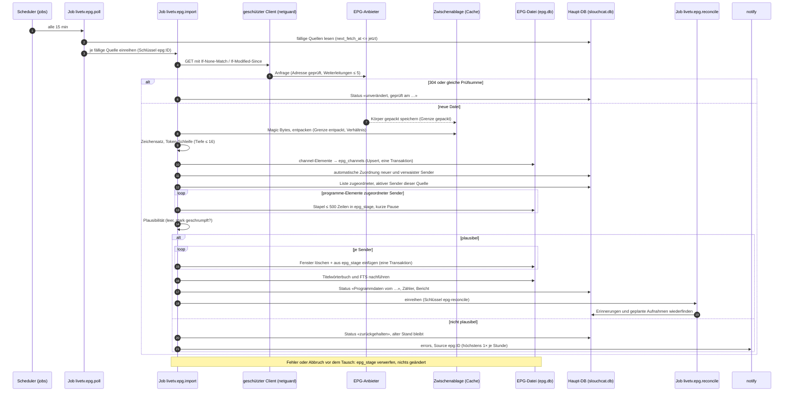
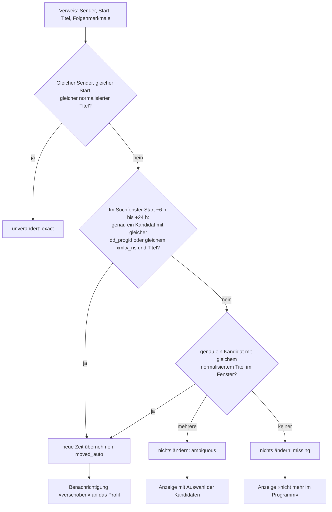

# Konzept 28 · EPG und Programmzeitschrift

Stand: 28. November 2026 · Fassung 1 · Status: Entwurf, nicht freigegeben

> **Kurz gesagt.** Slouchcat liest Programmdaten aus XMLTV-Dateien (Upload), XMLTV-Adressen und dem
> `xmltv.php` einer Xtream-Quelle, gepackt oder ungepackt. Jeder Sender hat **genau eine** EPG-Quelle. Der
> Import läuft als Hintergrundjob über den geschützten Netz-Client, liest die Datei in einem Durchgang ohne
> sie ganz in den Speicher zu laden, behält nur Sendungen zugeordneter, aktiver Sender und ersetzt sie je
> Sender und Zeitfenster in kurzen Transaktionen. Ein Fehler lässt den alten Stand stehen; die Wiedergabe
> hängt nie an Programmdaten. Fehlende Angaben bleiben leer, Abgeleitetes ist als «abgeleitet» markiert.
> Aufnahmen und Erinnerungen verweisen nicht auf Datenbankzeilen, sondern speichern die Merkmale der Sendung
> und finden sie nach jedem Import wieder, aber nur bei genau einem Kandidaten. **Tragende Empfehlung:** Die
> Programmdaten liegen in einer **eigenen SQLite-Datei**, die nicht gesichert wird (F-1). Vier Fragen an
> Marco (F-1 bis F-4), 13 offene Punkte, 12 Messpunkte.

Dieses Dokument ändert keinen Code. Alles hier ist **spezifiziert**, nichts ist gebaut. Die Tabellen in
Abschnitt 13 sind ein Vorschlag; `07-datenmodell.md` übernimmt sie und ist danach die einzige Quelle.

## Lesart

- **Einordnung** jeder tragenden Aussage: **[gebaut]** mit `Datei:Zeile` (heutiger Code, Pfade relativ zu
  `server/`, wenn nicht anders genannt) · **[spezifiziert]** (dieses Konzept legt es fest) · **[Empfehlung]**
  (Vorschlag mit Begründung, Marco oder der Bau kann anders entscheiden) · **[Annahme]** (nicht belegt;
  Recherche-Aussagen, die im Rohbericht R4 als «[Wissen]» markiert oder nicht abgerufen sind, stehen hier
  immer als Annahme) · **[offen O-n / F-n]** · **[zu messen M-n]**.
- **Nummern** F-n, O-n, M-n und T-n zählen in diesem Dokument ab 1; `20-offene-entscheidungen.md` führt sie
  zusammen und vergibt dort die Gesamtnummern. Verweise von aussen schreiben «09 F-1».
- **Stufen** wie in `03-fachkonzept.md`: Die Programmzeitschrift ist Stufe 2; was nur Aufnahmen betrifft,
  greift ab Stufe 5 (Einzelaufnahmen) und Stufe 6 (Serien, Folgenerkennung).
- **Fachwörter:** XMLTV ist das verbreitete XML-Format für Programmdaten; ein «EPG-Kanal» ist ein
  `<channel>`-Eintrag in einer XMLTV-Datei (nicht zu verwechseln mit dem Slouchcat-Sender); eine
  «Transaktion» ist ein Schreibvorgang der Datenbank, der ganz oder gar nicht gilt; FTS5 ist die
  Volltextsuche von SQLite.

---

## 1. Umfang

### 1.1 Was dazugehört (LTV-005)

| Zeile LTV-005 | Was Slouchcat tut | Abschnitt | Stufe |
|---|---|---|---|
| XMLTV-Dateien | Upload einer Datei durch den Administrator | 2.1 | 2 |
| XMLTV-URLs | Abruf einer Adresse in einem einstellbaren Intervall | 2.1, 2.5 | 2 |
| Komprimierte XMLTV-Dateien | gzip, zip, bzip2 nach Magic Bytes | 2.2 | 2 |
| Mehrere EPG-Quellen | beliebig viele Quellen mit Reihenfolge; je Sender genau eine | 2.1, 5 | 2 |
| Manuelle Senderzuordnung | Administrator wählt EPG-Kanal je Sender | 5.3 | 2 |
| Automatische Senderzuordnung | nur über Kennungen; Namen nur als Vorschlag (F-2) | 5.1, 5.2 | 2 |
| Automatische Aktualisierung | Zeitplan je Quelle, bedingter Abruf | 2.5, 11 | 2 |
| Aktuelle Sendungen | «läuft jetzt» je Sender | 8.2 | 2 |
| Kommende Sendungen | «als Nächstes», Raster, Sendungsliste je Sender | 8.1, 8.2 | 2 |
| Sendungstitel | `title`, Pflichtfeld | 4, 13 | 2 |
| Sendungsbeschreibungen | `desc`, gekappt | 4, 13 | 2 |
| Verfügbare Sendungsbilder | `icon` der Sendung, nur über den Server | 9 | 2 |
| Kategorien | Senderkategorien aus LTV-006 (Senderverwaltung) und `category` der Sendung | 8.5 | 2 |
| Genres | `category` der Sendung, wie geliefert (Auslegung, O-8) | 8.5 | 2 |
| Senderübergreifende Programmsuche | FTS5 über Titel und Untertitel | 8.4 | 2 |
| Konfigurierbarer EPG-Vorschauzeitraum | global, Vorgabe 7 Tage | 2.6 | 2 |
| Elektronische Programmzeitschrift | Raster Sender × Zeit, seitenweise | 8.1 | 2 |
| Aufnahmeplanung direkt aus dem EPG | EPG liefert die Sendungsmerkmale (Abschnitt 6) an `11-dvr.md` | 6 | 5 |
| Sendungserinnerungen | Erinnerung je Profil über das bestehende Benachrichtigungssystem | 10 | 2 |
| *Berücksichtige:* Zeitzonen | Zeitzone je Quelle für Zeiten ohne Versatz | 2.4, 4 | 2 |
| Sommer- und Winterzeit | Speicherung in UTC; mehrdeutige Ortszeit markiert | 4 | 2 |
| Fehlerhafte Zeitangaben | verwerfen, zählen, nie raten | 4 | 2 |
| Unvollständige Programmdaten | leer lassen, nichts erfinden | 4 | 2 |
| Fehlende EPG-Zuordnungen | Liste und Zähler in der Verwaltung | 5.5 | 2 |
| Geänderte Sendungszeiten | Wiedererkennen bei genau einem Kandidaten | 6.3 | 2 (Erinnerung), 5 (Aufnahme) |
| Aktualisierung geplanter Aufnahmen | dasselbe Verfahren, Ausführung in `11-dvr.md` | 6.3 | 5 |
| *Satz:* keine erfundenen Ergänzungen | Regel R-0 in Abschnitt 4 | 4 | 2 |
| *Satz:* Ausfall des Anbieters verhindert die Wiedergabe nicht | Abschnitt 3.6 | 3.6 | 2 |

### 1.2 Was nicht dazugehört

**[spezifiziert]** Ausgeschlossen, weder gebaut noch vorbereitet:

- **Kein Zusammenführen konkurrierender Quellen je Sender** (LTV-005 «Nicht vorgesehen»). Jeder Sender hat
  höchstens **eine** EPG-Quelle und darin genau einen EPG-Kanal. Slouchcat ergänzt keine Lücke einer Quelle
  aus einer anderen und wählt nicht je Sendung die «bessere» Quelle. Mehrere Quellen gibt es nur
  nebeneinander, für verschiedene Sender.
- **Keine KI**, keine Empfehlungen, keine «Für dich»-Liste aus Programmdaten (LTV-005; Ausschlussliste
  «KI-Funktionen»).
- **Keine Verknüpfung mit der Bibliothek**: keine Zuordnung einer Sendung zu einem Film oder einer Serie der
  Bibliothek, keine Bilder oder Beschreibungen von TMDB/TVDB, keine Anzeige «hast du schon gesehen»
  (LTV-005; Ausschlussliste «Automatische Übernahme in Film- und Serienbibliotheken»).
- **Kein Altersfilter aus EPG-Daten**: `rating` aus XMLTV wird weder für Sichtbarkeit noch für Sperren
  verwendet und in Stufe 2 nicht gespeichert (LTV-015, A-2 in `02-grundsatzentscheide.md`).
- **Nichts erfinden**: kein Auffüllen von Lücken, kein geschätztes Ende der letzten Sendung, keine erratene
  Zeitzone, kein Platzhalterbild, keine aus dem Titel erratene Staffel/Folge.
- **Kein Catch-up**: vergangene Sendungen sind Information, nie abspielbar (LTV-013).
- **Keine suchwortbasierten Aufnahmen**: die Programmsuche plant nichts automatisch (Ausschlussliste).

---

## 2. Quellen

### 2.1 Arten von EPG-Quellen

**[spezifiziert]** Nur der Administrator legt EPG-Quellen an (Verwaltung, `15-administration.md`). Drei Arten:

| Art | Woher die Daten kommen | Aktualisierung | Netz |
|---|---|---|---|
| `file` | Upload einer Datei in der Verwaltung | nur durch neuen Upload | keins |
| `url` | Adresse, die der Administrator einträgt | Intervall je Quelle | geschützter Client (3.2); Heimnetz nur nach F-4 |
| `xtream` | `xmltv.php` der Xtream-Eingangsquelle, mit deren Zugangsdaten | Intervall je Quelle | wie die Xtream-Quelle selbst (`12-sicherheit.md`) |

Regeln:

- **Upload [spezifiziert]:** Die Datei landet unverändert (auch gepackt) im Cache unter
  `<cache>/live/epg/source-<id>.bin` und wird von dort importiert. Höchstgrösse wie der Abruf (Abschnitt 12).
  Der Upload braucht einen eigenen Grenzwert für den Anfragekörper; das Muster dafür ist gebaut
  (`internal/api/limits.go:33-44`, Tabelle `largeBodies`). Geht der Cache verloren, zeigt die Quelle «Datei
  fehlt, bitte neu hochladen».
- **Xtream [Empfehlung]:** Slouchcat nutzt nur `xmltv.php` (eine XMLTV-Datei für alle Sender). Die
  Einzelabfragen `get_short_epg` und `get_simple_data_table` (je Sender eine Anfrage, Titel in Base64) nutzt
  Stufe 2 nicht: bei 5'000 Sendern wären das 5'000 Anfragen je Aktualisierung (Annahme aus R3 §3.1, nicht
  abgerufen). Anbieter ohne `xmltv.php`: O-4.
- **`url-tvg` aus einer M3U-Liste [Empfehlung]:** Eine M3U-Kopfzeile nennt oft eine XMLTV-Adresse (R3 §1,
  Annahme). Slouchcat zeigt sie beim Import der Liste als **Vorschlag** «EPG-Quelle anlegen»; der Administrator
  bestätigt. Sie wird nie still abgerufen, und weil die Liste (nicht der Administrator) sie bestimmt, gilt
  immer der geschützte Client ohne Heimnetz-Ausnahme (Muster `FeedOriginFile`, gebaut
  `internal/netguard/netguard.go:113-128`).
- **Datei in einem Ordner** (zum Beispiel WebGrab+Plus schreibt `guide.xml` auf das NAS): nicht in Stufe 2,
  O-5.
- **Reihenfolge der Quellen [spezifiziert]:** Der Administrator ordnet die Quellen. Die Reihenfolge zählt
  **nur** für die automatische Zuordnung (Abschnitt 5.1), nie für das Zusammenführen.

### 2.2 Kompression

**[spezifiziert]** Das Format erkennt Slouchcat an den ersten Bytes der Datei («Magic Bytes»), nicht an der
Dateiendung, nicht an `Content-Type` und nicht an `Content-Encoding`. Erkennungswerte (Annahme, aus R4 §8,
dort als Wissen geführt; im Bau mit Testdateien zu belegen):

| Format | Erste Bytes | Stufe 2 | Begründung |
|---|---|---|---|
| XML unkomprimiert | optional BOM `EF BB BF` oder `FF FE`/`FE FF`, dann Leerraum oder `<` | ja | Grundfall |
| gzip | `1F 8B` | ja | häufigstes Format (`.xml.gz`); Go-Standardbibliothek `compress/gzip`, keine neue Abhängigkeit |
| zip | `50 4B 03 04` | ja, **genau eine** `.xml`-Datei im Archiv | verbreitet bei Anbietern; `archive/zip` ist Standardbibliothek; braucht wahlfreien Zugriff, darum erst als Datei im Cache ablegen (2.3) |
| bzip2 | `42 5A 68` | ja | Standardbibliothek `compress/bzip2` (nur Entpacken), keine Abhängigkeit, kein Mehraufwand [Empfehlung] |
| xz | `FD 37 7A 58 5A 00` | nein | braucht eine Fremdbibliothek; im Repo ist keine vorhanden (`server/go.mod`, keine Fundstelle für `xz` oder `ulikunitz`) → O-1 |
| zstd | `28 B5 2F FD` | nein | ebenso Fremdbibliothek → O-1 |
| anderes | – | Abbruch mit «Format nicht erkannt» | nichts raten |

- **Doppeltes Entpacken vermeiden [Empfehlung]:** Der Abruf setzt `Accept-Encoding: identity`, wie der
  Download der Podcasts (gebaut `internal/fetch/fetch.go:127-128`). Damit entpackt der HTTP-Client nichts
  selbst, und allein die Magic Bytes entscheiden.
- **Verschachtelung:** Nach dem Entpacken wird einmal nachgeprüft. Höchstens eine Schicht (gzip in zip oder
  gzip in gzip wird einmal entpackt, eine dritte Schicht bricht ab).

### 2.3 Abruf und Zwischenablage

**[spezifiziert]** Jeder Abruf (und jeder Upload) wird zuerst gepackt, so wie er kommt, in die Datei
`<cache>/live/epg/source-<id>.bin` geschrieben (neu unter `.part`, dann umbenannt). Gründe:

1. zip braucht wahlfreien Zugriff.
2. Prüfsumme (SHA-256) der Datei: ist sie gleich wie beim letzten erfolgreichen Import, entfällt der Import
   («unverändert, geprüft am …»).
3. Ändert der Administrator Zuordnungen, Vorschauzeitraum oder Zeitzone, liest Slouchcat die vorhandene Datei
   neu, **ohne** den Anbieter erneut abzufragen.

Zusätzlich bedingter Abruf mit `If-None-Match`/`If-Modified-Since`; Muster gebaut beim Podcast-Abruf
(`internal/metadata/podcast.go:148-168`). Antwort 304 heisst «unverändert».

### 2.4 Zeitzone und Verschiebung je Quelle

**[spezifiziert]** Zwei Einstellungen je Quelle:

- **«Zeiten ohne Angabe gelten als»**: `UTC` (Vorgabe, so verlangt es die XMLTV-DTD; Beleg in R4 §1.1, DTD
  abgerufen) oder eine Zeitzone aus der IANA-Datenbank (zum Beispiel `Europe/Zurich`). Die Datenbank ist im
  Image vorhanden (gebaut `deploy/Dockerfile:96`, Paket `tzdata`). Slouchcat errät die Zone nie.
- **«Verschiebung in Minuten»** (−720 bis +720, Vorgabe 0): für Quellen, die einen falschen Versatz schreiben
  (zum Beispiel `+0000` bei Ortszeit). Wirkt auf alle Zeiten der Quelle, auch mit Versatz. Die Verwaltung zeigt
  daneben eine Vorschau «Laut dieser Quelle läuft jetzt auf Sender X: …», damit der Administrator einen Versatz
  sieht.
- **`tvg-shift` aus M3U [Empfehlung]:** Liefert die Senderliste je Sender `tvg-shift` (Stunden), übernimmt
  Slouchcat den Wert als Verschiebung **dieser Zuordnung**, sichtbar als «aus der Senderliste», änderbar. Die
  genaue Bedeutung bei Anbietern ist nicht belegt (R3 §1, nicht abgerufen) → O-9.

Gespeichert werden alle Zeiten als UTC in Sekunden. Angezeigt wird in der Zeitzone des Geräts; Tagesgrenzen der
Programmzeitschrift («heute», «morgen») rechnet der Client in seiner Zone [Empfehlung].

### 2.5 Aktualisierungsintervall je Quelle

**[spezifiziert]** Je Quelle `url` und `xtream` ein Intervall von 1 Stunde bis 7 Tage, **Vorgabe 24 Stunden**
[Empfehlung: die meisten XMLTV-Quellen erneuern sich täglich; Annahme]. Dazu «Jetzt aktualisieren» von Hand.
Uploads haben kein Intervall. Wie das ins Jobsystem passt (ein Zeitplan je Jobart): Abschnitt 11.

### 2.6 Vorschauzeitraum

**[spezifiziert]** Global für alle Quellen (Verwaltung, `15-administration.md`). Bereich 1 bis 14 Tage,
**Vorgabe 7 Tage** [Empfehlung: deckt eine Wochenplanung ab und hält das Mengengerüst klein, Abschnitt 8.6].
Sendungen, die nach `jetzt + Vorschauzeitraum` beginnen, verwirft der Import. Eine Quelle, die weniger liefert,
bleibt so kurz, wie sie ist (nichts auffüllen).

### 2.7 Rückschau

**[spezifiziert]** Vergangene Sendungen bleiben, bis ihr Ende länger als die Rückschau zurückliegt. **Vorgabe
24 Stunden**, Bereich 6 bis 72 Stunden. Gründe:

1. **Laufende Aufnahmen und Timeshift:** Eine Aufnahme, die vor Stunden begann, und ein persönlicher
   Timeshift-Puffer (`10-timeshift.md`) sollen anzeigen, welche Sendung an einer Stelle lief. Regel: Die
   wirksame Rückschau ist mindestens so lang wie die längste erlaubte Timeshift-Dauer.
2. **«Zuletzt gelaufen»:** Die Programmzeitschrift lässt sich bis gestern Abend zurückblättern; die Sendungsseite
   zeigt eine eben verpasste Sendung als «lief um …» (ohne Abspielen, kein Catch-up).
3. **Aufnahmen hängen nicht daran:** Eine fertige Aufnahme trägt ihre eigenen Merkmale (Abschnitt 6.2) und
   braucht die Programmzeile nicht mehr.

Ältere Sendungen löscht der Aufräumjob (Abschnitt 11).

---

## 3. Import-Ablauf

### 3.1 Ablauf



### 3.2 Regeln für den Abruf

- **Geschützter Client [spezifiziert]:** Abruf mit einem eigenen Satz `netguard.Clients`
  (`NewClients`, gebaut `internal/netguard/netguard.go:93-111`): kein Proxy aus der Umgebung, die Prüfung der
  aufgelösten Adresse bei jeder Verbindung und jeder Weiterleitung (`RefuseLocal`, `:73-82`), höchstens
  5 Weiterleitungen, nur `http`/`https` (Muster `internal/fetch/fetch.go:46-53`). Fehlertexte nennen nur
  Schema und Host (`netguard.Clean`, `:144-150`), weil Xtream-Adressen Zugangsdaten tragen (Regel 10).
- **Heimnetz:** Für `url`-Quellen nur nach F-4; für Bild-Adressen nie (Abschnitt 9).
- **Zeitgrenzen [Empfehlung, Annahme für die Zahlen]:** Antwortkopf binnen 30 s (wie `fetch.HeaderTimeout`,
  `internal/fetch/fetch.go:31`), ganzer Import höchstens 30 Minuten über `context` (danach Abbruch wie ein Fehler).
- **Grössengrenzen:** Abschnitt 12.

### 3.3 Streamender Parser

**[spezifiziert]** Kein Einlesen des ganzen Dokuments. Der Podcast-Parser ist dafür **kein** Vorbild in der
Technik: Er dekodiert das ganze Dokument in einen Baum (`d.Decode(&root)`, gebaut `internal/feed/feed.go:94-99`)
und liest bei Latin-1 den ganzen Körper in den Speicher (`charsetReader` mit `io.ReadAll`,
`internal/feed/feed.go:392-402`); bei 16 MiB Höchstgrösse (`internal/metadata/podcast.go:55`) geht das, bei
EPG-Dateien von Hunderten MB nicht. Übernommen werden nur seine Grenzen und `d.Entity = xml.HTMLEntity`
(`internal/feed/feed.go:95`).

Muster [Empfehlung; Technik nach Go-Doku `encoding/xml`, in R4 §4.2 abgerufen]:

1. `xml.Decoder` über dem entpackten, zeichensatz-gewandelten Strom; Schleife über `Token()`.
2. Bei `<channel>` und `<programme>` wird nur dieses Element mit `DecodeElement` in eine schmale Struktur
   gelesen (nur benötigte Felder; Unbekanntes wird übergangen).
3. `<programme>` eines nicht zugeordneten oder inaktiven Senders wird mit `Skip()` übersprungen, ohne es zu
   dekodieren. Dazu muss die Zuordnung **vor** den Sendungen feststehen: XMLTV schreibt üblicherweise alle
   `<channel>` vor die `<programme>` (Annahme aus R4 §4.2). Stehen `<channel>` später, arbeitet der Import mit
   der Zuordnung vom Stand vor dem Import, und neu zugeordnete Sender kommen beim nächsten Lesen der
   Zwischenablage dazu (2.3); kein zweiter Durchgang in Stufe 2.
4. Tiefe, Elementgrössen und Feldlängen sind begrenzt (Abschnitt 12).

### 3.4 Nur zugeordnete, aktive Sender

**[spezifiziert]** Gespeichert werden:

- **Alle EPG-Kanäle** der Quelle (`epg_channels`: Kennung, Anzeigenamen, Symbol-Adresse): klein, nötig für
  Zuordnung und Vorschläge.
- **Sendungen nur für EPG-Kanäle, denen mindestens ein aktiver Slouchcat-Sender zugeordnet ist.** Ein
  deaktivierter Sender oder ein Sender ohne Zuordnung erzeugt keine Programmzeilen. Wird später zugeordnet oder
  aktiviert, liest Slouchcat die Zwischenablage neu (2.3).

Das ist der grösste Hebel gegen grosse Anbieter-Dateien (R4, Hypothese H2; zu messen M-1).

### 3.5 Schreiben: Ersetzen je Sender und Zeitfenster

**[spezifiziert]** Zwei Phasen:

1. **Sammeln:** Die gültigen Sendungen gehen in die Tabelle `epg_stage` (Zwischentabelle), in Stapeln zu
   höchstens 500 Zeilen je Transaktion. Die Zahl folgt der Regel des Jobsystems «höchstens 500 Zeilen je
   Transaktion» (gebaut `internal/jobs/queue.go:5-7`); der Radio-Abgleich nutzt 1000 (`internal/radio/sync.go:33`).
   Zu Beginn jedes Imports wird `epg_stage` für diese Quelle geleert.
2. **Tauschen:** Je EPG-Kanal eine Transaktion: alle Sendungen des Kanals löschen, die im **Fenster**
   `[kleinster Start, grösster Start]` der neuen Daten dieses Kanals beginnen, dann die neuen aus `epg_stage`
   einfügen. Sendungen ausserhalb des Fensters bleiben (Vergangenheit, ferne Zukunft, falls eine Quelle nur einen
   Ausschnitt liefert). Grosse Kanäle (über 500 Zeilen) werden in mehreren Transaktionen getauscht, nach Tagen
   geschnitten.

Warum ersetzen statt zusammenführen («Upsert»): Gestrichene und verschobene Sendungen verschwinden ohne eigenen
Aufräumschritt, und es gibt keine stabile Kennung, nach der man zusammenführen könnte (Abschnitt 6.1). Preis:
Zeilennummern wechseln bei jedem Import; deshalb verweist nichts auf sie (Abschnitt 6.2). [Empfehlung aus R4
§4.3, Hypothese H1, zu messen M-2]

**Eine Schreibverbindung:** Die Haupt-DB hat genau eine Schreibverbindung (gebaut
`internal/store/store.go:94`, `_txlock=immediate`), über die auch Fortschritt, Job-Leases und Sitzungen laufen.

- Mit der **eigenen EPG-Datei** (F-1, Empfehlung) hat das EPG eine **eigene** Schreibverbindung; der Import
  blockiert die Haupt-DB nicht. Zwischen den Stapeln eine kurze Pause (Vorgabe 10 ms, Annahme), damit Leser der
  EPG-Datei und der WAL-Checkpoint (das Zurückschreiben des Schreibprotokolls in die Datei) Luft haben.
- In der Variante **«alles in einer Datei»** teilt der Import die Schreibverbindung mit allem anderen. Dann
  gelten dieselben Stapel, aber die Pause muss länger sein (Vorgabe 50 ms, Annahme), damit Wiedergabe,
  Aufnahmeplanung und Sitzungen nicht bis `busy_timeout(5000)` (gebaut `internal/store/store.go:114`) warten.
- In beiden Fällen: Haltezeit je Transaktion messen (M-2), Zielgrösse unter 50 ms (zu prüfende Grösse,
  keine Zusage).

### 3.6 Fehler, leere Dateien, Ausfall

| Fall | Regel [spezifiziert] | Anzeige |
|---|---|---|
| Abruf scheitert (Netz, HTTP-Fehler, Zeitgrenze) | nichts geändert; nächster Versuch nach Rückoff des Jobsystems, spätestens beim nächsten Intervall | Quelle «fehlgeschlagen: <Grund>», «Programmdaten vom <letzter Erfolg>» |
| Datei kaputt mitten im Lesen (XML-Fehler, Grenze überschritten) | `epg_stage` verwerfen; alter Stand bleibt vollständig | wie oben, mit Byte-Position des Fehlers (`Decoder.InputOffset`) |
| Absturz oder Neustart während des Sammelns | alter Stand bleibt; der Job läuft nach Ablauf der Lease neu (gebaut `internal/jobs/queue.go:82-91`), `epg_stage` wird neu gefüllt | «läuft» → später «erfolgreich» |
| Absturz während des Tauschs | jeder Sender ist für sich stimmig (alt oder neu); der Neustart wiederholt den ganzen Import (idempotent) | wie oben |
| Datei ohne Sendungen für zugeordnete Sender | **zurückhalten**, nichts tauschen | «zurückgehalten: keine Sendungen für zugeordnete Sender» |
| Datei stark geschrumpft: Sendungen mit Start in `[jetzt, jetzt + Vorschau]` für zugeordnete Sender unter 50 % des heutigen Bestands derselben Quelle (Schwelle Annahme, M-10) | **zurückhalten**; der Administrator kann «trotzdem übernehmen» | «zurückgehalten: nur N statt M Sendungen» |
| Ein einzelner Sender hatte Daten und bekommt keine | nichts löschen; sein alter Bestand altert natürlich aus | beim Sender «keine neuen Programmdaten seit …» |
| Anbieter dauerhaft weg | nach jedem gescheiterten Versuch Meldung `errors` an die Administratoren, höchstens einmal je Quelle und Stunde (gebaut `internal/notify/dispatch.go:25`, `:82-97`) | Dashboard und Quelle |

**Ausfall darf die Wiedergabe nicht verhindern [spezifiziert]:** Der Wiedergabeweg (`05-streaming-und-fast-zapping.md`)
liest keine Programmdaten. Programmangaben im Player («läuft jetzt») holt der Client getrennt; scheitert das
oder fehlt die EPG-Datei, bleibt die Anzeige leer, der Sender läuft. Liegen Daten vor, zeigt jede Ansicht mit
Programmdaten den Stand **«Programmdaten vom <Zeitpunkt des letzten erfolgreichen Imports>»**, sobald dieser
älter als zweimal das Intervall der Quelle ist. Sind die Daten aufgebraucht: «Keine Programmdaten».

---

## 4. Datenqualität

**R-0 [spezifiziert]: Slouchcat erfindet nichts.** Fehlt eine Angabe, bleibt sie leer. Abgeleitet wird nur aus
Daten derselben Quelle und desselben Kanals, und jede Ableitung ist als **«abgeleitet»** gespeichert und
sichtbar (Spalte `flags`, Abschnitt 13). Nie aufgefüllt: Lücken, Beschreibungen, Bilder, Folgennummern, Genres.

| Fall | Regel [spezifiziert] | Kennzeichnung |
|---|---|---|
| `title` fehlt oder leer | Sendung verwerfen, zählen | – |
| `start` fehlt oder unlesbar | verwerfen, zählen | – |
| `stop` fehlt | Ende = Start der nächsten Sendung **desselben Kanals in derselben Datei**, wenn sie höchstens 24 h später beginnt | `end_derived` |
| `stop` fehlt bei der letzten Sendung eines Kanals | Ende **unbekannt** (`stop_utc` leer); Raster zeigt «Ende unbekannt», offen bis zum Datenende; Aufnahme nur mit fester Dauer, die der Benutzer wählt (`11-dvr.md`) | `end_unknown` |
| `stop <= start` | verwerfen, zählen | – |
| Dauer über 24 h | verwerfen, zählen (Grenze Annahme, R4 §2) | – |
| Dauer 0 bis unter 1 min | behalten, zählen («sehr kurz») | – |
| Zeitformat-Varianten (`YYYYMMDDhhmm`, `±HH:MM`, `Z`, Leerzeichen) | tolerant lesen: 12 oder 14 Ziffern, Versatz mit oder ohne Doppelpunkt; kürzere Formen (nur Datum) verwerfen (Annahme R4 §2) | – |
| Zeit ohne Versatz | in der Zone der Quelle (2.4); Vorgabe UTC | – |
| Versatz offensichtlich falsch | nicht erkennbar, nicht korrigieren; Verschiebung je Quelle (2.4) | `shifted` (Verschiebung ≠ 0) |
| Ortszeit ohne Versatz in der Sommerzeit-Lücke (Frühling, Uhr springt vor) | Go verschiebt die nicht existierende Zeit, ohne Fehler (Annahme, Go-Doku nicht in dieser Sitzung abgerufen; im Bau testen, O-2) | `time_derived` |
| Ortszeit ohne Versatz in der doppelten Stunde (Herbst) | erste Deutung nehmen; widerspricht sie der Reihenfolge im Kanal (beginnt vor dem Ende der vorigen Sendung, die nach ihr kommt), die zweite Deutung | `time_ambiguous` |
| Zeit mit Versatz über einen Wechsel hinweg | eindeutig, keine Sonderbehandlung (Speicherung in UTC) | – |
| Überlappung (Ende A nach Start B) | beide behalten, nicht korrigieren; «läuft jetzt» nimmt die zuletzt begonnene; das Raster zeigt sie gestaffelt (`14-oberflaeche.md`); zählen | `overlap` |
| Lücke zwischen Sendungen | nicht füllen; Raster zeigt «keine Daten» | – |
| Exakte Dublette (gleicher Kanal, Start, Ende, Titel) | eine behalten, zählen | – |
| Gleicher Start, anderer Titel | beide behalten (Überlappung) | `overlap` |
| `<programme channel>` unbekannt | überspringen, zählen | – |
| Mehrsprachige Felder (`title lang=…`) | eine Sprache je Quelle: «bevorzugte Sprache» (Vorgabe: Sprache des Servers), sonst das erste Element | – |
| Zeichensatz in der XML-Deklaration | UTF-8, UTF-16 mit BOM, ISO-8859-1 bis -15, Windows-1250 bis -1258 über `golang.org/x/text/encoding/charmap` (schon direkte Abhängigkeit, gebaut `server/go.mod:23`), **streamend**; unbekannter Zeichensatz → Abbruch | – |
| Steuerzeichen, die XML 1.0 verbietet (häufig in Anbieter-Dateien, Annahme) | vor dem Decoder entfernen (ausser Tab, LF, CR), zählen | – |
| HTML-Entitäten wie `&nbsp;` | feste Tabelle `xml.HTMLEntity` wie beim Podcast-Parser (gebaut `internal/feed/feed.go:95`) | – |
| Überlange Felder | kappen: Titel/Untertitel 500 Zeichen (wie `feed.MaxTitle`, `internal/feed/feed.go:35`), Beschreibung 4'000 (wie `feed.MaxDescription`, `:29`), Adressen 2'048 Bytes (wie `feed.MaxURL`, `:36`; längere werden verworfen), höchstens 10 Kategorien | – |
| `previously-shown`, `new` | `new` als «Neu» anzeigen, wenn vorhanden. Fehlen von `previously-shown` heisst **nicht** «neu» (Beleg DTD, R4 §1.1); Slouchcat zeigt nie «Wiederholung», wenn die Quelle es nicht sagt | – |
| `date` | ist das Produktionsjahr, nicht das Sendedatum (DTD); nur als «Jahr» anzeigen | – |

Der Importbericht je Lauf zählt jede Regel (verworfen, abgeleitet, Überlappungen, Dubletten, unbekannte
Kanäle) und zeigt sie in der Verwaltung (9.4 des Auftrags: «Importstatus», «Fehleranzeige»).

---

## 5. Zuordnung Sender ↔ EPG-Kanal

### 5.1 Automatisch

**[spezifiziert]** Ein Sender bekommt höchstens einen EPG-Kanal aus genau einer Quelle. Mehrere Sender dürfen
denselben EPG-Kanal haben (HD und SD desselben Programms). Stufen, erster Treffer gewinnt:

| Stufe | Merkmal | Wirkung |
|---|---|---|
| 0 | **Manuelle Zuordnung** oder «bewusst ohne EPG» | bleibt immer; die Automatik fasst sie nie an |
| 1 | Sender aus einer **Xtream-Quelle** und `epg_channel_id` = `channel id` in deren eigenem `xmltv.php` (getrimmt, Gross-/Kleinschreibung gleich) | **automatische Zuordnung**, Grund «Xtream-Kennung» |
| 2 | `tvg-id` des Senders = `channel id` eines EPG-Kanals (getrimmt, ohne Unterschied der Gross-/Kleinschreibung), Quellen in der Reihenfolge des Administrators; in der ersten Quelle mit **genau einem** Treffer | **automatische Zuordnung**, Grund «tvg-id» |
| 3 | normalisierter Name des Senders = normalisierter `display-name` eines EPG-Kanals, **genau ein** Kandidat über alle Quellen, Länderkennung nicht widersprüchlich | **nur Vorschlag** (F-2), Rang 90 |
| 4 | normalisierter Name gleich, mehrere Kandidaten | Vorschlagsliste, Rang 70 |
| 5 | ähnlicher Name (Trigramm-Ähnlichkeit ≥ 0,6, Wert Annahme) | Vorschlagsliste, Rang 50–69, nie automatisch |
| – | nichts | «ohne Zuordnung» |

**Schwelle [Empfehlung]:** Automatisch nur bei einer **Kennung** (Stufe 1, 2), nie bei einem Namen. Begründung:
«keine falschen stillen Treffer». Ein Namenstreffer kann falsch sein, obwohl er eindeutig aussieht (gleicher
Name in zwei Ländern, «+1»-Sender, Regionalfenster). Damit Namensvorschläge trotzdem wenig Arbeit machen: eine
Sammelbestätigung «alle eindeutigen Namensvorschläge (Rang 90) übernehmen», nach Sichtprüfung in einer Liste.
Ob Rang 90 doch automatisch zuordnen soll: F-2.

**Normalisierung (nur für den Vergleich; der Anzeigename bleibt) [Empfehlung aus R4 §3.2]:** Unicode NFKD,
Akzente weg, Kleinschreibung; Klammern und Satzzeichen → Leerzeichen; Qualitätsmarken als eigenes Wort entfernen
(`hd`, `fhd`, `uhd`, `4k`, `sd`, `hevc`, `h265`, `raw`, `50fps`); Länder- und Gruppenpräfixe (`DE:`, `|CH|`,
`CH |`) als eigenes Merkmal abtrennen, nicht löschen; Zahlen und Zusätze wie `+1`, `tv`, `channel` bleiben
(`RTL 2` ≠ `RTL`, `SRF 1` ≠ `SRF zwei`).

### 5.2 Wann die Automatik läuft

**[spezifiziert]** Nur für Sender, die **neu** sind, deren `tvg-id` oder Xtream-Kennung sich **geändert** hat,
deren automatische Zuordnung **verwaist** ist (5.4) oder die noch **keine** Zuordnung haben. Eine bestehende,
funktionierende automatische Zuordnung wechselt nie von selbst den EPG-Kanal (Stabilität). Auslöser: Ende jedes
EPG-Imports und Ende jedes Imports einer Senderliste (`06-ablaeufe.md`).

### 5.3 Manuell

**[spezifiziert]** In der Verwaltung je Sender: EPG-Kanal aus einer Suchliste wählen (Quelle, Kennung,
Anzeigenamen, Vorschau «läuft jetzt»), Vorschlag übernehmen, Zuordnung lösen, «bewusst ohne EPG» setzen
(beendet die Vorschläge). Auch als Massenbearbeitung (LTV-006). Jede manuelle Handlung setzt `mode = manual`.

### 5.4 Erhalt beim Re-Import

**[spezifiziert]**

- Die Zuordnung hängt an der **stabilen Sender-Kennung** von Slouchcat (LTV-006, LTV-018; `07-datenmodell.md`)
  und am **Text** der XMLTV-Kennung (`source_id`, `xmltv_id`), nie an einer Zeilennummer der EPG-Tabellen.
  Damit übersteht sie den Neuaufbau der EPG-Datei (F-1) und jeden Import (R4 §3.3, Hypothese H9).
- **Sender-Re-Import** (Liste neu, URL geändert, Name geändert): die Sender-Kennung bleibt, also die Zuordnung
  auch («Erhalt von EPG-Zuordnungen», LTV-018).
- **EPG-Re-Import, Kennung verschwunden:** Die Zuordnung bleibt stehen und heisst «verwaist»; der Sender hat
  keine neuen Programmdaten. Automatische verwaiste Zuordnungen rechnet die Automatik neu (5.2); manuelle
  bleiben verwaist, bis der Administrator handelt. Taucht die Kennung wieder auf, gilt die Zuordnung wieder.
- **Quelle gelöscht:** Zuordnungen auf diese Quelle werden gelöscht; die Sender sind danach «ohne Zuordnung»
  und die Automatik läuft für sie (Bestätigung beim Löschen nennt die Zahl).

### 5.5 Fehlende Zuordnungen anzeigen

**[spezifiziert]** In der EPG-Verwaltung (`15-administration.md`): Zähler und Filter «ohne Zuordnung»,
«verwaist», «mit Vorschlag», «bewusst ohne EPG»; je Sender «Programmdaten bis <Datum>». Auf dem
Live-TV-Dashboard ein Zähler «aktive Sender ohne Programmdaten». Zuschauer sehen bei einem Sender ohne Daten
«Keine Programmdaten» und nichts Erfundenes.

---

## 6. Programm-Identität

### 6.1 Ausgangslage

XMLTV hat **keine** stabile Kennung einer Sendung (Beleg: DTD, R4 §1.1 und §7). Optional gibt es
`episode-num system="dd_progid"` (anbieterspezifisch); `clumpidx` ist keine Kennung. Dazu wechseln beim
Ersetzen (3.5) die Zeilennummern bei jedem Import.

### 6.2 Verweise speichern Rohmerkmale

**[spezifiziert]** Erinnerungen (Abschnitt 10), Einzelaufnahmen und von Serienregeln erzeugte Aufnahmen
(`11-dvr.md`) verweisen **nicht** auf `epg_programmes.id`. Sie speichern beim Anlegen einen **Programmverweis**
(Spaltengruppe, in `07-datenmodell.md` einmal definiert und in allen Tabellen gleich):

| Feld | Inhalt |
|---|---|
| `channel_id` | stabile Slouchcat-Sender-Kennung (führend) |
| `epg_source_id`, `epg_xmltv_id` | Quelle und Kanal der Zuordnung zu diesem Zeitpunkt (nur zur Auskunft) |
| `prog_start_utc`, `prog_stop_utc` | Zeiten laut EPG beim Anlegen (`stop` darf leer sein) |
| `prog_title`, `prog_title_norm` | Titel wie geliefert und normalisiert (Kleinschreibung, Akzente, Leerraum, Satzzeichen) |
| `prog_subtitle` | Untertitel wie geliefert |
| `prog_episode_ns`, `prog_episode_onscreen`, `prog_ext_id` | `xmltv_ns`, `onscreen`, `dd_progid` roh, falls vorhanden |
| `prog_match_state` | `exact`, `moved_auto`, `ambiguous`, `missing` (6.3) |

Im API heisst eine Sendung `programmeRef` = Sender-Kennung, Start und eine kurze Prüfsumme des normalisierten
Titels (überlappende Sendungen mit gleichem Start bleiben unterscheidbar). Die Sendungsseite löst den Verweis
bei jedem Aufruf neu auf (`08-api.md`).

### 6.3 Wiederfinden nach einem Import

**[spezifiziert]** Der Job `livetv.epg.reconcile` (Abschnitt 11) prüft nach jedem erfolgreichen Import alle
**künftigen** Verweise der betroffenen Sender (Erinnerungen vor ihrem Zeitpunkt, geplante Aufnahmen vor Beginn
des Vorlaufs). Eine laufende oder begonnene Aufnahme wird nie verschoben (`11-dvr.md`).



- **Suchfenster** −6 h bis +24 h um den gespeicherten Start [Annahme aus R4 §7; einstellbar im Bau, nicht in der
  Oberfläche].
- **Nie raten:** Bei mehreren oder keinem Kandidaten bleibt der Verweis auf der alten Zeit. Eine geplante
  Aufnahme läuft dann zur alten Zeit, eine Erinnerung kommt zur alten Zeit mit dem Zusatz «laut früherem
  Programm» [Empfehlung; ob eine Aufnahme in diesem Fall stattdessen ausgesetzt wird, entscheidet `11-dvr.md`].
- **Was der Benutzer sieht [spezifiziert]:**
  - `moved_auto`: in «Geplante Aufnahmen» und bei der Erinnerung «Verschoben: neu 20:30 (vorher 20:15)»,
    dazu eine Meldung in der Glocke des Profils.
  - `ambiguous`: «Die Sendung ist nicht mehr eindeutig im Programm. Bleibt auf 20:15–21:00.» mit den Kandidaten
    zur Auswahl («diese nehmen») und «löschen».
  - `missing`: «Nicht mehr im Programm gefunden. Bleibt auf 20:15–21:00.» mit «behalten» und «löschen».
- **Sender ohne EPG mehr** (Zuordnung gelöst oder verwaist): Verweise bleiben, Zustand `missing`.

---

## 7. Serien- und Folgenerkennung (für LTV-008)

### 7.1 Was als zuverlässig gilt

**[spezifiziert]** «Bereits aufgenommene Folge erkennen, sofern zuverlässig identifizierbar» (LTV-008) heisst:

| Stufe | Merkmal | Gilt als |
|---|---|---|
| A | `episode-num system="xmltv_ns"` mit **Staffel und Folge** (beide Zahlen vorhanden), gleicher normalisierter Serientitel, gleiche Quelle | **zuverlässig** |
| B | `dd_progid` mit Folgenteil (`EP…`), gleiche Quelle | **zuverlässig** (Bedeutung der Präfixe: Annahme, R4 §6.1) |
| C | `onscreen` wörtlich gleich (ganzer Text) und Titel gleich, gleiche Quelle | **wahrscheinlich**: nur wenn das Profil die Regeloption «auch nach Folgenangabe der Quelle» einschaltet (Vorgabe aus) |
| D | `sub-title` gleich und nicht leer, Titel gleich | **wahrscheinlich**: nur mit Regeloption «nach Folgentitel» (Vorgabe aus), weil Untertitel oft Zufallstext ist (Annahme R4 §6.1) |
| – | nur Titel und Zeit | **nicht identifizierbar** |

- Vergleichen wird nur **innerhalb desselben `system`** und derselben Quelle; ein Quellenwechsel macht frühere
  Merkmale nicht vergleichbar (R4 §6.3).
- Verglichen wird gegen die **eigenen Aufnahmen des Profils** mit ihren gespeicherten Merkmalen (6.2), nie gegen
  die EPG-Tabelle und nie gegen die Bibliothek.
- Aus `onscreen` wird keine Staffel- oder Folgennummer herausgelesen (kein Muster wie «S02E05» als
  Automatik); angezeigt wird der Text, wie er kommt. `xmltv_ns` ist nullbasiert; die Anzeige «Staffel 2, Folge 5»
  rechnet nur das Format um (+1), sie erfindet nichts.

### 7.2 Was der Benutzer sieht

**[spezifiziert]**

- Sendungsseite: «Staffel 2, Folge 5» (Stufe A) oder der `onscreen`-Text; fehlt beides: nichts.
- Beim Anlegen einer Serienaufnahme: Hat die gewählte Sendung kein zuverlässiges Merkmal (Stufe A/B), steht dort:
  «Slouchcat kann bei dieser Sendung Folgen nicht unterscheiden. Jede passende Ausstrahlung wird aufgenommen.»
  mit den Wahlmöglichkeiten aus `11-dvr.md` (zum Beispiel «höchstens eine je Tag»).
- In «Geplante Aufnahmen» je erzeugter Aufnahme: «übersprungen: Folge schon aufgenommen (S2 F5)» oder «Folge
  nicht identifizierbar».

### 7.3 Was eine Serienregel auswählt

**[spezifiziert]** Eine Serienregel entsteht **nur aus einer gewählten Sendung**, nie aus einem eingetippten
Suchwort (Ausschlussliste «suchwortbasierte automatische Aufnahmen»). Sie wählt Sendungen mit **gleichem
normalisiertem Titel** (vollständige Gleichheit, kein Teilwort, kein ähnlicher Titel) auf dem gewählten Sender
oder, wenn das Profil es wählt, auf allen seinen Sendern. Das ist die Auswahl, die der Benutzer ausdrücklich
trifft; eine Titelähnlichkeit als Automatik gibt es nicht. Titelzusätze wie «(Wh.)» verhindern einen Treffer;
das wird nicht wegnormalisiert (O-10).

---

## 8. Abfragen und Leistung

Alle Abfragen lesen die EPG-Datei über einen eigenen Lesepool; die Sender (Reihenfolge, Gruppen, Favoriten,
Rechte) kommen aus der Haupt-DB. Slouchcat verbindet beides im Go-Code, nicht per SQL über zwei Dateien
[Empfehlung, Folge von F-1]. Wer welche Sender sieht, regelt `04-architektur.md`/`07-datenmodell.md` (alle
Sender des Kontos, LTV-015); das EPG kennt keine eigene Sichtbarkeitsregel und keinen Altersfilter.

### 8.1 Raster (Zeitfenster × Sender, seitenweise)

**[spezifiziert]**

1. Haupt-DB: eine Seite Sender (Vorgabe 50 je Seite, Annahme für die Oberfläche) mit ihren Zuordnungen →
   Liste von `epg_channel_id` (Zeilennummer in der EPG-Datei, über eine kleine Zuordnung im Speicher aus
   `(source_id, xmltv_id)` gewonnen).
2. EPG-Datei:
   `SELECT … FROM epg_programmes WHERE epg_channel_id IN (…) AND start_utc < :to AND start_utc >= :from - 86400 AND (stop_utc IS NULL OR stop_utc > :from) ORDER BY epg_channel_id, start_utc`.
   Weil Sendungen über 24 h verworfen werden (Abschnitt 4), reicht die Untergrenze `:from − 24 h` für den
   Index `(epg_channel_id, start_utc)`; keine Unterabfrage je Sender nötig.
3. Zeitfenster Vorgabe 3 h (Annahme für die Oberfläche, `14-oberflaeche.md`); Tages- und Uhrzeitsprung
   verschiebt nur `:from`/`:to`.

Menge je Seite: 50 Sender × 3 h ≈ 150 bis 500 Zeilen (Annahme). Antwortzeit: M-4.

### 8.2 «Läuft jetzt» und «als Nächstes»

**[spezifiziert]** Für eine Senderliste (Seite oder Favoriten, nie alle 10'000 auf einmal):

- jetzt: `start_utc <= :now AND start_utc > :now - 86400 AND (stop_utc IS NULL OR stop_utc > :now)`, je Sender die
  zuletzt begonnene;
- als Nächstes: `start_utc > :now AND start_utc < :now + 86400`, je Sender die erste (`ROW_NUMBER()` über
  `epg_channel_id`).

[Empfehlung] Erst messen (M-5); nur wenn Senderlisten mit vielen Sendern zu langsam sind, einen Zwischenspeicher
im Arbeitsspeicher «jetzt/als Nächstes» für alle zugeordneten Sender, erneuert nach jedem Import und jeweils zum
nächsten Sendungswechsel. Bei 10'000 Sendern wären das 20'000 kleine Einträge (Annahme).

### 8.3 Sendungsdetails

**[spezifiziert]** Auflösung über `programmeRef` (6.2): Index `(epg_channel_id, start_utc)`, dann Titelprüfsumme.
Liefert alle gespeicherten Felder, Kennzeichen «abgeleitet», `flags`, Bild-Adresse über den Proxy (Abschnitt 9)
und «Programmdaten vom …». Vergangene Sendung: ohne Abspielen. Nicht mehr auffindbar: 404 (der Client zeigt
«Sendung nicht mehr im Programm»).

### 8.4 Programmsuche senderübergreifend (FTS5)

**[Empfehlung, Hypothese H3 aus R4]** Ein **Titelwörterbuch** statt eines Index über alle Sendungen:

- `epg_titles (id, kind, text, text_norm)`, eine Zeile je **verschiedenem** Titel oder Untertitel (`kind` =
  `title`/`subtitle`); jede Sendung verweist mit `title_id` und `subtitle_id` darauf.
- `epg_titles_fts` als FTS5-Tabelle mit externem Inhalt über `epg_titles`, Tokenizer
  `unicode61 remove_diacritics 2`, `prefix '2 3'`, mit Triggern: genau wie der Suchindex der Bibliothek (gebaut
  `server/migrations/00015_discover.sql:140-159`).
- **Indexiert:** Titel und Untertitel. **Nicht** in Stufe 2: Beschreibung (Grösse, O-11), Personen aus `credits`
  (nicht gespeichert).
- **Suche:** FTS → `title_id`s → Sendungen mit Start in `[jetzt − 3 h, jetzt + Vorschau]` über Index
  `(title_id, start_utc)` → nur Sender, die das Profil sieht → höchstens 100 Treffer, nach Start sortiert, gruppiert
  nach Titel.
- **Aktualisierungskosten:** Ein Import schreibt nur **neue** Titel ins Wörterbuch (`INSERT OR IGNORE` über
  `text_norm`); wiederkehrende Titel («Tagesschau» an jedem Tag auf vielen Sendern) kosten nichts. Der Aufräumjob
  löscht Titel ohne Sendung. Ein FTS über alle Sendungen kostete dagegen bei jedem Tausch je Zeile ein Löschen
  und ein Einfügen im Index (R4 §4.4, Beleg FTS5 «delete command»). Anteil verschiedener Titel: Annahme 10 bis
  30 % der Zeilen; zu messen M-6.
- Die FTS-Tabelle der Bibliothek (`search_docs`, CHECK `kind`) wird **nicht** erweitert; Live-TV taucht in der
  Bibliothekssuche nie auf (A-2).

### 8.5 Kategorien und Genres

**[spezifiziert, Auslegung O-8]**

- **Kategorien** im Sinn von LTV-006 sind Senderkategorien der Senderverwaltung (`15-administration.md`).
- **Genres** einer Sendung sind die `category`-Werte der XMLTV-Datei, **so wie geliefert** (Freitext ohne festes
  Vokabular, Annahme R4 §1.1): bis 10 je Sendung, getrimmt, in der bevorzugten Sprache der Quelle. Gespeichert
  als Text in der Sendungszeile; angezeigt auf Sendungsseite und Raster.
- **Filter:** im Raster und in den Suchtreffern über die geladenen Zeilen. Eine eigene Genre-Liste mit
  Übersetzung oder Zusammenfassung («Movie», «Spielfilm», «Film») baut Slouchcat nicht, weil das eine Zuordnung
  wäre, die die Quelle nicht liefert (O-8).

### 8.6 Mengengerüst [Annahme mit Rechenweg]

**Annahmen:** 30 Sendungen je Sender und Tag (R4 §4.1, Mittel aus Sparten- und Vollprogrammen); gespeicherte
Zeile mit Indizes **0,5 KB** (Titel- und Untertitelverweis, Beschreibung im Mittel 300 B, Kategorien, Zeiten,
Merkmale, zwei Indizes; Spanne 0,3 bis 0,8 KB); Rückschau 1 Tag. Zeilen = Sender × 30 × (Vorschau + 1).
«Anteil zugeordnet» ist der Anteil importierter Sender mit EPG-Zuordnung und aktiv: 100 % als obere Grenze,
30 % als Annahme für grosse Anbieterlisten (R4 §4.1: bei 10'000-Sender-Dumps oft über 70 % ohne EPG; Annahme).

| Sender importiert | Vorschau | Zeilen bei 100 % | Grösse bei 100 % | Zeilen bei 30 % | Grösse bei 30 % |
|---|---|---|---|---|---|
| 500 | 7 Tage | 500 × 30 × 8 = 120'000 | ≈ 60 MB | 36'000 | ≈ 18 MB |
| 500 | 14 Tage | 500 × 30 × 15 = 225'000 | ≈ 110 MB | 67'500 | ≈ 34 MB |
| 5'000 | 7 Tage | 1,2 Mio. | ≈ 600 MB | 360'000 | ≈ 180 MB |
| 5'000 | 14 Tage | 2,25 Mio. | ≈ 1,1 GB | 675'000 | ≈ 340 MB |
| 10'000 | 7 Tage | 2,4 Mio. | ≈ 1,2 GB | 720'000 | ≈ 360 MB |
| 10'000 | 14 Tage | 4,5 Mio. | ≈ 2,25 GB | 1,35 Mio. | ≈ 675 MB |

Vergleich: Die ganze Haupt-DB war vor der Bibliotheken-Migration 88 MB (`docs/perf/bibliotheken.md:92`); der
grösste Bestand heute ist das Radio mit rund 40 MB (`docs/perf/19-radio.md:13-14`).

**Schreibmenge je täglichem Import [Annahme]:** Sammeln (Einfügen in `epg_stage`), Löschen im Fenster, Einfügen
aus `epg_stage` ≈ 3 Zeilenoperationen je Sendung. Bei 1,2 Mio. Zeilen also rund 3,6 Mio. Operationen; bei
angenommenen 20'000 bis 50'000 Operationen je Sekunde (nicht gemessen) 1 bis 3 Minuten reine Schreibzeit, dazu
das Lesen der Datei (R4 §4.1: 20–50 MB/s mit `encoding/xml`, Annahme). Zu messen M-1, M-2, M-3. Das WAL wächst
während des Imports; nach dem Import ein `PRAGMA wal_checkpoint(TRUNCATE)` [Empfehlung].

**XML-Mengen (Download):** R4 §4.1 rechnet 84 MB roh / 8–10 MB gzip für 500 Sender × 7 Tage und bis 3,4 GB roh
für 10'000 × 14 Tage (Annahme). Die Grenzen in Abschnitt 12 sind darauf ausgelegt.

### 8.7 Tragender Entscheid: eigene SQLite-Datei für Programmdaten (F-1)

Heute gibt es genau eine Datenbankdatei (gebaut `internal/store/store.go:1-9`). Vor jeder Migration schreibt der
Server eine Kopie mit `VACUUM INTO` und behält 5 davon (gebaut `internal/store/migrate.go:19`, `:116`); die
manuelle Sicherung packt die ganze Datei ins Archiv (gebaut `internal/admin/backup.go:33-40`).

| | **A: eigene Datei `epg.db` (Empfehlung)** | B: alles in `slouchcat.db` |
|---|---|---|
| Sicherung | EPG nie in Sicherung und `VACUUM INTO`; Archiv und 5 Migrationskopien bleiben klein | 5 Kopien × EPG (bei 600 MB: 3 GB zusätzlich) im Konfigurationsordner; jede Migration und Sicherung dauert länger |
| Schreiben | eigene Schreibverbindung; der Import hält Fortschritt, Leases, Sitzungen nie auf | teilt die eine Schreibverbindung; Pausen nötig, Risiko für `busy_timeout` |
| Schema-Pflege | Datei ist **wiederbeschaffbar**: passt die Schemaversion (`PRAGMA user_version`) nicht, löscht der Server die Datei und importiert neu; keine Migrationen, keine eingefrorenen Stände für EPG | normale Migrationen nach Vorlage (Regel 5), eingefrorene Stände in `store/frozen_*_test.go` werden gross |
| Kaputte Datei | löschen und neu importieren (Minuten, je nach Menge) | Wiederherstellung der ganzen DB |
| Abfragen | keine SQL-Verbindung über beide Dateien; Go verbindet Sender und Sendungen (kleine Mengen je Seite) | ein Join über Sender und Sendungen |
| Zusammenhalt | kein Fremdschlüssel von der Zuordnung zu `epg_channels`; Verweis über Text (5.4), was ohnehin gewünscht ist | Fremdschlüssel möglich, aber wegen des Ersetzens ohnehin nicht nutzbar |
| Aufwand im Bau | zweiter Pool in `store`, eigenes sqlc-Paket (`epgq`) mit `depguard`-Riegel wie `certq`/`wishq`, Prüfung «nicht auf Netzlaufwerk», Neuaufbau-Logik | keiner |
| Nach Wiederherstellung einer Sicherung | Programmdaten fehlen, bis die Quellen neu importiert sind; Uploads müssen neu hochgeladen werden, wenn auch der Cache weg ist | alles da, aber veraltet |

**Empfehlung A.** Programmdaten sind fremde, flüchtige, wiederbeschaffbare Daten, mengenmässig ein Vielfaches
der restlichen Datenbank. Sie gehören zum Cache, nicht zu den Daten des Haushalts. Was der Haushalt pflegt
(Quellen, Zuordnungen, Erinnerungen, Planungen, Einstellungen), bleibt in `slouchcat.db` und damit in der
Sicherung.

- **Ort [Empfehlung]:** `<cache>/live/epg.db`; das Cache-Verzeichnis ist laut Konfiguration «regenerable»
  (gebaut `internal/config/config.go:39`). Liegt der Cache auf einem Netzlaufwerk (WAL ist dort unsicher, gebaut
  `internal/store/store.go:35`), nimmt Slouchcat `<config>/live-epg.db`. Auch dort ist sie nicht in der
  Sicherung, weil diese nur `slouchcat.db` kopiert (`internal/admin/backup.go:33-40`).
- **Regel 5** (Migrationen nur vorwärts) gilt weiter für `slouchcat.db`. Für `epg.db` gilt «Neuaufbau statt
  Migration». Das braucht einen ADR (Nummer vergibt der Bau; O-12).
- **Variante C (verworfen):** je Quelle eine eigene Datei, bei jedem Import neu gebaut und atomar ausgetauscht.
  Sauberer Tausch, aber Rückschau-Daten müssten in jede neue Datei mitkopiert werden, und Raster und Suche
  müssten über viele Dateien laufen. Zu viel für ein Homelab.

---

## 9. Bilder aus dem EPG

**[spezifiziert]**

- **Nur über den Server.** Der Client lädt nie direkt vom fremden Host (kein IP-Leck an Dritte, kein gemischter
  Inhalt). Die Adresse aus `<icon src>` (Sendung) bleibt gespeichert, an den Client geht nur eine Slouchcat-Adresse
  (`08-api.md`), mit Bildern über das Cookie wie heute.
- **Abruf** über einen geschützten Client **ohne** Heimnetz-Ausnahme, auch wenn die Quelle selbst im Heimnetz
  liegt (A-3: die Freigabe gilt nicht für Adressen, auf die eine Quelle verweist). Höchstens 10 MiB wie die
  Radio-Logos (gebaut `internal/radio/logo.go:48`), Antwortkopf 10 s, höchstens 5 Weiterleitungen, Inhalt muss
  sich als JPEG, PNG, WebP oder GIF entschlüsseln lassen (nicht dem `Content-Type` trauen).
- **Wann:** beim ersten Aufruf der Sendungsseite, nicht beim Import [Empfehlung]: höchstens 4 Abrufe gleichzeitig,
  gleiche Adresse nur einmal (Prüfsumme der Adresse als Schlüssel). Das Raster zeigt keine Sendungsbilder, nur
  Senderlogos (LTV-006).
- **Aufbereitung und Ablage** wie bei den Radio-Logos: skalieren in wenige Breiten, WebP/PNG, unter
  `<cache>/images/live/epg/<prüfsumme>/` (Muster gebaut `internal/radio/logo.go:36-41`). Obergrenze des Ordners
  Vorgabe 2 GiB (Annahme), älteste zuerst weg. Der Aufräumjob löscht Bilder, auf die keine Sendung mehr verweist.
- **Fehlschlag:** Zustand «fehlgeschlagen» je Adresse, neuer Versuch frühestens nach 7 Tagen (Annahme). Der Client
  zeigt dann **kein** Bild: kein Platzhalterbild, kein Bild aus einer anderen Quelle, kein Bild aus der Bibliothek.
- **Schalter** in der Verwaltung «Sendungsbilder laden» (Vorgabe an, weil LTV-005 «verfügbare Sendungsbilder»
  verlangt).
- **Senderlogo aus dem EPG** (`<channel><icon>`): nur als Vorschlag für die Senderverwaltung; welches Logo gilt,
  regelt `15-administration.md` (LTV-006, «manuelle Änderung von Senderlogos» geht vor).

---

## 10. Erinnerungen

### 10.1 Anlegen

**[spezifiziert]** Ein Profil mit wirksamem Recht «Live-TV» legt eine Erinnerung an einer **künftigen
Sendung** an (Raster, Sendungsseite, Suchtreffer). Gespeichert in der Haupt-DB (Tabelle `live_reminders`,
Abschnitt 13), privat je Profil, mit Programmverweis (6.2). Es gibt keine Serienerinnerung (nicht verlangt).
Höchstens 200 offene Erinnerungen je Profil (Annahme, Schutz vor Missbrauch).

### 10.2 Zeitpunkt

**[spezifiziert]** Wahl beim Anlegen: zu Beginn, 5, 15, 30 oder 60 Minuten vorher. **Vorgabe 5 Minuten**
[Empfehlung]. Erinnerungszeitpunkt = Start − Vorlauf.

### 10.3 Zustellung

**[spezifiziert]** Über das bestehende Benachrichtigungssystem, kein zweites:

- **Auslösen:** Beim Anlegen reiht Slouchcat einen Job `livetv.reminder.fire` mit Verzögerung bis zum
  Erinnerungszeitpunkt ein (Feld `Delay`, gebaut `internal/jobs/queue.go:159-161`; Eindeutigkeit über
  `IdempotencyKey` `reminder:<id>:<zeitpunkt>`). Die Worker fragen jede Sekunde (gebaut `internal/jobs/worker.go:45`);
  der Minutentakt des Schedulers (`internal/jobs/scheduler.go:56`) spielt keine Rolle. Die Warteschlange liegt in
  SQLite und übersteht Neustarts.
- **Der Handler prüft vor dem Senden:** Erinnerung noch offen? Recht «Live-TV» für Profil und Konto noch
  wirksam? Zeitpunkt stimmt mit dem gespeicherten überein (sonst ist der Job veraltet und tut nichts)?
- **Glocke (Posteingang je Profil):** neue Art `live_reminder` in `notifications`. Die Tabelle hat eine CHECK-Liste
  und verlangt `item_id` oder `wish_id` (gebaut `server/migrations/00070_wishes_notifications.sql:27-42`): sie
  muss mit einer neuen Spalte `live_reminder_id` neu gebaut werden (`07-datenmodell.md`).
- **Web-Push und Push an die Handy-App:** über ein neues Ereignis `live_reminder` (CHECK in `deliveries.event`
  neu bauen wie in `00084`); Zustellung als Job `notify.deliver` (gebaut `internal/notify/dispatch.go:68-75`).
  Die Handy-App bekommt Push über den Weiterleitungsdienst wie heute (ADR 0044).
- **E-Mail und Telegram:** dasselbe Ereignis, je nach Wahl des Kontos. Vorgabe für neue Konten: Push an,
  E-Mail und Telegram aus [Empfehlung].
- **Dringlichkeit:** Der Server sendet Web-Push immer mit `UrgencyNormal` (gebaut
  `internal/notify/push/push.go:174`); Android darf solche Meldungen verzögern (ADR 0044). Ob Erinnerungen `high`
  bekommen: O-6, Verzögerung messen M-8.

### 10.4 Einstellungen je Konto, Erinnerungen je Profil (F-3)

Die Kanäle sind **je Konto** eingestellt (`account_channels`, gebaut `server/migrations/00016_admin.sql:27-35`),
Web-Push-Abos hängen an Konto und Gerät (`00016_admin.sql:44-58`), Geräte kennen kein Profil
(`server/migrations/00007_accounts_profiles_access.sql:40-45`). Ein Profil kann seine Erinnerungen also nicht
getrennt schalten, und eine Push-Meldung erreicht alle Geräte des Kontos. Heute löst Slouchcat das bei Wünschen
mit dem Präfix «[Profilname]» (gebaut `internal/notify/dispatch.go:104-110`).

Folge für Erinnerungen: Die Glocke ist privat je Profil; Push, E-Mail und Telegram sieht jeder, der die Geräte
oder Postfächer des Kontos sieht, mit Profilname und Sendungstitel. Varianten in F-3.

### 10.5 Verschobene Sendung, Ablauf

**[spezifiziert]**

- **Verschoben** (`moved_auto`, 6.3): neuer Erinnerungszeitpunkt, neuer Job (neuer `IdempotencyKey`), der alte Job
  findet beim Feuern einen anderen Zeitpunkt und tut nichts. Meldung in der Glocke «Sendung verschoben».
- **Nicht eindeutig / nicht gefunden:** die Erinnerung bleibt auf der alten Zeit; Text «laut früherem Programm».
- **Server war aus:** Feuert der Job verspätet, sendet der Handler nur, solange die Sendung noch nicht länger als
  10 Minuten läuft (Text «hat vor N Minuten begonnen»); sonst Zustand «verpasst», keine Meldung [Empfehlung].
- **Zustände:** `planned` → `sent` | `missed` | `cancelled` (vom Profil gelöscht). Recht entzogen: nichts senden,
  Zeile bleibt (unsichtbar, 404), wie bei Aufnahmen (`03-fachkonzept.md` 2.4). Profil gelöscht: Zeile weg
  (Fremdschlüssel mit Löschweitergabe).
- **Aufräumen:** `sent`, `missed`, `cancelled` 7 Tage nach Sendungsende löschen (Aufräumjob, Abschnitt 11).

---

## 11. Hintergrundjobs

Das Jobsystem (Konzept 09) kann: persistente Warteschlange mit Priorität, Eindeutigkeitsschlüssel, Verzögerung,
Lease 5 min mit Herzschlag 60 s und 5 Versuchen (gebaut `internal/jobs/queue.go:82-91`), Fortschritt
(`internal/jobs/progress.go:42`), Pause je Jobart (bricht ab und gibt zurück, `internal/jobs/worker.go:149-155`),
Zeitfenster (`Windowable`, `internal/jobs/registry.go:103-107`), Aufräumaufgaben (`AddPruneTask`,
`internal/jobs/history.go:59`). Es kann nicht: einen Zeitplan je Quelle (genau einer je Jobart, Intervall 5 min
bis 7 Tage, `internal/jobs/scheduler.go:52-54`), Läufe unter 5 Minuten im Zeitplan, Dauerläufer. Für das EPG
genügt das; Aufnahmen brauchen den eigenen Dienst aus `11-dvr.md`.

**[spezifiziert]** Neue Jobarten:

| Name | Auslöser | Zeitplan / Auslösung | Pool | Priorität | Dauer | Pause / Zeitfenster |
|---|---|---|---|---|---|---|
| `livetv.epg.poll` | Zeitplan | alle 15 min (Vorgabe; Muster `podcast.poll` → `podcast.fetch`, gebaut `internal/metadata/metadata.go:565-567`): reiht für jede fällige Quelle `livetv.epg.import` ein | `general` | 3 | Sekunden | Pause: keine neuen Imports; Zeitfenster ja |
| `livetv.epg.import` | Ereignis, Hand («Jetzt aktualisieren», Priorität 7, `internal/jobs/registry.go:68`), Upload, geänderte Zuordnung/Einstellung | Schlüssel `epg:<source_id>` (nie zwei gleichzeitig je Quelle) | **neuer Pool `epg` mit 1 Worker** [Empfehlung, Vorbild `index`/`trickplay`] | 3 | zu messen M-1 (Sekunden bis Minuten) | Pause bricht zwischen zwei Stapeln ab; vor dem Tausch: nichts geändert, Neustart später von vorn (die Zwischenablage spart den Download); Zeitfenster ja |
| `livetv.epg.reconcile` | Ereignis nach erfolgreichem Import | Schlüssel `epg-reconcile` (mehrere Imports → ein Lauf) | `general` | 4 | Sekunden | Pause: Verschiebungen werden später nachgezogen; kein Zeitfenster |
| `livetv.reminder.fire` | Ereignis beim Anlegen/Verschieben einer Erinnerung | Verzögerung bis Erinnerungszeitpunkt | `notify` (gebaut: ein Worker) | 6 | Millisekunden | **nicht** pausierbar über ein Zeitfenster; eine Pause der Jobart zeigt die Verwaltung als Warnung «Erinnerungen werden nicht zugestellt» |
| Aufräumaufgabe EPG (kein eigener Typ) | `jobs.prune` über `AddPruneTask` | mit `jobs.prune` | – | – | Sekunden bis Minuten | wie `jobs.prune` |

Die Aufräumaufgabe löscht in Stapeln zu 500: Sendungen mit Ende vor `jetzt − Rückschau`, Titel ohne Sendung,
verwaiste Bilder, erledigte Erinnerungen (10.5), Importberichte über die letzten 10 je Quelle hinaus, die
Zwischenablage gelöschter Quellen. Kein `VACUUM` der EPG-Datei im laufenden Betrieb (die Datei bleibt etwa gleich
gross, weil jeden Tag gleich viel nachkommt; Annahme).

**Endgültiger Fehlschlag** eines Imports meldet das Jobsystem schon heute an die Administratoren (gebaut
`internal/jobs/worker.go:60-66 und :165-168`); dazu die Quellen-Meldung aus 3.6.

---

## 12. Sicherheit des Imports (Kurzfassung)

`12-sicherheit.md` vertieft. **[spezifiziert]**, Zahlen **[Annahme]**, bis M-1/M-11 sie bestätigen:

| Gefahr | Massnahme |
|---|---|
| XML External Entities (XXE), Nachladen der DTD | Go `encoding/xml` wertet `<!DOCTYPE>` und `<!ENTITY>` nicht aus und lädt nichts nach (Annahme, R4 §5.1 als Wissen; Testfall im Bau, O-2). `Decoder.Entity` nur die feste Tabelle `xml.HTMLEntity`. Der Kopf `xmltv.dtd` wird nie abgerufen. |
| Entity-Expansion («Billion Laughs») | ohne ausgewertete `<!ENTITY>` nicht möglich (Annahme wie oben, Testfall O-2) |
| Tiefe Verschachtelung | eigene Grenze Tiefe 16 in der Token-Schleife; ein `<programme>` höchstens 256 KiB, sonst überspringen und zählen |
| Dekompressionsbombe | Zähler **nach** dem Entpacken: höchstens 4 GiB entpackt, Verhältnis entpackt/gepackt höchstens 100 (XMLTV packt etwa 8–12-fach, R4 §4.1 Annahme), sonst Abbruch; zip: genau ein Eintrag, Grössenangabe des Archivs nicht vertrauen, zählend lesen |
| Riesige Datei | höchstens 1 GiB gepackt beim Abruf und beim Upload; Upload nur durch Administratoren, eigene Grenze in `largeBodies` (`internal/api/limits.go:33-44`) |
| Parser-Zeit, Erschöpfung | 30 min je Import über `context`; ein Import zur Zeit (Pool `epg` mit 1 Worker); Speicher O(Stapel), nicht O(Datei) |
| Unbekannter Zeichensatz | Liste erlaubter Zeichensätze (Abschnitt 4), sonst Abbruch |
| SSRF (Server fragt im Auftrag einer fremden Adresse im Heimnetz an) | geschützter Client (3.2): Prüfung der aufgelösten Adresse bei jeder Verbindung und Weiterleitung, kein Proxy aus der Umgebung; Heimnetz nur für vom Administrator eingetragene `url`-Quellen mit ausdrücklicher Freigabe (F-4); nie für `url-tvg` aus Listen, nie für Bilder |
| Zugangsdaten in Adressen | Xtream-Adressen tragen Benutzername und Passwort: nie loggen, Fehler nur mit Schema und Host (`netguard.Clean`), Parameter in die Redaction-Liste (Regel 10) |
| Fremde Bild-Adressen | nur über den Server, Grenzen aus Abschnitt 9, nie Heimnetz, Inhalt muss sich als Bild entschlüsseln lassen |
| Feldinhalte | gekappt (Abschnitt 4); Beschreibungen sind Text, der Client zeigt sie nie als HTML |

---

## 13. Tabellenentwurf

Vorschlag für `07-datenmodell.md`, das ihn übernimmt und danach die einzige Quelle ist. Namen englisch, `STRICT`.
Fremdschlüssel auf `live_channels` (die Sendertabelle aus `07-datenmodell.md`; Name dort festgelegt) und
`profiles`/`accounts`.

### 13.1 Haupt-DB `slouchcat.db` (gesichert, Migration nach Vorlage)

```sql
-- EPG sources (admin data)
CREATE TABLE live_epg_sources (
    id                 INTEGER PRIMARY KEY,
    kind               TEXT    NOT NULL CHECK (kind IN ('file', 'url', 'xtream')),
    name               TEXT    NOT NULL CHECK (length(name) BETWEEN 1 AND 200),
    position           INTEGER NOT NULL,                 -- order for automatic matching only
    enabled            INTEGER NOT NULL DEFAULT 1 CHECK (enabled IN (0, 1)),
    url_enc            BLOB,                             -- kind 'url': encrypted, may carry credentials
    input_source_id    INTEGER REFERENCES live_input_sources(id) ON DELETE CASCADE, -- kind 'xtream'
    allow_local        INTEGER NOT NULL DEFAULT 0 CHECK (allow_local IN (0, 1)),   -- F-4
    naive_tz           TEXT    NOT NULL DEFAULT 'UTC',   -- zone for times without offset
    shift_minutes      INTEGER NOT NULL DEFAULT 0 CHECK (shift_minutes BETWEEN -720 AND 720),
    preferred_lang     TEXT,                             -- NULL: server language
    every_minutes      INTEGER CHECK (every_minutes IS NULL OR every_minutes BETWEEN 60 AND 10080),
    next_fetch_at      INTEGER,
    etag               TEXT,
    last_modified      TEXT,
    content_sha256     TEXT,                             -- of the stored file of the last import
    last_success_at    INTEGER,                          -- «Programmdaten vom …»
    last_attempt_at    INTEGER,
    state              TEXT    NOT NULL DEFAULT 'new'
                       CHECK (state IN ('new', 'ok', 'unchanged', 'failed', 'held', 'running')),
    state_reason       TEXT    CHECK (state_reason IS NULL OR length(state_reason) <= 200),
    created_at         INTEGER NOT NULL,
    CHECK ((kind = 'url') = (url_enc IS NOT NULL)),
    CHECK ((kind = 'xtream') = (input_source_id IS NOT NULL))
) STRICT;

-- Import reports, last 10 per source
CREATE TABLE live_epg_imports (
    id              INTEGER PRIMARY KEY,
    source_id       INTEGER NOT NULL REFERENCES live_epg_sources(id) ON DELETE CASCADE,
    started_at      INTEGER NOT NULL,
    finished_at     INTEGER,
    outcome         TEXT    NOT NULL CHECK (outcome IN ('running', 'ok', 'unchanged', 'failed', 'held')),
    bytes_packed    INTEGER,
    bytes_unpacked  INTEGER,
    channels_seen   INTEGER,
    programmes_kept INTEGER,
    counters        TEXT    NOT NULL DEFAULT '{}' CHECK (json_valid(counters)), -- dropped, derived, overlaps …
    error           TEXT    CHECK (error IS NULL OR length(error) <= 500)
) STRICT;
CREATE INDEX live_epg_imports_source ON live_epg_imports (source_id, started_at);

-- Channel ↔ EPG channel mapping (one EPG source per channel)
CREATE TABLE live_channel_epg (
    channel_id     INTEGER PRIMARY KEY REFERENCES live_channels(id) ON DELETE CASCADE,
    mode           TEXT    NOT NULL CHECK (mode IN ('auto', 'manual', 'none')),
    reason         TEXT    CHECK (reason IN ('xtream_id', 'tvg_id', 'suggestion', 'admin')),
    source_id      INTEGER REFERENCES live_epg_sources(id) ON DELETE CASCADE,
    xmltv_id       TEXT    CHECK (xmltv_id IS NULL OR length(xmltv_id) <= 500),
    shift_minutes  INTEGER NOT NULL DEFAULT 0,          -- from tvg-shift or the admin
    orphaned_since INTEGER,                             -- xmltv_id missing in the last import
    updated_at     INTEGER NOT NULL,
    CHECK ((mode = 'none') = (source_id IS NULL AND xmltv_id IS NULL))
) STRICT;
CREATE INDEX live_channel_epg_target ON live_channel_epg (source_id, xmltv_id);

-- Reminders (private per profile)
CREATE TABLE live_reminders (
    id                    INTEGER PRIMARY KEY,
    profile_id            INTEGER NOT NULL REFERENCES profiles(id) ON DELETE CASCADE,
    account_id            INTEGER NOT NULL REFERENCES accounts(id) ON DELETE CASCADE,
    lead_minutes          INTEGER NOT NULL CHECK (lead_minutes IN (0, 5, 15, 30, 60)),
    remind_at             INTEGER NOT NULL,
    state                 TEXT    NOT NULL CHECK (state IN ('planned', 'sent', 'missed', 'cancelled')),
    -- programme reference (same column group as in the DVR tables, 07-datenmodell.md)
    channel_id            INTEGER NOT NULL REFERENCES live_channels(id) ON DELETE CASCADE,
    epg_source_id         INTEGER,
    epg_xmltv_id          TEXT,
    prog_start_utc        INTEGER NOT NULL,
    prog_stop_utc         INTEGER,
    prog_title            TEXT    NOT NULL,
    prog_title_norm       TEXT    NOT NULL,
    prog_subtitle         TEXT,
    prog_episode_ns       TEXT,
    prog_episode_onscreen TEXT,
    prog_ext_id           TEXT,
    prog_match_state      TEXT    NOT NULL DEFAULT 'exact'
                          CHECK (prog_match_state IN ('exact', 'moved_auto', 'ambiguous', 'missing')),
    created_at            INTEGER NOT NULL,
    UNIQUE (profile_id, channel_id, prog_start_utc, prog_title_norm)
) STRICT;
CREATE INDEX live_reminders_due ON live_reminders (state, remind_at);
CREATE INDEX live_reminders_channel ON live_reminders (channel_id, prog_start_utc);
```

Globale Einstellungen (Vorschauzeitraum, Rückschau, «Sendungsbilder laden») in den bestehenden Systemeinstellungen
(`07-datenmodell.md`). Neubauten bestehender Tabellen: `notifications` (Art `live_reminder`, Spalte
`live_reminder_id`) und `deliveries` (Ereignis `live_reminder`), Abschnitt 10.3.

### 13.2 EPG-Datei `epg.db` (nicht gesichert, Neuaufbau statt Migration)

```sql
PRAGMA user_version = 1;   -- mismatch: delete the file and import again

CREATE TABLE epg_channels (
    id            INTEGER PRIMARY KEY,
    source_id     INTEGER NOT NULL,                -- live_epg_sources.id (other file, no FK)
    xmltv_id      TEXT    NOT NULL,
    display_names TEXT    NOT NULL CHECK (json_valid(display_names)),
    name_norm     TEXT    NOT NULL,                -- first display name, normalised (5.1)
    icon_url      TEXT,
    last_seen_at  INTEGER NOT NULL,
    UNIQUE (source_id, xmltv_id)
) STRICT;

CREATE TABLE epg_titles (
    id        INTEGER PRIMARY KEY,
    kind      TEXT NOT NULL CHECK (kind IN ('title', 'subtitle')),
    text      TEXT NOT NULL,
    text_norm TEXT NOT NULL,
    UNIQUE (kind, text)
) STRICT;
CREATE INDEX epg_titles_norm ON epg_titles (kind, text_norm);

CREATE VIRTUAL TABLE epg_titles_fts USING fts5(
    text, content = 'epg_titles', content_rowid = 'id',
    tokenize = 'unicode61 remove_diacritics 2', prefix = '2 3'
);
-- plus insert/delete triggers as in 00015_discover.sql

CREATE TABLE epg_programmes (
    id               INTEGER PRIMARY KEY,           -- changes on every import, never referenced
    epg_channel_id   INTEGER NOT NULL REFERENCES epg_channels(id) ON DELETE CASCADE,
    start_utc        INTEGER NOT NULL,
    stop_utc         INTEGER,                       -- NULL: end unknown
    flags            INTEGER NOT NULL DEFAULT 0,    -- bits: end_derived, end_unknown, time_derived,
                                                    -- time_ambiguous, shifted, overlap
    title_id         INTEGER NOT NULL REFERENCES epg_titles(id),
    subtitle_id      INTEGER REFERENCES epg_titles(id),
    title_norm       TEXT    NOT NULL,
    description      TEXT,
    categories       TEXT,                          -- up to 10, separated by U+001F
    episode_ns       TEXT,
    episode_onscreen TEXT,
    ext_prog_id      TEXT,                          -- dd_progid
    is_new           INTEGER NOT NULL DEFAULT 0 CHECK (is_new IN (0, 1)),
    year             INTEGER,
    icon_url         TEXT,
    CHECK (stop_utc IS NULL OR stop_utc > start_utc)
) STRICT;
CREATE INDEX epg_programmes_channel_start ON epg_programmes (epg_channel_id, start_utc);
CREATE INDEX epg_programmes_title_start ON epg_programmes (title_id, start_utc);
CREATE INDEX epg_programmes_stop ON epg_programmes (stop_utc);  -- cleanup

CREATE TABLE epg_stage (                           -- emptied at the start of each import of a source
    source_id        INTEGER NOT NULL,
    epg_channel_id   INTEGER NOT NULL,
    start_utc        INTEGER NOT NULL,
    -- same columns as epg_programmes, titles as text
    stop_utc INTEGER, flags INTEGER NOT NULL, title TEXT NOT NULL, subtitle TEXT, title_norm TEXT NOT NULL,
    description TEXT, categories TEXT, episode_ns TEXT, episode_onscreen TEXT, ext_prog_id TEXT,
    is_new INTEGER NOT NULL, year INTEGER, icon_url TEXT
) STRICT;
CREATE INDEX epg_stage_channel ON epg_stage (source_id, epg_channel_id, start_utc);

CREATE TABLE epg_images (
    url_sha256  TEXT PRIMARY KEY,
    state       TEXT NOT NULL CHECK (state IN ('ok', 'failed')),
    bytes       INTEGER,
    fetched_at  INTEGER NOT NULL,
    retry_after INTEGER
) STRICT;
```

Keine Unique-Bedingung auf `(epg_channel_id, start_utc)`: Überlappungen mit gleichem Start sind erlaubt
(Abschnitt 4); Dubletten entfernt der Import.

---

## 14. Messpunkte, offene Punkte, Fragen

### 14.1 Messpunkte (M-n) [zu messen]

Messdaten nie aus echten Anbieterdateien ins Repo (RI-5 in `01-bestandsanalyse.md`): synthetische Dateien aus
einem Generator, Marcos echte Dateien nur lokal.

| Nr. | Was | Wie | Zu prüfende Grösse (keine Zusage) |
|---|---|---|---|
| M-1 | Lesedurchsatz und Speicher des streamenden Parsers | synthetische XMLTV 100 MB / 1 GB, gzip und ungepackt; mit 30 % und 100 % zugeordneten Sendern | ≥ 20 MB/s, Speicher unabhängig von der Dateigrösse |
| M-2 | Haltezeit je Schreibtransaktion (Sammeln, Tausch), Gesamtdauer Import | 120'000 / 1,2 Mio. / 2,4 Mio. Zeilen | < 50 ms je Transaktion |
| M-3 | Wirkung auf laufende Wiedergabe und API während des Imports, Variante A und B | p95 von Sitzungs-Touch und Fortschritt-Schreiben während Import | kein Anstieg über 100 ms in Variante A |
| M-4 | Raster 50 Sender × 3 h | `EXPLAIN QUERY PLAN` und Zeit bei 2,4 Mio. Zeilen | < 50 ms |
| M-5 | «Läuft jetzt» für 50, 500, 5'000 Sender | Zeit je Abfrage | entscheidet über den Zwischenspeicher (8.2) |
| M-6 | Titelwörterbuch: Anteil verschiedener Titel, FTS-Grösse, Kosten je Import | gegen FTS über alle Sendungen | Hypothese H3 bestätigt oder verworfen |
| M-7 | Grösse je Zeile und Datei | 100'000 Zeilen, mit `dbstat` | Annahme 0,5 KB/Zeile (8.6) prüfen |
| M-8 | Verzögerung der Erinnerung bis zum Gerät | Web-Push Desktop, Handy-App im Ruhezustand, `UrgencyNormal` gegen `high` | entscheidet O-6 |
| M-9 | WAL-Wachstum während Import, Checkpoint danach | Grösse `epg.db-wal` | – |
| M-10 | Schrumpf-Schwelle 50 % | an Marcos echten Dateien über zwei Wochen: wie stark schwankt die Menge von Tag zu Tag? | keine falschen «zurückgehalten» |
| M-11 | Entpack-Verhältnis echter Dateien | gzip/zip echter Anbieter (lokal) | Grenze 100 prüfen |
| M-12 | Datenqualität echter Dateien | Anteil ohne `stop`, ohne Versatz, mit `episode-num` (`xmltv_ns`/`onscreen`), mit Bildern, Abdeckung der Sender | Grundlage für Vorgaben und 7.1 |

### 14.2 Offene technische Punkte (O-n)

| Nr. | Punkt | Bis wann |
|---|---|---|
| O-1 | xz und zstd: brauchen eine Fremdbibliothek (Lizenz AGPL-verträglich prüfen, Pflege). Erst, wenn eine echte Quelle es verlangt. | nach Stufe 2, bei Bedarf |
| O-2 | Verhalten von `encoding/xml` bei `<!DOCTYPE>`/`<!ENTITY>`, Tiefengrenze, und von `time.ParseInLocation` in Sommerzeit-Lücke und doppelter Stunde mit Go 1.27 belegen (Testdateien im Bau) | Bau Stufe 2, vor dem ersten Import |
| O-3 | SQLite-Version in `modernc.org/sqlite v1.60.1` (gebaut `server/go.mod:26`); der Entwurf braucht nur FTS5 mit externem Inhalt (im Repo im Einsatz), kein `contentless_delete`, kein Trigramm | Bau Stufe 2 |
| O-4 | Xtream-Anbieter ohne brauchbares `xmltv.php`: Einzelabfragen `get_short_epg` (Base64, eine Anfrage je Sender) nachrüsten? | nach Messung M-12 |
| O-5 | XMLTV-Datei aus einem Ordner (WebGrab+Plus auf dem NAS), nur über `paths` (Regel 4) und registrierte Wurzeln | nach Stufe 2 |
| O-6 | Erinnerungen mit Web-Push-Dringlichkeit `high` (heute immer `UrgencyNormal`) | nach M-8 |
| O-7 | HD- und SD-Sender auf demselben EPG-Kanal: Serienregel und Doppelaufnahmen | `11-dvr.md` |
| O-8 | Auslegung «Kategorien» = Senderkategorien, «Genres» = `category` wie geliefert; keine eigene Genre-Liste. Bestätigung durch Marco über `20-offene-entscheidungen.md` | Freigabe Konzept |
| O-9 | Bedeutung von `tvg-shift` (Stunden, Vorzeichen) bei echten Listen | M-12 |
| O-10 | Titelzusätze wie «(Wh.)», «- Folge 3» im Titel: verhindern Serientreffer; bewusst nicht wegnormalisiert | nach M-12 |
| O-11 | Beschreibung in die Programmsuche aufnehmen (Grösse, Nutzen) | nach M-6 |
| O-12 | ADR «Programmdaten in eigener, nicht gesicherter Datei; Neuaufbau statt Migration» | mit F-1 |
| O-13 | Anzeige-Zeitzone für E-Mail und Telegram (Server-TZ oder Profil); Geräte zeigen ihre eigene | `14-oberflaeche.md` |

### 14.3 Fragen an Marco (F-n)

**F-1 · Programmdaten in eigener Datei, nicht in der Sicherung?**
- Problem: Programmdaten können ein Vielfaches der heutigen Datenbank ausmachen (8.6: 5'000 Sender × 7 Tage ≈
  600 MB, wenn alle zugeordnet sind). Heute landet alles in einer Datei, die bei jedem Update fünfmal kopiert und
  bei jeder Sicherung ganz mitgenommen wird.
- **(a) eigene Datei, nicht gesichert (Empfehlung).** Sicherungen und Updates bleiben klein und schnell, der
  Import bremst den Rest nicht. Folge: Nach einer Wiederherstellung fehlen die Programmdaten, bis die Quellen neu
  geladen sind (Minuten); hochgeladene Dateien muss der Administrator neu hochladen, wenn auch der Cache verloren
  ist. Quellen, Zuordnungen, Erinnerungen und Aufnahmeplanungen sind immer gesichert.
- (b) alles in einer Datei. Einfacher im Bau, nach einer Wiederherstellung sofort (veraltete) Daten. Folge:
  grosse Sicherungen, langsamere Updates, Import teilt sich die Schreibverbindung mit der Wiedergabe.

**F-2 · Namensgleiche Sender automatisch zuordnen?**
- Problem: Viele Listen haben keine passende `tvg-id`; dann bleibt nur der Name. Ein eindeutiger Name kann
  trotzdem falsch sein (gleicher Sender in zwei Ländern, Regionalfenster).
- **(a) nur Vorschlag, mit Sammelbestätigung (Empfehlung).** Keine falschen stillen Treffer; ein Klick für alle
  eindeutigen Vorschläge nach Durchsicht.
- (b) eindeutiger Name ordnet automatisch zu, sichtbar markiert «automatisch (Name)». Weniger Arbeit, aber
  falsche Programme fallen erst beim Zuschauen auf.

**F-3 · Wohin gehen Erinnerungen, solange die Benachrichtigungen je Konto eingestellt sind?**
- Problem: Glocke ist je Profil, Push/E-Mail/Telegram sind je Konto. Eine Push-Erinnerung erreicht alle Geräte des
  Kontos, mit Profilname und Sendungstitel (10.4).
- **(a) Glocke je Profil, dazu Push/E-Mail/Telegram an das Konto mit «[Profilname]» (Empfehlung).** Wie heute
  bei Wünschen; kein Umbau. Folge: Im gemeinsamen Haushalt sieht jeder die Erinnerungen der anderen auf
  gemeinsamen Geräten.
- (b) nur Glocke je Profil, kein Push. Ganz privat, aber die Erinnerung kommt nur, wenn die App offen ist; wenig
  nützlich.
- (c) Push nur an Geräte, deren letzte Anmeldung dieses Profil hatte. Privater, aber ein neuer Teil des
  Benachrichtigungssystems (Geräte kennen heute kein Profil) und unzuverlässig bei geteilten Geräten.

**F-4 · EPG-Adressen im Heimnetz erlauben?**
- Problem: Wer Programmdaten selbst erzeugt (zum Beispiel WebGrab+Plus auf dem NAS), stellt sie oft im Heimnetz
  bereit. Der Netzwächter sperrt das heute (A-3 gilt ausdrücklich für Senderquellen).
- **(a) ja, wie bei Senderquellen: nur vom Administrator eingetragen, ausdrückliche Freigabe je EPG-Quelle,
  gilt nur für diese Adresse (Empfehlung).** Folge: Die Freigabe darf nicht wie heute bei Podcasts den ganzen
  Client öffnen (`internal/netguard/netguard.go:118-128` gibt einen völlig ungeschützten Client, V1 L-5), sondern
  nur den eingetragenen Host; das regelt `12-sicherheit.md`.
- (b) nein. Selbst erzeugte Programmdaten gehen dann nur über Upload (von Hand, ohne automatische Aktualisierung).

---

## 15. Abdeckung

| Zeile (Auftrag) | Abschnitt |
|---|---|
| LTV-005 XMLTV-Dateien | 2.1 |
| LTV-005 XMLTV-URLs | 2.1, 2.5, 3.2 |
| LTV-005 Komprimierte XMLTV-Dateien | 2.2, 12 |
| LTV-005 Mehrere EPG-Quellen | 2.1, 5.1 |
| LTV-005 Manuelle Senderzuordnung | 5.3 |
| LTV-005 Automatische Senderzuordnung | 5.1, 5.2, F-2 |
| LTV-005 Automatische Aktualisierung | 2.5, 11 |
| LTV-005 Aktuelle Sendungen | 8.2 |
| LTV-005 Kommende Sendungen | 8.1, 8.2 |
| LTV-005 Sendungstitel | 4, 8.3, 13.2 |
| LTV-005 Sendungsbeschreibungen | 4, 8.3, 13.2 |
| LTV-005 Verfügbare Sendungsbilder | 9 |
| LTV-005 Kategorien | 8.5, O-8 |
| LTV-005 Genres | 8.5, O-8 |
| LTV-005 Senderübergreifende Programmsuche | 8.4 |
| LTV-005 Konfigurierbarer EPG-Vorschauzeitraum | 2.6 |
| LTV-005 Elektronische Programmzeitschrift | 8.1 (Darstellung `14-oberflaeche.md`) |
| LTV-005 Aufnahmeplanung direkt aus dem EPG | 6.2 (Ausführung `11-dvr.md`) |
| LTV-005 Sendungserinnerungen | 10 |
| LTV-005 Berücksichtige: Zeitzonen | 2.4, 4 |
| LTV-005 Berücksichtige: Sommer- und Winterzeit | 4, O-2 |
| LTV-005 Berücksichtige: Fehlerhafte Zeitangaben | 4 |
| LTV-005 Berücksichtige: Unvollständige Programmdaten | 4 (R-0) |
| LTV-005 Berücksichtige: Fehlende EPG-Zuordnungen | 5.5 |
| LTV-005 Berücksichtige: Geänderte Sendungszeiten | 6.3, 10.5 |
| LTV-005 Berücksichtige: Aktualisierung geplanter Aufnahmen | 6.3 |
| LTV-005 Satz: keine erfundenen Informationen | 1.2, 4 (R-0), 9 |
| LTV-005 Satz: Ausfall des Anbieters verhindert die Wiedergabe nicht | 3.6 |
| LTV-005 Nicht vorgesehen: Zusammenführung konkurrierender Quellen | 1.2, 5.1 |
| LTV-005 Nicht vorgesehen: KI-Empfehlungen | 1.2 |
| LTV-005 Nicht vorgesehen: Verknüpfung mit der Bibliothek | 1.2, 7.1 |
| LTV-008 Erkennung bereits aufgenommener Episoden | 7 |
| LTV-008 Anpassung an aktualisierte EPG-Zeiten | 6.3 |
| LTV-015 keine altersabhängige EPG-Filterung, keine Sperre aus Programmdaten | 1.2, 8 |
| LTV-018 Erhalt von EPG-Zuordnungen | 5.4 |
| 9.4 EPG-Quellen, Aktualisierungsintervalle, Senderzuordnungen, automatische Zuordnung, fehlende Zuordnungen, Importstatus, Fehleranzeige, EPG-Vorschauzeitraum | 2.1, 2.5, 5, 5.5, 3.6, 4 (Bericht), 2.6; Oberfläche `15-administration.md` |
| 10.4 XML External Entities, XML-Bomben, komprimierte Dateien, Dekompressionsbomben, Uploadlimits, Dateigrössenlimits, Parser-Zeitlimits, Ressourcenerschöpfung | 12 (fehlerhafte M3U-Dateien: `12-sicherheit.md`) |
| 11.1/11.2 500, 5'000, 10'000 importierte Sender; EPG-Datenmenge; Datenbanklast | 8.6, 8.7, M-1 bis M-7 |
| 16 Suchwortbasierte automatische Aufnahmen (ausgeschlossen) | 1.2, 7.3 |
