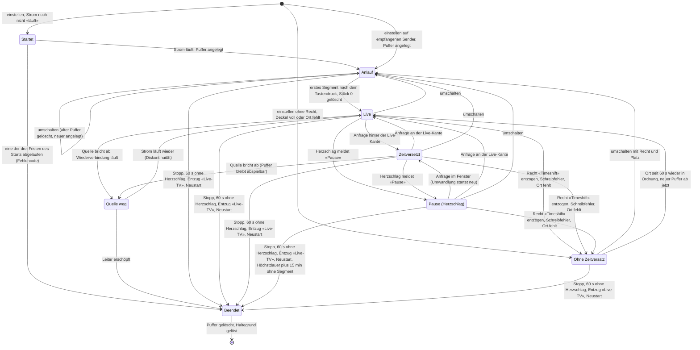

# Konzept 28 · Persönliches Timeshift

Stand: 29. November 2026 · Fassung 3 · Status: Entwurf nach Gesamtreview, nicht freigegeben

Dieses Dokument legt fest, wie der persönliche Zeitversatz (Timeshift) eines Zuschauers gebaut wird: was
der Sitzungspuffer ist, wie er entsteht, wächst, gekürzt und gelöscht wird, wie er mit der Umwandlung und
mit Aufnahmen zusammenspielt, wie viel Platz er braucht und wo er liegt. Es baut auf den tragenden
Entscheiden aus `04-architektur.md` (T-1 bis T-29, Fassung 4) und `05-streaming-und-fast-zapping.md`
(Fassung 4) auf und weicht von keinem ab; wo `12-sicherheit.md` (Fassung 3) strenger ist, gilt `12`. **Alle Zahlen stammen aus `04` Abschnitt 14 «Massgebliche Werte»**;
nennt dieses Dokument eine Zahl, steht dort derselbe Wert. Wo dort eine Frage an dich offen ist, steht hier nur
der Verweis («`04` F-7»), keine neue Frage. **Solange du eine Frage nicht beantwortet hast, gilt die
wortlauttreue Vorgabe**, bei Sicherheitsfragen die sichere; eine Empfehlung gilt erst mit deiner Antwort.
«Konzept freigegeben» und «Baufreigabe einer Stufe» sind zwei verschiedene Schritte.

Alles hier ist **spezifiziert**, nichts ist gebaut. «Gebaut» mit Datei und Zeile bezieht sich auf den
Stand des Arbeitsbaums (Server 1.44.1). Kennungen dieses Dokuments: `F-n` Fragen an dich, `O-n` offene
technische Punkte, `M-n` Messpunkte; sie zählen eigen. Kennungen anderer Dateien tragen die Dateinummer
(«`05` M-14»). Timeshift gehört zu **Stufe 4** (`18-umsetzungsplan.md`); Baufreigabe nach V-7 (`05` M-14, M-1
dieses Dokuments).

## 1. Begriffe

| Begriff | Bedeutung |
|---|---|
| **Ring** (technischer Startpuffer) | Der Speicher des Verteilers eines Senders (T-6, T-7): die letzten 15 Sekunden des Senders als TS-Pakete, bei Sendern mit langen Segmenten das Vierfache der Segmentdauer, nie mehr als 30 Sekunden (T-7, `04` 14.3), für alle Abnehmer gemeinsam. Er gehört **keinem** Zuschauer. Sein einziger Zweck ist der schnelle Start. |
| **Anlauf** | Der Anfang jeder Wiedergabe: die letzte vollständige Bildgruppe aus dem Ring und der Anfang der laufenden, also Bilder von bis zu zwei Bildgruppen **vor** dem Tastendruck (`05` Abschnitt 3.7). Ohne Anlauf gäbe es kein sofortiges Bild, weil ein Decoder mit einem Keyframe beginnen muss. |
| **Sitzungspuffer** (persönlicher Timeshift-Puffer) | Eine eigene Kopie des Quell-TS **einer** Live-Sitzung ab dem Einstellen, als Stückdateien auf dem Speicherort «Timeshift» (T-10). Nur mit wirksamem Recht «Timeshift». |
| **Stück** | Eine Datei des Sitzungspuffers mit rund 60 Sekunden Quell-TS, an einem Keyframe begonnen (Abschnitt 3). Kleinste Einheit, die gelöscht wird. |
| **Verzeichnis** | Die Liste der Keyframes und Segmente des Sitzungspuffers mit Stück, Byte-Position, Zeit und Uhrzeit. Liegt nur im Arbeitsspeicher (T-22). |
| **Fenster** | Der Bereich, den eine Sitzung abrufen kann: von der Rückspulgrenze bis zum neuesten vollständigen Segment (`05` Abschnitt 4.4). |
| **Rückspulgrenze** | Die untere Grenze des Fensters. Vorgabe: der Zeitpunkt des Einschaltens (`04` F-7). |
| **Live-Kante** | Das neueste **vollständige** Segment. In das noch wachsende Segment springt niemand. |
| **Höchstdauer** | Die längste Zeitspanne, die ein Sitzungspuffer hält; stellt der Administrator ein (LTV-007.10). |
| **Deckel** | Die Obergrenze in Byte für alle Sitzungspuffer zusammen auf dem Speicherort «Timeshift» (`04` Abschnitt 10.10). |

### 1.1 Warum das kein Archiv ist, und wie der Aufbau das erzwingt

Ein Archiv wäre ein Vorrat, aus dem jemand Sendungen holt, die vor seinem Einschalten liefen (LTV-013,
Auftrag 16 «Serverweite TV-Archive», «Gemeinsame Timeshift-Puffer»). Der Entwurf verhindert das nicht nur
durch eine Regel, sondern durch den Aufbau:

| Mittel | Wirkung | Herkunft |
|---|---|---|
| Der Ring hält 15 Sekunden, bei langen Segmenten bis 30 Sekunden; 30 Sekunden sind eine Konstante im Code, und die Länge ist keine Einstellung. | Keine Einstellung macht den Ring zum Archiv. Die Grenze gegen ein Archiv ist das **Fenster der Sitzung**, nicht die Länge des Rings. | T-7, `05` Abschnitte 3.6, 3.7 |
| Die Schnittstelle des Verteilers kennt für einen neuen Leser genau einen Einstieg: «ab der letzten vollständigen Bildgruppe». Es gibt kein «lies ab Uhrzeit». Leser gehen nur vorwärts. | Kein Codepfad kann ältere Daten aus dem Ring holen. | T-7, `05` Abschnitt 3.7 |
| Ein Sitzungspuffer wird **nur** vom eigenen Leser am Ring gefüllt, nie aus einem anderen Sitzungspuffer, nie aus einer Aufnahme. | Zwei Zuschauer desselben Senders teilen nie den Zeitversatz. | T-10, `05` Abschnitt 3.7 |
| Der Anlauf liegt in einem eigenen **Stück 0**, das gelöscht wird, sobald das Fenster beim Tastendruck beginnt (Abschnitt 4). | Nach spätestens einer Ringlänge (15, bei langen Segmenten bis 30 Sekunden) liegt auf dem Datenträger nichts mehr, was vor dem Einschalten gesendet wurde. | dieses Dokument, Empfehlung zu `04` F-7 (a) |
| Der Server liefert einer Sitzung nur Segmente aus **ihrem** Fenster, geprüft über das Token `lt` mit Sitzung und Einstell-Nummer. Alles andere ist 404. | Auch eine erfundene Segmentnummer oder ein fremdes Token holt nichts. | T-21, `05` Abschnitt 4.4 |
| Beim Umschalten, beim Sitzungsende und beim Serverstart wird der Sitzungspuffer gelöscht. | Was ein Zuschauer gepuffert hat, überlebt seine Sitzung auf diesem Sender nicht. | T-10, LTV-007.08, .09 |
| Ohne Recht «Timeshift» gibt es keinen Sitzungspuffer, nur die drei neuesten Segmente aus dem Ring. | Kein Zurückspulen ohne Recht, im Server durchgesetzt. | T-10, RA-08 |
| Eine Sitzung, die keine Segmente mehr holt, endet: ohne Sitzungspuffer nach 15 Minuten (nach gemeldeter Pause schon nach 60 Sekunden), mit Sitzungspuffer nach der Höchstdauer plus 15 Minuten. | Auch ein vergessener Tab hält keinen Puffer und keinen Eingang ohne Ende. | `04` 10.3, RT-11 |

Prüfungen dazu stehen in `05` Abschnitt 3.7 (letzte Zeile) und kommen nach `17-test-und-abnahme.md`.

## 2. Lebenszyklus des Sitzungspuffers

Grundlage: Die Live-Sitzung (T-9) gehört Anmeldung, Profil und Gerät; «Einstellen» ist ein Vorgang in der
Sitzung mit laufender Nummer. Ein Sitzungspuffer gehört genau **einem Einstellen**.

| Ereignis | Was geschieht | Anforderung |
|---|---|---|
| **Einstellen** mit wirksamem Recht «Timeshift» | Die Zulassung (T-19) prüft Platz unter dem Deckel und über der Mindestreserve. Der Dienst legt den Ordner `<timeshift>/<sitzung>-<einstellnummer>/` an (nur Kennungen, Rechte 0700) und meldet einen Leser am Ring an. Das Stück 0 bekommt den Anlauf, ab dem ersten Keyframe nach dem Tastendruck beginnt Stück 1. | LTV-007.02, .03 |
| **Einstellen ohne Recht** | Kein Ordner, keine Datei. Die Sitzung liest Segmente direkt aus dem Ring (T-10). | DR-22, RA-08 |
| **Wiedergabe live** | Der Schreiber hängt Pakete an das laufende Stück, der Player holt Segmente an der Live-Kante. | – |
| **Pause** | Im Player. Der Herzschlag (alle 10 Sekunden) meldet «Pause» und die Abspielstelle (T-21, `04` 10.3); fehlt die Angabe, gilt «spielt». Der Schreiber läuft weiter, weil er am Verteiler hängt, nicht am Player. Der Eingangsstrom läuft unverändert weiter; ein pausierter Zuschauer hält den Haltegrund «Zuschauer» (`04` Abschnitt 5.2). Die Angabe dient **nur der Anzeige**: Die Schauzeit zählt jedes ausgelieferte Segment, gleich was der Client meldet; weil ein pausierter Player nichts holt, zählt die Pause von selbst nicht, Vorrat, den er in der Pause holt, zählt (`03` DR-12, `04` 10.3, `12` 10.3, RT-04). Holt die Sitzung keine Segmente mehr, endet sie nach der Höchstdauer des Zeitversatzes plus 15 Minuten (`04` 10.3, RT-11). Geht die Handy- oder TV-App in den Hintergrund, endet die Sitzung nach 30 Sekunden, nicht sofort (`04` 10.3). | LTV-007.04, .14 |
| **Zurück** | Der Player springt im Fenster nach hinten. Im Direktweg ist das ein gewöhnlicher Sprung in der Liste; mit Umwandlung startet FFmpeg an der Pufferposition neu (Abschnitt 6). | LTV-007.05 |
| **Vor** | Der Player springt nach vorn, höchstens bis zur Live-Kante; die Liste enthält nichts dahinter. | LTV-007.06 |
| **Live** | Der Player springt an die Live-Kante (bei hls.js über den Startpunkt, den der Server nennt, `05` Abschnitt 5.3). | LTV-007.07 |
| **Ende des Fensters** (Höchstdauer erreicht) | Das älteste Stück wird gelöscht (Abschnitt 3.3). | LTV-007.10 |
| **Umschalten** | Der alte Sitzungspuffer wird **sofort** gelöscht (Leser abmelden, Stücke Datei für Datei löschen, Ordner löschen), dann beginnt für den neuen Sender ein neuer. Der alte Eingangsstrom endet ohne Karenz, wenn ihn niemand sonst hält (T-17). | LTV-007.08 |
| **Ende der Sitzung** (Stopp, Abmelden, 60 Sekunden ohne Herzschlag, Entzug, Laufzeit des Tokens von 12 Stunden ohne Erneuerung) | Sitzungspuffer **sofort** gelöscht wie beim Umschalten. Die Karenz von 30 Sekunden nach einem Sitzungsende durch den Zuschauer (T-17, `04` 14.1) betrifft nur den Eingangsstrom, nie den Sitzungspuffer; ein Wiedereinstieg in der Karenz beginnt einen neuen Puffer. Nach einem Entzug gibt es keine Karenz. | LTV-007.09, T-21 |
| **Sender wird deaktiviert** | nichts endet von selbst (T-29): Die Sitzung schaut weiter, ihr Puffer bleibt, bis der Zuschauer umschaltet oder geht, **spätestens bis das Token abläuft** (12 Stunden; für einen deaktivierten Sender wird es nicht erneuert). Zurück auf diesen Sender umschalten geht nicht (404). Der Befehl «sofort beenden» des Administrators beendet die Sitzung sofort; dann wird der Puffer gelöscht. | T-29 |
| **Quelle des Senders entfernt oder geändert** (Adresse, Zugangsdaten, Ursprünge, feste Ziele, Ziel entzogen) | Die Empfänger der Quelle enden innert 5 Sekunden; es gibt keine Ersatzquelle derselben Quelle mehr. Hat der Sender eine Ersatzquelle aus einer anderen Quelle, wechselt der Eingangsstrom dorthin (neuer Zeitabschnitt, der Puffer bleibt mit einer Diskontinuität); sonst endet der Strom, und die Sitzung bekommt «Quelle weg». | T-29, `04` 5.3 |
| **Speicherort «Timeshift» fällt aus** | Abschnitt 10.3. | `04` Abschnitt 9 |
| **Entzug nur von «Timeshift»** | Sitzungspuffer gelöscht; die Sitzung läuft ohne Zeitversatz aus dem Ring weiter; eine zeitversetzte Wiedergabe springt an die Live-Kante. | `04` Abschnitt 9, `03` Abschnitt 2.4 |
| **Serverstart nach Absturz** | Der Speicherort «Timeshift» wird geleert: nur unter dem eigenen Marker, nur Dateien und Ordner, deren Name dem eigenen Muster entspricht (`04` Abschnitt 5.3 Schritt 1, Abschnitt 10.10). Sitzungen überleben keinen Neustart. | LTV-019.19 |
| **Verwaiste Ordner im Betrieb** | Der Aufräumer im Dienst `live` (Minutentakt, kein Job) löscht Ordner, zu denen seit 60 Sekunden keine aktive Sitzung gehört (`04` Abschnitt 9). Er kennt die Namen aus dem eigenen Verzeichnis und aus dem Namensmuster. | LTV-019.19 |

**Löschen** geschieht immer Datei für Datei über `paths.Remove` und danach `paths.RemoveEmptyDir`, nie
rekursiv und nie über einen Symlink (gebaut: `server/internal/paths/remove.go:9-13`, Regel in `04`
Abschnitt 10.10). Das Löschen eines ganzen Puffers läuft in einer eigenen Go-Routine, damit Umschalten nicht
auf den Datenträger wartet; der neue Puffer entsteht in einem neuen Ordner und stört das nicht.

**Absturz mitten im Schreiben:** Der Sitzungspuffer braucht keine Wiederherstellung, weil er beim Start
ohnehin gelöscht wird. Deshalb gibt es für ihn weder `fdatasync` noch ein Verzeichnis auf dem Datenträger
(anders als bei Aufnahmen, `11-dvr.md` Abschnitt 5).

## 3. Speicherform (T-10)

### 3.1 Stücke

Ein Stück ist eine Datei mit rund **60 Sekunden** Quell-TS (`04` 14.5, Annahme; Vorbild TVHeadend mit
60-s-Dateien je Puffer, belegt am Quelltext, `anhang/nachpruefung-quellen.md` Nr. 44). Ein Stück endet am
ersten Keyframe nach 60 Sekunden und
das nächste beginnt mit PAT, PMT und diesem Keyframe. Ein Stück endet ausserdem an jeder Grenze eines
Zeitabschnitts (T-6) und nach einer Lücke des Schreibers.

| Grösse | Wert | Einordnung |
|---|---|---|
| Dauer eines Stücks | rund 60 s, endet am ersten Keyframe danach | `04` 14.5, Annahme, M-1 |
| Stück 0 | nur der Anlauf (bis zu zwei Bildgruppen; abrufbar höchstens eine Ringlänge, also 15, bei langen Segmenten bis 30 Sekunden) | `04` 14.3, `05` 3.7 (passt zu `04` F-7 (a)) |
| Dateien je Stunde und Sitzung | rund 60 | Rechnung |
| Name | `<nummer>.ts` (sechsstellig), im Ordner `<sitzung>-<einstellnummer>` | spezifiziert, T-25 |
| Rechte | Ordner 0700, Dateien 0600 | `04` 14.6, T-25 |
| Schreiben | gepuffert, Blöcke von 1 MiB; kein `fdatasync` | `04` 14.5, Annahme |
| Rückstau des Schreibers | bis 16 MiB im Arbeitsspeicher, gezählt bei Gebrauch gegen das Byte-Budget | `04` 14.3, T-8, Annahme (M-14) |

Warum nicht eine Datei je Segment (meist 2 bis 10 Sekunden): Bei einer Stunde wären das bis 1'800 Dateien je
Sitzung und ebenso viele Löschvorgänge; das ist auf einer HDD und einem Netzspeicher spürbar (Annahme, M-1).
Warum nicht eine einzige Ringdatei: Überschreiben im Kreis braucht ein Verzeichnis, das sich selbst
überholt, und macht «das Älteste fällt weg» schwer prüfbar (R5 Abschnitt 1.2 (b)).

### 3.2 Verzeichnis

Das Verzeichnis liegt nur im Arbeitsspeicher der Sitzung (T-22) und kennt je Eintrag:

| Feld | Inhalt |
|---|---|
| Stück | Nummer des Stücks |
| Byte-Position | Anfang im Stück |
| Zeit | entfaltete 64-Bit-Zeit der Quelle (`05` Abschnitt 3.4) |
| Uhrzeit | Ankunft am Server, für `EXT-X-PROGRAM-DATE-TIME` |
| Art | Keyframe (offen oder geschlossen), Diskontinuität, Grenze eines Zeitabschnitts |
| Segment | Nummer und Länge, sobald das Segment vollständig ist |

Ein Segment im Direktweg ist ein **Byte-Bereich in einem Stück**: Es beginnt an einem Keyframe, fasst
Bildgruppen zusammen, bis es mindestens 2 Sekunden lang ist; eine Obergrenze gibt es nicht, weil eine Bildgruppe nie
geteilt wird (`05` Abschnitt 4.4), und
reicht nie über die Grenze eines Stücks. Der Server setzt beim Ausliefern PAT und PMT davor, wie bei jedem
Segment (`05` Abschnitt 4.4).

### 3.3 Höchstdauer und das Ende des Fensters

| Punkt | Festlegung |
|---|---|
| Einstellung | Höchstdauer je Zuschauer, global für alle, vom Administrator (LTV-007.10, LTV-019.12). |
| Vorgabe | **60 Minuten** ab Werk, wählbar 15, 30, 60, 120 oder 240 Minuten (`04` 14.6, `03` DR-07). |
| Regel | Das Fenster ist nie länger als die Höchstdauer. Sobald das älteste Stück vollständig älter ist als «Live-Kante minus Höchstdauer», wird es gelöscht. Das Fenster schwankt also zwischen Höchstdauer minus einem Stück und der Höchstdauer. |
| Liste | Das erste Segment der Liste rückt nach, `EXT-X-MEDIA-SEQUENCE` steigt um die Zahl der weggefallenen Segmente. |
| Zuschauer an der gelöschten Stelle | Wer pausiert oder zurückgespult hat und dessen Stelle wegfällt, wird an den **neuen Anfang des Fensters** geführt, nicht an die Live-Kante. Der Player bekommt für das gelöschte Segment 404 und setzt am ersten Segment der Liste fort; der Herzschlag meldet «Älteste Minute weggefallen», die Oberfläche zeigt den Hinweis (`04` Abschnitt 7.5). |
| Lange Pause | Eine Pause länger als die Höchstdauer endet am Fensteranfang, mit dem Hinweis. Holt die Sitzung länger als die Höchstdauer plus 15 Minuten kein Segment, endet sie (`04` 10.3, RT-11); der Puffer wird gelöscht. |
| Änderung der Höchstdauer | gilt sofort für alle laufenden Puffer: kürzer heisst, die überzähligen Stücke fallen beim nächsten Durchgang weg; länger heisst, die Puffer wachsen ab jetzt weiter (nichts kommt zurück). |

Massgeblich sind 60 Minuten und der Deckel aus `04` 14.6; `15` LA-15 (2 Stunden, 64 GB) ist nach `04` 15.1
anzupassen (O-1 erledigt).

## 4. Rückspulgrenze

**Vorgabe (wortlauttreu, `04` F-7 (a)):** Ein Zuschauer kann nie vor den Zeitpunkt seines Einschaltens
zurückspulen (LTV-007.11). Der Anlauf wird einmal gezeigt und ist danach nicht mehr abrufbar.

Umsetzung im Sitzungspuffer:

1. Beim Einstellen schreibt der Schreiber den Anlauf in **Stück 0** und beginnt mit dem ersten Keyframe nach
   dem Tastendruck Stück 1. Fällt der Tastendruck mitten in eine lange Bildgruppe, beginnt Stück 1 am
   nächsten Keyframe; bis dahin wächst Stück 0 (höchstens eine Ringlänge nach T-7).
2. Die Liste enthält die Segmente des Stücks 0 nur, bis das erste Segment des Stücks 1 vollständig ist,
   höchstens eine Ringlänge: 15, bei langen Segmenten bis 30 Sekunden (`05` Abschnitt 3.7).
3. Danach beginnt das Fenster am ersten Segment von Stück 1. Die Segmente von Stück 0 beantwortet der Server
   mit 404, und Stück 0 wird gelöscht.
4. Die Zeitleiste der Oberfläche beginnt beim Tastendruck.

Was der Server nicht verhindern kann: In den ersten Sekunden hat der Player den Anlauf in seinem eigenen
Speicher (`04` F-7). Entscheidest du `04` F-7 (b), bleibt Stück 0 Teil des Fensters und wird wie jedes
andere Stück erst am Ende des Fensters gelöscht; sonst ändert sich nichts.

Ein Qualitäts- oder Spurwechsel ändert die Rückspulgrenze nicht. Ein Umschalten setzt sie neu, weil der
Puffer neu beginnt.

## 5. Ohne Recht «Timeshift»

Festgelegt in T-10 und `05` Abschnitt 4.4; hier nur, was das für den Zuschauer heisst:

| Punkt | Festlegung |
|---|---|
| Fenster | die drei neuesten Segmente direkt aus dem Ring, soweit sie dort noch liegen, in den ersten Sekunden dazu der Anlauf. Der Ring ist dafür bemessen (T-7): bis zu Segmenten von 7.5 Sekunden ganz, darüber nicht mehr voll. **Bei Sendern mit Segmenten über 10 Sekunden** fasst er keine drei Segmente; dort läuft eine Sitzung ohne Sitzungspuffer **nur über eine Umwandlung** (T-10, `05` 3.6), und ohne wirksame Sperre (Abschnitt 6) ist ein solcher Sender ohne Recht «Timeshift» nicht abspielbar. |
| Pause | Meldet eine Sitzung ohne Sitzungspuffer «Pause», endet sie nach 60 Sekunden wie beim Gehen des Zuschauers; es gibt nichts zu puffern (`04` 10.3). |
| Ältere Segmente | 404 |
| Datei | keine |
| Oberfläche | kein Knopf für Pause, Zurück, Live (DR-22) |
| Player hält trotzdem an (Hintergrund, Kopfhörer abgezogen) | Bei der Fortsetzung sind die alten Segmente weg; der Player springt an die Live-Kante (`04` Abschnitt 7.5). |
| Recht kommt während der Sitzung dazu | gilt ab dem nächsten Einstellen; ein Puffer rückwirkend entsteht nicht (es gäbe keine Daten dafür). |

## 6. Zusammenspiel mit der Umwandlung

Der Sitzungspuffer liegt **vor** der Umwandlung (T-10). Die Umwandlung je Sitzung ist ein FFmpeg, TS über
Pipes hinein und heraus (T-13); Entscheid nach T-14. Für Timeshift gilt:

| Lage | Verhalten | Herkunft |
|---|---|---|
| **Ohne wirksame Sperre von FFmpeg** | Jede Umwandlung ist ein Live-FFmpeg und startet nur mit hart gesetzter Sperre (Landlock und Filter für Systemaufrufe). Fehlt sie auf dem Host, gibt es **nur den Direktweg**: Spulen, Pause und Live gehen im Zeitversatz weiter, aber Sender, die eine Umwandlung brauchen, sind nicht abspielbar; die Verwaltung zeigt «Eindämmung nicht verfügbar» mit dieser Folge. Das ist die sichere Vorgabe bis zu deiner Antwort auf `12` F-1. | `04` T-27, 10.8; `12` F-1 (→ `20` E-28-04) |
| **Direktweg** (Original) | Segmente sind Byte-Bereiche der Stücke. Spulen, Pause, Live sind Sprünge des Players; kein Prozess. | T-12, `05` Abschnitt 4.5 |
| **Umwandlung, Spulen** | Eine Anfrage nach einem Segment, das nicht erzeugt ist und nicht kurz bevorsteht, beendet FFmpeg und startet es an dieser Rastergrenze neu, mit dem Sitzungspuffer ab dem Keyframe davor als Eingang. Höchstens zwei Neustarts je Sitzung in 10 Sekunden. Ob die Segmente verschiedener Läufe nahtlos passen, misst `05` M-9; sonst gilt der Rückfall «spiele ab Uhrzeit» mit `EXT-X-DISCONTINUITY` (`05` Abschnitt 4.5). | `04` Abschnitt 7.5, 8.5 |
| **Umwandlung, Qualitäts- oder Tonspurwechsel** | Neue Ausgabe-Generation an der aktuellen Stelle; der Sitzungspuffer bleibt. Weil der Puffer die Quelle hält, gilt die neue Qualität oder Tonspur auch für jede Stelle, an die der Zuschauer danach zurückspult. | `04` Abschnitt 7.5 |
| **Umwandlung, Pause** | Go gibt FFmpeg nur so viel Eingang, wie der Client abholt, plus drei Segmente Vorlauf; FFmpeg blockiert danach beim Lesen. **Nach 60 Sekunden ohne Segmentanfrage endet der Prozess**; die Reservierung im Budget bleibt bei der Sitzung. Bei «Weiter» startet FFmpeg an der Stelle des nächsten verlangten Segments neu. | `04` Abschnitt 7.5, T-13 |
| **Lange Sitzung, Überlauf der Quellzeit** | Kein FFmpeg-Lauf dauert länger als 24 Stunden und keiner geht über einen Überlauf der 33-Bit-Zeit (alle 26.5 Stunden): Go startet einen neuen Prozess ab einem Keyframe der Quelle, mit Überlappung, als neue Ausgabe-Generation mit Diskontinuität; die Reservierung bleibt. Den Wechsel des Tokens nach 11 Stunden legt der Server mit diesem Neustart zusammen (`04` 10.3). Der Sitzungspuffer ist davon nicht berührt. | `04` 7.5, 14.7 |
| **Ausgabestücke der Umwandlung** | mit Zeitversatz neben dem Sitzungspuffer, höchstens 5 Minuten; sie zählen zum Deckel (Abschnitt 9) und werden mit dem Sitzungspuffer gelöscht. | `04` Abschnitt 4.1 Ebene 6 |
| **Umwandlung langsamer als Echtzeit** | Der Zuschauer fällt hinter die Live-Kante zurück; nichts geht verloren, solange die Höchstdauer reicht. Nach 30 Sekunden meldet die Sitzung «zu langsam». | `04` Abschnitt 8.3 |
| **Neuer Zeitabschnitt im Puffer** (Codec, Spuren, Bildgrösse) | Neues Stück; der Entscheid (Direktweg oder Umwandlung) gilt je Zeitabschnitt. Beim Spulen über die Grenze wird er neu berechnet. | T-6, `05` Abschnitt 3.4 |

Die Zeit für einen Neustart an einer Pufferposition ist nicht gemessen (M-2).

## 7. Zusammenspiel mit Aufnahmen

Grundsatz aus T-16: Die Aufnahme zweigt am Verteiler ab, mit eigenem Leser, **unabhängig von jeder
Sitzung**; Aufnahme über die Sitzung eines Zuschauers ist verworfen (`04` Abschnitt 11). Sitzungspuffer und
Aufnahme sind deshalb zwei getrennte Abnehmer am selben Ring.

Die Sofortaufnahme im Player wirft eine Frage auf: Wer zeitversetzt schaut und «Aufnehmen» drückt, sieht eine
Stelle, die schon vorbei ist.

| Variante | Beginn der Aufnahme | Folge |
|---|---|---|
| **(a) ab jetzt** | an der Live-Kante, also beim Tastendruck nach Uhrzeit | Hält T-16 ein: die Aufnahme kommt nur vom Verteiler. Wer 20 Minuten zurückliegt, hat in der Aufnahme 20 Minuten weniger als gedacht. Die Oberfläche sagt das im Knopf: «Ab jetzt aufnehmen (live)». |
| **(b) ab der eigenen Stelle** | an der Stelle des Zuschauers im eigenen Sitzungspuffer | Die Aufnahme kopiert beim Start einmal den Teil des Sitzungspuffers ab dieser Stelle und hängt dann am Verteiler an. Bequemer, aber eine Aufnahme aus einem Sitzungspuffer: ein zweiter Füllweg, eine Abweichung von T-16, und der Puffer ist nicht mehr nur flüchtig. |
| **(c) mit dem ganzen Puffer** | an der Rückspulgrenze | wie (b), dazu die ganze gepufferte Zeit. |

Rechtlich und fachlich bleiben (b) und (c) innerhalb des eigenen Puffers (nichts vor dem Einschalten,
LTV-007.11). Technisch brechen sie T-16 und brauchen eine Kopie von bis zu der Höchstdauer beim Tastendruck
(bei 8 Mbit/s und 60 Minuten 3.6 GB), während der Puffer weiter beschrieben und gekürzt wird.

Frage F-1. **Vorgabe bis zu deiner Antwort: (a).** Der Auftrag sagt nichts zum Beginn einer Sofortaufnahme bei
Zeitversatz; (a) ist die Variante, die T-16 und Auftrag 8.1 (keine Aufnahme über eine Zuschauersitzung) wörtlich
einhält. Empfehlung ebenfalls (a). Für die Aufnahme selbst gilt `11-dvr.md`
Abschnitt 1 (Sofortaufnahme).

Weitere Regeln:

- Eine laufende Aufnahme desselben Senders ändert am Sitzungspuffer nichts, und umgekehrt.
- Umschalten oder Sitzungsende beendet eine Sofortaufnahme **nicht** (LTV-008.25): Sie hat ihren eigenen
  Haltegrund «Aufnahme» (`04` Abschnitt 5.2).
- Das Abspielen einer laufenden Aufnahme ist kein Timeshift und braucht keinen Sitzungspuffer: Die Aufnahme
  selbst ist die Quelle (`11-dvr.md` Abschnitt 6).

## 8. Speicherbedarf (Rechnung, Annahme)

Rechenweg: Bitrate in Mbit/s ÷ 8 = MB je Sekunde; × 3'600 = MB je Stunde. Dezimale Einheiten; der
TS-Überbau ist in der Bitrate der Quelle enthalten (Annahme, R5 Abschnitt 1.3). Alle Zuschauer haben das Recht
«Timeshift», ihre Puffer sind voll, die Speicherform ist die eigene Kopie je Sitzung (Vorgabe nach `04` F-8).
Ob sie denselben oder verschiedene Sender schauen, ändert an dieser Form nichts.

**Platz bei vollen Puffern:**

| Bitrate | je Zuschauer und Stunde | Höchstdauer | 1 Zuschauer | 5 Zuschauer | 20 Zuschauer |
|---|---|---|---|---|---|
| 4 Mbit/s (SD, gutes HD) | 1.8 GB | 30 min | 0.9 GB | 4.5 GB | 18 GB |
| 4 Mbit/s | 1.8 GB | 2 h | 3.6 GB | 18 GB | 72 GB |
| 8 Mbit/s (HD) | 3.6 GB | 30 min | 1.8 GB | 9 GB | 36 GB |
| 8 Mbit/s | 3.6 GB | 2 h | 7.2 GB | 36 GB | 144 GB |
| 16 Mbit/s (HD hoch, UHD tief) | 7.2 GB | 30 min | 3.6 GB | 18 GB | 72 GB |
| 16 Mbit/s | 7.2 GB | 2 h | 14.4 GB | 72 GB | 288 GB |

**Schreiblast** (unabhängig von der Höchstdauer, solange die Sitzungen laufen):

| Bitrate | 1 Zuschauer | 5 Zuschauer | 20 Zuschauer |
|---|---|---|---|
| 4 Mbit/s | 0.5 MB/s | 2.5 MB/s | 10 MB/s |
| 8 Mbit/s | 1 MB/s | 5 MB/s | 20 MB/s |
| 16 Mbit/s | 2 MB/s | 10 MB/s | 40 MB/s |

**Zuschläge:** je Sitzung mit Umwandlung die Ausgabestücke (höchstens 5 Minuten; bei 5 Mbit/s Ausgabe rund
190 MB). Ein Stück über der Höchstdauer kommt nicht dazu, weil die Regel in 3.3 vorher löscht. Der Rückstau von
16 MiB je Sitzung liegt im Arbeitsspeicher, nicht auf dem Datenträger.

Folgerungen: Für einen Haushalt mit bis zu fünf Zuschauern, HD und 60 Minuten reichen rund 18 GB. 20
Zuschauer mit 2 Stunden HD brauchen 144 GB und 20 MB/s Schreiblast; das ist die Rechnung hinter `04` F-8 und
der Grund für den Deckel. Die wirklichen Bitraten deiner Sender misst `05` M-2, die Schreiblast `05` M-14.

## 9. Grenzen

| Ebene | Grenze | Einordnung |
|---|---|---|
| **je Sitzung** | Höchstdauer (Abschnitt 3.3); ein Sitzungspuffer je Sitzung, weil eine Sitzung nur einen Sender zugleich hat | spezifiziert |
| **je Konto** | keine eigene Timeshift-Grenze. Begrenzt wird über die bestehende Grenze gleichzeitiger Ströme des Kontos und Profils (T-26, DR-12): Jede Live-Wiedergabe ist ein Strom, also höchstens so viele Sitzungspuffer. | Empfehlung |
| **global: Deckel** | Summe aller Sitzungspuffer und Ausgabestücke auf dem Speicherort «Timeshift». Ab Werk der kleinere Wert aus 20 % des beim Einrichten freien Platzes und 50 GB; einstellbar (LTV-019.10). | `04` 14.6, Annahme (M-14) |
| **global: Mindestreserve** | der grössere Wert aus 5 GB und 5 %; unter der Reserve entsteht kein neues Stück (LTV-019.13). | `04` 14.6, Vorgabe |
| **global: Live-Sitzungen** | Serverdeckel 20, einstellbar 1 bis 200 (`04` Abschnitt 8.5) | spezifiziert in `04` |
| **global: Sitzungen mit Zeitversatz** | nur falls du `04` F-8 (c) wählst | offen, `04` F-8 |

**Deckel erreicht** (Reihenfolge):

1. Slouchcat kürzt den **grössten** Sitzungspuffer um sein ältestes Stück, dann wieder den grössten, bis der
   Platz reicht (`03` DR-07). Kein Puffer wird dabei unter 5 Minuten gekürzt, und keiner ganz gelöscht
   (`04` 14.6, Annahme). Die betroffene Sitzung meldet über den Herzschlag die neue Rückspulgrenze; wer an der
   gekürzten Stelle stand, wird an den Fensteranfang geführt (wie 3.3).
2. Reicht das nicht, bekommt eine **neue** Sitzung keinen Sitzungspuffer und läuft ohne Zeitversatz aus dem
   Ring, mit dem Hinweis «Zeitversatz gerade nicht möglich» (`04` Abschnitt 8.3). Bestehende Sitzungen laufen
   weiter.
3. Live läuft in jedem Fall weiter.

## 10. Speicherort

Der Speicherort «Timeshift» ist ein Ordner, den der Administrator wählt (T-25, LTV-019.02); ab Werk
`<cache>/live/timeshift` auf dem Volume `/cache` (gebaut: `deploy/compose.yaml:35`).

### 10.1 Eignung

| Art | Eignung | Begründung (Annahme, wo nicht anders vermerkt) |
|---|---|---|
| **RAM-Disk** (tmpfs) | nur für kurze Fenster und wenige Zuschauer | Schnell und schont die SSD. Aber: tmpfs-Inhalt zählt im Container zum Speicher der cgroup (Annahme, R5 Abschnitt 8.3), ein voller Puffer kann so einen Speichermangel des ganzen Servers auslösen. Beispiel: 4 GB tmpfs bei 8 Mbit/s fassen rund 66 Minuten Puffer insgesamt, also zwei Zuschauer mit je 30 Minuten. Die Verwaltung rechnet das beim Wählen vor (`04` Abschnitt 10.6) und setzt den Deckel unter die Grösse der RAM-Disk. M-3. |
| **SSD, NVMe** | **empfohlen** | schnell; Schreiblast nach Abschnitt 8. 43 GB am Tag (drei Zuschauer, vier Stunden) verbraucht eine SSD mit 600 TBW in rund 38 Jahren (Rechnung aus RA-09). |
| **HDD** | geht | Mehrere gleichzeitige Schreiber kosten Kopfbewegungen; eine schlafende Platte braucht beim Anlaufen 5 bis 15 Sekunden (Annahme, RA-07), das fängt der Rückstau von 16 MiB nur bei tiefen Bitraten ab (8 Mbit/s: 16 Sekunden). `05` M-14. |
| **Netzspeicher** (SMB, NFS) | abgeraten, aber möglich | Ein Neuaufbau der Verbindung dauert 15 bis 60 Sekunden (Annahme, RA-07), länger als der Rückstau; dann entsteht eine Lücke. Die Verwaltung warnt bei der Wahl. |

### 10.2 Prüfungen

Beim Einrichten und vor jedem neuen Stück (`04` Abschnitt 10.10, LTV-019.22):

| Prüfung | Wann | Vorbild |
|---|---|---|
| Markerdatei mit zufälliger Kennung vorhanden und gleich | Einrichten, vor jedem Stück, jede Minute | neu |
| Dateisystemtyp wie beim Einrichten (`statfs`) | Einrichten, vor jedem Stück | gebaut für Podcast-Ordner: `server/internal/library/podcast_folder_check.go:100-117`, Typerkennung `server/internal/paths/fstype_linux.go:10-17` |
| Schreibprobe (eigene Datei anlegen, löschen) | Einrichten, jede Minute | gebaut für Podcast-Ordner: `podcast_folder_check.go:154-177` |
| freier Platz über der Mindestreserve | vor jedem Stück, jede Minute | neu |
| nicht der Medienordner (nur lesend, `deploy/compose.yaml:36`), nicht `/config` | Einrichten | `15` LA-16 |

Geschrieben wird nur relativ zur geöffneten Wurzel (`paths`, Regel 4). Fehlt der Marker oder ist der Typ
anders, gilt der Ort als «fehlt», und der Server schreibt **nirgends sonst** hin (T-25).

### 10.3 Voller oder fehlender Datenträger: was der Zuschauer sieht

| Lage | Verhalten | Zuschauer sieht |
|---|---|---|
| Reserve oder Deckel erreicht | Abschnitt 9 (kürzen, dann neue Sitzungen ohne Puffer) | gegebenenfalls kürzere Rückspulgrenze; neue Sitzung: «Zeitversatz gerade nicht möglich» |
| Schreibfehler (kein Platz, Ein-/Ausgabefehler) oder Marker fehlt, Dateisystem anders | Die betroffenen Sitzungspuffer enden; ihre Stücke werden nicht mehr ausgeliefert und gelöscht, soweit der Ort noch erreichbar ist. Die Sitzungen laufen ohne Zeitversatz aus dem Ring weiter (neue Ausgabe-Generation). Kein Ausweichen auf einen anderen Ordner. Der Ort bekommt den Zustand «voll» oder «fehlt»; der Administrator bekommt eine Meldung (`04` Abschnitt 9, 10.2). | Wer zeitversetzt schaute oder pausiert hatte, springt an die Live-Kante; Hinweis «Zeitversatz gerade nicht möglich» über den Herzschlag. Live läuft weiter. |
| Ort wieder in Ordnung | Ist der Ort **60 Sekunden lang** wieder in Ordnung, beginnt für **jede laufende Sitzung** mit Recht ein neuer Sitzungspuffer; ihre Rückspulgrenze ist dieser Zeitpunkt (`04` Abschnitt 9, 14.6). | Hinweis verschwindet; Pause und Zurück gehen wieder ab diesem Zeitpunkt |
| Datenträger stockt kurz | Der Rückstau von 16 MiB fängt es auf; reicht er nicht, entsteht im Puffer eine Diskontinuität mit neuem Stück. | kurzer Sprung beim Zurückspulen über diese Stelle |

Ein voller Datenträger bringt den Server nicht zum Absturz (LTV-019.20): Jeder Schreibfehler ist ein Zustand
des Speicherorts, kein Programmfehler (`04` Abschnitt 9).

## 11. Client-Sicht

Die Liste baut Go je Anfrage (`05` Abschnitt 4.4). Für Timeshift:

| Merkmal | Festlegung |
|---|---|
| Art der Liste | Live-Liste **ohne** `EXT-X-PLAYLIST-TYPE`. Mit `EVENT` dürfen Segmente nur am Ende angefügt werden; eine Liste mit gleitendem Fenster darf das Tag nicht tragen, und das Fenster gleitet am Ende der Höchstdauer (belegt, RFC 8216 Abschnitte 4.3.3.5 und 6.2.2; `anhang/nachpruefung-quellen.md` Nr. 3). |
| Fenster | von der Rückspulgrenze bis zur Live-Kante; `EXT-X-MEDIA-SEQUENCE` steigt, wenn Segmente wegfallen |
| Uhrzeit | `EXT-X-PROGRAM-DATE-TIME` am ersten Segment und nach jeder Diskontinuität |
| Startpunkt | `EXT-X-START` und Antwort auf «einstellen» (`05` Abschnitt 4.4, 5.3) |
| Länge | Delta-Listen (`CAN-SKIP-UNTIL`) ab Stufe 4 (`05` Abschnitt 4.4); lange Listen auf schwachen Fernsehern misst `05` M-19 |

Was die Player daraus machen, ist **Annahme**, bis die Messpunkte vorliegen:

| Player | Erwartetes Verhalten | Messpunkt |
|---|---|---|
| hls.js (Web) | Das Fenster der Liste ist der spulbare Bereich; Pause und Rücksprung im Fenster ohne Neuladen; der Startpunkt kommt ausdrücklich vom Server. Mit Zeitversatz bleibt `liveMaxLatencyDurationCount` auf dem Standard (unbegrenzt): hls.js springt ab Werk nie von selbst an die Live-Kante (belegt, Nachprüfung Nr. 10). Fällt das Segment unter der Abspielstelle heraus, setzt der **Client** selbst am Fensteranfang fort; wie hls.js dort reagiert, misst `05` M-3. Ohne Zeitversatz gilt `liveMaxLatencyDurationCount` 4 (`04` 14.10). | `05` M-3 |
| Safari, iPhone (nativ) | Zeigt bei einem ausreichend langen Live-Fenster eine Zeitleiste zum Spulen; die Startregel (drei Zieldauern vor dem Ende, belegt) betrifft nur den Start. Vorgesehen, aber ungeprüft, weil kein Gerät vorhanden ist (`20` E-28-12) (`04` 12.1). | `05` M-5 |
| Media3 (Handy, TV) | Live-Fenster mit Spulen, `EXT-X-PROGRAM-DATE-TIME` als Uhrzeit. Fällt die Stelle hinter das Fenster, meldet Media3 den Fehler `ERROR_CODE_BEHIND_LIVE_WINDOW` (belegt, Nachprüfung Nr. 18); die App fängt ihn ab und setzt am **Fensteranfang** fort, nicht an der Live-Kante (`05` 5.3). | `05` M-4, M-19 |

Die Matrix je Client führt `16-client-kompatibilitaet.md`.

## 12. Ablauf: Pause, Zurück, Live

```mermaid
sequenceDiagram
    autonumber
    participant C as Client (Player)
    participant S as live: Sitzung
    participant P as live/spool: Sitzungspuffer
    participant H as live/hub: Ring
    participant F as FFmpeg (nur bei Umwandlung)

    C->>S: einstellen (Sender X)
    S->>P: Ordner anlegen, Leser am Ring anmelden
    H-->>P: Anlauf (Stück 0), danach fortlaufend Stück 1, 2 …
    S-->>C: Liste, Startpunkt
    loop live
        C->>S: Segment n (Token lt)
        S->>P: Byte-Bereich lesen
        P-->>S: Segment
        S-->>C: Segment
    end
    Note over P: nach höchstens einer Ringlänge: Stück 0 gelöscht, Fenster beginnt beim Tastendruck
    C->>C: Pause (nur im Player)
    Note over H,P: Ring und Schreiber laufen weiter
    opt mit Umwandlung
        Note over S,F: Eingang gedrosselt; nach 60 s ohne Anfrage endet FFmpeg
    end
    C->>S: Segment k (weit zurück im Fenster)
    alt Direktweg
        S->>P: Byte-Bereich von Segment k
        S-->>C: Segment k
    else Umwandlung
        S->>F: beenden, neu starten ab Keyframe vor k
        P-->>F: Quell-TS ab dieser Stelle
        F-->>S: Ausgabe ab Segment k
        S-->>C: Segment k
    end
    C->>S: Liste neu laden
    S-->>C: Liste bis zur Live-Kante
    C->>S: Segment an der Live-Kante («Live»)
    S-->>C: Segment
    C->>S: einstellen (Sender Y)
    S->>P: Leser abmelden, Stücke Datei für Datei löschen
    S->>P: neuer Puffer für Y
```

## 13. Zustände der Sitzung

Die Zustände beschreiben eine Live-Sitzung mit Recht «Timeshift» aus Sicht des Servers. Was der Player
gerade tut (spielt, pausiert), sieht der Server nur an den Anfragen und am Herzschlag. Massgeblich für den
Eingangsstrom ist der Automat in `04` 5.1; die Zustände der Sitzung hier zeigt die API im Feld `state` (`08`).



«Pause» heisst: Der Herzschlag meldet «Pause» (T-21), der Player holt nichts. In diesem Zustand endet eine
Umwandlung nach 60 Sekunden ohne Segmentanfrage; der Sitzungspuffer wächst weiter. Ein Fensterende während der
Pause führt bei der nächsten Anfrage an den Fensteranfang (3.3). Der Befehl «sofort beenden» des Administrators
nach dem Deaktivieren eines Senders (T-29), das Entfernen oder Ändern der Quelle ohne Ersatzquelle und der
Ablauf des Tokens eines deaktivierten Senders führen aus jedem Zustand nach «Beendet»; das blosse Deaktivieren
nicht. «Startet» hat drei getrennte Fristen (bis zum ersten Byte, bis «läuft», bis zum ersten Segment) und eine
Gesamtfrist von 90 Sekunden (`04` 5.3); der Herzschlag nennt den Grund («verbindet», «wartet auf Keyframe»,
«wartet auf Umwandlung»).

Zuordnung zu den Zuständen der API (`08`, Feld `state`; RB-12):

| Zustand hier | `08` `state` |
|---|---|
| Startet | `starting` |
| Anlauf, Live | `live` |
| Zeitversetzt | `shifted` |
| Pause | `paused` |
| Quelle weg | `reconnecting` |
| Ohne Zeitversatz | `live` (ohne Fenster; die Antwort sagt, dass Zeitversatz gerade nicht möglich ist) |
| Beendet | keine Sitzung mehr (410 auf den Herzschlag) |

`recording_live` und `recording_done` gelten für die Wiedergabe von Aufnahmen (`11` 6.2).

## 14. Messpunkte, offene Punkte, Fragen

### 14.1 Messpunkte (zu messen)

| Nr. | Was | Womit | Vor |
|---|---|---|---|
| M-1 | Stückdauer: Zahl der Dateien, Zeit für Anlegen und Löschen eines Stücks auf SSD, HDD und Netzspeicher bei 5 und 20 Sitzungen; Sprung der Rückspulgrenze beim Löschen (60 s gegen 20 s) | CT 190, NAS | Bau der Stufe 4 |
| M-2 | Neustart der Umwandlung an einer Pufferposition (QSV auf CT 190) gegen den Suchsprung der Dateiwiedergabe aus Konzept 14 | CT 190 | Bau der Stufe 4 |
| M-3 | RAM-Disk im Container: Zählt tmpfs-Inhalt zur Speichergrenze des Containers, und was passiert bei vollem tmpfs (Fehler oder Speichermangel des Servers)? | CT 190 | Freigabe der RAM-Disk als Speicherort «Timeshift» |

Dazu gelten aus `05`: M-3, M-4, M-5 (Verhalten der Player im Fenster), M-9 (nahtloses Spulen mit Umwandlung),
M-14 (Schreiblast, Rückstau bei Netzspeicher und anlaufender Platte), M-19 (lange Listen).

### 14.2 Offene Punkte

| Nr. | Punkt | Gehört zu |
|---|---|---|
| O-1 | **erledigt durch `04` 14.6:** 60 Minuten, Deckel der kleinere Wert aus 20 % und 50 GB; `15` passt an (`04` 15.1). | – |
| O-2 | **erledigt durch `04` 14.6:** 5 Minuten (Annahme). | – |
| O-3 | Segment unter der Abspielstelle gelöscht: Media3 meldet «hinter dem Fenster», die App setzt am Fensteranfang fort (belegt, Nachprüfung Nr. 18); hls.js springt ab Werk nicht, der Client setzt selbst fort, das Verhalten misst `05` M-3. Offen bleibt nur die Messung. | `05` M-3, `16` |

### 14.3 Fragen an dich

Die Rückspulgrenze (`04` F-7) und die Speicherform (`04` F-8) sind dort gefragt und hier nicht wiederholt.

**F-1 · Sofortaufnahme während zeitversetzter Wiedergabe: ab wann?** → `20` E-28-37
Wer 20 Minuten zurückliegt und «Aufnehmen» drückt, sieht eine Stelle, die schon vorbei ist.

- **(a) Ab jetzt (live).** Die Aufnahme beginnt beim Tastendruck an der Live-Kante. Der Knopf sagt «Ab jetzt
  aufnehmen (live)». Hält T-16 ein (Aufnahme nur vom Verteiler).
- **(b) Ab der eigenen Stelle.** Slouchcat kopiert beim Start den eigenen Puffer ab der Abspielstelle in die
  Aufnahme und nimmt dann live weiter auf. Bequemer; aber ein zweiter Weg, eine Aufnahme zu füllen, und eine
  Abweichung von T-16.
- **(c) Mit dem ganzen Puffer** ab dem Einschalten. Wie (b), noch mehr Kopie.

Vorgabe bis zu deiner Antwort: **(a)** (hält T-16 ein). Empfehlung: **(a)**. (b) und (c) bleiben im eigenen
Puffer, also nichts vor dem Einschalten; sie kosten aber eigenen Code für einen seltenen Fall.

## 15. Abdeckung

### 15.1 LTV-007

| ID | Anforderung (kurz) | Wo | Stand |
|---|---|---|---|
| LTV-007.01 | Timeshift je Zuschauer getrennt | 1, 2, 3 | spezifiziert (T-10) |
| LTV-007.02 | Puffer beginnt beim Einschalten | 2, 4 | spezifiziert |
| LTV-007.03 | eigener Puffer je Zuschauer | 1.1, 3, 8 | spezifiziert; Speicherform `04` F-8 |
| LTV-007.04 | Pause | 2, 6, 12 | spezifiziert |
| LTV-007.05 | Zurückspulen im Puffer | 2, 6, 12 | spezifiziert; nahtlos mit Umwandlung: `05` M-9 |
| LTV-007.06 | Vorspulen bis Live, nicht darüber | 2, 11 | spezifiziert |
| LTV-007.07 | Sprung zu Live | 2, 12 | spezifiziert |
| LTV-007.08 | Senderwechsel löscht Puffer | 2, 13 | spezifiziert |
| LTV-007.09 | Beenden räumt temporäre Dateien auf | 2, 13 | spezifiziert |
| LTV-007.10 | Höchstdauer einstellbar | 3.3, 9 | spezifiziert; Vorgabe O-1 |
| LTV-007.X-01 | kein gemeinsames Archiv | 1.1 | spezifiziert |
| LTV-007.11 | kein Zurückspulen vor das Einschalten | 1.1, 4 | spezifiziert; Lage der Grenze `04` F-7 |
| LTV-007.12 | Startpuffer getrennt | 1, 1.1 | spezifiziert in `05` Abschnitt 3.7 |
| LTV-007.13 | Startpuffer kein Archiv | 1.1 | spezifiziert in `05` Abschnitt 3.7 |
| LTV-007.14 | Timeshift verändert den Eingangsstrom nicht | 2, 6 | spezifiziert (T-8) |

### 15.2 LTV-019, Teile zum Timeshift

| ID | Wo | Stand |
|---|---|---|
| LTV-019.02 Speicherort Timeshift | 10 | spezifiziert (T-25) |
| LTV-019.04 bis .07, .09 Speicherarten | 10.1 | spezifiziert; RAM-Disk M-3 |
| LTV-019.10 globale Grenze | 9 | spezifiziert |
| LTV-019.12 Höchstdauer | 3.3 | spezifiziert |
| LTV-019.13 Mindestreserve | 9, 10.2 | spezifiziert |
| LTV-019.15 Bereinigung flüchtiger Puffer | 2 | spezifiziert |
| LTV-019.19 verwaiste temporäre Dateien | 2 | spezifiziert |
| LTV-019.20 voller Datenträger ohne Absturz | 10.3 | spezifiziert |
| LTV-019.22 Prüfungen | 10.2 | spezifiziert |

## 16. Änderungen gegenüber der vorigen Fassung

Fassung 1 → 2 (Konsolidierung 1, Grundlage `04` Fassung 3 Abschnitte 13.4, 14, 15 und
`anhang/nachpruefung-quellen.md`):

- Kopf und Einleitung: Bezug auf `04` T-1 bis T-29 Fassung 3 und `05` Fassung 3; alle Zahlen aus `04`
  Abschnitt 14; Stufe nach `18-umsetzungsplan.md` (Stufe 4, Baufreigabe V-7).
- Abschnitt 2: Herzschlag meldet «spielt» oder «Pause», Schauzeit zählt ausgelieferte Segmente (`04` T-21,
  13.4, Rückmeldung `06` O-11). Karenz nur für den Eingangsstrom nach Sitzungsende durch den Zuschauer, nie für
  den Sitzungspuffer, nie nach Entzug (`04` T-17). Neue Zeilen: Deaktivieren eines Senders beendet nichts
  (T-29); Ausfall des Speicherorts.
- Abschnitt 3: Stückdauer, Schreibblock, Rückstau mit Status aus `04` 14.3 und 14.5; TVHeadend-Vorbild belegt
  (Nachprüfung Nr. 44). Höchstdauer 60 Minuten mit den Werten 15 bis 240 aus `04` 14.6; Abschnitt über die
  Abweichung zu `15` ersetzt durch den Verweis auf `04` 15.1.
- Abschnitt 6: Zeile «kein FFmpeg-Lauf länger als 24 Stunden, keiner über einen Überlauf» (`04` 7.5).
- Abschnitt 9: Mindestreserve «der grössere Wert aus 5 GB und 5 %» statt «5 GB oder 5 %»; kleinste
  Kürzung 5 Minuten aus `04` 14.6.
- Abschnitt 10.3: Ausfall des Speicherorts nach `04` Abschnitt 9 (Rückmeldung `06` O-8): auch eine pausierte
  Wiedergabe springt an die Live-Kante; nach 60 Sekunden in Ordnung bekommt jede laufende Sitzung einen neuen
  Puffer (Fassung 1: erst beim nächsten Einstellen).
- Abschnitt 11: `EXT-X-PLAYLIST-TYPE` belegt (Nachprüfung Nr. 3); hls.js `liveMaxLatencyDurationCount`
  unbegrenzt mit Zeitversatz, 4 ohne, kein Sprung zur Live-Kante ab Werk (Nachprüfung Nr. 10, `04` 14.10);
  Media3 «hinter dem Fenster» belegt (Nr. 18); Apple-Geräte ungeprüft.
- Abschnitt 13: Zustand «Pause» aus dem Herzschlag statt aus fehlenden Anfragen; Rückweg «Ort wieder in
  Ordnung»; «sofort beenden» (T-29).
- Abschnitt 14.2: O-1 und O-2 erledigt durch `04` 14.6; O-3 teilweise belegt.
- Zahlenformat auf de-CH umgestellt (Dezimalpunkt).
- Restebereinigung nach Konsolidierung 1: Frage F-1 mit Verweis auf `20` E-28-37.

Fassung 2 → 3 (Schlussbereinigung nach den Reviews 4, 5 und 6; Grundlage `04` und `05` Fassung 4, besonders
`04` 13.5, 14 und 15.3, `12` Fassung 3, Entscheide des Koordinators nach Review 4):

- Kopf: Stand 29. November 2026; Bezug auf `04` und `05` Fassung 4 und `12` Fassung 3; Grundregel «ohne Antwort
  gilt die wortlauttreue Vorgabe, bei Sicherheit die sichere» (RG-01); «Konzept freigegeben» gegen «Baufreigabe»
  (RG-06).
- Begriffe und 1.1: Ring nach T-7 neu (15 Sekunden, bei langen Segmenten das Vierfache, höchstens 30, keine
  Einstellung); die Grenze gegen ein Archiv ist das Fenster der Sitzung (RB-01). Neue Zeile: Sitzung ohne
  Segmentabruf endet (RT-11).
- Abschnitt 2: «Pause» des Herzschlags nur Anzeige, Schauzeit nach ausgelieferten Segmenten (RT-04, `12` 10.3);
  Sitzungsende nach Höchstdauer plus 15 Minuten ohne Segmentabruf; App im Hintergrund endet nach 30 Sekunden
  (`04` 15.3, RB-11). T-29: deaktivierter Sender höchstens bis zum Ablauf des Tokens, kein Zurückschalten; Quelle
  entfernt oder geändert beendet ihre Empfänger innert 5 Sekunden (RB-05, RT-06).
- Abschnitt 3: Segmente ohne Obergrenze von 10 Sekunden (`05` 4.4, RB-13); Stück 0 abrufbar höchstens eine
  Ringlänge (15 bis 30 Sekunden).
- Abschnitt 3.3: lange Pause endet nach der Höchstdauer plus 15 Minuten ohne Segmentabruf (statt «endet nicht»).
- Abschnitt 4: Anlauf höchstens eine Ringlänge.
- Abschnitt 5: Fenster ohne Sitzungspuffer nach T-7 und T-10; Sender mit Segmenten über 10 Sekunden nur über eine
  Umwandlung; gemeldete Pause ohne Sitzungspuffer endet nach 60 Sekunden (`04` 10.3).
- Abschnitt 6: kein Live-FFmpeg ohne wirksame Sperre, sonst nur Direktweg (RT-01, `12` F-1); Neustart nach
  24 Stunden mit Überlappung und mit dem Tokenwechsel zusammengelegt (RB-18).
- Abschnitte 7 und 14.3: F-1 mit Vorgabe und Empfehlung getrennt.
- Abschnitt 13: Zustände «Startet» (drei Fristen des Starts, RB-02) und «Quelle weg»; Zuordnung zu `08` `state`
  (RB-12); Ende durch Quelle entfernt und Tokenablauf eines deaktivierten Senders.
- Letzte Angleichung: Safari und iPhone «vorgesehen, aber ungeprüft» (Abschnitt zu den Clients; `20` E-28-12).
