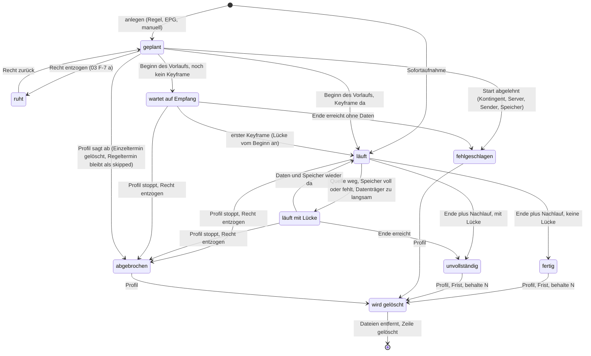
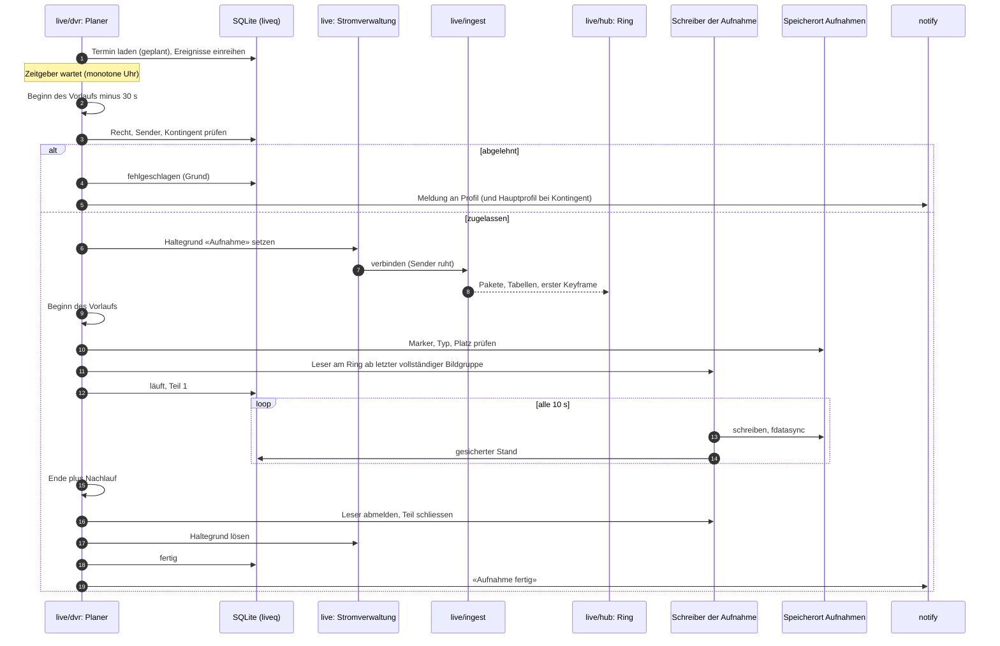
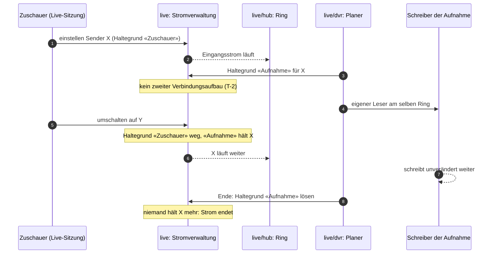
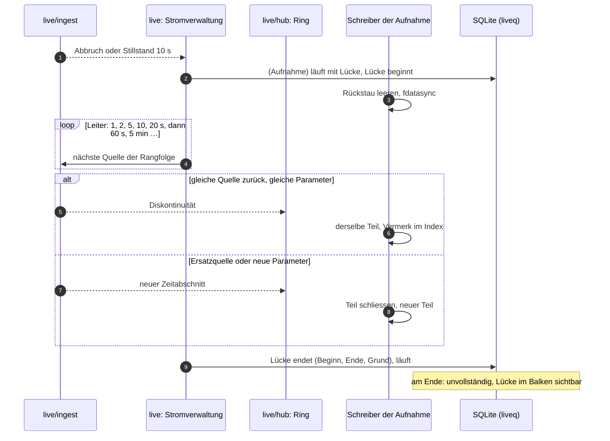
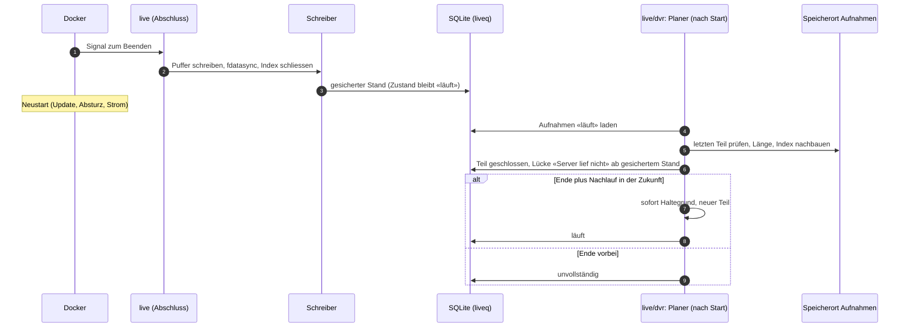

# Konzept 28 · Aufnahmen (DVR)

Stand: 28. November 2026 · Fassung 2 · Status: Entwurf nach Konsolidierung 1, nicht freigegeben

Dieses Dokument legt fest, wie Slouchcat Fernsehsendungen aufnimmt, plant, speichert, abspielt, schützt und
wieder löscht. Es baut auf den tragenden Entscheiden aus `04-architektur.md` (T-1 bis T-29, Fassung 3) und
`05-streaming-und-fast-zapping.md` (Fassung 3) auf, besonders T-1 (Planer im Dienst), T-6 (Zeitabschnitt),
T-8 (Rückstau), T-9 (Live-Sitzung), T-16 (Aufnahme am Verteiler), T-17 (Haltegründe), T-19 (Zulassung),
T-25 (Speicherorte) und T-29 (Deaktivieren beendet nichts Laufendes), und weicht von keinem ab. **Alle Zahlen
stammen aus `04` Abschnitt 14 «Massgebliche Werte».** Schema und Schnittstellen legen allein
`07-datenmodell.md` und `08-api.md` fest; Spalten- und Zustandsnamen hier folgen `07` Abschnitt 3.9.
Programmverweise, verschobene Sendungen und Folgenerkennung kommen aus `09-epg.md` Abschnitte 6 und 7 und
werden hier nur angewandt.

Alles hier ist **spezifiziert**, nichts ist gebaut. «Gebaut» mit Datei und Zeile bezieht sich auf den Stand des
Arbeitsbaums (Server 1.44.1). Kennungen dieses Dokuments: `F-n` Fragen an dich, `O-n` offene technische
Punkte, `M-n` Messpunkte; sie zählen eigen. Kennungen anderer Dateien tragen die Dateinummer («`03` F-9»).
Stufen nach `18-umsetzungsplan.md`: Aufnahmen **Stufe 5** (Baufreigabe nach V-7: M-1 und M-2 dieses
Dokuments), Serien und wiederkehrende Aufnahmen **Stufe 6**.

Begriffe, einmal erklärt: Eine **Planung** ist der Wunsch eines Profils (eine Sendung, ein Zeitraum, eine
Serie). Eine **Regel** ist eine Planung, die immer wieder Termine erzeugt (Serie, wiederkehrend). Ein
**Termin** ist eine konkrete Aufnahme mit Sender, Beginn und Ende. Eine **Aufnahme** ist ein Termin mit
seinem Ergebnis: **Teile** (Dateien mit Quell-TS) und **Lücken** (Zeiträume ohne Daten, mit Grund).
**Vorlauf** und **Nachlauf** sind Minuten vor dem Beginn und nach dem Ende der Sendung, damit eine
verspätete oder verfrühte Sendung ganz drauf ist.

## 1. Aufnahmearten

| Art | Wer legt an | Zeiten | Vor-/Nachlauf | ohne EPG | Stufe |
|---|---|---|---|---|---|
| **Sofortaufnahme** (LTV-008.01) | Profil im Player oder in der Senderübersicht | Beginn: **jetzt**, an der Live-Kante (auch bei zeitversetzter Wiedergabe, `10` F-1). Ende: mit EPG das Ende der laufenden Sendung plus Nachlauf; ohne EPG oder auf Wunsch «bis ich stoppe», höchstens die Grenze aus `15` LA-14 (Vorgabe 4 Stunden) | kein Vorlauf (es gibt nichts davor); Nachlauf nur bei «Ende der Sendung» | ja, als «bis ich stoppe» | 5 |
| **Einzelaufnahme aus dem EPG** (LTV-008.02, .03) | Profil auf der Sendungsseite oder im Raster | aus dem Programmverweis (`09` Abschnitt 6.2) | ja | nein | 5 |
| **Manuelle Aufnahme** (LTV-008.04) | Profil mit Sender, Datum, Beginn und Ende in Ortszeit | fest, beim Anlegen in UTC umgerechnet | ja (Vorgabe 0, weil die Zeiten schon gewählt sind; Empfehlung) | ja | 5 |
| **Serienaufnahme** (LTV-008.05) | Profil aus einer gewählten Sendung (nie aus einem Suchwort, `09` Abschnitt 7.3) | Termine aus dem EPG (Abschnitt 2) | ja, je Regel | nein | 6 |
| **Wiederkehrende Aufnahme** (LTV-008.06) | Profil mit Sender, Wochentagen, Beginn in Ortszeit, Dauer | Termine aus der Regel (Abschnitt 2) | ja, je Regel | ja | 6 |

**Vor- und Nachlauf** (LTV-008.07, .08):

| Punkt | Festlegung |
|---|---|
| Standard | global, vom Administrator: Vorschlag 2 Minuten Vorlauf, 10 Minuten Nachlauf (`15` LA-14) |
| je Planung | das Profil kann beide überschreiben; ohne Angabe gilt der Standard **zum Zeitpunkt des Anlegens** (gespeichert an der Planung, damit eine spätere Änderung des Standards keine Planung still ändert; Empfehlung) |
| Speicherung | Kernzeit (Beginn und Ende der Sendung) und Vor-/Nachlauf getrennt; die Wiedergabe beginnt beim Kern (Abschnitt 6) |
| Sommer- und Winterzeit | Vor- und Nachlauf sind Dauern, keine Uhrzeiten |

**Was ohne EPG geht** (`03` DR-09): Sofortaufnahme («bis ich stoppe»), manuelle Aufnahme, wiederkehrende
Aufnahme. Nicht: Einzel- und Serienaufnahme aus dem EPG, Folgenerkennung, Anpassung an verschobene Zeiten.

## 2. Vom Wunsch zum Termin

### 2.1 Regeln erzeugen Termine

Ein Termin ist eine Zeile in derselben Tabelle wie die Aufnahme, im Zustand «geplant» (Abschnitt 3.6). Es gibt
keine zweite Tabelle für Termine: Eine Aufnahme ist ein Termin mit Ergebnis. Einzel-, Sofort- und manuelle
Aufnahmen sind sofort ein Termin; Regeln erzeugen Termine.

| Regel | Erzeugt Termine für | Schlüssel gegen Doppelte | Horizont |
|---|---|---|---|
| Serie | jede Sendung mit gleichem normalisiertem Titel auf dem gewählten Sender oder, wenn das Profil es wählt, auf allen für es sichtbaren Sendern (`09` Abschnitt 7.3), soweit keine Folgenregel sie ausschliesst (2.4) | Regel, Sender, Beginn laut EPG, Prüfsumme des Titels (wie `programmeRef`, `09` Abschnitt 6.2) | so weit wie die Programmdaten (Vorschauzeitraum, `09` Abschnitt 2.6) |
| Wiederkehrend | jeden gewählten Wochentag zur lokalen Beginnzeit mit der Dauer | Regel, lokales Datum | 14 Tage (Annahme) |

**Neu berechnet wird** (`04` Abschnitt 10.1: Job nach jedem EPG-Import und beim Ändern einer Regel direkt):

| Auslöser | Was | Wie |
|---|---|---|
| Regel angelegt oder geändert | Termine dieser Regel | direkt in der Anfrage, damit die Liste sofort stimmt |
| erfolgreicher EPG-Import | Termine aller Serienregeln der betroffenen Sender | Job `livetv.dvr.expand` nach `livetv.epg.reconcile` (Schlüssel `dvr-expand`, mehrere Importe ergeben einen Lauf) |
| einmal täglich | wiederkehrende Regeln (Horizont rückt nach) und alle Serienregeln | derselbe Job im Zeitplan |
| Sender wieder sichtbar, Recht zurück | Termine der ruhenden Regeln des Profils | derselbe Job als Ereignis |

Die Berechnung ist idempotent (gleicher Schlüssel ergibt denselben Termin). Sie ändert nie einen Termin, dessen
Vorlauf schon begonnen hat; im SQL ist das abgesichert, weil jede Änderung nur `WHERE state = 'scheduled'`
schreibt (`07` 8.3, Review 2 RD-15). Entfällt eine Sendung im EPG, wird ihr noch nicht begonnener Termin aus
einer Serienregel entfernt (er war nie eine Entscheidung des Profils); bei Einzelaufnahmen gilt dagegen 2.3.

**Abgesagter Termin einer Regel:** Sagt das Profil einen einzelnen Termin einer Regel ab, wird die Zeile
**nicht** gelöscht, sondern bleibt als `cancelled` mit Grund `skipped` bis zum Ende ihres Termins stehen. So legt
`livetv.dvr.expand` ihn nicht neu an; danach räumt derselbe Job sie weg (`07` 3.9 und 9, W-17).

**Schlüssel nach einer Verschiebung** (Review 2 RD-09): Der Schlüssel eines Serientermins (`rule_key`) enthält
den Beginn laut EPG. Verschiebt `livetv.epg.reconcile` den Termin (`moved_auto`), setzt er den Schlüssel **in
derselben Transaktion** auf den neuen Beginn; dasselbe gilt beim Zusammenführen zweier Sender (neue Sender-
Kennung). Sonst rechnete der nächste `livetv.dvr.expand` einen zweiten Termin für dieselbe Sendung aus, und ein
ausgelassener Termin käme nach einer Verschiebung zurück. Prüfung: «Sendung um 5 Minuten verschoben ergibt
keinen zweiten Termin» (`17`).

**Höchstzahl:** je Regel höchstens 50 geplante Termine (Annahme; Vorbild TVHeadend «Autorec maximum
schedules», R5 Abschnitt 5.1). Wird sie erreicht, zeigt die Regel «weitere Termine folgen, wenn diese vorbei
sind».

**Gleiche Sendung auf mehreren Sendern** (HD und SD desselben Programms, `09` O-7): Findet eine Serienregel mit
«auf allen Sendern» dieselbe Sendung (gleicher normalisierter Titel, gleicher Beginn) auf mehreren Sendern,
entsteht **ein** Termin: auf dem Sender, aus dem die Regel entstand, sonst auf dem mit der kleinsten
Kanalnummer (Empfehlung).

### 2.2 Verweis auf Sendungen

Einzelaufnahmen und Termine aus Serienregeln speichern den **Programmverweis** aus `09` Abschnitt 6.2 (Sender,
Zeiten laut EPG, Titel roh und normalisiert, Folgenmerkmale, Zustand des Wiederfindens), nie die Zeilennummer
der Programmdaten. Dazu speichert jede Aufnahme Titel und Angaben der Sendung selbst, damit sie sie behält,
wenn die Programmdaten nach 24 Stunden wegfallen (`03` DR-20).

### 2.3 Verschobene Sendungen

Der Job `livetv.epg.reconcile` findet Verweise nach jedem Import wieder (`09` Abschnitt 6.3). Für Aufnahmen
gilt:

| Ergebnis des Wiederfindens | Termin vor Beginn des Vorlaufs | Laufende Aufnahme |
|---|---|---|
| `exact` | bleibt | bleibt |
| `moved_auto` (eindeutig wiedergefunden) | Kernzeit übernimmt die neue Zeit, Vor-/Nachlauf bleiben; Meldung «verschoben» (LTV-008.14) | wird **nie verschoben**. Nur das Ende: Liegt das neue Ende der Sendung später, verlängert sich die Aufnahme; früher endet sie nie (`15` LA-14 «verlängert, nie gekürzt») |
| `ambiguous` | **bleibt auf der alten Zeit und läuft dann auch**, markiert «nicht eindeutig» mit Auswahl der Kandidaten (LTV-008.14 «sonst bleibt die Planung») | wie `exact` |
| `missing` | bleibt auf der alten Zeit und läuft, markiert «nicht mehr im Programm» mit «behalten» und «löschen» | wie `exact` |

Ein nicht eindeutiger Termin **läuft** zur alten Zeit, weil ein Ausfall die schlechtere Überraschung ist; das
ist abgestimmt (`04` 15.2), `09` 6.3 zieht nach. Die Verlängerung laufender Aufnahmen geschieht über den Job
`livetv.epg.reconcile`: Er prüft auch laufende Aufnahmen, deren Verweis `exact` ist, auf ein späteres Ende, und
gibt das neue Ende an den Planer (`04` 15.2; die Beschreibung des Jobs steht in `09`, O-1). reconcile schreibt
Kernzeiten nur bei `state = 'scheduled'`; für eine laufende Aufnahme ändert er nur das Ende und nur nach hinten.

Ob die Anpassung überhaupt wirkt, schaltet der Administrator global (`15` LA-14, Vorgabe an).

### 2.4 Schon aufgenommene Folgen

Nach `09` Abschnitt 7.1 gilt eine Folge nur bei Stufe A (`xmltv_ns` mit Staffel und Folge) oder B
(`dd_progid` mit Folgenteil; `dd_progid` steht nicht in der XMLTV-Formatbeschreibung und ist eine verbreitete
Gewohnheit, Nachprüfung Nr. 40) als **zuverlässig** erkannt; C und D nur, wenn das Profil die Option der Regel
einschaltet. Verglichen wird nur mit den eigenen Aufnahmen des Profils (`03` DR-10), nie mit der Bibliothek.

| Lage | Verhalten |
|---|---|
| Folge zuverlässig erkannt und im **Folgengedächtnis** der Regel | kein Termin; in «Geplante Aufnahmen» «übersprungen: Folge schon aufgenommen (S2 F5)» (`09` Abschnitt 7.2) |
| Folge zuverlässig erkannt, schon als Termin derselben Regel geplant | nur die früheste Ausstrahlung bekommt einen Termin |
| Termin dieser Folge endet «fehlgeschlagen» oder «unvollständig» | Folge kommt nicht ins Gedächtnis; eine spätere Ausstrahlung wird geplant (Vorbild TVHeadend «re-record on errors», R5 E-10; Empfehlung) |
| Folge nicht identifizierbar | **`03` F-8**; bis zu deiner Antwort gilt dort die Empfehlung (a): jede passende Ausstrahlung wird aufgenommen, die Regel zeigt «Folgen nicht erkennbar, Wiederholungen werden mit aufgenommen». `09` Abschnitt 7.2 nennt «höchstens eine je Tag» als Wahl; das ist `03` F-8 (b) und gilt nur, wenn du es wählst. |

**Folgengedächtnis (Empfehlung):** Jede Regel merkt sich die Folgenmerkmale ihrer fertigen Aufnahmen, auch
wenn die Aufnahme später gelöscht wird (vom Profil, durch die Aufbewahrungsfrist oder durch «behalte N»).
Ohne Gedächtnis würde «behalte die letzten 3 Folgen» eine gelöschte Folge bei der nächsten Wiederholung wieder
aufnehmen. Das Gedächtnis gehört der Regel und wird mit ihr gelöscht. In der Regel gibt es «Gedächtnis leeren»,
falls ein Profil eine Folge doch noch einmal will.

### 2.5 Doppelt gesendetes Anlegen (Idempotenz)

Ein doppelter Druck auf «Aufnehmen» am Fernseher oder die Wiederholung einer App nach einer Zeitüberschreitung
darf keine zweite Aufnahme anlegen (Review 2 RD-10). Regel: Trifft ein Anlegen auf eine bestehende, nicht
abgesagte Zeile mit denselben Merkmalen, antwortet der Server mit **dieser** Zeile (200), statt eine neue
anzulegen.

| Art | Gleich heisst | Hinweis |
|---|---|---|
| Einzelaufnahme | Profil, Sender, Beginn laut EPG, normalisierter Titel; Zustand nicht `cancelled` oder `deleting` | wie bei Erinnerungen |
| Sofortaufnahme | Profil und Sender, Zustand `waiting`, `recording` oder `recording_gap` | eine laufende Sofortaufnahme je Profil und Sender |
| Manuelle Aufnahme | Profil, Sender, Beginn und Ende | – |
| Serienregel | Profil, normalisierter Titel, Sender oder «alle Sender» | eine Regel je Serie und Senderwahl |
| Wiederkehrende Regel | Profil, Sender, Wochentage, Beginn, Dauer | – |

Die Eindeutigkeit setzt `07` als Teil-Index durch (für Einzelaufnahme und Serienregel nach RD-10; für die übrigen
Arten nachzutragen, Abschnitt 14.1).

## 3. Planer

### 3.1 Eigener Zeitgeber im Dienst `live`, nicht das Jobsystem

Der Planer ist Teil von `live/dvr` und läuft im Serverprozess mit eigener Laufschleife (T-1).

Warum nicht das Jobsystem (alles gebaut):

| Eigenschaft des Jobsystems | Fundstelle | Folge für Aufnahmen |
|---|---|---|
| Der Zeitplaner tickt einmal je Minute | `server/internal/jobs/scheduler.go:16-17` | Start bis 60 Sekunden zu spät |
| Kürzester Zeitplan 5 Minuten | `server/internal/jobs/scheduler.go:53` | kein Zeitplan je Aufnahme |
| Ein Job hält eine Lease, die sein Arbeiter verlängert | `server/internal/jobs/queue.go:81-91` | ein Lauf über Stunden hängt an Herzschlägen, ein Neustart des Arbeiters setzt neu auf |
| Die Pause einer Jobart bricht laufende Jobs ab | `server/internal/jobs/worker.go:124-131` | eine Pause würde Aufnahmen beenden (verboten, `04` Abschnitt 10.1) |

Das Jobsystem bekommt nur Stapelarbeit: Termine berechnen (`livetv.dvr.expand`), Aufbewahrung
(`livetv.dvr.retention`), Dateien gelöschter Aufnahmen entfernen (`livetv.dvr.purge`), Prüfung auf verwaiste
Dateien. Eine Pause dieser Jobarten verzögert nur Planung und Aufräumen; die Verwaltung warnt dann
(«Serientermine werden nicht nachgeführt»).

### 3.2 Wie der Zeitgeber arbeitet

1. Beim Start liest der Planer alle Aufnahmen in den Zuständen «geplant», «wartet auf Empfang», «läuft» und
   «läuft mit Lücke» aus der Datenbank.
2. Er hält im Arbeitsspeicher eine nach Zeit sortierte Liste der nächsten Ereignisse je Aufnahme:
   **Empfang öffnen** (Beginn des Vorlaufs minus Aufwärmzeit), **Schreiben beginnen** (Beginn des Vorlaufs),
   **Schreiben beenden** (Ende plus Nachlauf).
3. Ein einziger Zeitgeber wartet auf das nächste Ereignis. Gewartet wird mit der monotonen Uhr, verglichen mit
   der Wanduhr (UTC). Nach jedem Aufwachen prüft er die Wanduhr erneut und arbeitet alle fälligen Ereignisse ab.
4. Jede Änderung (neuer Termin, Absage, Verschiebung, Verlängerung, Zusammenführen des Senders) ersetzt den
   Eintrag und weckt den Zeitgeber. Damit ein Eintrag nie zur alten Zeit oder am alten Sender feuert, trägt jede
   Aufnahme einen **Änderungszähler** (`rev`), den jede Änderung eines Termins erhöht. Der Zeitgeber merkt sich
   ihn und startet nur mit `… WHERE id = ? AND state = 'scheduled' AND rev = ?`; trifft das keine Zeile, liest
   er neu und plant neu (Review 2 RD-15; Spalte in `07` nachzutragen). Die Liste wird beim Start erst nach dem
   Wiederanlauf der Aufnahmen geladen (`07` 8.4 Schritt 4).
5. **Uhrsprung:** Einmal je Minute vergleicht der Planer monotone Uhr und Wanduhr. Weichen sie um mehr als
   2 Sekunden vom erwarteten Gang ab (NTP nach einem Stromausfall, von Hand verstellte Uhr), baut er die Liste
   neu auf (Annahme zur Schwelle; Vorbild R5 Abschnitt 5.5).

Aufnahmen laufen im Namen des Profils, aber **ohne Anmeldung** (LTV-008.15): Geprüft werden Rechte, Sichtbarkeit
des Senders und Kontingent beim Anlegen und beim Start, nicht über ein Token einer Sitzung.

### 3.3 Empfang vor dem Termin

| Zeitpunkt | Was | Wert |
|---|---|---|
| Beginn des Vorlaufs minus **Aufwärmzeit** | Haltegrund «Aufnahme» setzen (`04` Abschnitt 5.2). Läuft der Sender schon (Zuschauer, dauerhaft, andere Aufnahme), kostet das nichts; sonst baut die Stromverwaltung die Verbindung **sofort und ohne Staffelung** auf (`04` 5.3). Ein Sender, der zurückgestellt ist (`04` 5.1), startet mit diesem Haltegrund wieder. | Aufwärmzeit **30 Sekunden vor dem Beginn des Vorlaufs**, einstellbar 10 bis 120 (`04` 14.1, ein Bezugspunkt für alle Dokumente). Sie deckt Verbindung, Programmtabellen und die erste Bildgruppe (Annahme, `05` M-2 misst die Zeit bis zum ersten Keyframe). |
| Beginn des Vorlaufs | Leser am Ring anmelden. Er beginnt an der letzten vollständigen Bildgruppe (T-7), also einige Sekunden vor dem Zeitpunkt; das liegt im Vorlauf. Ab hier schreibt die Aufnahme. | – |
| Ende plus Nachlauf | Leser abmelden, Teil schliessen, Haltegrund lösen. Hält ihn niemand sonst, «ruht» der Strom **sofort**: nach dem Ende einer Aufnahme gibt es keine Karenz (T-17, `04` 14.1). | – |

Liegt beim Beginn des Vorlaufs noch kein Keyframe im Ring (Verbindung scheitert, Quelle langsam), wechselt die
Aufnahme in «wartet auf Empfang» und schreibt ab dem ersten Keyframe; die Zeit dazwischen ist eine Lücke
«Quelle nicht erreichbar». Die Wiederverbindung folgt der Leiter aus `04` Abschnitt 5.3 (bei einer Aufnahme
die lange Leiter für dauerhafte Haltegründe).

### 3.4 Überlappende Aufnahmen desselben Senders

Ohne Tuner gibt es nichts zusammenzulegen, um Hardware zu sparen. Mehrere Aufnahmen desselben Senders, von
einem oder mehreren Profilen, hängen am **einen** Eingangsstrom (T-2, LTV-008.24); jede Aufnahme hat ihren
eigenen Leser, ihren eigenen Rückstau und ihre eigenen Dateien (Abschnitt 9: getrennte Dateien als Vorgabe).
Zwei Sendungen hintereinander mit Vor- und Nachlauf schreiben die Überlappung zweimal; das kostet nur Platz.
Zwei Aufnahmen zur selben Zeit sind kein Konflikt (`03` DR-11).

### 3.5 Zeitzone, Sommer- und Winterzeit

| Fall | Regel |
|---|---|
| EPG-Termine | Zeitpunkte mit Versatz aus XMLTV, gespeichert in UTC: keine Frage der Zeitumstellung |
| Manuelle Aufnahme | Ortszeit des Formulars in der Zeitzone des Servers, beim Anlegen nach UTC; danach fest |
| Wiederkehrende Aufnahme | speichert lokale Beginnzeit, **Dauer** (nicht Endzeit) und den Namen der Zeitzone (zum Beispiel `Europe/Zurich`), die beim Anlegen für den Server galt. Jeder Termin wird in dieser Zone in UTC umgerechnet. |
| Zeitzone des Servers | die des Containers (`TZ`, ab Werk `Europe/Zurich`, gebaut: `deploy/compose.yaml:42`). Die Verwaltung zeigt sie bei den Aufnahme-Einstellungen. Ob das Image die Zonendaten enthält, ist zu prüfen (M-7). |
| Lücke im Frühling (02:00 bis 03:00 gibt es nicht) | Der Termin beginnt um 03:00 (erste gültige Zeit danach) und dauert so lange wie sonst; die Planung zeigt «wegen Zeitumstellung um 03:00» (Empfehlung, R5 Abschnitt 5.6). |
| Doppelte Stunde im Herbst | die erste der beiden Stunden (Empfehlung) |

Die Testinstanz CT 190 läuft in UTC (Hinweis aus dem Betrieb); dort weichen lokale Zeit und UTC nicht ab, und
die Regeln oben lassen sich nur mit gesetzter Zeitzone prüfen (M-7).

### 3.6 Zustände einer Aufnahme

| Zustand | Bedeutung | Wert in der Datenbank |
|---|---|---|
| geplant | Termin in der Zukunft | `scheduled` |
| ruht | Recht entzogen; nur, wenn du `03` F-7 (a) wählst | `suspended` |
| wartet auf Empfang | Zeit ist da, aber noch kein Keyframe | `waiting` |
| läuft | schreibt | `recording` |
| läuft mit Lücke | schreibt nicht, wartet auf Quelle oder Speicherort | `recording_gap` |
| fertig | Ende erreicht, ohne Lücke | `completed` |
| unvollständig | mindestens ein Teil, aber Lücken (Grund je Lücke) | `incomplete` |
| fehlgeschlagen | kein brauchbarer Teil; Grund nach `07` 3.9 (`quota_full`, `server_busy`, `channel_unavailable`, `source_unreachable`, `source_encrypted`, `storage_full`, `storage_missing`, `server_not_running`) | `failed` |
| abgebrochen | vom Profil gestoppt oder abgesagt, Recht entzogen, Sender gelöscht, oder ausgelassener Termin einer Regel (Grund `profile`, `right_revoked`, `channel_deleted`, `skipped`) | `cancelled` |
| wird gelöscht | Zeile bleibt, bis alle Dateien entfernt sind (übersteht einen Absturz beim Löschen) | `deleting` |



Eine vom Profil gestoppte Sofortaufnahme mit Daten gilt als **fertig** (sie endet, wie gewünscht). Eine
abgebrochene Aufnahme mit Daten bleibt abspielbar. Eine abgesagte Einzelplanung ohne Daten wird sofort
gelöscht; ein abgesagter Termin einer Regel bleibt als `cancelled`/`skipped` bis zu seinem Ende (2.1). Eine vom
Administrator nach dem Deaktivieren mit «sofort beenden» gestoppte Aufnahme ist «unvollständig», mit Lücke
`stopped_by_admin` bis zum geplanten Ende (T-29, `07` 3.9).
Kleine Paketfehler ohne Lücke ändern den Zustand nicht; sie stehen als Zähler am Teil (Abschnitt 5.5).

### 3.7 Neustart, Stromausfall, verpasster Start

Beim Start (`04` Abschnitt 5.3, Schritt 2):

| Lage | Verhalten |
|---|---|
| Aufnahme «läuft» oder «läuft mit Lücke», Ende plus Nachlauf noch in der Zukunft | letzten Teil prüfen und schliessen (Abschnitt 5.7), Lücke «Server lief nicht» vom letzten gesicherten Stand bis jetzt, **sofort** weiter aufnehmen mit neuem Teil |
| dasselbe, Ende schon vorbei | letzten Teil schliessen, Lücke bis zum Ende, Zustand «unvollständig» |
| «geplant» oder «wartet», Beginn vorbei, Ende in der Zukunft (verpasster Start) | **ab jetzt aufnehmen**, Lücke «Server lief nicht» vom geplanten Beginn bis jetzt; am Ende «unvollständig» |
| «geplant», Ende schon vorbei | «fehlgeschlagen» mit Grund «Server lief nicht»; Meldung an das Profil; keine stille Löschung |

Aufnahmen verbinden beim Start **sofort und ohne Staffelung**; die Staffelung (höchstens zwei Starts je Sekunde)
gilt nur für dauerhaften und zeitgesteuerten Empfang (`04` 5.3, 14.1, Rückmeldung `06` O-12).

## 4. Konflikte und Warnungen ohne Tuner

### 4.1 Was ein Konflikt ist

Es gibt keine Tuner und **kein Verbindungslimit je Anbieter** (LTV-017; ob das so bleibt, ist `04` F-3).
Zwei Aufnahmen zur selben Zeit sind kein Konflikt. Ein Konflikt (LTV-008.13, `03` DR-11) ist:

| Nr. | Konflikt | Prüfung | Folge beim Start, wenn er dann noch besteht |
|---|---|---|---|
| K-1 | **Kontingent** des Kontos reicht voraussichtlich nicht | belegt + erwartete Grösse aller künftigen und laufenden Aufnahmen des Kontos bis zu diesem Termin + erwartete Grösse dieses Termins > Kontingent | abgelehnt und gemeldet (E-4); Zustand «fehlgeschlagen», Grund «Kontingent voll» |
| K-2 | **Platz** am Speicherort reicht voraussichtlich nicht über der Mindestreserve | frei − Mindestreserve − erwartete Grösse der früher beginnenden Aufnahmen < erwartete Grösse | nur Warnung; gestartet wird, solange der Platz **jetzt** über der Reserve liegt. Unterschreitet er sie später: Lücke «Speicher voll» (Abschnitt 5.4) |
| K-3 | **Serverdeckel** (T-19): Obergrenze der Eingangsströme oder, falls gesetzt, Höchstzahl gleichzeitiger Aufnahmen (`15` F-21) wäre allein durch Aufnahmen überschritten | Zahl verschiedener Sender aller Aufnahmen im Zeitraum (über alle Profile; ohne Titel) | Vorrang nach `04` F-5 und `03` F-4; bis zur Antwort: Platz ab 2 Minuten vor Beginn reserviert, nie eine laufende Wiedergabe beendet; reicht es nicht, «fehlgeschlagen», Grund «Server ausgelastet» |
| K-4 | **Sender** deaktiviert oder verschwunden | Zustand des Senders | Ein Termin, der danach **beginnen** soll: «fehlgeschlagen», Grund «Sender nicht verfügbar»; nicht verschoben (`03` DR-16). Eine **laufende** Aufnahme läuft bis zu ihrem Ende weiter (T-29); nur der Befehl «sofort beenden» stoppt sie. |
| K-5 | **kein EPG mehr** für einen Termin aus dem EPG | Verweis `missing` oder Zuordnung gelöst | läuft zur alten Zeit (2.3) |
| K-6 | **Recht entzogen** («Live-TV» oder «Aufnahmen») | wirksames Recht | nach `03` F-7; bis zur Antwort: ruht |

Was der Server **nicht** vorhersagt: Live-Zuschauer zur Zeit des Termins, und ob der Anbieter eine weitere
Verbindung annimmt. Eine Aufnahme kann deshalb an einer Ablehnung der Quelle scheitern; dann gelten die Regeln
aus `04` Abschnitt 5.3 (Deutung «vermutlich Verbindungslimit», kein Sperren), und die Aufnahme bekommt eine
Lücke oder schlägt fehl.

### 4.2 Prognose des Platzbedarfs

Erwartete Grösse = mittlere Bitrate des Senders ÷ 8 × (Ende + Nachlauf − Beginn + Vorlauf) × 1.05.

| Grösse | Herkunft |
|---|---|
| mittlere Bitrate | aus den gespeicherten Streamparametern des Senders (T-14, `04` Abschnitt 4.2), nachgeführt bei jedem Empfang; ohne Wert 8 Mbit/s (Annahme) |
| Zuschlag 5 % | gegen Schwankungen (Annahme; prüft M-1 mit `05` M-2) |
| Sofortaufnahme «bis ich stoppe» | mit der Höchstdauer (Vorgabe 4 Stunden) |

Beispiel: 90 Minuten Sendung, 2 + 10 Minuten Vor- und Nachlauf, 8 Mbit/s: 1 MB/s × 6'120 s × 1.05 ≈ 6.4 GB.

### 4.3 Was der Benutzer wann sieht

| Wann | Wo | Was |
|---|---|---|
| beim Anlegen | im Dialog, sofort | Konflikt mit Satz, zum Beispiel «Dein Kontingent reicht voraussichtlich nicht (noch 3.1 GB frei, gebraucht 6.4 GB).» Speichern geht trotzdem (der Planer warnt, E-4). |
| nach jeder Änderung, nach EPG-Import, täglich, 10 Minuten vor Beginn | in «Geplante Aufnahmen» als Kennzeichen am Termin | derselbe Satz |
| wenn ein Termin **neu** in einen Konflikt gerät | Meldung in der Glocke des Profils, einmal je Termin und Konfliktart | «Aufnahme X am … : Kontingent reicht voraussichtlich nicht» |
| beim Start abgelehnt | Meldung nach Abschnitt 11 | «nicht aufgenommen: …» |

Der Administrator sieht in «DVR und Speicher» je Konto nur Zahl und Grösse geplanter Aufnahmen (Prognose in
GB) und Fehlerzustände, nie Titel, Sender oder Zeiten (`03` DR-17, `15` LA-16).

## 5. Schreiben in Originalqualität (LTV-020)

### 5.1 Container

Vergleich nach R5 Abschnitt 3 (dort mit Quellen aus dem Quelltext von FFmpeg und TVHeadend und der Norm
H.222.0 belegt; Aussagen, die R5 als Annahme führt, sind hier markiert):

| Quellspur | MPEG-TS | Matroska | fMP4 |
|---|---|---|---|
| H.264, HEVC, MPEG-2 Video | ja | ja | ja |
| mehrere Tonspuren, MP2, AC-3, E-AC-3 | ja | ja | ja |
| AAC-LATM | ja, unverändert | nur umgepackt (Annahme) | nur umgepackt (Annahme) |
| DVB-Untertitel (Bilder) | ja | ja (manche Player nicht) | **nein** |
| DVB-Teletext, auch Teletext-Untertitel | ja | **nein** | **nein** |
| SCTE-35, Daten (HbbTV, DSM-CC, private Daten) | ja | **nein** | **nein** |
| Programmtabellen, Referenzuhr (PCR) | ja | nein | nein |
| Wechsel der Spuren mitten drin | ja (neue PMT) | nur mit neuer Datei (Annahme) | nur mit neuem Kopfstück (Annahme) |
| lesbar nach hartem Abbruch | ja, Pakete synchronisieren neu | weitgehend, ohne Index und Dauer (Annahme) | bis zum letzten vollständigen Fragment |
| Index zum Spulen | **keiner**, eigener nötig | eingebaut | eingebaut |
| Zeitstempel | 33 Bit, Überlauf nach rund 26.5 h | 64 Bit | 64 Bit |

**Entscheid (Empfehlung, folgt T-16):** **MPEG-TS** mit eigenem Index je Teil. Nur TS erfüllt «alle
empfangenen Ton- und Untertitelspuren bleiben» ohne Ausnahme. Die Nachteile (kein eingebauter Index,
Zeitüberlauf, etwas grösser) löst der eigene Index.

**Was erhalten bleibt:** alles, was im empfangenen Programm liegt, Paket für Paket: Bild, alle Tonspuren, alle
Untertitel einschliesslich Teletext, Daten-PIDs, Referenzuhr, Programmtabellen, mitgelieferte SDT und EIT.
**Was nicht erhalten bleibt:**

- andere Programme desselben Multiplex (gewollt; der Empfänger liefert ein Programm, `04` Abschnitt 4.1);
- bei HLS-Quellen mit mehreren Qualitäten die anderen Varianten (aufgenommen wird die empfangene, ab Werk die
  höchste, `05` O-14);
- Spuren, die eine HLS- oder DASH-Quelle **ausserhalb** des TS liefert (eigene Liste für WebVTT-Untertitel
  oder für eine getrennte Tonspur): Der Empfänger von Weg G liest sie nicht, und WebVTT oder TTML passen nicht
  unverändert in TS. Das ist der Fall aus LTV-020.21: F-1;
- verschlüsselte Inhalte (DRM ausgeschlossen; der Empfänger lehnt solche Quellen ab, `05` Abschnitt 2.5).

**Umpacken** (LTV-020.09): Bei Quellen des Wegs W (DASH, HLS mit fMP4) packt FFmpeg vor dem Verteiler nach TS
um (`04` T-3); das ist verlustfreies Umpacken. Nach der Aufnahme wird nichts umgepackt (5.8).

### 5.2 Aufbau der Dateien

| Punkt | Festlegung |
|---|---|
| Teil | eine TS-Datei. Ein neuer Teil beginnt **nur** bei: Aufnahmebeginn, neuem Zeitabschnitt (T-6: geänderte Spuren, Codec, Bildparameter, Quellwechsel), Neustart des Servers, Wiederaufnahme nach einer Lücke des Speicherorts (voll, fehlt, Datenträger zu langsam). Eine Unterbrechung der Quelle bei gleichen Parametern ist eine Diskontinuität im selben Teil (5.5). Kein Schnitt nach Zeit (T-16). |
| Anfang eines Teils | PAT und PMT aus dem Zwischenspeicher des Verteilers (`05` Abschnitt 3.3), dann die Pakete ab dem Keyframe |
| Pakete | unverändert, wie sie im Ring liegen (T-16, LTV-020.02) |
| Index | eine Begleitdatei je Teil, angehängt beim Schreiben: je Keyframe entfaltete 64-Bit-Zeit, rohe 33-Bit-Zeit, Uhrzeit der Ankunft, Byte-Position, Art (offen, geschlossen); dazu Einträge für Diskontinuitäten und Überlauf. Festes Satzformat (O-2). |
| Wiederherstellbar | Fehlt der Index oder ist er kürzer als der Teil, baut der Server ihn aus dem TS neu auf (Abschnitt 5.7). |
| In der Datenbank | je Teil: Nummer, Speicherort, Pfad, Zeitraum, Bytes (gesicherter Stand), Datenfehler, Zustand. Kein Eintrag je Keyframe (bei 2 Sekunden je Bildgruppe wären es 1'800 Zeilen je Stunde). |

### 5.3 Schreiben, `fdatasync`, Rückstau

| Punkt | Festlegung | Einordnung |
|---|---|---|
| Schreiber | je Aufnahme eine Go-Routine mit eigenem Leser am Ring und eigenem Rückstau im Arbeitsspeicher: bis 64 MiB oder 60 Sekunden bei der gespeicherten Bitrate, das Kleinere. Er wird **nicht** vorab reserviert, sondern zählt bei Gebrauch und teilt sich den Rest des Byte-Budgets neben den Ringen; **keine Aufnahme scheitert am Byte-Budget** (`04` T-19, 8.1, 14.3) | spezifiziert; Grösse Annahme (M-14) |
| Pufferung | Blöcke von 1 MiB | `04` 14.5, Annahme |
| `fdatasync` | alle **10 Sekunden** und beim Schliessen eines Teils; danach Bytes und Ende des gesicherten Stands in die Datenbank, **ausserhalb** jeder Transaktion, die auf etwas anderes wartet (`04` 14.5; `07` 8.1: kein Datei- oder Netzzugriff in einer Transaktion) | Annahme; `fdatasync` schreibt Daten ohne nicht nötige Metadaten (R5 Beleg 15) |
| Ordner | nach dem Anlegen einer Datei auch den Ordner sichern (Verzeichniseintrag) | Annahme; auf SMB und NFS vom Mount abhängig, M-1 |
| Verlust bei Stromausfall | höchstens die letzten rund 10 Sekunden; sie werden als Lücke «Server lief nicht» geführt | Folge |
| Fehler | `ENOSPC` und `EIO` können erst bei `fdatasync` oder `close` kommen (R5 Beleg 15); jeder Fehler ist ein Zustand des Speicherorts, kein Programmfehler | spezifiziert (`04` Abschnitt 9) |
| Schutz der anderen | Der Schreiber blockiert nie den Verteiler: läuft sein Rückstau voll, wird sein Leser überrundet (T-8). | spezifiziert |

### 5.4 Langsamer oder ausgefallener Datenträger

| Lage | Verhalten |
|---|---|
| Datenträger stockt kürzer, als der Rückstau reicht | nichts sichtbar |
| Rückstau voll | Leser überrundet; Teil schliessen, Zustand «läuft mit Lücke», Lücke «Datenträger zu langsam»; sobald der Schreiber wieder nachkommt, neuer Teil ab dem nächsten Keyframe |
| `ENOSPC` oder Mindestreserve unterschritten | Teil schliessen, Lücke «Speicher voll», keine neuen Teile; Wiederaufnahme mit neuem Teil, sobald der Platz über der Reserve liegt (Prüfung alle 30 Sekunden, Annahme); Meldung an den Administrator |
| `EIO`, Marker fehlt, Dateisystem anders | Teil schliessen (soweit möglich), Lücke «Speicher fehlt», Speicherort im Zustand «fehlt»; Wiederaufnahme wie oben; **nie** ein anderer Ort (T-25) |
| Schreibaufruf hängt (zum Beispiel ein hart eingehängtes NFS ohne Antwort) | Die Go-Routine kann nicht abgebrochen werden; der Rückstau läuft voll, der Leser wird überrundet, die Aufnahme bekommt eine Lücke. Der Teil gilt als «hängt»; kehrt der Aufruf zurück, wird er geschlossen. Ob ein hängender Aufruf das Herunterfahren aufhält, misst M-2. |

### 5.5 Was sich im Strom ändert

| Ereignis | Erkennung | Verhalten | Anforderung |
|---|---|---|---|
| geänderte Spuren, Codec, Bildgrösse, Zeilensprung | Verteiler meldet neuen Zeitabschnitt (T-6) | neuer Teil, keine Lücke | LTV-020.13 |
| nur neue Versionsnummer der PMT | keine Änderung der Spuren | nichts (`05` Abschnitt 3.3) | – |
| Wechsel auf Ersatzquelle | Verteiler meldet Quellwechsel (neuer Zeitabschnitt) | neuer Teil; Lücke nur für die Zeit ohne Daten, Grund «Quelle gewechselt»; der Teil merkt sich die Quelle | LTV-020.14 |
| Abbruch und Wiederverbindung zur selben Quelle | Verteiler meldet Diskontinuität | **derselbe Teil**, Diskontinuität im Index; Lücke mit Zeitangabe für die Zeit ohne Daten, Grund «Quelle unterbrochen» | LTV-020.12 |
| Zeitsprung der Quelle bei gleichen Parametern (Werbeeinblendung) | Diskontinuität | derselbe Teil, Vermerk im Index, keine Lücke | T-6 |
| Überlauf der 33-Bit-Zeit (alle 26.5 Stunden) | Go entfaltet die Zeit (`05` Abschnitt 3.4) | Pakete unverändert; der Index führt beide Zeiten und einen Eintrag «Überlauf»; die Wiedergabe setzt dort eine Diskontinuität (Abschnitt 6) | LTV-020.18 |
| kurzer Paketverlust (Zähler springt) | Zählerfehler je PID im Verteiler | Zähler «Datenfehler» am Teil, keine Lücke; die Pakete bleiben, wie sie kamen | LTV-020.11 |
| Pakete mit Fehlerkennzeichen der Quelle | Kennzeichen im Paketkopf | unverändert geschrieben, gezählt; Decoder verdecken solche Stellen (Annahme) | LTV-020.11 |
| Daten ohne Paketraster, kaputte Tabellen | Der Empfänger synchronisiert neu (`04` Abschnitt 3.2, Anforderungen an `live/mpegts`); in den Ring kommen nur gültige Pakete | nichts im Teil; dauert es an, ist es «Quelle weg» | LTV-020.11 |
| Sender deaktiviert oder aus der Liste verschwunden | Stromverwaltung (T-29) | nichts: die Aufnahme läuft bis zu ihrem Ende weiter, solange der Strom liefert. Nur «sofort beenden» schliesst den Teil, Lücke `stopped_by_admin` bis zum geplanten Ende, Zustand «unvollständig» | LTV-002.11 |
| Verschlüsselung erkannt | `05` Abschnitt 2.5 | Quelle endet mit Zustand «verschlüsselt»; Lücke, Grund «Quelle verschlüsselt» | – |
| Programmfehler beim Lesen fremder Daten | Abfangen an der Wurzel der Go-Routine (T-27) | Fehler der Quelle, Quarantäne, Wiederverbindung; die Aufnahme bekommt eine Lücke, der Server läuft weiter | – |

**Bild und Ton synchron** (LTV-020.19): Weil kein Paket verändert wird, bleiben die Zeitstempel von Bild und
Ton zueinander, wie die Quelle sie liefert. An Teilgrenzen und Diskontinuitäten setzt die Wiedergabe neu auf.

**Lücke** heisst immer: Zeitraum in Uhrzeit (Beginn, Ende), Grund, und auf welchen Teil sie folgt. Die
Oberfläche zeigt die Abdeckung als Balken über die geplante Dauer und die Lücken mit Grund, zum Beispiel
«Quelle 3 Minuten weg (20:41–20:44)» oder «Server lief nicht (20:14–20:31)» (LTV-008.22).

### 5.6 Wiederaufnahme

Nach einer Lücke des Speicherorts (voll, fehlt, Datenträger zu langsam), nach einem Neustart und bei einem
neuen Zeitabschnitt (auch Ersatzquelle) beginnt die Aufnahme einen **neuen Teil** am nächsten Keyframe. Ein
alter Teil wird nie wieder geöffnet. So ist jede Teilgrenze eine saubere Stelle mit Tabellen und Keyframe.
Kommt dieselbe Quelle mit gleichen Parametern zurück, bleibt es beim selben Teil mit einer Diskontinuität im
Index (T-6, `05` Abschnitt 3.4); die Lücke steht trotzdem mit Zeit und Grund in der Datenbank.

### 5.7 Abschluss und Wiederherstellung

| Lage | Verhalten |
|---|---|
| Teil normal geschlossen | Puffer leeren, `fdatasync`, Index schliessen, Datenbank: Bytes, Ende, Zustand «geschlossen» |
| Teil nach Absturz offen | Beim Start: Länge der Datei mit dem gesicherten Stand vergleichen. Ein Rest bis zum letzten vollständigen Paket bleibt (TS ist ohne Abschluss lesbar); ein unvollständiges letztes Paket wird beim Lesen übergangen. Index ab dem gesicherten Stand aus dem TS neu aufbauen. Datenbank auf die wirkliche Länge setzen. Die Zeit nach dem letzten Keyframe des Teils bis zum Neustart ist Teil der Lücke «Server lief nicht». |
| Datei fehlt ganz | Teil «fehlt»; die Aufnahme bleibt mit den übrigen Teilen; Hinweis |

### 5.8 Kein Umpacken nach der Aufnahme

Nach dem Ende bleibt die Aufnahme, wie sie ist: Teile und Index. **Kein** Zusammenfügen, kein Umpacken, keine
Kopie (LTV-020.07). Die Wiedergabe arbeitet direkt auf den Teilen (Abschnitt 6). Ein Herunterladen als eine
Datei gibt es in Konzept 28 nicht (Leitplanken); käme es später, könnte der Server beim Ausliefern verketten,
ohne eine zweite Datei zu speichern (R5 Abschnitt 4.5).

## 6. Wiedergabe von Aufnahmen

### 6.1 Varianten

Die bestehende Dateiwiedergabe verlangt einen Titel in `items` (`playback_sessions.item_id`, `04` T-9), den
Fortschritt an `items` (gebaut: Tabelle `progress` mit Fremdschlüssel auf `items`,
`server/migrations/00004_playback_progress.sql:9-17`) und einen Plan mit Segmenten und Keyframe-Index
(`server/internal/transcode/plan.go:42`, `:96`).

| Variante | Was | Folge |
|---|---|---|
| **(A) Live-Sitzung spielt die Aufnahme** | Derselbe Sitzungstyp wie Live-TV (T-9), mit der Aufnahme statt des Rings als Quelle. Segmentierer, Liste, Token `lt`, Entscheid (T-14), Umwandlung (T-13) wie bei Live. | keine Naht der Dateiwiedergabe berührt; Aufnahmen bleiben ausserhalb von `items` (Regel 2); ein Weg für Live, Timeshift und Aufnahmen |
| (B) über die Dateiwiedergabe | Aufnahme als Titel mit Mediendatei | widerspricht «nie in `items`» (Leitplanken, LTV-008.X-05); zieht Sichtbarkeit, Suche und Startseite auf Aufnahmen |
| (C) nach dem Ende in MP4 umpacken und als Datei spielen | zweite Kopie | verliert Teletext und Daten (5.1); doppelter Platz; widerspricht 5.8 |

**Empfehlung: (A).** Das ist schon in T-9 und `05` Abschnitt 4.4 («Aufnahmen: dieselbe Bauweise») angelegt.
`playback.Decide`, `transcode.Plan`, `transcode.Session` und `ffmpegArgs` bleiben unverändert (T-13).

### 6.2 Wie eine Aufnahme mit Teilen und Lücken spielt

| Punkt | Festlegung |
|---|---|
| Liste einer fertigen Aufnahme | abgeschlossen (`EXT-X-PLAYLIST-TYPE:VOD`, `EXT-X-ENDLIST`). Segmente aus den Indizes aller Teile: im Direktweg an Keyframes, mindestens 2, höchstens 10 Sekunden (wie `05` Abschnitt 4.4), nie über eine Teilgrenze. Jedes Segment ist ein Byte-Bereich eines Teils; der Server setzt PAT und PMT davor. |
| Teilgrenze, Lücke, Überlauf, Diskontinuität | `EXT-X-DISCONTINUITY` und `EXT-X-PROGRAM-DATE-TIME`. Eine Lücke hat keine Segmente: Die Zeitleiste springt über sie, die Oberfläche zeigt sie aus der Liste der Lücken (API) als markierte Stelle. |
| Beginn | Beim ersten Abspielen beginnt die Wiedergabe am **Kern** (Beginn der Sendung), nicht am Anfang des Vorlaufs (Startpunkt in der Liste); danach am gespeicherten Fortschritt. |
| Direktweg oder Umwandlung | Entscheid je Sitzung und je Zeitabschnitt mit der Funktion aus T-14, aus den Streamparametern **des Teils** (gespeichert beim Schreiben) und den Fähigkeiten des Geräts (LTV-020.22). |
| Spulen | Direktweg: Sprung im Player. Umwandlung: Suchmodell wie beim Zeitversatz (`05` Abschnitt 4.5): FFmpeg startet an der Rastergrenze neu, Eingang aus dem Teil ab dem Keyframe davor, höchstens zwei Neustarts in 10 Sekunden; Rückfall nach `05` M-9. |
| Lange Aufnahmen | Kein FFmpeg-Lauf dauert länger als 24 Stunden und keiner geht über einen Überlauf der Quellzeit (Eintrag «Überlauf» im Index) oder über eine Teilgrenze: Go startet den Prozess dort neu, als neue Ausgabe-Generation (`04` 7.5, 14.7). Bei einer Sofortaufnahme von höchstens 4 Stunden und den üblichen Sendungen greift meist nur die Regel zum Überlauf. |
| Ton- und Untertitelwahl | wie bei Live (T-12, `04` Abschnitt 7.3, 7.4), weil alle Spuren im Teil liegen |
| Laufende Aufnahme | Liste ohne `EXT-X-ENDLIST`, sie wächst: Segmente bis zum letzten vollständigen Segment, das der Schreiber geschrieben hat (der Schreiber meldet es im Arbeitsspeicher; gelesen wird aus der Datei, auch vor `fdatasync`). Am Ende der Aufnahme kommt `EXT-X-ENDLIST` dazu. Wer an der Spitze schaut, schaut fast live; das ist kein Timeshift und braucht keinen Sitzungspuffer. |
| Grenzen | Die Wiedergabe einer Aufnahme ist ein Strom und zählt zu Stream-, Bandbreiten- und Auflösungsgrenze und zur Schauzeit (`03` DR-12, T-26). |
| Recht | Abspielen setzt für das Profil «Live-TV» und «Aufnahmen» wirksam voraus; ohne: 404 (`03` Abschnitt 2.2, 2.4). Das Hauptprofil braucht für das Abspielen der Aufnahmen seiner Profile «Live-TV» bei sich selbst (`03` DR-03). |

### 6.3 Fortschritt je Profil

| Punkt | Festlegung |
|---|---|
| Wem | dem Profil, dem die Aufnahme gehört (LTV-009.05, `03` DR-21) |
| Wo | an der Aufnahme selbst (Spalten Position, gesehen, zuletzt): Es gibt genau einen Fortschritt je Aufnahme, weil nur das eigene Profil ihn schreibt |
| Wie | Der Herzschlag der Live-Sitzung (alle 10 Sekunden, T-23) meldet die Position; geschrieben wird höchstens einmal je Minute und beim Beenden (T-22) |
| Gesehen | ab derselben Schwelle wie bei der Dateiwiedergabe (Annahme; der Wert kommt im Bau aus `playback`) |
| Hauptprofil spielt die Aufnahme eines Profils mit Altersgrenze | ändert den Fortschritt nicht und speichert keinen eigenen (`03` DR-21; Empfehlung: kein eigener Fortschritt, weil das ein zweites Fortschrittsmodell wäre) |

## 7. Eigentum und Sichtbarkeit (LTV-009, E-3)

| Wer | Darf | Herkunft |
|---|---|---|
| Profil, dem die Aufnahme gehört | sehen, abspielen, löschen, planen, ändern | LTV-009.01 bis .06 |
| Hauptprofil desselben Kontos, wenn das besitzende Profil eine **Altersgrenze** hat | sehen, abspielen, löschen; im eigenen Bereich «Aufnahmen meiner Profile», nicht vermischt mit den eigenen; Fortschritt bleibt beim Profil | E-3, `02` A-6, `03` DR-02, DR-21 |
| Hauptprofil, Profil ohne Altersgrenze | nichts | E-3 |
| andere Profile desselben Kontos | nichts: 404 | LTV-009.07 |
| andere Konten | nichts: 404 | LTV-009.08 |
| Administrator | nur Belegung je Konto (Grösse, Zahl, Prognose), technische Zustände und Fehler je Konto und Speicherort, Zahl laufender Aufnahmen je Sender ohne Profil und Titel; **nie** Titel, Sender oder Zeiten fremder Aufnahmen | E-3, LTV-009.11, `03` DR-17 |

**Durchsetzung im Server:** Die Zugriffsregel ist **eine** Abfrage in `liveq` mit allen Bedingungen (`04`
Abschnitt 10.3): Aufnahme gehört dem Profil der Sitzung, **oder** das Profil der Sitzung ist das Hauptprofil
desselben Kontos und die Aufnahme ist als «Profil mit Altersgrenze» gekennzeichnet. Jede Operation und jeder
Stream-Handler nutzt sie; eine nicht sichtbare Aufnahme ist 404, nie 403. Kennungen sind zufällig (ULID, T-21).

**Lücke «Altersgrenze nachträglich gesetzt»:** Was das Kennzeichen heisst, entscheidet `04` F-10. Bis zu deiner
Antwort gilt die Empfehlung dort, (b): Jede Aufnahme merkt sich **beim Anlegen**, ob ihr Profil eine
Altersgrenze hatte (`owner_age_limited`, `07` 3.9); nur solche sieht das Hauptprofil. Wählst du (a) oder (c),
fällt das Feld weg und die Abfrage prüft die aktuelle Altersgrenze des Profils. Die **Gegenrichtung** (die
Altersgrenze wird später entfernt, das Kind wird volljährig) ist nicht entschieden: Review 2 RD-18 schlägt vor,
beides zu verlangen (Kennzeichen beim Anlegen **und** heute wirksame Grenze unter 18). Das gehört als Ergänzung
zu `04` F-10; bis dahin gilt dieser Vorschlag, weil er Profile ohne Altersgrenze «ganz privat» hält (E-3). Ob die
Altersgrenze des Kontos mitzählt, ist `07` F-1. Liste und Einzelabruf nutzen dieselbe Bedingung; Termine eines
Profils (`scheduled`, `suspended`, `waiting`) sieht das Hauptprofil bis zur Antwort auf `14` F-4 nur als Zahl.

**Profil oder Konto gelöscht** (`03` DR-04, Review 2 RD-01). Ein Aufnahmeschreiber, der seinen Teil schliesst,
schreibt selbst in die Datenbank; der Haken beim Löschen des Profils läuft aber **in** der Löschtransaktion und
hält die einzige Schreibverbindung. Ein synchrones Stoppen im Haken würde den ganzen Server blockieren. Deshalb
zweistufig:

1. **Vor** der Löschtransaktion, ausserhalb jeder Transaktion: `live` sperrt neue Starts des Profils (Sperre im
   Arbeitsspeicher), beendet seine Live-Sitzungen, löst die Haltegründe seiner laufenden Aufnahmen und wartet,
   bis deren Schreiber die Teile geschlossen und den Stand geschrieben haben (höchstens 10 Sekunden, Annahme;
   bleibt ein Schreiber hängen, bricht das Löschen mit einer Fehlermeldung ab, und nichts ist gelöscht). Die so
   beendeten Aufnahmen werden «abgebrochen».
2. **In** der Transaktion schreibt der Haken nur SQL und wartet auf nichts: alle Aufnahmen des Profils, die nicht
   laufen, auf `deleting`. Ist danach noch eine laufende Zeile übrig, gibt er einen Fehler zurück, und das
   Löschen scheitert.
3. Nach dem Commit entfernt `livetv.dvr.purge` die Dateien Datei für Datei über `paths`, danach die Zeilen
   (`07` 10.1, 10.5). Planungen, Regeln, Folgengedächtnis und Fortschritt gehen mit dem Profil.

Beim Konto gilt dasselbe für jedes seiner Profile (`07` 10.2). Der Löschdialog nennt vorher Zahl und Grösse der
Aufnahmen. Das ist Löschen auf Befehl, keine automatische Löschung im Sinn von ADR 0032. Dass die Haken von
`auth` heute je einer Funktion gehören und von `wishes` belegt sind, regelt `07` (Review 2 RD-13). Prüfung:
Löschen eines Profils mit laufender Aufnahme unter `-race` mit Zeitgrenze (`17`).

**Recht entzogen** (`03` Abschnitt 2.4, `03` F-7): Vorhandene Aufnahmen sind für das Profil 404 und bleiben
gespeichert und im Kontingent. Planungen und laufende Aufnahmen nach `03` F-7; bis zur Antwort gilt dort (a):
Planungen ruhen, eine laufende Aufnahme endet sofort und bleibt als «abgebrochen (Recht entzogen)». Das
Hauptprofil kann Aufnahmen von Profilen mit Altersgrenze weiter löschen (`03` DR-03).

## 8. Kontingent und Aufbewahrung (E-4)

### 8.1 Kontingent

| Punkt | Festlegung | Herkunft |
|---|---|---|
| Geltung | je Konto; Summe aller Aufnahmen aller Profile des Kontos | LTV-009.09, `03` DR-06 |
| Vorgabe | `03` F-2 (Empfehlung 100 GB) | offen |
| Belegt | **eine** benannte Abfrage in `liveq` für alle Stellen (Start, Planer, Vorschau, Verwaltung, API), über alle Aufnahmen des Kontos ausser `scheduled`, `suspended`, `cancelled`: fehlende Dateien zählen 0, laufende (`waiting`, `recording`, `recording_gap`) das Grössere aus geschrieben und erwartet, alle übrigen (auch `deleting`, bis die Dateien weg sind) die geschriebenen Bytes. Kein laufend geführter Zähler, damit nichts auseinanderläuft (Review 2 RD-14). | spezifiziert |
| Laufende Aufnahme | zählt mit dem Grösseren aus geschrieben und erwartet (4.2), damit eine lange Sendung nicht erst am Ende scheitert | `03` DR-06 |
| Prüfung beim Planen | Konflikt K-1 (Warnung, Speichern geht) | E-4 |
| Prüfung beim Start | belegt + erwartete Grösse > Kontingent: **abgelehnt und gemeldet** an das Profil **und** das Hauptprofil (Abschnitt 11, ohne Titel bei Profilen ohne Altersgrenze); Zustand «fehlgeschlagen», Grund «Kontingent voll». Nichts wird deshalb gelöscht. | E-4 |
| Zwei Starts zugleich | Starten zwei Aufnahmen desselben Kontos gleichzeitig (zwei Serien um 20:15), dürfen nicht beide «noch» hineinpassen. Prüfung und Übergang nach `recording` sind **ein** Schritt in derselben Schreibtransaktion: die Bedingung «Belegung + erwartete Grösse ≤ Kontingent» steht im bedingten `UPDATE … SET state = 'recording'`. Die eine Schreibverbindung reiht die beiden nacheinander; die zweite sieht die erste schon mitgezählt (Review 2 RD-14, `07` 8.1, 8.3). | spezifiziert |
| Während der Aufnahme | Wächst sie über das Kontingent (höhere Bitrate, Verlängerung): **`03` F-9**; bis zur Antwort gilt dort (a): sie läuft zu Ende, danach werden neue Aufnahmen abgelehnt, bis Platz frei ist | offen `03` F-9 |
| Kontingent nachträglich verkleinert | nichts wird gelöscht; neue Aufnahmen werden abgelehnt, bis die Belegung darunter liegt | Empfehlung |

### 8.2 Automatisches Löschen: nur, was das Profil gewählt hat

Die einzige automatische Löschung von Aufnahmen (`02` A-4, eine benannte Ausnahme von ADR 0032):

| Mittel | Wer wählt | Wirkung |
|---|---|---|
| **Aufbewahrungsfrist** | das Profil je Planung oder Regel: 7, 14, 30, 90 Tage oder «bis ich lösche» (`15` LA-14). Der Standard des Administrators ist nur ein **Vorschlag**, den der Planer vorbelegt (`03` F-10 (a)); ab Werk «bis ich lösche» (`03` DR-18) | Die Aufnahme wird gelöscht, wenn die Frist ab ihrem Ende abgelaufen ist (LTV-008.11, LTV-019.14). Die Frist steht sichtbar an der Aufnahme. |
| **«Behalte die letzten N Folgen»** | das Profil je Serienregel oder wiederkehrender Regel | Sobald eine neue Aufnahme der Regel fertig oder unvollständig ist und die Regel mehr als N solche hat, werden die **ältesten** (nach Beginn der Sendung) bis auf N gelöscht (Wortlaut E-4: «die letzten N»). Fehlgeschlagene zählen nicht. |

**Schutz** (LTV-019.18, `03` DR-18): Nie automatisch gelöscht werden: eine laufende Aufnahme, eine Aufnahme, die
gerade jemand abspielt (eine Live-Sitzung hat sie als Quelle), eine Aufnahme im Zustand «wartet» oder «läuft
mit Lücke». Trifft «behalte N» eine geschützte Aufnahme, wird sie übersprungen und beim nächsten Durchgang
wieder geprüft; die Regel liegt bis dahin über N. **Empfehlung (klein):** Das Profil kann eine einzelne Aufnahme
als «behalten» markieren; dann gilt für sie weder Frist noch «behalte N».

**Ablauf:** Job `livetv.dvr.retention` stündlich und nach jeder fertigen Aufnahme einer Regel mit «behalte N».
Er setzt die betroffenen Zeilen auf «wird gelöscht»; `livetv.dvr.purge` entfernt die Dateien. Kein
automatisches Löschen bei vollem Kontingent und keines bei vollem Speicherort (E-4).

### 8.3 Globale Grenzen

| Grenze | Vorgabe (Vorschlag) | Wirkung |
|---|---|---|
| Aufnahmen insgesamt höchstens (je Speicherort) | ohne Grenze (`15` LA-16) | wie Mindestreserve: keine neuen Teile darüber |
| Mindestreserve am Speicherort «Aufnahmen» | der grössere Wert aus 20 GB und 5 % (`04` 14.6, Vorgabe) | darunter: keine neuen Aufnahmen und keine neuen Teile; laufende bekommen eine Lücke «Speicher voll» (`04` Abschnitt 8.3) |
| Warnen ab | Mindestreserve + 10 % (`15` LA-16) | Meldung an den Administrator (LTV-019.16) |
| Gleichzeitige Aufnahmen | `15` F-21 (Empfehlung: einstellbar, Vorgabe ohne Grenze) | Konflikt K-3 |

## 9. Deduplizierung (Entscheidungsvorlage)

Fall: Zwei Profile nehmen dieselbe Sendung desselben Senders auf. Der Auftrag erlaubt, das zu untersuchen; eine
Umsetzung ist nicht beschlossen (LTV-009.12). Gemeinsam ist allen Varianten: **ein** Eingangsstrom (3.4).

| Variante | Platz (1 h, 8 Mbit/s, 2 Profile) | Privatsphäre | Löschen | Kontingent | verschiedener Vor-/Nachlauf | Dateisysteme |
|---|---|---|---|---|---|---|
| **D0 getrennte Dateien** | 7.2 GB | vollständig getrennt | trivial | einfach | trivial | alle |
| **D1 Hardlinks** derselben Teile | 3.6 GB + Ränder | in der App getrennt; im Dateisystem verbunden (Zähler der Verweise), für den Administrator mit Shell sichtbar | Daten bleiben bis zum letzten Verweis | volle Grösse je Profil zurechnen, sonst ändert das Löschen des einen das Kontingent des anderen | verlangt gleiche Teilgrenzen; Ränder je Profil eigene Teile | nur im selben Dateisystem; auf SMB oft nicht (Annahme) |
| **D2 Zählung in der Datenbank** (eine Datei, Verweise mit Bereich) | 3.6 GB + Ränder | wie D1, nur in der Datenbank sichtbar | Zähler; Datei weg bei 0 | wie D1 | Bereich je Verweis, Wiedergabe schneidet zu | alle |
| **D3 Reflink** (Kopie, die Blöcke teilt) | wie D1 | Dateien unabhängig | trivial | wie D0 | trivial | nur Btrfs, XFS, ZFS mit Block-Cloning (R5 Beleg 19); nicht ext4, kaum Netzspeicher |

Risiken von D1 und D2: Ein Fehler in Zählung oder Verweisen löscht die Aufnahme eines anderen Profils oder hält
gelöschte Daten fest. Physisch läge dann eine Aufnahme zweier Profile an einem Ort; das rückt in die Nähe der
ausgeschlossenen «gemeinsam sichtbaren Aufnahmebibliotheken» (Auftrag 16), auch wenn niemand den anderen sieht.
Die rechtliche Seite ist nicht geprüft (R5 Abschnitt 7.2, Annahme). Der Nutzen hängt davon ab, wie oft zwei
Profile dieselbe Sendung aufnehmen; das ist unbekannt (M-6).

**Empfehlung für Stufe 5: D0.** Teile hängen über eine eigene Tabelle an der Aufnahme (nicht als Pfad in der
Aufnahme); das braucht D0 ohnehin für mehrere Teile. Etwas Weiteres wird nicht vorbereitet. D3 wäre die
einzige Variante ohne fachlichen Nachteil, wirkt aber nur auf manchen Dateisystemen; sie bleibt eine spätere,
eigene Frage, wenn M-6 einen Nutzen zeigt. Frage F-2.

## 10. Speicherort für Aufnahmen (LTV-019)

### 10.1 Volume

Heute sind die Medien nur lesend eingebunden (gebaut: `deploy/compose.yaml:36`, `/media:ro`), und `/config`
gehört nur der Datenbank (`compose.yaml:33-34`). Aufnahmen brauchen eine **eigene, schreibbare Wurzel**, nach
dem Muster der Podcast-Ordner (ADR 0029, `compose.podcasts.yaml`): eine freiwillige Zusatzdatei
`compose.live.yaml` mit einem Volume, zum Beispiel `${RECORDINGS_DIR}:/recordings` (`04` Abschnitt 10.6). Der
Administrator wählt den Ordner in der Verwaltung aus den als schreibbar eingebundenen Ordnern
(`15` LA-16); frei tippen geht nicht (Regel 4).

### 10.2 Ordner und Namen

```
/recordings/                      Wurzel, vom Administrator gewählt
  .slouchcat-live-store           Markerdatei: zufällige Kennung, Rolle «recordings»
  <aufnahme-ulid>/                ein Ordner je Aufnahme (0700)
    000001.ts                     Teil 1 (0600)
    000001.idx                    Index zu Teil 1
    000002.ts
    000002.idx
```

Nur Kennungen, nie Sender-, Sendungs- oder Profilnamen (T-25): Kein Titel aus dem EPG wird je zu einem Pfad,
also gibt es keine Pfadangriffe über Titel, keine Zeichensatzprobleme und keine Titel in Verzeichnislisten des
Datenträgers. Wer zu wem gehört, steht nur in der Datenbank.

### 10.3 Marker und Prüfungen

| Prüfung | Beim Einrichten | Vor jeder Aufnahme und jedem Teil | Laufend (jede Minute) | Vorbild |
|---|---|---|---|---|
| Wurzel öffnen über `paths` (relativ, kein `..`, Symlinks nur innerhalb) | ja | ja | – | Regel 4 |
| Markerdatei anlegen, Kennung in der Datenbank | ja | Marker da, Kennung gleich | ja | neu (T-25) |
| Dateisystemtyp speichern und vergleichen | ja | ja | ja | gebaut: `server/internal/paths/fstype_linux.go:10-17`; Vergleich wie `server/internal/library/podcast_folder_check.go:100-117` |
| Gerätenummer verschieden vom Elternordner (bei Netzspeicher) | ja | ja | ja | `15` LA-16 |
| Schreibprobe (eigene Datei anlegen und löschen) | ja | – | ja | gebaut: `podcast_folder_check.go:154-177` |
| freier Platz über Mindestreserve | ja | ja | ja | – |
| nicht der Medienordner, nicht `/config`, nicht gleich «Timeshift» (Warnung) | ja | – | – | `15` LA-16 |

Geschrieben wird nur relativ zu einem Verzeichnis-Deskriptor, der beim Prüfen geöffnet wurde. Fällt ein
Netzspeicher danach weg, bleibt der Deskriptor beim alten Dateisystem und liefert Fehler, statt in den leeren
Einhängepunkt zu schreiben (Annahme zum Verhalten bei SMB, M-2). Ein fehlender Marker oder ein anderer Typ
heisst «fehlt»: kein Schreiben, nirgends sonst hin (LTV-019.21).

### 10.4 Ausfall während der Aufnahme

Abschnitt 5.4. Kurz: Teil schliessen, Lücke «Speicher fehlt», Zustand des Speicherorts «fehlt», Meldung an den
Administrator, Wiederaufnahme mit neuem Teil, sobald alle Prüfungen wieder bestehen. Kein Ausweichort
(T-25, R5 E-8 als verworfene Variante).

### 10.5 Wechsel des Speicherorts

Neue Aufnahmen gehen ab dem Wechsel an den neuen Ort; eine laufende Aufnahme schreibt ihre Teile bis zum Ende am
alten (`15` LA-16 Schritt 4). Bestehende Aufnahmen: `15` F-17; bis zur Antwort gilt dort (A): Sie bleiben am
alten Ort abspielbar, der alte Ort bleibt als «nur lesen» registriert, bis er leer ist. Deshalb speichert jeder
**Teil** seinen Speicherort, nicht die Aufnahme. Kein automatisches Verschieben (LTV-019.X-03).

### 10.6 Sicherung und Wiederherstellung

Aufnahmen sind Mediendateien und **nicht** in der Sicherung (ADR 0009, `04` Abschnitt 10.5); die Datenbank
mit Aufnahmen, Teilen, Lücken, Regeln und Folgengedächtnis ist es.

| Lage nach Wiederherstellung | Was Slouchcat zeigt |
|---|---|
| Zeile und Dateien vorhanden | normal |
| Zeile vorhanden, Dateien fehlen (andere Platte, gelöscht) | Aufnahme mit Kennzeichen «Datei fehlt», nicht abspielbar, mit «löschen». Sie zählt mit 0 Byte zum Kontingent. Nie still entfernt. |
| Dateien vorhanden, keine Zeile (Aufnahme nach der Sicherung entstanden) | verwaiste Dateien (10.7) |
| Planungen und Regeln | wirken wieder; vergangene Termine aus der Zeit vor der Sicherung werden nicht nachgeholt (3.7: «fehlgeschlagen, Server lief nicht») |
| Marker | Die Kennung in der Datenbank passt, wenn derselbe Ort wieder eingebunden ist; sonst «fehlt», bis der Administrator den Ort neu einrichtet |

### 10.7 Verwaiste Dateien

Ordner und Dateien unter der Wurzel, die dem eigenen Namensmuster entsprechen, aber keiner Zeile gehören, werden
**nie** von selbst gelöscht (LTV-019.19, `04` Abschnitt 9). Der Job zur Prüfung (täglich und auf Knopfdruck)
meldet sie in «DVR und Speicher» als Zahl und Grösse, ohne Inhalt. Löschen kann sie nur der Administrator mit
«Verwaiste Aufnahmedateien löschen» und Rückfrage (Befehl im Sinn von ADR 0032). Dateien, die nicht dem
Namensmuster entsprechen, fasst der Server nie an.

## 11. Meldungen

Es gibt das bestehende Meldesystem mit Ereignisarten (gebaut: `server/internal/model/notify.go:43-56`), den
Posteingang (Glocke) je Profil und die externen Kanäle (E-Mail, Push, Telegram) **je Konto**. Welche Kanäle
Aufnahmemeldungen nutzen, ist `03` F-3; bis zur Antwort gilt dort (a): Glocke des Profils und die Kanäle des
Kontos mit dem Profilnamen vorn, ein Schalter je Ereignisart in den Kontoeinstellungen.

Die Namen der Einträge folgen `07` 3.11 (Glocke: `notifications.kind`) und `08` (Ereignisse der externen
Kanäle: `live_recording_done`, `live_recording_failed`).

| Ereignis | Empfänger | Kanäle | Glocke (`07`) / externes Ereignis |
|---|---|---|---|
| Aufnahme fertig | Profil | Glocke und Kanäle | `live_recording_done` / `live_recording_done` |
| Aufnahme unvollständig (mit Lücken) | Profil | Glocke und Kanäle | `live_recording_incomplete` / `live_recording_failed` |
| Aufnahme fehlgeschlagen (mit Grund) | Profil | Glocke und Kanäle | `live_recording_failed` / `live_recording_failed` |
| Aufnahme abgelehnt, Kontingent voll | Profil | Glocke und Kanäle | `live_recording_rejected` / `live_recording_failed` |
| dieselbe Ablehnung, für das **Hauptprofil** (E-4) | Hauptprofil des Kontos | Glocke und Kanäle | **eigene Art** (Vorschlag aus Review 2 RD-07: `live_quota_rejected_profile`, in `07` nachzutragen) / `live_recording_failed` |
| Termin verschoben, nicht eindeutig, nicht mehr im Programm | Profil | nur Glocke (`09` Abschnitt 6.3) | `live_schedule_moved`, `live_schedule_unclear` |
| Termin gerät in einen Konflikt | Profil | nur Glocke (4.3) | `live_schedule_conflict` |
| Speicherort voll, fehlt, Reserve unterschritten | Administratoren | bestehendes Ereignis «Fehler» mit Entprellung (`04` Abschnitt 10.2) | – |
| Sender einer laufenden oder in 30 Minuten beginnenden Aufnahme länger als 10 Minuten gestört | Administratoren | bestehendes Ereignis «Fehler» | – |
| verwaiste Dateien gefunden | Administratoren | nur Verwaltung | – |

Regeln: Eine Meldung je Aufnahme, Empfänger und Ereignis. Bei Profilen mit PIN nennt eine Meldung über externe
Kanäle keinen Titel und keinen Sender (`03` DR-05). Eine Meldung an den Administrator nennt nie Titel, Sender
oder Profil, nur Konto, Zahl und Speicherort.

**Meldung «Kontingent voll» an das Hauptprofil** (Review 2 RD-07): Sie darf das Hauptprofil nichts über die
Aufnahme eines Profils **ohne** Altersgrenze wissen lassen (LTV-009.07, E-3). Sie nennt deshalb nur den
Profilnamen und den Grund, ohne Titel, Sender und Zeiten: «Eine Aufnahme von Lea wurde abgelehnt: Kontingent
voll.» Titel, Sender und Zeit stehen nur darin, wenn die Aufnahme für das Hauptprofil ohnehin sichtbar ist
(Profil mit Altersgrenze nach Abschnitt 7). Dieselbe Regel gilt für die externen Kanäle. Prüfung: Eine Meldung
an das Hauptprofil für ein erwachsenes Profil enthält keinen Titel (Bytesuche, `17`).

## 12. Betrieb

| Lage | Verhalten | Herkunft |
|---|---|---|
| **Serverneustart** | Abschnitt 3.7 und 5.7; Planer baut seine Liste aus der Datenbank neu auf | `04` Abschnitt 5.3 |
| **Update bei laufender Aufnahme** | Vor dem Auslösen fragt die Verwaltung `live`, ob Aufnahmen laufen oder in den nächsten **15 Minuten** beginnen (`04` 14.8); dann Warnung mit Bestätigung (Empfehlung in `04` F-6). Nach dem Update: wie Neustart, mit Lücke. | `04` Abschnitt 9, F-6 |
| **Sender deaktiviert** | Laufende Aufnahmen laufen weiter (T-29); neue Termine schlagen fehl (K-4). Die Verwaltung zeigt beim Deaktivieren die Zahl laufender Aufnahmen ohne Profil und Titel und bietet «sofort beenden» an. | T-29 |
| **Pause von Jobarten** | hält nie eine Aufnahme an: Planer und Schreiber laufen im Dienst, nicht im Jobsystem. Pausiert sind höchstens Termine berechnen, Aufbewahrung, Dateien entfernen, Prüfung auf verwaiste Dateien. | T-1, `04` Abschnitt 10.1 |
| **Herunterfahren** | Docker beendet nach 10 Sekunden hart, solange `compose.yaml` keine Stoppfrist setzt (`04` Abschnitt 5.3). `live` beginnt beim Signal **gleichzeitig** mit dem Warten auf offene Anfragen (gebaut: `server/cmd/slouchcat/main.go:68`, 10 Sekunden) seinen eigenen Abschluss: keine neuen Aufnahmen, je Schreiber Rückstau und Puffer schreiben, `fdatasync`, Index schliessen, gesicherten Stand in die Datenbank (Ziel unter 3 Sekunden für alle, `04` 14.8, Annahme), dann FFmpeg beenden. Die Aufnahmen bleiben «läuft», damit der Start sie fortsetzt. Mit Stufe 5 bekommt die Standard-Compose-Datei `stop_grace_period: 30s` (`04` 14.8). | `04` Abschnitt 5.3, 10.6 |
| **Harter Abbruch** (Stromausfall, `kill -9`) | TS bleibt lesbar; beim Start 5.7 | – |

## 13. Abläufe

### 13.1 Geplante Aufnahme ohne Benutzer



### 13.2 Aufnahme auf einem Sender, der schon empfangen wird



### 13.3 Quelle fällt während der Aufnahme aus



### 13.4 Serverneustart mitten in der Aufnahme



## 14. Tabellenbedarf, Messpunkte, offene Punkte, Fragen

### 14.1 Schema: Verweis auf `07-datenmodell.md`

Das Schema steht allein in `07-datenmodell.md` Abschnitt 3.9 (`live_recording_rules`, `live_rule_episodes`,
`live_recordings`, `live_recording_parts`, `live_recording_gaps`), 3.1 (`live_storage`, `live_config`), 3.11
(`accounts.live_quota_bytes`, `notifications`) und Abschnitt 10 (Löschvorgänge). Die Tabelle aus Fassung 1 ist
entfallen. Dieses Dokument verwendet die Namen und Zustände von `07`.

Bedarf aus dieser Fassung, den `07` noch nicht hat (zum Nachtragen in `07`):

| Bedarf | Grund | Stelle hier |
|---|---|---|
| Spalte `rev` (Änderungszähler) in `live_recordings` | Zeitgeber feuert nie zur alten Zeit oder am alten Sender (Review 2 RD-15) | 3.2 |
| `rule_key` wird bei Verschiebung durch reconcile und beim Zusammenführen in derselben Transaktion neu gesetzt; Definition des Schlüssels in `07` | keine Doppel nach einer Verschiebung (RD-09) | 2.1 |
| Teil-Eindeutigkeit für Einzelaufnahme und Serienregel (RD-10) sowie für Sofort-, manuelle und wiederkehrende Aufnahme | Idempotenz | 2.5 |
| Glocke-Art für die Ablehnung beim Hauptprofil (Vorschlag `live_quota_rejected_profile`), Detail ohne Titel | RD-07 | 11 |
| Benannte Abfrage der Belegung und Kontingentbedingung im Startübergang | RD-14 | 8.1 |
| Haken beim Löschen nur mit SQL; Stoppen davor | RD-01 | 7 |
| Zugriffsbedingung des Hauptprofils mit heute wirksamer Altersgrenze | RD-18, `04` F-10 | 7 |

### 14.1a Abgleich mit `14` LD-02 und LD-03

Die Dialoge in `14` zeigen Felder, die dieses Dokument nicht festlegt und `07` nicht modelliert (`07` W-10,
W-11, O-3). Vorschlag zur Klärung mit `14` (nichts davon ist verbindlicher Umfang des Auftrags):

| Feld in `14` | Lage | Vorschlag |
|---|---|---|
| LD-02 Erkennung «nach Titel», Satz «Ähnliche Titel können mitkommen» | widerspricht `09` 7.3 (nur vollständige Titelgleichheit) | `14` passt an: kein «ähnlich»; der Satz entfällt |
| LD-02 «Angesehene zuerst» beim Behalten | widerspricht E-4 («die letzten N») und 8.2 (älteste nach Beginn) | `14` passt an: «löscht die älteste» |
| LD-02 «Folgen nicht doppelt aufnehmen» an/aus | 2.4 erkennt Folgen immer, wenn zuverlässig | Schalter ist ohne Schaden möglich (aus = jede Ausstrahlung); bis zur Klärung nicht modelliert (O-6) |
| LD-02 Zeitfenster und Wochentage einer Serie | in 2.1 nicht vorgesehen; ein vom Profil gewählter Filter, kein Suchwort | spätere Ergänzung; bis zur Klärung nicht modelliert (O-6) |
| LD-02 «Nur Erstausstrahlungen» | XMLTV kennt `new` und `previously-shown`, beide optional (Nachprüfung Nr. 40) | spätere Ergänzung, nur wenn die Quelle es liefert; bis zur Klärung nicht modelliert (O-6) |
| LD-03 «Wiederholung endet nie / am Datum / nach N» | in 2.1 nicht vorgesehen | spätere Ergänzung; bis zur Klärung nicht modelliert (O-6) |
| LD-03 «Name» | `07` hat `name` an der Regel | übernommen |

### 14.2 Messpunkte (zu messen)

| Nr. | Was | Womit | Vor |
|---|---|---|---|
| M-1 | `fdatasync`, Sichern des Ordners und `fallocate` auf SSD, HDD, SMB und NFS im Container; Treffsicherheit der Prognose (4.2) gegen die wirkliche Grösse | CT 190, NAS | Baufreigabe Stufe 5 |
| M-2 | Netzspeicher fällt während eines offenen Teils weg (`umount -l`, Netz getrennt, NFS hart eingehängt): Fehler statt Schreiben ins leere Verzeichnis? Hält ein hängender Schreibaufruf das Herunterfahren auf? | CT 190, NAS | Baufreigabe Stufe 5 |
| M-3 | Pünktlichkeit des Planers: Abstand zwischen geplantem und erstem geschriebenem Keyframe, mit ruhendem und mit laufendem Sender; Zeitumstellung mit gestellter Uhr | Testquellen, CT 190 | Abnahme Stufe 5 |
| M-4 | Wiedergabe einer Aufnahme mit mehreren Teilen, Lücken, Überlauf und als laufende Aufnahme in hls.js und Media3 (Safari ungeprüft, kein Gerät, `04` 12.1) | Testquellen | Abnahme Stufe 5 |
| M-5 | Zeit für den Neuaufbau eines Index je GB nach einem harten Abbruch | CT 190 | Bau Stufe 5 |
| M-6 | Wie oft zwei Profile dieselbe Sendung aufnehmen (Anlass für F-2) | Zählung im Testbetrieb, ohne Titel | nach Stufe 5 |
| M-7 | Zonendaten im Image und Verhalten mit `TZ` unter UTC (CT 190) | Image | Bau Stufe 6 |

Dazu gelten aus `05`: M-2 (Bitraten deiner Sender, Grundlage der Prognose), M-9 (Spulen mit Umwandlung),
M-12 (Langlauf des Empfängers: 72 Stunden als Tor zur Baufreigabe der Stufe 3, 7 Tage als Abnahme der Stufe 3,
`04` 14.8), M-14 (Schreiblast und Rückstau bei Netzspeicher und anlaufender Platte), M-22 (Überlauf der
Zeitstempel). M-1 und M-2 dieses Dokuments sind mit `05` M-14 die Vorprüfung V-7 vor der Baufreigabe der
Stufe 5 (`18`).

### 14.3 Offene Punkte

| Nr. | Punkt | Gehört zu |
|---|---|---|
| O-1 | **entschieden** (`04` 15.2): `livetv.epg.reconcile` prüft auch laufende Aufnahmen mit Verweis `exact` auf ein späteres Ende; offen ist nur, dass `09` 6.3 es nachträgt, ebenso «nicht eindeutig läuft zur alten Zeit». | `09` |
| O-2 | Satzformat des Index (feste Länge, Version, Prüfsumme je Block) | Bau |
| O-3 | Untertitel als Teletext und DVB-Untertitel in der Wiedergabe von Aufnahmen: dieselben Grenzen wie bei Live (`04` Abschnitt 7.4, O-5) | `16` |
| O-4 | Schwelle «gesehen» für Aufnahmen aus `playback` übernehmen | Bau |
| O-5 | Höchstzahl 50 Termine je Regel und Horizont 14 Tage für wiederkehrende Regeln bestätigen | `15` |
| O-6 | Felder aus `14` LD-02 und LD-03, die dieses Dokument nicht festlegt (Abschnitt 14.1a): aufnehmen oder aus den Mockups streichen | `14`, `07` |
| O-7 | Wartefrist beim Löschen eines Profils mit laufender Aufnahme (Vorschlag 10 Sekunden, Abschnitt 7) | `07`, Bau |

### 14.4 Fragen an dich

Schon gefragt und hier nur angewandt: `03` F-2 (Kontingent), F-3 (Kanäle), F-4 und `04` F-5 (Vorrang),
`03` F-7 (Entzug), F-8 (Folgen nicht erkennbar), F-9 (über das Kontingent), F-10 (Frist des Administrators),
`04` F-3 (Anbieterlimit), F-6 (Update), F-10 (Altersgrenze nachträglich), `10` F-1 (Sofortaufnahme bei
Zeitversatz), `15` F-17 (Wechsel des Speicherorts), F-21 (gleichzeitige Aufnahmen).

**F-1 · Spuren, die eine Quelle ausserhalb des TS liefert (LTV-020.21).** → `20` E-28-44
Manche HLS-Quellen liefern Untertitel als eigene WebVTT-Liste oder eine Tonspur als eigene Liste; DASH liefert
Untertitel oft als TTML. Der Empfänger von Weg G liest nur den TS-Strom, und WebVTT oder TTML passen nicht
unverändert in TS. Diese Spuren fehlen dann in der Aufnahme (und auch in der Live-Wiedergabe).

- **(a) Nicht aufnehmen, ehrlich anzeigen.** Die Senderverwaltung zeigt «liefert Untertitel ausserhalb des
  Stroms: nicht in Aufnahmen». Kein Mehraufwand; Abstrich an «alle empfangenen Untertitelspuren».
- **(b) Als Begleitdatei aufnehmen.** Untertitel als WebVTT-Datei je Teil, getrennte Tonspur als zweite Datei
  neben dem Teil; die Wiedergabe führt sie wieder zusammen. Verlustfrei, aber ein zweites Format neben TS und
  eigener Code im Empfänger.
- **(c) Später mit Weg W.** Erst wenn Weg W (FFmpeg liest DASH und HLS mit fMP4, `04` T-3) gebaut ist, und
  nur, soweit FFmpeg die Spur verlustfrei nach TS packen kann (für WebVTT nicht).

Empfehlung: **(a)** für Stufe 5, und (b) erst, wenn `05` M-2 zeigt, dass deine Quellen solche Spuren haben.

**F-2 · Gleiche Sendung, zwei Profile: getrennte Dateien?** → `20` E-28-50
Abschnitt 9. Varianten D0 (getrennt), D1 (Hardlinks), D2 (Zählung in der Datenbank), D3 (Reflink, nur auf
manchen Dateisystemen).

Empfehlung: **D0** für Stufe 5, ohne Vorbereitung für D1 bis D3; nach M-6 neu fragen, falls doppelte
Aufnahmen häufig sind.

## 15. Abdeckung

### 15.1 LTV-008

| ID | Anforderung (kurz) | Wo | Stand |
|---|---|---|---|
| LTV-008.01 | Sofortaufnahme | 1 | spezifiziert; Beginn bei Zeitversatz `10` F-1 |
| LTV-008.02 | Einzelaufnahme planen | 1, 2 | spezifiziert |
| LTV-008.03 | aus dem EPG planen | 1, 2.2 | spezifiziert |
| LTV-008.04 | manuell mit Start und Ende | 1, 3.5 | spezifiziert |
| LTV-008.05 | Serienaufnahme | 1, 2.1, 2.4 | spezifiziert (Stufe 6) |
| LTV-008.06 | wiederkehrend | 1, 2.1, 3.5 | spezifiziert (Stufe 6) |
| LTV-008.07 | Vorlauf | 1 | spezifiziert |
| LTV-008.08 | Nachlauf | 1 | spezifiziert |
| LTV-008.09 | schon aufgenommene Folgen | 2.4 | spezifiziert; ohne Kennung `03` F-8 |
| LTV-008.10 | verschiedene Sender gleichzeitig | 3.4, 4.1 | spezifiziert |
| LTV-008.11 | Aufbewahrungsfrist | 8.2 | spezifiziert; `03` F-10 |
| LTV-008.12 | Kontingent je Konto | 8.1 | spezifiziert; Vorgabe `03` F-2 |
| LTV-008.13 | Konflikte vor der Ausführung | 4 | spezifiziert |
| LTV-008.14 | Anpassung an EPG-Zeiten | 2.3 | spezifiziert; O-1 |
| LTV-008.15 | ohne Anmeldung | 3.2 | spezifiziert |
| LTV-008.16 bis .19 | Übersichten laufend, geplant, abgeschlossen, fehlgeschlagen mit Grund | 3.6 (Zustände, Gründe) | spezifiziert; Oberfläche in `14` |
| LTV-008.20 | abgeschlossene abspielen | 6 | spezifiziert |
| LTV-008.21 | eigene löschen | 3.6, 7 | spezifiziert |
| LTV-008.22 | unvollständige verständlich | 5.5, 6.2 | spezifiziert |
| LTV-008.23 | zentrale Streamverwaltung | 3.3, 3.4 | spezifiziert (T-16, T-17) |
| LTV-008.24 | bestehender Eingangsstrom | 3.4, 13.2 | spezifiziert |
| LTV-008.25 | unabhängig vom Schauen | 3.2, 13.2 | spezifiziert |
| LTV-008.26 | Neustart, Strom, Netz, Speicher | 3.7, 5.4, 5.7, 12, 13.3, 13.4 | spezifiziert |
| LTV-008.X-01 bis X-04 | keine Werbeerkennung, keine KI, keine Suchwort-, Personen- oder Mannschaftsaufnahmen | 2.1 (Serie nur aus gewählter Sendung) | nicht vorgesehen |
| LTV-008.X-05 | keine Übernahme in die Bibliothek | 6.1 | nicht vorgesehen |

### 15.2 LTV-009

| ID | Wo | Stand |
|---|---|---|
| LTV-009.01 bis .04 eigene Aufnahmen, Planungen, Serien | 7, 14.1 | spezifiziert |
| LTV-009.05 eigener Fortschritt | 6.3 | spezifiziert |
| LTV-009.06 selbst löschen | 7 | spezifiziert |
| LTV-009.07 andere Profile nicht (Ausnahme E-3) | 7 | spezifiziert; `04` F-10 |
| LTV-009.08 andere Konten nicht | 7 | spezifiziert |
| LTV-009.09 Kontingent je Konto | 8.1 | spezifiziert |
| LTV-009.10 Privatsphäre des Profilmodells | 7, 10.2, 11 | spezifiziert |
| LTV-009.11 Administrator nur technisch | 4.3, 7, 11 | spezifiziert |
| LTV-009.12 Deduplizierung untersucht | 9 | Entscheidungsvorlage F-2 |

### 15.3 LTV-019, Teile zu Aufnahmen

| ID | Wo | Stand |
|---|---|---|
| LTV-019.03 Speicherort Aufnahmen | 10.1 | spezifiziert |
| LTV-019.05 bis .09 Speicherarten | 10.1, 10.3 | spezifiziert; Netzspeicher M-2 |
| LTV-019.10 globale Grenze | 8.3 | spezifiziert |
| LTV-019.11 Kontingent je Konto | 8.1 | spezifiziert |
| LTV-019.13 Mindestreserve | 8.3 | spezifiziert |
| LTV-019.14 Fristen automatisch | 8.2 | spezifiziert |
| LTV-019.15 Bereinigung nach Wahl des Profils | 8.2 | spezifiziert |
| LTV-019.16 Warnung bei knappem Platz | 8.3, 11 | spezifiziert |
| LTV-019.17 Speicherübersicht ohne Titel | 4.3, 7 | spezifiziert; Seite in `15` |
| LTV-019.18 laufende Aufnahme geschützt | 8.2 | spezifiziert |
| LTV-019.19 verwaiste Dateien, nie Aufnahmen | 10.7 | spezifiziert |
| LTV-019.20 voller Datenträger ohne Absturz | 5.3, 5.4 | spezifiziert |
| LTV-019.21 kein Schreiben ins lokale Dateisystem darunter | 10.3, 10.4 | spezifiziert; M-2 |
| LTV-019.22 Prüfungen | 10.3 | spezifiziert |
| LTV-019.X-01, X-03, X-04 keine Verteilung, kein Verschieben, keine Komprimierung | 10.4, 10.5, 5.8 | nicht vorgesehen |

### 15.4 LTV-020

| ID | Wo | Stand |
|---|---|---|
| LTV-020.01 nur Originalqualität | 5.1, 5.2 | spezifiziert |
| LTV-020.02 nichts neu rechnen | 5.2 | spezifiziert (T-16) |
| LTV-020.03, .04 Bild und Ton erhalten | 5.1, 5.2 | spezifiziert |
| LTV-020.05, .17 alle Tonspuren | 5.1 | spezifiziert; getrennte Tonlisten F-1 |
| LTV-020.06, .16 alle Untertitelspuren | 5.1 | spezifiziert; Untertitel ausserhalb des TS F-1 |
| LTV-020.07 keine nachträgliche Komprimierung | 5.8 | spezifiziert |
| LTV-020.08 keine reduzierte Qualität | 1, 5 (es gibt keine Wahl) | spezifiziert |
| LTV-020.09 verlustfreies Umpacken | 5.1 | spezifiziert |
| LTV-020.10 Containervergleich | 5.1 | spezifiziert |
| LTV-020.11 beschädigte Eingänge | 5.5 | spezifiziert |
| LTV-020.12 unterbrochene Eingänge | 5.5, 13.3 | spezifiziert |
| LTV-020.13 wechselnde Parameter | 5.5 | spezifiziert |
| LTV-020.14 Ersatzquelle | 5.5, 13.3 | spezifiziert |
| LTV-020.15 Tonformate | 5.1 | spezifiziert |
| LTV-020.18 Zeitstempel, spulbar | 5.2, 5.5, 6.2 | spezifiziert; M-4 |
| LTV-020.19 Bild und Ton synchron | 5.5 | spezifiziert |
| LTV-020.20 unvollständige abspielbar | 5.7, 6.2 | spezifiziert |
| LTV-020.21 nicht erhaltbare Spuren | 5.1 | Frage F-1 |
| LTV-020.22 Umwandlung bei der Wiedergabe | 6.2 | spezifiziert |

## 16. Änderungen gegenüber der vorigen Fassung

Fassung 1 → 2 (Konsolidierung 1; Grundlage `04` Fassung 3 Abschnitte 13.4, 14, 15, `07-datenmodell.md`,
`anhang/reviews/review-2-datenmodell-api.md`, `anhang/nachpruefung-quellen.md`, Sammelliste der Rückmeldungen):

- Kopf und Einleitung: `04` T-1 bis T-29 Fassung 3, `05` Fassung 3; alle Zahlen aus `04` Abschnitt 14; Schema
  nur in `07`; Stufen nach `18` (5 und 6, Baufreigabe V-7).
- 2.1: abgesagter Termin einer Regel bleibt als `cancelled`/`skipped` (`07` 3.9, W-17); `rule_key` wird bei
  Verschiebung und Zusammenführen neu gesetzt (RD-09); Änderungen nur bei `state = 'scheduled'` (RD-15).
- 2.3: nicht eindeutiger Termin läuft zur alten Zeit, Verlängerung laufender Aufnahmen über
  `livetv.epg.reconcile`, beides abgestimmt (`04` 15.2); `09` zieht nach.
- 2.4: `dd_progid` als Gewohnheit, nicht als Teil des Formats (Nachprüfung Nr. 40).
- 2.5 neu: Idempotenz beim Anlegen von Aufnahme und Regel (RD-10).
- 3.2: Änderungszähler `rev` gegen Feuern zur alten Zeit (RD-15); Laden nach dem Wiederanlauf.
- 3.3: Aufwärmzeit 30 Sekunden vor dem Beginn des **Vorlaufs** (`04` 14.1, ein Bezugspunkt); Aufnahmen
  verbinden sofort ohne Staffelung; zurückgestellte Sender starten mit dem Haltegrund wieder; keine Karenz nach
  dem Ende einer Aufnahme (T-17).
- 3.6, 3.7: Gründe und Werte nach `07` 3.9; «sofort beenden» ergibt «unvollständig» mit Lücke
  `stopped_by_admin`; Start nach Neustart ohne Staffelung (Rückmeldung `06` O-12).
- 4.1 K-4, 5.5, 12: Deaktivieren oder Verschwinden eines Senders beendet keine laufende Aufnahme (T-29).
- 5.3: Rückstau zählt bei Gebrauch, keine Aufnahme scheitert am Byte-Budget (`04` T-19, 8.1); Schreibblock
  1 MiB; Stand in die Datenbank ausserhalb wartender Transaktionen.
- 6.2: kein FFmpeg-Lauf länger als 24 Stunden oder über einen Überlauf (`04` 7.5).
- 7: Löschen eines Profils oder Kontos mit laufender Aufnahme zweistufig, Stoppen vor der Transaktion, Haken
  nur SQL (RD-01); Gegenrichtung der Altersgrenze und gleiche Bedingung für Liste und Einzelabruf (RD-18).
- 8.1: eine benannte Abfrage für die Belegung, kein laufender Zähler; Prüfung und Start in einer
  Schreibtransaktion gegen zwei gleichzeitige Starts (RD-14).
- 8.3: Mindestreserve «Aufnahmen» der grössere Wert aus 20 GB und 5 % (`04` 14.6; Rückmeldung `10` Punkt 5).
- 11: Namen der Meldungen nach `07` 3.11 und `08`; eigene Art und Meldung ohne Titel an das Hauptprofil bei
  «Kontingent voll» (RD-07).
- 12: Update-Warnfenster 15 Minuten und Stoppfrist 30 Sekunden aus `04` 14.8.
- 14.1: Tabellenbedarf ersetzt durch Verweis auf `07` und eine Liste, was `07` noch nachtragen muss; 14.1a neu:
  Abgleich mit `14` LD-02 und LD-03 (W-10, W-11); O-1 entschieden, O-6 und O-7 neu; M-4 ohne Apple-Geräte;
  `05` M-12 mit 72 Stunden und 7 Tagen.
- Fragen F-1 und F-2 unverändert (beide «vor Stufe 5» in `18`).
- Zahlenformat auf de-CH umgestellt (Dezimalpunkt).
- Restebereinigung nach Konsolidierung 1: Fragen F-1 und F-2 mit Verweis auf `20` (E-28-44, E-28-50).
