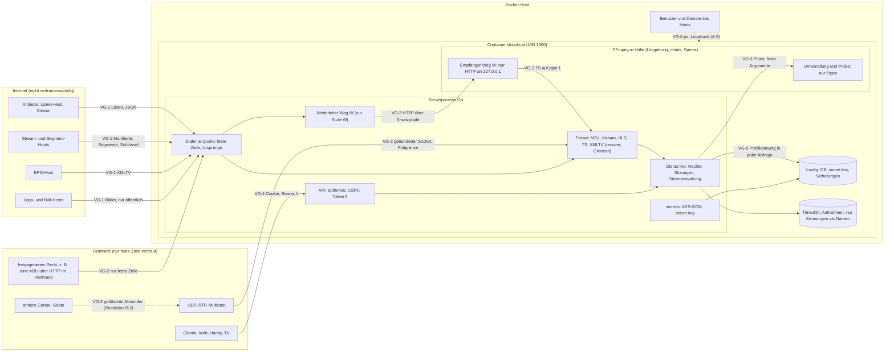

# Konzept 28 · Sicherheitskonzept und Bedrohungsmodell

Stand: 29. November 2026 · Fassung 3 · Status: Entwurf nach Zweitprüfung, nicht freigegeben

Dieses Dokument legt fest, wie Live-TV in Slouchcat sicher gebaut wird: welche Werte zu schützen sind, wer
angreifen kann, auf welchem Weg, und mit welcher Regel jeder Weg geschlossen wird. Es beantwortet Auftrag
Abschnitt 10 (`anhang/auftrag-2026-11-28.md`, Z. 1316–1406) Zeile für Zeile. Grundlage ist das unabhängige
Sicherheits-Review (`anhang/reviews/review-1-sicherheit.md`, Befunde RS-01 bis RS-24, Massnahmen MS-01 bis
MS-28), die Fassung 3 von `04-architektur.md` und `05-streaming-und-fast-zapping.md` (Entscheide T-1 bis
T-29; massgebliche Werte in `04` Abschnitt 14), das Review des Datenmodells und der API
(`anhang/reviews/review-2-datenmodell-api.md`, Befunde RD-06, RD-07, RD-08, RD-16) und die Nachprüfung an
Primärquellen (`anhang/nachpruefung-quellen.md`, «Nachprüfung Nr. n»). Fassung 3 arbeitet die Zweitprüfung
Sicherheit ein (`anhang/reviews/review-6-sicherheit-zweitpruefung.md`, Befunde RT-01 bis RT-21), dazu die Befunde
aus dem Gesamtreview und der Zweitprüfung Architektur, die dieses Dokument betreffen (`review-4-gesamt.md` RG-09,
`review-5-architektur-zweitpruefung.md` RB-05, RB-17), und die Entscheide des Koordinators nach Review 4 und 6.
**Grundregel:** Solange du eine Frage nicht beantwortet hast, gilt die wortlauttreue Vorgabe, bei einer
Sicherheitsfrage die **sichere** Vorgabe; eine Empfehlung gilt erst mit deiner Antwort. Wo dieses Dokument
strenger ist als `04`, gilt das Strengere, und die Stelle ist in Abschnitt 14 genannt. Zahlen stehen massgeblich in `04`
Abschnitt 14; nennt dieses Dokument eine Zahl, ist sie von dort übernommen oder als eigene Annahme
gekennzeichnet. Alles hier ist **spezifiziert**, nichts ist gebaut. Wo eine Regel auf bestehendem Code beruht, steht
**gebaut** mit Datei und Zeile (Stand Arbeitsbaum `claude/konzept-live-tv`, Server 1.44.1).

## Lesart

**Kennungen.** `SM-nn` ist eine Sicherheitsmassnahme dieses Dokuments (Katalog in Abschnitt 11), `BD-nn` eine
Bedrohung (Abschnitt 3), `SG-n` ein Schutzgut, `AK-n` ein Akteur, `VG-n` eine Vertrauensgrenze (Abschnitt 2),
`R-n` ein Restrisiko, `O-n` ein offener technischer Punkt und `F-n` eine Frage an dich (Abschnitt 13). `O-n`
und `F-n` zählen in dieser Datei eigen; aus anderen Dateien werden sie mit der Dateinummer genannt, etwa
«`04` F-13». `RS-nn` und `MS-nn` sind Befunde und Massnahmen des Reviews, `T-n` die tragenden Entscheide aus
`04`, `M-n` die Messpunkte aus `05` Abschnitt 10.1.

**Einordnung jeder Regel:** **gebaut** (mit Datei:Zeile), **spezifiziert** (dieses Konzept legt fest),
**Annahme** (Zahl oder Verhalten, das der Bau belegen muss), **offen** (O-n oder F-n), **zu messen** (M-n).

**Stufen** nach dem Schnitt von `18-umsetzungsplan.md` (Abschnitt 4): **0** Regeln und Grundlagen, **1a**
Sender schauen (HTTP, HLS, Xtream, M3U; nur öffentliche Ziele), **1b** Senderverwaltung erweitert, **2**
Programmzeitschrift, **3** Empfang und Umschalten, **H** Quellen im Heimnetz, UDP, RTP und Multicast, **4**
Timeshift, **5** Aufnahmen, **6** Serien und wiederkehrende Aufnahmen, **L** RTSP und RTMP, **W** DASH und HLS
mit fMP4 (nur nach M-10), **E** Ergänzungen nach Messung. «Pflicht vor Stufe n» heisst: Die Stufe wird nicht
veröffentlicht, solange die Massnahme und ihr Testfall fehlen. Gebaut wird eine Stufe ohnehin erst nach deiner
ausdrücklichen **Baufreigabe** dieser Stufe (Regel 11); «Konzept freigegeben» ist etwas anderes. Die Dialer-Prüfung mit leerer Zielliste
(«nur öffentlich») gehört zu 1a, die festen Ziele im Heimnetz zu H (`18` D-4).

**Begriffe, einmal erklärt.** **SSRF** (serverseitige Anfragefälschung): Jemand bringt den Server dazu, eine
Adresse abzurufen, die er selbst nicht erreicht, etwa den Router im Heimnetz. **DNS-Rebinding:** Ein Name zeigt
bei der Prüfung auf eine öffentliche Adresse und beim Verbinden auf eine im Heimnetz. **IDOR** (unsicherer
direkter Objektverweis): Jemand ändert eine Kennung in der Anfrage und bekommt fremde Daten. **CSRF**: Eine
fremde Webseite löst im Browser des Opfers eine Aktion bei Slouchcat aus. **Sandbox** (hier «Sperre»): Der
Kernel verbietet einem Prozess Dinge, die er sonst dürfte, etwa Dateien lesen oder Verbindungen öffnen.
**Fuzzing:** Ein Test füttert einen Parser mit Millionen zufällig veränderter Eingaben und sucht Abstürze.

---

## 1. Geltung und Grundsatz

**Grundsatz (spezifiziert).** Alle bestehenden Sicherheitsanforderungen von Slouchcat gelten für Live-TV
unverändert fort (Auftrag Z. 1402): `CLAUDE.md` Regeln 2, 3, 4, 6, 7, 10, 12, ADR 0025 («FFmpeg sieht keine
Adresse»), ADR 0040 (Sitzungsarten), ADR 0032 (Löschen), der Netzwächter `netguard` für jede fremd bestimmte
Adresse, «unsichtbar heisst 404, nie 403». **Keine Lockerung ohne Namen** (Z. 1404): Jede Abweichung steht in
der Tabelle unten, mit Grenze, mit der Rolle, die sie setzen darf, und mit der Stelle, an der sie sichtbar ist.
Was dort nicht steht, ist nicht erlaubt. Die Ausnahmen werden mit Stufe 0 in Regeln und Spec eingetragen
(`02` Abschnitt 4), nicht mit diesem Papier (SM-43).

### 1.1 Benannte Ausnahmen mit Sicherheitsbezug

| Nr. | Ausnahme | Genaue Grenze | Wer setzt sie | Wie sie sichtbar ist |
|---|---|---|---|---|
| **A-3** (präzisiert, `04` 10.9, O-24; Stufe H) | **Quellen im Heimnetz mit festen Zielen.** Eine Live-Quelle darf Adressen im Heimnetz erreichen. Bis Stufe H gibt es keine Freigabe (nur öffentliche Ziele). | Nur als **Liste fester Ziele je Quelle**: ab Werk je Eintrag **eine** Adresse (/32 bzw. /128) mit **einem** Port. Ein kleines Netz (höchstens /28 bzw. /124) oder ein Portbereich (höchstens 16 Ports) nur mit zweiter Bestätigung, die zählt, was sie umfasst, und nie, wenn das Netz das Standard-Gateway des Heimnetzes oder des Containers enthält (4.5, RT-05; Werte als Annahme, strenger als `04` 14.9). Jede Verbindung der Quelle wird an der wirklich angewählten Adresse geprüft; ein Verweis (Sender, Unterliste, Segment, Schlüssel, Weiterleitung) ist erlaubt, wenn er **innerhalb** der Ziele liegt, sonst nicht. **Nie** freigebbar: Loopback, `0.0.0.0/8`, unspezifiziert, Link-Local mit den Metadaten-Adressen, eigene Adressen des Containers (im Netzmodus «host» die des Hosts), der Port des Weiterleiters, die Netze der eigenen Container-Schnittstellen als Ganzes (das Gateway des Container-Netzes nur als Einzelziel mit Einzelport und eigener Warnung). Logos, EPG-Bilder und `url-tvg` aus Listen nie. Radio, Podcasts und Bilder bleiben unverändert. | **nur der Administrator** (mit Hauptprofil, wie jede Verwaltungsoperation); Konten und Profile tragen keine Quellen ein | LA-02: Abzeichen «Heimnetz: n Ziele» je Quelle; LA-03: Abschnitt «Ziele im Heimnetz» mit den aufgelösten Adressen; LA-01: Zahl der Quellen mit Freigabe; Protokoll der Verwaltung je Änderung (SM-41) |
| **A-9** (neu, `04` 10.6, F-11; Stufe H) | **Netzmodus «host» oder veröffentlichte UDP-Ports** für UDP, RTP und Multicast. | Nur über die Zusatzdateien `compose.live-udp.yaml` und `compose.live-hostnet.yaml` (oder ein eigenes Netz nach `04` F-11 (b)). Folgen im Wortlaut von `04` 10.6 Punkt 1 bis 4. Im Netzmodus «host» ist Weg W gesperrt und `netguard` verweigert zusätzlich alle Adressen der Schnittstellen des Hosts (SM-11). | **der Betreiber** des Docker-Hosts (wer die Compose-Dateien wählt), nicht die Verwaltung | Die Zusatzdatei setzt `SLOUCHCAT_NETWORK_MODE=host`; der Server prüft beim Start zusätzlich die Schnittstellen (O-4). LA-01 und die Systemseite zeigen dauerhaft «Netzmodus host: Sicherheitsfolgen» mit Link auf den Text. |
| **ADR 0025, Weg W** (`04` T-4; in `02` als A-10 nachzutragen, RT-09) | **FFmpeg liest selbst über HTTP**, aber nur vom Go-Weiterleiter. | Nur DASH und HLS mit fMP4 oder getrennter Tonspur; nur unverschlüsseltes HTTP an `127.0.0.1`; jede Adresse auf einen Ersatzpfad des Weiterleiters umgeschrieben (`05` 2.6), und der Weiterleiter beantwortet nur diese (SM-51); kein Tunnel, keine Proxy-Einstellung; nur mit der hart gesetzten Sperre des Prozesses (SM-09); nur nach dem Beleg M-10; nie im Netzmodus «host». Ohne Sperre und ohne M-10 wird Weg W **nicht gebaut** (`04` F-13). | **Marco** entscheidet über den Bau (`04` F-13); im Betrieb wählt der Server Weg W je Quelle selbst, aber nur, wenn die Hülle die Sperre beim Start vollständig setzen kann | LA-03 Test: «Diese Quelle liest FFmpeg über den geschützten Weiterleiter»; LA-01: «FFmpeg-Sperre: aktiv» oder «Eindämmung nicht verfügbar (DASH nicht verfügbar)» |
| **A-6** (`02`, E-3; `04` F-10) | **Hauptprofil sieht, löscht und spielt Aufnahmen seiner Profile mit Altersgrenze.** | Nur das Hauptprofil **desselben** Kontos, nur Aufnahmen von Profilen mit Altersgrenze, Abspielen nur mit bei ihm wirksamem «Live-TV» (`03` DR-03). Vorgabe (b) mit Gegenrichtung nach `07` 4.3: nur Aufnahmen, die entstanden sind, als das Profil eine Altersgrenze hatte, und nur, solange es heute noch eine hat (`04` F-10). Als Altersgrenze zählt auch die **des Kontos**, die der Administrator setzt (`07` 4.4, `07` F-1); damit erweitert ein zweiter Akteur A-6. Profile ohne Altersgrenze sind gegenüber anderen Profilen über die API privat (404); **gegen das Hauptprofil schützt sie nur eine PIN, und das Hauptprofil kann jede PIN ersetzen** (gebaut, `server/internal/auth/profiles.go:464-497`; R-12, F-5). Die Zugriffsregel ist **eine** Abfrage in `liveq` (SM-37). | **Marco** (E-3); im Betrieb folgt sie aus der Altersgrenze, die das Hauptprofil oder der Administrator setzt | Hauptprofil: Bereich «Aufnahmen meiner Profile» (`03` DR-02); Profil mit Altersgrenze: Hinweis in «Meine Aufnahmen» «Dein Hauptprofil kann diese Aufnahmen sehen» (Empfehlung für `14`) |
| **A-2, A-5** (LTV-015) | **Live-TV ohne Altersprüfung.** | Nur Live-TV, Programmdaten und Aufnahmen von Fernsehsendern. Filme, Serien, Hörbücher, Podcasts und alle anderen altersgefilterten Bibliotheken bleiben unverändert; Live-Antworten tragen keine `ItemRef` (A-8). Der Deckel des Administrators je Konto bleibt verbindlich. | **Hauptprofil** je Profil (innerhalb des Deckels), **Administrator** je Konto (Deckel) | Profilverwaltung: Schalter «Live-TV» mit Satz «Live-TV hat keine Altersprüfung. Das Profil sieht alle Sender des Kontos.» (Empfehlung für `14`); ab Werk aus für Profile mit Altersgrenze (`03` DR-01) |

**Weitere benannte Ausnahmen ohne engeren Sicherheitsbezug**, hier nur zur Vollständigkeit: A-1 (Nicht-Ziel
Live-TV aufgehoben, ohne DRM und ohne Plattform-Streams), A-4 (Aufnahmen löscht der Server nur nach der vom
Profil gewählten Frist oder «behalte N»), A-7 (eigene, schreibbare Speicherorte nur für Live-TV), A-8
(Kinderprofil-Vertragstest zählt Sender nicht als Titel). Ihre Grenzen stehen in `02` Abschnitt 4.

**In `02` und ADR 0046 noch nachzutragen** (RT-09; dieses Dokument ändert dort nichts): **A-10** Weg W mit der
Grenze wörtlich aus `05` 2.6 (Sperre hart, M-10, nie «host»; ADR 0046 nennt Weg W heute ohne diese Bedingungen);
**A-11** Zusatz zu Regel 3: `execve` nur in `internal/transcode` für die Hülle (`04` 10.8, O-26); **A-12** das
Hauptprofil verwaltet Aufnahmen seiner Profile mit Altersgrenze auch ohne eigenes wirksames «Live-TV»
(`listProfileLiveRecordings`, Löschen nach `03` DR-03), sonst widerspräche es SM-38; oder `08` F-1 so entscheiden,
dass SM-38 ohne Ausnahme gilt. **A-13** nur, wenn du bei F-1 Variante (c) wählst (Umwandlung ohne Sperre als
ausdrückliche Wahl des Betreibers). SM-43 prüft A-1 bis A-13.

### 1.2 Was ausdrücklich keine Lockerung ist

- Die Prozessklasse «Empfang» mit `oom_score_adj 100` (`04` T-20) ändert nur die Reihenfolge bei Speichermangel.
- Die eigene Datei `epg.db` ohne Sicherung (`09` F-1) verliert im Schadensfall Daten, gibt aber nichts preis.
- Strengere Regeln als heute sind **Verschärfungen**: die neuen Präfixe im Adressfilter (SM-03, wirken auch für
  Radio und Podcasts), die eigene Umgebung und die Ressourcengrenzen für Live-FFmpeg (SM-22), die
  Compose-Härtung (SM-23, `04` F-12), «Fehlerausgabe von FFmpeg nie roh» (SM-19).
- **Verschärfungen, die Bestehendes ändern, sind keine stillen Änderungen:** Die neuen Präfixe können einen
  bisher spielenden Radiosender oder einen Podcast auf einer solchen Adresse stummschalten. Das ist eine
  Verhaltensänderung einer bestehenden Funktion und steht als Feinschliff-Frage in `20` (Review 4 RG-09; Vorgabe:
  Verschärfung mit Hinweis im Release-Text).
- **Empfehlung an den Bestand (RT-18, O-13):** Die FFmpeg-Aufrufe der Dateiwiedergabe, der Untertitel, Bilder,
  Fingerabdrücke und Proben der Bibliothek starten heute ohne eigene Umgebung und ohne Grenzen (gebaut:
  `server/internal/transcode/session.go:649`, `:663`; `backend.go:314`; `subtitles.go:163`, `:221`; `tags.go:84`;
  `fingerprint.go:33`; `probe.go:535`; `images.go:302`). Mit Live-TV schützt `secret.key` zusätzlich alle
  Anbieter-Zugänge. Empfohlen ist in Stufe 0 eine Funktion in `transcode`, die **jedem** FFmpeg- und
  `ffprobe`-Aufruf eine kleine Umgebung (ohne `SLOUCHCAT_*`, `http_proxy`, `no_proxy`) und `RLIMIT_CORE 0` gibt;
  die Hülle mit Dateisperre für die Bibliothek ist ein eigener Schritt nach M-25. Das ist **nicht Teil von Konzept
  28** und ändert die VOD-Nähte nicht im Verhalten; es ist eine Verschärfung und braucht deine Zustimmung (SM-55).

---

## 2. Schutzgüter, Akteure, Vertrauensgrenzen

Übernommen aus dem Review (Abschnitt 3.1 bis 3.3), um SG-8 ergänzt.

### 2.1 Schutzgüter

| Nr. | Schutzgut | Warum wichtig |
|---|---|---|
| SG-1 | **Heimnetz**: Router, NAS, Smart-Geräte, Docker-Host, Dienste auf Loopback, Metadaten-Adressen | Der Server steht darin und darf nicht zum Sprungbrett werden. |
| SG-2 | **Zugangsdaten der Anbieter**: Benutzer, Passwort, Token in Adressen, Kopfzeilen | Missbrauch, Sperre des Zugangs, Kosten. |
| SG-3 | **Geheimnisse des Servers**: `/config/secret.key`, `slouchcat.db`, Sicherungen, Sitzungen, API-Schlüssel in der Umgebung (`deploy/compose.yaml:47-71`) | Mit ihnen sind alle anderen Schutzgüter offen. |
| SG-4 | **Private Daten der Profile**: Aufnahmen, Planungen, Serienregeln, Erinnerungen, Favoriten, Verlauf, Timeshift-Puffer | LTV-009, A-6. |
| SG-5 | **Verfügbarkeit**: Wiedergabe von Filmen, laufende Aufnahmen, Jobs | Live-TV darf Bestehendes nicht beeinträchtigen (Auftrag Abschnitt 5). |
| SG-6 | **Bestehende Bibliothek und ihre Regeln**: Altersmodell, `items` nur über `visibility`, Medien nur lesend | A-2, A-7, Regeln 2 und 4. |
| SG-7 | **Integrität des Bildes**: was ein Profil mit Altersgrenze sieht, was aufgenommen wird | LTV-015, LTV-020. |
| SG-8 | **Nachvollziehbarkeit**: wer welche Quelle, Freigabe oder welchen Speicherort wann geändert hat | Auftrag 10.1 «explizite Freigaben»; ohne Nachweis ist eine Freigabe nicht prüfbar. |

### 2.2 Akteure

| Nr. | Akteur | Fähigkeit | Ziel |
|---|---|---|---|
| AK-1 | Böswilliger oder gekaperter **IPTV-Anbieter oder Listen-Host** (M3U, Xtream) | bestimmt Sender-Adressen, Kopfzeilen in der Liste, Antworten der Xtream-Schnittstelle, Weiterleitungen | Heimnetz erreichen, Zugangsdaten ernten, Server stören, Schadcode in FFmpeg |
| AK-2 | **Stream-, Segment- oder CDN-Host** (auch der Host einer absoluten Adresse im Manifest) | bestimmt Mediendaten, Manifeste, Unterlisten, Schlüssel-Adressen, Weiterleitungen | wie AK-1, dazu die DRM-Erkennung aushebeln |
| AK-3 | **EPG-Host** | bestimmt XMLTV (auch gepackt) und `<icon>`-Adressen | Speicher und CPU erschöpfen, SSRF über Bilder, Inhalte einschleusen |
| AK-4 | **Logo- oder Bild-Host** | bestimmt Bilddaten | Schadcode im Bild-Decoder, Nachverfolgung des Servers |
| AK-5 | **Konto oder Profil ohne Live-TV-Recht** | gültige Sitzung, direkte API-Aufrufe | Live-TV, EPG, Logos oder Aufnahmen trotzdem erreichen |
| AK-6 | **Profil eines anderen Kontos** | eigene Sitzung mit Recht | fremde Aufnahmen, Planungen, Erinnerungen, Puffer |
| AK-7 | **Profil im selben Konto**, auch das **Hauptprofil** | Profilwechsel, Rechte des Hauptprofils | Aufnahmen anderer Profile sehen |
| AK-8 | **Profil mit Altersgrenze** | eigene Sitzung | Live-TV ohne Freigabe nutzen; Altersfilter der Bibliothek über Live-TV umgehen |
| AK-9 | **Gast oder Gerät im Heimnetz** | erreicht Port 8096, UDP-Ports und Multicast; kann Absender fälschen | Pakete in UDP-Sender einschleusen, fluten, mitlesen |
| AK-10 | **Administrator mit Fehlbedienung** | trägt Quellen ein, gibt Ziele frei, wählt Netzmodus und Speicherorte | ungewollte Öffnung des Heimnetzes, volle Platte, Lecks in Bildschirmfotos |
| AK-11 | **Angreifer mit erbeutetem Token `lt`** oder erbeuteter Sitzung | Adresse aus Browserverlauf, Proxy-Protokoll, Bildschirmfoto | fremd fernsehen, Plätze belegen, Prozesse auslösen |
| AK-12 | **Benutzer auf dem Docker-Host** | `ps`, `/proc`, Loopback des Hosts | Argumentlisten und Ersatzpfade lesen, Dienste auf Loopback erreichen |
| AK-13 | **Fremde Webseite** im Browser eines angemeldeten Benutzers | Formulare und Bilder auf Slouchcat-Adressen | CSRF auf schreibende Live-Operationen |

### 2.3 Vertrauensgrenzen

| Nr. | Grenze | Was sie überquert | Wächter |
|---|---|---|---|
| VG-1 | Internet ↔ Serverprozess | Listen, Manifeste, Segmente, Schlüssel, XMLTV, Bilder, Xtream-JSON | Dialer je Quelle (SM-01), Grenzen der Parser (Abschnitt 7) |
| VG-2 | Heimnetz ↔ Serverprozess | freigegebene Quellen, UDP, RTP, Multicast, Clients im Heimnetz | feste Ziele (SM-01), Binden und Flutgrenze (SM-10) |
| VG-3 | Serverprozess ↔ FFmpeg | Pipes (Regelfall); in Weg W HTTP über den Weiterleiter auf `127.0.0.1`; Umgebung, Argumente | Hülle (SM-22), Argumentregel (SM-21), Sperre (SM-09) |
| VG-4 | Client ↔ API | Cookie, Bearer (`app`, `tv`), Token `lt` in Adressen, CSRF-Kopf | `authorize` (gebaut, `server/internal/api/session.go:281-288`, `:305-316`), Dienst `live` (SM-35) |
| VG-5 | Profil ↔ Profil, Konto ↔ Konto | Abfragen in `liveq` mit Profil- und Kontokennung | eine Zugriffsabfrage je Objektart (SM-37) |
| VG-6 | Container ↔ Docker-Host | Netzmodus, Volumes (`/config`, `/cache`, Aufnahmen, `tmpfs`), Prozessliste des Hosts | Bridge-Netz ab Werk, A-9, Compose-Härtung (SM-23) |
| VG-7 | Verwaltung ↔ übrige Rollen | Quellen, Freigaben, Geheimnisse (nur schreibbar), technische Angaben ohne private Titel | `x-visibility: admin`, SM-16, SM-42 |

### 2.4 Datenflussdiagramm

Gestrichelte Rahmen sind Vertrauensbereiche, Pfeile mit `VG-n` überqueren eine Grenze.

---

## 3. Bedrohungsmodell

Jede Zeile: **Bedrohung** (ein Satz, verständlich ohne Fachwissen), Akteur, Angriffsweg, Schutzgut, **Risiko
ohne Massnahme** (Live-TV naiv gebaut), Massnahme, **Restrisiko** (nach allen Pflichtmassnahmen). Risiko
nach Schaden × Ausnutzbarkeit: hoch, mittel, niedrig. Gegliedert nach den sechs Unterabschnitten des Auftrags.

### 3.1 Netzwerk (Auftrag 10.1)

| Nr. | Bedrohung | Akteur | Angriffsweg | Schutzgut | Risiko ohne | Massnahme | Restrisiko |
|---|---|---|---|---|---|---|---|
| BD-01 | Eine Senderliste nennt als «Sender» den Router, und der Server ruft ihn auf. | AK-1 | Sender-, Listen-, Segment- oder Schlüsseladresse einer öffentlichen Quelle | SG-1 | hoch | SM-01, SM-02, SM-03 | niedrig |
| BD-02 | Eine Quelle mit Heimnetz-Freigabe schickt den Server über ihre Liste an beliebige Geräte im Heimnetz. | AK-1, AK-9, AK-10 | Sender oder Verweise einer freigegebenen Quelle ausserhalb des freigegebenen Geräts | SG-1 | hoch | SM-01, SM-06, SM-41, SM-47 | niedrig (R-6: das freigegebene Gerät selbst bleibt erreichbar, auch für den Host einer Liste aus dem Internet) |
| BD-52 | Eine Freigabe für ein ganzes Netz oder viele Ports öffnet dem Listen-Host wieder das halbe Heimnetz, auch den Router oder Dienste anderer Container. | AK-1, AK-10 | Ziel `192.168.1.0/24` mit Ports 80–143; Gateway des Docker-Netzes | SG-1 | hoch | SM-01 (Einzelziel ab Werk, Netz eng, kein Gateway; RT-05) | niedrig |
| BD-03 | Eine Weiterleitung führt vom Anbieter auf eine Adresse im Heimnetz oder auf unverschlüsseltes HTTP. | AK-1, AK-2 | Antwort 3xx | SG-1, SG-2 | hoch | SM-04 | niedrig |
| BD-04 | Ein Name zeigt bei der Prüfung nach aussen und beim Verbinden ins Heimnetz. | AK-1, AK-2 | DNS-Rebinding, Name mit öffentlicher und privater Adresse | SG-1 | hoch | SM-05 | niedrig |
| BD-05 | Eine IPv6- oder eingebettete Adresse rutscht durch den Filter. | AK-1, AK-2 | NAT64, Teredo, IPv4-übersetzte Form, weltweite IPv6 im Heimnetz | SG-1 | mittel | SM-03, SM-11 | niedrig (R-4: weltweite IPv6 und eigene WAN-Adresse) |
| BD-06 | Eine Verbindung, die für eine freigegebene Quelle offen ist, wird von einer anderen Quelle ohne Prüfung weiterbenutzt. | AK-1 | gemeinsamer Verbindungsvorrat | SG-1 | mittel | SM-02 | niedrig |
| BD-07 | Der Server meldet beim Test oder Import, welche Geräte im Heimnetz antworten, und wird so zum Portscanner. | AK-1, AK-10 | Fehlertexte, Zustände, Antwortzeiten | SG-1 | mittel | SM-06 | niedrig |
| BD-08 | Unterlisten verweisen im Kreis oder laden in hohem Takt neu. | AK-2 | HLS mit Zieldauer 0, Kette A→B→A, tausende Varianten | SG-5 | mittel | SM-07 | niedrig |
| BD-09 | FFmpeg verbindet sich in Weg W an Go vorbei mit einer Adresse, die niemand geprüft hat. | AK-2 | absolute Adresse im Manifest, durchgereichte Weiterleitung, Codepfad ohne Proxy | SG-1, SG-2 | hoch | SM-08, SM-09 | mittel ohne M-10, niedrig mit (R-3) |
| BD-10 | Ein Gerät im Heimnetz speist ein falsches Bild in einen UDP-Sender ein, den auch Kinder sehen. | AK-9 | gefälschter Absender, Multicast-Gruppe | SG-7, SG-5 | hoch | SM-10 | mittel (R-2) |
| BD-11 | Ein lauschender UDP-Port wird mit Daten geflutet oder der Empfänger sendet Antworten an gefälschte Absender. | AK-9 | UDP-Flut, RTCP | SG-5, SG-1 | mittel | SM-10 | niedrig |
| BD-12 | Der Netzmodus «host» öffnet Dienste auf dem Loopback des Docker-Hosts für jede Lücke der Abwehr. | AK-1, AK-2, AK-12 | `127.0.0.1` des Hosts, IPv6 des Hosts | SG-1, SG-3 | hoch | SM-11 | mittel (R-5) |
| BD-13 | Ein RTSP-Server lenkt den Datenkanal auf eine Adresse im Heimnetz um. | AK-2 | `Transport`-Kopf mit `destination=`, Rückfall auf UDP | SG-1 | mittel | SM-12 | niedrig |
| BD-14 | Logo- und Bild-Adressen lassen den Server ins Heimnetz greifen oder verraten Clients an fremde Hosts. | AK-1, AK-3, AK-4 | `tvg-logo`, `<icon>` | SG-1 | mittel | SM-13 | niedrig |
| BD-53 | Ein gekaperter FFmpeg-Empfänger lässt sich vom Weiterleiter beliebige Seiten des Anbieters mit dessen Zugangsdaten holen. | AK-2 (nach BD-24) | Pfad unter einem gültigen Ersatzpfad, `//fremd/x` als Rest | SG-2 | mittel | SM-51 (RT-08) | niedrig |

### 3.2 Zugangsdaten (Auftrag 10.2)

| Nr. | Bedrohung | Akteur | Angriffsweg | Schutzgut | Risiko ohne | Massnahme | Restrisiko |
|---|---|---|---|---|---|---|---|
| BD-15 | Passwörter und Token der Anbieter stehen lesbar in der Datenbank und in jeder Sicherung. | Dritte mit Kopie, AK-10 | Klartext in Spalten, Sicherung ohne Geheimnisse, `VACUUM INTO` | SG-2 | hoch | SM-14, SM-18 | niedrig |
| BD-16 | Ein gekaperter Listen-Host trägt einen Sender auf seinem eigenen Host ein und erntet die Kopfzeilen und Passwörter der Quelle. | AK-1 | Kopfzeilen und Anmeldung an jeden Host der Liste | SG-2 | hoch | SM-15 | niedrig |
| BD-17 | Die Xtream-Antwort nennt einen anderen Server, und der Server schickt Benutzer und Passwort im Pfad dorthin. | AK-1 | `server_info.url`, `server_info.port` | SG-2 | hoch | SM-20 | niedrig |
| BD-18 | Eine Senderliste setzt eigene Kopfzeilen wie `Authorization` oder `X-Forwarded-For` für Anfragen ins Heimnetz. | AK-1 | `#EXTVLCOPT`, `#EXTHTTP`, Anhang `\|…` | SG-1, SG-2 | mittel | SM-15 | niedrig |
| BD-19 | Zugangsdaten landen im Protokoll, im Fehlerring der Verwaltung oder im kopierten Diagnosetext. | AK-10, Dritte mit Protokoll | Adresse im Fehlertext, `slog.Any`, Kopfzeilen als Wert | SG-2 | hoch | SM-17 | niedrig |
| BD-20 | Die Verwaltung zeigt Adressen oder Kopfzeilen im Klartext, die dann in Bildschirmfotos stehen. | AK-10 | API-Antwort, Maskierung nach Namen | SG-2 | mittel | SM-16 | niedrig |
| BD-21 | Zugangsdaten erscheinen in der Prozessliste, in der Umgebung oder in `ffmpeg.log`. | AK-12 | `/proc/<pid>/cmdline`, `/proc/<pid>/environ`, Datei | SG-2, SG-3 | hoch | SM-19, SM-22 | niedrig |
| BD-22 | Eine in eine andere Zeile kopierte verschlüsselte Spalte schickt ein Passwort an einen fremden Host. | Dritte mit Schreibzugriff auf eine Sicherung | Wiederherstellung einer manipulierten Sicherung | SG-2 | niedrig | SM-14 | niedrig |
| BD-54 | Zugangsdaten einer `https`-Quelle gehen an einen Listeneintrag `http://` desselben Hosts, oder ein Listen-Host landet als Vorschlag unter den Ursprüngen. | AK-1 | Ursprung nur als Host verglichen; Vorschlag «alle übernehmen» | SG-2 | mittel | SM-54 (RT-14) | niedrig |

### 3.3 FFmpeg und externe Prozesse (Auftrag 10.3)

| Nr. | Bedrohung | Akteur | Angriffsweg | Schutzgut | Risiko ohne | Massnahme | Restrisiko |
|---|---|---|---|---|---|---|---|
| BD-23 | Ein Wert aus der Quelle (Sprachkennung, Dienstname) gelangt in einen Filter und lässt FFmpeg eine Datei oder Adresse öffnen. | AK-1, AK-2, AK-3 | Argumentliste, Filtergraph, Formatraten an der Pipe | SG-3 | mittel | SM-21 | niedrig |
| BD-24 | Ein präparierter Strom nutzt eine Speicherlücke in FFmpeg, liest `secret.key`, überschreibt die Datenbank innerhalb ihrer Grösse (etwa den Passwort-Hash des Eigentümers) und übernimmt so das Konto. | AK-1, AK-2, AK-4, AK-9 | Demuxer, Decoder, Untertitel, Teletext | SG-3, SG-1 | hoch | SM-22 (Umwandlung nur mit wirksamer Sperre, RT-01), SM-48, SM-49, SM-23, SM-26; in Weg W SM-09 | niedrig mit Sperre; ohne Sperre gibt es keine Live-Umwandlung (Vorgabe F-1); bei F-1 (c) hoch (R-1) |
| BD-55 | Die Hülle setzt die Sperre auf einem anderen Betriebssystem-Faden als dem, der FFmpeg startet, und FFmpeg läuft unbemerkt ohne Sperre. | – (Baufehler) | Go-Scheduler zwischen Sperre und `execve` | SG-3 | mittel | SM-48 (RT-02, RB-17) | niedrig |
| BD-56 | Ein gekaperter FFmpeg umgeht den Filter der Systemaufrufe über `io_uring`, 32-Bit-Aufrufe oder Kennzeichen im Typ eines Sockets. | AK-1, AK-2 (nach BD-24) | `io_uring_setup`, `int 0x80`, `SOCK_DGRAM\|SOCK_NONBLOCK`, `AF_UNIX` | SG-1, SG-3 | mittel | SM-49 (RT-03) | niedrig |
| BD-57 | Ein FFmpeg der Dateiwiedergabe oder der Bilder liest `secret.key` und damit jetzt auch die Anbieter-Zugänge. | AK-4, Fremde über Bibliotheksmedien | Aufrufe ausserhalb der Hülle | SG-2, SG-3 | mittel | SM-55 (Empfehlung an den Bestand, RT-18), SM-13 (Bildweg für Live über die Hülle, RT-17) | mittel (R-14) |
| BD-25 | Ein kaputtes Paket bringt einen Go-Parser zum Absturz und beendet den ganzen Server. | AK-1, AK-2, AK-9 | Längenfelder in TS, PSI, PES, RTP; Listen | SG-5 | hoch | SM-25 | niedrig |
| BD-26 | Viele, hängende oder verwaiste FFmpeg-Prozesse erschöpfen CPU, Speicher und Prozesstabelle. | AK-5 mit Recht, AK-11, AK-2 | Umschalten, Spulen, Segmentabruf ausserhalb des Erzeugten | SG-5 | hoch | SM-24, SM-39, SM-23 | niedrig |
| BD-27 | Eine bekannte Lücke in FFmpeg oder einer Go-Bibliothek bleibt im Image. | AK-1, AK-2 | veraltete Fassung | SG-3 | mittel | SM-26 | mittel (R-1) |
| BD-58 | Ein fataler Laufzeitfehler (Stapelüberlauf, Speicher erschöpft) in einem Parser beendet den Server trotz `recover`. | AK-1, AK-2 | Rekursion über eine Tiefe aus der Quelle | SG-5 | mittel | SM-25 (RT-15) | niedrig |

### 3.4 Import und Parser (Auftrag 10.4)

| Nr. | Bedrohung | Akteur | Angriffsweg | Schutzgut | Risiko ohne | Massnahme | Restrisiko |
|---|---|---|---|---|---|---|---|
| BD-28 | Eine XMLTV-Datei lädt über eine Entität fremde Dateien nach, bläht sich auf oder verschachtelt sich so tief, dass der Speicher wächst. | AK-3 | `<!DOCTYPE>`, `<!ENTITY>`, «Billion Laughs», tiefe Verschachtelung beim Lesen mit `Token()` | SG-3, SG-5 | mittel | SM-28 | niedrig |
| BD-29 | Eine gepackte Datei entpackt sich zu vielen Gigabyte. | AK-3, AK-1 | gzip-, zip-, bzip2-Bombe, Transport-gzip | SG-5 | hoch | SM-29 | niedrig |
| BD-30 | Ein einziges riesiges Element oder eine riesige Zeile füllt den Speicher, bevor eine Grenze greift. | AK-1, AK-3 | 2 GB in einem `<desc>`, M3U ohne Zeilenumbruch | SG-5 | hoch | SM-27, SM-28 | niedrig |
| BD-31 | Eine kaputte oder riesige Senderliste hält den Import und den einzigen Datenbankschreiber auf. | AK-1, AK-10 | 10 GB, eine Million Einträge, ungültiges UTF-8, tiefes JSON | SG-5 | hoch | SM-27 | niedrig |
| BD-32 | Eine Programmsuche mit Sonderzeichen führt zu Fehlern oder sehr teuren Abfragen. | AK-5 mit Recht | FTS5-Syntax in `MATCH` | SG-5 | niedrig | SM-30 | niedrig |
| BD-33 | Programmdaten enthalten HTML oder Steuerzeichen, die im Client oder in Meldungen wirken. | AK-3 | Titel, Beschreibung | Clients | mittel | SM-28 (Text), gebaut: Escaping der E-Mail (`server/internal/notify/texts.go:85-92`) | niedrig |
| BD-59 | Ein EPG-Host liefert innerhalb der Grössengrenzen Millionen Sendungen und füllt das Volume der Filme. | AK-3 | Sendungen von einer Sekunde, Volltextindex | SG-5 | niedrig | SM-53 (RT-13) | niedrig |

### 3.5 Dateisystem und Speicherung (Auftrag 10.5)

| Nr. | Bedrohung | Akteur | Angriffsweg | Schutzgut | Risiko ohne | Massnahme | Restrisiko |
|---|---|---|---|---|---|---|---|
| BD-34 | Timeshift-Puffer füllen die Platte, auf der auch Filme umgewandelt werden. | AK-5 mit Recht, AK-10 | viele Sitzungen, kein Deckel | SG-5 | hoch | SM-31, SM-39 | niedrig |
| BD-35 | Ein Sendungs- oder Sendertitel wird zum Dateinamen und bricht aus dem Speicherort aus. | AK-3, AK-1 | `../` im Titel | SG-6 | mittel | SM-32 | niedrig |
| BD-36 | Die Bereinigung löscht über einen Symlink Dateien der Bibliothek. | AK-10 | Symlink im Timeshift-Ordner | SG-6 | mittel | SM-32 | niedrig |
| BD-37 | Ein nicht eingehängtes Volume führt zum Schreiben auf die lokale Platte. | AK-10 | leerer Einhängepunkt | SG-5, SG-6 | mittel | SM-33 | niedrig |
| BD-38 | Andere Prozesse oder Konten lesen Timeshift- und Aufnahmedateien direkt. | AK-6, AK-12 | Dateirechte, statische Auslieferung | SG-4 | mittel | SM-32, SM-34 | niedrig (R-8: Wer den Host verwaltet, liest alles) |

### 3.6 Authentisierung und Autorisierung (Auftrag 10.6)

| Nr. | Bedrohung | Akteur | Angriffsweg | Schutzgut | Risiko ohne | Massnahme | Restrisiko |
|---|---|---|---|---|---|---|---|
| BD-39 | Ein Profil ohne Recht ruft Liste, Segment, Logo, Programmdaten oder Aufnahmen direkt auf. | AK-5, AK-8 | direkte API-Aufrufe | SG-4, SG-6 | hoch | SM-38 | niedrig |
| BD-40 | Ein Profil ändert eine Kennung und bekommt fremde Aufnahmen, Planungen oder Erinnerungen. | AK-6, AK-7 | IDOR | SG-4 | hoch | SM-37 | niedrig |
| BD-41 | Das Hauptprofil setzt einem erwachsenen Profil kurz eine Altersgrenze und sieht dessen Aufnahmen. | AK-7 | `UpdateProfile` (gebaut, `server/internal/auth/profiles.go:204-225`) | SG-4 | mittel | SM-37 mit `04` F-10 | niedrig bei `04` F-10 (b), sonst benannt (A-6) |
| BD-42 | Ein erbeutetes Token hält die Sitzung unbegrenzt am Leben. | AK-11 | Segmentabrufe ohne Herzschlag | SG-4, SG-5 | hoch | SM-35 | niedrig |
| BD-43 | Nach Abmelden oder Rechteentzug läuft die Wiedergabe weiter. | AK-5, AK-11 | Token ohne Rückprüfung | SG-4 | hoch | SM-36 | niedrig (R-7: Rest im Puffer des Players) |
| BD-44 | Unterschiedliche Fehlerantworten oder fortlaufende Kennungen verraten, was es gibt. | AK-5, AK-6 | 401 gegen 404, Antwortzeit, Kennungen zählen | SG-4 | niedrig | SM-35, SM-37, SM-38 | niedrig |
| BD-45 | Eine fremde Webseite stellt im Browser des Opfers um, löscht Aufnahmen oder plant welche. | AK-13 | CSRF | SG-4 | mittel | SM-40 | niedrig |
| BD-46 | Schnelles Umschalten, Quellentests oder Importe belegen alle Eingänge und Anbieterverbindungen. | AK-5 mit Recht, AK-11, AK-10 | Drosselung fehlt, Konto ohne Stream-Grenze | SG-5, SG-2 | hoch | SM-39, SM-24 | niedrig |
| BD-47 | Der Administrator sieht Titel privater Aufnahmen oder externe Meldungen verraten sie. | AK-10, Dritte am Postfach | Verwaltung, E-Mail, Push | SG-4 | mittel | SM-42, SM-45, SM-46 | niedrig |
| BD-48 | Freigaben und Quellen werden ohne Spur geändert. | AK-10 | Verwaltung | SG-8, SG-1 | mittel | SM-41 | niedrig |
| BD-49 | Die Verwaltung zeigt, welches Konto gerade welchen Sender aufnimmt, und das öffentliche Programm verrät damit den Titel. | AK-10 | Abnehmerliste eines Eingangs (`08` 3.9, `15` LA-12) | SG-4 | hoch | SM-45 | niedrig |
| BD-50 | Die Meldung «Kontingent voll» an das Hauptprofil nennt den Titel einer Aufnahme eines erwachsenen Profils. | AK-7 | Glocke, E-Mail, Push | SG-4 | hoch | SM-46 | niedrig |
| BD-51 | Ein aus Sicherheitsgründen deaktivierter Sender läuft für laufende Zuschauer weiter. | AK-9, AK-1 | `04` T-29 | SG-7 | mittel | SM-36, SM-47 (Befehl «sofort beenden», Text) | niedrig |
| BD-60 | Eine entfernte oder geänderte Quelle läuft mit alten Zugangsdaten und gelöschten Zielen weiter. | AK-1, AK-10 | T-29 auf Quellen angewandt; Empfänger mit altem Regelstand | SG-1, SG-2 | mittel | SM-47 (RT-06, RB-05) | niedrig |
| BD-61 | Ein Client meldet dauernd «Pause», holt Segmente und umgeht die tägliche Schauzeit. | AK-8, AK-5 mit Recht | Angabe `playing` im Herzschlag | SG-6 | mittel | SM-50 (RT-04) | niedrig |
| BD-62 | Das Hauptprofil ersetzt die PIN eines erwachsenen Profils, wechselt hinein und sieht dessen private Aufnahmen. | AK-7 | `SetProfilePIN`, `RemoveProfilePIN` ohne alte PIN (gebaut) | SG-4 | mittel | keine in Konzept 28; F-5, SM-56 für Meldungen | mittel (R-12) |
| BD-63 | Eine fertige Aufnahme spielt nach Entzug des Zugriffs weiter, weil ihre Liste nur einmal geladen wird. | AK-7 | VOD-Liste mit `EXT-X-ENDLIST` | SG-4 | niedrig | SM-36 (RT-10) | niedrig |
| BD-64 | Ein Herzschlag ohne Segmentabruf hält Sitzung, Eingang und Anbieterverbindung ohne Ende. | AK-5 mit Recht, vergessenes Gerät | Pause dauerhaft | SG-5 | niedrig | SM-39 (RT-11) | niedrig |
| BD-65 | Antworten wie 429, 503, 409 oder 410 vor der Rechteprüfung verraten einem Profil ohne Recht, dass es Live-TV gibt. | AK-5 | Reihenfolge der Prüfungen | SG-4 | niedrig | SM-52 (RT-12) | niedrig |
| BD-66 | Die Verwaltung ordnet eine private Aufnahme über zwei Seiten zu (Technik der Wiedergabe gleich der eines Eingangs). | AK-10 | LA-21 und LA-12 | SG-4 | niedrig | SM-45 (RT-19) | niedrig |

---

## 4. Netzwerksicherheit (Auftrag 10.1)

### 4.1 Der Dialer je Quelle: eine Prüfung für jede Verbindung

**Gebaut** ist der Kern: Die Prüfung sitzt in `net.Dialer.Control`, sieht also die Adresse, die wirklich
angewählt wird, nach der Namensauflösung und nach jeder Weiterleitung (`server/internal/netguard/netguard.go:70-82`).
Abgelehnt werden heute Loopback, privat (RFC 1918, `fc00::/7`), Link-Local, Multicast, unspezifiziert und die
Präfixe aus `localPrefixes` (`netguard.go:34-54`); gemappte IPv6-Adressen werden vorher entpackt (`ip.Unmap()`,
`netguard.go:49`).

**Spezifiziert für Live-TV (SM-01):**

1. **Jede** ausgehende Verbindung des Live-TV (Liste, Xtream-Schnittstelle, Sender, Weiterleitung, Unterliste,
   Segment, Schlüssel, EPG, Logo, Bild) läuft über einen Dialer mit der Kontrollfunktion **dieser Quelle**. Sie
   lässt eine öffentliche Adresse durch; eine lokale nur, wenn Adresse und Port in den festen Zielen der Quelle
   liegen; eine Adresse aus der Liste «nie freigebbar» (4.4) nie. Eine leere Zielliste ist der Regelfall und
   entspricht `netguard.RefuseLocal`.
2. **Verboten im Paket `live/**`**: `netguard.Clients.For` (`netguard.go:123-128`) und `netguard.LocalHost`
   (`netguard.go:58-68`). Beide entscheiden mit einer eigenen Namensauflösung, getrennt von der Verbindung, und
   `LocalHost` hält einen Namen schon für lokal, wenn **eine** seiner Adressen lokal ist (`:67`). Der Bau setzt
   das als `forbidigo`-Regel durch.
3. Kein Proxy aus der Umgebung (`Proxy: nil`, wie gebaut in `netguard.go:100-107`), weil die Prüfung die
   angewählte Adresse sehen muss.
4. **Alle Live-Abrufe setzen `Accept-Encoding: identity`** (`Transport.DisableCompression`), wie der Download
   der Podcasts (gebaut, `server/internal/fetch/fetch.go:127-128`). Sonst entpackt der Go-Client gzip selbst, und
   eine Kompressionsbombe im Transport umginge die Zählung der Grössengrenzen (BD-29).
5. **Kopf der Antwort** höchstens 64 KiB (`Transport.MaxResponseHeaderBytes`, Annahme; Go erlaubt ab Werk deutlich
   mehr), Antwortkopf innert 15 s, Lesestillstand 10 s (`05` 2.3).
6. **TLS** prüft immer Go mit dem Zertifikatsspeicher des Images. Es gibt keinen Schalter «Zertifikat nicht
   prüfen» (das wäre eine Lockerung; F-3).
7. Ein Ziel ist eine Adresse, nie ein Name. Der Dialer vergleicht die verbundene Adresse, nicht den Namen in der
   Adresse.

### 4.2 Verbindungsvorrat (SM-02)

Ein `http.Transport` je Quelle und **Regelstand** (Ziele, Ursprünge). Ändert der Administrator die Regel, wird
der alte Transport geschlossen (`CloseIdleConnections`) und nicht wiederverwendet. Kein gemeinsamer Vorrat
zwischen Quellen: Die Prüfung läuft nur beim Aufbau einer Verbindung, und eine Quelle «nur öffentlich» bekäme
sonst eine offene Verbindung zu einem freigegebenen Gerät ohne Prüfung (RS-11). Das gebaute Muster trennt aus
genau diesem Grund zwei Transporte (`netguard.go:93-111`). EPG-Quellen und Logos haben eigene Transporte ohne
Freigabe.

**Laufende Verbindungen bei einer engeren Regel oder einer entfernten Quelle (spezifiziert, SM-47; ab 1a für
Quellen, ab H für Ziele).** `CloseIdleConnections` schliesst nur ruhende Verbindungen. Darum gilt (RT-06, RB-05,
Entscheid des Koordinators):

1. **Entfernen** einer Quelle und **Ändern** ihrer Adresse, ihrer Zugangsdaten, ihrer Kopfzeilen, ihrer Ursprünge
   oder ihrer festen Ziele beenden **alle** Empfänger dieser Quelle innert 5 s (Vorgabe, `04` 14.1), auch laufende
   Wiedergaben und Aufnahmen. Der Dialog nennt vorher die Zahl der betroffenen Zuschauer und Aufnahmen und verlangt
   eine Bestätigung. Eine Aufnahme bekommt eine Lücke mit Grund und wechselt, wenn vorhanden, auf eine Ersatzquelle;
   nach einer Änderung (nicht nach dem Entfernen) verbindet der Empfänger mit dem neuen Regelstand neu.
2. Der Empfänger gibt die entschlüsselten Werte frei (Adresse, Kopfzeilen, Zugangsdaten) und schliesst seinen
   Transport. Jede Quelle trägt eine **Fassungsnummer**; jede neue Verbindung (auch jedes HLS-Segment, das eine
   eigene Anfrage ist) prüft, dass sie noch der Fassung in der Datenbank entspricht, sonst bricht sie ab. Kein
   Empfänger verbindet mit einem Regelstand, der nicht mehr gilt.
3. **`04` T-29 gilt nur für «Sender deaktivieren»** (eine Pflegehandlung): Dann laufen Wiedergaben und Aufnahmen
   weiter (9.2). Für Quellen gilt T-29 nicht. `07` 10.3 (Quelle entfernen setzt die Sender auf «deaktiviert») darf
   darum nicht über T-29 zum Weiterlaufen führen.

### 4.3 SSRF je Adressart

| Adressart | Wer bestimmt sie | Regel (spezifiziert) | Stufe |
|---|---|---|---|
| **M3U-Adresse** einer Quelle | Administrator | Dialer der Quelle; in 1a nur öffentliche Ziele, ab H feste Ziele, wenn der Administrator sie freigegeben hat | 1a, H |
| **Stream-Adresse** eines Senders aus einer Liste | Listen-Host (AK-1) | Dialer derselben Quelle; erbt eine Freigabe (ab H) nur, wenn das Ziel in den festen Zielen liegt (4.5) | 1a, H |
| **Xtream-Schnittstelle und Stream-Adressen** | Administrator (Host), Anbieter (Kennungen) | Adresse baut der Server im Speicher **nur** aus dem eingetragenen Host (SM-20) | 1a |
| **Playlist, Unterliste, Segment, Schlüssel** (HLS) | Stream-Host (AK-2) | je eine eigene Anfrage über den Dialer der Quelle; Grenzen 4.7 | 1a |
| **EPG-Adresse** einer EPG-Quelle | Administrator | eigener Dialer der EPG-Quelle; in 2 nur öffentlich; Heimnetz nur mit festen Zielen ab H, wenn `09` F-4 es zulässt (O-9) | 2, H |
| **`url-tvg`** aus einer M3U | Listen-Host | nur als Vorschlag, nie still abgerufen; nach Bestätigung **immer nur öffentlich** (gebaut als Muster `FeedOriginFile`, `netguard.go:113-116`; `09` 2.1) | 2 |
| **Logo** (`tvg-logo`, Xtream `stream_icon`) | Listen-Host | nur öffentlich, nie über eine Freigabe (4.9) | 1a |
| **EPG-Bild** (`<icon src>`) | EPG-Host | nur öffentlich (4.9) | 2 |
| **DASH- und fMP4-Manifeste** | Stream-Host | nur Stufe W über den Weiterleiter (4.8) | W |
| **RTSP, RTMP** | Administrator (Adresse), Server (Datenkanal) | nur über den übergebenen Dialer der Quelle (SM-12) | L |

### 4.4 IPv4 und IPv6: gesperrte Bereiche

«Gesperrt» heisst: nie öffentlich, also nur über feste Ziele erreichbar. «Nie freigebbar» heisst: auch nicht über
feste Ziele.

| Bereich | Bedeutung | Heute (`netguard.go`) | Live-TV |
|---|---|---|---|
| `10.0.0.0/8`, `172.16.0.0/12`, `192.168.0.0/16` | privat (RFC 1918) | gesperrt (`IsPrivate`, `:50`) | gesperrt, freigebbar |
| `fc00::/7` | IPv6 Unique Local (ULA) | gesperrt (`IsPrivate`) | gesperrt, freigebbar |
| `100.64.0.0/10` | CGNAT, auch Tailscale | gesperrt (`:35`) | gesperrt, freigebbar |
| `198.18.0.0/15` | Benchmark-Netz | gesperrt (`:36`) | gesperrt, freigebbar |
| `224.0.0.0/4`, `ff00::/8` | Multicast | gesperrt (`IsMulticast`) | für HTTP nie; als Gruppe nur über UDP-Quellen (4.10) |
| `127.0.0.0/8`, `::1` | Loopback | gesperrt (`IsLoopback`) | **nie freigebbar** |
| `0.0.0.0/8`, `::` | «dieses Netz», unspezifiziert | gesperrt (`:37`, `IsUnspecified`) | **nie freigebbar** |
| `169.254.0.0/16`, `fe80::/10` | Link-Local, darin `169.254.169.254` und `fd00:ec2::254` (Metadaten) | gesperrt (`IsLinkLocalUnicast`) | **nie freigebbar**; `fd00:ec2::254` liegt in ULA und wird **eigens** nie freigebbar |
| `::ffff:0:0/96` | IPv4-gemappt | wird entpackt und dann geprüft (`:49`) | wie die eingebettete IPv4-Adresse |
| `64:ff9b::/96` | NAT64 weltweit | gesperrt (`:38`) | gesperrt, nie freigebbar |
| `::/96`, `2002::/16`, `fec0::/10` | IPv4-kompatibel, 6to4, Site-Local | gesperrt (`:39-41`) | gesperrt, nie freigebbar |
| `64:ff9b:1::/48` | NAT64 lokal (RFC 8215) | **nicht** gesperrt | neu gesperrt, nie freigebbar (SM-03) |
| `2001::/32` | Teredo, bettet eine IPv4-Adresse ein | **nicht** gesperrt | neu gesperrt, nie freigebbar |
| `::ffff:0:0:0/96` | IPv4-übersetzt (SIIT) | **nicht** gesperrt | neu gesperrt, nie freigebbar |
| `192.0.0.0/24` | IETF-Protokollzuweisungen | **nicht** gesperrt | neu gesperrt, freigebbar |
| `240.0.0.0/4`, `255.255.255.255` | reserviert, Broadcast | **nicht** gesperrt | neu gesperrt, nie freigebbar |
| eigene Adressen des Containers | alle Adressen der eigenen Schnittstellen, beim Start gelesen | – | **nie freigebbar** |
| Netze der eigenen Container-Schnittstellen (etwa das Bridge-Netz `172.17.0.0/16` oder das Netz des Compose-Projekts) | dort lauschen Dienste des Hosts und anderer Container | privat, heute gesperrt | als Netz **nie freigebbar**; das Gateway des Container-Netzes nur als Einzelziel mit Einzelport und eigener Warnung «Dieses Ziel ist der Docker-Host» (RT-05) |
| Netz, das das Standard-Gateway des Heimnetzes enthält | der Router | privat, heute gesperrt | als Netz **nie freigebbar**; der Router nur als Einzelziel mit Einzelport (RT-05) |
| eigene Adressen des Hosts (nur Netzmodus «host») | dito, IPv4 und IPv6 | – | **nie freigebbar**, dazu die IPv6-Präfixe dieser Schnittstellen gesperrt (SM-11) |
| Port des Weiterleiters (Stufe W) | `127.0.0.1:<Port>` | – | **nie freigebbar** (liegt ohnehin auf Loopback) |

Die neuen Präfixe gelten auch für Radio und Podcasts; das ist eine Verschärfung (`04` 10.9). Bekannte
Restlücken (R-4): eine weltweite IPv6-Adresse eines Geräts im Heimnetz ist von einer fremden nicht zu
unterscheiden (`netguard.go:44-47`), und die öffentliche Adresse des eigenen Anschlusses gilt als öffentlich
(manche Router zeigen ihre Verwaltung auch dort).

### 4.5 Freigabe lokaler Ziele (SM-01, SM-06; Stufe H)

In Stufe 1a gibt es keine Freigabe: Jede Quelle hat eine leere Zielliste, jede lokale Adresse wird abgelehnt,
und Sender aus Listen mit lokalem Ziel werden als «Ziel im Heimnetz nicht freigegeben» markiert. Die Liste
fester Ziele, ihre Bestätigung und der Sammelhinweis kommen mit Stufe H (`18` 4.6, D-4).

| Punkt | Regel (spezifiziert) |
|---|---|
| Form | je Quelle eine Liste fester Ziele; **ab Werk je Eintrag eine Adresse (/32 bzw. /128) mit einem Port** (RT-05, Entscheid des Koordinators). Ein kleines Netz (höchstens /28 bzw. /124, also 16 Adressen) oder ein Portbereich (höchstens 16 Ports) nur mit **zweiter Bestätigung**, die zählt, was sie umfasst («14 Adressen, 8 Ports»), und nie, wenn das Netz das Standard-Gateway des Heimnetzes oder des Containers enthält (4.4). Höchstens 16 Einträge je Quelle. Alle Zahlen Annahme; sie sind strenger als `04` 14.9 (dort /24, /64, 64 Ports) und gehören dort nachgezogen. |
| Hostname | wird **beim Freigeben** aufgelöst; die Adressen werden angezeigt, bestätigt und als Adressen gespeichert. Ändert sich die Auflösung später, ist das eine neue Freigabe mit Rückfrage; bis dahin gelten die gespeicherten Adressen. |
| Bestätigung | ausdrücklich, mit Text V-3 (`15` Abschnitt 5, Wortlaut in Abschnitt 10), je Quelle. Kommt die Liste der Quelle **nicht** selbst von einem festen Ziel (also aus dem Internet), sagt der Dialog zusätzlich wörtlich: «Der Anbieter dieser Liste kann die freigegebenen Ziele über die Einträge der Liste ansprechen, ohne dass du etwas tust.» |
| Geltung | für jede Verbindung **dieser** Quelle: Liste, Sender, Weiterleitung, Unterliste, Segment, Schlüssel. Nie für Logos, EPG-Bilder, `url-tvg`. Nie für eine andere Quelle. |
| Weiterleitungen nach ausserhalb | Eine Weiterleitung von einem freigegebenen Ziel auf eine öffentliche Adresse ist ein normaler öffentlicher Abruf; eine Weiterleitung auf ein anderes lokales Ziel ausserhalb der Liste wird abgelehnt. Die Freigabe «wandert» nie mit. |
| Sender aus Listen | erben die Freigabe nur, wenn ihr Ziel in den festen Zielen liegt. Sonst wird der Eintrag importiert, als «Ziel im Heimnetz nicht freigegeben» markiert und **nie verbunden**. |
| Listen mit vielen internen Adressen | Der Import probiert **keine** Adresse aus. Die Verwaltung zeigt eine Sammelzeile «n Sender zeigen auf Adressen im Heimnetz ausserhalb der Freigabe» mit den betroffenen **Netzen** (/24 bzw. /64) und Ports, gezählt; einzelne Adressen nennt sie nur für Ziele, die der Administrator selbst eingetragen hat. Ein Klick «Diese Ziele freigeben» führt in dieselbe Bestätigung wie oben. |
| Fehlermeldungen ohne Orakel | Für Adressen, die **nicht** in den festen Zielen liegen, gibt es genau einen Zustand «Ziel im Heimnetz nicht freigegeben», ohne Verbindungsversuch, also ohne Unterschied zwischen «antwortet», «abgelehnt» und «Zeitüberschreitung». Verbindungszustände (erreichbar, abgelehnt, Zeitüberschreitung, HTML-Fehlerseite) und Antwortzeiten zeigt die Verwaltung nur für öffentliche Ziele und für freigegebene. Die Meldung in `15` LA-03 Schritt 2 («Die Adresse liegt im Heimnetz (192.168.1.20)») gilt nur für die Adresse, die der Administrator selbst eintippt (O-10). |
| Nachweis | jede Änderung von Zielen schreibt einen Eintrag ins Protokoll der Verwaltung (SM-41). |
| UDP, RTP, Multicast | immer lokale Quellen; das feste Ziel ist die Lauschadresse mit Port und die Gruppe (4.10). |

### 4.6 Weiterleitungen und DNS-Rebinding (SM-04, SM-05)

**Weiterleitungen (spezifiziert, eigene `CheckRedirect` je Quelle):**

| Regel | Wert |
|---|---|
| Höchstzahl | 5 Sprünge je Abruf, **zusammen** mit den Ebenen der Unterlisten (gebaut als Muster: `maxHops = 5`, `server/internal/radio/reader.go:32-33`) |
| Schemata | nur `http` und `https`; alles andere bricht ab |
| Prüfung | jeder Sprung ist eine neue Verbindung über den Dialer der Quelle, also mit derselben Prüfung der angewählten Adresse |
| `https` → `http` | **bricht ab**, für jeden Live-Abruf. `05` 2.4 verlangt den Abbruch nur bei Quellen mit Geheimnissen; diese Fassung ist strenger, weil auch ein Bild ohne Zugangsdaten unverschlüsselt verfälscht werden kann (SG-7). Entscheid: F-2. |
| Wechsel des Ursprungs | Wechseln Schema, Host oder Port, fallen alle Kopfzeilen ausser `User-Agent`, `Accept` und `Range` weg; Zugangsdaten nur, wenn der neue Ursprung zu den festen Ursprüngen der Quelle gehört (SM-15). |
| Weg W | Der Weiterleiter folgt Weiterleitungen selbst; FFmpeg bekommt nie eine Antwort 3xx (SM-08). |

**DNS-Rebinding (gebaut im Kern, spezifiziert im Rest):** Die Prüfung im Dialer sieht die Adresse **nach** der
Auflösung und für jede Verbindung neu (`netguard.go:70-82`). Ein Name, der zwischen zwei Anfragen auf eine
andere Adresse zeigt, wird bei der zweiten Verbindung erneut geprüft. Für Live-TV gilt zusätzlich: keine
Entscheidung auf einer eigenen, früheren Auflösung (Verbot von `LocalHost`, 4.1); feste Ziele sind Adressen, nicht
Namen (4.5); ein Name mit einer öffentlichen und einer privaten Adresse ist bei jeder Verbindung genau das, was
gerade angewählt wird.

### 4.7 Verschachtelte HLS-Listen, Segmente, Schlüssel (SM-07)

| Punkt | Regel | Einordnung |
|---|---|---|
| Wer liest | Go, in Weg G, jede Liste selbst (`05` 2.2). FFmpeg sieht keine HLS-Adresse ausser in Stufe W. | spezifiziert |
| Jede Adresse | Hauptliste, Variante, Ton- und Untertitelliste, Segment, `EXT-X-MAP`, `EXT-X-KEY`, `EXT-X-SESSION-KEY`: je eine Anfrage über den Dialer der Quelle; relative Adressen werden gegen die Adresse aufgelöst, **nach** der letzten Weiterleitung. | spezifiziert |
| Inhalt statt Etikett | Was eine Antwort ist (TS, Liste, HTML-Fehlerseite), entscheidet Go an den ersten Bytes, nie an Endung oder `Content-Type` (gebaut als Muster, `server/internal/radio/hlssrc.go:20-22`). | spezifiziert |
| Grössen | Liste höchstens 1 MiB (gebaut für Radio, `hlssrc.go:25`), Segment höchstens 64 MiB (Annahme), `EXT-X-MAP` höchstens 1 MiB (Annahme), Schlüssel genau 16 Byte bei AES-128, sonst Abbruch (Annahme; `05` 2.3 nennt «höchstens 64 Byte»). | Annahme |
| Takt | Nachladen frühestens nach max(1 s, halbe Zieldauer); Zieldauer 1 bis 60 s, sonst Abbruch | Annahme (`05` 2.3) |
| Ketten | höchstens 32 Varianten; Unterlisten höchstens 3 Ebenen; Kreis (eine schon besuchte Adresse) bricht ab | Annahme |
| Sprünge | Sprung der Folgenummer um mehr als 10 Segmente: Neustart am Ende (gebaut als Muster, `hlssrc.go:29-31`) | spezifiziert |
| Schlüssel | nur `http`/`https`; `skd://`, `data:` und andere Formate als `identity` führen zu «DRM» (`05` 2.5); ein Schlüssel wird nie gespeichert und nie protokolliert. | spezifiziert; die Einordnung der Verschlüsselungsarten nach der HLS-Spezifikation ist **Annahme** (an der Quelle nicht nachgelesen, `05` 2.5) |
| Nach 3 Segmentfehlern in Folge | Abbruch und Wiederverbindung nach `04` 5.3 | spezifiziert (`05` 2.2) |

### 4.8 DASH und HLS mit fMP4: Weg W (SM-08, SM-09; nur Stufe W)

Die Regeln stehen in `05` 2.6 und gelten hier wörtlich. Ergänzend und präzisierend:

| Punkt | Regel |
|---|---|
| Wie FFmpeg den Weiterleiter erreicht | über **Ersatzpfade**, die direkt auf den Weiterleiter zeigen: `http://127.0.0.1:<Port>/<Zufall>/…` (`05` 2.6, `04` T-4). Es gibt keine Proxy-Einstellung; FFmpeg sieht keinen echten Host. Die Umgebung der Hülle enthält weder `http_proxy` noch `no_proxy` (FFmpeg liest beide selbst, belegt, Nachprüfung Nr. 25). Fassung 1 dieses Dokuments schlug eine Proxy-Option vor (O-5); `04` hat sich für den Ersatzpfad entschieden, der nicht davon abhängt, dass FFmpeg eine Proxy-Angabe in jeder Unteranfrage beachtet. |
| Protokoll-Liste | `-protocol_whitelist http,tcp`, Eingang `-f hls` oder `-f dash`; `tcp` ist als untere Schicht von `http` nötig (belegt, Nachprüfung Nr. 24); der HLS-Leser nimmt in Listen nur `http`, `https`, `file`, `data` an, mit der Liste bleibt `http` (belegt für 7.1.4, Nachprüfung Nr. 27). |
| Ersatzpfade | zufällig, mindestens 128 Bit, je Empfänger und Host; der Weiterleiter beantwortet nur Pfade, die er diesem Empfänger vergeben hat (sonst 404), und ruft dafür nur Adressen dieser Quelle über deren Dialer ab. Ein Ersatzpfad ist kein Geheimnis des Anbieters; er stirbt mit dem Empfänger. |
| **Nur umgeschriebene Verweise (SM-51, RT-08)** | Der Weiterleiter ist **kein** Proxy je Host. Er beantwortet nur (a) genau die Adressen, die er aus Listen und Manifesten umgeschrieben hat, und (b) für DASH-Vorlagen (`$Number$`, `$Time$`, `$RepresentationID$`) nur Pfade, die dem Muster der Vorlage entsprechen, mit Platzhaltern nur aus Ziffern bzw. den Kennungen des Manifests. Jeder andere Pfad unter einem gültigen Anfang: 404. Die Zieladresse entsteht immer als `url.URL{Scheme, Host, Path, RawQuery}` aus seiner Tabelle, **nie** durch Zusammensetzen von Text (ein Rest `//fremd.example/x` darf keinen anderen Host ergeben). Antworten an FFmpeg nur mit dem Inhaltstyp, den der Verweis erwarten lässt (Liste, Segment, Kopfstück), am Inhalt geprüft; eine Seite einer Verwaltung des Anbieters (HTML, JSON) geht nie an FFmpeg. |
| Kein Tunnel | `CONNECT` und jede Anfrage in Proxy-Form beantwortet der Weiterleiter mit 403. |
| DASH vorab in Go | Go liest jedes MPD mit `encoding/xml`, wendet die DRM-Regel an (jede `ContentProtection` führt zur Ablehnung) und verwirft jedes Dokument mit `<!DOCTYPE` oder `<!ENTITY`, bevor der XML-Leser von FFmpeg es sieht. Grenzen wie XMLTV-Element (Tabelle 7.4, MPD-Zeile). |
| Netzmodus «host» | Weg W gesperrt (SM-11). |
| Beleg | M-10 als feindliche Testmenge mit Mitschrift aller `connect()`- und `sendto()`-Aufrufe des Prozesses; bestanden schon **ohne** Sperre (`05` 2.6: die Sperre ist die zweite Sicherung). |

**Sperre des Prozesses (SM-09), präzisiert.** Landlock (eine Sicherheitsfunktion des Linux-Kernels, die ein
Prozess sich selbst auferlegt und nicht mehr lösen kann) regelt in seiner Netzfassung (ABI 4) TCP-Verbindungen
nur nach **Port**, nicht nach Adresse (belegt, Nachprüfung Nr. 34, Kerneldoku). UDP regelt Landlock erst ab ABI 10
(`BIND_UDP`, `CONNECT_SEND_UDP`; belegt ebenda, in `go-landlock` ab v0.10.0, Nachprüfung Nr. 35). Dateiregeln
gibt es ab ABI 1; dass das Linux 5.13 ist, belegt die README von `go-landlock`; die Kernelfassung für ABI 4 (in
`04` «6.7») und für ABI 10 ist **nicht nachgelesen**. Daraus folgt:

1. Landlock erlaubt TCP-Verbindungen nur zum Port `P` des Weiterleiters, aber zu **jeder** Adresse mit diesem Port.
   Der Weiterleiter wählt `P` darum zufällig beim Start, und `P` steht in keinem Manifest.
2. **UDP:** Hat der Kernel ABI 10 oder höher, verbietet Landlock UDP (keine `CONNECT_SEND_UDP`- und keine
   `BIND_UDP`-Regel). **Immer zusätzlich**, auch mit ABI 10, setzt die Hülle einen Seccomp-Filter (eine Liste
   erlaubter Systemaufrufe, Einzelheiten in 6.3 «Filter der Systemaufrufe», SM-49), der für den Empfänger von
   Weg W `socket()` nur für `AF_INET`/`AF_INET6` mit `SOCK_STREAM` (Typ ohne die Kennzeichen `SOCK_NONBLOCK` und
   `SOCK_CLOEXEC` verglichen) und Protokoll 0 oder TCP zulässt, **kein** `AF_UNIX`. Er verbietet damit UDP auf
   älteren Kernen, rohe Sockets, SCTP und Multipath-TCP (das Landlock nach der Doku von `go-landlock` nicht
   einschränkt, Nachprüfung Nr. 35). Annahme: FFmpeg braucht für HTTP an eine Zahlenadresse nichts anderes,
   auch keine Namensauflösung über einen Unix-Socket; M-10 belegt es. Landlock setzt zusätzlich `BIND_TCP` ohne
   Regel (kein Lauschen) und, ab ABI 6, `LANDLOCK_SCOPE_SIGNAL` und `LANDLOCK_SCOPE_ABSTRACT_UNIX_SOCKET`.
3. Dateiregeln: Lesen nur Programm, Bibliotheken, `/dev/dri` und was die Hardware braucht; kein `/config`,
   kein `/cache` ausser dem eigenen Arbeitsordner, kein `/media`, kein `/proc` anderer Prozesse (sonst liest ein
   gekaperter FFmpeg die Ersatzpfade anderer Empfänger aus deren Argumentliste); Schreiben nirgends.
4. **Hart gesetzt, nie «so gut es geht».** Die Hülle fragt die ABI-Fassung des Kernels ab, setzt den
   vollständigen Regelsatz und prüft das Ergebnis. Fehlt ein Teil (Dateien, TCP, UDP über Landlock oder Seccomp),
   startet der FFmpeg-Empfänger von Weg W **nicht** (`04` T-4). Die Betriebsart `BestEffort()` von
   `go-landlock` wird **nirgends** verwendet: Sie fällt ohne Kernel-Unterstützung still auf «keine Beschränkung»
   zurück (belegt, Nachprüfung Nr. 35). Ein Lint (`forbidigo`) verbietet den Aufruf.
5. **Restrisiko (R-3):** Ein FFmpeg mit eingeschleustem Code kann eine TCP-Verbindung zu einem Rechner des
   Angreifers auf Port `P` öffnen. Er hat dann weder `secret.key` noch die Datenbank. Er hat den Strom, die
   Ersatzpfade seiner eigenen Quelle und, über den Weiterleiter, die Antworten auf genau die Verweise, die das
   Manifest seiner Quelle nennt (SM-51); beliebige Seiten des Anbieters mit dessen Zugangsdaten bekommt er nicht.

### 4.9 Logos und EPG-Bilder nur über den Server (SM-13)

| Punkt | Regel | Einordnung |
|---|---|---|
| Wer lädt | nur der Server. Clients bekommen nur eine Slouchcat-Adresse (`08`), nie die fremde Adresse (kein Leck der Client-Adresse an Dritte, kein gemischter Inhalt). | spezifiziert (`09` 9) |
| Netz | eigener Transport, **immer nur öffentlich**, nie über eine Freigabe, auch wenn die Quelle im Heimnetz liegt | spezifiziert |
| Grössen | höchstens 10 MiB (gebaut für Radio-Logos, `server/internal/radio/logo.go:48`), Antwortkopf 10 s, höchstens 5 Weiterleitungen; Pixelgrenze `transcode.MaxImagePixels` = 50 Megapixel (gebaut, `server/internal/transcode/images.go:56-59`) | gebaut (Muster) |
| Decoder | zuerst vollständig mit den Go-Decodern (`image/png`, `image/jpeg`, `image/gif`; WebP braucht `golang.org/x/image`, eine neue Abhängigkeit, O-11), mit Prüfung der Masse vor dem Dekodieren (`image.DecodeConfig`). Was das besteht, **kodiert Go neu als PNG**; FFmpeg bekommt nur diese Bytes über eine Pipe und läuft über die Hülle (RT-17), oder Go skaliert selbst. Kein fremdes Bild erreicht je einen FFmpeg-Decoder. Der Inhalt entscheidet, nie `Content-Type`. | spezifiziert (Pflicht 1a, SM-13) |
| Takt | höchstens 4 Abrufe gleichzeitig, gleiche Adresse nur einmal; Logos erst, wenn ein Sender aktiv ist; EPG-Bilder erst beim ersten Aufruf der Sendungsseite (`09` 9) | spezifiziert |
| Ablage | unter `<cache>/images/live/…/<Prüfsumme>/`, Name nur aus der Prüfsumme, Obergrenze 2 GiB (Annahme, `09` 9) | spezifiziert |
| Zugriff | Logo- und Bildrouten antworten ohne wirksames Recht 404 (SM-38). Der Service Worker darf Logos zwischenspeichern (sie sind nicht privat), Listen und Segmente bleiben `NetworkOnly` (gebaut: `web/vite.config.ts:123-160`, laut V1 L-3). Nach einem Entzug bleiben zwischengespeicherte Logos auf dem Gerät sichtbar (R-13). | spezifiziert |

### 4.10 UDP, RTP und Multicast (SM-10; Stufe H)

| Frage | Regel (spezifiziert) |
|---|---|
| Wer darf welche Gruppe und welchen Port abonnieren? | **Nur der Administrator**, je Quelle, als festes Ziel: Lauschadresse (eine Adresse einer gewählten Schnittstelle), Port ab 1024, bei Multicast die Gruppe (muss in `224.0.0.0/4` bzw. `ff00::/8` liegen, nicht in `224.0.0.0/24` und nicht in `ff02::/16`, den Steuergruppen) und, wo die Quelle es zulässt, die Absenderadresse für den quellenspezifischen Beitritt (SSM, IGMPv3). Konten und Profile abonnieren nie; ein Zuschauer löst nur aus, dass der Server **eine schon freigegebene** Gruppe beitritt. |
| Binden | nie an `0.0.0.0` oder `::`, immer an die Adresse der gewählten Schnittstelle; `SO_REUSEADDR` nur für mehrere Programme derselben Gruppe (`04` O-11). |
| Absender | Pakete anderer Absender als der eingetragene werden verworfen und gezählt. **Ehrlich gesagt:** Das hält Irrläufer ab, keinen Angreifer im selben Netz (R-2). |
| Senden | Der Empfänger sendet nichts, auch kein RTCP (`05` 2.2). |
| Flutschutz | höchstens das Doppelte der gemessenen Bitrate in Byte je Sekunde und eine feste Obergrenze von 50 Mbit/s je Quelle (Annahme); Pakete über der Grenze werden verworfen und gezählt. Empfangspuffer des Sockets fest (Annahme 4 MiB). |
| Inhalt | jedes Paket geht durch denselben TS-Parser mit `recover` (SM-25). RTP: Kopf mit Erweiterungen begrenzt (Tabelle 7.4). |
| Netzmodus | Bridge mit veröffentlichtem Port oder Netzmodus «host» oder eigenes Netz (A-9, `04` F-11); im Netzmodus «host» gelten SM-11 und R-5. |
| Text in der Verwaltung | V-3 bekommt für UDP-Quellen den Zusatz: «Eine UDP- oder Multicast-Quelle vertraut jedem Gerät in diesem Netz. Ein Gerät im Heimnetz kann Bild und Ton dieses Senders fälschen; das sehen auch Profile mit Altersgrenze, und es wird aufgenommen. Empfohlen ist ein eigenes Netz (VLAN) für Multicast.» |

### 4.11 RTSP und RTMP (SM-12; Stufe L)

Nach `04` F-1 (a) über Go-Bibliotheken. Vor dem Bau belegt (M-23): Jede Bibliothek verbindet nur über den
übergebenen Dialer, auch bei Weiterleitungen und Wiederverbindung (Test mit einem Dialer, der alles ablehnt).
RTSP nur mit `Transport: …/TCP`, kein Rückfall auf UDP; nennt der Server im `Transport`-Kopf eine andere Adresse
(`source=`, `destination=`) oder einen anderen Port, wird abgelehnt. RTMP: `rtmp` und `rtmps`, nie `rtmpe` oder
`rtmpte`. Zugangsdaten nur im Speicher und nur an den eingetragenen Ursprung. Gilt `04` F-1 (b) (FFmpeg öffnet
selbst), ist das eine **zweite** benannte Ausnahme von ADR 0025 und braucht deinen ausdrücklichen Entscheid.

---

## 5. Zugangsdaten (Auftrag 10.2)

### 5.1 Speicherung (SM-14)

**Gebaut:** Das Paket `secrets` verschlüsselt mit AES-256-GCM; der Schlüssel liegt in `/config/secret.key`
(32 Byte, Modus 0600), nie in der Datenbank (`server/internal/secrets/secrets.go:1-4`, `:24-29`). Werte haben
das Format `v1:` + base64url(Nonce ‖ Chiffrat) (`:115-124`). Als zusätzliche Daten (AAD) zählt heute nur die
Fassung `v1:` (`:121`, `:136`). Zweckschlüssel leitet `Derive` per HKDF ab (`:143-153`).

**Spezifiziert:**

| Punkt | Regel |
|---|---|
| Was verschlüsselt wird | **jede** Adresse einer Quelle, jede Stream-Adresse eines Senders, jede EPG-Adresse, Benutzer, Passwort, **alle** Kopfzeilen-Werte (`04` T-28). Im Klartext daneben nur `site` (Schema, Host, Port; gebaut als `netguard.Site`, `netguard.go:132-138`) für Anzeige, Suche und Protokoll, dazu die **Namen** der Kopfzeilen. |
| Xtream | Der Import speichert je Sender nur `stream_id` (eine Zahl); die Adresse entsteht beim Verbinden im Speicher (SM-20). |
| Bindung an die Zeile | neue Werte im Format `v2:` mit AAD = Tabelle, Spalte und Kennung der Zeile; `v1:`-Werte bleiben lesbar. Ein in eine andere Zeile kopierter Wert lässt sich nicht entschlüsseln (RS-20). |
| Entschlüsseln | nur in `live/catalog`, kurz vor dem Verbinden, nur im Speicher; nie in eine Struktur, die protokolliert oder an die API gegeben wird (Typ ohne `String()`, der den Wert zeigt; Bau: eigener Typ `secretURL` mit `LogValue()` = `site`). |
| Schlüssel | derselbe `secret.key`; kein eigener Schlüssel für Live-TV. Das Token `lt` nutzt `Derive("live-token")`, also einen unabhängigen Zweckschlüssel. |
| `VACUUM INTO` | Die Kopien vor jeder Migration (gebaut, `server/internal/store/migrate.go:110-121`; `CLAUDE.md` Regel 5) liegen neben der Datenbank in `/config` und enthalten die Chiffrate; im Klartext nur `site`. |
| Sicherung ohne Geheimnisse | **Gebaut** ist: Die Kopie löscht mit `secure_delete` alle `v1:`-Einstellungen, Push-Abos, Telegram-Codes und Sitzungen (`server/internal/admin/backup.go:338-353`); private Podcast-Adressen bleiben dagegen im Klartext (`backup.go:88-91`). Für Live-TV (Vorgabe nach F-4 (a)): Die Kopie überschreibt mit `secure_delete` jeden verschlüsselten Live-Wert mit dem **Platzhalter `v0:`** («Zugang fehlt»), nicht mit `NULL`. So bleiben alle CHECK-Regeln aus `07` gültig (etwa `url_enc GLOB 'v[0-9]*:*'`, Pflichtspalten für Xtream-Benutzer und Kopfzeilen-Werte), und die Kopie enthält weder Klartext noch Chiffrat (RD-08). Der Dienst erkennt `v0:` und zeigt je Quelle «Zugang neu eingeben»; ein `v0:`-Wert wird nie an eine Quelle geschickt. Die Klartextspalten `site`, Namen der Kopfzeilen und der Fingerabdruck `url_fp` (HMAC, `07`) bleiben. `07` 6.3 beschreibt heute noch die Sicherung mit Chiffraten und ist nach dem Entscheid zu F-4 anzugleichen. |
| Sicherung mit Geheimnissen | ganz verschlüsselt mit Passphrase (gebaut: age mit scrypt, `backup.go:33-41`); unverändert. |

### 5.2 Adressen mit eingebetteten Zugangsdaten und Kopfzeilen (SM-15, SM-16)

| Punkt | Regel (spezifiziert) |
|---|---|
| Erkennung | entfällt: Weil **jede** Adresse geheim ist, braucht es keine Erkennung nach Muster (die bei unbekannten Namen und Xtream-Pfaden versagt, RS-05). |
| `benutzer:passwort@` | wird beim Anlegen in Benutzer und Passwort zerlegt und ohne Benutzerteil gespeichert; Go setzt daraus sonst selbst einen `Authorization`-Kopf, auch nach Weiterleitungen. |
| Feste Ursprünge (SM-54, RT-14) | Zugangsdaten und Kopfzeilen einer Quelle hängen an einer festen Menge von **Ursprüngen = Schema, Host und Port**, nie nur an einem Host (`15` spricht heute von «Hosts» und ist anzugleichen). Ab Werk nur der Ursprung der eingetragenen Adresse. Geheimnisse einer `https`-Quelle gehen **nie** an einen `http`-Ursprung, auch nicht an einen Listeneintrag `http://` desselben Hosts (das ist keine Weiterleitung, also griffe 4.6 nicht) und auch nicht an einen ausdrücklich eingetragenen `http`-Ursprung ohne eigene Bestätigung mit Warnung. Der Administrator kann weitere Ursprünge hinzufügen. Die Verwaltung schlägt die Ursprünge der importierten Sender vor, je einzeln, mit Zahl der Sender und dem Satz «Diesen Ursprung nennt die Liste, nicht du»; ein «alle übernehmen» gibt es nicht. Jede Anfrage an einen anderen Ursprung bekommt nur `User-Agent` und `Accept`. |
| Kopfzeilen aus Listen | Aus `#EXTVLCOPT`, `#EXTHTTP` und dem Anhang `\|…` übernimmt der Import nur `User-Agent` und `Referer`, je höchstens 256 Zeichen, ohne Steuerzeichen; alles andere (`Authorization`, `Cookie`, `Host`, `X-Forwarded-*`, `Proxy-*`, alle übrigen) wird verworfen und gezählt (`04` 10.5). |
| Verbotene Kopfzeilen auch für den Administrator | `Host`, `Content-Length`, `Transfer-Encoding`, `Connection`, `Proxy-*`, `X-Forwarded-*`, `Forwarded` (Annahme); Namen nach RFC-Zeichensatz, Werte ohne CR, LF und NUL, je Wert höchstens 4 KiB, höchstens 16 Kopfzeilen je Quelle. |
| Anmeldung an Quellen | nur vom Server aus (LTV-Q-10.21); kein Client sieht je eine Anbieter-Adresse oder ein Passwort. |

### 5.3 Nie in Logs, Argumenten, Fehlern, Antworten (SM-16, SM-17, SM-19)

| Ort | Regel | Einordnung |
|---|---|---|
| **Protokoll** | Live-TV protokolliert von einer Adresse **nur** `netguard.Site(u)`. Ein Lint (`forbidigo`) verbietet im Paket `live/**` und in `transcode/live.go` Adressen als `slog.String`, `slog.Any` oder im Text der Meldung. Die Schwärzung (5.4) ist die zweite Linie, nicht die erste. | spezifiziert |
| **Fehlerring der Verwaltung** | sitzt hinter der Schwärzung (gebaut, `server/internal/logging/errors.go:17-28`, `:55`); jede Ergänzung in 5.4 wirkt dort mit. | gebaut |
| **Argumentlisten** | Weg G und L: kein Prozess. Umwandlung und Probe: nur `pipe:0`/`pipe:1`. Weg W: nur der Ersatzpfad auf `127.0.0.1`. Nie eine Anbieter-Adresse, ein Passwort oder eine Kopfzeile in `/proc/<pid>/cmdline`. | spezifiziert (`05` 2.4) |
| **Umgebung** | jeder Live-FFmpeg bekommt eine eigene, kleine Umgebung ohne `SLOUCHCAT_*` (SM-22). Heute erbt FFmpeg die ganze Umgebung des Servers mit allen API-Schlüsseln (`server/internal/transcode/session.go:660-683`, kein `cmd.Env`; `deploy/compose.yaml:41-79`). | spezifiziert |
| **`ffmpeg.log`** | Live-FFmpeg schreibt **keine** Datei (die Dateiwiedergabe tut es, `session.go:34`, `:305-309`). Die Fehlerausgabe bleibt gekürzt im Speicher (Muster `tailWriter`) und läuft vor jeder Verwendung durch die Schwärzung. | spezifiziert (`04` 10.4) |
| **Fehlermeldungen** | an Clients nur stabile Codes ohne Adresse; in der Verwaltung höchstens `site` (gebaut als Muster `netguard.Clean`, `netguard.go:144-150`). Antwortkörper von Quellen werden nie gezeigt und nie protokolliert, auch nicht gekürzt. | spezifiziert |
| **API-Antworten** | keine Operation liefert eine Adresse einer Quelle oder eines Senders, einen Benutzer, ein Passwort oder einen Kopfzeilen-Wert, auch nicht an die Verwaltung. Die Verwaltung bekommt `site`, «Pfad und Abfrage verborgen», die Namen der Kopfzeilen und «Passwort gespeichert». Felder sind nur schreibbar; «Ändern» füllt nichts vor, leer heisst unverändert, «Entfernen» ist eine eigene Aktion. Die Maskierung geschieht im Server; `15` LA-03 (Maskierung nach Namen, `15` Zeile «Kopfzeilen») und das Beispiel mit maskierten Pfadteilen in `15` Abschnitt 0 Punkt 5 sind anzupassen (`04` O-24). | spezifiziert |
| **Diagnose, «Technische Angaben kopieren»** | enthält Sender, Quelle als `site`, Zustände, Codecs, Zeiten; nie Adresse, Pfad, Abfrage, Kopfzeile. | spezifiziert |
| **Importergebnis** (LA-04) | «Fehlerhafte Einträge» nennen Zeilennummer und Grund, nie den Inhalt der Zeile und nie die Adresse; «Adresse geändert» ohne alte oder neue Adresse. | spezifiziert |
| **Android-Apps** | kennen keine Anbieter-Adresse; das Token `lt` steht nur in Adressen zu Slouchcat und läuft durch `com.slouchcat.core.api.log.Log` mit derselben Schwärzung (Regel 10). | spezifiziert |

### 5.4 Neue Muster und Schlüssel für die Schwärzung (Regel 10; SM-17, Stufe 0)

Alles hier gehört nach `server/internal/logging/logging.go` **und** als Testfall nach `logging_test.go`; für
`android/` in `com.slouchcat.core.api.log.Log`, soweit die App Live-Adressen kennt. Heute gebaut: Schlüsselnamen
`logging.go:63-70` (Vergleich nach Endung, `:200-208`), Abfrageparameter `:75`, Pfadmuster `:131-140`,
zusammengesetzte Werte nur für `error` und `*url.URL` (`:185-198`).

| Art | Neu | Begründung |
|---|---|---|
| Abfrageparameter (`sensitiveQuery`) | `lt`, `username`, `user`, `password`, `pass`, `passwd`, `pwd`, `u`, `p`, `auth_token`, `api_token`, `access_key`, `hash`, `jwt`, `session`, `sid` | Token `lt`; Xtream `get.php`, `player_api.php`, `xmltv.php`; verbreitete Anbieterformen `?u=…&p=…`. `u` und `p` schwärzen auch harmlose Werte (etwa Seitenzahlen); Überschwärzung ist harmlos. |
| Abfrageparameter, Regel nach Endung | jeder Name, der auf `token`, `key`, `pass`, `pwd`, `secret`, `sig`, `signature` oder `auth` **endet** | unbekannte Namen der Anbieter (`x_auth`, `stream_key`) |
| Pfadmuster | Benutzerteil vor dem Host: `(?i)([a-z][a-z0-9+.-]*://)[^/@\s]+@` → `${1}[redacted]@` | `benutzer:passwort@host` |
| Pfadmuster | Xtream: `(?i)/(live\|movie\|series\|timeshift)/[^/\s]+/[^/\s]+/` → `/${1}/[redacted]/[redacted]/` | Benutzer und Passwort im Pfad |
| Pfadmuster | Xtream-Kurzform: `(?i)(://[^/\s]+)/[^/\s]+/[^/\s]+/(\d+)(\.(ts\|m3u8))?\b` → `${1}/[redacted]/[redacted]/${2}${3}`, nur auf Werte, die als Adresse erkannt sind | `/benutzer/passwort/1234.ts` |
| ~~Pfadmuster Ersatzname~~ | **entfällt** (Fassung 1 hatte `…\.src\.slouchcat\.invalid`): Weg W nutzt Ersatzpfade auf `127.0.0.1` (`05` 2.6); ein Ersatzpfad ist kein Geheimnis eines Anbieters und nur im Container erreichbar (`04` 15.1). Die Fehlerausgabe von FFmpeg wird ohnehin nie roh protokolliert. | – |
| Schlüsselnamen (`sensitiveKeys`, nach Endung) | `cookie`, `setcookie`, `username`, `sourceurl`, `streamurl`, `epgurl`, `playlisturl`, `manifesturl`, `segmenturl`, `keyurl`, `sourceheaders`, `headers`, `xtreamuser` | Attribute mit Adressen und Kopfzeilen. `livetoken`, `relaysecret`, `proxysecret`, `xtreampassword` sind über die Endungen `token`, `secret`, `password` schon abgedeckt und kommen nur in den Test. |
| **Nicht** aufnehmen | `lt` als Schlüsselendung (träfe `default`, `result`, `alt`); `url` als Schlüsselendung (zu breit; hier gilt «nur `netguard.Site`») | RS-07 (f) |
| Zusammengesetzte Werte (`redactAny`) | `http.Header`, `url.Values`, `[]string`, `map[string]string`, `map[string][]string`: Element für Element durch die Schlüsselregel und `RedactString`; `*http.Request` nur als Methode und `site` | Kopfzeilen und Argumentlisten als ein Wert |
| Nie protokolliert, auch nicht geschwärzt | Antwortkörper von Quellen; Inhalt von M3U-Zeilen; Fehlerausgabe von FFmpeg in Weg W (nur gekürzt im Speicher); Schlüssel aus `EXT-X-KEY` | `04` 10.4 |

**Testfall (Pflicht):** Ein Protokoll, das jeden Testwert (Abfrage, Pfad, Benutzerteil, Kopfzeile als
`http.Header`, Argumentliste als `[]string`) in Text, `slog.String`, `slog.Any` und Gruppe enthält,
enthält danach keinen davon; dazu der Gegentest, dass `default=`, `result` und `alt` unverändert bleiben.

### 5.5 Weitergabe nur an feste Ursprünge (SM-15, SM-20)

Zugangsdaten gehen nur an die festen Ursprünge der Quelle (5.2), nie von `https` nach `http` (4.6), nie an einen
Host aus einer Antwort des Anbieters (Xtream `server_info`, SM-20), nie an Logo- oder Bild-Hosts, nie an FFmpeg.
Weicht der Host der Xtream-Antwort vom eingetragenen ab, zeigt die Verwaltung einen Hinweis «Der Anbieter nennt
einen anderen Server (`site`); Slouchcat nutzt nur den eingetragenen.»

---

## 6. FFmpeg und externe Prozesse (Auftrag 10.3)

### 6.1 Argumentlisten ohne Shell, und keine Werte der Quelle (SM-21)

**Gebaut:** `os/exec` nur in `transcode`, immer `exec.CommandContext` mit Argumentliste (Regel 3; Lint
`server/.golangci.yml:132-134`). Das Radio setzt Eingangsformat und Protokoll-Liste (`server/internal/transcode/radio.go:79-82`).

**Spezifiziert:** Die Argumentliste schützt gegen Shell-Einschleusung, nicht gegen Werte, die FFmpeg selbst
auswertet. Deshalb gelangen in die Argumentliste eines Live-FFmpeg nur:

- Ganzzahlen: PIDs, Indizes, Bitraten, Grössen, Bildraten als Bruch aus Ganzzahlen, Zeitstempel;
- Werte aus festen Listen im Code: Codec, Filter, Backend, Format, Profil, Pixelformat;
- feste Pfade nur für Programm und Gerät (`/dev/dri/renderD128`), nie für Daten.

Kein Text aus Quelle, EPG oder Profil, auch nicht in einem Filtergraphen, nicht als `-metadata`, nicht als
Sprachkennung (Sprachen werden über den PID-Index gewählt, die Kennung setzt Go selbst in die Programmtabelle).
Jeder Eingang hat ein festes Format (`-f mpegts`; in Weg W `-f hls` oder `-f dash`); FFmpeg errät nie das Format
einer Pipe. Ein Test prüft **jede** erzeugte Argumentliste gegen eine Erlaubnisliste von Mustern (Element für
Element: Option aus der Liste, Wert Zahl oder Listenwert).

### 6.2 Protokoll-Liste je Aufruf

| Aufruf | Protokoll-Liste | Eingang |
|---|---|---|
| Live-Umwandlung je Sitzung | `-protocol_whitelist pipe` | `-f mpegts -i pipe:0` |
| Probe (`ffprobe`) auf dem Ring | `-protocol_whitelist pipe` | `-f mpegts -i pipe:0` |
| Strom normalisieren (`04` O-2) | `-protocol_whitelist pipe` | `-f mpegts -i pipe:0` |
| Bild skalieren (Logos, EPG-Bilder) | `-protocol_whitelist pipe`, über die Hülle. Richtigstellung: Das **gebaute** Bild-FFmpeg liest eine Datei mit `-protocol_whitelist file` und startet ohne eigene Umgebung (`server/internal/transcode/images.go:108`, `:174`, `:302`); für Live wird es so nicht verwendet | `-f png_pipe -i pipe:0`, nur von Go neu kodierte PNG-Bytes (4.9) |
| Empfänger Weg W (Stufe W) | `-protocol_whitelist http,tcp` | `-f hls` oder `-f dash`, Ersatzpfad |

Kein Live-Aufruf erbt die Argumente der Hauptkette der Dateiwiedergabe, die heute keine Protokoll-Liste hat
(V1 L-5). **FFmpeg sieht keine Netzadresse** (ADR 0025 Punkt 2, `04` T-4); Weg W ist die einzige, benannte und erst
mit M-10 zu belegende Ausnahme (1.1).

### 6.3 Eindämmung (T-27; SM-22, SM-23)

**Gebaut heute:** FFmpeg startet ohne eigene Umgebung, ohne `SysProcAttr`, ohne Ressourcengrenzen; nur `nice 10`
und `oom_score_adj 500` (`server/internal/transcode/session.go:660-683`, `:702-712`). Der Container läuft als UID
1000 (`deploy/compose.yaml:29`, `deploy/Dockerfile:136`), der Server ist PID 1 (`Dockerfile:143`), ohne
`no-new-privileges`, ohne `cap_drop`, ohne `pids_limit`.

**Spezifiziert: eine Hülle für jeden Live-FFmpeg und jede Probe.** Die Hülle ist ein Unterbefehl des Servers
(`slouchcat sandbox-exec`), den `transcode` mit `exec.CommandContext` startet. Sie richtet den Prozess ein und
ersetzt sich dann mit `execve` durch FFmpeg (gleiche PID, keine zweite Prozessstufe). So gelten alle Grenzen
**vor** der ersten Zeile FFmpeg (so jetzt auch `04` T-27 und 10.8; Fassung 2 von `04` setzte die Grenzen nach dem
Start). Der Code der Hülle liegt in `internal/transcode`; `cmd/slouchcat` ruft beim Unterbefehl nur diese Funktion;
`execve` (`syscall.Exec`, `unix.Exec`) erlaubt ein Lint nur dort; Regel 3 bekommt dafür einen benannten Zusatz
(`04` 10.8, `04` O-26; erledigt O-1).

| Massnahme | Wie | Geht im heutigen Container? | Stufe |
|---|---|---|---|
| Umgebung | ausdrücklich: `PATH`, `LANG=C.UTF-8`, `TZ`, die Variablen der Hardware (`LIBVA_DRIVER_NAME`, `LIBVA_DRIVERS_PATH`, `NVIDIA_*`, soweit das Image sie braucht); sonst nichts, keine `SLOUCHCAT_*`, nie `http_proxy` oder `no_proxy` (FFmpeg liest beide selbst, belegt, Nachprüfung Nr. 25) | ja, nur Code | 1a |
| Ressourcengrenzen | `RLIMIT_CORE` 0, `RLIMIT_NOFILE` 256, `RLIMIT_AS` (Richtwert 2 GiB für Umwandlung, nur Software-Backend, bis M-25 die Verträglichkeit mit QSV und NVENC belegt), `RLIMIT_FSIZE` 0 (FFmpeg verlängert keine Datei; **Überschreiben innerhalb der Grösse verhindert es nicht**, das tut nur die Dateisperre). **Kein `RLIMIT_NPROC`:** Es zählt alle Threads der UID im Container, also auch die des Servers, und liesse FFmpeg unter Last scheitern (RT-16, Annahme zu `setrlimit(2)`). Threads begrenzt `-threads` in der Argumentliste, Prozesse `pids_limit` (SM-23). | ja, nur Code | 1a |
| Rechte | `PR_SET_NO_NEW_PRIVS` setzt die Hülle selbst (Voraussetzung für Seccomp und Landlock ohne Rechte); `PR_SET_PDEATHSIG` = SIGKILL (stirbt der Server, stirbt FFmpeg) | ja, nur Code | 1a |
| Sperre der Dateien (Landlock) | Lesen nur Programm, Bibliotheken, Gerätedateien der Hardware; kein `/config`, kein `/cache`, kein `/media`, kein `/proc` anderer Prozesse; **Schreiben nirgends** (damit auch kein Überschreiben von `slouchcat.db` oder Aufnahmen); ab ABI 6 `LANDLOCK_SCOPE_SIGNAL` und `LANDLOCK_SCOPE_ABSTRACT_UNIX_SOCKET` | braucht Landlock ABI 1 (Linux 5.13, belegt über die README von `go-landlock`) und ein Seccomp-Profil von Docker, das die Aufrufe zulässt (M-25) | **Pflicht ab 1a** für jede Live-Umwandlung und Probe (Vorgabe F-1 (b), RT-01); Pflicht für Weg W |
| Sperre des Netzes | Umwandlung und Probe: Landlock ohne jede `CONNECT_TCP`- und `BIND_TCP`-Regel, ab ABI 10 auch ohne UDP-Regel; **immer** dazu Seccomp: **kein** `socket()`, auch nicht `AF_UNIX`, solange M-25 keinen Bedarf zeigt (RT-03). Weg W: 4.8 | Landlock-TCP ab ABI 4 (Kernelfassung nicht nachgelesen), UDP ab ABI 10 (belegt, Nachprüfung Nr. 34); Seccomp auf jedem heutigen Kernel | wie oben |
| Hart, nie still (F-1, RT-01) | Die Hülle prüft die ABI-Fassung und setzt den Regelsatz vollständig. **Seccomp ist ohne Ausnahme Pflicht:** Ist der Filter nicht setzbar, startet **kein** Live-FFmpeg, unabhängig von F-1. **Landlock:** fehlt ein Teil, startet weder der Empfänger von Weg W noch eine Live-Umwandlung oder Probe. Der Server bietet dann nur den **Direktweg** ohne FFmpeg an (`04` T-12); Sender, die ohne Umwandlung nicht spielen, sind «auf diesem Server nur mit Umwandlung abspielbar, die Umwandlung ist aus». LA-01 und das Protokoll zeigen dauernd «Eindämmung nicht verfügbar: Live-Umwandlung aus» mit Grund (Kernel, Docker-Profil, fehlende ABI-Fassung) und Folge. Ohne Probe entscheidet der Server aus den Programmtabellen und der Erkennung in Go (`04` T-14). **«Trotzdem erlauben»** gibt es nur als ausdrückliche Wahl des Betreibers nach F-1 (c): ab Werk aus, Bestätigung mit Protokolleintrag, dauerhafter Hinweis; dann ist es die benannte Lockerung A-13. `BestEffort()` von `go-landlock` wird nie verwendet (Lint). | ja, nur Code | 1a |
| Anzeige | LA-01: «FFmpeg-Sperre: aktiv» oder «Eindämmung nicht verfügbar», mit dem Grund (`04` T-27, 10.8) | ja | 1a |
| Compose | `security_opt: ["no-new-privileges:true"]`, `cap_drop: [ALL]`, `pids_limit` (Richtwert 512) | **braucht eine Änderung an `compose.yaml`**, `04` 10.6, `04` F-12 | 0 (Planschritt 0.6 in `18`, nach `04` F-12 (a) und V-4); sonst 1a |

**Was die Compose-Änderung für bestehende Installationen heisst:** Die drei Zeilen härten nur. Der Server läuft
schon als UID 1000 ohne Fähigkeiten im wirksamen Satz; `cap_drop` entfernt auch die Fähigkeiten, die ein
setuid-Programm erlangen könnte, `no-new-privileges` verbietet das ganz, `pids_limit` begrenzt die Prozesstabelle.
Funktionen ändern sich nicht (Annahme; Beleg: ganze Prüfreihe mit diesen Einstellungen, M-25). Wer die Datei nicht
übernimmt (eigene Compose-Datei, kein Updater), behält die heutige Lage; die Hülle wirkt trotzdem, weil sie
`no_new_privs` selbst setzt. Der Updater ersetzt `compose.yaml` bei einem Update und legt eine Kopie ab
(`deploy/compose.yaml:11-13`); eigene Änderungen gehören in eine eigene Zusatzdatei. Kommt die Härtung nur in eine
Zusatzdatei für Live-TV (`04` F-12 (b)), gilt sie nur für Installationen mit dieser Datei.

**Bau der Hülle (SM-48, RT-02, RB-17).**

1. **Erste Anweisung in `main`:** Der Unterbefehl `sandbox-exec` läuft vor jeder Initialisierung des Servers; er
   lädt keine Konfiguration, öffnet keine Datenbank und liest `secret.key` nie.
2. **Ein Faden bis `execve`:** Landlock vor ABI 8 (`TSYNC`, belegt, Nachprüfung Nr. 34), `no_new_privs` und ein
   Seccomp-Filter ohne `SECCOMP_FILTER_FLAG_TSYNC` gelten je Betriebssystem-Faden (Annahme zu Seccomp und
   `no_new_privs`). Die Hülle ruft darum als Erstes `runtime.LockOSThread()` und gibt den Faden **nie** frei; alles,
   was den Prozess einschränkt, und das `execve` geschehen auf **diesem** Faden. Alternative: Sperre für alle Fäden
   (Landlock `TSYNC` ab ABI 8, Seccomp mit `TSYNC`, `syscall.AllThreadsSyscall` ohne cgo; der Server baut ohne cgo,
   `deploy/Dockerfile:60`).
3. **Selbstprüfung auf demselben Faden vor `execve`:** `/proc/thread-self/status` zeigt `NoNewPrivs: 1` und
   `Seccomp: 2`; ein Öffnen von `/config/secret.key` scheitert mit `EACCES`; sonst bricht die Hülle ab.
4. **Lint:** `syscall.Exec`, `unix.Exec`, `syscall.ForkExec` und `os.StartProcess` nur in `internal/transcode`
   (der heutige Lint kennt nur `exec.Command`, `CommandContext`, `LookPath`, `server/.golangci.yml:132-134`).
5. **Testfall:** 1'000 Starts unter Last (viele Go-Routinen im Server); jeder FFmpeg zeigt in `/proc/<pid>/status`
   `NoNewPrivs: 1` und `Seccomp: 2`, und jeder scheitert an `/config/secret.key`. Dazu ein Test in einem Kindprozess,
   dass FFmpeg nach dem Start der Hülle `/config` nicht lesen kann. Ein Lauf in der CI auf einem Runner mit Landlock
   (Annahme: Kernel der GitHub-Runner ab 6.x, im Bau prüfen, O-14).

**Filter der Systemaufrufe (SM-49, RT-03).** Vor ABI 10 ist Seccomp die einzige Sperre gegen UDP, ohne Landlock die
einzige gegen jedes Netz. Darum ist er genau festgelegt (Einzelheiten der Aufrufe: Annahme, M-25 belegt sie):

| Regel | Festlegung |
|---|---|
| Art | **Erlaubnisliste**; Vorgabe für alles andere `SECCOMP_RET_KILL_PROCESS` |
| Architektur | erste Regel prüft `AUDIT_ARCH_X86_64` bzw. `AUDIT_ARCH_AARCH64` und tötet sonst; damit wirken weder 32-Bit-Aufrufe über `int 0x80` noch die x32-Nummern; `socketcall` ist nicht erlaubt |
| Nie erlaubt | `io_uring_setup`, `io_uring_enter`, `io_uring_register` (umgingen die Prüfung von `socket()` und `sendto()`), `ptrace`, `process_vm_readv`, `process_vm_writev`, `bpf`, `userfaultfd`, `perf_event_open`, `kexec_*`, `mount`, `unshare`, `setns` |
| `socket()` | Umwandlung und Probe: gar nicht. Weg W: nur `AF_INET`/`AF_INET6`, Typ nach Maskierung von `SOCK_NONBLOCK` und `SOCK_CLOEXEC` gleich `SOCK_STREAM`, Protokoll 0 oder `IPPROTO_TCP`; kein `AF_UNIX`, kein `AF_NETLINK`, kein `AF_PACKET` |
| Nicht setzbar | dann startet kein Live-FFmpeg (siehe oben) |
| Testfälle | je ein Versuch über `io_uring`, über `int 0x80` und mit `SOCK_DGRAM\|SOCK_NONBLOCK` beendet den Prozess; Umwandlung mit `socket(AF_UNIX)` ebenso |

**Restrisiko (R-1), offen gesagt:** Ohne Landlock könnte Schadcode in FFmpeg mit der UID des Servers `secret.key` und
die Datenbank lesen und `slouchcat.db` **innerhalb ihrer Grösse überschreiben**, etwa den Passwort-Hash des
Eigentümers durch einen bekannten gleicher Länge ersetzen und sich über die öffentliche Adresse des Servers als
Administrator anmelden (Kontoübernahme, RT-01). Darum gibt es ab Werk keine Live-Umwandlung ohne Sperre (F-1 (b)).
Mit Sperre bleibt, dass FFmpeg rechnen und seine Ausgabe verfälschen kann. Wählt der Betreiber F-1 (c), gilt R-1 für
seinen Server in voller Höhe.

### 6.4 Bösartige und fehlerhafte Medien

**FFmpeg** bekommt bei Live-TV erstmals Video, Untertitel und Teletext aus beliebigen Fremdquellen. Schutz:
6.1 bis 6.3, dazu der Abgleich der FFmpeg-Fassung mit bekannten Lücken bei jedem Release (SM-26). Ein FFmpeg,
der abstürzt oder Unsinn liefert, trifft nur seine eine Sitzung (`04` T-13).

**Der neue TS-Parser in Go** (`live/mpegts`) und alle anderen Parser im Serverprozess (SM-25):

1. **`recover` an der Wurzel jeder Go-Routine** von `live/ingest`, `live/hub`, `live/spool`, `live/dvr`, `live/guide`
   und `live/catalog`. Ein Programmfehler wird zu «Quelle liefert ungültige Daten», die Quelle geht in Quarantäne,
   das Protokoll bekommt den Aufrufstapel ohne Inhalt der Daten. Heute gibt es `recover` nur für HTTP, Jobs und
   `discover` (gebaut, `server/internal/api/problem.go:83`, `server/internal/jobs/worker.go:189`); die Relays des
   Radios haben keines. Ein Lint oder Test prüft, dass jede `go`-Anweisung in `live/**` über eine gemeinsame
   Startfunktion mit `recover` läuft.
2. **Keine Speicheranforderung aus einem Längenfeld der Quelle ohne Obergrenze** (`04` 3.2 Punkt 6); die Grenzen
   stehen in Tabelle 7.4.
3. **Fuzz-Ziele** (`func FuzzX(f *testing.F)`) für TS-Paket, PSI (PAT, PMT, SDT), PES-Kopf, RTP-Kopf, HLS-Liste,
   M3U, Xtream-JSON, XMLTV-Element, MPD (Stufe W), Bildprüfung. Ausgangsmenge aus der feindlichen Testmenge; die
   CI lässt jedes Ziel eine feste Zeit laufen (Annahme 60 s je Ziel im Volllauf). Heute gibt es Fuzzing nur in
   `mediaindex`.
4. **Feindliche Testfälle** nach dem Vorbild `server/internal/radio/hostile_test.go`, je Anforderung aus `04` 3.2.
5. **Was `recover` nicht fängt (RT-15):** fatale Laufzeitfehler wie Stapelüberlauf, «out of memory» und
   gleichzeitiges Schreiben in eine Map beenden den Prozess trotz `recover` (Annahme, Go-Laufzeit). Darum: keine
   Rekursion über eine Tiefe, die die Quelle bestimmt (MPD, JSON, PSI-Schleifen: Schleife mit eigenem Stapel und
   Grenze aus Tabelle 7.4); `GOMEMLIMIT` des Servers gesetzt (Wert nach M-13); Fuzz-Läufe auch mit `-race`; für
   Bibliotheken der Stufe L ein Test, dass ein `panic` in ihren Rückrufen über die eigene Startfunktion läuft.

### 6.5 Prozesslimits, Zeitgrenzen, Beendigung, Waisen, Erschöpfung (SM-24)

| Punkt | Regel | Einordnung |
|---|---|---|
| Zahl der Prozesse | begrenzt durch die Umwandlungseinheiten (gebaut, `transcode.Manager`), den Anteil für Live (ab Werk die Hälfte, `04` 8.1), die Serverdeckel (`04` 8.5: 20 Live-Sitzungen) und `pids_limit` | spezifiziert |
| Neustarts | höchstens 2 je Sitzung in 10 Sekunden; weitere Segmentanfragen ausserhalb des Erzeugten warten (`04` 8.5). Ein Segmentabruf mit `GET` kann so keine Prozessflut auslösen. | spezifiziert |
| Zeitgrenzen | Umwandlung: 60 s ohne Leser endet (`04` 7.5); Probe: höchstens 10 s, höchstens 2 MiB Eingabe (Annahme); Empfänger Weg W: 10 s ohne Ausgabe heisst Neustart nach Leiter (`05` 2.2) | spezifiziert |
| Sichere Beendigung | SIGTERM, nach 2 s SIGKILL (gebaut, `session.go:26`, `:663-665`); Pipes werden geschlossen, damit ein hängender Schreiber nicht blockiert | gebaut |
| Waisen | jeder Prozess hängt am Kontext seines Besitzers und des Managers (`04` 9); Abgleich je Minute; `PR_SET_PDEATHSIG` in der Hülle (6.3). Das Image hat kein `init`: Der Server ist PID 1 und holt Zombies nur über `cmd.Wait` (V1 L-5); weil die Hülle per `execve` ersetzt wird und FFmpeg keine Kinder startet, entstehen keine Enkel. | spezifiziert |
| Speicher | `RLIMIT_AS` wo verträglich; `oom_score_adj` je Klasse (`04` 8.4); Ringe und Rückstau mit Reservierung (`04` 8.1) | spezifiziert |
| Ausgabe | Ausgabestücke einer Umwandlung höchstens 5 Minuten mit Zeitversatz, 8 MiB ohne (`04` 8.5); ein FFmpeg, der mehr liefert als das Dreifache der erwarteten Bitrate, wird beendet (Annahme) | spezifiziert |

---

## 7. Import- und Parser-Sicherheit (Auftrag 10.4)

### 7.1 XMLTV (SM-28; Stufe 2)

**Belegt** (Review RS-15, am Quelltext von Go 1.27.3 geprüft): `encoding/xml` sammelt `<!DOCTYPE …>` und
`<!ENTITY …>` nur als `Directive` und wertet sie nie aus; Entitäten werden nur aus den fünf vordefinierten Namen
und aus `Decoder.Entity` ersetzt, einstufig, ohne erneutes Lesen; externe Entitäten werden nie geladen; es gibt
keine Rekursion und damit keine Entitäten-Bombe (belegt auch für Go 1.24, Nachprüfung Nr. 31). Die Annahme in
`09` Abschnitt 12 ist damit belegt. **Die Tiefengrenze von 10'000 gilt nur für `Unmarshal` und `DecodeElement`,
nicht für `Decoder.Token`** (belegt, Nachprüfung Nr. 32): Wer Zeichen für Zeichen mit `Token()` liest, wie der
EPG-Import ausserhalb der Elemente `<channel>` und `<programme>`, hat keine Tiefengrenze; der Elementstapel des
Decoders wächst ohne Prüfung.

**Trotzdem zu begrenzen:** Der Decoder puffert **ein einzelnes Token** (Text, Attribut, Kommentar, Direktive)
vollständig, ohne Grenze; `DecodeElement` liest ein Element erst ganz und misst danach. Darum:

1. **Eigene Tiefengrenze in der `Token`-Schleife:** Die Schleife zählt jedes `StartElement` und `EndElement`
   selbst und bricht bei Tiefe 16 (XMLTV, `09` 12) bzw. 32 (MPD in Stufe W) mit einem stabilen Fehlercode ab,
   bevor der Stapel weiter wächst. Dazu eine Grenze der Elemente insgesamt ausserhalb von `<programme>`
   (Annahme 100'000) und die Byte-Grenze aus Punkt 2. Testfall in SM-28.
2. Ein zählender Leser zwischen Entpacker und Decoder bricht ab, sobald seit dem Start des aktuellen Elements der
   obersten Ebene (`<channel>`, `<programme>`) mehr als 256 KiB gelesen sind (`d.InputOffset()`; Skizze im Review).
   Damit ist auch jedes einzelne Token begrenzt, auch zwischen zwei Elementen (Kommentar, Direktive).
3. `d.Entity = xml.HTMLEntity` (gebaut als Muster, `internal/feed/feed.go:95`), `d.Strict = true`.
4. Eine Direktive oder ein Kommentar ausserhalb des Prologs wird übersprungen und gezählt; mehr als 1'000 davon
   brechen ab (Annahme).
5. Zeichensatz streamend über `golang.org/x/text/encoding` (schon Abhängigkeit, `server/go.mod:23`), nicht über
   `io.ReadAll` wie der Podcast-Parser (`internal/feed/feed.go:392-402`); nur die Liste erlaubter Zeichensätze
   (`09` Abschnitt 4).
6. Programmdaten sind Text; Clients zeigen sie nie als HTML (`09` Abschnitt 12). Steuerzeichen ausser Tab und
   Zeilenumbruch werden entfernt.
7. **Menge der Programmdaten (SM-53, RT-13, Stufe 2):** höchstens 500 Sendungen je Sender und Tag und je Import
   höchstens Sender × Tage × 100; Überschuss wird verworfen und gezählt. Vor dem Import und vor jedem Stapel prüft
   der Import die Mindestreserve des Cache-Volumes, auf dem `epg.db` liegt (`07`: `<cache>/live/epg.db`); reicht sie
   nicht, bricht er ab und behält den alten Stand. Alle Zahlen Annahme.

### 7.2 Kompression (SM-29; Stufe 2)

| Punkt | Regel |
|---|---|
| Erkennung | an den ersten Bytes (gzip `1F 8B`, zip `50 4B 03 04`, bzip2 `42 5A 68`), nie an Endung, `Content-Type` oder `Content-Encoding` (`09` 2.2). Abruf mit `Accept-Encoding: identity` (4.1). |
| Schichten | höchstens eine Schicht entpackt; eine zweite Kompression im Inneren bricht ab (strenger als `09` 2.2, das gzip in zip «einmal» nachprüft; das ist dieselbe Regel: eine Hülle, dann XML). |
| Zähler | **nach** dem Entpacken: höchstens 4 GiB, Verhältnis entpackt zu gepackt höchstens 100 (Annahme, `09` 12), gezählt beim Lesen, nie aus Angaben im Archiv. |
| zip | genau **ein** Eintrag im zentralen Verzeichnis, Name endet auf `.xml`, Methode nur `Store` oder `Deflate`; Eintrag mit Verschlüsselung, Datendeskriptor-Tricks oder abweichendem lokalem Kopf (Name, Methode, Grössen anders als im zentralen Verzeichnis) wird abgelehnt; zip64 nur, wenn die gelesene Grösse unter der Grenze bleibt; der Eintrag wird über einen begrenzten Leser gezählt. Kein Entpacken auf die Platte, kein Pfad aus dem Archiv wird je benutzt. |
| gzip | mehrere Glieder (`multistream`) sind erlaubt, zählen zusammen. |
| bzip2 | Standardbibliothek, gleiche Zähler. |
| xz, zstd | nicht in Stufe 2 (`09` O-1). |
| Zwischenablage | gepackt, wie geliefert, unter `<cache>/live/epg/source-<Kennung>.bin`; Name nur aus der Kennung (`09` 2.3). |

### 7.3 M3U, Xtream und Uploads (SM-27; Stufe 1a)

| Punkt | Regel |
|---|---|
| M3U | zeilenweise gestreamt (`bufio.Reader` mit eigener Zeilengrenze, nicht `bufio.Scanner` mit Abbruch ohne Zählung); erste nicht leere Zeile muss `#EXTM3U` sein, sonst «keine Senderliste»; ungültiges UTF-8 wird ersetzt, nicht abgebrochen; Steuerzeichen ausser Tab werden entfernt. |
| Attribute | `tvg-id`, `tvg-name`, `tvg-logo`, `group-title`, `tvg-chno`, `url-tvg` und wenige weitere; je höchstens 4 KiB; unbekannte werden übergangen; Kopfzeilen aus Listen nur nach 5.2. |
| Adressen | nur `http`, `https`, `udp`, `rtp`, `rtsp`, `rtmp`, `rtmps` (je nach Stufe); alles andere (`file`, `data`, `javascript`, `ftp`) wird als fehlerhaft gezählt. |
| Xtream-JSON | streamend über `json.Decoder.Token`, Tiefe höchstens 32, Antwort höchstens 200 MiB, Feld höchstens 4 KiB; nur Live-Kategorien und Live-Ströme (`15` V-6). |
| Upload (Datei) | eigener Grenzwert in `largeBodies` (gebaut als Muster, `server/internal/api/limits.go:33-44`); nur für Administratoren; der Inhalt wird wie ein Abruf geprüft. Grösse 200 MiB für Abruf und Hochladen (`04` 14.9; O-8 erledigt). |
| Schreiben | in Stapeln von 500 Zeilen (`04` 4.2), damit der einzige SQLite-Schreiber nicht lange blockiert. |
| Ein fehlerhafter Import zerstört nichts | Bricht der Import ab, bleibt der bisherige Stand unverändert (`15` LA-04). |

### 7.4 Grenzen je Parser (Vorschlagswerte, alle **Annahme** bis zur Messung)

| Parser | Grösse | Zeit | Tiefe | Zeilen- oder Feldlänge | Anzahl |
|---|---|---|---|---|---|
| M3U (Abruf und Upload) | 200 MiB (`04` 14.9) | Import 10 min | – | Zeile 64 KiB, Attribut 4 KiB | 200'000 Einträge |
| Xtream-JSON | 200 MiB je Antwort | 2 min je Antwort, Import 10 min | 32 | Feld 4 KiB | 200'000 Ströme, 5'000 Kategorien |
| HLS-Liste | 1 MiB | Kopf 15 s, Lesen 10 s Stillstand | Unterlisten 3, mit Weiterleitungen 5 Sprünge | Zeile 64 KiB | 32 Varianten, 10'000 Segmente je Liste |
| Segment, `EXT-X-MAP`, Schlüssel | 64 MiB, 1 MiB, 16 Byte | 15 s Kopf, 10 s Stillstand | – | – | 3 Fehler in Folge |
| MPD (nur Stufe W, Go liest vorab) | 1 MiB | 15 s | 32, in der `Token`-Schleife selbst gezählt | Attribut 64 KiB | 64 Darstellungen, 256 Perioden |
| XMLTV | 1 GiB gepackt, 4 GiB entpackt, Verhältnis 100 | 30 min je Import | 16 (`09` 12), in der `Token`-Schleife selbst gezählt (Go begrenzt sie dort nicht) | 256 KiB je Element der obersten Ebene, damit je Token | 1'000 Direktiven und Kommentare; 100'000 Elemente ausserhalb von `<programme>`; Felder nach `09` 4 |
| gzip, bzip2, zip | wie XMLTV | wie XMLTV | 1 Schicht | – | zip: 1 Eintrag |
| TS-Paket und PSI (`live/mpegts`) | Paket 188 Byte; Abschnitt höchstens 1'021 Byte bei PAT/PMT, 4'093 Byte bei privaten | Echtzeit | – | Adaptionsfeld ≤ 183 Byte; Deskriptorschleife innerhalb des Abschnitts | 64 Programme je PAT, 64 Spuren je PMT, 8'191 PIDs |
| PES | 4 MiB je zusammengesetztem Paket (auch bei Längenangabe 0) | – | – | Kopf nach Längenfeld, geprüft gegen Rest | – |
| RTP | Paket ≤ 64 KiB, Kopf mit Erweiterungen ≤ 1 KiB | – | – | – | Flutgrenze 4.10 |
| Bilder (Logos, EPG) | 10 MiB, 50 Megapixel | 10 s Kopf | – | – | 4 Abrufe gleichzeitig |
| Antwort von `ffprobe` (JSON) | 1 MiB | 10 s | 16 | – | 64 Spuren |
| Programmsuche (FTS5) | 100 Zeichen | – | – | – | 8 Wörter (SM-30) |

### 7.5 Programmsuche (SM-30; Stufe 2)

Die Eingabe wird wie in der Bibliothekssuche in Wörter zerlegt, jedes Wort in doppelte Anführungszeichen gesetzt
(innere Anführungszeichen verdoppelt), höchstens 8 Wörter und 100 Zeichen; Präfixsuche nur am letzten Wort;
Drosselung je Profil (SM-39). FTS5-Operatoren (`OR`, `NEAR`, `*`, `^`, Spaltenfilter) aus der Eingabe wirken nie.

---

## 8. Dateisystem und Speicherung (Auftrag 10.5)

| Punkt | Regel | Einordnung | Massnahme |
|---|---|---|---|
| **Unbegrenzte Puffer** | Es gibt keinen: Ring 15 s; bei langen Segmenten das Vierfache der Segmentdauer, höchstens 30 s, beim Start reserviert, wächst nie an Ort (`04` T-7); Ringe im Byte-Budget mit Reservierung, Rückstau bei Gebrauch gezählt (`04` 8.1; Budget ab Werk ein Achtel des Arbeitsspeichers, höchstens 512 MB); Rückstau je Schreiber bis 64 MiB oder 60 s für Aufnahmen, bis 16 MiB für Sitzungspuffer; Deckel über alle Sitzungspuffer ab Werk der kleinere Wert aus 20 % des beim Einrichten freien Platzes und 50 GB, Kürzen nie unter 5 Minuten; Höchstdauer je Puffer 60 min (`03` DR-07); Mindestreserve Timeshift der grössere Wert aus 5 GB und 5 %, Aufnahmen der grössere Wert aus 20 GB und 5 %, Ordner des Startpuffers 10 %. Alle Werte nach `04` Abschnitt 14.3 und 14.6. | spezifiziert | SM-31 |
| **Path Traversal** | Namen von Ordnern und Dateien bestehen **nur** aus Kennungen (ULID, Zahlen, feste Endungen), nie aus Sender-, Sendungs- oder Profilnamen und nie aus Werten der Quelle. Jeder Zugriff relativ zu einer geprüften, geöffneten Wurzel über `paths` (`os.Root`; Regel 4), `..` und Symlinks aus der Wurzel hinaus werden verworfen. Ein Test prüft, dass ein Titel mit `../` und `/` keinen Pfad ändert. | spezifiziert | SM-32 |
| **Dateisystemrechte** | Ordner 0700, Dateien 0600, Eigentümer die UID des Servers; das `tmpfs` des Radios hat schon `mode=0700` (gebaut, `deploy/compose.yaml:39-40`). Das Aufnahme-Volume aus `compose.live.yaml` wird mit derselben UID eingehängt. | spezifiziert | SM-32 |
| **Zugriffsschutz Timeshift** | Stückdateien eines Sitzungspuffers liest nur der Server, und nur für die eigene Live-Sitzung über deren Token `lt` (SM-35). Es gibt keine statische Auslieferung eines Ordners und keine Adresse, die einen Dateinamen enthält; Segmente werden nach Nummer im Verzeichnis der Sitzung gefunden. Ohne Recht «Timeshift» gibt es keinen Sitzungspuffer, und ältere Segmente als die drei neuesten sind 404 (`04` T-10). | spezifiziert | SM-34 |
| **Zugriffsschutz Aufnahmen** | Aufnahmedateien liest nur der Server, über eine Live-Sitzung, die die Zugriffsregel (SM-37) bei Anlage und bei jeder Listenanfrage prüft. Aufnahmen sind nie in `items`, nie im Ordner der Bibliothek, nie in Downloads (`02` A-2). Der Administrator kann sie nicht abspielen (`15` Abschnitt 4). | spezifiziert | SM-34, SM-37 |
| **Datenträgerausfälle** | Markerdatei mit zufälliger Kennung und Dateisystemtyp je Speicherort, geprüft vor jedem neuen Stück; fehlt oder passt einer nicht, ist der Speicherort «fehlt», und der Server schreibt nirgends sonst hin (kein stilles Ausweichen, `04` T-25, 9). Nie wird in einen leeren Einhängepunkt geschrieben. Schreibfehler sind Zustände des Speicherorts, keine Programmfehler. | spezifiziert | SM-33 |
| **Marker** | Die Markerdatei liegt in der Wurzel des Speicherorts, heisst fest (`.slouchcat-live-<Art>`), enthält die Kennung des Speicherorts und wird beim Einrichten geschrieben. Gelöscht wird beim Start nur unter einer Wurzel mit passendem Marker. | spezifiziert | SM-33 |
| **Sichere Bereinigung** | Datei für Datei über `paths.Remove` und leere Ordner über `paths.RemoveEmptyDir`, die nie rekursiv löschen, keinem Symlink folgen und nie die Wurzel selbst löschen (gebaut, `server/internal/paths/remove.go:9-13`, `:56`, `:75-87`; Lint `server/.golangci.yml:139-144`). Beim Start löscht der Server im Timeshift-Speicherort nur Dateien, deren Name seinem Muster entspricht; ein Symlink bleibt unberührt. Aufnahmen löscht er nie von selbst ausser nach A-4; Teile ohne Datenbankzeile werden gemeldet, nicht gelöscht (`04` 9). Dass rekursives Löschen über `os.Root.RemoveAll` nicht übernommen wird, begründet `04` 13.3. | gebaut (Muster), spezifiziert | SM-32 |

---

## 9. Authentisierung und Autorisierung (Auftrag 10.6)

### 9.1 Token `lt` für Liste und Segment (SM-35; Stufe 1a)

| Punkt | Regel (spezifiziert) |
|---|---|
| Inhalt | nach `08` 4.2 (dort massgeblich): `base64url(sessionId (16 Byte ULID) ‖ tune (uint32) ‖ issuedAt (uint32 Sekunden) ‖ mac (16 Byte))`, `mac` = HMAC-SHA256 mit `k = secrets.Keyring.Derive("live-token")` über alle vorderen Felder und das Kennzeichen `live-v1`, auf 128 Bit gekürzt. Muster gebaut beim Radio (`server/internal/radio/token.go:11-41`). Kein Profil, kein Konto, keine Quelle, keine Adresse im Token; Pfad (`/live/play/{sessionId}/{tune}/…`) und Token müssen übereinstimmen. |
| Prüfung | zuerst Form und HMAC in konstanter Zeit, **erst dann** Zugriff auf den Zustand der Sitzung (anders als `playback.Authorize`, das zuerst die Datenbank liest, `server/internal/playback/sessions.go:803-823`). Der Zustand liegt im Arbeitsspeicher; Sitzung vorhanden, nicht beendet, Einstell-Nummer gleich der aktuellen, Segmentnummer im Fenster. |
| Bindung | an eine Live-Sitzung (gehört Anmeldung, Profil und Gerät, `04` T-9) und an genau ein Einstellen; nach dem Umschalten ist das alte Token sofort ungültig. |
| Laufzeit | vom Einstellen bis zum nächsten Umschalten, zum Ende der Sitzung, zu 60 s ohne Herzschlag oder zu 12 Stunden ab `issuedAt` (Annahme, `04` 14.4); ab 11 Stunden liefert der Herzschlag eine Liste mit neuem Token (`08` 4.2), **aber nur, wenn Sender und Quelle noch aktiv sind**; sonst endet eine Wiedergabe auf einem deaktivierten Sender spätestens mit dem Ablauf ihres Tokens (RB-05). Widerruf lebt in der Sitzung, nicht im Token (wie Radio, `token.go:16`). |
| Erneuerung | **nur** der Herzschlag (alle 10 s), eine angemeldete JSON-Operation derselben Anmeldung mit Cookie oder Bearer; Segmentabrufe verlängern nichts (`04` T-21). Benanntes Risiko: Herzschlag im Hintergrund (M-5). |
| Prüfung der Anmeldung | jede Listenanfrage **und jeder Herzschlag**, höchstens 30 s alt: wirksames Recht, Gültigkeit der Anmeldesitzung (Abmelden, Passwortwechsel, Rolle, Ablauf) und bei einer Aufnahme ihre Zugriffsregel (SM-37). Der Herzschlag prüft das mit, weil eine **fertige Aufnahme** eine abgeschlossene Liste hat, die der Player nur einmal lädt (RT-10, `11` 6.2); scheitert die Prüfung, endet die Sitzung (410 an den Herzschlag, 404 an Segmente). Löschen einer Aufnahme (auch der Zustand `deleting`) beendet Sitzungen auf ihr sofort. Segmente prüfen Token und Sitzung, nicht die Anmeldung (`08` 4.2). Gebaut beim Radio einmal je Minute (`server/internal/radio/listen.go:578-587`). |
| Fehlerantwort: 404, nicht 401 | Ein falsches, fremdes, abgelaufenes oder widerrufenes Token und eine beendete Sitzung ergeben an jeder `lt`-Route **404** mit demselben Körper wie «kein Recht» (`08` 4.2, `04` 10.3). Der Bestand antwortet an seinen Token-Routen (`st`, `rt`, `dt`) mit **401** (`server/internal/api/stream_token.go:24-52`; Radio `api/openapi.yaml:12006-12007`) und **bleibt so**; Live-TV ändert ihn nicht. **Warum Live-TV abweicht:** (1) Das Token ist die einzige Berechtigung dieser Routen; «Token passt nicht» heisst «diese Wiedergabe ist für dich nicht sichtbar», und Unsichtbares ist 404 (`03` 2.3, Auftrag Z. 1400). (2) Mit 401 für ein falsches Token und 404 für fehlendes Recht liessen sich beide Fälle unterscheiden: Ein Angreifer erführe, ob ein Token zu einer lebenden Sitzung gehört. (3) Weil die Apps heute an Token-Routen auf 401 reagieren, gilt für `lt` die Client-Regel aus `08` (RD-16): Der Client deutet einen Fehler an einer `lt`-Route nie selbst als «Sitzung weg», sondern fragt den Herzschlag; nur dessen 410 `live_session_gone` heisst «neu anlegen». Ein Segment ausserhalb des Fensters ist ebenfalls 404. |
| Nicht in Logs | `lt` steht in `sensitiveQuery` (5.4), nicht in den Schlüsselnamen. |
| Nicht im Referrer | `Referrer-Policy: no-referrer` auf jeder Antwort (gebaut, `server/internal/api/stream_token.go:54-61`). |
| Nicht im Zwischenspeicher | Liste und Segmente mit `Cache-Control: private, no-store` (gebaut als Muster, `server/internal/api/playback_handlers.go:93`); der Service Worker lässt `/api/` unberührt (V1 L-3). |
| Was bleibt | Das Token steht in Adressen und damit im Verlauf und im Protokoll eines Reverse-Proxys (V1 L-2). Es nützt nur, solange die Sitzung lebt, also höchstens bis 60 s nach dem letzten Herzschlag des echten Geräts (R-9). |
| `x-visibility`, `x-clients` | Liste und Segment sind `scoped` mit `x-clients: [app, tv]`, wie die Routen des Radios (gebaut, `api/openapi.yaml:11996-12086`); Beschreibung als `http.Handler` (Regel 6). |

### 9.2 Prüfung bei jedem Zugriff und Entzug während der Wiedergabe (SM-36)

| Zugriff | Was geprüft wird |
|---|---|
| jede JSON-Operation | Sitzung, Profil, `x-visibility`, `x-clients` (gebaut, `authorize`), dann im Dienst `live` die drei Schalter (Konto **und** Profil), dann die Objektregel (SM-37) |
| Einstellen | dazu Stream-, Bitraten-, Höhen- und Schauzeitgrenzen unter derselben Startsperre wie die Dateiwiedergabe (`04` T-26), Drosselung (SM-39) |
| Schauzeit (SM-50, RT-04) | **zählt der Server nach dem, was er beobachtet:** jedes ausgelieferte, verschiedene Segment einer Sitzung zählt mit seiner Dauer, auch wenn der Client im Herzschlag «Pause» meldet. Die Angabe `playing` des Clients dient nur der Anzeige («pausiert») und der Drosselung einer Umwandlung, nie der Zählung (Regel 12; Entscheid des Koordinators). `04` 10.3 («Segmente während einer gemeldeten Pause zählen nicht») und `08` (`LiveHeartbeatRequest.playing`) sind entsprechend anzupassen; die strengere Regel hier gilt. Folge: Ein Player, der in der Pause noch seinen Vorlauf holt, zählt diese Sekunden mit (zur sicheren Seite). |
| Liste | Token, Zustand, höchstens 30 s alt Recht und Anmeldung |
| Segment | Token, Zustand (im Speicher), Segment im Fenster |
| Logo, Sendungsbild | Sitzung mit wirksamem Recht «Live-TV» (Cookie wie heutige Bilder) |
| Einstellen auf einen deaktivierten Sender | 404 sofort (`04` T-29) |

**Entzug, und wie schnell er wirkt:**

| Weg | Wirkung | Zeit |
|---|---|---|
| Haken in `auth` (Schalter geändert, Abmelden, Profilwechsel, Profil oder Konto gelöscht, Tageslimit; bestehende Wege `EndSession`, `EndAccount`, `EndProfile`, `server/internal/playback/sessions.go:1121-1187`) | Sitzung endet im Speicher: Token ungültig, Sitzungspuffer gelöscht, Haltegrund gelöst; die nächste Listen- **und** Segmentanfrage ist 404 | sofort; Ziel: innert 10 s ist die Wiedergabe weg (`04` 9) |
| Sicherung ohne Haken (etwa Ablauf der Anmeldung) | Listenanfrage prüft höchstens 30 s alt | höchstens 30 s plus eine Nachladezeit der Liste |
| Herzschlag fehlt | Ende der Sitzung | 60 s |
| Nur «Timeshift» entzogen | Sitzungspuffer gelöscht, Wiedergabe springt an die Live-Kante | sofort |
| Handy- oder TV-App geht in den Hintergrund, Bildschirm aus (`04` 10.3) | Der Client beendet die Sitzung selbst; Token ungültig, Puffer gelöscht; bei Rückkehr stellt die App neu ein (neues Token) | sofort, spätestens 60 s (fehlender Herzschlag) |
| Browser im Hintergrund, Bildübertragung auf ein anderes Gerät | offen (`04` O-25): es gilt die Regel der 60 s ohne Herzschlag ohne Ausnahme | höchstens 60 s nach dem letzten Herzschlag |
| Sender deaktiviert (`04` T-29) | **kein Entzug:** Neues ist sofort 404 (Einstellen, Aufnahme, Vorladen, Prüfung); laufende Wiedergaben und Aufnahmen laufen weiter | – |
| Befehl «sofort beenden» der Verwaltung (`04` T-29) | Sitzungen des Senders enden wie bei einem Haken; Aufnahmen «unvollständig, Sender deaktiviert» | sofort |
| Quelle entfernt oder ihre Adresse, Zugangsdaten, Kopfzeilen, Ursprünge oder festen Ziele geändert (RT-06, RB-05, SM-47) | **alle** Empfänger der Quelle enden nach Bestätigung; Wiedergaben enden, Aufnahmen bekommen eine Lücke und wechseln, wenn möglich, auf eine Ersatzquelle; entschlüsselte Werte werden freigegeben (4.2) | innert 5 s (Annahme) |
| Sitzung ohne Segmentabruf (SM-39, RT-11, ab Stufe 1a) | Herzschläge allein halten eine Sitzung nicht ewig: Holt sie länger als das Fenster ihres Zeitversatzes plus 15 Minuten (ohne Zeitversatz 15 Minuten) kein Segment, endet sie; bei Mangel weicht eine pausierte Sitzung vor dem Vorladen | nach der Frist |

**Sicherheitsfolgen von T-29.** T-29 gilt **nur** für «Sender deaktivieren»; für das Entfernen oder Ändern einer
Quelle gilt die Zeile oben (Entscheid des Koordinators zu RT-06 mit RB-05). Deaktivieren ist eine Pflegehandlung, kein Entzug eines Rechts. Wer einen Sender
aus einem **Sicherheitsgrund** abschaltet (gefälschtes Bild über UDP, R-2; eine Quelle, die feindliche Daten
liefert), muss «sofort beenden» wählen, sonst sehen laufende Zuschauer, auch Profile mit Altersgrenze, weiter.
Der Dialog «Deaktivieren» sagt darum ausdrücklich: «Laufende Wiedergaben und Aufnahmen laufen weiter. Wählst du
‹sofort beenden›, enden sie jetzt.» (Empfehlung für `15`). Rechte (drei Schalter, Abmelden, Profilwechsel) sind
von T-29 nicht berührt und wirken wie oben sofort.

**Sicherheitsfolgen der Regel «Hintergrund beendet die Sitzung».** Sie verkleinert das Fenster, in dem ein Token
gilt, und gibt Plätze der Stream-Grenze frei; ein vergessenes Gerät hält keinen Eingang. Die 60 Sekunden, die eine
kurze Unterbrechung übersteht, sind dieselben wie beim fehlenden Herzschlag (R-9). Bei der Bildübertragung hat das
Empfangsgerät das Token in seiner Adresse; es gilt dort bis 60 s nach dem letzten Herzschlag des Senders der
Übertragung (R-9, `04` O-25).

**Restrisiko (R-7):** Was der Player schon geladen hat, spielt er zu Ende. Für Live-TV ist das höchstens sein
Vorlauf (Einstellung für hls.js in `05` 5.3); mit Zeitversatz kann der Player nicht mehr laden als das, was er
gepuffert hat.

### 9.3 404 ohne Orakel, IDOR-Schutz (SM-37, SM-38)

- **404 überall:** Ohne wirksames Recht antwortet jede Live-Operation und jede Live-Route mit 404, nie 403 (`03`
  2.3). Ein ungültiges, fremdes, abgelaufenes oder widerrufenes Token ergibt **dieselbe** 404-Antwort mit gleichem
  Körper wie «kein Recht». Die gebauten Token-Routen antworten heute 401 (`server/internal/api/stream_token.go:24-52`);
  Live-TV weicht bewusst davon ab, Begründung in 9.1 (`04` 10.3, `08` 4.2).
- **403 nur für den fehlenden CSRF-Kopf:** «404, nie 403» gilt für **Unsichtbares** (fehlendes Recht, fremde
  Kennung, ungültiges Token). Der bestehende CSRF-Schutz behält sein Verhalten: Eine schreibende Anfrage ohne
  CSRF-Kopf bekommt wie überall **403** `csrf_header_missing` (gebaut, `server/internal/api/session.go:281-288`,
  `:314-315`). Die Prüfung läuft in `authorize` nach dem Routing und **vor** jeder Prüfung von Recht oder Objekt;
  die Antwort ist also für jedes Profil gleich, mit und ohne Recht, und verrät nichts über Sichtbares (`04` 10.3).
- **Zeitverhalten:** HMAC zuerst, Zustand im Speicher (9.1); fremde und fehlende Objekte gehen durch dieselbe
  Abfrage (SM-37), sodass «gibt es nicht» und «gehört dir nicht» denselben Weg nehmen.
- **Feste Reihenfolge der Prüfungen (SM-52, RT-12):** Jede Live-Operation prüft in dieser Reihenfolge und antwortet
  mit dem ersten Fehler: (1) Anmeldung (401 wie heute bei JSON-Operationen; an `lt`-Routen 404), (2) CSRF-Kopf (403
  wie heute, s. u.), (3) wirksames Recht «Live-TV» bzw. «Timeshift» oder «Aufnahmen» (404), (4) Objekt sichtbar und
  eigenes (404), **erst dann** (5) Grenzen und Zustände: 429 `live_too_fast`, 503 `live_capacity`, 503
  `live_epg_rebuilding`, 409 `stream_limit_reached`, 403 `watch_limit_reached`, 410 `live_session_gone`. Ein Profil
  ohne Recht sieht damit nie, ob Live-TV ausgelastet oder gedrosselt ist. 410 gibt es nur für **eigene** beendete
  Sitzungen; eine fremde oder unbekannte Sitzung ist 404. In Sammelantworten (`deleteLiveRecordings`, `skipped`)
  tragen fremde und unbekannte Kennungen denselben Grund `not_found`. `403 watch_limit_reached` steht erst nach der
  Rechteprüfung und betrifft nur sichtbare Funktionen; es ist darum kein Widerspruch zu «404, nie 403».
- **Kennungen:** Sitzungen, Aufnahmen, Planungen, Serienregeln, Erinnerungen tragen zufällige Kennungen (ULID),
  nie fortlaufende (`04` T-9). Sender haben eine stabile, nicht geheime Kennung; sie sind für jedes Profil mit Recht
  ohnehin sichtbar.
- **Eine Abfrage je Objektart:** Jede Abfrage in `liveq` für Aufnahme, Planung, Serienregel, Erinnerung, Favorit,
  Verlauf, Sitzung und Puffer trägt die Kennung des Profils **und** des Kontos der Sitzung in der `WHERE`-Klausel.
  Für Aufnahmen ist die Zugriffsregel eine einzige Abfrage: eigenes Profil, **oder** Hauptprofil desselben Kontos
  **und** Aufnahme mit Merkmal «Profil mit Altersgrenze» (`04` F-10) **und** bei «abspielen» Live-TV beim
  Hauptprofil wirksam (`03` DR-03). Nirgends wird ein Objekt erst geladen und danach in Go geprüft.

**IDOR-Matrix (Pflichttest, SM-37):** Zeilen = Akteur, Spalten = Objekt; jede nicht erlaubte Zelle antwortet 404.

| Akteur ↓ / Objekt → | Aufnahme | Planung, Serienregel | Erinnerung, Favorit, Verlauf | Sitzung, Puffer |
|---|---|---|---|---|
| eigenes Profil | ja | ja | ja | ja |
| anderes Profil desselben Kontos ohne Hauptprofil-Rolle | 404 | 404 | 404 | 404 |
| Hauptprofil, Objekt eines Profils **mit** Altersgrenze | sehen, löschen, abspielen (A-6, `04` F-10) | 404 (Empfehlung; `03` DR-02 nennt nur Aufnahmen) | 404 | 404 |
| Hauptprofil, Objekt eines Profils **ohne** Altersgrenze | 404 (über die API; gegen das Hauptprofil schützt im Produkt nur eine PIN, die es ersetzen kann, R-12, F-5) | 404 | 404 | 404 |
| Profil mit Altersgrenze, Objekt des Hauptprofils | 404 | 404 | 404 | 404 |
| Profil eines anderen Kontos | 404 | 404 | 404 | 404 |
| Administrator (als Verwaltung) | nur Belegung und Zahl je Konto, keine Kennung, kein Titel | Zahl | – | technische Angaben nach `03` DR-17 |

**Was die Matrix nicht schützt (RT-07, R-12):** Profile **ohne** PIN öffnet jeder, der die Anmeldung des Kontos hat;
die Matrix schützt die API, nicht die Daten vor einer Person mit Kontozugang. Das Hauptprofil kann die PIN jedes
Profils setzen oder entfernen, ohne die alte zu kennen (gebaut, `server/internal/auth/profiles.go:464-484`,
`:488-497`), und danach in das Profil wechseln. Das ist bestehendes Verhalten und wird in Konzept 28 nicht geändert
(Entscheid des Koordinators); es steht als Restrisiko R-12 und als Frage F-5. Innerhalb von Konzept 28 gilt SM-56:
Meldungen über E-Mail, Push und Telegram zu Aufnahmen und Erinnerungen nennen keinen Titel und keinen Sender, ausser
das Profil hat das ausdrücklich eingeschaltet; die E-Mail geht an die Adresse des Kontos, und Profile haben keine
eigene (gebaut, `server/migrations/00002_accounts_sessions.sql:25`).

### 9.4 PIN-Profile, Administrator, Sitzungsarten

| Punkt | Regel |
|---|---|
| PIN-Profile | Der Live-TV-Bereich liegt hinter dem Profil wie alles andere; der Wechsel in ein PIN-Profil verlangt die PIN wie heute (das Hauptprofil kann sie ersetzen, R-12). Eine Live-Sitzung gehört genau einem Profil; ein Profilwechsel auf dem Gerät beendet die Live-Sitzungen des alten Profils auf diesem Gerät (Muster Radio «revoked», ADR 0025 Punkt 4). Meldungen über E-Mail, Push und Telegram nennen für PIN-Profile keinen Sender- oder Sendungstitel (`03` DR-05). |
| Was der Administrator sieht | laufende Live-Wiedergaben wie heute Titel: Konto, Profil, Gerät, Sender, Technik (`03` DR-17); Aufnahmen nur als Zahl und Belegung je Konto, nie Titel, Profil, Sender oder Zeit; Protokolle mit Sender, `site` der Quelle und technischer Meldung, ohne Profil und Titel (`15` Abschnitt 4). Er kann fremde Aufnahmen weder abspielen noch löschen (Notfall: `15` F-18). |
| **Laufende Aufnahmen in «Aktive Streams» (RD-06, SM-45)** | Ein Eingang ist ein Sender zu einer Zeit; mit dem Konto daneben verriete das öffentliche EPG den Titel der privaten Aufnahme. Darum zeigt die Verwaltung je Eingang laufende Aufnahmen **nur als Zahl**, ohne Konto, Profil, Titel oder Kennung; die Liste der Abnehmer (`LiveIngest.consumers` in `08`) enthält nur Zuschauer. Belegung je Konto zeigt nur LA-16 und LA-22, ohne Sender und ohne Zeit. Fehlersuche an einer Aufnahme geht über ihre Kennung im Protokoll (`15` Abschnitt 4). **Auch nicht über zwei Seiten (RT-19):** Die Kachel einer Wiedergabe einer Aufnahme (`live_recording` in LA-21) zeigt nur grobe Technik (Direktweg oder Umwandlung, Zielqualität), keine Quellparameter (Auflösung, Bildrate, Bitrate der Quelle); die Zahl laufender Aufnahmen je Eingang erscheint erst ab 2, sonst nur «Aufnahmen laufen». `15` LA-12, LA-21 und `08` 3.9 sind anzupassen. |
| **Meldung «Kontingent voll» an das Hauptprofil (RD-07, SM-46)** | Das Hauptprofil bekommt den Eintrag in einer eigenen Art (Vorschlag `07`/`08`: `live_quota_rejected_profile`) **ohne** Titel, Sender und Zeiten: «Eine Aufnahme von ‹Profilname› wurde abgelehnt: Kontingent voll.» Titel und Sender nur, wenn die Aufnahme zu einem Profil mit Altersgrenze gehört (A-6, Merkmal der Aufnahme nach `04` F-10). Dasselbe gilt für E-Mail, Push und Telegram (`deliveries`); für PIN-Profile gilt zusätzlich `03` DR-05. Das betroffene Profil selbst bekommt die volle Meldung. |
| Sitzungsarten der Apps | Jede `account`- und `scoped`-Live-Operation nennt in `x-clients`, ob `app` und `tv` sie rufen dürfen (Regel 7, ADR 0040); Verwaltungsoperationen nie. Die Apps nutzen Bearer, nie das Cookie; Token `lt` für Medien wie im Browser. Für Operationen mit `x-clients` gilt `docs/dev/VERTRAEGLICHKEIT.md`. |
| CSRF | Einstellen, Beenden, Herzschlag, Qualitäts- und Spurwechsel, Aufnahme anlegen, ändern, löschen, Erinnerung, Favorit sind `POST`, `PUT` oder `DELETE` mit dem CSRF-Kopf (gebaut, `server/internal/api/session.go:278-288`). `GET` hat keine Nebenwirkung ausser dem gedrosselten Neustart einer Umwandlung (6.5). Live-Routen senden keine CORS-Freigabe (gebaut: keine Fundstelle für `Access-Control-Allow-Origin` in `server/internal/api`). |
| Bestehende Konto-Grenzen | Live-Wiedergaben zählen zu gleichzeitigen Strömen, Bitrate, Höhe und Schauzeit von Profil und Konto (`03` DR-12, `04` T-26). Weil `max_streams` ab Werk leer ist, gelten zusätzlich die Serverdeckel aus `04` 8.5. |

### 9.5 Drosselung (SM-39)

| Was | Grenze (Annahme) | Wirkung |
|---|---|---|
| Einstellen (Umschalten) | je Sitzung und je Profil 1 je Sekunde, Stoss 5 (`internal/ratelimit`, `ratelimit.New`; `04` 8.5) | «zu schnell», der Client wiederholt |
| Herzschlag | höchstens 1 je 2 s je Sitzung wird ausgewertet | überzählige werden ohne Arbeit beantwortet |
| Live-Sitzungen insgesamt | Vorgabe 20, einstellbar 1 bis 200 (`04` 8.5) | «Server ausgelastet» |
| Quellentest (Verwaltung) | je Quelle einer zur Zeit, serverweit 2 gleichzeitig, je Administrator 6 je Minute | «Test läuft schon» |
| Import von Hand | je Quelle einer zur Zeit, höchstens 1 je Minute; EPG über den Pool mit einem Arbeiter (`09` 12) | «Import läuft schon» |
| Prüfungen ruhender Sender | 1 zur Zeit, 5 s Pause dazwischen (`04` 14.2; `15` LA-13 nennt 2) | Warteschlange |
| Segmentabrufe | höchstens 2 gleichzeitig je Sitzung (`04` 14.4) | weitere warten |
| Eingangsströme insgesamt | ab Werk 8, einstellbar 1 bis 200 (`04` 14.1) | «Server ausgelastet» |
| FFmpeg-Empfänger (Weg W) | höchstens 2 (0 bis 8, `04` 14.7) | Quelle wartet |
| Programmsuche | je Profil 2 je Sekunde, Stoss 10 | «zu schnell» |
| Logos und Bilder | 4 Abrufe gleichzeitig (4.9) | Warteschlange |

### 9.6 Protokoll der Verwaltung (SM-41)

Anlegen, Ändern und Löschen von Quellen, festen Zielen, Ursprüngen, EPG-Quellen, Speicherorten und der drei
Schalter je Konto schreiben einen Eintrag ins bestehende Protokoll der Verwaltung: wer, wann, was (bei Zielen die
Adressen und Ports, bei Quellen `site`), nie ein Geheimnis. Das schliesst den Nachweis «explizite Freigabe» (SG-8).

---

## 10. Rechtliches (Hinweis, kein Rechtsrat)

Slouchcat ist ein Werkzeug für den eigenen Haushalt; ob eine eingetragene Quelle genutzt, aufgenommen und an
die Konten des Servers weiterverteilt werden darf, verantwortet allein der Betreiber, so wie LTV-017 ihm auch die
Nutzungsbedingungen und die zulässige Zahl der Verbindungen seiner Anbieter zuweist. Slouchcat prüft keine
Nutzungsrechte, spielt keine kopiergeschützten Ströme ab und umgeht keinen Schutz: Es erkennt DRM nach der Regel in
`05` 2.5 und lehnt ab, setzt nie einen Schlüssel für die Entschlüsselung mit DRM und bietet kein Eingabefeld
dafür. Die Grenze zwischen Transportverschlüsselung (HLS `AES-128`, Schlüsselformat `identity`, Schlüssel für
jeden angemeldeten Abrufer) und DRM ist eine technische Einordnung nach der HLS-Spezifikation; sie ist **Annahme**:
Die Stellen zu Verschlüsselung und DRM sind auch in der Nachprüfung nicht an der Quelle gelesen (`05` 2.5, O-16;
`04` 15.1 nennt W-11 dagegen «belegt», das betrifft nach der Nachprüfung nur die Startregel). Belegt ist nur, dass
Media3 `AES-128` spielt und `SAMPLE-AES` nicht (Nachprüfung Nr. 17). Im Zweifel lehnt Slouchcat ab (`SAMPLE-AES`
auch mit `identity`). Ob das Schweizer
Urheberrecht (Annahme: Art. 39a URG zum Schutz technischer Massnahmen) oder ein Vertrag des Anbieters weitergehende
Pflichten bringt, ist juristisch zu klären (`24` N-13, N-19).

**Wortlaut des Hinweises in der Verwaltung** (Schlüssel `live.admin.responsibility.*`, `15` Abschnitt 5,
präzisiert; Vorschlag):

| Text | Ort | Wortlaut |
|---|---|---|
| V-1 | LA-01 Fuss, LA-02 Kopf | «Du bist dafür verantwortlich, dass du die eingetragenen Quellen nutzen, aufnehmen und im Haushalt verteilen darfst. Slouchcat prüft keine Nutzungsrechte und gibt keine Rechtsauskunft.» |
| V-3 | LA-03 Heimnetz, LA-10 | «Mit dieser Freigabe darf Slouchcat für diese Quelle genau die Adressen und Ports aufrufen, die du hier bestätigst, auch wenn eine Senderliste oder eine Weiterleitung dorthin zeigt. Andere Adressen im Heimnetz bleiben gesperrt, ebenso der Server selbst. Gib nur Geräte frei, die du kennst.» Für UDP und Multicast dazu der Satz aus 4.10. |
| V-5 | LA-03 Test bei DRM | «Kopiergeschützte Streams spielt Slouchcat nicht ab und umgeht keinen Schutz.» (unverändert) |

---

## 11. Massnahmenkatalog

Spalte «Schliesst»: Bedrohung `BD-nn` und Befund `RS-nn` bzw. Lockerung `SL-n`. Spalte «Pflicht vor»: Stufe, vor
deren Veröffentlichung Massnahme **und** Testfall vorliegen müssen; «empfohlen» heisst: gute Praxis, kein Halt.

| Nr. | Massnahme | Schliesst | Pflicht vor | Sicherheitstestfall | Bezug |
|---|---|---|---|---|---|
| SM-01 | Dialer je Quelle mit Prüfung jeder Verbindung an der angewählten Adresse; feste Ziele ab Werk als Einzeladresse mit Einzelport, Netz (≤ /28) oder Portbereich (≤ 16) nur mit zweiter Bestätigung, nie mit Gateway des Heimnetzes oder des Containers; Netze der Container-Schnittstellen nie; Liste «nie freigebbar»; kein `Clients.For`, kein `LocalHost` (Lint) | BD-01, BD-02, BD-52; RS-01, SL-1, RT-05 | 1a (Regel mit leerer Liste: nur öffentlich), H (feste Ziele) | In 1a erreicht eine Quelle keine einzige lokale Adresse (weder `192.168.1.20:9981` noch `127.0.0.1:8096`); ab H erreicht eine Quelle mit festem Ziel `192.168.1.20:9981` weder `192.168.1.20:22` noch `192.168.1.1:80`, `127.0.0.1:8096`, `169.254.169.254:80` oder `172.17.0.1:2375`, weder als Sender noch über Weiterleitung, Unterliste, Segment oder Schlüssel; ein Ziel `192.168.1.0/28`, das das Gateway `192.168.1.1` enthält, und ein Ziel `172.17.0.0/16` werden beim Freigeben abgewiesen. | T-5, LTV-003, LTV-Q-10.02–.04, .09, .10 |
| SM-02 | ein HTTP-Transport je Quelle und Regelstand, geschlossen bei Änderung; laufende Verbindungen zu nicht mehr erlaubten Zielen enden nach Bestätigung (4.2) | BD-06; RS-11 | 1a (H für den Fall mit Freigabe) | Nach einem Abruf einer freigegebenen Quelle von `192.168.1.20` scheitert derselbe Abruf über eine Quelle ohne Freigabe mit «Ziel im Heimnetz», auch innerhalb der Leerlaufzeit der Verbindung; nach dem Entzug des Ziels ist eine laufende Verbindung dorthin innert 5 s geschlossen. | T-5 |
| SM-03 | Präfixe `64:ff9b:1::/48`, `2001::/32`, `::ffff:0:0:0/96`, `192.0.0.0/24`, `240.0.0.0/4` in `netguard`; eigene Adressen des Containers nie freigebbar | BD-05; RS-18 | 1a | Eine Quelle mit `http://[64:ff9b:1::c0a8:101]/` und eine mit `http://[2001:0:4136:e378:8000:63bf:3fff:fdd2]/` werden abgewiesen. | `04` 10.9, LTV-Q-10.07, .08 |
| SM-04 | eigene `CheckRedirect`: höchstens 5 Sprünge mit Unterlisten, nur `http`/`https`, kein `https`→`http`, Kopfzeilen fallen bei Ursprungswechsel | BD-03, BD-16; RS-06 (C) | 1a | Eine Weiterleitung von `https://a.example` auf `http://a.example` bricht ab, und eine auf `https://b.example` empfängt weder `Authorization` noch `Cookie` noch eine eigene Kopfzeile der Quelle. | LTV-Q-10.05, F-2 |
| SM-05 | DNS-Rebinding: keine Entscheidung vor der Verbindung; feste Ziele als Adressen, Rückfrage bei geänderter Auflösung | BD-04 | 1a | Ein Testname, der abwechselnd `203.0.113.5` und `192.168.1.1` liefert, erreicht `192.168.1.1` bei keiner von 100 Verbindungen. | LTV-Q-10.06 |
| SM-06 | Import ohne Probe; Sender ausserhalb der Ziele markiert, nie verbunden; Sammelhinweis nach Netzen; ein Zustand ohne Verbindungsversuch für nicht freigegebene Ziele | BD-02, BD-07; RS-01 P4 | 1a (Markierung ohne Probe), H (Sammelhinweis, Freigabe) | Eine Liste mit 500 Sendern auf `10.0.0.1–250:1–2` erzeugt null Verbindungsversuche ins Heimnetz und für jede Adresse denselben Zustand, unabhängig davon, ob dort etwas lauscht. | LTV-Q-10.09 |
| SM-07 | Grenzen für HLS: Takt, Zieldauer, Varianten, Tiefe, Kreise, Grössen | BD-08; RS-14 | 1a | Eine Liste mit Zieldauer 0 und eine Kette A→B→A brechen mit stabilem Fehlercode ab; der Server lädt dabei höchstens einmal je Sekunde nach. | LTV-Q-10.12–.15 |
| SM-08 | Weg W: Ersatzpfade auf `127.0.0.1` für jede Adresse, keine Proxy-Einstellung, kein `CONNECT`, `http,tcp`, `-f hls`/`-f dash`, keine 3xx, MPD vorab in Go ohne DOCTYPE, gesperrt im Netzmodus «host» | BD-09; RS-02, SL-2 | W | Mit der feindlichen Testmenge aus `05` 2.6 zeigt die Mitschrift aller `connect()`- und `sendto()`-Aufrufe des FFmpeg-Prozesses nur `127.0.0.1:<Port>`. | T-4, M-10, LTV-Q-10.36 |
| SM-09 | Sperre des FFmpeg-Empfängers, **hart gesetzt**: Landlock (Dateien; TCP nur Port `P`; UDP ab ABI 10), immer Seccomp (nur `AF_UNIX` und TCP über `AF_INET`/`AF_INET6`), kein `/proc` anderer Prozesse; fehlt ein Teil, startet der Empfänger nicht; nie `BestEffort()` | BD-09, BD-24; RS-02 P5, RS-03 | W (Pflicht) | Ein Empfänger in der Sperre kann `/config/secret.key` nicht öffnen, `/proc/1/cmdline` nicht lesen, keinen UDP-, SCTP- oder Multipath-TCP-Socket anlegen und keine Verbindung zu einem anderen Port öffnen; auf einem Kernel ohne Landlock (oder mit einem Docker-Profil, das die Aufrufe sperrt) startet er nicht, und LA-01 zeigt «Eindämmung nicht verfügbar». | T-4, T-27, M-25 |
| SM-10 | UDP, RTP, Multicast: nur Administrator, Bindung an eine Schnittstelle, Port ≥ 1024, Gruppe geprüft, SSM, nichts senden, Flutgrenze, Text V-3 | BD-10, BD-11; RS-12 | H | Pakete mit gefälschtem Absender werden gezählt und verworfen, sobald sie die Bytegrenze überschreiten; der Socket lauscht nicht auf `0.0.0.0`, und der Empfänger sendet kein Paket. | LTV-Q-10.11 |
| SM-11 | Netzmodus «host» als A-9; Weg W gesperrt; Adressen und IPv6-Präfixe des Hosts gesperrt; dauerhafter Hinweis | BD-12, BD-05; RS-13, SL-4 | H | Im Netzmodus «host» erreicht keine Quelle `127.0.0.1:<Port>` eines Testdienstes auf dem Host, und eine DASH-Quelle meldet «im Netzmodus host nicht verfügbar». | A-9, `04` F-11 |
| SM-12 | RTSP/RTMP nur über den übergebenen Dialer, RTSP nur TCP, keine Fremdadresse im `Transport`, kein `rtmpe` | BD-13; RS-24 | L | Eine RTSP-Quelle, deren Server UDP an `192.168.1.1` verlangt, wird abgelehnt; ein Dialer, der alles ablehnt, verhindert jede Verbindung der Bibliothek. | `04` F-1, M-23 |
| SM-13 | Logos und EPG-Bilder nur über den Server, nur öffentlich; Go dekodiert und kodiert neu als PNG, FFmpeg bekommt nur diese Bytes über eine Pipe in der Hülle (oder Go skaliert selbst); Grenzen, Takt | BD-14, BD-57; RS-21, RT-17 | 1a (Logos), 2 (EPG-Bilder) | Ein Logo auf `http://192.168.1.1/logo.png` wird nie abgerufen; ein Bild mit gültigem Kopf und kaputtem Inhalt erreicht FFmpeg nicht; das Bild-FFmpeg für Live zeigt in `/proc/<pid>/status` `Seccomp: 2`, hat kein `SLOUCHCAT_*` in der Umgebung und keine Datei als Eingang. | LTV-Q-10.16, .17 |
| SM-14 | jede Adresse und jeder Kopfzeilen-Wert verschlüsselt, nur `site` im Klartext; Xtream nur `stream_id`; AAD `v2:` mit Tabelle, Spalte, Zeile | BD-15, BD-22; RS-05, RS-20 | 1a | Die Datenbank enthält keinen der Testwerte von Benutzer, Passwort, Token, Pfad und Kopfzeile (Bytesuche), und ein in eine andere Zeile kopierter Wert lässt sich nicht entschlüsseln. | T-28, LTV-Q-10.18, .19 |
| SM-15 | Geheimnisse nur an feste Ursprünge; aus Listen nur `User-Agent` und `Referer`; `benutzer:passwort@` zerlegt; verbotene Kopfzeilen | BD-16, BD-18; RS-06 | 1a | Ein Sender einer Liste auf einem fremden Host empfängt weder `Authorization` noch `Cookie` noch eine eigene Kopfzeile, und eine Liste mit `#EXTHTTP:{"Cookie":"x"}` setzt kein Cookie. | T-28, LTV-Q-10.20, .21, .26 |
| SM-16 | API und Oberfläche: Geheimnisse nur schreibbar, nur `site` und Namen, Maskierung im Server; Diagnose und Importergebnis ohne Adresse | BD-20; RS-05 P2, RS-17, SL-3 | 1a | Keine Antwort einer Live-Operation (auch nicht der Verwaltung) enthält einen Testwert von Adresse, Pfad, Passwort oder Kopfzeilen-Wert; für `X-Token: abc` liefert die API nur den Namen. | LTV-Q-10.23, .24 |
| SM-17 | Schwärzung nach 5.4; nur `netguard.Site` im Protokoll (Lint); `redactAny` für zusammengesetzte Werte; Testfall | BD-19; RS-07 | 0 | Ein Protokoll mit allen Testwerten aus 5.4 in Text, `slog.String`, `slog.Any` und Gruppe enthält keinen davon, und `default=x` bleibt unverändert. | Regel 10, LTV-Q-10.19, .22 |
| SM-18 | Sicherung ohne Geheimnisse überschreibt jeden verschlüsselten Live-Wert mit `secure_delete` durch den Platzhalter `v0:` («Zugang fehlt»), damit die CHECK-Regeln aus `07` halten (RD-08; F-4) | BD-15; RS-05 P5, RD-08 | 1a | Eine entpackte Sicherung ohne Geheimnisse besteht `PRAGMA integrity_check` und `PRAGMA foreign_key_check`, enthält weder Klartext noch Chiffrat einer Live-Adresse oder eines Passworts (Bytesuche nach Testwert, `v1:` und `v2:` in Live-Spalten), und nach der Wiederherstellung zeigt jede Quelle «Zugang neu eingeben», ohne eine Anfrage an die Quelle zu schicken. | LTV-Q-10.25 |
| SM-19 | keine Zugangsdaten in Argumenten, Umgebung, `ffmpeg.log`; Fehlerausgabe von FFmpeg nie roh | BD-21 | 1a | Während einer Live-Umwandlung enthalten `/proc/<pid>/cmdline` und `/proc/<pid>/environ` keinen Testwert und keine `SLOUCHCAT_*`-Variable, und im Arbeitsordner entsteht keine `ffmpeg.log`. | `05` 2.4, `04` 10.4 |
| SM-20 | Xtream: Adressen nur aus dem eingetragenen Host, `server_info` nie verwendet, Hinweis bei Abweichung | BD-17; RS-05 P3 | 1a | Eine Xtream-Antwort mit `server_info.url = sammler.example` führt zu keiner einzigen Anfrage an `sammler.example`. | LTV-Q-10.26 |
| SM-21 | Argumente nur Zahlen und Listenwerte; festes Eingangsformat; `-protocol_whitelist pipe` auch für `ffprobe`; Mustertest | BD-23; RS-16 | 1a | Ein Strom mit Sprachkennung `deu,movie=/etc/passwd` und Dienstname mit `;` und `[` erzeugt Argumentlisten, die den Mustertest bestehen und keinen dieser Werte enthalten. | T-27, LTV-Q-10.27, .28 |
| SM-22 | Hülle für jeden Live-FFmpeg: Umgebung (ohne `SLOUCHCAT_*`, `http_proxy`, `no_proxy`), rlimits vor `execve` (ohne `RLIMIT_NPROC`; Threads über `-threads`), `no_new_privs`, `PDEATHSIG`; Landlock und Seccomp hart; **Live-Umwandlung und Probe nur mit wirksamer Sperre**, sonst Direktweg und Zustand «Eindämmung nicht verfügbar: Live-Umwandlung aus»; «trotzdem erlauben» nur nach F-1 (c); nie `BestEffort()` (Lint) | BD-21, BD-24, BD-26; RS-03, RT-01, RT-16 | 1a (mit M-25 auf CT 190 vor der Baufreigabe von 0/1a) | `/proc/<pid>/limits` eines Live-FFmpeg zeigt die gesetzten Grenzen und kein `RLIMIT_NPROC`, `/proc/<pid>/status` zeigt `NoNewPrivs: 1` und `Seccomp: 2`, das Öffnen von `/config/secret.key` scheitert, ein Schreibversuch auf `slouchcat.db` scheitert; auf einem Testkernel ohne Landlock startet keine Live-Umwandlung, ein H.264-Sender läuft im Direktweg weiter, LA-01 zeigt «Eindämmung nicht verfügbar: Live-Umwandlung aus», und kein Codepfad ruft `BestEffort()` (Lint grün, Gegentest rot). | T-27, LTV-Q-10.29, .35 |
| SM-23 | Compose: `no-new-privileges`, `cap_drop: [ALL]`, `pids_limit` | BD-24, BD-26; RS-03 | 0 (nach `04` F-12 (a) und V-4, `18` Planschritt 0.6), sonst 1a | Die ganze Prüfreihe läuft mit diesen Einstellungen grün, und ein Prozess im Container kann keine 600 Kinder anlegen. | `04` 10.6, M-25 |
| SM-24 | Prozesslimits, Zeitgrenzen, Beendigung, Waisen, Neustartdrossel | BD-26 | 1a | Nach 1000 Umschaltungen gibt es so viele Go-Routinen, offene Dateien und Prozesse wie vorher, und nach dem harten Abbruch des Servers lebt kein FFmpeg mehr. | LTV-Q-10.31–.35 |
| SM-25 | `recover` an der Wurzel jeder Live-Go-Routine; keine Allokation aus Längenfeldern; keine Rekursion über eine Tiefe aus der Quelle; `GOMEMLIMIT`; Fuzz-Ziele in der CI, auch mit `-race`; `panic` in Rückrufen von Bibliotheken über die eigene Startfunktion (Stufe L) | BD-25, BD-58; RS-04, RT-15 | 1a (TS, HLS, M3U, Xtream), 2 (XMLTV), H (RTP), W (MPD) | Ein Paket, das im Parser einen Indexfehler auslöst, beendet nur den Empfang dieses Senders mit Quarantäne; ein MPD oder JSON mit Tiefe 100'000 bricht mit stabilem Fehlercode ab, ohne Stapelüberlauf; eine gleichzeitige Filmwiedergabe läuft in beiden Fällen weiter. | T-27, LTV-Q-10.29, .30 |
| SM-26 | `govulncheck` in der CI; Abgleich der FFmpeg-Fassung bei jedem Release; Release ohne Test-Tags; Live-Testdialer nur über ein Build-Tag | BD-24, BD-27; RS-24 | 0 (Prüfung auf Test-Tags, `18` Planschritt 0.5), 1a (`govulncheck`, FFmpeg-Abgleich) | Die CI scheitert, wenn das Release-Binary mit einem Test-Tag gebaut ist oder `govulncheck` eine erreichbare Lücke meldet. | O-7 |
| SM-27 | Grenzen für M3U, Xtream und Upload; streamendes Lesen; Stapel | BD-30, BD-31; RS-14 | 1a | Eine M3U mit einer 10-MB-Zeile, eine mit 300'000 Einträgen und eine Xtream-Antwort mit Tiefe 1'000 brechen mit stabilem Fehlercode ab, ohne dass der Speicher des Servers über 64 MiB wächst (Annahme), und der bisherige Stand bleibt. | LTV-Q-10.41–.45 |
| SM-28 | XMLTV: eigene Tiefen- und Mengengrenze in der `Token`-Schleife (Go begrenzt dort nicht), Budget je Element über `InputOffset`, `Strict`, `HTMLEntity`, Zeichensatz streamend, Text statt HTML | BD-28, BD-30, BD-33; RS-15 | 2 | Eine XMLTV mit einem 2-GB-`<desc>` bricht nach 256 KiB ab; eine mit 100'000 verschachtelten Elementen ausserhalb von `<programme>` bricht bei Tiefe 17 ab, ohne dass der Speicher über 64 MiB wächst (Annahme); eine mit `<!DOCTYPE>`, internen Entitäten und `&xxe;` lädt nichts nach und expandiert nichts. | `09` 12, LTV-Q-10.37, .38 |
| SM-29 | Kompression: Magic Bytes, `identity`, eine Schicht, Zähler nach dem Entpacken, zip mit einem Eintrag, Store/Deflate | BD-29; RS-15 | 2 | Eine gzip-Bombe 1:1000, ein zip mit zwei Einträgen und ein zip mit Methode bzip2 brechen ab, bevor mehr als die Grenze entpackt ist. | LTV-Q-10.39, .40 |
| SM-30 | FTS5-Eingabe in Wörter zerlegt, zitiert, begrenzt | BD-32; RS-23 | 2 | Die Suche nach `"a* OR b* NEAR(` liefert eine leere Trefferliste, keinen Fehler 500. | `09` 8.4 |
| SM-31 | Deckel, Reserve, Höchstdauer, Rückstau, kein stilles Ausweichen | BD-34; RS-22 | 4 | Mit 30 Sitzungen und vollem Deckel entsteht kein neues Stück, das Volume hält die Reserve, und eine Filmwiedergabe startet weiter. | T-7, T-25, LTV-Q-10.46 |
| SM-32 | Namen nur aus Kennungen, Zugriff nur über `paths`, 0700/0600, Löschen Datei für Datei | BD-35, BD-36, BD-38; RS-22 | 4 (Aufnahmen 5) | Ein Symlink im Timeshift-Ordner auf `/media` bleibt beim Aufräumen unberührt, das Ziel wird nicht gelöscht, und ein Sendungstitel `../../x` ändert keinen Pfad. | T-25, LTV-Q-10.47, .48, .52 |
| SM-33 | Marker und Dateisystemtyp je Speicherort, kein Schreiben in leeren Einhängepunkt | BD-37 | 4 (Aufnahmen 5) | Mit ausgehängtem Aufnahme-Volume entsteht keine Datei im leeren Einhängepunkt, und die Verwaltung zeigt «Speicherort fehlt». | LTV-Q-10.51 |
| SM-34 | Timeshift- und Aufnahmedateien nur über Server-Endpunkte der eigenen Sitzung; keine statische Auslieferung | BD-38 | 4 (Aufnahmen 5) | Ein Segment eines fremden Sitzungspuffers ist mit dem eigenen Token und mit jeder geratenen Segmentnummer 404. | T-10, LTV-Q-10.49, .50 |
| SM-35 | Token `lt` nach `08` 4.2: HMAC zuerst, Bindung an Sitzung und Einstellen, Laufzeit, nur Herzschlag verlängert; jeder Token-Fehler 404 mit gleichem Körper (Bestand mit 401 bleibt unverändert); `no-store`, `no-referrer` | BD-42, BD-44; RS-08, RS-19 | 1a | Ein gefälschtes, ein abgelaufenes, ein fremdes, ein widerrufenes und ein nach dem Umschalten altes Token sowie ein Profil ohne Recht ergeben an Liste und Segment dieselbe 404-Antwort (Status und Körper bytegleich); eine bestehende `st`-Route antwortet für ein falsches Token weiter 401; ein Client, der nur Segmente holt, verliert die Sitzung nach 60 s. | T-21, LTV-Q-10.53, .54, .59 |
| SM-36 | Widerruf über die Haken in `auth`; Sicherung je Listenanfrage **und Herzschlag** höchstens 30 s alt, bei Aufnahmen mit Zugriffsregel; Löschen einer Aufnahme beendet ihre Sitzungen; Token-Erneuerung nur bei aktivem Sender und aktiver Quelle; App im Hintergrund beendet die Sitzung; Deaktivieren eines Senders entzieht nichts, «sofort beenden» schon (T-29) | BD-43, BD-63; RS-08, RT-10, RB-05 | 1a | Nach dem Abmelden antwortet jede Adresse mit dem alten Token innert 10 s mit 404, nach Ablauf der Anmeldung ohne Haken innert 30 s; nach «Sender deaktivieren» ist Einstellen sofort 404, eine laufende Wiedergabe läuft weiter, nach «sofort beenden» endet sie innert 10 s; entfernt man einem Kind die Altersgrenze, während das Hauptprofil dessen fertige Aufnahme schaut, endet diese Wiedergabe innert 30 s; eine gelöschte Aufnahme liefert sofort kein Segment mehr. | LTV-Q-10.55, .56 |
| SM-37 | eine Zugriffsabfrage je Objektart mit Profil und Konto; Aufnahmeregel nach A-6 und `04` F-10; ULIDs; IDOR-Matrix | BD-40, BD-41, BD-44; RS-09, SL-5 | 1a (Favoriten, Verlauf, Sitzungen), 2 (Erinnerungen), 5 (Aufnahmen, Planungen), 6 (Serienregeln) | Jede nicht erlaubte Zelle der Matrix in 9.3 antwortet 404 mit gleichem Körper, jede erlaubte liefert genau die eigenen Daten. | LTV-009, LTV-Q-10.57, .58 |
| SM-38 | Vertragstest: jede Live-Operation und Route ohne wirksames Recht 404; `x-visibility`, `x-clients` | BD-39; RS-19 | 1a | Für jede Operation mit Live-Bezug aus `api/openapi.yaml` liefert ein Profil ohne Recht 404 mit identischem Körper, auch für Logo, Bild und Suche, und zwar auch in den Zuständen «gedrosselt», «Deckel voll» und «EPG wird neu gebaut» (SM-52). | LTV-012, LTV-Q-10.61, .62 |
| SM-39 | Drosselung nach 9.5; Serverdeckel; Karenz weicht zuerst; Sitzung ohne Segmentabruf endet nach dem Fenster ihres Zeitversatzes plus 15 min (ohne Zeitversatz 15 min), pausierte Sitzung weicht bei Mangel vor dem Vorladen; `deviceId` an die Anmeldung gebunden | BD-46, BD-34, BD-26, BD-64; RS-10, RT-11 | 1a (Drosselung, Deckel, Sitzung ohne Segmentabruf wie `04` 8.5 und `17`), 3 (`deviceId`) | Wer in 10 s durch 20 Sender schaltet, hält danach höchstens zwei Eingangsströme, und ein zweites Profil kann sofort einen anderen Sender einstellen; ein Client, der 20 Minuten nur Herzschläge mit «Pause» schickt und kein Segment holt, verliert ohne Zeitversatz nach 15 Minuten die Sitzung und den Eingang. | `04` 8.5, LTV-Q-10.60 |
| SM-40 | bestehender CSRF-Schutz unverändert für jede schreibende Live-Operation (403 `csrf_header_missing`, gebaut); «404 statt 403» gilt nur für Unsichtbares; keine CORS-Freigabe | BD-45 | 1a | Ein `POST` auf «Einstellen» und ein `DELETE` auf eine Aufnahme ohne CSRF-Kopf werden mit 403 `csrf_header_missing` abgewiesen und ändern nichts, und zwar für ein Profil mit und ohne Recht mit derselben Antwort. | LTV-Q-10.59 |
| SM-41 | Protokoll der Verwaltung für Quellen, Ziele, Ursprünge, Speicherorte, Schalter | BD-48; RS-01 P6 | 1a (Quellen, Ursprünge, Schalter), H (feste Ziele) | Nach dem Freigeben eines Ziels steht ein Eintrag mit Administrator, Zeit, Adresse und Port im Protokoll, aber kein Passwort und keine volle Adresse. | SG-8 |
| SM-42 | Administratorsicht ohne private Titel; Meldungen bei PIN-Profilen ohne Titel | BD-47 | 1a (Wiedergaben), 5 (Aufnahmen) | Keine Antwort der Verwaltung enthält den Titel einer Testaufnahme, und eine E-Mail für ein PIN-Profil nennt keinen Sender. | LTV-009, `03` DR-05, DR-17 |
| SM-43 | benannte Ausnahmen A-1 bis A-13 (A-10 Weg W, A-11 Zusatz zu Regel 3, A-12 Hauptprofil ohne eigenes Live-TV, A-13 nur bei F-1 (c)) in `02`, Regeln, Spec und ADR 0046 mit ihren Grenzen; Hinweise V-1, V-3, V-5 | SL-1 bis SL-5; RT-09 | 0 | Die Prüfung von `02`, Regeln, Spec und ADR 0046 findet jede Ausnahme aus 1.1 mit ihrer Grenze, auch Weg W mit «Sperre hart, M-10, nie host»; keine Live-Regel weicht ohne Eintrag ab. | LTV-Q-10.63, .64 |
| SM-44 | DRM erkennen und ablehnen (`05` 2.5; Einordnung nach der HLS-Spezifikation ist Annahme); keine Entschlüsselungsoptionen, kein Eingabefeld | – (Rechtliches) | 1a (HLS), W (DASH) | Eine HLS-Liste mit `METHOD=SAMPLE-AES` und eine mit `KEYFORMAT="com.apple.streamingkeydelivery"` erhalten den Zustand «DRM» und werden nie abgespielt. | A-1, LTV-003 |

| SM-45 | Verwaltung zeigt laufende Aufnahmen je Eingang nur als Zahl ab 2, sonst «Aufnahmen laufen»; die Abnehmerliste eines Eingangs enthält nur Zuschauer; nie Konto oder Profil neben einem Sender einer laufenden Aufnahme; Kachel einer Aufnahme-Wiedergabe nur mit grober Technik | BD-49, BD-66; RD-06, RT-19 | 5 | Läuft für Konto X eine Aufnahme auf Sender S, enthält keine Antwort der Verwaltung (Eingänge, Aktive Streams, Übersicht, Protokoll) zugleich S und die Kennung, die E-Mail oder den Namen von X oder eines seiner Profile (Bytesuche je Antwort); schaut X zugleich eine Aufnahme, enthält ihre Kachel weder Auflösung noch Bildrate noch Bitrate der Quelle. | LTV-009, `03` DR-17, A-6 |
| SM-46 | Meldung «Kontingent voll» an das Hauptprofil in eigener Art ohne Titel, Sender und Zeit; Titel nur für Aufnahmen eines Profils mit Altersgrenze; gleiche Regel für E-Mail, Push, Telegram | BD-50; RD-07 | 5 | Wird eine Aufnahme eines Profils ohne Altersgrenze wegen vollem Kontingent abgelehnt, enthalten der Eintrag des Hauptprofils und jede Zustellung an das Hauptprofil weder Titel noch Sender noch Zeit (Bytesuche); das Profil selbst bekommt sie. | LTV-009, E-4, `03` DR-05, DR-06 |
| SM-47 | Entfernen einer Quelle und Ändern ihrer Adresse, Zugangsdaten, Kopfzeilen, Ursprünge oder festen Ziele beenden alle Empfänger der Quelle innert 5 s nach Bestätigung; entschlüsselte Werte frei; Fassungsnummer der Quelle bei jeder Verbindung geprüft; T-29 nur für «Sender deaktivieren», dessen Dialog nennt, dass Laufendes weiterläuft | BD-02, BD-10, BD-60; T-29, RT-06, RB-05 | 1a (Quellen, Text beim Deaktivieren), H (Ziele) | Entfernt der Administrator eine Quelle, während ein Zuschauer und eine Aufnahme darüber laufen, gibt es innert 5 s keine Verbindung mehr zur Quelle, die Wiedergabe endet und die Aufnahme zeigt eine Lücke mit Grund; dasselbe beim Entzug des Ziels `192.168.1.20:9981` (H); ein Empfänger, der nach einer Änderung neu verbindet, nutzt nur den neuen Regelstand. | T-5, T-29 |

| SM-48 | Bau der Hülle: Unterbefehl als erste Anweisung in `main` ohne Laden von Konfiguration oder `secret.key`; `runtime.LockOSThread()` vom ersten Aufruf bis `execve`, nie freigegeben (oder `TSYNC` für alle Fäden); Selbstprüfung über `/proc/thread-self/status` und ein scheiterndes Öffnen von `secret.key` vor `execve`; Lint für `syscall.Exec`, `unix.Exec`, `syscall.ForkExec`, `os.StartProcess` nur in `internal/transcode` | BD-55; RT-02, RB-17 | 1a (Lint 0) | 1'000 Starts unter Last: jeder FFmpeg zeigt in `/proc/<pid>/status` `NoNewPrivs: 1` und `Seccomp: 2` und scheitert an `/config/secret.key`; ein Kindprozess-Test zeigt, dass FFmpeg nach dem Start der Hülle `/config` nicht lesen kann; ein `unix.Exec` ausserhalb von `transcode` lässt den Lint scheitern. | T-27, `04` 10.8 |
| SM-49 | Filter der Systemaufrufe als Erlaubnisliste mit `SECCOMP_RET_KILL_PROCESS`, Prüfung der Architektur, ohne `io_uring_*`, `socketcall`, `ptrace`, `process_vm_*`, `bpf`, `userfaultfd`, `perf_event_open`; Umwandlung und Probe ohne `socket()`, Weg W nur TCP über `AF_INET`/`AF_INET6` mit maskiertem Typ; nicht setzbar = kein Live-FFmpeg; Landlock zusätzlich ohne `BIND_TCP` und ab ABI 6 mit Bereichen | BD-56; RT-03 | 1a (Umwandlung, Probe), W (Empfänger) | Je ein Versuch über `io_uring`, über `int 0x80`, mit `SOCK_DGRAM\|SOCK_NONBLOCK` und mit `socket(AF_UNIX)` in einer Umwandlung beendet den FFmpeg-Prozess; ein Prozess, dem der Filter nicht gesetzt werden kann, startet nicht. | T-27, M-25 |
| SM-50 | Schauzeit nach dem, was der Server beobachtet: jedes ausgelieferte, verschiedene Segment zählt; `playing` nur für Anzeige und Drosselung | BD-61; RT-04 | 1a | Ein Client meldet dauernd «Pause» und holt 30 Minuten Segmente: die Schauzeit des Profils steigt um mindestens 29 Minuten, und am Tageslimit endet die Wiedergabe. | LTV-012, `03` DR-12, T-26, Regel 12 |
| SM-51 | Weiterleiter beantwortet nur selbst umgeschriebene Verweise (genaue Adressen, Vorlagen nur mit Ziffern bzw. Kennungen des Manifests); Ziel als `url.URL` aus der Tabelle, nie aus Text; Inhaltstyp geprüft | BD-53; RT-08 | W | Fragt FFmpeg einen nicht vergebenen Pfad unter einem gültigen Anfang oder einen Rest `//fremd.example/x` ab, antwortet der Weiterleiter 404 und baut keine Verbindung zu einem anderen Host auf. | T-4, M-10 |
| SM-52 | Feste Reihenfolge der Prüfungen: Anmeldung, CSRF, Recht, Objekt, erst dann Grenzen und Zustände; 410 nur für eigene Sitzungen; `skipped` mit `not_found` für fremde und unbekannte Kennungen | BD-65; RT-12, RS-19 | 1a | Ein Profil ohne Recht bekommt in den Zuständen «gedrosselt», «Deckel voll» und «EPG wird neu gebaut» auf jede Live-Operation 404; eine fremde beendete Sitzung ergibt 404, nicht 410. | LTV-Q-10.62 |
| SM-53 | Mengengrenze der Programmdaten (500 Sendungen je Sender und Tag, Gesamtzahl je Import) und Prüfung der Reserve des Cache-Volumes vor dem Import und je Stapel | BD-59; RT-13 | 2 | Eine XMLTV mit 10'000 Sendungen je Sender und Tag schreibt höchstens 500 je Sender und Tag und meldet den Überschuss; ist die Reserve des Volumes unterschritten, bricht der Import ab und der alte Stand bleibt. | LTV-Q-10.45 |
| SM-54 | Ursprung = Schema, Host und Port; Geheimnisse einer `https`-Quelle nie an `http`, auch nicht an einen Listeneintrag desselben Hosts; Vorschläge einzeln mit Zahl und Hinweis, kein «alle übernehmen»; `site` kürzt einen Hostnamen mit einem Teil über 32 Zeichen auf die registrierbare Domain (Annahme, O-16) | BD-54; RT-14 | 1a | Eine `https`-Quelle mit Kopfzeile `X-Token` und einem Listeneintrag `http://anbieter.example/1.ts` schickt dorthin weder Kopfzeile noch Zugangsdaten; `site` eines Senders `https://abcdef…(40 Zeichen).cdn.example/` enthält den langen Teil nicht. | T-28, LTV-Q-10.26 |
| SM-55 | **Empfehlung an den Bestand** (kein Teil von Konzept 28, braucht deine Zustimmung): kleine Umgebung und `RLIMIT_CORE 0` für jeden FFmpeg- und `ffprobe`-Aufruf, auch der Bibliothek; Hülle mit Dateisperre für die Bibliothek als eigener Schritt nach M-25 | BD-57; RT-18 | 0 (Empfehlung) | Während einer Dateiwiedergabe enthält `/proc/<pid>/environ` des FFmpeg keine `SLOUCHCAT_*`-Variable, und `/proc/<pid>/limits` zeigt `Max core file size 0`. | O-13 |
| SM-56 | Meldungen über E-Mail, Push und Telegram zu Aufnahmen und Erinnerungen nennen keinen Titel und keinen Sender, ausser das Profil hat es ausdrücklich eingeschaltet (für PIN-Profile nie, `03` DR-05) | BD-62; RT-07 (3) | 2 (Erinnerungen), 5 (Aufnahmen) | Eine E-Mail «Aufnahme fertig» für ein Profil ohne PIN und ohne eigene Wahl enthält weder Titel noch Sender (Bytesuche); nach dem Einschalten durch das Profil enthält sie beides. | LTV-009, `03` DR-05 |

**Pflicht vor der Baufreigabe von Stufe 0 und 1a** (zusätzlich zu den Massnahmen unten): **M-25 auf CT 190**
(Landlock-ABI, Seccomp-Profil von Docker, Adressraum-Grenze mit QSV und NVENC, ganze Prüfreihe mit
`no-new-privileges`, `cap_drop`, `pids_limit`), weil davon abhängt, ob Live-Umwandlung auf deinem Server überhaupt
läuft (RT-01).

**Pflicht vor Stufe 0:** SM-17, SM-43; dazu SM-23 (nach `04` F-12 (a)), die Prüfung auf Test-Tags aus SM-26 und der
Lint aus SM-48 (`18` Planschritte 0.5, 0.6); empfohlen SM-55. **Pflicht vor Stufe 1a:** SM-01 (nur öffentlich),
SM-02 bis SM-07, SM-13 (Logos), SM-14 bis SM-22, SM-24, SM-25, SM-26, SM-27, SM-35 bis SM-42 (soweit die Objekte in
1a entstehen), SM-44 (HLS), SM-47 (Quellen, Text beim Deaktivieren), SM-48, SM-49 (Umwandlung, Probe), SM-50,
SM-52, SM-54. **Stufe 1b** bringt keine neue Pflicht (Logo-Upload nutzt den bestehenden Weg mit `largeBodies`).
**Stufe 2:** SM-13 (EPG-Bilder), SM-25 (XMLTV), SM-28 bis SM-30, SM-37 (Erinnerungen), SM-53, SM-56 (Erinnerungen).
**Stufe 3:** SM-39 (`deviceId`; die Sitzung ohne Segmentabruf schon in 1a). **Stufe H:** SM-01 (feste Ziele), SM-06
(Sammelhinweis), SM-10, SM-11, SM-25 (RTP), SM-41 (Ziele), SM-47 (Ziele). **Stufe 4:** SM-31 bis SM-34. **Stufe 5:**
SM-32 bis SM-34 für Aufnahmen, SM-36 (Aufnahmen), SM-37, SM-42, SM-45, SM-46, SM-56. **Stufe 6:** SM-37
(Serienregeln). **Stufe L:** SM-12, SM-25 (Rückrufe). **Stufe W:** SM-08, SM-09, SM-25 (MPD), SM-44 (DASH), SM-49
(Empfänger), SM-51.

**Was `17` nachtragen muss** (RT-21): Nach der Zählung von Review 6 prüft AK-L-(229 + n) die Massnahme SM-n für
SM-01 bis SM-44, AK-L-327 und -328 prüfen SM-45 und SM-46. **Neu oder erweitert** sind die Testfälle von SM-01
(Gateway, Container-Netz), SM-13 (Bild über die Hülle), SM-22 (ohne Landlock keine Umwandlung), SM-25 (Tiefe ohne
Rekursion), SM-36 (fertige Aufnahme, Löschen), SM-38 (Zustände), SM-39 (Sitzung ohne Segment), SM-43 (A-10 bis
A-13), SM-45 (zwei Seiten), **SM-47** (laufende Verbindung endet beim Entfernen der Quelle und beim Entzug eines
Ziels; AK-L-231 prüft heute nur ruhende Verbindungen) und SM-48 bis SM-56. Für SM-48 und SM-49 gehört ein Lauf in die
CI auf einem Runner mit Landlock (O-14), nicht nur ein Lauf auf CT 190.

---

## 12. Abdeckung

### 12.1 Auftrag Abschnitt 10, Zeile für Zeile

Testfall nach der Zählung von Review 6: AK-L-(229 + n) prüft SM-n bis SM-44; AK-L-327 und -328 prüfen SM-45 und
SM-46; «neu» heisst: in `17` nachzutragen (11, «Was `17` nachtragen muss»).

| Z. | Punkt des Auftrags | Abschnitt | Massnahmen | Testfall | Stand |
|---|---|---|---|---|---|
| 1318 | Vollständiges Sicherheitskonzept und Bedrohungsmodell | 1 bis 3 | alle | – | gedeckt |
| 1324 | SSRF bei Stream-URLs | 4.1, 4.3 | SM-01, SM-02, SM-03, SM-05 | AK-L-230, AK-L-231, AK-L-232, AK-L-234 | gedeckt |
| 1325 | SSRF bei EPG-URLs | 4.3 | SM-01, SM-04 | AK-L-230, AK-L-233 | gedeckt (Heimnetz nur nach `09` F-4, O-9) |
| 1326 | SSRF bei M3U-URLs | 4.3, 4.5 | SM-01, SM-06 | AK-L-230, AK-L-235 | gedeckt |
| 1327 | Weiterleitungen | 4.6 | SM-04 | AK-L-233 | gedeckt |
| 1328 | DNS-Rebinding | 4.6 | SM-05 | AK-L-234 | gedeckt |
| 1329 | IPv4 | 4.4 | SM-03 | AK-L-232 | gedeckt mit Rest (R-4) |
| 1330 | IPv6 | 4.4 | SM-03, SM-11 | AK-L-232, AK-L-240 | gedeckt mit Rest (R-4) |
| 1331 | Zugriff auf interne Netzwerke | 4.4, 4.5 | SM-01, SM-06 | AK-L-230, AK-L-235 | gedeckt (RT-05 mit Einzelzielen und Gateway-Regel geschlossen) |
| 1332 | Explizite Freigaben lokaler Quellen | 1.1 (A-3), 4.5, 4.2 | SM-01, SM-06, SM-41, SM-47 | AK-L-230, AK-L-235, AK-L-270, neu (SM-47) | gedeckt (RT-05, RT-06 geschlossen); Testfall SM-47 in `17` nachzutragen |
| 1333 | Multicast- und UDP-Risiken | 4.10 | SM-10, SM-11 | AK-L-239, AK-L-240 | gedeckt (R-2 ehrlich) |
| 1334 | Verschachtelte HLS- und DASH-Manifeste | 4.7, 4.8 | SM-07, SM-08, SM-51 | AK-L-236, AK-L-237, neu (SM-51) | gedeckt (RT-08 für Stufe W geschlossen) |
| 1335 | Segment-URLs | 4.7 | SM-01, SM-07 | AK-L-230, AK-L-236 | gedeckt |
| 1336 | Schlüssel-URLs | 4.7 | SM-01, SM-07, SM-44 | AK-L-230, AK-L-236, AK-L-273 | gedeckt (DRM-Grenze Annahme, R-10) |
| 1337 | Playlist-URLs | 4.7 | SM-01, SM-07 | AK-L-230, AK-L-236 | gedeckt |
| 1338 | Externe Senderlogos | 4.9 | SM-13 | AK-L-242 | gedeckt (RT-17 geschlossen) |
| 1339 | Externe EPG-Bilder | 4.9 | SM-13 | AK-L-242 | gedeckt (RT-17 geschlossen) |
| 1343 | Sichere Speicherung von Zugangsdaten | 5.1 | SM-14 | AK-L-243 | gedeckt |
| 1344 | Zugangsdaten innerhalb von URLs | 5.2, 5.4 | SM-14, SM-15, SM-17 | AK-L-243, AK-L-244, AK-L-246 | gedeckt |
| 1345 | Konfigurierbare HTTP-Header | 5.2 | SM-14, SM-15, SM-16 | AK-L-243, AK-L-244, AK-L-245 | gedeckt |
| 1346 | Authentifizierung gegenüber Streamquellen | 5.2, 5.5 | SM-15, SM-20, SM-54 | AK-L-244, AK-L-249, neu (SM-54) | gedeckt (RT-14 geschlossen; `15` anzugleichen) |
| 1347 | Keine Zugangsdaten in Logs | 5.3, 5.4 | SM-17 | AK-L-246 | gedeckt |
| 1348 | Keine Zugangsdaten in Client-Antworten | 5.3 | SM-16 | AK-L-245 | gedeckt |
| 1349 | Keine Zugangsdaten in Fehlermeldungen | 5.3 | SM-16, SM-17 | AK-L-245, AK-L-246 | gedeckt |
| 1350 | Schutz in Backups | 5.1 | SM-14, SM-18 | AK-L-243, AK-L-247 | gedeckt (Vorgabe F-4 (a) sicher) |
| 1351 | Keine Weitergabe an nicht autorisierte Ziele | 5.5 | SM-04, SM-15, SM-20, SM-51, SM-54 | AK-L-233, AK-L-244, AK-L-249, neu (SM-51), neu (SM-54) | gedeckt |
| 1355 | Command Injection | 6.1 | SM-21 | AK-L-250 | gedeckt |
| 1356 | FFmpeg-Protokollbeschränkungen | 6.2 | SM-21, SM-08 | AK-L-250, AK-L-237 | gedeckt |
| 1357 | Bösartige Medienstreams | 6.3, 6.4 | SM-22, SM-23, SM-25, SM-26, SM-48, SM-49 | AK-L-251, AK-L-252, AK-L-254, AK-L-255, neu (SM-48), neu (SM-49) | gedeckt (RT-01 mit sicherer Vorgabe F-1 (b), RT-02, RT-03 geschlossen); Rest R-1 bei F-1 (c), R-14 Bibliothek |
| 1358 | Fehlerhafte Mediendaten | 6.4 | SM-25 | AK-L-254 | gedeckt (RT-15 geschlossen) |
| 1359 | Prozesslimits | 6.5 | SM-22, SM-23, SM-24 | AK-L-251, AK-L-252, AK-L-253 | gedeckt (RT-16 geschlossen) |
| 1360 | Timeouts | 6.5 | SM-24 | AK-L-253 | gedeckt |
| 1361 | Sichere Prozessbeendigung | 6.5 | SM-24 | AK-L-253 | gedeckt |
| 1362 | Verwaiste Prozesse | 6.5 | SM-22, SM-24 | AK-L-251, AK-L-253 | gedeckt |
| 1363 | Ressourcenerschöpfung (Prozesse) | 6.5 | SM-22, SM-24, SM-39 | AK-L-251, AK-L-253, AK-L-268 | gedeckt (RT-11 geschlossen) |
| 1365 | Indirekt abgerufene URLs umgehen den SSRF-Schutz nicht | 4.8, 4.11, 6.2 | SM-08, SM-09, SM-12, SM-48, SM-49, SM-51 | AK-L-237, AK-L-238, AK-L-241, neu (SM-48), neu (SM-49), neu (SM-51) | gedeckt in Regel und Bau; Beleg M-10, R-3 |
| 1369 | XML External Entities | 7.1 | SM-28 | AK-L-257 | gedeckt |
| 1370 | XML-Bomben | 7.1 | SM-28 | AK-L-257 | gedeckt |
| 1371 | Komprimierte XMLTV-Dateien | 7.2 | SM-29 | AK-L-258 | gedeckt |
| 1372 | Dekompressionsbomben | 7.2, 4.1 Punkt 4 | SM-29 | AK-L-258 | gedeckt |
| 1373 | Fehlerhafte M3U-Dateien | 7.3 | SM-27, SM-25 | AK-L-256, AK-L-254 | gedeckt |
| 1374 | Uploadlimits | 7.3, 7.4 | SM-27 | AK-L-256 | gedeckt |
| 1375 | Dateigrössenlimits | 7.4 | SM-27, SM-28, SM-07 | AK-L-256, AK-L-257, AK-L-236 | gedeckt |
| 1376 | Parser-Zeitlimits | 7.4 | SM-27, SM-28 | AK-L-256, AK-L-257 | gedeckt |
| 1377 | Ressourcenerschöpfung (Parser) | 7.1, 7.3, 7.4 | SM-27, SM-28, SM-29, SM-39, SM-53 | AK-L-256, AK-L-257, AK-L-258, AK-L-268, neu (SM-53) | gedeckt (RT-13 geschlossen) |
| 1381 | Unbegrenzte Puffer | 8 | SM-31, SM-53 | AK-L-260, neu (SM-53) | gedeckt |
| 1382 | Path Traversal | 8 | SM-32 | AK-L-261 | gedeckt |
| 1383 | Dateisystemrechte | 8 | SM-32 | AK-L-261 | gedeckt |
| 1384 | Zugriffsschutz Timeshift-Dateien | 8, 9.1 | SM-34, SM-35 | AK-L-263, AK-L-264 | gedeckt |
| 1385 | Zugriffsschutz Aufnahmen | 8, 9.3 | SM-34, SM-36, SM-37 | AK-L-263, AK-L-265, AK-L-266 | gedeckt (RT-10 geschlossen) |
| 1386 | Datenträgerausfälle | 8 | SM-33 | AK-L-262 | gedeckt |
| 1387 | Sichere Bereinigung temporärer Dateien | 8 | SM-32, SM-33 | AK-L-261, AK-L-262 | gedeckt |
| 1391 | Authentifizierung von Stream-Endpunkten | 9.1 | SM-35 | AK-L-264 | gedeckt |
| 1392 | Authentifizierung von Segment-Endpunkten | 9.1 | SM-35 | AK-L-264 | gedeckt |
| 1393 | Berechtigungsprüfungen bei jedem Zugriff | 9.1, 9.2, 9.3 | SM-35, SM-36, SM-38, SM-52 | AK-L-264, AK-L-265, AK-L-267, neu (SM-52) | gedeckt (RT-10, RT-12 geschlossen) |
| 1394 | Widerruf laufender Wiedergabeberechtigungen | 9.2, 4.2 | SM-36, SM-47 | AK-L-265, neu (SM-47) | gedeckt (RT-06 geschlossen); Testfall SM-47 in `17` nachzutragen |
| 1395 | Schutz privater Profildaten | 9.3 | SM-37, SM-56 | AK-L-266, neu (SM-56) | **teilweise**: RT-07 (PIN-Ersatz durch das Hauptprofil) bleibt als R-12 und F-5 |
| 1396 | Schutz privater Aufnahmebibliotheken | 9.3, 9.4, 1.1 (A-6) | SM-37, SM-42, SM-45, SM-46, SM-56 | AK-L-266, AK-L-271, AK-L-327, AK-L-328, neu (SM-56) | **teilweise**: RT-07 wie oben; RT-19 geschlossen |
| 1397 | Bestehende Session- und Token-Architektur | 9.1, 9.4 | SM-35, SM-40 | AK-L-264, AK-L-269 | gedeckt |
| 1398 | Bestehende Account-Limits | 9.2, 9.4, 9.5 | SM-39, SM-50 | AK-L-268, neu (SM-50) | gedeckt (RT-04 geschlossen; `04` 10.3, `08` anzupassen) |
| 1399 | Serverseitige Durchsetzung sämtlicher Freigaben | 9.2, 9.3 | SM-37, SM-38, SM-50 | AK-L-266, AK-L-267, neu (SM-50) | gedeckt (RT-04 geschlossen) |
| 1400 | Unsichtbares liefert 404 | 9.3 | SM-35, SM-38, SM-52 | AK-L-264, AK-L-267, neu (SM-52) | gedeckt (RT-12 geschlossen) |
| 1402 | Bestehende Sicherheitsanforderungen bleiben gültig | 1 | SM-43, SM-55 | AK-L-272, neu (SM-55) | gedeckt mit Rest (Bibliothek, R-14; SM-55 nur Empfehlung) |
| 1404 | Keine stillschweigende Lockerung | 1.1, 1.2, 12.3 | SM-43 | AK-L-272 | gedeckt, sobald `02` und ADR 0046 A-10 bis A-12 nachtragen (RT-09) |
| 1406 | Unabhängige OMC Security Reviewer | Review 1, Review 6 | – | – | gedeckt |

### 12.2 Befunde aus Review 1 (Stand nach Review 6)

| Befund | Schwere | Stand nach Review 6 | Behandlung in Fassung 3 |
|---|---|---|---|
| RS-01 Freigabe lokaler Ziele nicht eng | hoch | teilweise | **geschlossen:** feste Ziele ab Werk als Einzelziel, Netz nur eng und ohne Gateway (RT-05); `04` T-5, 10.9; SM-01, SM-06, SM-41 |
| RS-02 Weg W nicht dicht | hoch | geschlossen in der Regel | **geschlossen** auch im Bau: SM-08, SM-09, SM-48, SM-49, SM-51 (RT-02, RT-03, RT-08); Beleg M-10, R-3 |
| RS-03 FFmpeg mit Zugriff auf Geheimnisse | hoch | teilweise | **geschlossen** mit sicherer Vorgabe F-1 (b): keine Live-Umwandlung ohne wirksame Sperre (RT-01); SM-22, SM-23, SM-48, SM-49; offen nur, wenn du F-1 (c) wählst (R-1) |
| RS-04 Paket beendet den Server | hoch | geschlossen | SM-25, ergänzt um fatale Laufzeitfehler (RT-15) |
| RS-05 Adressen im Klartext | hoch | geschlossen | SM-14, SM-16, SM-18, SM-20; Sicherung nach F-4 (a) |
| RS-06 Kopfzeilen an fremde Hosts | hoch | geschlossen | SM-04, SM-15, SM-54 (Ursprung mit Schema, RT-14); `15` anzugleichen |
| RS-07 Schwärzung | mittel | geschlossen | SM-17 |
| RS-08 Token `lt` | mittel | geschlossen | SM-35, SM-36 (Herzschlag prüft auch Aufnahmen, RT-10) |
| RS-09 Hauptprofil und Altersgrenze | mittel | teilweise | **offen, weil** das Hauptprofil jede PIN ersetzen kann (RT-07; bestehendes Verhalten, nicht in Konzept 28 zu ändern): R-12, F-5; die Altersgrenze selbst nach `04` F-10 (b) mit Gegenrichtung (`07` 4.3) |
| RS-10 Umschalten als Hebel | mittel | geschlossen | SM-39 |
| RS-11 Verbindungsvorrat | mittel | geschlossen | SM-02, SM-47 (Testfall in `17` nachzutragen) |
| RS-12 UDP, RTP, Multicast | mittel | geschlossen | SM-10; R-2 |
| RS-13 Netzmodus «host» | mittel | geschlossen | A-9, SM-11 |
| RS-14 Grenzen M3U, Xtream, HLS | mittel | geschlossen | SM-07, SM-27 |
| RS-15 XMLTV | mittel | geschlossen | SM-28, SM-29, SM-53 (Menge, RT-13) |
| RS-16 Argumente, Filtergraph | mittel | geschlossen | SM-21 |
| RS-17 Kopfzeilen nach Namen maskiert | mittel | geschlossen | SM-16 |
| RS-18 Adressfilter | niedrig | geschlossen | SM-03; R-4 |
| RS-19 401/404, Zeit, Kennungen | niedrig | geschlossen | SM-35, SM-38, SM-52 (Reihenfolge, RT-12) |
| RS-20 AAD ohne Zeile | niedrig | geschlossen | SM-14 (Pflicht 1a; `04` 10.5 nennt es noch «Empfehlung») |
| RS-21 Logos durch FFmpeg | niedrig | teilweise | **geschlossen:** Go kodiert neu, Bild-FFmpeg über die Hülle (RT-17), SM-13 |
| RS-22 Speicherorte | mittel | geschlossen | SM-31 bis SM-34 |
| RS-23 Programmsuche | niedrig | geschlossen | SM-30 |
| RS-24 Abhängigkeiten, Test-Dialer | niedrig | geschlossen | SM-12, SM-26, O-7 |

### 12.3 Stillschweigende Lockerungen aus Review 1

| Nr. | Stand |
|---|---|
| SL-1 Freigabe gilt für alle Anfragen der Quelle | geschlossen (SM-01; A-3 präzisiert; Netzgrösse nach RT-05) |
| SL-2 Weg W mit Tunnel und weiter Protokoll-Liste | geschlossen (SM-08, SM-51), Restrisiko R-3 benannt |
| SL-3 Kopfzeilen nur bei bestimmten Namen maskiert | geschlossen (SM-16) |
| SL-4 Netzmodus «host» als Betriebswahl | als benannte Ausnahme A-9 ausgewiesen (SM-11) |
| SL-5 Hauptprofil sieht Aufnahmen nach gesetzter Altersgrenze | **teilweise:** Vorgabe (b) mit Gegenrichtung nach `07` 4.3 (nur Aufnahmen aus der Zeit mit Altersgrenze, nur solange sie besteht); offen bleiben der PIN-Weg (RT-07, R-12, F-5) und die Konto-Altersgrenze als zweiter Akteur (in A-6 benannt, `07` F-1) |
| neu: Schauzeit nach Angabe des Clients (`04` 10.3) | wäre eine Lockerung von Regel 12 (Review 6 Abschnitt 7); hier nicht übernommen: SM-50 |

### 12.4 Befunde aus Review 2, Review 4, Review 5 und der Nachprüfung

| Befund | Behandlung |
|---|---|
| RD-06 Verwaltung sieht Konto und Sender laufender Aufnahmen | SM-45 (9.4); `08` 3.9 und `15` LA-12 sind anzupassen |
| RD-07 Meldung «Kontingent voll» an das Hauptprofil mit Titel | SM-46 (9.4); eigene Art in `07`/`08` |
| RD-08 Platzhalter statt `NULL` in der Sicherung ohne Geheimnisse | SM-18 mit `v0:` (5.1); Entscheid F-4 |
| RD-16 404 an `lt`-Routen, Reaktion der Clients | 9.1 «Fehlerantwort»; Client-Regel in `08` und `16` |
| RG-09 Verschärfung von `netguard` ändert Radio und Podcasts | 1.2; Feinschliff-Frage in `20` |
| RB-05 T-29 hält Ströme einer gelöschten Quelle; Laufzeit ohne Grenze | 4.2, 9.1, 9.2; SM-36, SM-47 |
| RB-17 Hülle: Lint, Faden, Startreihenfolge | 6.3 «Bau der Hülle»; SM-48 |
| Nachprüfung Nr. 24, 25, 27 (`tcp` in der Liste, `http_proxy`, HLS-Leser von FFmpeg) | 4.8, 6.3; belegt |
| Nachprüfung Nr. 31, 32 (`encoding/xml`: keine Entitäten, keine Tiefengrenze in `Token`) | 7.1, SM-28 |
| Nachprüfung Nr. 34, 35 (Landlock nach Port, UDP ab ABI 10, `TSYNC` ab ABI 8, `BestEffort()` fällt still zurück) | 4.8, 6.3, SM-09, SM-22, SM-48 |
| Nachprüfung zu HLS-Verschlüsselung und DRM | nicht gelesen: Annahme (4.7, 10, R-10) |

### 12.5 Befunde aus Review 6

| Befund | Schwere | Massnahme oder «offen, weil …» |
|---|---|---|
| RT-01 Vorgabe bei F-1 unsicher; Kontoübernahme über die Datenbank | hoch | **geschlossen in der Vorgabe:** F-1 (b) «nur mit Sperre» bis zu deiner Antwort; ohne Sperre Direktweg und «Eindämmung nicht verfügbar: Live-Umwandlung aus»; «trotzdem erlauben» nur F-1 (c), dann A-13; Seccomp ohne Ausnahme; R-1 ergänzt; M-25 vor der Baufreigabe von 0/1a (6.3, SM-22) |
| RT-02 Sperre in Go auf dem falschen Faden | mittel | SM-48 (`runtime.LockOSThread`, Selbstprüfung, Testfall 1'000 Starts) |
| RT-03 Seccomp-Filter nicht festgelegt | mittel | SM-49 (Erlaubnisliste, Architektur, ohne `io_uring`, kein `socket()` für Umwandlung, nicht setzbar = kein Start) |
| RT-04 Pause umgeht die Schauzeit | mittel | SM-50 (Zählung nach Beobachtung des Servers); `04` 10.3 und `08` anzupassen |
| RT-05 Freigabe bis /24 öffnet das Heimnetz | mittel | SM-01 (Einzelziel ab Werk, Netz ≤ /28 mit zweiter Bestätigung, nie mit Gateway, Container-Netze nie); `04` 14.9 Fassung 4 nennt dieselben Werte |
| RT-06 Entfernte Quelle läuft weiter | mittel | SM-47 (Entfernen und Ändern beenden alle Empfänger, Fassungsnummer); T-29 nur für Sender |
| RT-07 Hauptprofil ersetzt jede PIN | mittel | **offen, weil** bestehendes Verhalten in `auth`, das Konzept 28 nicht ändert (Entscheid des Koordinators): R-12, F-5; in Konzept 28 SM-56 (Meldungen ohne Titel) und der Wortlaut von A-6 |
| RT-08 Weiterleiter als Allzweck-Proxy | mittel | SM-51; R-3 ergänzt |
| RT-09 Fehlende benannte Ausnahmen | niedrig | 1.1 (A-10 bis A-13 in `02` und ADR 0046 nachzutragen), SM-43 |
| RT-10 Fertige Aufnahme: Prüfung je Liste greift nicht | niedrig | SM-36 (Herzschlag prüft Zugriffsregel, Löschen beendet Sitzungen) |
| RT-11 Herzschlag ohne Segmentabruf hält ewig | niedrig | SM-39 (Höchstdauer ohne Segment, `deviceId` an die Anmeldung) |
| RT-12 Statuscodes vor der Rechteprüfung | niedrig | SM-52 (feste Reihenfolge, 410 nur für eigene Sitzungen) |
| RT-13 Programmdaten ohne Mengengrenze | niedrig | SM-53 |
| RT-14 Ursprung als Host, `http` auf demselben Host | niedrig | SM-54; `15` anzugleichen |
| RT-15 `recover` fängt nicht alles | niedrig | SM-25 (keine Rekursion über Quellentiefe, `GOMEMLIMIT`, `-race`) |
| RT-16 `RLIMIT_NPROC` zählt alle Threads der UID | niedrig | 6.3: nicht verwendet; `-threads`, `pids_limit` |
| RT-17 Bildweg falsch beschrieben, ausserhalb der Hülle | niedrig | 4.9, 6.2, SM-13 |
| RT-18 Übrige FFmpeg-Aufrufe ungehüllt | mittel | **offen, weil** nicht Teil von Konzept 28: Empfehlung an den Bestand SM-55, O-13, R-14 |
| RT-19 Zuordnung privater Aufnahmen über zwei Seiten | niedrig | SM-45 (grobe Technik, Zahl erst ab 2) |
| RT-20 Redaktionelle Widersprüche | niedrig | behoben: Reihenfolge 12.3/12.4 und R-10/R-11, Nummern in 7.1, SL-5, Logos im Service Worker als R-13, Beispiel ohne TVHeadend; `04` 10.5 «Empfehlung» bleibt dort zu ändern (12 legt fest) |
| RT-21 Testfälle fehlen | niedrig | Testfälle in Abschnitt 11 für SM-47 bis SM-56 und die erweiterten; in `17` nachzutragen (11, «Was `17` nachtragen muss») |

---

## 13. Restrisiken, offene Punkte, Fragen

### 13.1 Restrisiken

Bewertung nach allen Pflichtmassnahmen und mit den Vorgaben bis zu deiner Antwort (neu bewertet nach Review 6).

| Nr. | Restrisiko | Warum es bleibt | Bewertung | Wer es trägt, wie es sichtbar ist |
|---|---|---|---|---|
| R-1 | Eine Speicherlücke in FFmpeg gibt einem Angreifer Code im Container. **Ohne** Landlock liest er `secret.key`, Datenbank und Sicherungen, **überschreibt `slouchcat.db` innerhalb ihrer Grösse** (etwa den Passwort-Hash des Eigentümers) und übernimmt so über die öffentliche Adresse das Administratorkonto; ebenso überschreibt er Aufnahmen anderer Profile. `RLIMIT_FSIZE 0` verhindert nur das Verlängern. | FFmpeg ist C-Code auf feindlichen Daten und läuft mit der UID des Servers. | **niedrig** mit der Vorgabe F-1 (b) (ohne Sperre keine Live-Umwandlung); **hoch** auf einem Server, dessen Betreiber F-1 (c) wählt; für die Bibliothek siehe R-14 | Betreiber; LA-01 «Eindämmung nicht verfügbar: Live-Umwandlung aus»; F-1 |
| R-2 | Ein Gerät im Heimnetz fälscht Bild und Ton eines UDP- oder Multicast-Senders, auch für Profile mit Altersgrenze und in Aufnahmen. | UDP hat keine Absenderprüfung; LTV-015 verlangt alle Sender ohne Prüfung. | mittel (nur Stufe H) | Betreiber; Text V-3 mit Zusatz (4.10); Empfehlung VLAN |
| R-3 | Ein gekaperter FFmpeg-Empfänger in Weg W öffnet eine TCP-Verbindung zum Rechner eines Angreifers auf dem Port des Weiterleiters und trägt dorthin den Strom und die Antworten auf die Verweise seines Manifests. | Landlock regelt TCP nur nach Port (belegt, Nachprüfung Nr. 34). Er hat keine Geheimnisse des Servers und bekommt über den Weiterleiter keine beliebigen Seiten des Anbieters (SM-51). | niedrig (nur Stufe W) | Marco über `04` F-13; Weg W nur mit Sperre |
| R-4 | Weltweite IPv6-Adressen im Heimnetz und die öffentliche Adresse des eigenen Anschlusses gelten als öffentlich. | nicht von fremden Adressen zu unterscheiden (`netguard.go:44-47`) | niedrig | im Bridge-Netz ohne IPv6 praktisch geschlossen; im Netzmodus «host» teilweise über SM-11 |
| R-5 | Im Netzmodus «host» liegt jeder Dienst auf dem Loopback des Hosts hinter jeder Lücke der Abwehr. | Folge des Netzmodus selbst | mittel (nur mit A-9) | Betreiber; A-9, dauerhafter Hinweis |
| R-6 | Ein freigegebenes Ziel bleibt erreichbar, für das Gerät selbst und, wenn die Liste aus dem Internet kommt, auch für den Host der Liste; ein gekapertes Gerät kann den Server mit feindlichen Daten beliefern. | Die Freigabe ist Vertrauen in dieses Ziel. | niedrig (Einzelziele ab Werk, RT-05) | Administrator; V-3 mit Zusatz zur Liste aus dem Internet (4.5) |
| R-7 | Nach einem Entzug spielt der Player noch, was er schon geladen hat. | Daten auf dem Gerät holt kein Server zurück. | niedrig | Zuschauer; höchstens der Vorlauf des Players |
| R-8 | Wer den Docker-Host verwaltet, liest Aufnahmen, Puffer und mit `secret.key` alle Geheimnisse. | Grenze des Betriebs, nicht der Anwendung | – (ausserhalb der Anwendung) | Betreiber |
| R-9 | Ein Token `lt` aus Verlauf, Proxy-Protokoll oder von einem Gerät der Bildübertragung ist bis 60 s nach dem letzten Herzschlag des echten Geräts nutzbar. | Bearer-Adressen für native Player (V1 L-2); die Apps beenden die Sitzung im Hintergrund selbst (`04` 10.3), Browser und Bildübertragung sind offen (`04` O-25) | niedrig | Betreiber des Reverse-Proxys; Schwärzung in Slouchcat |
| R-10 | Die Grenze zwischen Transportverschlüsselung und DRM ist eine Annahme. | Die HLS-Spezifikation ist zu Verschlüsselung und DRM nicht nachgelesen (`05` 2.5) | niedrig | vorsichtige Ablehnung (SM-44) |
| R-11 | Ein aus Sicherheitsgründen deaktivierter Sender läuft für laufende Zuschauer weiter, wenn der Administrator nicht «sofort beenden» wählt. | `04` T-29 schützt laufende Wiedergaben und Aufnahmen; für Quellen gilt es nicht mehr (SM-47) | niedrig | Administrator; Text im Dialog (9.2) |
| R-12 | Aufnahmen eines erwachsenen Profils sind gegenüber dem Hauptprofil nur so privat wie seine PIN, und das Hauptprofil kann die PIN ohne Kenntnis ersetzen oder entfernen; Profile ohne PIN öffnet jeder mit Zugang zum Konto. Eine Altersgrenze des Kontos (gesetzt vom Administrator) macht alle Profile zu Profilen mit Altersgrenze im Sinn von A-6. | bestehendes Verhalten (`server/internal/auth/profiles.go:464-497`), in Konzept 28 nicht geändert | mittel | Marco über F-5; Wortlaut von A-6 (1.1) |
| R-13 | Senderlogos bleiben nach einem Entzug im Speicher des Service Workers des Geräts sichtbar. | Logos sind nicht privat und dürfen zwischengespeichert werden (4.9); der Server holt sie vom Gerät nicht zurück | niedrig | – (`08` 4.4 verweist hierher) |
| R-14 | Ein FFmpeg der **Bibliothek** (Dateiwiedergabe, Untertitel, Bilder, Fingerabdruck, Probe) liest mit einer Speicherlücke `secret.key` und damit jetzt auch die Anbieter-Zugänge. | Diese Aufrufe liegen ausserhalb von Konzept 28 und ohne Hülle (RT-18) | mittel (heute schon vorhanden, durch Live-TV schwerer) | Marco über SM-55 und O-13 |

### 13.2 Offene technische Punkte

| Nr. | Punkt | Gehört zu |
|---|---|---|
| O-1 | ~~Ort der Hülle und Regel 3~~ **erledigt durch `04` 10.8 und `04` O-26:** Code in `internal/transcode`, `execve` per Lint nur dort, benannter Zusatz zu Regel 3. | – |
| O-2 | **Landlock und Seccomp im Go-Code:** über `golang.org/x/sys/unix` (schon Abhängigkeit, `server/go.mod:22`) oder `go-landlock` (MIT, v0.11.2, Nachprüfung Nr. 35; dann ohne `BestEffort()`). Welche ABI-Fassung CT 190 und der Entwicklungsrechner melden; ob ABI 10 (UDP) vorhanden ist. Bei teilweiser Unterstützung gilt 4.8 Punkt 4 und 6.3 «Hart, nie still»: keine Live-Umwandlung ohne vollständige Sperre (F-1 (b)). | Bau, M-25 |
| O-3 | **Docker-Seccomp und Landlock:** ob das Standardprofil von Docker die Landlock-Aufrufe auf CT 190 zulässt; sonst ist die Sperre ohne Compose-Änderung nicht verfügbar. | M-25 |
| O-4 | **Erkennung des Netzmodus «host»:** Umgebungsvariable aus der Zusatzdatei und Prüfung der Schnittstellen beim Start; was gilt, wenn jemand «host» ohne die Zusatzdatei wählt. | Bau, `15` |
| O-5 | ~~Proxy-Angabe in Weg W~~ **erledigt durch `05` 2.6 Fassung 3:** Ersatzpfade, die direkt auf den Weiterleiter zeigen; keine Proxy-Einstellung. | – |
| O-6 | **DRM-Grenze nach RFC 8216** belegen (`05` W-11, O-16). | `05`, `24` |
| O-7 | **Live-Testdialer:** Build-Tag (Muster `radiotest`, `server/internal/radio/dialer.go:1-11`), das nur Loopback zulässt; CI-Schritt, der das Release-Binary auf Test-Tags prüft. | `17` |
| O-8 | ~~Grösse des M3U-Uploads~~ **erledigt durch `04` 14.9:** 200 MiB für Abruf und Hochladen; `15` ist anzupassen (`04` 15.1). | – |
| O-9 | **EPG im Heimnetz:** `09` 3.2 nennt `netguard.Clients` (`NewClients`) mit lokalem Client ohne Prüfung; erlaubt `09` F-4 das Heimnetz, gilt SM-01 mit festen Zielen, nie der lokale Client. | `09` |
| O-10 | **Meldung mit Adresse im Heimnetz** in `15` LA-03 Schritt 2 nur für die selbst eingetippte Adresse; für Listeneinträge gilt der eine Zustand aus 4.5. | `15` |
| O-11 | **WebP-Decoder** braucht `golang.org/x/image` (neue Abhängigkeit) oder WebP-Logos gehen ohne Go-Prüfung nicht an FFmpeg. | Bau |
| O-12 | **Fuzz-Laufzeit in der CI** (Annahme 60 s je Ziel im Volllauf) gegen die Dauer des Gates `ci`. | `17`, ADR 0013 |
| O-13 | **Empfehlung an den Bestand (RT-18):** kleine Umgebung und `RLIMIT_CORE 0` für jeden FFmpeg- und `ffprobe`-Aufruf der Bibliothek (SM-55), ohne die VOD-Nähte im Verhalten zu ändern; die Hülle mit Dateisperre für die Bibliothek als eigener Schritt nach M-25. Nicht Teil von Konzept 28; braucht deine Zustimmung (→ `20` E-28-68). | `18` Stufe 0, `20` |
| O-14 | **CI mit Landlock:** ein Lauf von SM-48 und SM-49 auf einem Runner, dessen Kernel Landlock und Seccomp zulässt (Annahme: Kernel der GitHub-Runner ab 6.x); sonst bleiben die Tests nur auf CT 190 (`17` AK-L-251 heute «CT, Landlock nein»). | `17`, CI |
| O-15 | **`AF_UNIX` und Namensauflösung:** ob FFmpeg für HTTP an eine Zahlenadresse ohne `AF_UNIX` auskommt (glibc, nscd) und ob Umwandlung und Probe ganz ohne `socket()` laufen; Messung in M-10 und M-25. Zeigt sie Bedarf, wird die Erlaubnis einzeln benannt. | M-10, M-25 |
| O-16 | **Token im Hostnamen:** Kürzen von `site` auf die registrierbare Domain, wenn ein Teil des Hostnamens über 32 Zeichen hat (SM-54); welche Liste der öffentlichen Endungen (Public Suffix List) Go dafür nutzt (`golang.org/x/net/publicsuffix`, schon Abhängigkeit über `x/net`; Annahme). | Bau |
| O-17 | **erledigt:** Werte der festen Ziele (Einzelziel ab Werk, Netz höchstens /28 bzw. /124, höchstens 16 Ports, 4.5) stehen gleich in `04` 14.9 Fassung 4. | – |

### 13.3 Fragen an dich

Nur neue, echte Weichen. Aus `04` gelten weiter und werden hier nicht wiederholt: **`04` F-1** (RTSP und RTMP),
**`04` F-10** (Aufnahmen nach nachträglicher Altersgrenze), **`04` F-11** (Multicast über «host» oder eigenes
Netz), **`04` F-12** (Härtung der Standard-Compose-Datei), **`04` F-13** (Weg W ohne Sperre). Dazu **`09` F-4**
(EPG im Heimnetz), **`15` F-18** (Notfall-Löschen durch den Administrator) und **`07` F-1** (zählt die Altersgrenze
des Kontos; Folge für A-6 und R-12). F-1 bis F-5 tragen den Verweis auf ihre Nummer in `20` (F-5 → E-28-63).

**F-1 · Darf FFmpeg Live-TV umwandeln, wenn der Kernel keine Sperre erlaubt?** → `20` E-28-04
Die Umwandlung je Zuschauer bekommt Fremddaten über eine Pipe. Ohne Dateisperre (Landlock) könnte eine
Speicherlücke in FFmpeg `secret.key` lesen und die Datenbank überschreiben, bis hin zur Übernahme deines
Administratorkontos (R-1, RT-01). Ob der Kernel von CT 190 und das Profil von Docker die Sperre zulassen, misst
M-25 **vor** der Baufreigabe von Stufe 0 und 1a. Still weggelassen wird die Sperre nie (`04` T-27); Seccomp ist
in jeder Variante Pflicht.

- **(a) Ja, mit ausgewiesenem Zustand** «Eindämmung nicht verfügbar» in LA-01 und im Protokoll (Vorgabe von
  Fassung 2 dieses Dokuments und von `04` Fassung 3). Folge: Live-TV läuft auf jedem Host mit Umwandlung; R-1 ist
  dort hoch. Nicht mehr empfohlen.
- **(b) Nur mit Sperre** (**Vorgabe bis zu deiner Antwort**, sichere Variante nach dem Entscheid des Koordinators).
  Ohne Sperre gibt es nur den Direktweg ohne FFmpeg (`04` T-12); die Umwandlung für Live-TV ist aus, und die
  Verwaltung sagt es mit der Folge. Folge: Auf Hosts ohne Landlock sehen viele Sender im Browser kein Bild
  (Zeilensprung, MP2, AC-3, HEVC; `04` 7.6).
- **(c) Nur mit Sperre, «trotzdem erlauben» als ausdrückliche Wahl des Betreibers:** ein Schalter in der Verwaltung
  (oder eine Umgebungsvariable), ab Werk aus, mit Bestätigung, Protokolleintrag und dauerndem Hinweis. Folge: wie
  (b), bis jemand die Wahl trifft; danach wie (a). Das ist eine benannte Lockerung und gehört als A-13 nach `02`.

Empfehlung: **(b)**; (c) nur, wenn M-25 zeigt, dass CT 190 die Sperre nicht kann, und du das Risiko für deinen
Server bewusst trägst.

**F-2 · Weiterleitung von `https` nach `http`: immer abbrechen?** → `20` E-28-05
Fassung 2 von `05` brach nur bei Quellen mit Zugangsdaten ab. Eine unverschlüsselte Strecke erlaubt aber jedem
dazwischen, das Bild auszutauschen, auch für Profile mit Altersgrenze. `04` T-28 und `05` 2.4 (Fassung 3) haben
(a) als Vorgabe übernommen; die Frage bleibt, weil sie Quellen ausschliessen kann.

- **(a) Immer abbrechen** (Vorgabe hier und in `04` T-28). Folge: Ein Anbieter, der so weiterleitet, funktioniert
  nicht; die Meldung sagt «Quelle leitet auf unverschlüsseltes HTTP um».
- **(b) Nur mit Zugangsdaten abbrechen** (wie `05` Fassung 2). Folge: mehr Quellen laufen; Quellen ohne Zugangsdaten bleiben
  verfälschbar.

Empfehlung: **(a)**. Eingetragene `http`-Quellen bleiben erlaubt; verboten ist nur der stille Wechsel.

**F-3 · Darf der Administrator die Zertifikatsprüfung einer Quelle abschalten?** → `20` E-28-06
Manche Geräte im Heimnetz und manche Anbieter haben ein selbst ausgestelltes Zertifikat.

- **(a) Nie** (Vorgabe). Folge: Solche Quellen gehen nur über `http` oder mit gültigem Zertifikat.
- **(b) Je Quelle, nur mit festen Zielen im Heimnetz**, als neue benannte Ausnahme mit Warnung und Protokolleintrag.
- **(c) Je Quelle für alle Quellen** mit Warnung. Folge: Zugangsdaten an öffentliche Anbieter sind abhörbar.

Empfehlung: **(a)**; (b) nur, wenn M-2 zeigt, dass du so eine Quelle wirklich hast.

**F-4 · Was geschieht mit den Zugangsdaten der Quellen in einer «Sicherung ohne Geheimnisse»?** → `20` E-28-11
Heute löscht diese Sicherung verschlüsselte Einstellungen (`server/internal/admin/backup.go:338-353`), behält aber
private Podcast-Adressen im Klartext (`backup.go:88-91`).

- **(a) Leeren** (Vorgabe in diesem Dokument): Jeder verschlüsselte Live-Wert wird in der Kopie durch den
  Platzhalter `v0:` ersetzt, damit die Regeln der Datenbank gültig bleiben (RD-08). Folge: Die Sicherung enthält
  wörtlich keine Zugangsdaten; nach einer Wiederherstellung, auch auf demselben Server, gibst du die Zugänge neu
  ein.
- **(b) Als Chiffrat behalten.** Folge: Auf demselben Server (gleicher `secret.key`) laufen die Quellen nach einer
  Wiederherstellung sofort weiter; wer die Sicherung **und** später den Schlüssel bekommt, liest sie.

Empfehlung: **(a)**, weil eine Sicherung oft an Orten liegt, die weniger geschützt sind als `/config`. `04` 10.5 und
`07` 6.3 beschreiben heute (b) als Folge, ohne es zu entscheiden; nach deiner Antwort sind sie anzugleichen.

**F-5 · Das Hauptprofil kann die PIN jedes Profils ersetzen: was gilt für private Aufnahmen?** → `20` E-28-63 (neu, RT-07)
LTV-009 sagt: «Andere Profile desselben Accounts dürfen diese Aufnahmen nicht sehen oder abspielen.» Über die API
hält das (404). Das Hauptprofil kann aber heute schon die PIN jedes Profils setzen oder entfernen, ohne die alte zu
kennen, und danach in das Profil wechseln (gebaut, `server/internal/auth/profiles.go:464-497`); das Profil merkt es
erst beim nächsten Wechsel. Profile ohne PIN öffnet jeder, der die Anmeldung des Kontos kennt.

- **(a) Hinnehmen** (**Vorgabe bis zu deiner Antwort**, weil Konzept 28 das bestehende Verhalten von `auth` nicht
  ändert; Entscheid des Koordinators): A-6 sagt im Wortlaut «Privat gegenüber anderen Profilen des Kontos sind
  Aufnahmen nur mit PIN; das Hauptprofil kann eine PIN ersetzen.» Restrisiko R-12. Folge: einfach; die Zusage von
  LTV-009 gilt gegenüber dem Hauptprofil nur so weit wie heute für alle anderen Daten eines Profils.
- **(b) Der PIN-Ersatz meldet sich beim Profil:** Ersetzt oder entfernt das Hauptprofil die PIN eines Profils ohne
  Altersgrenze, beendet der Server dessen Sitzungen und legt in dessen Glocke den Eintrag «Deine PIN wurde vom
  Hauptprofil geändert». Folge: kleine Änderung an `auth`, wirkt für alle Profildaten, nicht nur für Live-TV.
- **(c) Ausserhalb von Konzept 28 ändern** (eigene Idee): etwa PIN-Ersatz nur mit Bestätigung des Profils oder über
  die E-Mail des Kontos. Folge: grösserer Eingriff, eigene Abwägung.

Empfehlung: **(b)** als kleinste Änderung, die das Profil nicht im Unklaren lässt; bis zu deiner Antwort gilt (a).
Unabhängig davon gilt in Konzept 28 SM-56 (externe Meldungen ohne Titel, ausser das Profil wählt es), und die
Folge der Konto-Altersgrenze für A-6 gehört zur Frage `07` F-1.

---

## 14. Änderungen gegenüber der vorigen Fassung

Fassung 1 → 2 (Konsolidierung 1, Grundlage `KONSOLIDIERUNG.md`, `04` und `05` Fassung 3, `18`, `07`, `08`,
Review 2, Nachprüfung):

- **Stufen** auf den Schnitt von `18` gezogen (0, 1a, 1b, 2, 3, H, 4, 5, 6, L, W, E): Dialer-Prüfung mit leerer
  Zielliste in 1a, feste Ziele, UDP, RTP, Multicast und Netzmodus «host» in H (`18` D-4); Compose-Härtung und
  Prüfung auf Test-Tags in Stufe 0 (`18` Planschritte 0.5, 0.6). Lesart, 4.3, 4.5, 4.10, Katalog und
  Zusammenfassung der Pflichten angepasst.
- **Weg W:** Ersatzpfade auf `127.0.0.1` statt Ersatznamen mit Proxy-Einstellung (`05` 2.6, `04` T-4, 13.4);
  `http_proxy` und `no_proxy` nie in der Umgebung (Nachprüfung Nr. 25); Schwärzungsmuster für Ersatznamen entfällt
  (`04` 15.1); O-5 erledigt.
- **Landlock:** UDP regelt Landlock ab ABI 10 (Nachprüfung Nr. 34); der Satz «UDP regelt Landlock nicht» aus
  Fassung 1 ist richtiggestellt. Seccomp bleibt immer gesetzt (ältere Kerne, rohe Sockets, SCTP, Multipath-TCP).
  Kernelfassung für ABI 4 als nicht nachgelesen gekennzeichnet.
- **Keine Sperre «so gut es geht»:** `BestEffort()` von `go-landlock` verboten (Nachprüfung Nr. 35); Weg W
  startet ohne vollständige Sperre nicht; Umwandlung und Probe weisen «Eindämmung nicht verfügbar» aus (`04`
  T-27). SM-09 und SM-22 mit neuem Testfall.
- **Hülle** setzt alle Grenzen vor `execve`; Ort in `internal/transcode` nach `04` 10.8 und O-26; O-1 erledigt.
- **`encoding/xml`:** Tiefengrenze gilt nicht für `Decoder.Token` (Nachprüfung Nr. 32); eigene Tiefen- und
  Mengengrenze in der Leseschleife (7.1, Tabelle 7.4); SM-28 mit neuem Testfall.
- **HLS-Verschlüsselung und DRM** als Annahme geführt (4.7, 10, SM-44), weil an der Quelle nicht gelesen.
- **Review 2:** RD-06 als SM-45 (keine Kombination Konto und Sender laufender Aufnahmen), RD-07 als SM-46
  (Meldung «Kontingent voll» ohne Titel an das Hauptprofil), RD-08 in SM-18 und F-4 (Platzhalter `v0:` statt
  `NULL`); RD-16 und Token-Fehler 404 gegen 401 des Bestands begründet und mit Testfall (9.1, SM-35).
- **Token `lt`:** Aufbau nach `08` 4.2 übernommen (mit `issuedAt`); neues Token ab 11 Stunden.
- **CSRF:** klargestellt, dass 403 `csrf_header_missing` das bestehende Verhalten ist und «404, nie 403» nur für
  Unsichtbares gilt; Prüfung läuft vor jeder Rechteprüfung, also ohne Orakel (9.3, SM-40; `17` H-3).
- **T-29 und «Hintergrund beendet die Sitzung»** auf Sicherheitsfolgen geprüft (9.2): Deaktivieren entzieht
  nichts, für Sicherheitsfälle «sofort beenden»; neues SM-47 und R-11; neue Regel für laufende Verbindungen bei
  entzogenen festen Zielen (4.2). Bedrohungen BD-49 bis BD-51 ergänzt.
- **Zahlen** auf `04` Abschnitt 14 gezogen (Mindestreserven, Kürzen am Deckel, Prüfungen ruhender Sender,
  gleichzeitige Segmentabrufe, Eingangsströme, Weg-W-Empfänger, Upload 200 MiB; O-8 erledigt).
- **Fragen:** F-1 und F-2 an den Stand von `04` Fassung 3 angepasst (F-2 bleibt offen, Vorgabe übernommen), F-4
  mit dem Platzhalter; F-3 unverändert.
- Restebereinigung nach Konsolidierung 1: Hinweis auf den alten Text in `04` 10.8 gestrichen (dort nachgeführt); Fragen mit Verweis auf `20`.

Fassung 2 → 3 (Zweitprüfung, Grundlage Review 6, Entscheide des Koordinators nach Review 4 und 6, Review 4 RG-09,
Review 5 RB-05 und RB-17):

- **RT-01 (hoch):** F-1 mit sicherer Vorgabe (b): Live-Umwandlung und Probe nur mit wirksamer Sperre; ohne Sperre
  Direktweg, Umwandlung aus, Zustand «Eindämmung nicht verfügbar: Live-Umwandlung aus»; «trotzdem erlauben» nur als
  neue Variante (c) mit A-13. Seccomp ohne Ausnahme Pflicht. R-1 um Überschreiben der Datenbank und Kontoübernahme
  ergänzt. M-25 vor der Baufreigabe von 0/1a (6.3, 11, SM-22, BD-24).
- **RT-02, RB-17:** Bau der Hülle (erste Anweisung in `main`, ein Faden bis `execve`, Selbstprüfung, Lint für alle
  `exec`-Varianten) als SM-48 mit Testfall. **RT-03:** Filter der Systemaufrufe festgelegt (Erlaubnisliste,
  Architektur, ohne `io_uring`, kein `socket()` für Umwandlung, nicht setzbar = kein Start) als SM-49; Weg W ohne
  `AF_UNIX`, Landlock ohne `BIND_TCP`, Bereiche ab ABI 6 (4.8, 6.3).
- **RT-04:** Schauzeit zählt nach dem, was der Server beobachtet (SM-50); strenger als `04` 10.3.
- **RT-05:** feste Ziele ab Werk als Einzelziel, Netz ≤ /28 und ≤ 16 Ports nur mit zweiter Bestätigung, nie mit
  Gateway, Container-Netze nie; Satz zum Listen-Host im Dialog (1.1, 4.4, 4.5, SM-01); strenger als `04` 14.9 (O-17).
- **RT-06, RB-05:** Entfernen oder Ändern einer Quelle beendet alle Empfänger, Fassungsnummer je Verbindung; T-29 nur
  für «Sender deaktivieren»; Token-Erneuerung nur bei aktivem Sender und aktiver Quelle (4.2, 9.1, 9.2, SM-47, SM-36).
- **RT-07:** als Restrisiko R-12 und neue Frage F-5 (Vorgabe: hinnehmen, weil bestehendes Verhalten); Wortlaut von
  A-6 mit PIN und Konto-Altersgrenze; SM-56 für Meldungen ohne Titel.
- **RT-08:** Weiterleiter nur für umgeschriebene Verweise (SM-51); R-3 neu gefasst.
- **RT-09:** A-10 bis A-13 als in `02` und ADR 0046 nachzutragen aufgeführt; SM-43 prüft sie.
- **RT-10 bis RT-17, RT-19:** Herzschlag prüft Aufnahmen (SM-36), Sitzung ohne Segmentabruf endet (SM-39), feste
  Reihenfolge der Prüfungen (SM-52), Mengengrenze der Programmdaten (SM-53), Ursprung mit Schema und ohne «alle
  übernehmen» (SM-54), keine Rekursion über Quellentiefe und `GOMEMLIMIT` (SM-25), kein `RLIMIT_NPROC`, Bildweg
  richtiggestellt und über die Hülle (SM-13), grobe Technik bei Aufnahme-Wiedergaben (SM-45).
- **RT-18:** Empfehlung an den Bestand als SM-55, O-13, R-14. **RG-09:** Verschärfung von `netguard` als Änderung
  bestehender Funktionen benannt (1.2).
- **RT-20:** Reihenfolge der Abschnitte 12.2 bis 12.5 und der Restrisiken, Nummern in 7.1, Wortlaut von SL-5,
  Logos im Service Worker als R-13, neutrales Beispiel statt TVHeadend. **RT-21:** Testfälle für SM-47 und alle neuen
  Massnahmen; Liste, was `17` nachtragen muss (Abschnitt 11).
- **Abdeckung** Auftrag Abschnitt 10 mit Testfall und Stand je Zeile (12.1); Tabelle RT-01 bis RT-21 (12.5);
  Restrisiken neu bewertet (13.1); neue Bedrohungen BD-52 bis BD-66; neue offene Punkte O-13 bis O-17.
- **Grundregel** «ohne Antwort gilt die wortlauttreue bzw. sichere Vorgabe» und Begriff «Baufreigabe» (Lesart).
- Letzte Angleichung: SM-39 «Sitzung ohne Segmentabruf» in Stufe 1a (wie `04` 8.5, `17`); O-17 und RT-05 erledigt (`04` 14.9 Fassung 4); F-5 → `20` E-28-63, O-13 → E-28-68.
- Nach der Schlussprüfung (Review 7): Ring nach T-7 (Unbegrenzte Puffer); «5 s» für das Ende der Empfänger als Vorgabe (`04` 14.1).
