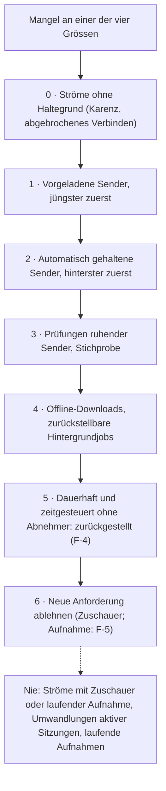

# Konzept 28 · Ressourcen und Performance

Stand: 28. November 2026 · Fassung 2 · Status: Entwurf nach Konsolidierung 1, nicht freigegeben

> **Kurz gesagt.** Dieses Dokument rechnet aus, was Live-TV an Netz, Rechenzeit, Grafikeinheit,
> Arbeitsspeicher, Plattenplatz, Dateien, Prozessen und Datenbank kostet. **Nichts ist gemessen.** Gemessen
> sind nur die Ausgangswerte der heutigen Dateiwiedergabe und des Webradios in `docs/perf/`; alles andere ist
> eine Rechnung mit ausgewiesenen Annahmen und gilt «nach dieser Rechnung», bis der genannte Messpunkt
> vorliegt. Alle Grenzwerte stammen aus `04-architektur.md` Abschnitt 14, alle Stufen aus
> `18-umsetzungsplan.md`. Die drei wichtigsten Ergebnisse: (1) **Der Engpass ist fast immer die Umwandlung
> für den Browser**, nicht der Empfang. Der schlanke Bau von hls.js spielt nur H.264 mit AAC oder MP3-Ton
> direkt; HEVC, Zeilensprung und MPEG-2 brauchen eine Bild-Umwandlung, AC-3, E-AC-3 und LATM eine
> Ton-Umwandlung. Auf der Testinstanz CT 190 reicht das halbe Budget nach dieser Rechnung für zwei
> gleichzeitige Bild-Umwandlungen. (2) **Dauerempfang kostet vor allem Internet-Bandbreite und Verbindungen
> zum Anbieter** (ein HD-Sender rund um die Uhr sind 86 GB am Tag); im voreingestellten Byte-Budget haben
> höchstens 24 HD-Ringe Platz. (3) **Viele gleichzeitige Aufnahmen starten alle**, weil nur die Ringe
> reserviert werden; bei zehn HD-Aufnahmen sinkt aber die Toleranz gegen einen stockenden Datenträger von
> 60 auf rund 36 Sekunden.

Dieses Dokument ändert keinen Code. Es setzt die verbindlichen Entscheide T-1 bis T-29 aus
`04-architektur.md` (Fassung 3) und die Umschalt-Kette aus `05-streaming-und-fast-zapping.md` (Fassung 3)
voraus und entscheidet nichts neu. Wo es Vorrang oder Grenzen berührt, verweist es auf die offenen Fragen.

## Lesart

- **Herkunft jeder Zahl** in eckigen Klammern:
  - **[G]** gemessen, mit Fundstelle in `docs/perf/` (nur diese Werte sind gemessen);
  - **[B]** belegt: aus der Recherche als Beleg geführt oder in `anhang/nachpruefung-quellen.md` an der
    Primärquelle bestätigt (dann mit «Nachprüfung Nr. n»);
  - **[S]** spezifiziert: ein Wert aus `04` Abschnitt 14 oder aus `05`, `07`, `09` (ein vom Konzept festgelegter
    Wert, der selbst bis zur Messung eine Annahme sein kann);
  - **[A]** Annahme dieses Dokuments oder einer Recherche, die dort als «[Wissen]» oder «Annahme» steht;
  - **[R]** Rechnung aus den Werten darüber.
- **Einheiten:** Bitraten in Mbit/s; Speicher dezimal in MB und GB (1 GB = 1000 MB), nur wo `04` oder `05`
  MiB nennen, steht MiB (1 MiB = 1,048576 MB). **1 Mbit/s entspricht 0,125 MB/s, 0,45 GB je Stunde und
  10,8 GB je Tag.** Rechenweg: eine Zeile Formel, eine Zeile Einsetzen.
- **Nummern:** M-1 bis M-25 sind die Messpunkte aus `05` Abschnitt 10.1, «09 M-n» die aus `09`; «13 M-1» bis
  «13 M-7» sind die Last- und Langzeitmessungen dieses Dokuments; V-1 bis V-12 die Messversuche aus `18`
  Abschnitt 2.2. Offene Punkte dieses Dokuments heissen «13 O-n», Vorrangkonflikte «13 P-n». F-n ohne Zusatz
  sind die Fragen aus `04` Abschnitt 12.3; aus anderen Dateien mit Dateinummer («`03` F-4»).
  `20-offene-entscheidungen.md` vergibt die Gesamtnummern.
- **Stufen** nach `18`: V (Messversuche), 0, 1 (1a, 1b), 2, 3, H (Heimnetz, UDP, RTP, Multicast), 4
  (Timeshift), 5 (Aufnahmen), 6 (Serien), L (RTSP, RTMP), W (DASH, HLS-fMP4), E (Ergänzungen), Apps.
- **Keine Kapazitätszusage.** Die Szenarien sind Analysen (Auftrag 11.1), keine zugesicherten Grössen. Die
  Obergrenzen ab Werk sind Schutzwerte, keine Kapazitätsaussage (`04` 6.3).

## 0. Die vier Zähler

Der Auftrag verlangt, vier Dinge sauber zu trennen (Auftrag 11.2). Sie kosten Verschiedenes:

| Zähler | Zeichen | Was es ist | Was es kostet |
|---|---|---|---|
| **Empfangene Sender** | E | Eingangsströme, die gerade laufen, aus jedem Grund: Zuschauer, Aufnahme, dauerhaft, Zeitplan, automatisch, Vorladen, Prüfung, Karenz (`04` Abschnitt 5.2). Jeder Sender höchstens einmal (T-2). | Internet-Bandbreite, je eine Verbindung zum Anbieter, ein Ring im Arbeitsspeicher, etwas Rechenzeit in Go |
| **Zuschauer** | Z | Live-Sitzungen (T-9). Mehrere Zuschauer desselben Senders brauchen **einen** Eingangsstrom. | Ausgangsbandbreite, Verbindungen zum Client; mit Recht «Timeshift» zusätzlich je ein Sitzungspuffer auf Platte |
| **Umwandlungen** | U (U_T Ton, U_B Bild) | FFmpeg-Prozesse je Sitzung, nur wenn das Gerät den Strom nicht direkt abspielt (T-13, T-14). Nie geteilt, nie vorsorglich. Ein Lauf dauert höchstens 24 Stunden (`04` 14.7). | Umwandlungseinheiten des bestehenden Budgets, CPU oder GPU, Arbeitsspeicher des Prozesses |
| **Aufnahmen** | A | Laufende Aufnahmen (T-16). Zwei Profile, die dieselbe Sendung aufnehmen, sind zwei Aufnahmen auf einem Eingangsstrom. | Platz und Schreiblast auf dem Speicherort «Aufnahmen»; ein Rückstau im Arbeitsspeicher, der nur bei Gebrauch zählt; **keine** Einheiten, **kein** FFmpeg |

Dazu kommt **I**, die Zahl **importierter** Sender. Sie wirkt nur auf Datenbank, Programmdaten und
Oberfläche, nie auf den Empfang.

Es gilt immer: U ≤ Z; die Sender aller Zuschauer und Aufnahmen sind eine Teilmenge von E; E ist durch die
Obergrenze der Eingangsströme gedeckelt (8 ab Werk, einstellbar 1 bis 200, `04` 14.1 [S]).

**Was heisst das für dich:** Zwanzig Leute auf demselben Sender kosten einen Empfang, aber womöglich zwanzig
Umwandlungen. Zwanzig Sender im Dauerempfang kosten zwanzig Empfänge, aber keine Umwandlung.

## 1. Grundgrössen und Annahmen

### 1.1 Bitraten und Bildgruppen

| Grösse | Rechenwert | Spanne | Herkunft |
|---|---|---|---|
| SD, MPEG-2, 576i (Rundfunk) | 4 Mbit/s | 3 bis 6 | [A]; Testquelle Q-F mit 4 Mbit/s [S] (`05` 8.2) |
| SD, H.264, 576i | 2,5 Mbit/s | 1,5 bis 3 | [A] |
| HD, H.264, 720p50 oder 1080i50 | **8 Mbit/s** | 5 bis 15 | [A] aus R5 1.3 («HD-IPTV oft 5–15 Mbit/s»); 8 Mbit/s ist der Rechenwert von `04` 14.3 [S] |
| HD, HEVC | 5 Mbit/s | 3 bis 8 | [A] |
| HD, MPEG-2 (selten) | 15 Mbit/s | 12 bis 18 | [A] |
| UHD, HEVC, 2160p50 | 20 Mbit/s | 15 bis 25 | [A] aus R5 1.3 («UHD bis 25 Mbit/s»); Testquelle Q-G [S] |
| Ton im TS | im Wert oben enthalten | 0,1 bis 0,5 | [A]; TS-Overhead steckt in der Bitrate der Quelle (R5 1.3, [A]) |
| Ausgabe einer Bild-Umwandlung auf 1080p H.264 | 6 Mbit/s | 4 bis 8 | [A]; die bestehende Qualitätsleiter deckelt nach Profilgrenze |
| Ausgabe einer Ton-Umwandlung | wie die Quelle | – | [R]: das Bild wird kopiert, nur der Ton ändert sich |
| Bildgruppe (GOP) Rundfunk MPEG-2 | 0,5 s | 0,5 bis 1 | [A] |
| Bildgruppe Rundfunk H.264 | 1 s | 0,5 bis 2 | [A] |
| Bildgruppe IPTV- und Internet-Quellen | 2 s | 1 bis 10 | [A]; «Long-GOP 2–4 s» als Sekundärquelle [B] (R1 3.1) |

**Rechenweg «Bitrate zu Menge»:** Menge je Stunde = Bitrate ÷ 8 × 3600 s.
Einsetzen für 8 Mbit/s: 8 ÷ 8 × 3600 = 3600 MB = **3,6 GB je Stunde**, 86,4 GB je Tag. Für 4 Mbit/s 1,8 GB/h,
für 20 Mbit/s 9,0 GB/h.

### 1.2 Was der Browser direkt spielt (für die Szenarien)

Nach `04` 7.6 und der Nachprüfung Nr. 11 und 13 [B]: Die Web-App lädt den **schlanken Bau** von hls.js; der
volle Bau ist nicht Teil der Vorgabe (`04` O-22).

| Sender liefert | Browser | Media3 (Fernseher, Handy) |
|---|---|---|
| H.264 ohne Zeilensprung, AAC | Original | Original |
| H.264 ohne Zeilensprung, MP2 | Ton-Umwandlung (Original nur, wenn der Browser MP3-Ton meldet, M-3) | Original, wenn das Gerät den Ton dekodiert (M-7) |
| H.264 ohne Zeilensprung, AC-3, E-AC-3 oder AAC-LATM | **Ton-Umwandlung** (schlanker Bau liest AC-3 in TS nicht, E-AC-3 und LATM kein Bau, belegt) | Original mit passendem Decoder oder Tonanlage |
| H.264 mit Zeilensprung, MPEG-2 | **Bild-Umwandlung** (T-15; MPEG-2 liest kein Browser-Player, belegt) | Original, wenn das Gerät es meldet (M-6, M-7) |
| HEVC | **Bild-Umwandlung** (schlanker Bau liest HEVC in TS nicht, belegt) | Original bei Hardware-Decoder |

Safari, iPhone und iPad sind ungeprüft und nicht zugesagt, weil kein Gerät vorhanden ist (`04` 12.1, `05` 4.3).
HEVC in TS ist dort nach Apples Vorgaben nicht erlaubt (Nachprüfung Nr. 8 [B]); er wird umgewandelt (O-3).

### 1.3 Arbeitsspeicher

| Grösse | Rechenwert | Herkunft |
|---|---|---|
| Server im Leerlauf (Prozess) | 83 MB, mit 50'570 Titeln | [G] `docs/perf/M10.md:47` |
| Container im Leerlauf | 115,5 MiB | [G] `docs/perf/M10.md:48` |
| Container mit sieben Radio-Relays | 218 MiB | [G] `docs/perf/radio.md:128` |
| Ring je Sender | Bitrate × 15 s × 1,03 ÷ 8, beim Start reserviert | [S] `04` 14.3 |
| … bei 4 / 8 / 20 Mbit/s | 7,7 / **15,45** / 38,6 MB | [R] |
| Byte-Budget ab Werk | ein Achtel des Arbeitsspeichers, höchstens 512 MB (einstellbar 64 bis 8192 MB) | [S] `04` 14.3 |
| … davon höchstens für Ringe | drei Viertel: bei 512 MB also **384 MB**, rund **24 HD-Ringe** (384 ÷ 15,45) | [S] `04` 14.3; [R] |
| … der Rest (mindestens ein Viertel) | für Rückstau der Schreiber, Zuführer und Ausgabestücke; **bei Gebrauch gezählt**, nicht reserviert; im Normalbetrieb leer | [S] `04` 8.1 |
| Rückstau je Aufnahme | bis 64 MiB oder 60 s bei der Bitrate, das Kleinere: bei 4 / 8 / 20 Mbit/s 30 / **60** / 67,1 MB | [S] `04` 14.3; [R] |
| Rückstau je Sitzungspuffer (Timeshift) | bis 16 MiB = 16,8 MB | [S] `04` 14.3 |
| Zuführer und Ausgabestücke einer Umwandlung ohne Zeitversatz | je bis 8 MiB = 8,4 MB, bei Gebrauch | [S] `04` 14.3 |
| Kopie beim Segmentabruf aus dem Ring | in Blöcken von 256 KiB, höchstens 2 Abrufe je Sitzung: rund 0,5 MB je Sitzung, rund 10 MB bei 20 Sitzungen; ausserhalb des Budgets | [S] `04` 8.1, 14.3 |
| CT 190 (4 GB): Byte-Budget / Ringe | 512 MB / 384 MB | [R] |
| FFmpeg reiner Ton (Radio: AAC kopiert oder MP3 nach AAC) | 16 bis 18 MB je Prozess | [G] `docs/perf/radio.md:125-126` |
| FFmpeg Ton-Umwandlung eines Live-TS (Bild kopiert) | **40 MB** | [A], grösser als beim Radio wegen des Bildstroms im Eingang; 13 M-5 |
| FFmpeg Bild-Umwandlung 1080p, QSV, VAAPI oder NVENC | **200 MB** (100 bis 300) | [A]; im Repo nicht gemessen; 13 M-5 |
| FFmpeg Bild-Umwandlung 1080p, Software (x264) | 300 MB (200 bis 400) | [A]; 13 M-5 |
| Radio-tmpfs, falls Radio genutzt | bis 564 MB | [G] `deploy/compose.yaml:39-40` |

### 1.4 Rechenzeit und Grafikeinheit

| Grösse | Wert | Herkunft |
|---|---|---|
| FFmpeg-Umpacken (Remux) einer Datei auf CT 190 | 1,2 bis 1,3 CPU-s je 45 s Inhalt, also 2,7 bis 2,9 % eines Kerns in Echtzeit | [G] `docs/perf/M1b.md` 3b |
| QSV-Umwandlung 1080p auf CT 190 (CPU-Anteil) | 2,4 bis 2,6 CPU-s je 45 s, also 5,3 bis 5,8 % eines Kerns | [G] `docs/perf/M1b.md` 3b |
| QSV-Durchsatz UHD 630 | rund 17-fache Echtzeit je 1080p-Strom | [G] `docs/perf/M1b.md` 3b, `docs/perf/18-trickplay.md` |
| Software-Umwandlung 1080p auf CT 190 | 31,6 CPU-s je 45 s, also rund 70 % eines Kerns; ein Strom 2,7-fache, zwei je 1,4-fache Echtzeit | [G] `docs/perf/M1b.md` 3b |
| Software-Umwandlung 1080p auf 28 Kernen | 14 Ströme ohne Verzug | [G] `docs/perf/M1b.md` 3 |
| NVENC (RTX 4070) | 6 × 1080p im Budget 12; Treibergrenze 8 Sitzungen | [G] `docs/perf/M1b.md` 3c |
| 2160p24 auf CT 190 (QSV) | 3,8-fache Echtzeit allein, 1,9-fache bei zwei; 2160p60 nur 1,4-fache | [G] `docs/perf/13-abspielseite.md` 1.2 |
| Radio-Relay | 0,1 % (Ton kopiert) bis 3,0 % (MP3 nach AAC) eines Kerns | [G] `docs/perf/radio.md:125-126` |
| Go-Empfang eines 8-Mbit/s-Stroms (TS lesen, Kennzeichen prüfen, in den Ring schreiben) | 0,5 bis 2 % eines Kerns | [A]; rund 5'300 TS-Pakete je Sekunde (8'000'000 ÷ 8 ÷ 188); M-13 |
| Go-Leser je Abnehmer (Kopie aus dem Ring) | 0,2 bis 0,5 % eines Kerns | [A]; M-13 |
| Ton-Umwandlung eines Live-TS (Bild kopiert, Ton nach AAC) | **5 %** eines Kerns (3 bis 6) | [A] = Umpacken (2,8 %) plus Tonkodierung (wie Radio, bis 3 %); M-8 |
| Zeilensprung-Entfernung | auf QSV, VAAPI, NVENC in der Grafikeinheit; in Software `bwdif` zusätzlich 0,2 bis 0,5 Kerne je 1080i-Strom | [A]; M-8 |

### 1.5 Budget der Umwandlung

| Grösse | Wert | Herkunft |
|---|---|---|
| Budget QSV, VAAPI | 8 Einheiten | [G] kalibriert `docs/perf/M1b.md` 3c; gebaut `server/internal/transcode/manager.go:104-115` |
| Budget NVENC | 12 Einheiten | [G] wie oben |
| Budget Software | Kerne ÷ 2, mindestens 1 | [G] wie oben |
| Kosten Bild-Umwandlung HD (1080p) / kleinere Stufe | 2 / 1,5 | gebaut `plan.go:120-121`; [S] `04` 14.7 |
| Kosten Ton-Umwandlung | 0,25 | gebaut `plan.go:123` (Satz für reine Tonarbeit); für Live [A], M-8 |
| Kosten 2160p-Ausgabe | 5 | gebaut `plan.go:114` |
| Kosten FFmpeg-Empfänger (Weg W) | 0,5, **innerhalb** des Anteils für Live; höchstens 2 (0 bis 8) | [S] `04` 8.1, 14.7 |
| Anteil für Live-Umwandlungen | die Hälfte des Budgets (einstellbar 0 bis 100 %); kein Borgen ungenutzter Einheiten der Filme | [S] `04` 7.6, 14.7 |
| Kleines Budget (Software, 2 Kerne) | genau **eine** Bild-Umwandlung zur selben Zeit, für Live oder Film, wenn sonst nichts Einheiten hält; daneben höchstens zwei Ton-Umwandlungen im Live-Anteil | [S] `04` 7.6 |
| Wartezeit auf Budget | bis 10 s, dann «ausgelastet» | gebaut `manager.go:27-28`; [S] `04` 14.7 |
| Höchste Laufzeit eines FFmpeg an einem Strom | 24 h, nie über einen Überlauf der Quellzeit; danach neue Ausgabe-Generation | [S] `04` 7.5, 14.7 |

### 1.6 Dateideskriptoren, Goroutinen, Prozesse

Ein Dateideskriptor ist ein Eintrag für jede offene Datei, jede Netzverbindung und jede Pipe. Eine Goroutine
ist ein leichter Ausführungsfaden in Go.

| Was | Deskriptoren im Serverprozess | Goroutinen | Herkunft |
|---|---|---|---|
| Grundlast (Datenbank mit Lese- und Schreibpool, `epg.db`, Lauscher, Protokolle) | 60 bis 100 | 50 bis 150 | [A] |
| Eingangsstrom HTTP-TS oder UDP | 1 | 2 (Lesen, Überwachung) | [A] |
| Eingangsstrom HLS | 1 bis 2 (Liste und Segment, mit wiederverwendeter Verbindung) | 3 | [A] |
| Ring im Arbeitsspeicher / als Datei (F-2 a) | 0 / 1 | 0 | [S] `05` 3.1 (anonyme Speicherabbildung) |
| Zuschauer (Liste und Segmente über HTTP, höchstens 2 gleichzeitige Abrufe) | 2 | 2 | [A]; [S] `04` 14.4 |
| Sitzungspuffer (Stückdatei und Verzeichnis) | 2, beim Abruf eines alten Segments kurz 1 mehr | 1 | [A] |
| Umwandlung (stdin, stdout, stderr) | 3 | 4 (Zuführen, Lesen und Schneiden, Fehlerausgabe, Warten) | [A]; FFmpeg selbst hat eigene, auf 256 begrenzte Deskriptoren [S] `04` 14.7 |
| Aufnahme (Teilstück und Verzeichnis) | 2 | 1 | [A] |
| Speicherbedarf einer Goroutine | rund 8 KiB Stapel | – | [A]; 1000 Goroutinen ≈ 8 MB |
| Grenze offener Dateien | Go hebt die weiche Grenze beim Start auf die harte an; die harte Grenze kommt von Docker | – | [A]; die Compose-Datei hebt sie in Stufe 0 an (`18` Schritt 0.6), Wert offen (13 O-6) |

**Rechenwert Deskriptoren:** D = 100 + 2·E + 2·Z + 2·Z_TS + 3·U + 2·A (+ E, wenn der Ring in einem Ordner liegt).

### 1.7 Schreibraten

| Wer schreibt | Rate | Herkunft |
|---|---|---|
| Ring im Arbeitsspeicher | nichts auf Platte | [S] T-7, `05` 3.1 |
| Ring in einem Ordner (F-2 a) | Bitrate je empfangenem Sender, rund um die Uhr | [S] `04` F-2 |
| Sitzungspuffer (Recht «Timeshift») | Bitrate je Zuschauer, ab dem Einstellen, auch ohne Pause; Stücke zu rund 60 s, Schreibblock 1 MiB | [S] T-10, F-8 (a), `04` 14.5 |
| Aufnahme | Bitrate je Aufnahme, ohne Entdoppelung (siehe `11` F-2) | [S] T-16 |
| Ausgabestücke einer Umwandlung mit Zeitversatz | Ausgabebitrate, höchstens 5 Minuten liegen | [S] `04` 14.5 |
| Sichern einer Aufnahme auf den Datenträger | alle 10 s und am Teil-Ende | [S] `04` 14.5 |
| Datenbank | Abschnitt 6 | – |

**Was heisst das für dich:** Die einzigen gemessenen Zahlen stammen von Filmen und vom Webradio. Für Live-TV
stehen hier Schätzungen; jede ist mit dem Messpunkt verbunden, der sie ersetzt.

## 2. Formeln

Jede Formel trennt die vier Zähler. Ein Beispiel rechnet sie mit HD-Sendern zu 8 Mbit/s.

| Grösse | Formel | Beispiel |
|---|---|---|
| **Eingangsbandbreite** | B_ein = Σ über alle empfangenen Sender R_s | 3 Sender zu 8 Mbit/s, darunter einer nur vorgeladen: 3 × 8 = **24 Mbit/s** |
| **Ausgangsbandbreite** | B_aus = Σ über alle Zuschauer R_aus, mit R_aus = R_s (Original und Ton-Umwandlung) oder R_ziel (Bild-Umwandlung) | 3 Zuschauer Original, 2 mit Bild-Umwandlung auf 6 Mbit/s: 3 × 8 + 2 × 6 = **36 Mbit/s** |
| **Byte-Budget, reserviert** | M_res = Σ_E Ring(R_s) ≤ ¾ × Budget | 4 Sender: 4 × 15,45 = **62 MB** von 384 MB |
| **Byte-Budget, Rückstau bei Gebrauch** | M_rück = Σ der gerade stockenden Schreiber ≤ Budget − M_res; reicht es nicht, teilen sie den Rest zu gleichen Teilen | 2 Aufnahmen stocken zugleich: je bis 60 MB, zusammen 120 MB von 450 MB Rest |
| **Arbeitsspeicher gesamt** | M = Grundlast + M_res + M_rück + Σ_U RSS_FFmpeg + Z × 0,5 MB (Segmentkopien) + Goroutinen | 83 + 62 + 0 + 1 × 200 (Bild) + 5 × 0,5 + 1 ≈ **349 MB** im Normalbetrieb |
| **Temporärer Speicher** | T = Σ_{U mit Zeitversatz} 300 s × R_aus ÷ 8 (+ Σ_E Ring, wenn F-2 a mit Ordner) | 2 Umwandlungen mit Zeitversatz zu 6 Mbit/s: 2 × 300 × 6 ÷ 8 = **450 MB** |
| **Timeshift-Platz** | S_TS = Σ_{Z mit Recht} min(T_max, t_z) × R_s ÷ 8, gedeckelt durch den Deckel | 3 Zuschauer, je seit über 60 min, T_max 60 min: 3 × 3,6 GB = **10,8 GB** |
| **Timeshift-Schreiblast** | W_TS = Σ_{Z mit Recht} R_s ÷ 8 | 3 × 1 MB/s = **3 MB/s** = 10,8 GB/h |
| **Aufnahme-Platz** | S_A = Σ_A (Dauer + Vorlauf + Nachlauf) × R_s ÷ 8 | 60-min-Sendung, Vorlauf 2 und Nachlauf 10 min (`15` 3.14 [S]): 72 min × 1 MB/s = **4,32 GB** |
| **Aufnahme-Schreiblast** | W_A = Σ_A R_s ÷ 8 | 5 Aufnahmen: **5 MB/s** |
| **Toleranz einer Aufnahme gegen Stockung** | t_tol = min(60 MB, (Budget − M_res) ÷ A_stockend) ÷ (R_s ÷ 8) | 10 HD-Aufnahmen, alle stockend: (512 − 155) ÷ 10 = 35,7 MB, ÷ 1 MB/s = **36 s** |
| **Deskriptoren** | D = 100 + 2·E + 2·Z + 2·Z_TS + 3·U + 2·A | E = 4, Z = 5, Z_TS = 3, U = 2, A = 2: 100 + 8 + 10 + 6 + 6 + 4 = **134** |
| **Externe Prozesse** | P = U + W + Probe (≤ 1) + Stichprobe (≤ 1) + bestehende (Dateiwiedergabe, Downloads, Trickplay) | 2 Live-Umwandlungen, 1 Film: **3** FFmpeg (+ kurz eine Probe) |
| **Umwandlungseinheiten Live** | K = Σ_{U_B} Kosten_Bild + Σ_{U_T} 0,25 + W × 0,5 ≤ Anteil × Budget | 2 × 2 + 2 × 0,25 = **4,5** > 4 auf CT 190: die zweite Bild-Umwandlung wartet oder wird abgelehnt |
| **Download beim Anbieter** | Monatsmenge = Σ_E R_s ÷ 8 × Laufzeit | ein Sender dauerhaft: 8 ÷ 8 × 86'400 s × 30 = **2,59 TB je Monat** |

W = Zahl der FFmpeg-Empfänger der späten Stufe W.

**Was heisst das für dich:** Jede Zeile kannst du mit deinen eigenen Zahlen nachrechnen: Bitrate in Mbit/s
durch 8 ist MB je Sekunde, mal 3600 ist MB je Stunde.

## 3. Szenarien (Auftrag 11.1)

Alle Szenarien rechnen mit HD zu 8 Mbit/s, wo nichts anderes steht. «CT 190» heisst: 2 vCPU, 4 GB, QSV mit
Budget 8, davon 4 für Live (`04` 7.6), Byte-Budget 512 MB mit 384 MB für Ringe, Obergrenzen ab Werk 8
Eingangsströme und 20 Live-Sitzungen (`04` 14.1, 14.4).

### 3.1 Dauerhaft empfangene Sender: 5, 20, 50, 100

Nur der Ring läuft (dauerhaft heisst nicht aufzeichnen, LTV-013). Keine Umwandlung. Dauerempfang gehört zu
Stufe 3 (`18` 4.5).

| Sender | Eingang | Ringe (15 s) | passt in die Ringe des Budgets 512 MB (384 MB)? | Download je Tag / je Monat | Go-Rechenzeit [A] | Deskriptoren | Goroutinen |
|---|---|---|---|---|---|---|---|
| 5 | 40 Mbit/s | 5 × 15,45 = 77 MB | ja (20 %) | 432 GB / 13 TB | 2,5 bis 10 % eines Kerns | 105 bis 110 | 60 bis 165 |
| 20 | 160 Mbit/s | 20 × 15,45 = 309 MB | ja (80 %); danach haben nur noch 4 HD-Ringe Platz für Zuschauer und Aufnahmen anderer Sender | 1,73 TB / 52 TB | 10 bis 40 % | 120 bis 140 | 90 bis 210 |
| 50 | 400 Mbit/s | 50 × 15,45 = 773 MB | **nein**; braucht ein Budget von mindestens 773 ÷ 0,75 = 1031 MB oder einen Ring von 7 s (360 MB) | 4,32 TB / 130 TB | 25 bis 100 % | 150 bis 200 | 150 bis 300 |
| 100 | 800 Mbit/s | 100 × 15,45 = 1545 MB | **nein**; braucht mindestens 2060 MB; auch mit dem kürzesten Ring von 4 s (412 MB) nicht im Budget ab Werk, sondern erst ab 549 MB | 8,64 TB / 259 TB | 50 bis 200 % | 200 bis 300 | 250 bis 450 |

Rechenweg Ring bei 7 s: 50 × 8 × 7 × 1,03 ÷ 8 = 360,5 MB. Bei 4 s (kleinster Wert, `04` 14.3): 100 × 8 × 4 ×
1,03 ÷ 8 = 412 MB; 412 ÷ 0,75 = 549 MB Budget.

Mit Sendermischung (70 % HD 8, 20 % SD 4, 10 % UHD 20 Mbit/s; [A]) liegt das Mittel bei 0,7 × 8 + 0,2 × 4 +
0,1 × 20 = 8,4 Mbit/s, also fast gleich.

Was die Tabelle nicht zeigt, aber zuerst knapp wird:

1. **Internetanschluss.** 20 HD-Sender brauchen 160 Mbit/s Dauerlast im Download; ein Anschluss mit
   100 Mbit/s trägt nach dieser Rechnung höchstens etwa 10 HD-Sender mit Reserve für den Rest des Haushalts.
2. **Verbindungen zum Anbieter.** Jeder Sender ist eine eigene Verbindung (T-2, T-17). Ein Zugang mit wenigen
   erlaubten Verbindungen trägt keinen Dauerempfang mehrerer Sender (F-3, LTV-017).
3. **Obergrenze der Eingangsströme.** 8 ab Werk; für 20 Dauersender muss der Administrator sie anheben.
4. **Datenvolumen.** 52 TB im Monat für 20 Sender ist bei vielen Anschlüssen und Anbietern ausserhalb des
   Üblichen ([A]).

Weicht ein Dauersender bei Mangel einem Zuschauer (Vorgabe F-4 (a)), wird er **zurückgestellt** und startet
nach 60 Sekunden freiem Platz oder sobald ein Abnehmer kommt von selbst wieder (`04` 5.3, 14.1).

Platte: nichts, solange der Ring im Arbeitsspeicher liegt. Liegt er nach F-2 (a) auf einer SSD, schreiben
20 Sender 1,73 TB am Tag ohne Nutzen (Abschnitt 5.4).

**Was heisst das für dich:** Ein paar Dauersender sind billig. Viele Dauersender kosten vor allem
Internetvolumen und Verbindungen beim Anbieter; ab etwa 20 HD-Sendern musst du das Byte-Budget anheben.

### 3.2 Importierte Sender: 500, 5'000, 10'000

Importierte Sender, die niemand schaut, kosten keinen Empfang. Sie wirken auf Datenbank, Programmdaten,
Logos, Suche und Oberfläche.

| Grösse | 500 | 5'000 | 10'000 | Herkunft |
|---|---|---|---|---|
| Katalog in `slouchcat.db` (Sender, Quellzeile mit verschlüsselter Adresse, Gruppen; 1 bis 2 KB je Sender) | 0,5 bis 1 MB | 5 bis 10 MB | 10 bis 20 MB | [A]; Vergleich: Radio mit 55'646 Sendern [G] `docs/perf/radio.md:67`, dort als Ziel «rund 40 MB» (`:14`, Zielwert, kein Messwert) |
| Import der Liste (M3U, rund 600 B je Eintrag; Grenze 200 MiB und 200'000 Einträge) | 0,3 MB, 1 Transaktion | 3 MB, 10 Transaktionen zu 500 | 6 MB, 20 Transaktionen zu 500 | [A]; Grenzen und Stapel [S] `04` 14.9; Vergleich: Radio-Abgleich von 63'562 Einträgen in 21 s [G] `docs/perf/radio.md:66-67` |
| Programmdaten 7 Tage, 30 % zugeordnet / alle zugeordnet | 18 MB / 60 MB | 180 MB / 600 MB | 360 MB / 1,2 GB | [S] `09` 8.6 |
| Programmdaten 14 Tage, 30 % / alle | 34 MB / 110 MB | 340 MB / 1,1 GB | 675 MB / 2,25 GB | [S] `09` 8.6 |
| Logos im Cache (10 bis 30 KB je Logo) | 5 bis 15 MB | 50 bis 150 MB | 100 bis 300 MB | [A] |
| Zwischenspeicher «läuft jetzt / als Nächstes» (falls nach 09 M-5 nötig) | 1'000 Einträge | 10'000 | 20'000, wenige MB | [S] `09` 8.2 |
| Suchindex im Arbeitsspeicher (falls nach Radio-Muster) | < 1 MB | 2 bis 3 MB | 5 MB | [A]; Vergleich: Radio-Liste mit Zählern 7,1 ms über 40'000 Sender [G] `docs/perf/radio.md:29` |
| Oberfläche | seitenweise, 50 je Seite: 10 Seiten | 100 Seiten | 200 Seiten | [S] `09` 8.1 |
| Prüfung ruhender Sender | nie reihum; bei 10 s je Sender wären 10'000 Sender 28 Stunden Dauerlast beim Anbieter | – | – | [S] `05` 9.5 |
| Eingang, Umwandlung, Aufnahme | 0 | 0 | 0 | [S] |

**Was heisst das für dich:** Eine grosse Anbieterliste macht die Datenbank und den Cache grösser, aber nicht
den Empfang teurer. Das Teure daran sind die Programmdaten; darum empfiehlt `09` F-1 eine eigene, nicht
gesicherte Datei.

### 3.3 Gleichzeitige Zuschauer: 1, 5, 20, 50

Fünf Fälle je Zahl: derselbe Sender oder verschiedene Sender, je alle im Original oder alle mit
Bild-Umwandlung, und eine **Mischung M**. Die Mischung folgt RA-05 und der Tabelle 1.2: Im Browser ist
Umwandlung häufig.

**Annahmen der Mischung M** (alles [A], bis V-1 / M-2 deine Sender zählt):

- Die Hälfte der Zuschauer schaut im Browser (hls.js, schlanker Bau), die Hälfte in den Android-Apps (Media3).
- Bei den Sendern: 35 % H.264 ohne Zeilensprung mit AAC; 30 % H.264 ohne Zeilensprung mit MP2, AC-3, E-AC-3
  oder LATM; 25 % mit Zeilensprung oder MPEG-2; 10 % HEVC.
- **Browser** nach 1.2: 35 % Original, 30 % Ton-Umwandlung, **35 % Bild-Umwandlung** (Zeilensprung, MPEG-2,
  HEVC). Fassung 1 rechnete mit 30 % Bild, weil sie HEVC im Browser noch für möglich hielt.
- **Media3** (Fernseher und Handy zusammen): 90 % Original, 10 % Ton-Umwandlung.
- Mittlere Kosten je Browser-Zuschauer: 0,3 × 0,25 + 0,35 × 2 = 0,775 Einheiten; je Media3-Zuschauer
  0,1 × 0,25 = 0,025 Einheiten.

Spalten: E empfangene Sender, Ein/Aus in Mbit/s, U Umwandlungen (T Ton, B Bild), K Einheiten, RAM = reservierte
Ringe plus FFmpeg (ohne Grundlast 83 MB, ohne Rückstau, der nur bei Gebrauch zählt), D Deskriptoren.
Rechenweg RAM: E × 15,45 MB + U_B × 200 MB + U_T × 40 MB. Die Segmentkopien (0,5 MB je Sitzung) sind darin
vernachlässigt.

**1 Zuschauer**

| Fall | E | Ein | Aus | U | K | RAM | D | CT 190 nach dieser Rechnung |
|---|---|---|---|---|---|---|---|---|
| Original | 1 | 8 | 8 | 0 | 0 | 15 MB | 104 | ja |
| Bild-Umwandlung | 1 | 8 | 6 | 1 B | 2 | 15 + 200 = 215 MB | 107 | ja (2 von 4) |

**5 Zuschauer**

| Fall | E | Ein | Aus | U | K | RAM | D | CT 190 nach dieser Rechnung |
|---|---|---|---|---|---|---|---|---|
| derselbe Sender, Original | 1 | 8 | 40 | 0 | 0 | 15 MB | 112 | ja |
| derselbe Sender, Bild | 1 | 8 | 30 | 5 B | 10 | 15 + 1000 = 1015 MB | 127 | **nein:** 2 mit halbem Budget, 4 mit ganzem; die übrigen «ausgelastet» |
| verschiedene, Original | 5 | 40 | 40 | 0 | 0 | 77 MB | 120 | ja |
| verschiedene, Bild | 5 | 40 | 30 | 5 B | 10 | 77 + 1000 = 1077 MB | 135 | **nein**, wie oben |
| Mischung M (3 Browser: 1 Original, 1 Ton, 1 Bild; 2 Media3 Original; 4 Sender) | 4 | 32 | 38 | 1 T, 1 B | 2,25 | 62 + 200 + 40 = 302 MB | 124 | ja |

**20 Zuschauer**

| Fall | E | Ein | Aus | U | K | RAM | D | CT 190 nach dieser Rechnung |
|---|---|---|---|---|---|---|---|---|
| derselbe Sender, Original | 1 | 8 | 160 | 0 | 0 | 15 MB (+ rund 10 MB Segmentkopien) | 142 | nach Budget ja; genau an der Obergrenze von 20 Live-Sitzungen; 160 Mbit/s brauchen Kabel oder gutes WLAN; 13 M-3 |
| derselbe Sender, Bild | 1 | 8 | 120 | 20 B | 40 | 15 + 4000 = 4,0 GB | 202 | **nein**, auf keiner Homelab-Grösse dieses Dokuments |
| verschiedene, Original | 20 | 160 | 160 | 0 | 0 | 309 MB (passt in 384 MB) | 180 | **nein ab Werk** (Obergrenze 8 Eingangsströme); nach Anheben nach Budget ja, Eingang 160 Mbit/s |
| verschiedene, Bild | 20 | 160 | 120 | 20 B | 40 | 309 + 4000 = 4,3 GB | 240 | **nein** |
| Mischung M (10 Browser: 3 Original, 3 Ton, 4 Bild; 10 Media3: 9 Original, 1 Ton; 12 Sender) | 12 | 96 | 16 × 8 + 4 × 6 = 152 | 4 T, 4 B | 1 + 8 = 9 | 185 + 800 + 160 = 1145 MB | 188 | **teilweise:** mit halbem Budget (4) passen die 4 Ton-Umwandlungen (1) und **eine** Bild-Umwandlung (2); drei Browser-Zuschauer bekommen «ausgelastet». Mit ganzem Budget (8) passen 4 Ton und 3 Bild; einer bleibt draussen, und für Filme bleibt nichts. Eingang über der Vorgabe 8. |

**50 Zuschauer**

| Fall | E | Ein | Aus | U | K | RAM | D | CT 190 nach dieser Rechnung |
|---|---|---|---|---|---|---|---|---|
| derselbe Sender, Original | 1 | 8 | 400 | 0 | 0 | 15 MB (+ rund 26 MB Segmentkopien) | 202 | **nein ab Werk** (Obergrenze 20 Live-Sitzungen); nach Anheben eine Frage von Netz und Rechenzeit; 13 M-3 |
| derselbe Sender, Bild | 1 | 8 | 300 | 50 B | 100 | über 10 GB | 352 | **nein**, auf keiner Homelab-Grösse |
| verschiedene, Original | 50 | 400 | 400 | 0 | 0 | 773 MB, **über den 384 MB für Ringe** | 300 | **nein** |
| verschiedene, Bild | 50 | 400 | 300 | 50 B | 100 | über 10 GB | 450 | **nein** |
| Mischung M (25 Browser: 9 Original, 7 Ton, 9 Bild; 25 Media3: 22 Original, 3 Ton; 30 Sender) | 30 | 240 | 41 × 8 + 9 × 6 = 382 | 10 T, 9 B | 2,5 + 18 = 20,5 | 464 + 1800 + 400 = 2,66 GB | 317 | **nein**; auch die Grösse «gross» (Abschnitt 4) trägt nach Budget mit ganzem Budget nur 4 der 9 Bild-Umwandlungen |

**Zusatz bei Recht «Timeshift» für alle Zuschauer** (Stufe 4, Vorgabe F-8 (a), Höchstdauer 60 Minuten,
Deckel der kleinere Wert aus 20 % des freien Platzes und 50 GB, `04` 14.6):

| Zuschauer | Schreiblast | Platz bei vollen Puffern | gegen den Deckel von 50 GB | Toleranz, wenn alle Puffer zugleich stocken (Rückstau bis 16,8 MB) |
|---|---|---|---|---|
| 1 | 1 MB/s = 3,6 GB/h | 3,6 GB | passt | 16,8 s |
| 5 | 5 MB/s = 18 GB/h | 18 GB | passt | 16,8 s |
| 20, verschiedene Sender | 20 MB/s = 72 GB/h | 72 GB | **überschritten**; nach `03` DR-07 gekürzt: 50 ÷ 20 = 2,5 GB je Sitzung, also rund 42 min | Rest des Budgets (512 − 309) ÷ 20 = 10,2 MB je Puffer: **rund 10 s** |
| 50 | 50 MB/s = 180 GB/h | 180 GB | **überschritten**: 1 GB je Sitzung, rund 17 min (über der kleinsten Länge von 5 min, `04` 14.6) | nur mit angehobenem Budget rechenbar |

Fassung 1 rechnete den Rückstau als reserviert und kam bei 20 Zuschauern verschiedener Sender auf 645 MB über
dem Budget. Nach `04` 8.1 wird er nur bei Gebrauch gezählt: Die Sitzungen starten alle; knapp wird nur die
Toleranz, wenn alle Puffer **zugleich** stocken.

**Was heisst das für dich:** Viele Zuschauer sind billig, solange ihre Geräte den Strom direkt spielen. Im
Browser braucht jeder Sender mit HEVC, Zeilensprung oder MPEG-2 eine Bild-Umwandlung, und die kostet so viel
wie ein Film, der umgewandelt wird. Wie viele deiner Sender das betrifft, weisst du erst nach V-1.

### 3.4 Gleichzeitige Aufnahmen: 1, 5, 10

Aufnahmen kopieren nur (T-16): kein FFmpeg, keine Einheiten. Aufnahmen kommen mit Stufe 5 (`18` 4.8).
**Reserviert werden nur die Ringe;** der Rückstau zählt bei Gebrauch (`04` 8.1). Keine Aufnahme wird wegen des
Rückstaus abgelehnt. Die Tabelle zeigt, wie viel Toleranz jede Aufnahme behält, wenn **alle zugleich** stocken
(Formel «Toleranz» in Abschnitt 2, Budget 512 MB).

| Aufnahmen | Sender | Eingang | Schreiblast | Platz je Stunde (mit Vor- und Nachlauf × 1,2) | reserviert (Ringe) | Rückstau je Aufnahme, wenn alle stocken | Toleranz | DB-Schreiben (Stand alle 10 s) | D |
|---|---|---|---|---|---|---|---|---|---|
| 1 | 1 | 8 Mbit/s | 1 MB/s | 3,6 GB (4,3 GB) | 15 MB | 60 MB (voll) | 60 s | 0,1 je s | 104 |
| 5, derselbe Sender (fünf Profile) | 1 | 8 Mbit/s | 5 MB/s | 18 GB (21,6 GB) | 15 MB | min(60, 497 ÷ 5 = 99) = 60 MB | 60 s | 0,5 je s | 112 |
| 5, verschiedene Sender | 5 | 40 Mbit/s | 5 MB/s | 18 GB (21,6 GB) | 77 MB | min(60, 435 ÷ 5 = 87) = 60 MB | 60 s | 0,5 je s | 120 |
| 10, derselbe Sender | 1 | 8 Mbit/s | 10 MB/s | 36 GB (43 GB) | 15 MB | 497 ÷ 10 = 49,7 MB | **50 s** | 1 je s | 122 |
| 10, verschiedene Sender | 10 | 80 Mbit/s | 10 MB/s | 36 GB (43 GB) | 155 MB | 357 ÷ 10 = 35,7 MB | **36 s** | 1 je s | 140 |
| 5 UHD, verschiedene Sender (20 Mbit/s) | 5 | 100 Mbit/s | 12,5 MB/s | 45 GB (54 GB) | 193 MB | 319 ÷ 5 = 63,8 MB (Grenze 67,1 MB) | **25 s** | 0,5 je s | 120 |

Die Werte für zehn HD- und fünf UHD-Aufnahmen stimmen mit `04` 8.1 überein. Folgen nach dieser Rechnung:

- **Alle Aufnahmen starten.** Bis zu sechs gleichzeitigen HD-Aufnahmen auf verschiedenen Sendern behalten
  die volle Toleranz von 60 Sekunden (512 ≥ A × (15,45 + 60), also A ≤ 6,8). Wer bei zehn Aufnahmen die
  volle Toleranz will, hebt das Budget auf 768 MB an (155 + 600 = 755 MB, `04` 8.1).
- **Die Toleranz zählt nur, wenn alle zugleich stocken,** etwa bei einem NAS, das neu verbindet. Ein Neuaufbau
  von SMB dauert nach Annahme 15 bis 60 Sekunden (RA-07); bei zehn Aufnahmen kann das eine Lücke geben. Zu
  messen in V-7 und 13 M-4.
- **Schreiblast:** 10 MB/s sind für eine SSD und eine einzelne Festplatte im Dauerbetrieb wenig ([A]); zehn
  verschränkte Schreiber auf einer Festplatte oder einem NAS sind zu messen (V-7).
- **Rechenzeit:** zehn Leser und zehn Empfänger nach 1.4 [A]: 10 × (0,5 bis 2 %) + 10 × (0,2 bis 0,5 %) = 7 bis
  25 % eines Kerns.
- **Grenze gleichzeitiger Aufnahmen:** gibt es ab Werk nicht; ob es eine einstellbare gibt, ist `15` F-21.

**Was heisst das für dich:** Aufnahmen sind billig für Rechner und Grafik. Viele gleichzeitige Aufnahmen
starten alle; nur ihr Schutz gegen eine kurz stockende Platte wird kleiner, wenn das Byte-Budget nicht
mitwächst.

### 3.5 Gleichzeitige Umwandlungen gegen das bestehende Budget

Wie viele Umwandlungen das Budget nach Kosten zulässt (Anteil Live = Hälfte, `04` 14.7). Die Zahlen sind
**Budgetgrenzen**, keine gemessenen Kapazitäten für Live. Ein FFmpeg-Empfänger der Stufe W (0,5 Einheiten)
zählt in diesem Anteil und senkt die Zahlen entsprechend.

| Backend, Gerät | Budget | Live-Anteil | Bild HD (2) halb / ganz | Bild kleiner (1,5) halb / ganz | Ton (0,25) halb / ganz | Grundlage der Messung |
|---|---|---|---|---|---|---|
| QSV, UHD 630 (CT 190) | 8 | 4 | **2** / 4 | 2 / 5 | 16 / 32 | Budget kalibriert [G] `M1b.md` 3c; Ton auf 2 vCPU nach 1.4 eher **8** (8 × 5 % = 0,4 Kerne zusätzlich zum Rest) [A] |
| VAAPI (AMD oder Intel ohne QSV) | 8 | 4 | 2 / 4 | 2 / 5 | 16 / 32 | Budget wie QSV, für VAAPI nicht eigens gemessen |
| NVENC, RTX 4070 | 12 | 6 | 3 / 6 | 4 / 8 | 24 / 48 | [G] `M1b.md` 3c; Treibergrenze 8 Sitzungen [G] |
| Software, 2 Kerne | 1 | 0,5 | **1** (Übergrösse, nur wenn sonst nichts Einheiten hält, Live oder Film) / 1 | 1 / 1 | 2 / 4 | [S] `04` 7.6; [G] `M1b.md` 3b: ein Strom 2,7-fache Echtzeit; mit Zeilensprung offen (M-8) |
| Software, 8 Kerne | 4 | 2 | 1 / 2 | 1 / 2 | 8 / 16 | Budget Kerne ÷ 2 [G] |
| Software, 28 Kerne | 14 | 7 | 3 / 7 | 4 / 9 | 28 / 56 | [G] `M1b.md` 3 (14 Ströme ohne Verzug) |

Rechenweg Beispiel QSV: halbes Budget 4 ÷ Kosten 2 = 2 Bild-Umwandlungen; 4 ÷ 0,25 = 16 Ton-Umwandlungen.

Für Live gilt anders als für Filme: Eine Umwandlung muss **dauerhaft** mit mindestens Echtzeit laufen, und ein
Lauf endet spätestens nach 24 Stunden mit einer neuen Ausgabe-Generation (`04` 7.5). Die Grafikeinheit von
CT 190 schaffte 17-fache Echtzeit je 1080p-Strom [G]; vier Live-Umwandlungen belegen sie nach dieser Rechnung
zu rund 4 ÷ 17 = 24 %. Die Grenze setzt also das Budget, nicht die Grafikeinheit, solange M-8 das bestätigt.
Auf dem Software-Backend ist es umgekehrt: Dort reicht schon ein 1080i-Strom mit Zeilensprung-Entfernung
womöglich nicht für Echtzeit auf 2 Kernen ([A], M-8).

**Was heisst das für dich:** Auf deiner Testinstanz können nach dieser Rechnung zwei Personen gleichzeitig im
Browser einen Sender schauen, der umgewandelt werden muss, solange Live-TV nur die Hälfte des Budgets nehmen
darf. Ohne Grafikeinheit ist es genau eine, und nur, wenn gerade kein Film umgewandelt wird.

### 3.6 Zusammengesetztes Beispiel: ein Familienabend auf CT 190

Annahmen [A]: zwei Fernseher (Media3) im Original auf zwei Sendern; ein Browser auf einem 1080i-Sender (Bild);
ein Film im Browser mit Umwandlung (Kosten 2); zwei Aufnahmen auf zwei anderen Sendern; Vorladen 1 davor und
1 danach und «automatisch» N = 3 (F-9 (b)), Quelle erlaubt weitere Verbindungen.

| Grösse | Rechnung | Ergebnis |
|---|---|---|
| Gewünschte Eingangsströme | 3 (Zuschauer) + 2 (Aufnahmen) + bis 4 (Vorladen) + 3 (automatisch) | 12, gedeckelt auf **8**: Vorladen und «automatisch» weichen zuerst (`04` 8.2) |
| Eingang | 8 × 8 Mbit/s | **64 Mbit/s**; auf einem 50-Mbit/s-Anschluss zu viel, dort besser ohne Vorladen |
| Einheiten | Live 2 (Bild) + Film 2 | 4 von 8; Live-Anteil 2 von 4 |
| Byte-Budget reserviert | 8 × 15,45 | 124 MB von 384 MB für Ringe |
| Arbeitsspeicher | 83 + 124 + 200 (Live-FFmpeg) + 200 (Film-FFmpeg, [A]) + bis 564 (Radio-tmpfs, wenn genutzt) | 0,6 bis 1,2 GB von 4 GB |
| Rechenzeit | 8 Empfänger × 1 % + 3 Leser × 0,3 % + 2 QSV × 5,8 % | rund 0,2 Kerne von 2 |
| Platte | 2 Aufnahmen | 2 MB/s, 7,2 GB je Stunde |

Geht nach dem Film ein Zuschauer, läuft sein Sender 30 Sekunden in Karenz weiter; endet eine Aufnahme, ruht
ihr Sender sofort (`04` 14.1: Karenz nur, wenn der Zuschauer selbst geht).

**Was heisst das für dich:** Ein normaler Abend mit wenigen Personen passt nach dieser Rechnung gut auf die
Testinstanz. Knapp wird es, sobald eine weitere Person im Browser einen Sender mit Zeilensprung oder HEVC
einschaltet.

## 4. Drei Installationsgrössen

Alles hier ist eine **Empfehlung nach dieser Rechnung** und zu messen (Abschnitt 10). Die Budgets sind die
Vorgaben je Backend; eine stärkere Grafikeinheit bekommt ohne eigene Kalibrierung (über
`SLOUCHCAT_TRANSCODE_BUDGET`, gebaut `config/config.go:64-65` laut A2) **dasselbe** Budget.

| | **Klein** | **Mittel** | **Gross** |
|---|---|---|---|
| Beispiel | Testinstanz CT 190 (2 vCPU, 4 GB, UHD 630 mit QSV); ein Mini-PC der N100-Klasse (4 Kerne, 8 bis 16 GB, QSV) liegt dazwischen | 6 bis 8 Kerne, 16 GB, integrierte Grafik (QSV oder VAAPI) | 12 und mehr Kerne, 32 GB, eigene Grafikkarte mit NVENC |
| Umwandlungsbudget / davon Live | 8 / 4 (ohne Grafik: 1, Ausnahme bei Übergrösse) | 8 / 4 (ohne Kalibrierung) | 12 / 6 |
| Byte-Budget ab Werk / davon Ringe | 512 MB / 384 MB (24 HD-Ringe) | 512 MB / 384 MB (Deckel) | 512 MB / 384 MB (Deckel) |
| Byte-Budget empfohlen | 512 MB lassen | 1 GB (768 MB für 49 HD-Ringe) | 2 bis 4 GB |
| Sinnvolle Dauersender | 0 bis 5 | 10 bis 20 | 20 bis 50 (ab 50 Budget ≥ 1,1 GB); 100 nur mit Anschluss ≥ 1 Gbit/s und Budget ≥ 2,1 GB |
| Zuschauer im Original | bis 5 ohne Bedenken, bis 20 (Obergrenze) zu messen | bis 20 | 20 bis 50 (Obergrenze der Live-Sitzungen anheben) |
| Bild-Umwandlungen HD gleichzeitig (halb / ganz) | **2** / 4; ohne Grafik **1**, wenn kein Film umgewandelt wird | **2** / 4 | 3 / 6 (Treiber: 8 Sitzungen) |
| Ton-Umwandlungen | bis 8 (Rechenzeit); ohne Grafik 2 | bis 16 | bis 24 |
| Aufnahmen gleichzeitig | bis 6 mit voller Toleranz von 60 s; mehr starten, mit kleinerer Toleranz | bis 10 mit voller Toleranz (Budget 1 GB) | 10 und mehr (Grenze ist der Datenträger) |
| Timeshift-Speicher | SSD des Caches, Deckel 10 bis 20 GB; keine RAM-Disk | SSD, Deckel 50 GB (Vorgabe) | SSD oder NVMe, Deckel 100 bis 200 GB |
| Höchstdauer Timeshift | 30 oder 60 min | 60 min (Vorgabe) | 60 oder 120 min |
| Vorladen | ja, klein: 1 davor, 1 danach, insgesamt 2; «automatisch» N = 0 bis 2; nur bei Anschluss ≥ 50 Mbit/s | ja: 1 und 1, insgesamt 4 (Vorgabe); N = 3 | ja: bis 2 und 2, insgesamt 8 bis 16; N bis 10 |
| Obergrenze Eingangsströme | 8 (Vorgabe) | 12 bis 20 | 20 bis 60 |
| **Was zuerst knapp wird** | (1) Umwandlungseinheiten für **jeden** Browser-Zuschauer auf einem Sender mit HEVC, Zeilensprung oder MPEG-2; (2) Arbeitsspeicher: 4 GB tragen Server, Radio-tmpfs, Ringe und zwei bis vier FFmpeg-Prozesse; (3) Rechenzeit auf 2 vCPU bei vielen Ton-Umwandlungen (AC-3, E-AC-3, LATM im Browser); (4) Ringe im Byte-Budget ab rund 20 empfangenen Sendern | (1) Umwandlungseinheiten für den Browser, solange das Budget nicht nach Messung angehoben ist; (2) Internetanschluss und Verbindungen zum Anbieter bei Dauerempfang; (3) Ringe im Byte-Budget ab Werk | (1) Internetanschluss und Verbindungen zum Anbieter; (2) Sitzungsgrenze des NVENC-Treibers und Budget für Browser-Zuschauer; (3) Upload für Zuschauer von unterwegs |

Ausserhalb jeder Grösse gilt: **Zuschauer von unterwegs** hängen am Upload des Heimanschlusses. Bei 40 Mbit/s
Upload sind das nach dieser Rechnung höchstens fünf HD-Ströme im Original; Profile mit Bitratengrenze lösen
zudem eine Bild-Umwandlung aus und kosten Einheiten (T-26).

**Was heisst das für dich:** Mehr Kerne und mehr Arbeitsspeicher helfen bei Dauerempfang und Aufnahmen. Für
mehr gleichzeitige Browser-Zuschauer auf schwierigen Sendern hilft nur eine stärkere Grafikeinheit **und**
ein nach Messung angehobenes Budget, oder die TV-App, die die meisten Sender direkt spielt.

## 5. Speicherplanung (LTV-019)

### 5.1 Drei Speicherorte und ihre Grössen

| Speicherort | Grösse je Sender oder Sitzung | je Stunde | je Tag | Beispiel |
|---|---|---|---|---|
| Startpuffer (Ring, T-7) | 15,45 MB je HD-Sender, 38,6 MB je UHD-Sender, fest | – (überschreibt sich) | – | 10 Sender: 155 MB |
| Timeshift (T-10) | höchstens T_max × Bitrate ÷ 8 je Sitzung | 3,6 GB je HD-Sitzung | wird beim Umschalten gelöscht; geschrieben werden 3,6 GB je Stunde Schauen | 3 Personen je 4 h am Abend: 43,2 GB geschrieben, höchstens 10,8 GB belegt |
| Aufnahmen (T-16) | Dauer × Bitrate ÷ 8 | SD 1,8 GB, HD 3,6 GB, UHD 9,0 GB | SD 43 GB, HD 86 GB, UHD 216 GB bei Daueraufnahme | 90-min-Film HD mit 12 min Vor- und Nachlauf: 102 min × 1 MB/s = 6,1 GB |

### 5.2 Beispielrechnungen für Aufnahmen

**Familie mit drei Profilen in einem Konto, zusammen 10 Stunden Sendungen je Woche, HD:**

1. Mit Vorlauf 2 und Nachlauf 10 Minuten (`15` 3.14 [S]) und Sendungen von im Mittel 60 Minuten: Faktor
   72 ÷ 60 = 1,2. Aufgenommen werden 10 h × 1,2 = 12 h je Woche.
2. Platz je Woche: 12 h × 3,6 GB/h = **43,2 GB**.
3. Bei einer Aufbewahrung von 30 Tagen (4,3 Wochen): 4,3 × 43,2 = **186 GB** im eingeschwungenen Zustand.
4. Gegen das vorgeschlagene Kontingent von **100 GB je Konto** (`03` F-2 (a), `15` F-20): voll nach
   100 ÷ 43,2 = 2,3 Wochen, also nach etwa 16 Tagen. Danach lehnt Slouchcat neue Aufnahmen ab und meldet es
   (Entscheid Marco, LEITPLANKEN 4). Passend wären eine Aufbewahrung von 14 Tagen (2 × 43,2 = 86 GB) oder ein
   Kontingent von 200 GB.

**Variante: jedes der drei Profile 10 Stunden je Woche:** 3 × 43,2 = 130 GB je Woche; 30 Tage: 557 GB.

**Sportfan, UHD 20 Mbit/s:** ein Spiel 3 h plus 12 min = 3,2 h × 9 GB/h = **28,8 GB**; das Kontingent von 100 GB
hält drei Spiele.

### 5.3 Eignung der Speicherarten

| Speicherart | Startpuffer | Timeshift | Aufnahmen | Begründung |
|---|---|---|---|---|
| Arbeitsspeicher des Servers (ab Werk für den Ring) | **geeignet** | nicht vorgesehen (T-25) | nicht vorgesehen | Ring ausserhalb der Speicherverwaltung von Go, genau gezählt [S] `05` 3.1 |
| RAM-Disk (tmpfs) | geeignet (Mindestreserve 10 %, `04` 14.6) | **nur für kurze Fenster**: 512 MB fassen bei 8 Mbit/s 512 s, also 8,5 min über alle Sitzungen; 4 GB rund 66 min [B] R5 8.3 | ungeeignet (flüchtig) | Inhalt zählt zum Speicher des Containers; Gefahr, dass der Kernel den ganzen Server beendet [A] R5 8.3 |
| SSD | **nicht empfohlen**: 20 Sender schreiben 1,73 TB am Tag ohne Nutzen (`04` F-2) | **geeignet** (Vorgabe: `<cache>/live/timeshift`) | geeignet | Verschleiss Abschnitt 5.4 |
| NVMe | wie SSD | geeignet | geeignet | wie SSD |
| Festplatte (HDD) | **ungeeignet**: Umschalten langsamer als ohne Puffer (`04` F-2) | bedingt: Anlaufen einer Platte (5 bis 15 s, [A] RA-07) liegt nahe am Rückstau von 16 MiB = 16,8 s bei 8 Mbit/s | **geeignet**, wenn sie nicht schlafen geht; Rückstau bis 60 s fängt das Anlaufen auf | sequenzielles Schreiben von wenigen MB/s ist für eine Festplatte wenig [A] |
| Netzlaufwerk (SMB, NFS) | ungeeignet | **nicht empfohlen**: ein Neuaufbau von SMB dauert 15 bis 60 s ([A] RA-07), mehr als der Rückstau von 16,8 s | **geeignet mit Prüfung**: Marker, Dateisystemtyp, nie in den leeren Einhängepunkt (T-25); Rückstau bis 60 s deckt kurze Ausfälle, bei vielen gleichzeitigen Aufnahmen weniger (3.4) | V-7 |
| Bestehendes Linux-Dateisystem | wie SSD oder HDD je nach Gerät | wie dort | wie dort | – |

### 5.4 Schreiblast und Verschleiss einer SSD

Annahme [A] aus RA-09: eine Verbraucher-SSD von 1 TB mit 600 TBW (geschriebene Terabyte bis zum Ende der
Garantie).

| Lage | Schreiblast je Tag | Rechnung | SSD am Ende der Garantie nach |
|---|---|---|---|
| Dauerempfang, Ring im Arbeitsspeicher | 0 | – | – |
| Dauerempfang von 5 Sendern, Ring in einem Ordner auf der SSD (F-2 a) | 432 GB | 5 × 86,4 GB | 600'000 ÷ 432 = 1389 Tage, **3,8 Jahre** |
| Dauerempfang von 20 Sendern, Ring auf der SSD | 1,73 TB | 20 × 86,4 GB | 600 ÷ 1,73 = 347 Tage, **unter 1 Jahr** |
| Timeshift, 3 Personen je 4 h am Tag | 43,2 GB | 3 × 4 × 3,6 GB | 13'889 Tage, **38 Jahre** (wie RA-09) |
| Timeshift, 20 Personen desselben Senders je 4 h | 288 GB | 20 × 4 × 3,6 GB | 2083 Tage, **5,7 Jahre** |
| Aufnahmen, 12 h je Woche | 6,2 GB | 43,2 GB ÷ 7 | über 200 Jahre |

Daraus folgt die Empfehlung aus `04` F-2 (b) nach dieser Rechnung: Der Startpuffer gehört in den
Arbeitsspeicher. Timeshift kostet nur dann merklich Haltbarkeit, wenn viele Personen täglich lange schauen;
das ist der Preis von F-8 (a).

### 5.5 Mindestreserve

| Speicherort | Vorgabe (`04` 14.6) | Rechnung |
|---|---|---|
| Timeshift | der grössere Wert aus 5 GB und 5 % | Cache von 500 GB: max(5 GB, 25 GB) = **25 GB** |
| Aufnahmen | der grössere Wert aus 20 GB und 5 % | NAS-Freigabe von 4 TB: max(20 GB, 200 GB) = **200 GB**; Platte von 250 GB: **20 GB**. 20 GB entsprechen bei fünf gleichzeitigen HD-Aufnahmen rund 67 Minuten (20'000 ÷ 5 MB/s = 4000 s) |
| Ordner des Startpuffers (nur bei F-2 (a)) | 10 % | – |
| Warnung | Mindestreserve + 10 % (`15` 3.16 [S]) | – |

Zum Vergleich: TVHeadend hält ab Werk 1000 MiB frei [B] R5 6.

Der Timeshift-Ordner liegt ab Werk auf demselben Volume wie der Umwandlungs-Cache der Filme und die
Offline-Downloads (bis 100 GB, gebaut laut A2 7.1). Der Umwandlungs-Cache ist heute nur gemessen, nicht
begrenzt (A2 2.5). Die Reserve des Timeshift-Ordners schützt deshalb auch die Filmwiedergabe: Unter der Reserve
schreibt Live-TV nichts Neues mehr.

**Was heisst das für dich:** Für Aufnahmen rechnest du mit 3,6 GB je Stunde HD, plus ein Fünftel für Vor- und
Nachlauf. Ein Kontingent von 100 GB reicht einer Familie mit 10 Stunden je Woche nur gut zwei Wochen.

## 6. Datenbank

### 6.1 Was in SQLite steht und wie oft geschrieben wird

SQLite hat genau **eine Schreibverbindung** (gebaut `server/internal/store/store.go:94`, laut A3), WAL mit
`synchronous(NORMAL)`, `busy_timeout` 5 s. Jede lange Transaktion hält alle anderen Schreiber auf. Tabellen
nach `07`.

| Was | Datei, Tabelle | Wann geschrieben | Rate bei 20 Zuschauern, 5 Aufnahmen, 20 Dauersendern | Herkunft |
|---|---|---|---|---|
| Quellen, Sender, Gruppen, Zuordnungen | `slouchcat.db` | beim Import und Abgleich, Stapel zu 500 | 20 Transaktionen je Abgleich von 10'000 Sendern | [S] `04` 14.9 |
| Gespeicherte Streamparameter | `slouchcat.db` | bei Probe und geänderter Tabelle | wenige je Tag | [S] `04` 4.2 |
| Zustand je Quelle | `slouchcat.db` | nur bei Wechsel | wenige je Tag | [S] T-22 |
| Sitzung: Anlage, Ende | `live_sessions` | je Sitzung zweimal | gering | [S] `07` |
| Sitzung: Berührung | `live_sessions.last_seen_at` | höchstens einmal je Minute | 20 ÷ 60 = 0,33 je s | [S] `07`, T-22 |
| Herzschlag der Sitzung (alle 10 s) | nur Arbeitsspeicher | – | 0 | [S] `04` 14.4 |
| Gezeigter Sender | `live_session_tunes`, dazu `live_sessions.channel_id` und `tune_seq` | erst mit dem ersten ausgelieferten Segment, nicht beim Tastendruck; Ende beim Umschalten: rund 3 Schreibvorgänge je gezeigtem Sender | üblich 0,1 Umschaltungen je s, also 0,3 je s; schlimmstens (20 Sitzungen, 1 Umschaltung je s, jede bis zum Segment) 60 je s | [S] `07`; [R] |
| Schauzeit | `live_watch_time` (je Profil und Viertelstunde) | [A] höchstens einmal je Minute und Profil | unter 0,3 je s | [S] `07`; Takt [A] |
| Stand laufender Aufnahmen | `slouchcat.db` | alle 10 s je Aufnahme | 5 ÷ 10 = 0,5 je s | [S] `04` 14.5 |
| Teile und Lücken einer Aufnahme | `slouchcat.db` | bei Teil-Ende und Lücke | selten | [S] T-16 |
| Jobs (Listen-Abgleich, EPG-Abruf alle 15 min, Logos, Prüfungen) | `slouchcat.db` | Warteschlange, Lease-Herzschlag alle 60 s | unter 0,1 je s | [S] `09` 11 |
| Programmdaten | `epg.db` (eigene Schreibverbindung, `09` F-1 (a)) | beim Import, Stapel zu 500 | 1,2 Mio. Zeilen: 3,6 Mio. Zeilenoperationen, 1 bis 3 min Schreibzeit | [S] `09` 8.6 |

**Summe für `slouchcat.db`** nach dieser Rechnung: üblich rund 1 bis 2 Schreibvorgänge je Sekunde;
schlimmstens, wenn 20 Personen gleichzeitig im Sekundentakt umschalten und jede Umschaltung bis zum ersten
Segment kommt, rund 60 je Sekunde. Das ist für SQLite wenig ([A]); entscheidend ist die **Haltezeit** je
Transaktion, nicht die Zahl. Liegen die Programmdaten nach `09` F-1 (b) in derselben Datei, teilt der Import
diese eine Schreibverbindung mit allen oben genannten (09 M-3).

**Redis-Last** (Auftrag 11.2): entfällt; es gibt kein Redis (`03` LTV-Q-11.29). An ihre Stelle tritt die
Warteschlange der Jobs in SQLite mit der Rate in der Zeile «Jobs».

### 6.2 EPG-Datenmenge

Die Mengen stehen in `09` 8.6 und sind dort hergeleitet; hier nur die Folge für die Planung:

| Sender mit Programmdaten | 7 Tage Vorschau | 14 Tage Vorschau |
|---|---|---|
| 150 (500 importiert, 30 %) | 18 MB | 34 MB |
| 1'500 (5'000, 30 %) | 180 MB | 340 MB |
| 10'000 (alle zugeordnet) | 1,2 GB | 2,25 GB |

### 6.3 Folgen für die Sicherung

| Fall | Folge | Rechnung |
|---|---|---|
| Programmdaten in eigener Datei (`09` F-1 (a), Empfehlung) | nicht in der Sicherung, nicht in den Kopien vor Migrationen | `slouchcat.db` wächst durch Live-TV nur um Katalog und Zeilen: 10 bis 20 MB für 10'000 Sender [A], Zeilen der gezeigten Sender rund 0,1 MB je Tag bei 500 Umschaltungen zu 200 B [A], Diagnose der letzten 7 Tage (`07`) |
| Programmdaten in `slouchcat.db` (`09` F-1 (b)) | jede Migration schreibt 5 Kopien mit `VACUUM INTO` (gebaut laut A3) | 600 MB EPG × 5 = **3 GB** zusätzlich im Konfigurationsordner (`09` 8.7) |
| Aufnahmen | nie Teil der Sicherung (wie Medien, gebaut laut A2 8) | – |

**Was heisst das für dich:** Live-TV schreibt im laufenden Betrieb wenig in die Datenbank. Gross werden nur die
Programmdaten; deshalb ist die eigene, nicht gesicherte Datei aus `09` F-1 wichtig.

## 7. Auswirkung auf die bestehende Medienwiedergabe

| Bereich | Was geteilt wird | Was geschützt ist und wodurch | Was nicht geschützt ist |
|---|---|---|---|
| **Umwandlungsbudget** | dasselbe Budget je Backend (T-13) | Live-Umwandlungen und FFmpeg-Empfänger der Stufe W belegen zusammen höchstens den Anteil (ab Werk die Hälfte, `04` 8.1); eine Live-Reservierung wartet, statt laufende Filmumwandlungen zu verdrängen; verdrängt werden nur Offline-Downloads (gebaut) | die Hälfte für Live ist für Filme gesperrt, wenn Live sie belegt; umgekehrt borgt Live keine freien Einheiten der Filme (`04` 7.6, 13 P-7). Auf dem Software-Backend mit 2 Kernen gibt es nur eine Bild-Umwandlung: Live **oder** Film |
| **Platte** | Timeshift liegt ab Werk auf dem Cache-Volume der Filme | Deckel über alle Sitzungspuffer (kleinerer Wert aus 20 % und 50 GB), Mindestreserve (`04` 14.6) | der Umwandlungs-Cache der Filme selbst ist nicht begrenzt (A2 2.5); ein voller Cache beendet eine Filmsitzung mit Fehler (A2 7.2) |
| **Netz** | Ausgang im Heimnetz und Upload nach aussen | – | Slouchcat priorisiert nicht; viele Live-Zuschauer und ein Film von unterwegs teilen sich den Upload |
| **Rechenzeit** | dieselben Kerne | Empfang und Aufnahme laufen ohne Zurückstufung (T-20), Umwandlungen für Zuschauer mit `nice 10` (gebaut) | auf dem Software-Backend gewinnt ein Live-Empfang gegen eine Filmumwandlung (Empfang 0, Umwandlungen `nice 10`); bei vielen Dauersendern kann das eine Filmumwandlung unter Echtzeit drücken ([A], 13 M-6, 13 P-8) |
| **Arbeitsspeicher** | derselbe Container | Ringe sind reserviert und wachsen nicht über das Byte-Budget; der Rückstau bleibt im Rest des Budgets (T-19, `04` 8.1); Segmentkopien sind klein (256-KiB-Blöcke) | FFmpeg-Prozesse liegen ausserhalb des Budgets; bei Not beendet der Kernel zuerst FFmpeg (`oom_score_adj 500`, gebaut), also auch Filmumwandlungen |
| **Datenbank** | eine Schreibverbindung | Programmdaten in eigener Datei (`09` F-1 (a)); Stapel zu 500 | – |

Was nach der Spezifikation **garantiert** bleibt (T-19 und `04` 8.2; gebaut ist nichts davon): Eine laufende
Filmumwandlung wird von Live-TV nie beendet, und Live-TV kann nie mehr als seinen Anteil der Einheiten belegen.
Mehr verspricht das Konzept nicht. Wie stark Live-Last den Start eines Films verzögert, misst 13 M-6 gegen den
gemessenen Wert von rund 0,87 s bis zum ersten Segment [G] `docs/perf/wiedergabestart.md`.

**Was heisst das für dich:** Ein Film bekommt immer mindestens die Hälfte der Umwandlungskraft. Platte und
Netz teilen sich Filme und Live-TV ohne Vorrang; dafür sorgen nur Deckel und Reserve.

## 8. Überlastverhalten (Auftrag 11.3)

### 8.1 Rangfolge

Die Rangfolge ist in `04` 8.2 festgelegt und gilt für jede Grösse (Eingangsströme, Ringe im Byte-Budget, Platz,
Einheiten):

Zwei Regeln aus `04` 5.3 und 14.1 gehören dazu: **Karenz** gibt es nur, wenn ein Zuschauer selbst geht
(30 Sekunden, einstellbar 15 bis 300); nach dem Ende einer Aufnahme, eines Zeitfensters, nach Umschalten oder
Rechteentzug ruht der Strom sofort. Ein **zurückgestellter** Sender startet von selbst wieder, sobald 60
Sekunden lang Platz frei ist oder ein Abnehmer kommt.

### 8.2 Je Engpass

| Engpass | Erkennung | Reaktion in Rangfolge | Benutzer sieht | Administrator sieht |
|---|---|---|---|---|
| **Datenträger Timeshift voll** oder Deckel erreicht | Platz unter der Reserve, Deckel, Schreibfehler «kein Platz» (`04` 9) | 1. ältesten Teil des grössten Sitzungspuffers kürzen, nie unter 5 Minuten (`03` DR-07, `04` 14.6); 2. neue Sitzungen ohne Sitzungspuffer aus dem Ring; Live läuft weiter (`04` 8.3) | kürzere Rückspulgrenze; Hinweis «Zeitversatz gerade nicht möglich» | Zustand des Speicherorts, Meldung «voll» (`04` 10.2) |
| **Datenträger Aufnahmen voll** oder Reserve unterschritten | wie oben | 1. laufenden Teil schliessen, Lücke «Speicher voll»; 2. neue Aufnahmen starten nicht; 3. Wiederaufnahme mit neuem Teil, sobald Platz ist (`04` 8.3); automatisch gelöscht wird nur nach Frist und «behalte N» (LEITPLANKEN 4) | Profil und Hauptprofil: Meldung, Aufnahme unvollständig | Meldung, Belegung je Konto ohne Titel |
| **Cache-Volume voll** (Filme, Downloads, Timeshift gemeinsam) | Reserve des Timeshift-Ordners | Live-TV schreibt unter der Reserve nichts Neues; die Filmumwandlung hat keinen eigenen Umgang mit `ENOSPC` (A2 7.2) | Filmsitzung kann mit Fehler enden | Belegung des Caches (Konzept 12) |
| **Datenträger stockt oder fehlt** | Rückstau füllt sich; Marker fehlt; anderer Dateisystemtyp (`04` 9) | 1. Rückstau fängt auf (Aufnahme bis 60 s, Timeshift bis 16 MiB); stocken mehrere zugleich, teilen sie den Rest des Byte-Budgets zu gleichen Teilen (`04` 8.1); 2. danach Lücke; 3. kein Ausweichen auf einen anderen Ordner (T-25); Timeshift: Puffer enden, Wiedergabe springt an die Live-Kante, neuer Puffer 60 s nach Rückkehr des Orts (`04` 9, 14.6) | kurzer Sprung; bei Timeshift Rückfall auf live | «Speicher fehlt», Zähler der Lücken |
| **CPU-Überlast** | **keine direkte Messung im Server** (`15` F-22); indirekt: Umwandlung langsamer als Echtzeit, Rückstand eines Zuführers wächst; bestehende Rücksicht auf rechenintensive Umwandlungen bei Trickplay (`manager.go:371-410`, gebaut) | 1. bis 4. der Rangfolge; 5. neue Umwandlungen warten bis 10 s, dann Ablehnung; 6. laufende zu langsame Umwandlung meldet nach 30 s Rückstand «zu langsam» und schlägt eine tiefere Qualität vor (`04` 8.3, 14.7) | ohne Zeitversatz: Sprünge; mit Zeitversatz: fällt hinter live zurück; Vorschlag tiefere Qualität | Zähler «zu langsam» je Sitzung |
| **GPU-Überlast** | keine direkte Messung; nur über das Budget (Einheiten) und «langsamer als Echtzeit» | wie CPU; das Budget verhindert Überbuchung nach Kosten | «Der Server ist ausgelastet» bei neuer Umwandlung | belegte Einheiten, Warteschlange |
| **Byte-Budget: Ringe** | Reservierung eines neuen Rings passt nicht in drei Viertel des Budgets (T-19) | Rangfolge 0 bis 5, dann neue Anforderung ablehnen; bei einem neuen Zeitabschnitt eines gehaltenen Stroms bleibt der bisherige Ring, nie endet deswegen ein gehaltener Strom (`04` 5.3) | «Der Server ist ausgelastet» | Belegung des Byte-Budgets |
| **Byte-Budget: Rückstau** | Rest des Budgets ausgeschöpft | keine Ablehnung; die stockenden Schreiber teilen den Rest, wer seinen Teil ausschöpft, bekommt eine Lücke (`04` 8.1) | Lücke in Aufnahme oder Zeitversatz | Zähler der Lücken je Ursache |
| **Arbeitsspeicher des Systems** | Kernel (OOM) | beendet zuerst FFmpeg (`oom_score_adj 500`, gebaut); Empfang und Aufnahme im Serverprozess bleiben (T-20) | Umwandlung bricht ab, Sitzung meldet Fehler | Fehler der Umwandlung im Protokoll |
| **Bandbreite Eingang** | Slouchcat kennt den Anschluss nicht; sichtbar nur indirekt: Bitrate eines Stroms bricht ein, Stillstand (`05` 9.2) | Schutz nur über die Obergrenze der Eingangsströme; Rangfolge 1 bis 2 greift nicht von selbst, weil kein Mangel erkannt wird (13 O-4) | Stocken, Wiederverbinden | Summe der gemessenen Bitraten (`04` 8.3) |
| **Bandbreite Ausgang** | keine Erkennung im Server; der Client holt Segmente zu spät | betrifft nur diesen Client: alte Segmente 404, Player springt nach vorn (T-8, `05` 3.5); Profilgrenzen für Bitrate wirken über Umwandlung (T-26) (13 O-5) | Stocken, Sprung an die Live-Kante | nichts Eigenes |
| **Zu viele Verbindungen, Deskriptoren** | Obergrenze Live-Sitzungen (20), Eingangsströme (8), höchstens 2 Segmentabrufe je Sitzung, Fehler beim Öffnen | neue Sitzung oder neuer Strom abgelehnt; ein dritter Segmentabruf wartet; Compose hebt die Grenze offener Dateien an (`04` 10.6, `18` Schritt 0.6) | «Der Server ist ausgelastet» | Zähler der Sitzungen und Ströme |
| **Zu viele FFmpeg-Prozesse** | Einheiten; Neustarts je Sitzung (2 in 10 s); FFmpeg-Empfänger der Stufe W höchstens 2; Prozessgrenze des Containers nach F-12 | weitere Anfragen warten; Neustarts gedrosselt (`04` 8.5); ein FFmpeg endet 60 s nach der letzten Segmentanfrage und spätestens nach 24 h (neue Ausgabe-Generation, `04` 7.5); verwaiste Prozesse werden beendet (`04` 9) | kurze Wartezeit beim Spulen; nach 24 h ein kurzer Sprung | Zahl der Prozesse, verwaiste Prozesse |
| **Fehlerhafte oder unerreichbare Quelle** | Stillstand 10 s, Uhr steht, Liste rückt nicht vor, ungültige Daten (`05` 9.2) | Wiederverbindung nach Leiter (1, 2, 5, 10, 20 s), Ersatzquelle, Quarantäne (30 s, 5 min, 30 min) (`04` 14.1); bricht die Quelle in der Karenz ab, endet der Strom sofort; kein Einfluss auf andere Sender | «Verbindung wird wiederhergestellt», «Ersatzquelle», «Sender nicht verfügbar» | Zustand je Quelle; Meldung nach 10 min bei dauerhaftem Haltegrund |
| **Anbieter lehnt weitere Verbindung ab** | 401, 403, 429 neben einer offenen oder vor höchstens 10 s geschlossenen Verbindung derselben Quelle (`04` 5.3) | vorsorgliche Ströme dieser Quelle beenden, einmal neu versuchen; vorsorglicher Empfang ruht 30 min | «Quelle lehnt weitere Verbindung ab» | Hinweis «vermutlich Verbindungslimit des Anbieters» |

### 8.3 Offene Prioritätskonflikte

Diese Konflikte entscheidet dieses Dokument **nicht**. Es nennt sie mit der Stelle, an der die Frage steht.
Wann die Antwort vorliegen muss, steht in `18` 2.1.

| Nr. | Konflikt | Wo gefragt | Was die Rechnung hier beiträgt | Antwort vor (`18` 2.1) |
|---|---|---|---|---|
| P-1 | Neuer Zuschauer gegen dauerhaft oder zeitgesteuert empfangene Sender ohne Abnehmer | `04` F-4 | Auf «klein» belegen 5 Dauersender 5 von 8 Eingangsströmen; ohne (a) bleiben für Zuschauer und Aufnahmen drei. | Stufe 3 |
| P-2 | Beginnende Aufnahme gegen laufende Wiedergaben bei voller Obergrenze | `04` F-5, `03` F-4 | Die Ringe im Byte-Budget können vor der Obergrenze der Ströme voll sein (3.1); dann greift dieselbe Frage. | Stufe 5 |
| P-3 | Wissen um das Verbindungslimit des Anbieters | `04` F-3 (LTV-017) | Dauerempfang und Vorladen sind nach 3.1 und 3.6 die grössten Verbraucher von Verbindungen. | Stufe 0 (`04` F-3), Stufe 3 (P-3) |
| P-4 | Timeshift für alle gegen Platte (Kopie je Sitzung) | `04` F-8 | 20 Zuschauer desselben Senders: 72 GB/h geschrieben; Variante (c) wäre die Bremse. | Stufe 4 |
| P-5 | Was ab Werk vorsorglich empfangen wird | `04` F-9 | Vorladen und «automatisch» kosten auf «klein» bis 7 Eingangsströme und 56 Mbit/s. | Stufe 3 |
| P-6 | Höchstzahl gleichzeitiger Aufnahmen auf dem Server | `15` F-21 | 3.4: Ohne Grenze starten alle; die Toleranz gegen Stockungen sinkt. | Stufe 5 |
| P-7 | Darf Live ungenutzte Einheiten der Filme borgen? | Vorgabe in `04` 7.6: kein Borgen; als Vorrangfrage für `20` geführt (`04` 15.2) | 3.3: Im Fall «20 Zuschauer, Mischung» fehlen auf CT 190 genau die Einheiten, die für Filme frei stünden. | Stufe 1 |
| P-8 | Live-Empfang ohne Zurückstufung gegen Filmumwandlung auf dem Software-Backend | Vorgabe T-20; als Vorrangfrage für `20` geführt (`04` 15.2) | Abschnitt 7, Zeile «Rechenzeit»; 13 M-6. | Stufe 1 |
| P-9 | Rückstau der Aufnahmen gegen Ringe der Zuschauer im selben Byte-Budget | **erledigt durch `04` 8.1** (nur Ringe reserviert, Rückstau bei Gebrauch) | – | – |

**Was heisst das für dich:** Wenn etwas knapp wird, gibt Slouchcat zuerst das Vorsorgliche auf und lehnt
dann Neues ab. Es beendet nie, was jemand gerade schaut oder aufnimmt. Wer im Zweifel Vorrang hat, entscheidest
du in den Fragen P-1 bis P-8.

## 9. Zielwerte Fast Zapping (LTV-010)

Die vier Zielwerte sind zu prüfende Grössen (LTV-010.32). Die Zerlegung folgt `05` 5.1 (Abschnitte 1 bis 10)
und 5.2 (Fassung 3); die Bereiche dort sind Annahmen. Hier steht, **welcher Teil wem gehört** und unter welchen
Bedingungen ein Zielwert nach der Rechnung erreichbar **scheint** oder sicher nicht.

**Player-Werte** (`04` 14.10): hls.js beginnt nach dem ersten Segment (Abschnitt 9 kostet 0). Media3 1.11.1 hat
einen Startpuffer von **1000 ms** (belegt, Nachprüfung Nr. 16 [B]; Fassung 1 rechnete mit 2500 ms). Er zählt
in Sendezeit: Liegt ein erstes Segment mit mindestens 1 Sekunde Bild ganz vor, kostet er keine Wartezeit; er
kostet bis zu 1 Sekunde nur, wenn das erste Segment kürzer ist oder die Daten nur in Echtzeit eintreffen (etwa
nach dem Anlauf einer Umwandlung). Vorgabe: kein eigener Ladepuffer. **Apple-Geräte:** Listen unter sechs
Segmenten und kurze Segmente sind eine **bewusste Abweichung** von Apples Vorgaben (Nachprüfung Nr. 7 [B]);
Safari, iPhone und iPad sind ungeprüft, weil kein Gerät vorhanden ist, und für sie gilt kein Zielwert als
zugesagt (`05` 4.3, M-5).

| Fall, Ziel | Abschnitte (`05` 5.1) | Server | Quelle (Bildgruppe) | Client und Netz | scheint erreichbar, wenn (Annahme) | sicher nicht, wenn | Ressourcen-Vorbedingung | Messung |
|---|---|---|---|---|---|---|---|---|
| **1 · bereits empfangen, kompatibel**, unter 1 s | 1, 2, 6, 8, 9, 10 | 2 und 6: 2 bis 15 ms | keine: Anlauf aus dem Ring | 1: 5 bis 150 ms; 8: Segment laden (2 MB bei 100 Mbit/s 0,16 s); 9: hls.js 0, Media3 0 bis 1,0 s; 10: 0,05 bis 0,3 s | Kabel oder WLAN ≥ 30 Mbit/s; hls.js oder Media3 mit Wiederverwendung der Instanz; **für Media3 ein erstes Segment mit mindestens 1 s Bild** (O-19). Summe günstig 0,2 s; ungünstig ohne Wartezeit des Startpuffers 0,9 s (`05` 5.2) | Media3 mit zu kurzem erstem Segment oder Daten in Echtzeit: Summe ungünstig 1,9 s; Client unter etwa 16 Mbit/s (ein 2-MB-Segment allein dauert 1 s); auf Apple-Geräten nicht zugesagt | Sender liegt im Ring: Eingangsstrom läuft, Obergrenze nicht erreicht | M-1, M-3, M-4 |
| **2 · vorgeladen**, unter 1 s | wie Fall 1 | wie Fall 1 | keine | wie Fall 1 | wie Fall 1, dazu Vorladen eingeschaltet und für die Quelle erlaubt (F-9), Nachbar 2 s vorher stabil (`04` 14.2) | wie Fall 1; Vorladen wurde bei Mangel abgebaut (Rangfolge 1); Zugang erlaubt nur eine Verbindung | Eingangsströme und Ringe frei für den Nachbarn: je Sitzung 2 × 15,45 MB, 2 × 8 Mbit/s | M-1, M-17 |
| **3 · noch nicht empfangen**, unter 3 s | zusätzlich 3, 4, 5 | 3: Verbindung 0,1 bis 0,6 s, vorher Schliessen der alten bis 0,1 s; 4: 0 s mit gespeicherten Parametern | **5: Warten auf den Keyframe (0 bis 1 Bildgruppe) und bis die Bildgruppe vollständig ist (1 Bildgruppe)**; bei HLS-Quellen das neueste Quellsegment | wie Fall 1 | Bildgruppe ≤ 1 s, oder die Quelle liefert beim Verbinden einen Schub ab Keyframe, oder HLS-Quelle mit kurzen Segmenten; gespeicherte Parameter; Summe 0,3 bis 1,8 s (`05` 5.2) | **Bildgruppe ≥ 4 s ohne Schub** (`05` 7: ohne Vorladen nicht erreichbar); HTTP-TS mit Bildgruppe 2 s ohne Schub: 2,3 bis 4,8 s; HLS-Quelle mit 6-s-Segmenten über einen Anschluss von 10 Mbit/s: das Quellsegment (6 MB) allein dauert 4,8 s; Internetanschluss durch Dauerempfang ausgelastet | freier Platz unter der Obergrenze der Eingangsströme und für einen Ring, sonst zuerst Freigabe nach Rangfolge | M-1, M-2 (V-1), M-21 |
| **4 · neue Umwandlung nötig**, unter 5 s | Fall 1 oder 3, zusätzlich 7 | **7: Prozessstart und erstes Segment 0,6 bis 1,8 s**; Vergleich gemessen für Dateien: 0,87 s (QSV 1080p) [G] `docs/perf/wiedergabestart.md`; 4 gleichzeitig startende QSV-Ströme ≤ 1,0 s [G] `M1b.md` | bei nicht empfangenem Sender wie Fall 3 | wie Fall 1; auf Media3 kostet der Startpuffer hier eher seine 1000 ms, weil nach dem Anlauf in Echtzeit kodiert wird | Grafikeinheit (QSV, NVENC), freie Einheiten, Sender empfangen: rund 0,8 bis 1,8 s; nicht empfangen und Bildgruppe ≤ 2 s: unter 5 s nach `05` 5.2 | **Budget voll:** Wartezeit bis 10 s, dann «ausgelastet», also kein langsamer Start, sondern keiner; Software-Backend auf 2 Kernen: schon für Dateien 1,5 s allein [G] `M1b.md` 3b, mit Zeilensprung und Fall 3 über 5 s; auf diesem Backend auch, wenn gerade ein Film umgewandelt wird (eine Bild-Umwandlung insgesamt); Fall 3 mit langer Bildgruppe | freie Einheiten im Live-Anteil (3.5) | M-1, M-8 |
| **Ton-Umwandlung** (zusätzlicher Fall des Benchmarks; im Browser für AC-3, E-AC-3, LATM und meist MP2 der Normalfall) | Fall 1 plus 7 (nur Ton) | 7: 0,2 bis 0,6 s [A] | wie Fall 1 oder 3 | wie Fall 1 | wie Fall 1 plus 0,2 bis 0,6 s; also unter 1 s nur im günstigen Fall | wie Fall 1 | 0,25 Einheiten | M-1, M-8 |

Ohne Messung ist **kein** Zielwert belegt. Die Rechnung sagt nur: Die Fälle 1 und 2 hängen am Client und an
seinem Netz, Fall 3 an der Quelle, Fall 4 an der Hardware und am freien Budget. Der Server trägt in den Fällen
1 und 2 nach dieser Rechnung weniger als 20 ms bei.

**Was heisst das für dich:** Ob das Umschalten unter einer Sekunde liegt, entscheiden vor allem dein Player
und dein WLAN; auf dem Fernseher zusätzlich, ob das erste Stück mindestens eine Sekunde Bild trägt. Ob ein
kalter Sender unter drei Sekunden kommt, entscheidet vor allem, wie oft dein Anbieter ein vollständiges Bild
sendet.

## 10. Messplan

Alle Ergebnisse kommen nach `docs/perf/28-live-tv.md` (Benchmark-Protokoll nach `05` 8.6), Rohdaten als CSV
in `docs/perf/28-live-tv/` (Muster `docs/perf/18-trickplay/`). Echte Quellen und echte Programmdaten nur als
Kennzahlen, nie Inhalte, Adressen oder Senderlisten (LEITPLANKEN 5). «Baufreigabe» heisst wie in `05` 10.1:
ohne Ergebnis keine Freigabe der Stufe. **Die Spalte «Wann» folgt `18-umsetzungsplan.md`** (Abschnitt 2.2 und
die Zeilen «Messungen» je Stufe).

Die Abbruchkriterien sind **Vorschläge** dieses Dokuments; die verbindliche Fassung steht in
`17-test-und-abnahme.md` (die Benchmark-Schwellen braucht deine Bestätigung, `17` O-8).

### 10.1 Messversuche der Stufe V und ihre Messpunkte

| Versuch (`18` 2.2) | Messpunkte | Vor |
|---|---|---|
| V-1 | `05` M-2 | Baufreigabe Stufe 1 |
| V-2 | `05` M-3 | Baufreigabe Stufe 1 |
| V-3 | `05` M-5 | keine Baufreigabe; Zusage für Safari, iPhone, iPad (kein Gerät vorhanden) |
| V-4 | `05` M-25 | Baufreigabe Stufe 1 (und Stufe 0 für die Härtung) |
| V-5 | `05` M-4 | Baufreigabe der Stufe, in der die Apps Live-TV bekommen (`18` 5) |
| V-6 | `05` M-16 | Baufreigabe Stufe H |
| V-7 | `05` M-14, `10` M-1, `11` M-1, M-2 | Baufreigabe Stufen 4 und 5 |
| V-8 | **13 M-1** (72-h-Lauf, Teil von `05` M-12) | Baufreigabe Stufe 3 |
| V-9 | `09` M-10 bis M-12 | Bau Stufe 2 (läuft nebenher) |
| V-10 | `05` M-10, M-11, M-12 (FFmpeg-Empfänger 30 h) | Baufreigabe Stufe W |
| V-11 | `05` M-23 | Baufreigabe Stufe L |
| V-12 | `11` M-7 | Bau Stufe 6 |

### 10.2 Messpunkte aus `04` und `05`

| Nr. | Was (Kurzform, Einzelheiten `05` 10.1) | Methode | Hardware | Abbruchkriterium (Vorschlag) | Wann (`18`) |
|---|---|---|---|---|---|
| M-1 | Umschaltzeit je Fall, Client, Netz | Benchmark `05` 8: 5 Aufwärm-, 50 gewertete Wechsel, Median, p90, p95, Fehlerquote | Referenz, klein, gross (`05` 8.1) | Median über Zielwert oder p95 über dem Doppelten oder Fehlerquote > 2 % in N-1/N-2: Zielwert nicht eingehalten | Abnahme Stufe 1 (Fälle 1, 3, 4 ohne Vorladen), Stufe 2 (mit Programm), Stufe 3 (Fall 2 und alle Quellarten) |
| M-2 | Deine Quellen: Codecs, Zeilensprung, Bildgruppe, **Bitrate (Mittel und Spitze)**, Schub, zweite Verbindung | Messwerkzeug (V-1), je Sender 2 min | CT 190 | – (Inventar); ersetzt die Mischung M in 3.3 und die Bitraten in 1.1 | Baufreigabe Stufe 1 (V-1) |
| M-3 | hls.js im schlanken Bau mit TS-Segmenten (H.264, AAC, HE-AAC, MP2 als MP3); HEVC und AC-3 nur im vollen Bau für O-22; E-AC-3, LATM, MPEG-2 nicht zu messen (belegt) | Testquellen `05` 8.2 | Chrome, Firefox | Abspielfehler einer Testquelle, die als «Original» gilt: T-11 nicht bestätigt | Baufreigabe Stufe 1 (V-2) |
| M-4 | Media3 mit HLS-TS: Start mit 1000 und 500 ms, Stockungen, Decoder beim Umschalten | Testquellen | Pixel, Android-TV-Gerät | mehr als eine Stockung in den ersten 10 s mit dem Standard: eigener Ladepuffer nötig | Baufreigabe der App-Stufe (V-5) |
| M-5 | Safari, iPhone, iPad: Zeit bis Bild bei 1, 3, 6 Segmenten; bewusste Abweichung von Apples Vorgaben | Testquellen; **kein Gerät vorhanden** | – | Zeit bis Bild bei 1 und 3 Segmenten ≥ bei 6: Ausweg aus `05` 4.3 wählen; mehr als 3 Segmente ohne Recht nur als Frage (`05` O-28) | keine Baufreigabe; nur Zusage dieser Clients (V-3) |
| M-6 | Zeilensprung je Client | Q-E, Q-F | alle vorhandenen Clients | – (Bewertung); entscheidet O-23 | während des Baus Stufe 1 |
| M-7 | Decoder je Gerät | Fähigkeitsabfrage, Testquellen | alle vorhandenen Clients | – | während des Baus Stufe 1 |
| M-8 | Live-Umwandlung: Startzeit, Kosten je Backend, Zeilensprung, **Ton-Umwandlungen je Referenz** | FFmpeg an der Pipe, 1 bis n gleichzeitig, je 10 min | CT 190 (QSV), Entwicklungsrechner (NVENC), Software | eine Umwandlung unter 1,0-facher Echtzeit innerhalb ihres Budgets: Kostensatz zu niedrig, anheben | während des Baus Stufe 1 |
| M-9 | Nahtlose Segmente über FFmpeg-Läufe | Testquellen, drei Player | Referenz | sichtbarer Sprung oder Fehler: Rückfall `05` 4.5 | während des Baus Stufe 4 |
| M-10 | Weg W dicht | feindliche Testmenge, Mitschrift der Verbindungen | Image, Testaufbau | eine Verbindung ausser zu `127.0.0.1` mit dem Port des Weiterleiters: Weg W nicht bauen | Baufreigabe Stufe W (V-10) |
| M-11 | FFmpeg-Leser für DASH, HLS-fMP4 | Testquellen | Referenz | Abbruch oder Fehlauswahl der Darstellung | Baufreigabe Stufe W (V-10) |
| M-12 | Langlauf: **72 h** Empfänger (= 13 M-1, V-8); **7 Tage** dauerhafter Empfang; FFmpeg-Empfänger 30 h | Verlauf von Arbeitsspeicher, Goroutinen, Deskriptoren, Lücken | CT 190 | Leck nach `17` 7 (siehe 13 M-1) | 72 h: Baufreigabe Stufe 3; 7 Tage: Abnahme Stufe 3; 30 h: Baufreigabe Stufe W |
| M-13 | Ring: Arbeitsspeicher und **Rechenzeit je Sender** bei 8 und 20 Mbit/s; 5, 20, 50, 100 Sender | Testquelle, synthetisch vervielfacht | CT 190 | Go-Rechenzeit je Sender über 2 % eines Kerns oder Ring über der Rechnung (1,03-fach): Werte in 1.4 und `04` 14.3 neu setzen | während des Baus Stufe 3 |
| M-14 | Sitzungspuffer und Aufnahmen auf SSD, HDD, RAM-Disk, Netzspeicher; NAS 30 s getrennt, Platte schläft | Schreiblast, Lücken (V-7) | CT 190, NAS | eine Lücke in einer einzelnen Aufnahme bei Unterbruch ≤ 60 s: Rückstau zu klein; Schreiben ins leere Verzeichnis | Baufreigabe Stufen 4 und 5 (V-7) |
| M-15 | Schwellen der Überwachung | Fehlerbilder `05` 8.2 | Referenz | Fehlalarm im 24-h-Lauf mit gesunder Quelle | während des Baus Stufe 3 |
| M-16 | UDP und Multicast im Container | Bridge, Host-Netz, macvlan/ipvlan (V-6) | CT 190, Heimnetz | Multicast kommt in keiner Netzart an; Paketverlust über 0,1 % ohne Last | Baufreigabe Stufe H (V-6) |
| M-17 | Vorladen: Gewinn gegen Verbindungen und Bandbreite | Benchmark mit und ohne | Referenz, Testserver «nur eine Verbindung» | kein Gewinn im Median: Vorgabe «aus» (F-9) | während des Baus Stufe 3 |
| M-18 | Reverse-Proxy | Abruf der Segmente, Zwischenpufferung | dein Aufbau | Segment-Verzögerung > 200 ms gegen direkt | Abnahme Stufe 1 |
| M-19 | Lange Wiedergabelisten | 60 min und mehr | Android-TV-Gerät | Einlesen > 500 ms | während des Baus Stufe 4 |
| M-20 | Stichprobe mit Dekodieren | Filter im Image, Kosten | Image, CT 190 | Kosten > 10 % eines Kerns je Stichprobe | Stufe E (bei `04` F-14 (b) Stufe 3; `18` D-5) |
| M-21 | Teilstücke unter einer Bildgruppe | Q-C, Q-D | vorhandene Player | Abspielfehler | nur falls Fall 3 sonst verfehlt |
| M-22 | Zeitüberlauf nach 26,5 h und 53 h | vorgestellter Zeitstempel | Referenz, Player | Abbruch oder Sprung > 1 s im Direktweg; FFmpeg darf keinen Überlauf erleben (Lauf ≤ 24 h) | während des Baus Stufe 1 |
| M-23 | RTSP und RTMP nur über Dialer | Dialer, der alles ablehnt | Testserver | eine Verbindung am Dialer vorbei | Baufreigabe Stufe L (V-11) |
| M-24 | Untertitel DVB, Teletext | Testquelle | Media3 | – | Apps, Stufe E |
| M-25 | Eindämmung (Landlock-Fassung, Filter für Systemaufrufe, Grenzen, Compose-Härtung) | Prüfreihe mit Einstellungen (V-4) | CT 190, Entwicklungsrechner | Sperre nicht hart setzbar oder Prüfreihe rot | Baufreigabe Stufe 1 und Stufe 0 (Härtung) (V-4); Baufreigabe Stufe W |

### 10.3 Messpunkte aus `09`

| Nr. | Was | Methode | Hardware | Abbruchkriterium (Vorschlag, nach `09` 14.1) | Wann (`18`) |
|---|---|---|---|---|---|
| 09 M-1 | Lesedurchsatz des Parsers | synthetische XMLTV 100 MB und 1 GB | CT 190 | unter 20 MB/s oder Speicher wächst mit der Dateigrösse | während des Baus Stufe 2 |
| 09 M-2 | Haltezeit je Schreibtransaktion | 120'000 / 1,2 Mio. / 2,4 Mio. Zeilen | CT 190 | über 50 ms | während des Baus Stufe 2 |
| 09 M-3 | Wirkung des Imports auf Wiedergabe | p95 von Berührung und Stand während Import | CT 190 | Anstieg über 100 ms | während des Baus und zur Abnahme Stufe 2; entscheidet `09` F-1 |
| 09 M-4 | Raster 50 Sender × 3 h | Zeit bei 2,4 Mio. Zeilen | CT 190 | über 50 ms | während des Baus und zur Abnahme Stufe 2 |
| 09 M-5 | «Läuft jetzt» für 50 bis 5'000 Sender | Zeit je Abfrage | CT 190 | – (entscheidet Zwischenspeicher) | während des Baus Stufe 2 |
| 09 M-6 | Titelwörterbuch | Anteil verschiedener Titel | CT 190 | – | während des Baus Stufe 2 |
| 09 M-7 | Grösse je Zeile | `dbstat` | CT 190 | Abweichung über 50 % von 0,5 KB: Mengen in 6.2 neu rechnen | während des Baus Stufe 2 |
| 09 M-8 | Verzögerung der Erinnerung | Web-Push, Handy-App | Geräte | – | Abnahme Stufe 2 |
| 09 M-9 | WAL-Wachstum | Grösse `epg.db-wal` | CT 190 | – | während des Baus Stufe 2 |
| 09 M-10 bis M-12 | Schrumpf-Schwelle, Entpack-Verhältnis, Datenqualität echter Dateien | lokal, zwei Wochen (V-9) | – | falsche «zurückgehalten»; Grenze 100 überschritten | Bau Stufe 2 (V-9, nebenher) |

### 10.4 Last- und Langzeitmessungen dieses Dokuments

| Nr. | Was | Methode | Hardware | Abbruchkriterium (Vorschlag) | Wann (`18`) |
|---|---|---|---|---|---|
| **13 M-1** (= V-8) | **72-h-Dauerempfang** | Empfänger aus Stufe 1, gehalten durch einen Haltegrund nur im Testbau, 20 Testsender des Simulators, keine Zuschauer; alle 60 s: Prozessspeicher, Belegung Byte-Budget, Deskriptoren, Goroutinen, CPU je Kern | CT 190 | Leck nach `17` 7: nach 1 h Einschwingen Prozessspeicher über 10 % höher, Goroutinen oder Deskriptoren mehr als 5 mehr; oder ein Strom bricht ohne Ursache der Quelle ab | **Baufreigabe Stufe 3**; der 7-Tage-Lauf (`05` M-12) ist Abnahme Stufe 3 |
| **13 M-2** | **Zapping-Dauerlauf 1'000 Wechsel** | Skript über die API: je 1 s ein Wechsel durch 20 Sender, Mischung aus Original, Ton- und Bild-Umwandlung; vorher und 60 s nachher zählen: Goroutinen, Deskriptoren, FFmpeg-Prozesse, Eingangsströme, Prozessspeicher; dazu der Testserver «nur eine Verbindung» (`04` 8.5) | CT 190 | nach dem Lauf mehr FFmpeg-Prozesse oder Eingangsströme als vorher; Goroutinen oder Deskriptoren mehr als ± 5; Prozessspeicher über 10 % höher; eine gesperrte Quelle | Abnahme Stufe 1 (ohne Vorladen); Abnahme Stufe 3 (mit Vorladen) |
| **13 M-3** | **20 Zuschauer, ein Sender** | 20 Clients (Headless-Browser und `hlsbench`-Muster), Q-B Original, 30 min; Ausgang, Rechenzeit, Prozessspeicher, p95 der Segmentantwort, Stockungen; Wiederholung mit Recht «Timeshift» (Schreiblast, Toleranz) | CT 190, Heimnetz Kabel | p95 Segmentantwort über 500 ms; mehr als eine Stockung je Client und 10 min; Prozessspeicher über Rechnung + 50 % | Abnahme Stufe 1 (ohne Timeshift); Abnahme Stufe 4 (mit Timeshift) |
| **13 M-4** | **Aufnahme unter Last** | 5, dann 10 Aufnahmen auf verschiedenen Sendern, dazu 5 Zuschauer, ein EPG-Import und eine Filmumwandlung, 2 h; einmal mit NAS-Unterbruch von 30 s; Lücken, Byte-Budget, Schreiblast | CT 190 mit SSD und mit NAS | eine Lücke ohne Ursache der Quelle oder des Speicherorts; bei NAS-Unterbruch von 30 s eine Lücke bei bis zu 6 Aufnahmen (Toleranz nach 3.4) | Baufreigabe Stufe 5 (zusammen mit V-7) |
| **13 M-5** | **Arbeitsspeicher je FFmpeg-Umwandlung** | Spitzen-RSS je Prozess für Ton, Bild HD, Bild mit Zeilensprung, je Backend, 10 min | CT 190 (QSV), Entwicklungsrechner (NVENC), Software | Abweichung über 50 % von 1.3: Werte in Abschnitt 3 und 4 neu rechnen | während des Baus Stufe 1, zusammen mit M-8 |
| **13 M-6** | **Wirkung auf die Dateiwiedergabe** | Filmstart (wie `docs/perf/wiedergabestart.md`) und Echtzeitfaktor einer Filmumwandlung, einmal ohne Live, einmal mit 10 Dauersendern, 2 Bild-Umwandlungen und 2 Aufnahmen; je Backend QSV und Software | CT 190 | Filmstart über das Doppelte von 0,87 s, oder Filmumwandlung unter 1,0-facher Echtzeit: P-7, P-8 entscheiden (`18` U-9) | Abnahme Stufe 1; erneut Abnahme Stufe 3 und Stufe 5 |
| **13 M-7** | **Überlast-Übung** | jeden Engpass aus 8.2 einmal auslösen: Speicherort voll bis zur Reserve, Netzlaufwerk getrennt, Ringe des Byte-Budgets voll, Einheiten voll, Obergrenze der Ströme, dauerhafter Sender zurückgestellt und wieder angelaufen, Karenz nur nach Gehen des Zuschauers, Quelle weg, Ablehnung 403, CPU mit Fremdlast gesättigt; Prüfung der Rangfolge und der Meldungen | CT 190 | Abbruch des Servers, Beenden einer laufenden Wiedergabe oder Aufnahme, oder Reihenfolge anders als `04` 8.2 | Abnahme Stufe 3; Teile für Aufnahmen und Speicherorte zur Abnahme Stufe 5 |

**Was heisst das für dich:** Vor jeder Stufe steht, was gemessen sein muss. Die Lastmessungen 13 M-1 bis
13 M-7 zeigen, ob die Rechnungen dieses Dokuments halten; erst danach gelten die Zahlen in Abschnitt 4 als
Empfehlung mit Beleg.

## 11. Offene Punkte dieses Dokuments

| Nr. | Punkt | Stand |
|---|---|---|
| 13 O-1 | Kopien je Segmentabruf ausserhalb des Byte-Budgets | **erledigt durch `04` 8.1**: Blöcke zu 256 KiB, höchstens zwei Abrufe je Sitzung, rund 10 MB bei 20 Sitzungen |
| 13 O-2 | Rückstau reserviert oder bei Gebrauch gezählt | **erledigt durch `04` 8.1**: nur Ringe reserviert (höchstens drei Viertel), Rückstau bei Gebrauch im Rest |
| 13 O-3 | Software-Backend: Live-Anteil kleiner als eine Bild-Umwandlung | **erledigt durch `04` 7.6**: Ausnahme bei Übergrösse gilt auch für Live, eine Bild-Umwandlung zur selben Zeit |
| 13 O-4 | Slouchcat kennt den Internetanschluss nicht. Eine Angabe des Administrators («Anschluss hat X Mbit/s») würde erlauben, Vorladen und «automatisch» vor der Sättigung abzubauen. Das wäre neu und gehört als Vorschlag in `15`. | offen (`15`, `20`) |
| 13 O-5 | Für die Ausgangsbandbreite gibt es keine Erkennung im Server. Ob der Herzschlag des Clients Stockungen meldet und die Verwaltung sie zeigt, ist nicht spezifiziert. | offen (`08`, `15`) |
| 13 O-6 | Wert der angehobenen Grenze offener Dateien in der Compose-Datei (`04` 10.6, `18` Schritt 0.6). Nach Rechenwert reichen für 50 Zuschauer und 50 Sender rund 500 Deskriptoren; ein Wert von 65'536 liesse grosse Reserve ([A]). | offen (Bau Stufe 0) |
| 13 O-7 | Schreibt jedes Einstellen in SQLite? | **erledigt durch `07`**: `live_session_tunes` erst mit dem ersten ausgelieferten Segment; Rechnung in 6.1 |

## 12. Hinweise an andere Dokumente (nicht stillschweigend korrigiert)

Die Nummern aus Fassung 1 bleiben; Erledigtes steht mit Verweis.

| Nr. | Stelle | Befund | Stand |
|---|---|---|---|
| H-1 | `04` 6.3, `05` 3.6 | Rückstau im Byte-Budget, zehn HD-Aufnahmen | **erledigt durch `04` 8.1** (Fassung 3); 3.4 neu gerechnet |
| H-2 | `04` 6.3 und 8.5 | Vorgaben schliessen grosse Szenarien ab Werk aus | **erledigt**: `04` 6.3 nennt sie Schutzwerte, keine Kapazitätsaussage |
| H-3 | `05` 3.6 | Ringe ohne Faktor 1,03 | **erledigt** in `05` 3.6 (77, 309, 773, 1545 MB) |
| H-4 | `05` M-12 | 72 h gegen 7 Tage | **erledigt**: 72 h Tor zur Baufreigabe Stufe 3 (V-8), 7 Tage Abnahme Stufe 3 |
| H-5 | `04` 8.1 | Weg W ausserhalb des Live-Anteils | **erledigt**: innerhalb (`04` 8.1); `18` ist noch nicht nachgezogen (H-10) |
| H-6 | `15` F-20 | «100 GB ≈ 17 h HD» falsch (27,8 h) | an `15` weitergegeben (`04` 15.1); offen, bis `15` nachgeführt ist |
| H-7 | `15` 3.15 | Höchstdauer 2 h und 64 GB | massgeblich 60 min und der kleinere Wert aus 20 % und 50 GB (`04` 14.6); an `15` weitergegeben (`04` 15.1) |
| H-8 | `04` 7.6 | Software-Backend fehlt in der Kapazitätstabelle | **erledigt**: «Kleines Budget» in `04` 7.6 |
| H-9 | `04` 8.3, Zeile «Arbeitsspeicher knapp» | Dort steht weiter «Ringe und Rückstau sind reserviert». Das widerspricht `04` 8.1 und 14.3 (Rückstau bei Gebrauch). Dieses Dokument folgt 8.1. | **offen in `04`** |
| H-10 | `18` | Stellen auf dem Stand vor `04` Fassung 3: Abschnitt 9 «FFmpeg-Empfänger des Wegs W ausserhalb des Live-Anteils» und 4.11 Risiko «nimmt Einheiten aus dem Teil der Filme (`13` H-5)»; 4.8 Risiko «Byte-Budget reicht nicht für zehn HD-Aufnahmen (`13` H-1)»; V-3 misst Listen mit 1, 2, 3 Segmenten, `05` M-5 verlangt 1, 3, 6; V-7 nennt `13` O-2 (erledigt); 2.1 «vor Stufe 5» nennt `13` P-9 (erledigt) | **offen in `18`** |

## 13. Abdeckung

| Auftrag | Zeile | Abschnitt |
|---|---|---|
| 11 (Einleitung) | nachvollziehbare Ressourcenplanung für Installationsgrössen | 1, 2, 4 |
| 11.1 | 5 permanent empfangene Sender | 3.1 |
| 11.1 | 20 permanent empfangene Sender | 3.1 |
| 11.1 | 50 permanent empfangene Sender | 3.1 |
| 11.1 | 100 permanent empfangene Sender | 3.1 |
| 11.1 | 500 importierte Sender | 3.2, 6.2 |
| 11.1 | 5'000 importierte Sender | 3.2, 6.2 |
| 11.1 | 10'000 importierte Sender | 3.2, 6.2 |
| 11.1 | 1 gleichzeitiger Zuschauer | 3.3 |
| 11.1 | 5 gleichzeitige Zuschauer | 3.3 |
| 11.1 | 20 gleichzeitige Zuschauer | 3.3, 13 M-3 |
| 11.1 | 50 gleichzeitige Zuschauer | 3.3 |
| 11.1 | mehrere Zuschauer desselben Senders | 3.3 (Fälle «derselbe Sender»), 3.3 Timeshift-Zusatz |
| 11.1 | mehrere Zuschauer unterschiedlicher Sender | 3.3 (Fälle «verschiedene») |
| 11.1 | gleichzeitige DVR-Aufnahmen | 3.4, 13 M-4 |
| 11.1 | gleichzeitige individuelle Transcoding-Prozesse | 3.5, 3.3 |
| 11.1 | keine automatisch garantierten Kapazitäten | Lesart, 4 (Einleitung), 9 |
| 11.2 | Eingangsbandbreite | 2, 3.1, 3.3, 3.4 |
| 11.2 | Ausgangsbandbreite | 2, 3.3, 4 (unterwegs) |
| 11.2 | CPU | 1.4, 3.1, 3.4, 3.5, 3.6 |
| 11.2 | GPU | 1.4, 1.5, 3.5 |
| 11.2 | RAM | 1.3, 2, 3.1, 3.3, 3.4 |
| 11.2 | temporärer Speicher | 2, 5.1, 5.3 |
| 11.2 | Timeshift-Speicher | 2, 3.3 (Zusatz), 5.1, 5.4 |
| 11.2 | DVR-Speicher | 2, 3.4, 5.1, 5.2 |
| 11.2 | Anzahl Dateideskriptoren | 1.6, 2, 3.1, 3.3, 3.4, 13 O-6 |
| 11.2 | Anzahl externer Prozesse | 2, 3.3 (U), 8.2 |
| 11.2 | Datenbanklast | 6.1 |
| 11.2 | Redis-Last | 6.1 (entfällt, Job-Warteschlange) |
| 11.2 | EPG-Datenmenge | 3.2, 6.2 |
| 11.2 | Dateisystemlast | 1.7, 3.4, 5.3, 5.4 |
| 11.2 | Auswirkungen auf bestehende Medienwiedergaben | 7, 13 M-6 |
| 11.2 | Berechnungsbeispiele und Empfehlungen klein, mittel, gross | 3.6, 4, 5.2 |
| 11.2 | Trennung empfangene Sender, Zuschauer, Transcodes, Aufnahmen | 0, 2, 3 |
| 11.3 | sinnvolles Überlastungsverhalten | 8.1, 8.2 |
| 11.3 | bestehende Wiedergaben und laufende Aufnahmen geschützt | 8.1 («Nie»), 7 |
| 11.3 | Preloading und Hintergrund zuerst reduziert | 8.1 (Stufen 0 bis 4) |
| 11.3 | volle Datenträger | 8.2 (drei Zeilen) |
| 11.3 | CPU-Überlastung | 8.2 |
| 11.3 | GPU-Überlastung | 8.2 |
| 11.3 | RAM-Mangel | 8.2 (drei Zeilen) |
| 11.3 | Bandbreitenmangel | 8.2 (Eingang, Ausgang) |
| 11.3 | zu viele offene Verbindungen | 8.2 |
| 11.3 | zu viele FFmpeg-Prozesse | 8.2 |
| 11.3 | fehlerhafte oder nicht erreichbare Quellen | 8.2 (zwei Zeilen) |
| 11.3 | offene Prioritätskonflikte ausdrücklich | 8.3 (P-1 bis P-8; P-9 erledigt) |
| LTV-010 | Zielwerte, Zerlegung, Bedingungen | 9 |
| LTV-010 | reproduzierbarer Benchmark | 10.2 (M-1, Verweis `05` 8) |
| LTV-019 | Speicherorte, Speicherarten, Mindestreserve, Schreiblast | 5 |

## 14. Änderungen gegenüber der vorigen Fassung

- **Byte-Budget** nach `04` 8.1 und 14.3: nur Ringe reserviert, höchstens drei Viertel (384 MB bei 512 MB,
  24 HD-Ringe); Rückstau bei Gebrauch. Neu gerechnet: 3.1 (Dauersender: 50 brauchen ≥ 1031 MB, 100 ≥ 2060 MB,
  auch mit 4-s-Ring nicht im Budget ab Werk), 3.3 (Timeshift-Zusatz als Toleranz statt Überschreitung), 3.4
  (alle Aufnahmen starten; Toleranz 60 / 50 / 36 / 25 s), 3.6, Abschnitt 4. Quelle: `04` 13.4 zu `13` H-1, O-2,
  P-9.
- **Segmentkopien** (256 KiB, zwei je Sitzung) nach `04` 8.1; 13 O-1 erledigt.
- **Weg W** zählt innerhalb des Live-Anteils (`04` 8.1): 1.5, 2, 3.5, 7. Quelle: `13` H-5.
- **Software-Backend:** genau eine Bild-Umwandlung, Live oder Film (`04` 7.6): 1.5, 3.5, 4, 7, 9; 13 O-3
  erledigt.
- **hls.js, schlanker Bau** (Nachprüfung Nr. 11, 13): neue Tabelle 1.2; Mischung M mit 35 % statt 30 %
  Bild-Umwandlung im Browser (HEVC dazu); 20 und 50 Zuschauer neu gerechnet; Kernaussagen in 4 angepasst.
- **Media3-Startpuffer 1000 ms** (Nachprüfung Nr. 16): Abschnitt 9 neu, Fall 1 ungünstig 1,9 s (ohne
  Wartezeit 0,9 s); M-4 mit 1000 und 500 ms.
- **Apple:** Listen unter sechs Segmenten als bewusste Abweichung (Nachprüfung Nr. 7); Safari, iPhone, iPad
  ungeprüft, kein Gerät; M-5 mit 1, 3, 6 Segmenten, keine Baufreigabe.
- **FFmpeg-Lauf höchstens 24 h, Karenz nur nach Gehen des Zuschauers, Zustand «zurückgestellt»** (`04` 5.3,
  7.5, 14.1, 14.7): 0, 3.1, 3.6, 8.1, 8.2, 13 M-7.
- **Mindestreserven** nach `04` 14.6 (Timeshift max(5 GB, 5 %), Aufnahmen max(20 GB, 5 %), Startpuffer-Ordner
  10 %): 5.5 neu; meine Empfehlung «10 GB» aus Fassung 1 entfällt.
- **Datenbank:** Tabellen und Schreibzeitpunkte nach `07` (`live_session_tunes` erst beim ersten Segment,
  `live_watch_time`); 13 O-7 erledigt.
- **Stufen und «Wann»** im Messplan nach `18` (V, 1, 2, 3, H, 4, 5, W, L, E, Apps); neue Tabelle 10.1 mit V-1
  bis V-12; 13 M-1 = V-8 auf dem Code der Stufe 1; 13 M-3 mit Timeshift zur Abnahme Stufe 4 statt
  Baufreigabe; 13 M-7 zur Abnahme Stufe 3 und 5. Quelle: `18` 2.2, 4.3 bis 4.12, D-8.
- **Vorrangkonflikte:** P-9 erledigt; Spalte «Antwort vor» nach `18` 2.1.
- **Abschnitt 12:** H-1 bis H-5 und H-8 erledigt; H-6, H-7 an `15` weitergegeben; neu H-9 (`04` 8.3) und H-10
  (`18`).
- Restebereinigung nach Konsolidierung 1: M-20 in Stufe E, bei `04` F-14 (b) in Stufe 3 (`18` D-5, `20` U-12).
