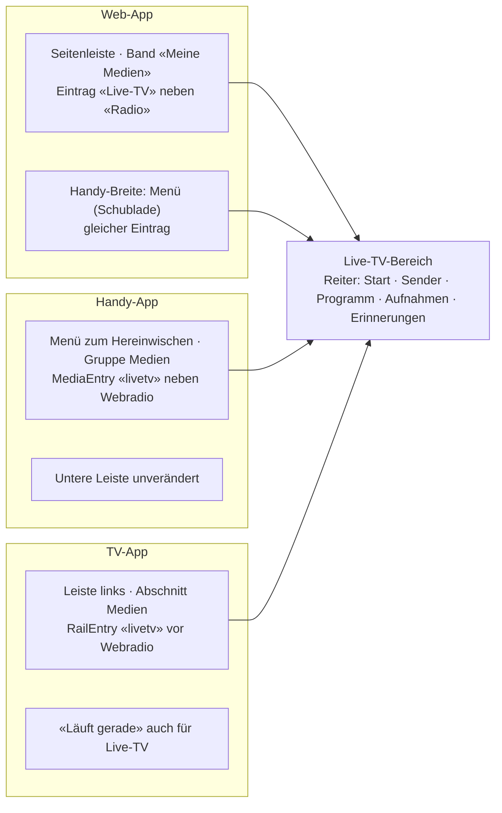
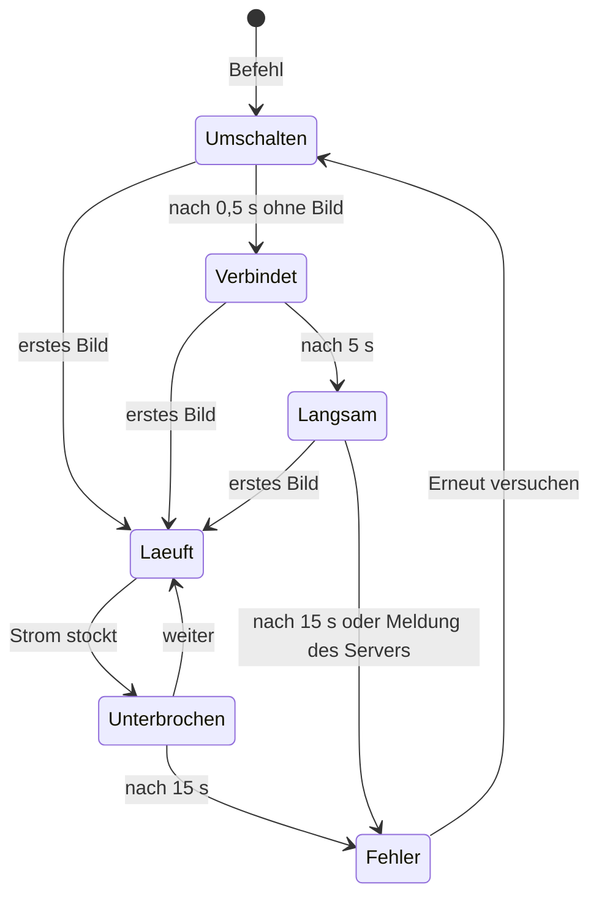

# Konzept 28 · Oberfläche für Zuschauer

Stand: 28. November 2026 · Fassung 1 · Status: Entwurf, nicht freigegeben

Dieses Dokument beschreibt jede Seite, jeden Dialog und jeden Zustand des Live-TV-Bereichs für
Zuschauer in den drei Clients **Web-App** (Computer, Tablet, Handy-Browser), **Handy-App** (Android,
Konzept 27) und **TV-App** (Android TV / Google TV, Konzept 26). Es ist die Bauvorlage für die
klickbaren Mockups (`docs/planning/mockups/28-live-tv/`) und später für den Bau. Die Verwaltung steht
in `15-administration.md`.

Alles hier ist **spezifiziert**, nichts ist gebaut. Wo ein bestehendes Bauteil wiederverwendet wird,
steht sein Ort im Repo dabei (**gebaut**, Datei). Werte wie Schwellen in Sekunden sind **Vorschläge**,
die das Fachkonzept (`03-fachkonzept.md`) oder Streaming (`05-streaming-und-fast-zapping.md`)
festlegen; Zielzeiten sind zu prüfende Grössen, keine Zusage. Offene Weichen stehen als **F-n** in
Abschnitt 9. Die Nummern F-1 bis F-12 sind in diesem Dokument fortlaufend; `15-administration.md`
setzt mit F-13 fort. `20-offene-entscheidungen.md` übernimmt sie.

Kurz erklärt: **EPG** ist die elektronische Programmzeitschrift, also die Programmdaten der Sender.
**Timeshift** heisst zeitversetztes Fernsehen: anhalten, zurückspulen, wieder zu «live». **Zappen**
heisst schnell von Sender zu Sender schalten.

---

## 0. Grundsätze für alle Seiten

1. **Ohne Recht fehlt der Bereich.** Hat das Profil das Recht «Live-TV» nicht (wirksam nur, wenn Konto
   und Profil es haben), gibt es keinen Eintrag, keine Route, keinen Hinweis. Eine direkt aufgerufene
   Adresse zeigt die bestehende Seite «Nicht gefunden» (Server antwortet 404, nie 403). Dasselbe gilt
   für das Recht «Aufnahmen» (alle Aufnahme-Knöpfe, Seiten LS-08 bis LS-12 und LS-14 fehlen) und das
   Recht «Timeshift» (Anhalten und Zurückspulen fehlen, Abschnitt 4.7).
2. **Kein Altersfilter.** Live-TV zeigt allen freigegebenen Profilen alle Sender des Angebots. Es gibt
   keine Sperre nach Sender, Sendung oder Programmdaten (LTV-015, benannte Ausnahme vom Altersmodell).
3. **Aufnahmen sind privat.** Sie erscheinen nur in «Meine Aufnahmen» des eigenen Profils, nie auf der
   Startseite, in der Suche, in Sammlungen oder in der Bibliothek. Einzige Ausnahme: das Hauptprofil
   sieht die Aufnahmen der Profile mit Altersgrenze (LS-14).
4. **Ehrliche Programmdaten.** Fehlt etwas im EPG, steht «Keine Programmdaten», nie ein erfundener Titel,
   nie ein geschätztes Ende. Der Sender lässt sich trotzdem einschalten.
5. **Kein verpasstes Fernsehen.** Vergangene Sendungen sind nur Information. Es gibt keinen Knopf
   «Von vorne», kein Archiv, keine Wiedergabe vor dem eigenen Einschalten (LTV-007, LTV-013).
6. **Ein Sender je Player.** Keine Vorschau mit laufendem Bild im Raster, kein Bild-im-Bild, kein
   Mehrfachbild (LTV-016). Wer den Player verlässt, beendet die Wiedergabe.
7. **Marcos Gestaltungsregeln.** Klappbares ist zu und zeigt seine Zusammenfassung in der Kopfzeile
   (Ausnahmen: Sprunglink öffnet sein Ziel, eben Angelegtes ist offen, Aufklapper mit Fehler öffnet
   sich). Rahmen mindestens 3:1, gedämpfter Text mindestens 8:1 gegen seinen Grund. Senderlogos und
   Sendungsbilder bekommen keinen Rahmen. Anlegen und Ändern im selben Dialog. Medienauswahl links.
8. **Kein neues Designsystem.** Bestehende Bauteile aus `web/src/ui`, `android/core/design`,
   `android/app-tv/.../ui` und Tokens aus `packages/design-tokens`. Neue Bauteile nur, wo nichts passt
   (Abschnitt 6).
9. **Texte und Farben** nur aus `web/src/locales/*.json` (Namensraum `live`) und aus Tokens (Regel 9).

### 0.1 Beispieldaten für die Mockups

Alle Inhalte sind **Beispieldaten** und im Mockup als solche zu kennzeichnen (Fussnote «Beispieldaten,
simulierte Wiedergabe»). Keine Logos und keine Sendungsbilder ins Repo; Logos zeigt das Mockup als
Initialen auf Fläche (`StationLogo`-Rückfall), Bilder aus dem lokalen, nicht eingecheckten `img/`
(Baukästen 26/27) oder gar nicht. Episodentitel sind erfunden.

**Uhrzeit im Mockup:** Samstag, 28. November 2026, 20:41.

**Konto** «Familie Keller» (`familie.keller@example.ch`), Kontingent für Aufnahmen 200 GB, Rechte
Live-TV, Aufnahmen und Timeshift an. Profile: **Anna** (Hauptprofil, ohne Altersgrenze), **Luca**
(Altersgrenze 16), **Mia** (Altersgrenze 6). Timeshift-Höchstdauer des Servers: 2 Stunden.

**Sender** (Nummer · Name · Land · Sprache · Gruppen · Programmdaten):

| Nr. | Sender | Land | Sprache | Gruppen | EPG |
|---|---|---|---|---|---|
| 1 | SRF 1 | CH | Deutsch | Schweiz, Vollprogramme | ja |
| 2 | SRF zwei | CH | Deutsch | Schweiz, Sport | ja |
| 3 | SRF info | CH | Deutsch | Schweiz, Nachrichten | ja |
| 4 | RTS 1 | CH | Französisch | Schweiz | ja |
| 5 | RSI LA 1 | CH | Italienisch | Schweiz | ja |
| 7 | TeleZüri | CH | Deutsch | Schweiz, Regional | **keine Zuordnung** |
| 10 | Das Erste | DE | Deutsch | Deutschland, Vollprogramme | ja |
| 11 | ZDF | DE | Deutsch | Deutschland, Vollprogramme | ja |
| 12 | 3sat | DE | Deutsch | Deutschland, Kultur | ja |
| 13 | arte | DE | Deutsch/Französisch | Deutschland, Kultur | ja |
| 14 | ZDFneo | DE | Deutsch | Deutschland | ja |
| 15 | ZDFinfo | DE | Deutsch | Deutschland, Nachrichten | ja (Sender gerade gestört) |
| 16 | tagesschau24 | DE | Deutsch | Deutschland, Nachrichten | ja |
| 17 | phoenix | DE | Deutsch | Deutschland, Nachrichten | **lückenhaft** (Daten nur bis 20:00) |
| 18 | KiKA | DE | Deutsch | Deutschland, Kinder | ja, endet 21:00 |
| 30 | ORF 2 | AT | Deutsch | Österreich | ja |

**Favoriten von Anna** (in dieser Reihenfolge): SRF 1, SRF zwei, Das Erste, ZDF, arte.
**Zuletzt gesehen:** SRF zwei (vor 5 Min.), SRF info, ZDF, KiKA.

**Programm Samstag 28.11.** (Ausschnitt 19:00–23:30):

| Sender | Sendungen |
|---|---|
| SRF 1 | 19:30 Tagesschau · 19:55 Meteo · 20:05 Wort zum Sonntag · 20:10 Happy Day (Show, bis 22:00) · 22:00 Tagesschau Nacht · 22:15 Sportaktuell · 22:40 Der Bestatter (Krimiserie, S06E03 «Das letzte Hemd») |
| SRF zwei | 19:00 Eishockey National League: ZSC Lions – HC Davos (live, bis 21:45) · 21:45 Sport aktuell · 22:15 Der Marsianer (Spielfilm, bis 00:35) |
| SRF info | stündlich Tagesschau (10 Min.), dazwischen Kassensturz (Wiederholung), 10 vor 10 (Wiederholung) |
| Das Erste | 19:50 Wetter vor acht · 20:00 Tagesschau · 20:15 Klein gegen Gross (Show, bis 23:15) · 23:15 Tagesthemen |
| ZDF | 19:00 heute · 19:25 Der Bergdoktor (Wiederholung) · 20:15 Ein starkes Team: «Tödliche Ernte» (Krimi, bis 21:45) · 21:45 heute-journal · 22:00 Der Kommissar und das Meer · 23:30 das aktuelle sportstudio |
| 3sat | 19:20 Wilde Schweiz (Doku) · 20:15 Kabarett aus der Schweiz · 21:45 Kulturzeit extra |
| arte | 19:20 ARTE Journal · 19:40 Die Alpen von oben (Doku, bis 21:15) · 21:15 Tracks |
| KiKA | 19:30 logo! · 19:50 Unser Sandmännchen · 20:00 Checker Tobi · 20:30 Die Sendung mit der Maus · **ab 21:00 keine Programmdaten** |
| phoenix | 19:30 phoenix der tag · **ab 20:00 keine Programmdaten** |
| TeleZüri | **keine Programmdaten** (ganze Zeile) |

Sonntag 29.11.: SRF 1 20:05 und Das Erste 20:15 «Tatort: Die Stille nach dem Sturm» (Serie Tatort,
Erstausstrahlung). Für die Serienaufnahme gibt es so denselben Titel auf zwei Sendern.

**Aufnahmen von Anna:**

| Titel | Sender | Zeit | Grösse | Zustand |
|---|---|---|---|---|
| Eishockey: ZSC Lions – HC Davos | SRF zwei | heute ab 20:12 (Sofortaufnahme bis Sendungsende 21:45 + 10 Min.) | 2,9 GB bisher | **läuft** |
| Tatort: Spur im Nebel | Das Erste | So 22.11., 20:13–21:55 | 5,8 GB | fertig, angesehen; Serie «Tatort», behalte die letzten 10 |
| Arena | SRF 1 | Fr 27.11., 22:23–23:50 | 4,1 GB | fertig, 35 % gesehen; wird am 27.12. gelöscht (Frist 30 Tage) |
| Terra X: Die Alpen | ZDF | Mi 25.11., 19:13–20:10 | 3,2 GB | **unvollständig**: 2 Lücken, 6 Min. fehlen (Sender war nicht erreichbar) |
| Kassensturz | SRF 1 | Di 24.11., 21:03–21:55 | – | **fehlgeschlagen**: Sender war nicht erreichbar |
| Der Bergdoktor | ZDF | Do 26.11., 20:13–21:55 | – | **nicht aufgenommen**: Kontingent des Kontos war voll |

**Geplant von Anna:** Einzel «das aktuelle sportstudio» (ZDF, heute 23:30); Einzel «Der Marsianer»
(SRF zwei, heute 22:15–00:35, überschneidet sich mit «sportstudio»); Serie «Tatort» (alle Sender, nur
Erstausstrahlungen, Folgen nicht doppelt, behalte 10; nächster Termin So 20:05 SRF 1, die Ausstrahlung
20:15 Das Erste ist als «schon geplant» übersprungen); wiederkehrend «Tagesschau» (SRF 1, Mo–Fr
19:30–19:55, behalte 5); manuell «TV24, Mo 30.11., 21:00–22:00» (Sender ist aus dem Angebot
verschwunden: Warnung «Sender weg»).

**Erinnerungen von Anna:** «Tatort: Die Stille nach dem Sturm», So 20:05, SRF 1, 5 Min. vorher;
«Sport aktuell», heute 21:45, SRF zwei, zum Beginn.

**Kontingent:** 200 GB; Anna 82 GB, übrige Profile 60 GB, frei 58 GB.

**Aufnahmen von Mia** (für LS-14): «Checker Tobi» (KiKA, Sa 21.11., 0,9 GB, fertig), Serie «Die
Sendung mit der Maus» (behalte 5, 3 Folgen, 2,4 GB). **Luca:** «Eishockey: SCB – EV Zug» (SRF zwei,
Di 24.11., 6,1 GB, fertig).

---

## 1. Einordnung in die Clients

### 1.1 Wo Live-TV erscheint



| Client | Ort | gebaut als Vorbild | Neu |
|---|---|---|---|
| Web Computer und Tablet (ab 768 px) | Seitenleiste, Band «Meine Medien», Eintrag **«Live-TV»** mit Symbol `tv` und Zählertext «16 Sender» bzw. «Live» | Radio-Eintrag in «Meine Medien» (`web/src/app/AppLayout.tsx`, `MyMediaKey` in `api/openapi.yaml`) | neuer Schlüssel `livetv` in `MyMediaKey`; Reihenfolge und Ausblenden über Verwaltung «Meine Medien» (LA-26) |
| Web Handy (unter 768 px) | dieselbe Liste in der Menü-Schublade hinter dem Menüknopf | `SideNavMenu`, `SideNavDrawer.tsx` | – |
| Handy-App | Menü zum Hereinwischen, Gruppe «Medien», Eintrag **«Live-TV»** direkt nach Webradio (`order = 95`); untere Leiste (Start, Suche, Downloads, Wünsche, Mehr) bleibt; ab 700 dp feste Seitenspalte | `MediaEntry` in `android/app-mobile/.../shell/Registry.kt`, Webradio `audio/AudioFeature.kt` (`order = 90`) | `MediaEntry("livetv", MediaSection.Media, 95, …)` und `LiveTvFeature` in `Features.kt` |
| TV-App | Leiste links, Abschnitt «Medien», Eintrag **«Live-TV»** vor Webradio (`order = 990`); «Läuft gerade» zeigt auch den laufenden Sender | `RailEntry` in `android/app-tv/.../shell/Registry.kt`, `RADIO_ORDER = 1_000`, `NOW_ORDER = 1_001` | `RailEntry("livetv", RailSection.Media, 990, …)` |

**Ohne Recht** fehlen alle drei Einträge, die Zahl in «Meine Medien» ebenso. Die Zähler-Abfrage
liefert den Eintrag gar nicht erst (der Server entscheidet, Regel 12).

**Innerhalb des Bereichs** führt eine Reiterleiste oben durch die Hauptseiten. Sie erscheint auf allen
Live-TV-Seiten ausser dem Player:

| Reiter | Seite | nur mit Recht |
|---|---|---|
| Start | LS-01 | Live-TV |
| Sender | LS-02 (mit «Meine Sender» LS-03) | Live-TV |
| Programm | LS-04 (mit Programmsuche LS-05) | Live-TV |
| Aufnahmen | LS-08 (mit Geplant LS-11) | Aufnahmen |
| Erinnerungen | LS-13 | Live-TV |

Web: Bauteil `Tabs` als Linkreiter (wie `AreaTabs` der Verwaltung, `web/src/ui/AreaTabs.tsx`), Ziel im
URL. Handy-App: Reiter als `SlouchcatChip`-Reihe unter der `TopBar`, waagrecht scrollbar. TV: Reiterreihe
oben als fokussierbare Chips; ↑ aus der ersten Inhaltsreihe führt hinein, ↓ zurück.

### 1.2 Bestehende Seiten, die sich ändern

| Kennung | Seite | Änderung | Client |
|---|---|---|---|
| LS-20 | Hauptnavigation | Eintrag «Live-TV» (oben 1.1) | alle |
| LS-21 | Profile verwalten: Profilformular (`/settings/profiles`, `web/src/features/profiles/ProfileForm.tsx`; Handy-App Einstellungen › Profile; TV «Profile verwalten») | neuer Block «Live-TV» mit drei Schaltern (Abschnitt 1.3) | alle |
| LS-22 | Benachrichtigungen einstellen (`/settings/notifications`, `features/notifications/ChannelSettingsPage.tsx`) | neue Ereignisse «Sendungserinnerung», «Aufnahme fertig», «Aufnahme fehlgeschlagen oder unvollständig», «Aufnahme nicht möglich» (F-6) | Web, Handy-App |
| LS-23 | Benachrichtigungen (Glocke, `features/discover/NotificationsPage.tsx`, `ui/InboxEntry.tsx`) | neue Einträge mit Symbol `reminder`/`record`, Ziel Sendungsdetails, Player oder Aufnahme | alle |
| LS-24 | Suche (`/search`, `features/discover/SearchPage.tsx`) | nur ein Verweis «Im TV-Programm suchen: ‹Begriff›» unter den Treffern, wenn das Recht besteht (F-3); **nie Aufnahmen** | Web, Handy-App, TV |
| LS-25 | Ton-Vorrang (`web/src/app/radio/priority.ts`) und Mini-Player-Dock | Live-TV ist eine dritte Tonquelle: Einschalten von Live-TV beendet Radio und Hörbuch; Verlassen des Live-Players hinterlässt **keinen** Mini-Player (kein Bild-im-Bild) | Web; Handy-App analog |
| LS-26 | Startseite | **keine Änderung** in Stufe 1 (F-2); Aufnahmen nie | alle |

### 1.3 Die drei Schalter im Profilformular (LS-21)

Nur das **Hauptprofil** ändert Profile (bestehende Regel `requirePrimary`). Neuer Block im
Profilformular, als Aufklapper (zu), Kopfzeile mit Zusammenfassung, z. B. «Live-TV: an · Aufnahmen: an ·
Timeshift: aus».

```
┌ Live-TV ─────────────────────────── an · Aufnahmen an · Timeshift aus  ▾ ┐
│ [■] Live-TV                                                              │
│     Fernsehen schauen und das Programm sehen.                            │
│ [■] Aufnahmen                                                            │
│     Sendungen aufnehmen. Aufnahmen belegen Speicher des Kontos.          │
│ [ ] Timeshift                                                            │
│     Live-TV anhalten und zurückspulen, bis zum eigenen Einschalten.      │
│ ⓘ Live-TV zeigt alles, was der Sender zeigt. Slouchcat prüft keine       │
│   Altersfreigaben von Sendern oder Sendungen.                            │
└──────────────────────────────────────────────────────────────────────────┘
```

- **Bauteile (gebaut):** `Switch` mit Hilfetext, Muster «Darf anfordern» (`ProfileForm.tsx`, Texte
  `profiles.settings.form.canRequestCapped/…Help`), `DisclosureGroup`/`BandPanel` für den Aufklapper,
  `Notice` (info) für den Hinweis.
- **Hinweis «zeigt alles»** erscheint bei **jedem** Profil mit Altersgrenze, auch wenn der Schalter aus
  ist, und zusätzlich als Bestätigung beim Einschalten: Ein kleiner `ConfirmDialog` «Live-TV für Mia
  einschalten? Mia sieht dann alle Sender und Sendungen ohne Altersprüfung.» [Einschalten] [Abbrechen].
  Bei Profilen ohne Altersgrenze kein Dialog.
- **Deckel des Kontos:** Hat das Konto ein Recht nicht, ist der Schalter gesperrt (`aria-disabled`,
  fokussierbar) mit Text «Für dein Konto nicht freigeschaltet. Das kann der Server-Admin ändern.»
  (Muster `canRequestCapped`).
- **Abhängigkeit:** «Aufnahmen» und «Timeshift» sind nur wählbar, wenn «Live-TV» an ist; sonst gesperrt
  mit «Zuerst Live-TV einschalten.»
- **Vorgabe beim Anlegen** eines Profils: offen, F-1.
- **Keine Kopplung an die Altersgrenze:** Ändert das Hauptprofil später die Altersgrenze, bleiben die
  Schalter, wie sie sind (LTV-015).
- **TV-App:** gleiche drei Schalter als `SwitchRow`-Zeilen; Bestätigung als `TvDialog`.

---

## 2. Seiteninventar

Routen der Web-App unter `/live`, Pfade als Vorschlag für `web/src/app/paths.ts`. Handy-App: Routen
`live/...` im Compose-Navigationsgraph. TV: Seiten der TV-App. «Recht» nennt das zusätzlich nötige Recht
neben «Live-TV».

| Kennung | Seite | Zweck | Route Web | Handy-App | TV | Recht | LTV |
|---|---|---|---|---|---|---|---|
| LS-01 | Live-TV-Start | Einstieg: jetzt, gleich, zuletzt, Favoriten, Genre, Einstiege | `/live` | `live` | Live-TV › Start | – | 014 |
| LS-02 | Senderübersicht | alle Sender mit Jetzt/Danach, Gruppen, Filter, Suche | `/live/channels?group=&q=&country=&lang=&category=&fav=` | `live/channels` | Live-TV › Sender | – | 006, 014 |
| LS-03 | Meine Sender | Favoriten ansehen und ordnen | `/live/channels/favorites` | `live/favorites` | Live-TV › Sender, Reihe «Meine Sender» + Ordnen | – | 001, 010, 014 |
| LS-04 | Programmzeitschrift | Raster Sender × Zeit; Handy als Liste | `/live/guide?day=&time=&group=` | `live/guide` | Live-TV › Programm; Taste GUIDE | – | 005, 014 |
| LS-05 | Programmsuche | Sendungen senderübergreifend finden, auch «nach Genre» | `/live/guide/search?q=&when=&genre=&group=` | `live/guide/search` | Live-TV › Programm › Suche | – | 005 |
| LS-06 | Sendungsdetails | eine Sendung mit allen Aktionen | `/live/programs/$programId` | `live/program/{id}` | Seitenmenü rechts oder eigene Seite | – | 005, 008, 014 |
| LS-07 | Live-Player | Fernsehen schauen, zappen, Timeshift, sofort aufnehmen | `/live/watch/$channelId?list=` | `live/watch/{id}` | Vollbild | Timeshift für Spulen, Aufnahmen für ● | 007, 010, 014, 016 |
| LS-08 | Meine Aufnahmen | private Aufnahmen des Profils | `/live/recordings?state=&sort=` | `live/recordings` | Live-TV › Aufnahmen | Aufnahmen | 008, 009, 014 |
| LS-09 | Aufnahme-Detail | eine Aufnahme: Zustand, Lücken, Aufbewahrung | `/live/recordings/$recordingId` | `live/recording/{id}` | Seite | Aufnahmen | 008, 009 |
| LS-10 | Aufnahme-Player | Aufnahme abspielen (auch laufende) | `/live/recordings/$recordingId/play` | Player | Player | Aufnahmen | 008, 016, 020 |
| LS-11 | Geplante Aufnahmen | Termine, Serien, Wiederkehrend | `/live/scheduled?tab=upcoming|series|recurring` | `live/scheduled` | Live-TV › Aufnahmen › Geplant | Aufnahmen | 008, 014 |
| LS-12 | Konflikte und Warnungen | was einer geplanten Aufnahme im Weg steht | `/live/scheduled/warnings` | `live/scheduled/warnings` | Seite | Aufnahmen | 008, 019 |
| LS-13 | Erinnerungen | Sendungserinnerungen | `/live/reminders` | `live/reminders` | Live-TV › Erinnerungen | – | 005 |
| LS-14 | Aufnahmen meiner Profile | Hauptprofil: Aufnahmen der Profile mit Altersgrenze | `/live/recordings/profiles` | `live/recordings/profiles` | Live-TV › Aufnahmen › Profile | Hauptprofil, Aufnahmen | 009, 015 |
| LS-15 | Senderprogramm | Tagesprogramm eines Senders als Liste | `/live/guide/channel/$channelId?day=` | `live/guide/channel/{id}` | Seite | – | 005 |

**Zustände je Seite** (Einzelheiten im jeweiligen Abschnitt):

| Seite | leer | lädt | Fehler | ohne EPG | ohne Recht Aufnahme | ohne Recht Timeshift |
|---|---|---|---|---|---|---|
| LS-01 | «Noch keine Sender» (Angebot leer) | Skeleton-Reihen | Fehlerseite mit «Erneut versuchen» | Reihen «Jetzt»/«Gleich» entfallen, Sender bleiben | Einstiege Aufnahmen/Geplant fehlen | – |
| LS-02 | «Keine Sender» / «Kein Sender passt» | Skeleton-Zeilen | `Notice` danger | «Keine Programmdaten» in der Zeile | – | – |
| LS-03 | «Noch keine Lieblingssender» | Skeleton | `Notice` | wie LS-02 | – | – |
| LS-04 | «Keine Sender in dieser Gruppe» | Skeleton-Zellen je Zeitfenster | `Notice` über dem Raster, Raster bleibt | Zelle «Keine Programmdaten» | Aufnahme-Kennzeichen und -Aktionen fehlen | – |
| LS-05 | «Nichts gefunden» | Skeleton | `Notice` | «Programmdaten fehlen für N Sender» | Aufnahme-Aktionen fehlen | – |
| LS-06 | – | Skeleton-Kopf | Seite «Nicht gefunden» (Sendung weg) | Seite nur über Sender erreichbar | Knöpfe fehlen | – |
| LS-07 | – | Umschaltbild (4.5) | Fehlerbilder (4.8) | Info zeigt «Keine Programmdaten» | Knopf ● fehlt | Pause/Spulen fehlen (4.7) |
| LS-08–12, 14 | eigene Leerzustände | Skeleton | `Notice` | Titel = «Manuelle Aufnahme …» | ganze Seiten fehlen | – |
| LS-13 | «Keine Erinnerungen» | Skeleton | `Notice` | – | – | – |
| LS-15 | «Keine Programmdaten für diesen Tag» | Skeleton | `Notice` | ganzer Tag «Keine Programmdaten» + «Zeit aufnehmen» | «Zeit aufnehmen» fehlt | – |

**Dialoge** (Kennung `LD-nn`, Abschnitt 5): LD-01 Aufnahme planen · LD-02 Serienaufnahme · LD-03
Manuelle oder wiederkehrende Aufnahme · LD-04 Sofortaufnahme · LD-05 Erinnerung · LD-06 Löschen und
Abbrechen · LD-07 Konflikt oder Warnung · LD-08 Tag und Uhrzeit wählen · LD-09 Filterblatt (Handy) ·
LD-10 Senderwechsel bei Zeitversatz · LD-11 Aufbewahrung ändern.

---

## 3. Die Seiten

Für jede Seite: Aufbau (oben nach unten, links nach rechts), Verhalten je Gerät, Tastatur und
Fernbedienung (Regel 8: Pfeiltasten, Tab, Enter, Zurück, sichtbarer Fokus, keine Fokusfalle).
«Zurück» heisst im Web Browser-Zurück bzw. Esc/Backspace, wo der Player es schon so hält; am Handy die
Systemgeste; am TV die Zurück-Taste. Der Fokusring ist überall `state.focus-ring`, 3 px
(`focus.ring.width`).

### 3.1 LS-01 Live-TV-Start

**Zweck:** schneller Einstieg. «Was läuft jetzt, was kommt gleich, wo war ich.»

**Aufbau (Web Computer):**

1. Seitenkopf: Titel «Live-TV», darunter Reiterleiste (1.1).
2. Hinweisband nur bei Bedarf: `Notice` warning «2 geplante Aufnahmen brauchen deine Aufmerksamkeit»
   → LS-12 (nur mit Recht Aufnahmen).
3. Reihe **«Jetzt im Fernsehen»** (`Row` Variante `cards`): `ProgramCard` (neu, 6.3) je Sender mit
   laufender Sendung: Bild der Sendung falls vorhanden, sonst Senderlogo gross auf Fläche
   `surface.2`; Senderlogo klein, Nummer, Titel, «20:10–22:00», Fortschrittsbalken, Abzeichen
   (● nimmt auf, Serie). Reihenfolge: erst Lieblingssender in ihrer Reihenfolge, dann nach Nummer. Klick
   = einschalten (LS-07). Kontextmenü «Details», «Aufnehmen», «Zum Senderprogramm».
4. Reihe **«Gleich im Fernsehen»**: Sendungen, die in den nächsten 60 Minuten beginnen, gleiche
   Reihenfolge, Karte zeigt «ab 21:45» statt Fortschritt. Klick = Sendungsdetails.
5. Reihe **«Zuletzt gesehen»** (`Row` Variante `tiles`): `ChannelCard` (neu, 6.2) mit Logo, Nummer,
   Name, Jetzt-Titel und Fortschritt. Klick = einschalten. Höchstens 12.
6. Reihe **«Meine Sender»** (`ChannelCard`), «Alle»-Link zu LS-03.
7. Reihe **«Nach Genre»** (`Row` Variante `chips`, `GenreChip`): Nachrichten, Sport, Film, Serie,
   Dokumentation, Kinder, Musik, Show, Kultur. Die Genres stammen aus den Programmdaten, nur Genres
   mit Treffern in den nächsten 3 Stunden. Klick → LS-05 mit `genre=…&when=now`.
8. Einstiege (`LinkCard`, vier nebeneinander): «Programmzeitschrift», «Meine Aufnahmen · 1 läuft»,
   «Geplant · 5», «Erinnerungen · 2». Die zwei Aufnahme-Karten nur mit Recht.

**Tablet:** gleiche Reihen, Karten kleiner (`size.poster.*` wie Startseite). **Handy (Web und App):**
Reihen untereinander, waagrecht wischbar; Einstiege als 2 × 2-Raster. Handy-App: `MediaRow`,
`RowHeader`, `MediaCard`. **TV:** Reihen als `TvCard`-Reihen, oben eine Vorschau der fokussierten Karte
(Titel, Zeit, zwei Zeilen Beschreibung, Hintergrund `art()` nur mit echtem Sendungsbild, sonst ruhige
Fläche `media.backdrop`). Erste Reihe hat den Startfokus.

**Tastatur Web:** Tab springt von Reihe zu Reihe (eine Reihe = ein Tab-Halt, wie `Row`), ←/→ innerhalb
der Reihe, Enter öffnet, Shift+F10 bzw. Kontextmenütaste öffnet das Kontextmenü. **TV:** ↑/↓ zwischen
Reihen, jede Reihe merkt sich die letzte Kachel (`focusKey`), OK öffnet, langes OK nicht verwendet;
Menü-Aktionen über die Taste «Optionen» gibt es am TV nicht, darum öffnet OK auf einer
«Gleich»-Karte die Sendungsdetails (LS-06 als Seitenmenü).

**Zustände:** lädt = `Skeleton` in Endmass je Reihe; leer (kein Sender im Angebot) = `EmptyState`
«Noch keine Sender. Sobald der Server-Admin Sender einrichtet, erscheinen sie hier.»; ohne EPG
(kein Sender hat Daten) = Reihen 3, 4, 7 fehlen, darüber `Notice` info «Für die Sender gibt es gerade
keine Programmdaten. Fernsehen geht trotzdem.»; Fehler = `features/shared/SystemState.tsx`.

### 3.2 LS-02 Senderübersicht

**Zweck:** alle Sender finden, filtern, einschalten, favorisieren.

**Aufbau (Web Computer):**

1. Kopf: «Sender» und Zahl «16 Sender» bzw. «3 von 16 Sendern».
2. Werkzeugleiste: `SearchField` («Sender suchen», sucht Name und Nummer), `FacetSelect` «Gruppe»
   (Alle Sender · Meine Sender · Schweiz · Deutschland · Österreich · Nachrichten · Sport · Kinder ·
   Kultur · Regional · Vollprogramme), `FacetSelect` «Land», «Sprache», «Kategorie», Ansichtsschalter
   `ToggleToolbar` «Liste | Kacheln». Filter stehen im URL (wie `features/radio/RadioPage.tsx`).
3. `ActiveFilters` mit «Alle Filter entfernen».
4. Inhalt **Liste** (Standard): `VirtualList` (`web/src/ui/VirtualList.tsx`) mit `ChannelRow` (neu,
   6.1): Nummer · Logo · Name · Jetzt (Titel, «20:10–22:00», Fortschritt) · Danach (Titel, «ab 22:00») ·
   Abzeichen · Herz · Menü ⋯. Sortiert nach Nummer, Sender ohne Nummer am Ende nach Name.
   **Kacheln:** `ChannelCard` im Raster (Muster `StationTile`).
5. Bei Gruppenwahl ein Gruppenkopf «Gruppe Schweiz · 6 Sender».

**Handlungen:** Klick auf die Zeile oder Enter = einschalten (LS-07, Zapping-Liste = aktuelle Filterung,
`?list=`); Herz = Favorit an/aus (`toast` «SRF 1 ist jetzt in Meine Sender · Rückgängig»); Menü ⋯:
«Senderprogramm» (LS-15), «Jetzige Sendung: Details», «Zu Meine Sender» / «Aus Meine Sender».

**Handy:** Filter hinter einem Knopf «Filter (2)» als `FilterSheet` (LD-09); Zeile zweizeilig (oben
Nummer, Logo, Name, Herz; unten Jetzt mit Fortschritt; Danach entfällt). Handy-App: Muster
`audio/RadioScreen.kt` (Filter, Ländersheet), `ListRow`. **TV:** Kopf mit Zahl, Suche mit
TV-Tastatur (`keyboard()`), Filter als Seitenmenü von rechts («Gruppe», «Land», «Sprache»); Inhalt
als senkrechte Liste grosser `ChannelRow`-Zeilen (eine Zeile = ein Fokus), Herz über die Taste →
am Zeilenende.

**Tastatur Web:** Tab: Suche → Filter → Ansicht → Liste (ein Tab-Halt, Pfeile innerhalb, wie
`VirtualList`) ; in der Zeile → erreicht Herz und Menü; Enter schaltet ein; Zurück stellt Filter und
Scrollstelle her (wie Radio-Test `web/e2e/radio.spec.ts`). **TV:** ↑/↓ Zeilen, → zum Herz, OK
einschalten, Zurück schliesst zuerst das Filtermenü.

**Zustände:** leer «Kein Sender passt zu den Filtern» + «Filter entfernen»; Sender ohne EPG zeigt in
der Jetzt-Spalte «Keine Programmdaten» (gedämpft, aber ≥ 8:1); gestörter Sender (Server meldet ihn
nicht verfügbar) bleibt sichtbar mit Abzeichen «Gestört» (`StatusDot` warning) und Text «Gerade nicht
erreichbar»; einschalten ist möglich (Player zeigt 4.8).

### 3.3 LS-03 Meine Sender

**Zweck:** persönliche Favoriten in eigener Reihenfolge. Sie bestimmen die Reihenfolge auf LS-01 und
die Zapping-Liste «Meine Sender» im Player.

**Aufbau:** Kopf «Meine Sender · 5»; Knopf «Ordnen»; Liste der `ChannelRow` in Favoriten-Reihenfolge.
Im **Ordnen-Modus** bekommt jede Zeile «Nach oben», «Nach unten», «Entfernen» (Muster
`RankedChoiceList`/`RankSelect`, keine Ziehgeste nötig); Knopf «Fertig». Speichern sofort je Schritt
(wie `SetRadioFavoriteOrder`).

**Geräte:** Handy wie Web schmal; TV: Ordnen über OK auf einer Zeile → Zeile «hängt» am Fokus, ↑/↓
verschiebt, OK legt ab, Zurück bricht ab (Sprechtext «SRF 1, Platz 2 von 5»).

**Tastatur Web:** im Ordnen-Modus Alt+↑/Alt+↓ verschiebt die fokussierte Zeile zusätzlich zu den
Knöpfen; der Fokus bleibt auf der Zeile.

**Leer:** `EmptyState` «Noch keine Lieblingssender. Tippe in der Senderliste aufs Herz.» + «Zu den
Sendern».

### 3.4 LS-04 Programmzeitschrift

Siehe Abschnitt 4.1 bis 4.4 (eigener Abschnitt wegen Umfang).

### 3.5 LS-05 Programmsuche

**Zweck:** senderübergreifend Sendungen finden (LTV-005), auch der Einstieg «Nach Genre».

**Aufbau:** `SearchField` «Sendungen suchen» (Titel, Episodentitel, Beschreibung); Filter
`ChoiceChips` «Wann»: Jetzt · Heute · Morgen · Nächste 7 Tage (bis zum Vorschauzeitraum);
`FacetSelect` «Genre», «Gruppe» (inkl. Meine Sender). Treffer gruppiert nach Tag («Heute», «Morgen»,
«Mo 30.11.»), je Treffer eine `ProgramRow` (Variante von `ChannelRow`, 6.1): Zeit «20:15–21:45» ·
Senderlogo + Name · Titel · Episodentitel · Genre · Abzeichen · Aktionen «Aufnehmen» ● und «Erinnern»
(Symbolknöpfe mit Namen). Laufende Treffer zeigen Fortschritt und «Einschalten».

Beispiel: Suche «tatort» → Sonntag 29.11.: 20:05 SRF 1 «Tatort: Die Stille nach dem Sturm»
(Abzeichen «Serie geplant»), 20:15 Das Erste dieselbe Folge (Abzeichen «Schon geplant»); Mittwoch 2.12.: 22:20
SRF 1 «Tatort: Spur im Nebel» (Wiederholung, Abzeichen «Aufgenommen»).

**Handy:** Filter im `FilterSheet`; Zeile zweizeilig. **TV:** Suche mit TV-Tastatur und Spracheingabe
wie die bestehende Suche; Treffer als Liste; OK öffnet LS-06 als Seitenmenü.

**Tastatur:** Tab: Suche → Wann → Filter → Ergebnisliste (ein Tab-Halt, ↑/↓ zwischen Treffern, →
erreicht die Aktionsknöpfe der Zeile); Enter auf der Zeile = Details.

**Zustände:** leer vor der Eingabe «Gib einen Titel ein oder wähle ein Genre.»; keine Treffer «Keine
Sendung gefunden. Programmdaten reichen bis Fr 4.12.»; Sender ohne EPG fehlen und werden genannt:
`Notice` info «Für 2 Sender gibt es keine Programmdaten: TeleZüri, phoenix (teilweise).»

### 3.6 LS-06 Sendungsdetails

**Zweck:** alles über eine Sendung, alle Aktionen an einem Ort.

**Aufbau (Web Computer), Muster Detailseite (`features/catalog/DetailHeader.tsx`, `ui/RoundAction.tsx`,
`ui/FactList.tsx`):**

1. Kopf: Bild der Sendung (16:9) nur, wenn die Programmdaten eines liefern; sonst kein Platzhalterbild,
   sondern das Senderlogo auf ruhiger Fläche. Darüber Titel «Ein starkes Team», darunter Episodentitel
   «Tödliche Ernte», Zeile «ZDF · Heute, 20:15–21:45 · 90 Min.», `Chip`s für Genre («Krimi»), und
   Kennzeichen aus den Daten: «Untertitel», «Audiodeskription», «16:9», «Wiederholung» (nur wenn die
   Daten sie angeben).
2. Zustandszeile: läuft → `ProgressBar` und «Läuft · noch 64 Min.»; vorbei → «Vorbei. Slouchcat bietet
   keine verpassten Sendungen an.» (und, falls aufgenommen, Link «Deine Aufnahme ansehen»).
3. Rundknöpfe (`RoundAction`), je nach Lage:
   - **Einschalten** (nur wenn läuft).
   - **Aufnehmen** (● Symbol `record`) → LD-01; wenn geplant: «Aufnahme geplant» (gefüllt) → LD-01 im
     Ändern-Modus; wenn läuft: «Nimmt auf» → Menü «Aufnahme beenden», «Zur Aufnahme».
   - **Serie aufnehmen** (Symbol `recordSeries`) → LD-02; nur wenn die Sendung als Serie erkennbar ist
     (Serienkennung oder Episodenangabe in den Daten); sonst fehlt der Knopf, und LD-02 ist über
     LD-01 «Stattdessen jede Ausstrahlung dieses Titels aufnehmen» erreichbar.
   - **Erinnern** (Symbol `reminder`) → LD-05; nur bei künftigen Sendungen; gesetzt = «Erinnerung um
     20:10».
   - **Senderprogramm** → LS-15.
4. Beschreibung, voller Text.
5. `FactList` nur mit Angaben aus den Daten: Originaltitel, Jahr, Land, Regie, Mitwirkende, Folge
   («Staffel 6, Folge 3»). Fehlende Zeilen fehlen; nichts wird ergänzt.
6. Abschnitt «Weitere Termine» (nächste 7 Tage, gleiche Serie oder gleicher Titel): Zeilen wie LS-05.

**Handy:** Bild oben, Knöpfe als Reihe von Symbolknöpfen mit Beschriftung darunter; Handy-App
`SlouchcatCard` + `Buttons.kt`. **TV:** als **Seitenmenü von rechts** (`TvSideMenu`) über dem Raster
oder der Startseite: Titel, Zeit, Beschreibung (6 Zeilen, Rest mit «Mehr» als `TvDialog`), Knöpfe
senkrecht: Einschalten · Aufnehmen · Serie aufnehmen · Erinnern · Senderprogramm. Zurück schliesst das
Menü und gibt den Fokus an die Zelle zurück.

**Tastatur:** Tab-Reihenfolge Kopf-Links → Rundknöpfe (eine `Toolbar`, Pfeile innerhalb) →
Beschreibung «Mehr» → Weitere Termine.

**Zustände:** Sendung nicht mehr im Programm (Programmdaten geändert) = Seite «Nicht gefunden» mit
Text «Diese Sendung steht nicht mehr im Programm.» und Link «Zum Senderprogramm».

### 3.7 LS-07 Live-Player

Siehe Abschnitt 4.5 bis 4.10.

### 3.8 LS-08 Meine Aufnahmen

**Zweck:** die private Aufnahmebibliothek des Profils (LTV-009).

**Aufbau (Web Computer):**

1. Kopf «Meine Aufnahmen»; rechts Knöpfe «Geplant (5)» → LS-11 und «Neue Aufnahme» → LD-03.
2. Speicherleiste `StorageMeter` (gebaut): «Speicher des Kontos: 142 von 200 GB belegt» mit Teilen
   «Du 82 GB» · «Übrige Profile 60 GB» · «Frei 58 GB». Keine Namen anderer Profile, keine Titel.
   Bei ≥ 90 %: `Notice` warning «Der Speicher des Kontos ist fast voll. Neue Aufnahmen können
   abgelehnt werden.»
3. Hauptprofil mit Profilen mit Altersgrenze, die Aufnahmen haben: `LinkCard` «Aufnahmen meiner Profile
   · Luca, Mia» → LS-14.
4. Filter `ToggleToolbar` mit Zahlen: Alle 5 · Läuft 1 · Fertig 3 · Unvollständig 1 · Fehlgeschlagen 2;
   Sortierung `SelectField`: Neueste zuerst · Älteste zuerst · Sender · Titel · Grösse · Läuft bald ab.
5. Abschnitt **«Läuft»** (immer oben, wenn vorhanden): `ProgramCard` Variante Aufnahme mit pulsierendem
   ● (bei `prefers-reduced-motion` ohne Puls), «Nimmt auf seit 20:12 · bis 21:55», bisherige Grösse.
6. Raster `ProgramCard` Variante Aufnahme: Bild oder Senderlogo, Titel, «Das Erste · So 22.11. · 1 Std.
   42 Min.», Fortschritt (Wiedergabe), Abzeichen (Serie, Unvollständig, Neu = nie angesehen), Zeile
   Aufbewahrung «Wird am 27.12. gelöscht» oder «Behalten, bis du löschst» oder «Behalte die letzten
   10 Folgen». **Serien** sind als Stapel zusammengefasst («Tatort · 6 Folgen», `CollectionCard`-Art),
   Klick öffnet die Folgenliste (LS-08 mit `?series=`).
7. Abschnitt **«Fehlgeschlagen und nicht aufgenommen»** als Aufklapper (zu; Kopf «2 Aufnahmen»): Zeilen
   mit Titel, Sender, Zeit, **Grund in Klartext** (4.8 / 5.7), Knopf «Entfernen».

**Mehrfachauswahl:** Knopf «Auswählen» → Kartenecken mit Kontrollkästchen, Leiste «2 ausgewählt ·
10,0 GB · Löschen» → LD-06.

**Handy:** Liste statt Raster (`MediaListRow`), Speicherleiste als eine Zeile mit Balken. **TV:**
Reihen «Läuft», «Neu», «Serien», «Alle», «Fehlgeschlagen»; OK = LS-09.

**Tastatur:** Tab: Kopf-Knöpfe → Filter (`ToggleToolbar`, Pfeile) → Sortierung → Raster (ein Tab-Halt,
Pfeile 2D) → Aufklapper.

**Leer:** «Noch keine Aufnahmen. Plane Aufnahmen in der Programmzeitschrift oder starte eine im
Player.» + «Zum Programm». Gefiltert leer: «Keine Aufnahmen mit diesem Zustand.»

### 3.9 LS-09 Aufnahme-Detail

**Aufbau:** Kopf wie LS-06 (Bild/Logo, Titel, Sender, Datum, Dauer «1 Std. 42 Min., davon Vorlauf 2
Min. und Nachlauf 10 Min.», Grösse «5,8 GB»). Rundknöpfe: **Abspielen** / **Weiter ab 35:12** /
**Von vorne** (`ResumeChoice`-Muster) · **Aufbewahrung** → LD-11 · **Löschen** → LD-06 · bei laufender
Aufnahme **Aufnahme beenden**. Abschnitt **Zustand**:

- fertig: «Vollständig aufgenommen.»
- unvollständig: `Notice` warning «Unvollständig: 2 Lücken, zusammen 6 Minuten. Der Sender war von
  19:41 bis 19:44 und von 19:58 bis 20:01 nicht erreichbar.» und eine Zeitleiste der Aufnahme mit
  schraffierten Lücken (`LiveSeekBar` Variante Aufnahme, 6.5).
- Quelle gewechselt: Info «Um 19:44 auf eine Ersatzquelle gewechselt.» (keine Quellenadresse).
- Spuren: «Ton: Deutsch, Deutsch (Audiodeskription) · Untertitel: Deutsch (Videotext)» (alle
  empfangenen Spuren bleiben erhalten, LTV-020).

Abschnitt **Herkunft**: «Aus der Serienaufnahme ‹Tatort›» (Link LS-11 Reiter Serien) oder «Einzeln
geplant am 20.11.» oder «Sofortaufnahme».

**Fehlgeschlagen:** statt Abspielen der Grund und «Entfernen». Ein Teilstück, das abspielbar ist, gilt
als «unvollständig», nicht als «fehlgeschlagen».

### 3.10 LS-10 Aufnahme-Player

Bestehender Videoplayer (`features/player/PlayerPage.tsx`, `ui/PlayerChrome.tsx`; Handy-App
`player/PlayerScreen.kt`; TV `player/PlayerScreen.kt`) mit der Aufnahme als Titel:

- Zeitleiste über die ganze Aufnahme, **Lücken schraffiert** (`state.track` mit Muster `live.gap`),
  Vorlauf und Nachlauf heller abgesetzt; Start standardmässig beim Beginn der Sendung (nach dem Vorlauf),
  `ResumeChoice` «Weiter ab 35:12 / Von vorne / Ab Aufnahmebeginn (mit Vorlauf)».
- Tasten wie heute: ←/→ ±10 s, **0–9 springen in Prozent** (hier sinnvoll, die Dauer ist bekannt),
  Ton/Untertitel/Qualität wie heute; keine Folgen- und Kapitelknöpfe (ausgegraut bleiben die
  Kapitelknöpfe nach Konzept 23 «Keine Kapitel»).
- **Laufende Aufnahme:** Zeitleiste wächst; rechts «Aufnahme läuft» mit Knopf «Zum aktuellen Stand»
  (Muster «Zurück zu Live», 4.6). Kein Timeshift-Recht nötig: es ist die eigene Aufnahme.
- Wiedergabefortschritt je Profil. Spielt das Hauptprofil eine Aufnahme eines Kinderprofils ab
  (LS-14), zählt der Fortschritt nur für das Hauptprofil (Empfehlung, F-5).

### 3.11 LS-11 Geplante Aufnahmen

**Aufbau:** Kopf «Geplant» mit «Neue Aufnahme» → LD-03; `Notice` warning, wenn Warnungen vorliegen
(«3 Termine mit Warnungen» → LS-12). Reiter (`Tabs`, `?tab=`):

**Reiter «Termine»** (Standard): alle kommenden konkreten Aufnahmen, egal ob einzeln, aus Serie oder
wiederkehrend, gruppiert nach Tag. Je Zeile (`DataTable` mit aufklappbaren Zeilen, gebaut):
Zeit «23:30–00:55» und darunter «Vorlauf 2 · Nachlauf 10 Min.» · Senderlogo + Name · Titel · Art
(`Chip`: Einzeln / Serie / Wiederkehrend / Manuell) · Zustand (`StatusDot` + Text: «Geplant»,
«Startet in 4 Min.», «Nimmt auf», «Warnung: Überschneidung», «Warnung: Sender weg», «Wird nicht
aufgenommen: Kontingent») · Aktionen «Ändern» (LD-01 bzw. LD-03) und «Abbrechen» (LD-06). Aufgeklappt:
Aufbewahrung, voraussichtliche Grösse, Herkunft, letzte Anpassung an das EPG («Zeit angepasst: neu
20:20 statt 20:15»).

**Reiter «Serien»:** Regeln als Zeilen: «Tatort · alle Sender · nur Erstausstrahlungen · Folgen nicht
doppelt · behalte 10 · 1 Termin geplant · 6 Aufnahmen». Aktionen «Ändern» (LD-02), «Beenden» (LD-06).
Aufgeklappt: die nächsten Termine, übersprungene Ausstrahlungen mit Grund («schon aufgenommen»,
«Wiederholung», «schon geplant»).

**Reiter «Wiederkehrend»:** «Tagesschau · SRF 1 · Mo–Fr 19:30–19:55 · behalte 5 · nächster Termin Mo
30.11.» und manuelle Einmal-Aufnahmen unter «Manuell». Aktionen wie oben.

**Handy:** Zeilen als Karten; Reiter als Chips. **TV:** Liste, OK öffnet ein Seitenmenü «Ändern /
Abbrechen / Zur Sendung».

**Tastatur:** Reiter (Pfeile) → Tabelle (Zeile = Fokus, ↑/↓, Enter klappt auf, → erreicht Aktionen).

**Leer:** Termine «Keine Aufnahmen geplant.» + «Zum Programm»; Serien «Keine Serienaufnahmen. Öffne
eine Sendung und wähle ‹Serie aufnehmen›.»; Wiederkehrend «Keine wiederkehrenden Aufnahmen.» + «Neue
Aufnahme».

### 3.12 LS-12 Konflikte und Warnungen

**Zweck:** alles an einem Ort, was einer geplanten Aufnahme im Weg steht. Es gibt **keine Tuner und
kein Anbieterlimit** in Slouchcat (LTV-017); darum gibt es keinen «Konflikt um einen Empfänger». Was
bleibt, sind Warnungen mit Folgen, die das Profil verstehen soll.

**Aufbau:** Liste von Karten (`Notice`-Stil, Rahmen nach Schwere), je Karte: Art, betroffene Termine,
Folge in Klartext, Aktionen. Arten:

| Art | Schwere | Text (Beispiel) | Aktionen |
|---|---|---|---|
| **Kontingent** | warning; danger, wenn schon jetzt voll | «Für ‹Der Marsianer› (ca. 8 GB) fehlt voraussichtlich Platz im Speicher des Kontos: frei 58 GB, geplant bis dann 61 GB. Ist beim Start nicht genug frei, wird die Aufnahme nicht gemacht.» | «Aufnahmen aufräumen» (LS-08 nach Grösse), «Trotzdem behalten» (Warnung bleibt sichtbar) |
| **Speicher des Servers** | warning | «Auf dem Server wird der Speicher für Aufnahmen knapp. Aufnahmen können ausfallen. Der Server-Admin ist informiert.» | keine (nur Information) |
| **Überschneidung** | info | «‹Der Marsianer› (bis 00:35) und ‹das aktuelle sportstudio› (ab 23:28) überschneiden sich. Beide werden aufgenommen.» | «Eine abbrechen …» |
| **Doppelt** | info | «‹Tatort: Die Stille nach dem Sturm› ist schon über die Serienaufnahme geplant (So 20:05, SRF 1).» | «Einzelaufnahme entfernen» |
| **Sender weg** | danger | «TV24 ist nicht mehr im Angebot. 1 Aufnahme kann nicht starten.» | «Anderen Sender wählen» (LD-03), «Abbrechen» |
| **Sendung verschwunden** | warning | «‹Arena› steht nicht mehr im Programm von SRF 1 (Fr 4.12.). Die Aufnahme wird nicht gemacht.» | «Zeit trotzdem aufnehmen» (LD-03 vorbelegt), «Entfernen» |
| **Zeit geändert** | info | «Neue Zeit nach Programmänderung: 20:20–21:50 statt 20:15–21:45. Angepasst.» | «OK» (blendet aus) |
| **Sommer-/Winterzeit** | info | «Am 28.3.2027 gibt es 02:30 nicht. Die Aufnahme beginnt um 03:00.» | «OK» |

Ob eine Überschneidung im Mockup als «Konflikt» heisst: nein, sie ist ein Hinweis, weil beide Aufnahmen
laufen (Empfehlung; ob Aufnahmen zu den Stream-Grenzen des Kontos zählen, klärt 03/11, O-Punkt dort).

**Abzeichen** dafür überall: im Raster (Zelle), auf LS-11 (Zustand), auf LS-01 (Hinweisband).

**Leer:** «Alles in Ordnung. Keine geplante Aufnahme hat eine Warnung.»

### 3.13 LS-13 Erinnerungen

**Aufbau:** Liste nach Tag: Zeit · Sender · Titel · «Erinnert 5 Min. vorher» · Knöpfe «Ändern» (LD-05),
«Entfernen». Vergangene Erinnerungen verschwinden nach Sendungsbeginn.

**Erinnern im Moment selbst:**

- Web und Handy-App offen: `toast`-artiges Band oben (bleibt bis Klick, `role=status`): «Tatort beginnt
  in 5 Min. auf SRF 1» [Einschalten] [Schliessen]; dazu Eintrag in der Glocke (LS-23).
- App zu: Push nach F-6 («Tatort beginnt um 20:05 auf SRF 1»), Antippen öffnet LS-07.
- TV: `TvToastHost` unten rechts mit «OK: einschalten», 15 s sichtbar; läuft ein Player, erscheint
  der Hinweis über dem Bild und OK schaltet um (mit LD-10, falls zeitversetzt).
- Verschiebt das EPG die Sendung, folgt die Erinnerung (Zeile zeigt «Zeit geändert»). Entfällt die
  Sendung, verschwindet die Erinnerung mit Eintrag in der Glocke «Erinnerung entfällt: … steht nicht
  mehr im Programm».

**Leer:** «Keine Erinnerungen. Öffne eine Sendung und wähle ‹Erinnern›.»

### 3.14 LS-14 Aufnahmen meiner Profile (nur Hauptprofil)

**Regel (Marco, 28.11.2026):** Das Hauptprofil darf die Aufnahmen der Profile **mit Altersgrenze**
sehen, abspielen und löschen. Profile ohne Altersgrenze erscheinen hier nie.

**Aufbau:** Kopf «Aufnahmen meiner Profile» und Satz «Hier siehst du die Aufnahmen der Profile mit
Altersgrenze. Aufnahmen von Profilen ohne Altersgrenze bleiben privat.» Je Profil ein Aufklapper (zu),
Kopfzeile mit Avatar und Zusammenfassung «Mia · 4 Aufnahmen · 3,3 GB · 2 geplant». Aufgeklappt: Liste
wie LS-08 (Karten oder Zeilen) mit Abspielen und Löschen. Geplante Termine des Profils: F-4.

**Erreichbar** nur aus LS-08 (Karte) und über die Reiterleiste «Aufnahmen › Profile»; fehlt ganz, wenn
das Konto keine Profile mit Altersgrenze und Aufnahmerecht hat.

**Löschen** durch das Hauptprofil: LD-06 mit Satz «Mia sieht die Aufnahme danach nicht mehr.» Das
betroffene Profil bekommt einen Eintrag in seiner Glocke «Anna hat ‹Checker Tobi› gelöscht.»
(Empfehlung, Teil von F-4).

**Leer:** «Die Profile Luca und Mia haben keine Aufnahmen.»

### 3.15 LS-15 Senderprogramm

**Zweck:** Tagesprogramm eines Senders als Liste; Ersatz für das Raster am Handy, Weg für «Zeit
aufnehmen» bei Sendern ohne EPG.

**Aufbau:** Kopf mit Logo, Nummer, Name, Knopf «Einschalten», Herz; Tagesleiste `ChoiceChips` (Heute,
Morgen, Mo 30.11. …); Liste `ProgramRow` von 00:00 bis Tagesende, die laufende Sendung markiert und
beim Öffnen in Sicht gescrollt; vergangene Zeilen mit «vorbei»-Kennzeichen (Hintergrund
`live.cell.past`, Text bleibt ≥ 8:1). Lücken als eigene Zeile «20:00–24:00 · Keine Programmdaten».

**Ohne EPG** (TeleZüri): «Für diesen Sender gibt es keine Programmdaten.» + Knöpfe «Einschalten» und
«Zeit aufnehmen» (LD-03 mit Sender vorbelegt).

---

## 4. Programmzeitschrift und Live-Player im Detail

### 4.1 LS-04 Programmzeitschrift: Raster (Web Computer und Tablet)

```
┌ Live-TV · Reiter ───────────────────────────────────────────────────────────────────────────┐
│ [Heute] [Morgen] [Mo 30.11.] [Di 1.12.] …   [Jetzt]  Uhrzeit [Hauptabend 20:15 ▾]            │
│ Gruppe [Alle Sender ▾]   [Im Programm suchen]                                                │
├──────────────┬──────────────────────────┬────────────────────────┬───────────────────────────┤
│              │ 20:00        20:30   ▼20:41  21:00        21:30        22:00                    │
├──────────────┼────────┬─────────────────┼─────────────────────────┬─────────────────────────┤
│ 1  SRF 1     │Tagessch│ Happy Day ━━━━━━┃━━━━━━━━━━━━━━━━━━━━━━━━━│Tagesschau Nacht         │
│ 2  SRF zwei  │ Eishockey: ZSC Lions – HC┃Davos ● nimmt auf        │Sport aktuell ⏰          │
│ 10 Das Erste │Tagess│Klein gegen Gross ━━┃━━━━━━━━━━━━━━━━━━━━━━━━━━━━━━━━━━━━━━━━━━━━━━━━━━│
│ 17 phoenix   │░░░░░░░░ Keine Programmdaten ░┃░░░░░░░░░░░░░░░░░░░░░░░░░░░░░░░░░░░░░░░░░░░░░░░│
│ 18 KiKA      │Checker │Die Sendung mit ┃der Maus │░░░░ Keine Programmdaten ░░░░░░░░░░░░░░░░│
│ 7  TeleZüri  │░░░░░░░░░░ Keine Programmdaten · Sender läuft trotzdem ░░░░░░░░░░░░░░░░░░░░░░░░░░│
└──────────────┴──────────────────────────┴───────────────────────────────────────────────────┘
```

**Aufbau:**

1. **Werkzeugleiste** (klebt oben):
   - Tagesleiste `ChoiceChips`: «Heute», «Morgen», dann Wochentag und Datum bis zum Ende des
     Vorschauzeitraums (Verwaltung, Standard 7 Tage). Vergangene Tage gibt es nicht.
   - Knopf **«Jetzt»**: springt auf heute, Zeitachse so, dass die Jetzt-Linie bei einem Viertel der
     Breite steht, Fokus auf die laufende Sendung des obersten sichtbaren Senders.
   - **Uhrzeit-Sprung** `SelectField`: Morgen 06:00 · Mittag 12:00 · Vorabend 18:00 · Hauptabend 20:15 ·
     Spätabend 22:00 · Nacht 00:00 · «Andere Uhrzeit …» (LD-08).
   - **Gruppe** `FacetSelect`: Alle Sender · Meine Sender · Gruppen.
   - Link «Im Programm suchen» → LS-05.
2. **Zeitachse** (klebt oben unter der Werkzeugleiste): Beschriftung jede halbe Stunde, feine Striche
   jede Viertelstunde; die aktuelle Zeit als Marke «20:41» in Farbe `live.now-line`.
3. **Senderspalte** (klebt links, 200 px; Tablet 96 px nur Nummer und Logo): Nummer, Logo, Name; Klick
   = einschalten; Herz nicht hier.
4. **Zellen:** Breite proportional zur Dauer, Vorschlag 6 px je Minute (30 Min. = 180 px), Mindestbreite
   24 px; Höhe 64 px. Inhalt: Titel (abgeschnitten mit …), darunter Beginnzeit «20:10» und Kennzeichen.
   Sehr schmale Zellen zeigen nur das Kennzeichen und den Titel im Tooltip bzw. Fokus-Vorschau.
5. **Jetzt-Linie:** senkrecht über alle Zeilen, 2 px `live.now-line`, wandert jede Minute. Sie ist
   Schmuck; die Information «läuft» trägt zusätzlich die Zelle selbst.
6. **Fokus-Vorschau** (nur Computer, unter der Werkzeugleiste, einklappbar, standardmässig zu mit
   Zusammenfassung «Ein starkes Team · ZDF · 20:15–21:45»): die fokussierte Sendung mit zwei Zeilen
   Beschreibung und Knöpfen Einschalten / Aufnehmen / Erinnern. Aufgeklappt bleibt sie offen, bis man
   sie schliesst.

**Kennzeichen in Zellen** (Bauteil `RecordingBadge`, 6.8; immer Symbol **und** Text oder Name für
Bildschirmleser):

| Zustand | Darstellung |
|---|---|
| läuft | Hintergrund `live.cell.current`, Fortschrittslinie unten in der Zelle |
| vorbei | Hintergrund `live.cell.past`, Text unverändert hell (≥ 8:1), kein Ausgrauen der Schrift |
| Aufnahme geplant | ● hohl in `live.record` |
| nimmt auf | ● gefüllt in `live.record` |
| Serie geplant | ●● in `live.record` |
| Erinnerung | Symbol `reminder` |
| Warnung | ⚠ in `state.warning` |
| keine Programmdaten | Schraffur `live.cell.gap` (Streifen, Kontrast der Streifen zum Grund ≥ 3:1) mit Text «Keine Programmdaten»; ganze Zeile ohne Daten zusätzlich «Sender läuft trotzdem» |

**Virtuelles Scrollen bei 10'000 Sendern:** Zeilen sind virtuell (wie `VirtualList`): gezeichnet werden
nur sichtbare Zeilen plus ein Rand von etwa einer Bildschirmhöhe. Zeitlich lädt der Client die
Programmdaten fensterweise (z. B. je 6 Stunden für die sichtbaren Sender plus Rand); noch nicht geladene
Zellen zeigen `Skeleton`-Balken in Endmass, nie leere Fläche, die man mit «keine Daten» verwechseln
könnte. Die Bildlaufleiste zeigt die volle Senderzahl. Die Zeitachse reicht von heute 00:00 bis zum Ende
des Vorschauzeitraums; links davon steht nichts (kein Archiv). Die Abfrageform (Fenster × Sender) legt
`08-api.md` fest; hier nur das Verhalten.

**Handlungen:** Klick auf eine Zelle öffnet die Details (Web: LS-06 als Seite; Rückweg stellt Tag,
Zeit, Scrollstelle und Fokus her). Kontextmenü (Rechtsklick, Shift+F10, Kontextmenütaste): Einschalten
(wenn läuft) · Details · Aufnehmen · Serie aufnehmen · Erinnern bzw. entfernen.

**Tastatur Web** (Raster ist **ein** Tab-Halt mit wanderndem Fokus, `roving tabindex`):

| Taste | Wirkung |
|---|---|
| ←/→ | vorige/nächste Sendung derselben Zeile; Raster scrollt mit |
| ↑/↓ | Zeile darüber/darunter, Sendung, die den **Fokus-Zeitpunkt** abdeckt (der Zeitpunkt bleibt beim senkrechten Wandern gleich, auch über schmale Zellen) |
| Bild↑/Bild↓ | eine Seite Zeilen |
| Pos1 | Jetzt (wie Knopf) |
| Ende | letzte Sendung des Tages in der Zeile |
| Strg+←/Strg+→ | 2 Stunden zurück/vor |
| Alt+Bild↑/Alt+Bild↓ | Tag zurück/vor |
| Enter | Details |
| Leertaste | Einschalten, wenn die Sendung läuft; sonst Details |
| R | Aufnehmen (LD-01), nur mit Recht |
| E | Erinnern (LD-05) |
| Esc | Fokus zurück in die Werkzeugleiste |
| Tab | verlässt das Raster (keine Falle) |

Name für Bildschirmleser je Zelle: «ZDF, Ein starkes Team, 20:15 bis 21:45, läuft, Aufnahme geplant».
Spaltenköpfe sind nicht `grid`-Zellen im Sinn von ARIA, das Raster ist `role="grid"` mit Zeilen je
Sender (Empfehlung; Storybook-Fokustest).

**Tablet:** Wischen in beide Richtungen; Tippen = Details als Blatt von unten (`FilterSheet`-Art) mit den
Knöpfen; Senderspalte schmal.

### 4.2 LS-04 am Handy: «Jetzt und danach»

Ein Raster Sender × Zeit ist auf 360–412 px Breite kaum lesbar. Darum zeigt das Handy (Web unter
768 px und Handy-App bis 700 dp) eine **Liste je Sender**:

```
[Heute] [Morgen] [Mo 30.11.] …        [Jetzt ▾]   [Gruppe ▾]
──────────────────────────────────────────────────────────
 1 SRF 1        Happy Day                  20:10–22:00
                ━━━━━━━━━━━━━━━━━━━━━━━━━━━──────────────
                danach 22:00 Tagesschau Nacht
──────────────────────────────────────────────────────────
 2 SRF zwei     Eishockey: ZSC Lions – HC Davos  ● nimmt auf
                ━━━━━━━━━━━━━━━━━━━━━━━━━━━━━━━━━━━──────
                danach 21:45 Sport aktuell  ⏰
──────────────────────────────────────────────────────────
17 phoenix      Keine Programmdaten
──────────────────────────────────────────────────────────
```

- Zeitwahl «Jetzt ▾» (`SelectField`): Jetzt · 20:15 · 22:00 · Andere Uhrzeit. Bei einer gewählten Zeit
  zeigt die Liste «Um 20:15» die Sendung zu dieser Zeit und «danach».
- Tippen auf die Sendungszeile = Details (LS-06); Tippen auf Logo und Name = einschalten; langes Drücken
  = Blatt mit Einschalten / Aufnehmen / Erinnern / Senderprogramm.
- «Ganzes Tagesprogramm» des Senders über das Blatt → LS-15.
- Querformat am Handy: weiterhin Liste (das Raster gibt es erst ab Tablet-Breite).
- Handy-App: `MediaListRow`-Muster mit Fortschritt (`ProgressBar` thin), `SlouchcatSheet`.
- Tablet in der Handy-App (ab 700 dp): Raster wie 4.1, Bedienung mit Touch.

### 4.3 LS-04 am TV

```
┌───────────────────────────────────────────────────────────────────────────────┐
│ Vorschau: Ein starkes Team · «Tödliche Ernte»                         20:41  │
│ ZDF · 20:15–21:45 · Krimi · läuft, noch 64 Min.                               │
│ Zwei Zeilen Beschreibung …                                                    │
├──────────┬─────────────────┬───────────────────────────┬──────────────────────┤
│ Heute ▾  │ Hauptabend ▾    │ Alle Sender ▾                                    │
├──────────┼───────────20:30─┼──────▼──21:00──────────────┼─────────21:30───────┤
│ 1 SRF 1  │ Happy Day  ━━━━━┃━━━━━━━━━━━━━━━━━━━━━━━━━━━━━━━━━━━━━━━━━━━━━━━━━ │
│ 2 SRF 2  │ Eishockey ●     ┃                          │ Sport aktuell ⏰       │
│ 10 Erste │ Klein gegen Gross ┃                                                │
│ 11 ZDF   │[Ein starkes Team ┃ ●                       ]│ heute-journal         │  ← Fokus
│ 12 3sat  │ Kabarett aus der Schweiz ┃                   │ Kulturzeit extra       │
│ …        │                                                                    │
└──────────┴────────────────────────────────────────────────────────────────────┘
```

- Oben ein Drittel **Vorschau** der fokussierten Zelle (Text; Sendungsbild als ruhiger Hintergrund nur,
  wenn vorhanden). **Kein laufendes Bild** des Senders (kein Bild-im-Bild).
- Darunter eine Zeile mit drei Auswahlknöpfen (Tag, Uhrzeit, Gruppe) als Seitenmenüs von rechts.
- Raster: 7 Zeilen sichtbar, 2½ Stunden Breite. Fokus springt **von Sendung zu Sendung**.
- **Seitenweise blättern:** ↓ in der untersten sichtbaren Zeile schiebt um eine Zeile (der Fokus bleibt
  auf Zeile 6, damit man sieht, was kommt); Kanal +/− (falls vorhanden) = eine Seite (7 Zeilen);
  Vorspulen/Zurückspulen-Taste = 2 Stunden vor/zurück; → am rechten Rand schiebt um 30 Minuten.
- OK = Sendungsdetails als Seitenmenü (LS-06 TV); auf der Senderspalte = einschalten.
- Taste Wiedergabe/Pause auf einer laufenden Sendung = einschalten (Abkürzung).
- Zurück: schliesst Seitenmenü → verlässt Raster zur Reiterleiste → verlässt Seite.
- Taste GUIDE: öffnet LS-04 von überall (auch aus dem Player, dort als Überlagerung, 4.9).
- `focusKey`: Rückkehr aus den Details landet auf derselben Zelle.

### 4.4 Gemeinsame Regeln der Programmzeitschrift

- Zeiten in der Ortszeit des Geräts, Wechsel Sommer-/Winterzeit ohne Lücke in der Achse: In der Nacht
  der Umstellung zeigt die Achse die Stunde 02:00 doppelt (Herbst) bzw. springt von 01:59 auf 03:00
  (Frühling), mit Hinweis in der Zeitachse «Zeitumstellung».
- Fehlerhafte Zeiten aus den Daten (Überlappung zweier Sendungen) zeigt das Raster so, wie der Server
  sie liefert (der Server bereinigt, `09-epg.md`); der Client erfindet nichts.
- Ein EPG-Ausfall stoppt das Fernsehen nicht: `Notice` info über dem Raster «Die Programmdaten
  konnten nicht aktualisiert werden. Angezeigt wird der Stand von heute 06:00.»
- Das Raster zeigt keine Altersangaben und filtert nichts (LTV-015; F-8 zur Anzeige).

### 4.5 LS-07 Live-Player: Aufbau je Client

**Web Computer (Leiste unten, wie `PlayerChrome` Layout `desktop`):**

```
┌──────────────────────────────────────────────────────────────────────────────────────┐
│ ← Zurück    SRF zwei · Eishockey: ZSC Lions – HC Davos                ● Nimmt auf      │
│                                                                                       │
│                                    [ Bild ]                                           │
│                                                                                       │
│ ┌ Info (bei Umschalten und Taste I, 5 s) ─────────────┐                                │
│ │ 2  SRF zwei                                          │                               │
│ │ Jetzt 19:00–21:45  Eishockey: ZSC Lions – HC Davos   │                               │
│ │ ━━━━━━━━━━━━━━━━━━━━━━━━━━━━━━━━━━━━━━━──────────    │                               │
│ │ Danach 21:45  Sport aktuell                          │                               │
│ └──────────────────────────────────────────────────────┘                               │
│ seit 20:03 ░░━━━━━━━━━━━━━━━━━━━━━━━━━━━━━━━━━━━━━━━━━━━●━━━━━━━━━━┤ Live  (LiveSeekBar)│
│ [◂ Sender] [−10] [❚❚] [+10] [Sender ▸] │ [● LIVE]  20:41     [● Aufnehmen] [≡ Sender]   │
│                                         [▦ Programm] [Ton] [Untertitel] [⚙] [⛶]        │
└──────────────────────────────────────────────────────────────────────────────────────┘
```

Reihenfolge der Leiste (eine `Toolbar`, Pfeiltasten innerhalb): **Vorheriger Sender** · −10 s ·
Wiedergabe/Pause · +10 s · **Nächster Sender** | **Live-Anzeige** · Uhrzeit der Position | Lautstärke
(`VolumeControl`) · **Aufnehmen** · **Senderliste** · **Programm** · Ton · Untertitel · Einstellungen
(Qualität, Info) · Vollbild. Die Sender-Knöpfe stehen dort, wo im Videoplayer «Vorherige/Nächste Folge»
stehen (Konzept 23, 3.1), mit Vorschaukarte beim Fokus: «Nächster Sender: 3 SRF info · Tagesschau».
Menüs öffnen über ihrem Knopf ohne X (Konzept 23, 4.1).

**Web Tablet:** wie Computer, Leiste zweizeilig ab 768 px nach bestehender Regel.

**Web Handy und Handy-App hochkant:** Bild oben 16:9, darunter **nicht** schwarze Fläche, sondern:

1. Bedienzeile auf dem Bild (bei Tippen sichtbar, blendet nach 4 s aus wie heute): Mitte ◂ Sender ·
   −10 · ❚❚ · +10 · Sender ▸ (Muster Konzept 23 «Folgenknöpfe in der Mitte»), unten `LiveSeekBar`
   und Live-Anzeige, oben Zurück, Aufnehmen, Einstellungen (Blatt mit Ton, Untertitel, Qualität).
2. Unter dem Bild: Infokarte Jetzt/Danach (wie oben) mit Knöpfen «Aufnehmen», «Details».
3. Darunter **Senderliste** der aktuellen Zapping-Liste (`ChannelRow` kompakt), der laufende Sender
   markiert; Tippen schaltet um. Liste wählbar oben: «Alle · Meine Sender · Gruppe …».

**Handy quer:** Vollbild, Bedienung wie Computer verkleinert; Senderliste über Knopf «Sender» als Blatt
von rechts. Drehen ändert nichts an der Wiedergabe.

**TV:** Vollbild ohne Leiste; Bedienung erscheint unten bei OK; Senderliste links als Seitenmenü
(`TvSideMenu`-Art, gespiegelt von links); Info-Banner unten.

### 4.6 Live-Anzeige und «Zurück zu Live»

Bauteil `LiveIndicator` (neu, 6.6):

| Lage | Darstellung | Wirkung bei Klick/OK |
|---|---|---|
| an der Live-Kante | gefüllte Pille «● LIVE» (`live.record.base` als Punkt, Text `text.primary`) | keine (Name für Bildschirmleser «Live») |
| zeitversetzt | umrandete Pille «−12:30 · Zurück zu Live» | springt zur Live-Kante |
| pausiert | «Pausiert · −3:10» | Zurück zu Live |
| Puffer beginnt erst | «LIVE», Leiste noch kurz | – |

Tasten: **L** oder **Ende** = Zurück zu Live (Web), am TV über den Knopf in der Leiste und Taste
«Live» (wenn die Fernbedienung eine hat). Die Uhrzeit neben der Anzeige ist die **Wanduhrzeit der
Position** («20:28»), nicht die abgelaufene Zeit.

### 4.7 Timeshift-Leiste

Bauteil `LiveSeekBar` (neu, 6.5; baut auf den Spuren von `SeekBar`, `state.track`, `state.buffered`):

```
 Happy Day 20:10                                     │ Tagesschau Nacht 22:00 (später)
 ┊░░░░░░░┊━━━━━━━━━━━━━━━━━━━━━━━━━━━●━━━━━━━━━━━━━━┤ Live 20:41
 20:10   20:03 seit deinem Einschalten     20:28      
 └ vor deinem Einschalten, nicht verfügbar
```

- **Anfang** = eigener Einschaltzeitpunkt des aktuellen Senders («seit 20:03»). Davor gibt es nichts.
  Hat die laufende Sendung früher begonnen, zeigt ein kurzer schraffierter Stummel links mit
  Beschriftung «Vor 20:03 nicht verfügbar», damit klar ist, warum man nicht an den Sendungsbeginn kommt.
- **Ende** = Live-Kante, wächst mit der Zeit.
- **Sendungsgrenzen** als feine Marken mit Titel im Tooltip bzw. Fokus («ab 22:00 Tagesschau Nacht»).
- **Höchstdauer erreicht** (z. B. 2 Stunden): der Anfang wandert mit, Beschriftung «ab 18:41 (höchstens
  2 Std.)». Kürzt der Server den Puffer, weil sein Speicher voll ist: `toast` «Der Zeitversatz wurde
  gekürzt: zurück bis 19:52.»
- **Senderwechsel:** Die Leiste beginnt neu beim neuen Einschaltpunkt (LTV-007). Zurückspulen auf den
  vorigen Sender gibt es nicht.
- **Spulen:** ←/→ ±10 s, Shift+←/→ ±60 s (Kapitel gibt es live nicht); Ziehen an der Leiste; am TV ←/→
  mit wachsenden Schritten wie heute (`PlayerScreen.kt`), Blase zeigt Uhrzeit statt Trickplay-Bild
  (Trickplay gibt es für Live nicht).
- **Ohne Recht Timeshift:** keine Leiste zum Spulen, nur die Live-Anzeige und der Sendungsfortschritt;
  Knopf Pause, −10, +10 fehlen. Drückt man Leertaste, K oder die Pause-Taste der Fernbedienung:
  `toast` «Anhalten und Zurückspulen sind für dieses Profil nicht freigegeben.» Hat der Server
  Timeshift ganz abgeschaltet oder gerade keinen Platz: «Zurückspulen ist gerade nicht möglich.»
- **Pause länger als der Puffer:** Der Puffer läuft weiter; ist die Position aus dem Fenster gefallen,
  springt die Wiedergabe an den neuen Anfang und zeigt `toast` «Du warst zu lange pausiert. Weiter ab
  18:41.»

### 4.8 Senderwechsel im Player

**Wege:**

| Weg | Web | Handy | TV |
|---|---|---|---|
| Nächster/vorheriger Sender | Knöpfe ◂ Sender ▸; Tasten **Bild↑/Bild↓** und **N/P** | Knöpfe in der Bildmitte; Senderliste unter dem Bild | **Kanal +/−**; ohne Kanaltasten ↑/↓ (F-7) |
| Senderliste über dem Bild | Knopf «Sender», Taste **C** | Liste unter dem Bild bzw. Blatt (quer) | OK bzw. ← öffnet sie links (F-7) |
| Zifferneingabe | **0–9** | – (kein Zifferntastenfeld) | Zifferntasten |
| Letzter Sender | – | – | Taste LAST_CHANNEL, falls vorhanden |
| Aus dem Programm | Taste **G** → Überlagerung (4.9) | Knopf «Programm» → LS-04 | GUIDE |

**Zapping-Liste:** «Nächster Sender» folgt der Liste, aus der man gekommen ist: aus «Meine Sender» durch
die Favoriten, aus einer Gruppe durch die Gruppe, sonst durch alle Sender nach Nummer. Die Senderliste
zeigt oben, welche Liste gilt («Liste: Meine Sender ▾»), und lässt sie wechseln. Am Ende der Liste geht
es zum Anfang (ringförmig), mit kurzem Hinweis «Wieder am Anfang: 1 SRF 1».

**Senderliste über dem Bild** (Bauteil `ChannelZapList`, neu, 6.4): Spalte links, 360 px (TV 560 px),
Grund `scrim.*`, je Zeile Nummer · Logo · Name · Jetzt-Titel mit Fortschritt; der laufende Sender
markiert und beim Öffnen fokussiert. Das Bild läuft dahinter weiter (eine Wiedergabe, kein zweiter
Player). Web: ↑/↓ wandert, Enter schaltet um und schliesst, Esc schliesst; Tippen ausserhalb schliesst
(Konzept 23 Regeln). Suche in der Liste: Tippen von Buchstaben springt zum ersten passenden Sender
(Web, nur bei offener Liste).

**Zifferneingabe** (Bauteil `ChannelNumberEntry`, neu, 6.7):

- Erste Ziffer öffnet oben rechts ein Feld «1_» mit Vorschau des Senders, der zur bisherigen Eingabe
  passt («12 · 3sat»). Bis zu 4 Ziffern.
- Umschalten nach **2 Sekunden ohne weitere Ziffer** oder sofort mit Enter/OK; Esc/Zurück bricht ab.
- Keine Nummer: «Kein Sender mit Nummer 812» für 2 s, kein Wechsel.
- **Lösung für die Web-Tastenbelegung:** Im **Live-Player** bedeuten 0–9 Sendernummern, weil eine
  Sprungweite in Prozent bei Live keinen Sinn hat (die Länge wächst). Im **Aufnahme-Player** (LS-10)
  und im Videoplayer bleiben 0–9 Prozentsprünge. Der Live-Player bekommt dafür eine eigene Tastenkarte
  `liveKeyAction` neben `playerKeyAction` (`web/src/features/player/keymap.ts`); die Hilfe (`?`,
  `ShortcutHelp`) zeigt je Player die gültige Karte.

**Tastenkarte Web Live-Player (Vorschlag):**

| Taste | Wirkung | Vergleich Videoplayer |
|---|---|---|
| Leertaste, K, Enter (auf dem Bild) | Pause/Weiter (nur mit Timeshift) | gleich |
| ←/→ | ±10 s im Puffer | gleich |
| Shift+←/→ | ±60 s | dort Kapitel |
| ↑/↓ | Lautstärke | gleich |
| Bild↑/Bild↓, N/P | nächster/vorheriger Sender | N/P = Folge |
| 0–9 | Sendernummer | dort Prozent |
| C | Senderliste | dort Kapitel |
| G | Programm-Überlagerung | neu |
| L, Ende | Zurück zu Live | neu |
| R | Aufnehmen (LD-04) | neu |
| I | Info Jetzt/Danach | dort Info |
| T, U, Q, M, F, ? | Ton, Untertitel, Qualität, Stumm, Vollbild, Hilfe | gleich |
| Esc, Backspace | Menü zu, sonst Player verlassen | gleich |

**Hinweis beim Wechsel, wenn zurückgespult** (LD-10): Ist die Position mehr als 60 s hinter Live oder
pausiert, fragt der Player vor dem Wechsel: «Du schaust 12 Minuten zeitversetzt. Beim Senderwechsel geht
das verloren.» [Wechseln] [Bleiben], dazu «Nicht mehr fragen» (gilt für dieses Gerät). Bei Kanal +/−
und Ziffern genügt am TV und im Web ein **zweiter Druck** innerhalb von 3 s statt eines Klicks auf
«Wechseln» (Text: «Nochmals drücken zum Wechseln»). Die Schwelle und ob überhaupt gefragt wird: F-9.

### 4.9 Programm-Überlagerung im Player

Taste G (Web) bzw. GUIDE (TV) bzw. Knopf «Programm» öffnet die Programmzeitschrift **über dem laufenden
Bild** (Grund `scrim.*` stark abgedunkelt, Ton läuft weiter). Inhalt und Bedienung wie LS-04 (Raster;
am Handy die Liste), Startfokus auf der laufenden Sendung des laufenden Senders. Auswahl einer laufenden
Sendung = Senderwechsel im selben Player (mit LD-10); Auswahl einer künftigen Sendung = Details als
Seitenmenü mit Aufnehmen/Erinnern. Zurück/Esc schliesst und gibt den Fokus an den Knopf «Programm».
Das ist kein Bild-im-Bild: Es gibt nur ein Bild, und es ist abgedeckt.

### 4.10 Info-Einblendung, Aufnahmeknopf, Ton, Untertitel, Qualität, Vollbild

**Info-Einblendung** (Bauteil `NowNextBanner`, neu, 6.6): erscheint 5 s nach jedem Senderwechsel und bei
Taste I/INFO; unten links. Inhalt: Nummer, Logo, Name; «Jetzt 20:10–22:00 Happy Day» mit Fortschritt;
«Danach 22:00 Tagesschau Nacht»; Abzeichen (● nimmt auf, Serie geplant, Erinnerung). Ohne EPG: «Keine
Programmdaten». Am TV zeigt → im Banner die übernächste Sendung, OK auf «Danach» öffnet deren Details.

**Aufnahmeknopf** (nur mit Recht Aufnahmen):

| Zustand | Knopf | Klick |
|---|---|---|
| keine Aufnahme | «● Aufnehmen» umrandet | LD-04 |
| diese Sendung ist geplant | «● Geplant» gefüllt hell | LD-01 Ändern |
| nimmt auf | «● Nimmt auf · 0:29» gefüllt `live.record` | Menü: «Bis Sendungsende verlängern» (falls kürzer gewählt), «Aufnahme beenden» (LD-06), «Zu meinen Aufnahmen» |
| Kontingent voll | «● Aufnehmen» | LD-04 zeigt Fehler (5.4) |

Aufnahmen anderer Profile sind nirgends zu sehen.

**Ton, Untertitel, Qualität:** bestehende Menüs (`panels/TrackPanels.tsx`, `panels/SettingsPanel.tsx`,
`ui/PlayerPanel.tsx`; TV `PlayerMenus.kt`; Handy `PlayerSheets.kt`). Beispiel Ton: «Deutsch» ·
«Deutsch (Audiodeskription)» · «Englisch (Originalton)». Untertitel: «Aus» · «Deutsch (Videotext)» ·
«Deutsch für Hörgeschädigte». Qualität: «Automatisch» · «Original (1080i)» · «720p» · «480p». Gibt es
keine Untertitel: Knopf ausgegraut (`aria-disabled`) mit Hinweis «Dieser Sender sendet keine
Untertitel». Ein Wechsel, der den Strom neu aufbaut, zeigt kurz den Ladezustand «Wechsle Tonspur …».
Was davon technisch je Client geht, legt `16-client-kompatibilitaet.md` fest; die Oberfläche zeigt nur,
was der Server als Spur meldet.

**Vollbild:** wie heute (F, Doppelklick, Knopf). Am Handy quer = Vollbild.

### 4.11 Ladezustände beim Umschalten

Ziel ist, dass in der **ersten Sekunde** schon klar ist, welcher Sender kommt, auch wenn noch kein Bild
da ist. Ablauf (Bauteil-Zustände von `MiniPlayer` als Vorbild: `starting/live/shifted/paused/error`):



| Zeit nach Befehl | Was man sieht |
|---|---|
| 0 s | altes Bild verschwindet sofort (schwarz, `media.backdrop`), **nie** ein stehendes Bild des alten Senders; `NowNextBanner` des **neuen** Senders sofort sichtbar; Leiste zeigt Live-Anzeige leer |
| ab 0,5 s | zusätzlich ruhige Ladeanzeige in der Mitte (kein Zucken bei schnellem Start) mit «SRF info wird geladen» |
| ab 5 s | Text «Dauert länger als üblich …» |
| ab 15 s oder Fehlermeldung | Fehlerbild (unten) |
| Strom stockt im Lauf | letztes Bild bleibt stehen, darüber Ladeanzeige «Verbindung wird wiederhergestellt …» |

Die Schwellen 0,5 / 5 / 15 s sind Vorschläge (zu prüfen gegen die Zielzeiten aus LTV-010:
unter 1 s für empfangene oder vorgeladene Sender, unter 3 s für neue, unter 5 s mit Neucodierung).
Schnelles Zappen (mehrere Befehle in kurzer Folge) zeigt nur den Banner des zuletzt gewählten Senders.

### 4.12 Fehlerzustände im Player

Jeder Fehler zeigt Senderlogo und Name, einen Satz in verständlicher Sprache und höchstens zwei Knöpfe.
Fokus liegt am TV auf dem ersten Knopf.

| Zustand | Text | Knöpfe |
|---|---|---|
| Sender nicht erreichbar | «ZDFinfo ist gerade nicht erreichbar. Slouchcat versucht es weiter.» (darunter «Nächster Versuch in 20 s») | «Erneut versuchen» · «Anderer Sender» (öffnet Senderliste) |
| Ersatzquelle aktiv | kein Fehlerbild; `toast` «Auf eine Ersatzquelle umgeschaltet.» (nur einmal je Sitzung); in der Info ein kleines Zeichen «Ersatzquelle» | – |
| Wiederverbindung | Ladeanzeige über dem letzten Bild «Verbindung wird wiederhergestellt …» | – |
| Grenze des Kontos erreicht (gleichzeitige Wiedergaben) | bestehender Text der Wiedergabegrenze (`features/player/labels.ts`), z. B. «Auf deinem Konto laufen schon 3 Wiedergaben gleichzeitig.» | «Zurück» |
| Bandbreite/Auflösung begrenzt | kein Fehler; Qualität wird gedeckelt, Hinweis im Qualitätsmenü «Höchstens 720p für dieses Profil» | – |
| Sehzeit des Tages aufgebraucht | bestehender Text der Sehzeit | «Zurück» |
| Recht entzogen (während des Schauens) | «Live-TV ist für dieses Profil nicht mehr freigegeben.» | «Zur Startseite» |
| Timeshift nicht erlaubt | kein Fehlerbild; 4.7 | – |
| Sender nicht mehr im Angebot | «Diesen Sender gibt es nicht mehr.» | «Anderer Sender» |
| Auf diesem Gerät nicht abspielbar (Format, keine Umwandlung erlaubt) | «Dieser Sender lässt sich auf diesem Gerät nicht abspielen.» | «Anderer Sender» |
| Server überlastet | «Der Server ist gerade ausgelastet. Versuche es gleich nochmals.» | «Erneut versuchen» |
| Sender ohne Ton (vom Admin so gekennzeichnet) | kein Fehler; Info «Dieser Sender hat keinen Ton.» | – |
| Netz langsam | bestehendes `useSlowConnection` | – |

Fehlermeldungen enthalten nie Adressen, Zugangsdaten oder Anbieternamen.

### 4.13 Neue Tasten der TV-Fernbedienung

| Taste (`KeyEvent`) | Im Live-Player | Im Programm | Sonst |
|---|---|---|---|
| `KEYCODE_CHANNEL_UP/DOWN` | nächster/vorheriger Sender | Seite hoch/runter | – |
| `KEYCODE_0` … `KEYCODE_9` | Zifferneingabe | Sprung zum Sender mit der Nummer | – |
| `KEYCODE_GUIDE` | Programm-Überlagerung | – | öffnet LS-04 |
| `KEYCODE_INFO` | Info-Banner | Details der Zelle | – |
| `KEYCODE_LAST_CHANNEL` | zuletzt gesehener Sender | – | – |
| `KEYCODE_MEDIA_RECORD` | Sofortaufnahme LD-04 | Aufnehmen LD-01 | – |
| `KEYCODE_DVR` | – | – | öffnet LS-08 |

Heute kennt `android/app-tv/.../ui/TvRemoteKeys.kt` nur Medientasten; die neuen kommen dazu. Viele
Fernbedienungen (z. B. von Google-TV-Geräten) haben **weder Kanal- noch Zifferntasten**: Darum muss
alles auch mit Steuerkreuz, OK und Zurück gehen (F-7). Im TV-Mockup kommen die Tasten in einer eigenen
Datei zur Tastenkarte und zur gezeichneten Fernbedienung (Baukasten 26: `core.js` und `index.html` sind
gesperrt; im Mockup-Bericht nennen).

**TV-Player mit Steuerkreuz (Vorschlag, F-7 Variante A):** ↑/↓ ohne sichtbare Bedienung = Sender
± (wie die bekannten Live-TV-Apps), ← = Senderliste links, → = Info-Banner, OK = Bedienleiste
(Fokus auf Pause), Wiedergabe/Pause-Taste = Pause, Zurück = Bedienung zu, sonst Player verlassen. Mit
sichtbarer Bedienleiste gelten die Regeln des Videoplayers (←/→ spulen in der Leiste, ↑/↓ zwischen
Leiste und Knöpfen).

---

## 5. Dialoge

Alle Dialoge: Web `Dialog`/`EditorDialog` (`web/src/ui/Dialog.tsx`, Handy Vollbild), Handy-App
`SlouchcatSheet` mit `SheetActions`, TV `TvDialog` oder `TvSideMenu`. Fokus beim Öffnen auf dem ersten
Feld, beim Schliessen zurück zum Auslöser (Storybook `dialog-focus.spec.ts`). Anlegen und Ändern im
selben Dialog: Titel «Aufnahme planen» bzw. «Aufnahme ändern», im Ändern-Modus zusätzlich ein
Gefahr-Link «Aufnahme abbrechen».

### 5.1 LD-01 Aufnahme planen (Einzelsendung)

```
Aufnahme planen
Ein starkes Team · «Tödliche Ernte»
ZDF · Heute, 20:15–21:45

Vorlauf      [Standard (2 Min.) ▾]     0 · 1 · 2 · 5 · 10 · 15 · 30 Min.
Nachlauf     [Standard (10 Min.) ▾]    0 · 5 · 10 · 15 · 30 · 60 Min.
Aufbewahren  [Standard (bis du löschst) ▾]   7 · 14 · 30 · 90 Tage · bis du löschst

Aufnahme von 20:13 bis 21:55 · etwa 5,9 GB
⚠ (Warnungen, falls vorhanden, als Notice)

↳ Stattdessen die Serie aufnehmen          (nur wenn Serie erkennbar)
                                   [Abbrechen]  [Aufnahme planen]
```

- Werte «Standard» nennen den Wert aus der Verwaltung in Klammern (LA-14).
- Läuft die Sendung schon: Hinweis «Die Sendung läuft seit 20:15. Die Aufnahme beginnt jetzt.»; Knopf
  heisst «Ab jetzt aufnehmen». Eine Aufnahme ab Sendungsbeginn gibt es nicht (kein Archiv).
- Grösse: aus der gemessenen Bitrate des Senders, sonst «Grösse unbekannt».
- Hinweis zur Programmänderung, immer klein: «Ändert sich die Sendezeit, passt Slouchcat die Aufnahme an.»
- Fehler beim Speichern (`Form`, Serverfehler je Feld), z. B. «Diese Sendung ist schon vorbei.»

### 5.2 LD-02 Serienaufnahme

Felder (Vorgaben fett):

| Feld | Werte | Hinweis |
|---|---|---|
| Serie | «Tatort» (nur Anzeige); Erkennung «nach Serienkennung des Programms» oder «nach Titel» | Bei «nach Titel» Satz: «Slouchcat erkennt die Serie am Titel. Ähnliche Titel können mitkommen.» |
| Sender | **nur Das Erste** · alle Sender, auf denen die Serie läuft | Liste der gefundenen Sender: «Das Erste, SRF 1, ORF 2» |
| Zeitfenster | **jederzeit** · nur zwischen [20:00] und [22:30]; Wochentage optional (Chips Mo–So, `WeekdayPicker` 6.9) | |
| Nur Erstausstrahlungen | an/**aus** | gesperrt mit Hinweis, wenn die Programmdaten Wiederholungen nicht kennzeichnen: «Das Programm kennzeichnet Wiederholungen bei diesem Sender nicht.» |
| Folgen nicht doppelt aufnehmen | **an**/aus | gesperrt, wenn Folgen nicht eindeutig erkennbar: «Folgen sind hier nicht eindeutig erkennbar. Slouchcat nimmt jede passende Ausstrahlung auf.» |
| Behalten | **alle Folgen** · die letzten 1 · 2 · 3 · 5 · 10 · 20 | bei Zahl: «Ist eine neue Folge fertig, löscht Slouchcat die älteste. Angesehene zuerst.» (benannte Ausnahme: nur das Profil stellt das ein) |
| Vor-/Nachlauf, Aufbewahren | wie LD-01 | |

Vorschau unten: «Demnächst: So 29.11. 20:05 SRF 1 · (20:15 Das Erste: gleiche Folge, wird übersprungen)
· So 6.12. 20:05 SRF 1». Knöpfe «Abbrechen» · «Serie aufnehmen» bzw. im Ändern-Modus «Speichern» und
Gefahr-Link «Serienaufnahme beenden» (LD-06).

### 5.3 LD-03 Manuelle oder wiederkehrende Aufnahme

| Feld | Werte |
|---|---|
| Sender | Auswahl mit Suche (Nummer, Name) |
| Datum | Datumsfeld, Vorgabe heute |
| Von / Bis | Uhrzeit; «Bis» vor «Von» heisst nächster Tag (Hinweis «endet am Folgetag») |
| Wiederholen | **einmal** · täglich · Mo–Fr · wöchentlich an [Wochentage] |
| Wiederholung endet | **nie** · am [Datum] · nach [N] Aufnahmen |
| Name | frei, Vorgabe «TeleZüri, Mo 30.11., 21:00» |
| Behalten | (nur bei Wiederholung) alle · die letzten N |
| Aufbewahren | wie LD-01 |

Hinweis bei Zeitumstellung (siehe LS-12). Einstiege: LS-11 «Neue Aufnahme», LS-15 «Zeit aufnehmen»,
LS-12 «Anderen Sender wählen».

### 5.4 LD-04 Sofortaufnahme im Player

```
Jetzt aufnehmen
SRF zwei · Eishockey: ZSC Lions – HC Davos (bis 21:45)

(•) Bis Sendungsende (21:45, mit Nachlauf bis 21:55)
( ) 30 Minuten   ( ) 1 Stunde   ( ) Bis ich stoppe (höchstens 4 Stunden)
Aufbewahren [Standard ▾]

Die Aufnahme beginnt jetzt (20:41), nicht am Anfang der Sendung.
                                   [Abbrechen]  [Aufnehmen]
```

- Ohne EPG fehlt «Bis Sendungsende», Vorgabe 1 Stunde.
- Schaut man zeitversetzt: Satz «Du schaust zeitversetzt. Aufgenommen wird ab dem Live-Zeitpunkt.»
- Fehler Kontingent: Dialog zeigt statt der Auswahl `Notice` danger «Im Speicher deines Kontos ist kein
  Platz frei (200 von 200 GB). Lösche Aufnahmen, um aufzunehmen.» [Meine Aufnahmen] [Schliessen].
- TV: `TvDialog` mit den Optionen als Liste, OK wählt und startet.
- Bestätigung: `toast` «Aufnahme läuft bis 21:55.»

### 5.5 LD-05 Erinnerung

«Erinnern an ‹Tatort: Die Stille nach dem Sturm› · So 29.11., 20:05 · SRF 1». Zeitpunkt `ChoiceChips`:
zum Beginn · 2 · **5** · 10 · 15 Min. vorher. Satz zum Weg: «Du bekommst die Erinnerung in Slouchcat
und als Mitteilung auf deinen Geräten.» (genauer Weg F-6). Knöpfe «Abbrechen», «Erinnern» bzw.
«Speichern» und «Erinnerung entfernen». Schnellweg im Raster (Taste E auf gesetzter Erinnerung):
entfernt ohne Dialog, `toast` «Erinnerung entfernt · Rückgängig».

### 5.6 LD-06 Löschen und Abbrechen

| Fall | Text | Knöpfe |
|---|---|---|
| Aufnahme löschen | «‹Arena› (4,1 GB) löschen? Die Aufnahme wird endgültig entfernt und lässt sich nicht wiederherstellen.» | Abbrechen · **Löschen** (danger) |
| mehrere | «3 Aufnahmen (13,1 GB) löschen? …» | gleich |
| laufende Aufnahme | «Die Aufnahme läuft noch. Stoppen und löschen?» + Wahl «Nur stoppen, behalten» | Abbrechen · Nur stoppen · **Stoppen und löschen** |
| Aufnahme eines Profils (LS-14) | zusätzlich «Mia sieht die Aufnahme danach nicht mehr.» | gleich |
| geplanten Termin abbrechen | «Aufnahme ‹Der Marsianer› heute 22:15 nicht machen?»; bei Serie/wiederkehrend Wahl «Nur diesen Termin auslassen» / «Ganze Regel beenden» | Behalten · **Nicht aufnehmen** |
| Serienaufnahme beenden | «Serienaufnahme ‹Tatort› beenden? 1 geplanter Termin entfällt. Deine 6 Aufnahmen: (•) behalten ( ) auch löschen (31,4 GB)» | Behalten · **Beenden** |

`ConfirmDialog` (gebaut). Fokus startet auf dem harmlosen Knopf.

### 5.7 LD-07 Konflikt oder Warnung

Öffnet sich aus einem ⚠-Kennzeichen (Zelle, Zeile) und erscheint als `Notice` **im** Dialog LD-01/02/03,
bevor man speichert. Inhalt wie die Karte auf LS-12 (Art, Folge, Aktionen). Die Warnung verhindert
das Planen nicht (Ausnahme: Sender weg, Sendung vorbei). **Beim Start** entscheidet der Server: Ist das
Kontingent dann voll, wird die Aufnahme **abgelehnt**, und Profil und Hauptprofil bekommen eine Meldung
(Marco, 28.11.2026); in LS-08 erscheint sie unter «Nicht aufgenommen» mit Grund «Speicher des Kontos
war voll».

### 5.8 LD-08 Tag und Uhrzeit wählen

Liste der Tage (wie Tagesleiste) und Uhrzeitfeld (Stunden und Minuten, Schritt 15 Min.); «Springen».
TV: zwei Seitenmenüs nacheinander (Tag, dann Uhrzeit in 30-Min.-Schritten).

### 5.9 LD-09 Filterblatt (Handy)

`FilterSheet` (gebaut) mit Gruppe, Land, Sprache, Kategorie; «Anwenden», «Zurücksetzen». Esc/Zurück
schliesst ohne Änderung (wie Radio-Test `:191`).

### 5.10 LD-10 Senderwechsel bei Zeitversatz

Siehe 4.8. Web als kleiner nicht-modaler Dialog über der Leiste (kein Fokusfang, Esc = bleiben); TV als
`TvToastHost`-Hinweis mit Zweitdruck-Regel.

### 5.11 LD-11 Aufbewahrung ändern

«Aufbewahren: (•) bis du löschst ( ) 7 ( ) 14 ( ) 30 ( ) 90 Tage ab Aufnahme». Bei Serien mit «behalte
N» zusätzlich «Diese Folge immer behalten (zählt nicht zu den 10)». Satz: «Abgelaufene Aufnahmen
löscht Slouchcat automatisch, weil du es so eingestellt hast.»

---

## 6. Neue Bauteile

Nur, wo nichts Bestehendes passt. Web in `web/src/ui` mit Story und Bildvergleich (Regel:
`e2e-storybook/components.spec.ts`), Handy in `android/app-mobile` bzw. `core/design`, TV in
`android/app-tv/.../ui`. «Erweitert» heisst: bestehendes Bauteil bekommt eine Variante.

| Nr. | Bauteil | Zweck | Varianten | Zustände | Wo |
|---|---|---|---|---|---|
| 6.1 | `ChannelRow` (neu) / `ProgramRow` (Variante) | Senderzeile mit Nummer, Logo, Name, Jetzt mit Fortschritt, Danach; Variante Sendungszeile mit Zeit | `full` (Computer), `compact` (Handy, Player-Liste), `tv` | normal, Fokus, läuft gerade (im Player), gestört, ohne EPG, Lieblingssender | LS-02, LS-03, LS-05, LS-07, LS-15 |
| 6.2 | `ChannelCard` (Erweiterung von `StationTile`) | Kachel mit Logo quer, Nummer, Jetzt-Titel, Fortschritt, Herz | Logo quer 16:9 (neu), quadratisch (Radio) | normal, Fokus, gestört, ohne EPG | LS-01, LS-02 Kacheln |
| 6.3 | `ProgramCard` (neu) | Sendung jetzt/gleich bzw. Aufnahme, 16:9 | `now` (Fortschritt), `upcoming` («ab 21:45»), `recording` (Wiedergabefortschritt, Aufbewahrung, Zustand) | Bild/ohne Bild (Logo), nimmt auf, unvollständig, fehlgeschlagen, neu | LS-01, LS-08, LS-14 |
| 6.4 | `ChannelZapList` (neu) | Senderliste über dem Bild mit Listenwahl | links (Web, TV), Blatt (Handy quer), unter dem Bild (Handy hoch) | offen, Fokus, laufender Sender, leer (Filter) | LS-07 |
| 6.5 | `LiveSeekBar` (neu, nutzt `SeekBar`-Spuren) | Zeitleiste in Wanduhrzeit: Einschaltpunkt, Live-Kante, Sendungsmarken, Stummel «nicht verfügbar»; Variante Aufnahme mit Lücken | `live`, `recording` | an Live, zeitversetzt, pausiert, gekürzt, ohne Timeshift (nur Anzeige) | LS-07, LS-09, LS-10 |
| 6.6 | `LiveIndicator` und `NowNextBanner` (neu) | «● LIVE» / «−12:30 · Zurück zu Live»; Info Jetzt/Danach | Pille; Banner Web/Handy/TV | live, versetzt, pausiert; mit/ohne EPG | LS-07 |
| 6.7 | `ChannelNumberEntry` (neu) | Anzeige der Zifferneingabe mit Vorschau | – | tippt, Treffer, kein Treffer | LS-07 Web und TV |
| 6.8 | `RecordingBadge` (neu, kleines Bauteil neben `Badge`) | Kennzeichen geplant ○, nimmt auf ●, Serie ●●, Erinnerung, Warnung, unvollständig, fehlgeschlagen | Symbol allein (Zelle), Symbol + Text | – | LS-01 bis LS-15 |
| 6.9 | `WeekdayPicker` (neu, auf `ChoiceChips` mit Mehrfachwahl) | Wochentage wählen | – | gewählt, Fokus | LD-02, LD-03 |
| 6.10 | `GuideGrid` (neu) | Programmraster Sender × Zeit, virtuell in beiden Richtungen, wandernder Fokus | Computer, Tablet (schmale Senderspalte), TV (`TvGuideGrid` in Compose) | lädt (Skeleton-Zellen), Lücken, Jetzt-Linie, Fokus, Kontextmenü | LS-04, Überlagerung 4.9 |
| 6.11 | Symbole in `web/src/ui/Icon.tsx` und `android/core/design/Icons.kt` | `record` (gefüllter Kreis), `recordSeries` (zwei Kreise), `reminder` (Glocke mit Uhrzeiger, verschieden von `bell` der Glocke), `calendar`, `clock` (fehlt im Web), `live` (Sendemast) | Strichstärke und Raster wie bestehende | – | überall |

**Wiederverwendet, ohne Änderung (gebaut):** `Row`, `RowList`, `VirtualList`, `SearchField`,
`FacetSelect`, `FilterSheet`, `ActiveFilters`, `ChoiceChips`, `ToggleToolbar`, `Tabs`, `DataTable`,
`DetailHeader`, `RoundAction`, `FactList`, `Chip`, `GenreChip`, `LinkCard`, `CollectionCard`,
`StorageMeter`, `ProgressBar`, `Notice`, `Skeleton`, `EmptyState`/`SystemState`, `Dialog`,
`ConfirmDialog`, `EditorDialog`, `Form`, `SelectField`, `RadioGroup`, `Switch`, `ResumeChoice`,
`PlayerChrome`, `PlayerPanel`, `VolumeControl`, `TrackPanels`, `InboxEntry`; Handy-App `MediaRow`,
`MediaCard`, `MediaListRow`, `ListRow`, `SwitchRow`, `SlouchcatSheet`, `SlouchcatChip`; TV `TvCard`,
`TvSideMenu`, `TvDialog`, `TvToastHost`, `focusKey`.

### 6.12 Neue Farb-Tokens (Vorschlag für `packages/design-tokens/tokens/color.json`)

Werte sind Vorschläge für das dunkle Thema (`bg.base #0b0c10`); der Bau prüft Kontraste mit
`colorTokens.test.ts`. Kein Hex im Code (Regel 9); Android bekommt sie über `SlouchcatTokens`.

| Token | Vorschlag | Zweck | Kontrast (Annahme, gegen `bg.base`) |
|---|---|---|---|
| `live.record.base` | `#ff5a52` | Aufnahme-Punkt, «nimmt auf» | ca. 6,3:1 |
| `live.record.on` | `#16080a` | Text auf gefülltem Aufnahme-Grund | ≥ 8:1 gegen `live.record.base` |
| `live.now-line` | `#ffd24a` | Jetzt-Linie, Zeitmarke der Achse | ca. 13:1 |
| `live.cell.current` | eine Stufe heller als `surface.2` | laufende Sendung im Raster | Rahmen zur Nachbarzelle ≥ 3:1 über `border.frame` |
| `live.cell.past` | zwischen `bg.base` und `surface.1` | vergangene Sendung; Text bleibt `text.primary`/`text.secondary` (≥ 8:1) | – |
| `live.cell.gap` | Streifen aus `surface.1` und `surface.3` | «Keine Programmdaten» | Streifen ≥ 3:1 untereinander, Text ≥ 8:1 auf beiden |

Warnung und Fehler nutzen die bestehenden `state.warning` und `state.danger`; der Fokus `state.focus-ring`.
Live-Anzeige «LIVE» nutzt `live.record.base` nur für den Punkt, damit «Live» und «Aufnahme» nicht
verwechselt werden: Die Pille sagt «LIVE» in Text, der Aufnahmeknopf trägt immer das Wort
«Aufnehmen»/«Nimmt auf». TV-eigene Masse (Zeilenhöhe Raster, Breite Senderspalte) als Tokens in
`tokens-tv/tv.json`.

---

## 7. Texte (Namensraum `live`)

Alle Texte in `web/src/locales/de.json`, `en.json`, bei ss-Wörtern und «Guillemets» auch `de-DE.json`
(ADR 0033). Für die Android-Apps kommt `live` in `android/strings-namespaces.txt`. Schlüssel sind
Vorschläge; Gliederung `live.<bereich>.<name>`.

| Schlüssel | Deutsch (Schweiz) | Englisch |
|---|---|---|
| `live.nav.title` | Live-TV | Live TV |
| `live.nav.count_other` | {{count}} Sender | {{count}} channels |
| `live.tabs.start / channels / guide / recordings / reminders` | Start · Sender · Programm · Aufnahmen · Erinnerungen | Start · Channels · Guide · Recordings · Reminders |
| `live.home.now` | Jetzt im Fernsehen | On now |
| `live.home.soon` | Gleich im Fernsehen | Coming up |
| `live.home.recent` | Zuletzt gesehen | Recently watched |
| `live.home.favorites` | Meine Sender | My channels |
| `live.home.genres` | Nach Genre | By genre |
| `live.channels.search` | Sender suchen | Search channels |
| `live.channels.group` | Gruppe | Group |
| `live.channels.allChannels` | Alle Sender | All channels |
| `live.channels.unavailable` | Gerade nicht erreichbar | Currently unavailable |
| `live.epg.none` | Keine Programmdaten | No programme data |
| `live.epg.noneButPlays` | Keine Programmdaten · Sender läuft trotzdem | No programme data · channel still plays |
| `live.epg.now` / `next` | Jetzt / Danach | Now / Next |
| `live.epg.from` | ab {{time}} | from {{time}} |
| `live.epg.remaining` | noch {{minutes}} Min. | {{minutes}} min left |
| `live.epg.past` | Vorbei. Slouchcat bietet keine verpassten Sendungen an. | This has ended. Slouchcat does not offer missed programmes. |
| `live.guide.jumpNow` | Jetzt | Now |
| `live.guide.today` / `tomorrow` | Heute / Morgen | Today / Tomorrow |
| `live.guide.primeTime` | Hauptabend | Prime time |
| `live.guide.searchProgram` | Im Programm suchen | Search the guide |
| `live.player.live` | LIVE | LIVE |
| `live.player.backToLive` | Zurück zu Live | Back to live |
| `live.player.behind` | {{offset}} zeitversetzt | {{offset}} behind live |
| `live.player.since` | seit {{time}} | since {{time}} |
| `live.player.notBeforeJoin` | Vor {{time}} nicht verfügbar | Not available before {{time}} |
| `live.player.nextChannel` / `previousChannel` | Nächster Sender / Vorheriger Sender | Next channel / Previous channel |
| `live.player.channelList` | Senderliste | Channel list |
| `live.player.noChannelNumber` | Kein Sender mit Nummer {{number}} | No channel number {{number}} |
| `live.player.loading` | {{channel}} wird geladen | Loading {{channel}} |
| `live.player.slow` | Dauert länger als üblich … | Taking longer than usual … |
| `live.player.reconnecting` | Verbindung wird wiederhergestellt … | Reconnecting … |
| `live.player.fallback` | Auf eine Ersatzquelle umgeschaltet. | Switched to a backup source. |
| `live.errors.unreachable` | {{channel}} ist gerade nicht erreichbar. Slouchcat versucht es weiter. | {{channel}} is not reachable right now. Slouchcat keeps trying. |
| `live.errors.rightRevoked` | Live-TV ist für dieses Profil nicht mehr freigegeben. | Live TV is no longer enabled for this profile. |
| `live.errors.noTimeshift` | Anhalten und Zurückspulen sind für dieses Profil nicht freigegeben. | Pausing and rewinding are not enabled for this profile. |
| `live.errors.timeshiftUnavailable` | Zurückspulen ist gerade nicht möglich. | Rewinding is not possible right now. |
| `live.errors.notPlayable` | Dieser Sender lässt sich auf diesem Gerät nicht abspielen. | This channel cannot be played on this device. |
| `live.errors.gone` | Diesen Sender gibt es nicht mehr. | This channel no longer exists. |
| `live.errors.busy` | Der Server ist gerade ausgelastet. Versuche es gleich nochmals. | The server is busy. Please try again shortly. |
| `live.zap.confirm` | Du schaust {{offset}} zeitversetzt. Beim Senderwechsel geht das verloren. | You are {{offset}} behind live. Switching channels discards it. |
| `live.zap.pressAgain` | Nochmals drücken zum Wechseln | Press again to switch |
| `live.rec.record` | Aufnehmen | Record |
| `live.rec.recording` | Nimmt auf | Recording |
| `live.rec.scheduled` | Aufnahme geplant | Recording scheduled |
| `live.rec.series` | Serie aufnehmen | Record series |
| `live.rec.plan` | Aufnahme planen | Schedule recording |
| `live.rec.edit` | Aufnahme ändern | Edit recording |
| `live.rec.padBefore` / `padAfter` | Vorlauf / Nachlauf | Start early / End late |
| `live.rec.keep` | Aufbewahren | Keep |
| `live.rec.keepUntilDeleted` | bis du löschst | until you delete |
| `live.rec.keepLast_other` | die letzten {{count}} Folgen | the last {{count}} episodes |
| `live.rec.onlyNew` | Nur Erstausstrahlungen | New episodes only |
| `live.rec.noDuplicates` | Folgen nicht doppelt aufnehmen | Skip episodes already recorded |
| `live.rec.startsNow` | Die Aufnahme beginnt jetzt ({{time}}), nicht am Anfang der Sendung. | Recording starts now ({{time}}), not at the beginning of the programme. |
| `live.rec.mine` | Meine Aufnahmen | My recordings |
| `live.rec.profiles` | Aufnahmen meiner Profile | My profiles' recordings |
| `live.rec.upcoming` / `seriesRules` / `recurring` | Termine / Serien / Wiederkehrend | Upcoming / Series / Recurring |
| `live.rec.state.done / incomplete / failed / rejected / running` | Fertig · Unvollständig · Fehlgeschlagen · Nicht aufgenommen · Läuft | Done · Incomplete · Failed · Not recorded · Recording |
| `live.rec.gaps_other` | {{count}} Lücken, zusammen {{minutes}} Minuten | {{count}} gaps, {{minutes}} minutes in total |
| `live.rec.reason.unreachable` | Der Sender war nicht erreichbar. | The channel was not reachable. |
| `live.rec.reason.quota` | Der Speicher des Kontos war voll. | The account's storage was full. |
| `live.rec.reason.serverDown` | Der Server lief zu dieser Zeit nicht. | The server was not running at that time. |
| `live.rec.reason.storage` | Auf dem Server war kein Speicher frei. | There was no free storage on the server. |
| `live.rec.reason.channelGone` | Den Sender gab es nicht mehr. | The channel no longer existed. |
| `live.rec.deletesOn` | Wird am {{date}} gelöscht | Will be deleted on {{date}} |
| `live.rec.quota` | Speicher des Kontos: {{used}} von {{total}} belegt | Account storage: {{used}} of {{total}} used |
| `live.warn.quota` | Für diese Aufnahme fehlt voraussichtlich Platz im Speicher des Kontos. | This recording will probably not fit into the account's storage. |
| `live.warn.overlap` | Überschneidet sich mit ‹{{title}}›. Beide werden aufgenommen. | Overlaps with ‘{{title}}’. Both will be recorded. |
| `live.warn.channelGone` | {{channel}} ist nicht mehr im Angebot. | {{channel}} is no longer available. |
| `live.warn.timeChanged` | Neue Zeit nach Programmänderung: {{from}}–{{to}}. | New time after a schedule change: {{from}}–{{to}}. |
| `live.reminder.set` | Erinnern | Remind me |
| `live.reminder.startsIn` | {{title}} beginnt in {{minutes}} Min. auf {{channel}} | {{title}} starts in {{minutes}} min on {{channel}} |
| `live.reminder.switchOn` | Einschalten | Watch now |
| `live.profile.block` | Live-TV | Live TV |
| `live.profile.liveTv` / `recordings` / `timeshift` | Live-TV / Aufnahmen / Timeshift | Live TV / Recordings / Timeshift |
| `live.profile.noAgeCheck` | Live-TV zeigt alles, was der Sender zeigt. Slouchcat prüft keine Altersfreigaben von Sendern oder Sendungen. | Live TV shows everything the channel broadcasts. Slouchcat does not check age ratings of channels or programmes. |
| `live.profile.capped` | Für dein Konto nicht freigeschaltet. Das kann der Server-Admin ändern. | Not enabled for your account. The server admin can change this. |
| `live.sample` | Beispieldaten, simulierte Wiedergabe | Sample data, simulated playback (nur Mockup) |

Englisch verwendet britische Schreibweise wie die bestehenden Texte (zu prüfen beim Bau gegen `en.json`).

---

## 8. Ausschlüsse in der Oberfläche

Damit kein Mockup sie aus Versehen andeutet: kein Knopf «Von vorne» / «Neu starten» bei laufenden
Sendungen; keine Mediathek, kein «Verpasst»; kein Bild-im-Bild, keine Vorschau mit laufendem Bild, kein
Mehrfachbild; kein Altersfilter, kein Jugendschutz-Hinweis je Sendung, keine Sperre nach EPG; keine
geteilten Aufnahmen, kein «Für alle Profile aufnehmen»; keine Suchwort-Aufnahme («alles mit ‹Federer›»),
keine Personen- oder Mannschaftsregeln; keine Werbeerkennung, keine KI-Vorschläge, keine
«Empfohlen für dich»-Reihe; keine Aufnahmen in Startseite, Bibliothek, Suche, Sammlungen, Downloads;
keine Qualitätswahl für Aufnahmen; keine Anbieter- oder Abo-Angaben; keine Filme oder Serien aus
Xtream-Bibliotheken.

---

## 9. Offene Gestaltungsfragen

**F-1 Vorgabe der Schalter beim Anlegen eines Profils und beim Start von Live-TV.**
Varianten: (A) alle Profile ab Werk aus, das Hauptprofil schaltet ein; (B) Profile ohne Altersgrenze
ab Werk an, Profile mit Altersgrenze aus; (C) alle an. Weil das Konto-Recht ab Werk aus ist (LA-22),
wirkt nichts, bevor der Server-Admin das Konto freischaltet. **Empfehlung B:** Für Erwachsene genügt
dann die Freischaltung des Kontos; Kinder bleiben ohne bewusste Freigabe des Hauptprofils draussen
(passt zu LTV-015 «Hauptnutzer entscheidet ausdrücklich»).

**F-2 Live-TV auf der Startseite der App.** (A) nein, Live-TV nur im eigenen Bereich; (B) neue
Reihenart «Jetzt im Fernsehen» für die Startseite, vom Server-Admin wie andere Reihen ein- und
ausschaltbar (Vertrag `HomeRow`). **Empfehlung A** für die erste Stufe; B als spätere Stufe, falls
gewünscht. Aufnahmen kommen in keiner Variante auf die Startseite.

**F-3 Live-TV in der allgemeinen Suche.** (A) gar nicht; (B) nur ein Verweis «Im TV-Programm suchen»;
(C) eigene Treffergruppe «Im Fernsehen» mit Sendern und Sendungen. **Empfehlung B:** klar getrennt,
kein Mischen mit Bibliothekstiteln, wenig Aufwand. Aufnahmen nie.

**F-4 Was das Hauptprofil bei Profilen mit Altersgrenze ausser den Aufnahmen sieht.** Festgelegt ist
«sehen, löschen, abspielen» der Aufnahmen. Offen: (A) nur Aufnahmen; (B) dazu die geplanten Termine und
Regeln nur lesend; (C) geplante auch abbrechen und ändern. Dazu: Bekommt das Profil eine Meldung, wenn
das Hauptprofil eine seiner Aufnahmen löscht? **Empfehlung B** mit Meldung an das Profil: Das Hauptprofil
versteht, warum Speicher knapp wird, ohne die Planung des Kindes zu übernehmen.

**F-5 Wiedergabefortschritt, wenn das Hauptprofil eine Aufnahme eines Profils abspielt.** (A) eigener
Fortschritt des Hauptprofils, das Kind sieht nichts davon; (B) gemeinsamer Fortschritt. **Empfehlung A**
(Privatsphäre bleibt, «Neu» beim Kind bleibt «Neu»).

**F-6 Wohin Erinnerungen und Aufnahme-Meldungen gehen.** Heute stellt man Meldewege je **Konto** ein;
E-Mail und Telegram eines Kontos sehen alle Profile. (A) nur in der Glocke des Profils und als
Mitteilung auf Geräten, auf denen gerade dieses Profil gewählt ist; E-Mail und Telegram gar nicht;
(B) wie A, dazu E-Mail/Telegram, wenn das Konto es einschaltet, mit Hinweis «Alle Profile des Kontos
sehen diese Meldungen»; (C) wie alle anderen Ereignisse an das ganze Konto. **Empfehlung A** für
Erinnerungen (zeitkritisch, privat), **B** für «Aufnahme fertig/fehlgeschlagen/abgelehnt». Die Meldung
«abgelehnt» geht nach Marcos Entscheid an Profil und Hauptprofil.

**F-7 Bedienung des TV-Players mit Steuerkreuz.** (A) ↑/↓ = Sender ±, ← = Senderliste, → = Info,
OK = Bedienleiste, Pause über die Pausetaste (wie verbreitete Live-TV-Apps; anders als der
Videoplayer, wo ↑/↓ die Bedienung zeigen und OK pausiert); (B) wie der Videoplayer: OK = Pause, ←/→
spulen, ↑ = Bedienung, ↓ = Senderliste, Senderwechsel nur über Liste, Kanaltasten und Ziffern.
**Empfehlung A:** Schnelles Zappen ist Priorität (LTV-010), und viele Fernbedienungen haben keine
Kanaltasten. Spulen bleibt in der Bedienleiste mit ←/→.

**F-8 Altersangaben der Programmdaten anzeigen?** Manche Programmdaten liefern eine Altersangabe
(z. B. «ab 12»). (A) nie anzeigen, weil Slouchcat sie nicht prüft und die Anzeige Schutz vortäuschen
könnte; (B) als reine Information auf der Detailseite mit dem Satz «Angabe des Senders, Slouchcat prüft
sie nicht». **Empfehlung A** (klar und im Sinn von LTV-015). Gefiltert wird in keiner Variante.

**F-9 Rückfrage beim Senderwechsel aus dem Zeitversatz.** (A) immer fragen, wenn man zeitversetzt
schaut; (B) erst ab 60 s Abstand zu Live oder bei Pause, mit «Nicht mehr fragen»; (C) nie fragen,
nur danach `toast` «Zeitversatz verworfen». **Empfehlung B** (schützt längeres Zurückspulen, stört
schnelles Zappen nicht).

**F-10 Was mit bestehenden Aufnahmen geschieht, wenn das Recht «Aufnahmen» wegfällt.** (A) Aufnahmen
bleiben sichtbar, abspielbar und löschbar, nur neue Aufnahmen und Planungen gehen nicht (Planungen
ruhen); (B) alles unsichtbar, aber erhalten, bis das Recht zurückkommt. Fällt das Recht «Live-TV» ganz
weg, ist der Bereich unsichtbar (Grundsatz); dann gilt B ohnehin. **Empfehlung A** für den Wegfall nur
von «Aufnahmen»: Das Profil kann Speicher freigeben, und nichts verschwindet überraschend. Die
Rechteregel «ohne Recht unsichtbar» zielt auf die Funktion, nicht auf eigene Daten; falls Marco sie
wörtlich auch auf eigene Aufnahmen anwenden will, gilt B.

**F-11 Sendungsbilder im Raster.** (A) im Raster nie Bilder, nur Text (ruhig, schnell); (B) kleine
Bilder in breiten Zellen. **Empfehlung A**; Bilder in Fokus-Vorschau, Karten und Detailseite.

**F-12 Live-TV-Eintrag in der Web-Navigation.** (A) im Band «Meine Medien» neben Radio (Medienauswahl
links, Reihenfolge durch den Server-Admin); (B) in der Hauptgruppe neben Start und Suche. **Empfehlung
A** (passt zu Marcos Regel und zum Radio).

---

## 10. Abdeckung des Auftrags

| Auftrag | Stelle |
|---|---|
| LTV-014 Start: Aktuell im Fernsehen | LS-01 Reihe «Jetzt im Fernsehen» |
| LTV-014 Start: Demnächst | LS-01 «Gleich im Fernsehen» |
| LTV-014 Start: Zuletzt angesehene Sender | LS-01 «Zuletzt gesehen» |
| LTV-014 Start: Persönliche Senderfavoriten | LS-01 «Meine Sender», LS-03 |
| LTV-014 Start: Sendungen nach Genre | LS-01 «Nach Genre» → LS-05 |
| LTV-014 Start: Einstieg Programmzeitschrift, eigene und geplante Aufnahmen | LS-01 Einstiege, Reiterleiste 1.1 |
| LTV-014 Senderübersicht: Logos, Nummern, Namen, aktuelle/nächste Sendung, Fortschritt | LS-02, `ChannelRow` 6.1 |
| LTV-014 Senderübersicht: Gruppen, Filter, Suche, Favoriten | LS-02 Werkzeugleiste, LS-03 |
| LTV-014 Programmzeitschrift: tabellarisch, Sender vertikal, Zeit horizontal, Zeitmarkierung | 4.1 |
| LTV-014 Programmzeitschrift: Navigation Tage und Uhrzeiten | 4.1 Werkzeugleiste, LD-08, Tasten |
| LTV-014 Programmzeitschrift: aktuelle und zukünftige Sendungen, Details | 4.1, LS-06 |
| LTV-014 Programmzeitschrift: Aufnahmeplanung, Serienaufnahme, Erinnerung | 4.1 Kontextmenü, Tasten R/E, LD-01/02/05 |
| LTV-014 Sendungsdetails: Titel, Beschreibung, Sender, Bilder, Start/Ende, Dauer, Genre | LS-06 |
| LTV-014 Sendungsdetails: laufende Sendung abspielen, Aufnahme/Serie planen, Erinnerung | LS-06 Rundknöpfe |
| LTV-014 Player: Wiedergabe, Pause, Timeshift, zurück, vor, Live-Indikator, zurück zu Live | 4.5–4.7 |
| LTV-014 Player: Senderwechsel im Player | 4.8, 4.9, `ChannelZapList` |
| LTV-014 Player: aktuelle und kommende Sendung | 4.10 `NowNextBanner` |
| LTV-014 Player: Aufnahme starten | 4.10, LD-04 |
| LTV-014 Player: Audio, Untertitel, Qualität, Vollbild | 4.10 |
| LTV-014 Player: verständliche Lade- und Fehlerzustände | 4.11, 4.12 |
| LTV-014 Meine Aufnahmen: privat, laufend, abgeschlossen, fehlgeschlagen, Fortschritt, Wiedergabe, Löschen, Aufbewahrung | LS-08, LS-09, LS-10, LD-06, LD-11 |
| LTV-014 Geplante Aufnahmen: Einzel, Serie, wiederkehrend, Bearbeiten, Abbrechen, Konflikte, Vor-/Nachlauf, Zeitpunkt, Zustand | LS-11, LS-12, LD-01–03, LD-06 |
| LTV-014 Desktop, Smartphone, Tablet, Android TV, Google TV | je Seite «Geräte»; 1.1; 4.2, 4.3, 4.5 |
| LTV-014 Fire TV | Nicht-Ziel dieses Repos (Leitplanken 3.4) |
| LTV-014 kein neues Designsystem | Grundsatz 8, Abschnitt 6 |
| LTV-005 Programmsuche, Erinnerungen, Aufnahme aus EPG, unvollständige Daten ehrlich, Ausfall stoppt TV nicht | LS-05, LS-13, 4.1, 4.4, Grundsatz 4 |
| LTV-007 Timeshift ab Einschalten, pausieren, zurück, vor, zu Live, Senderwechsel löscht, nicht vor Einschalten | 4.6, 4.7, 4.8, LD-10 |
| LTV-008 Sofort, geplant, aus EPG, manuell, Serie, wiederkehrend, Vor-/Nachlauf, Episoden erkennen, Fristen, Konflikte, EPG-Anpassung, Übersichten laufend/geplant/fertig/fehlgeschlagen, Wiedergabe, Löschen, unvollständig verständlich | LD-01–04, LS-08–12, LD-11 |
| LTV-009 privat je Profil, eigener Fortschritt, eigene Löschung, Kontingent je Konto | Grundsatz 3, LS-08 Speicherleiste, LS-10 |
| LTV-010 Fast Zapping in der Bedienung, Favoriten | 4.8 Zapping-Liste, 4.11 |
| LTV-012 Rechte Konto und Profil, nie mehr als das Konto | 1.3 |
| LTV-015 Freigabe durch Hauptprofil, keine Altersprüfung, unsichtbar ohne Freigabe, Aufnahmen von Kinderprofilen | 1.3, Grundsatz 1–2, LS-14, F-1, F-4, F-8 |
| LTV-016 ein Sender je Player | Grundsatz 6, 4.9 |
| 13.1 Startseite, Senderübersicht, Sendergruppen, Favoriten | LS-01, LS-02 (Gruppe), LS-03 |
| 13.1 Programmzeitschrift, Sendungsdetails | LS-04, LS-06 |
| 13.1 Live-Player, Senderwechsel im Player, Timeshift-Bedienung | LS-07, 4.5–4.9 |
| 13.1 Sofortaufnahme, geplante Aufnahme, Serienaufnahme | LD-04, LD-01, LD-02 |
| 13.1 Meine Aufnahmen, geplante Aufnahmen, Aufnahmekonflikte | LS-08, LS-11, LS-12 |
| 13.1 Sendungserinnerungen | LS-13, LD-05 |
| 13.1 Leere, Lade-, Fehlerzustände | Zustandstabelle Abschnitt 2, je Seite, 4.11, 4.12 |
| 13.3 Hauptnavigation, Profilverwaltung, Kinderprofil-Einstellungen | LS-20, LS-21 (1.3) |
| 13.3 weitere betroffene Seiten (Zuschauer) | LS-22 bis LS-26 |
| 13.4 realistische Beispieldaten, erkennbar simuliert | 0.1 |
| 16 Ausschlüsse | Abschnitt 8 |
