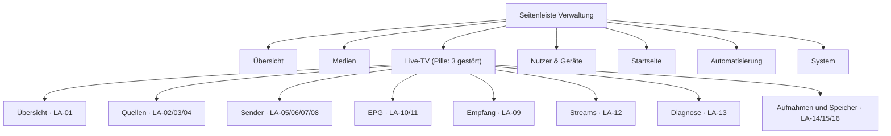
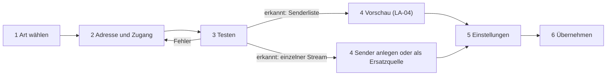

# Konzept 28 · Administration

Stand: 28. November 2026 · Fassung 1 · Status: Entwurf, nicht freigegeben

Dieses Dokument beschreibt die Verwaltung von Live-TV in der Web-App (`/admin`). Die TV-App und die
Handy-App haben keine Verwaltung (Konzept 26 E-7, Konzept 27); wer verwaltet, nimmt den Browser. Es ist
die Bauvorlage für das klickbare Verwaltungs-Mockup (`docs/planning/mockups/28-live-tv/`, Hülle aus
`25-medienwuensche/`) und später für den Bau. Die Zuschauerseiten stehen in `14-oberflaeche.md`.

Alles hier ist **spezifiziert**, nichts gebaut. Vorgabewerte sind **Vorschläge**; massgeblich werden
die Werte aus `03-fachkonzept.md`, `05-streaming-und-fast-zapping.md`, `10-timeshift.md`, `11-dvr.md`
und `13-ressourcen-und-performance.md`. Die Streaming-Engine legt dieses Dokument nicht fest: Wo eine
Seite einen technischen Wert zeigt (Bitrate, Codec, Belegung), heisst das nur, dass der Server ihn
liefern soll. Offene Weichen stehen als **F-13** bis **F-22** in Abschnitt 6 (Fortsetzung der Nummern
aus `14-oberflaeche.md`).

Kurz erklärt: Eine **Quelle** ist eine Senderliste oder ein einzelner Stream, den der Administrator
einträgt (M3U-Liste, Xtream-Zugang, einzelne Adresse). Ein **Sender** ist das, was Zuschauer sehen;
er kann aus mehreren Quellen gespeist werden (Hauptquelle und **Ersatzquellen**). Ein **Eingang** ist
eine laufende Verbindung von Slouchcat zu einer Quelle; viele Zuschauer und Aufnahmen teilen sich einen
Eingang (LTV-004). **M3U** ist das übliche Dateiformat für Senderlisten, **Xtream Codes** eine
verbreitete Schnittstelle von IPTV-Anbietern, **XMLTV** das übliche Format für Programmdaten.

---

## 0. Grundsätze

1. **Bestehende Verwaltung, kein Sondersystem.** Seitenrahmen `AdminPage` (`web/src/ui/AdminPage.tsx`:
   h1, Hilfeknopf, Live-Anzeige, Hauptaktionen, `StatusStrip`, Abschnitte), Bereichsreiter `AreaTabs`,
   Seitenleiste `AdminSideNav` (aufklappbarer Baum), Einstellungen mit `SettingRow` + `SaveBar`,
   Tabellen `DataTable`, Formulare mit `Form`, Kennzahlen `StatTile`/`DashCard`/`StatusStrip`,
   Speicher `StorageMeter`, Aufklapper `BandPanel`/`DisclosureGroup`. Kompakte Dichte der Verwaltung
   (`web/src/ui/density.css`, `admin-look.css`). Alles **gebaut**.
2. **Marcos Regeln:** Klappbares zu mit Zusammenfassung in der Kopfzeile (Ausnahmen: Sprunglink öffnet
   sein Ziel, eben Angelegtes ist offen, Aufklapper mit Fehler öffnet sich); Rahmen ≥ 3:1, gedämpfter
   Text ≥ 8:1; **Anlegen und Ändern im selben Formular**.
3. **Kein Anbieterlimit.** Slouchcat zählt keine Verbindungen je Anbieter, kennt keine Abos und keine
   Laufzeiten (LTV-017). Die Seiten sagen das ausdrücklich (Abschnitt 5).
4. **Privatsphäre:** Der Administrator sieht nie Titel fremder Aufnahmen (Abschnitt 4).
5. **Geheimnisse:** Passwörter und Schlüssel werden nach dem Speichern nie wieder angezeigt; Adressen mit
   Zugangsdaten erscheinen überall maskiert (`http://xtream.example.com:8080/live/••••/••••/1234.ts`).
   Fehlermeldungen nennen höchstens Schema und Host (Muster `netguard.Clean`).
6. **Texte** im Namensraum `live.admin` (`web/src/locales/*.json`), Farben aus Tokens (Regel 9).

### 0.1 Beispieldaten für das Mockup

Alle Adressen auf `example.*`-Domänen, keine echten Anbieter, keine Logos (Initialen). Uhrzeit im
Mockup: Samstag, 28. November 2026, 20:41.

**Quellen:**

| Name | Art | Sender (aktiv / gesamt) | Aktualisierung | Zustand | Heimnetz |
|---|---|---|---|---|---|
| Kabelanbieter Schweiz | M3U-URL `https://iptv.example.net/playlist.m3u8?token=••••` | 398 / 412 | alle 24 h, zuletzt heute 06:00 | in Ordnung | nein |
| Xtream Beispielanbieter | Xtream `http://xtream.example.com:8080`, Benutzer `demo` | 120 / 9'874 | alle 12 h, zuletzt heute 05:00 **fehlgeschlagen** (Server antwortet 503), bisherige Liste aktiv | Warnung | nein |
| Senderliste Region | M3U-Datei `senderliste-region.m3u` (1,2 MB, hochgeladen 20.11.) | 64 / 66 | nur von Hand | in Ordnung | nein |
| Heimnetz Multicast | Einzelströme `udp://@239.10.0.1:5000`, `udp://@239.10.0.2:5000` | 2 / 2 | – | in Ordnung | **ja** |

**Sender:** 584 aktiv von 10'354 importierten; 571 verfügbar, 13 nicht verfügbar. Beispiele wie in
`14-oberflaeche.md` 0.1 (SRF 1, SRF zwei, SRF info, Das Erste, ZDF, ZDFinfo gestört, phoenix,
KiKA, TeleZüri ohne EPG, TV24 verschwunden).

**EPG-Quellen:** «XMLTV Schweiz und Deutschland» `https://epg.example.org/ch-de.xml.gz`, alle 12 h,
zuletzt heute 04:10, 214 Kanäle, 48'312 Sendungen, reicht bis Sa 5.12.; «Programmdaten Xtream» (vom
Xtream-Zugang), alle 24 h, zuletzt gestern 05:05, Warnung «312 Sendungen ohne Zeitzone, als Ortszeit
gelesen».

**Zuordnungen:** 531 automatisch sicher, 22 automatisch unsicher, 19 von Hand, 12 fehlen.

**Aktive Eingänge** (jetzt): SRF 1 (permanent, 2 Zuschauer), SRF zwei (1 Zuschauer, 2 Aufnahmen),
ZDF (1 Zuschauer), SRF info (vorgeladen), Das Erste (Zeitplan «Abends»), ZDFinfo (wiederverbindet,
Versuch 3 von 5, Ersatzquelle 2 bereit).

**Konten:** `familie.keller@example.ch` (Kontingent 200 GB, belegt 142 GB, 31 Aufnahmen),
`grosseltern@example.ch` (100 GB, 12 GB, 4), `wg-langstrasse@example.ch` (100 GB, 97 GB, 22,
Warnung), `admin@example.ch` (kein Live-TV).

**Speicherorte:** Startpuffer RAM-Disk `/live/buffer` (tmpfs, 2 GB, 0,4 GB belegt); Timeshift
`/live/timeshift` (SSD, 256 GB frei, belegt 18,4 GB); Aufnahmen `/recordings` (Netzlaufwerk NFS,
4 TB, belegt 1,2 TB).

---

## 1. Einordnung in die Verwaltung

### 1.1 Neuer Bereich «Live-TV»

Heute hat die Verwaltung fünf Bereiche (`web/src/features/admin/sections.ts`: `media`, `people`,
`home`, `automation`, `system`). Live-TV wird ein **sechster Bereich** `livetv` mit Symbol `tv`, in der
Seitenleiste nach «Medien». Begründung: zu viele Seiten für einen Reiter unter «Medien» (Radio hat vier
Reiter), und der Bereich ist für Server ohne Live-TV überflüssig (F-13).



**Bereichsreiter** (`AreaTabs`, je ein Eintrag in `adminSections` mit `area: 'livetv'`):

| Reiter | Pfad | Seiten (Reiter innerhalb mit `Tabs`, `?tab=`) |
|---|---|---|
| Übersicht | `/admin/live` | LA-01 |
| Quellen | `/admin/live/sources` | LA-02; Formular LA-03 unter `/admin/live/sources/new` und `/admin/live/sources/$sourceId`; LA-04 unter `/admin/live/sources/$sourceId/import/$runId` |
| Sender | `/admin/live/channels` | `?tab=channels` LA-05 (Bearbeiten LA-06 als Dialog `?edit=$channelId`), `?tab=groups` LA-08, `?tab=duplicates` LA-07 |
| EPG | `/admin/live/epg` | `?tab=sources` LA-10, `?tab=mapping` LA-11 |
| Empfang | `/admin/live/reception` | LA-09 mit `?tab=strategy`, `?tab=schedules`, `?tab=overrides` |
| Streams | `/admin/live/streams` | LA-12 |
| Diagnose | `/admin/live/diagnostics` | LA-13 (`?channel=$id` für einen Sender) |
| Aufnahmen und Speicher | `/admin/live/storage` | `?tab=dvr` LA-14, `?tab=timeshift` LA-15, `?tab=storage` LA-16 |

**Seitenleiste:** Der Baum zeigt «Live-TV» mit Unterpunkten wie oben. Alarm-Pillen nach bestehendem
Muster (`AdminSideNav.tsx`): «3 gestört» am Bereich und an «Diagnose», «Fehler» an «Quellen» bei
fehlgeschlagenem Import, «Speicher knapp» an «Aufnahmen und Speicher». **Suchpalette** Strg+K
(`AdminFinder.tsx`) findet die Seiten und, ab drei Buchstaben, Sender und Quellen nach Namen
(«SRF 1 › Sender bearbeiten»).

**Handy-Breite:** Seitenleiste als Blatt `AdminSideNavMenu` (gebaut); Tabellen wechseln in die
Kartenansicht von `DataTable`; Formulare einspaltig; `EditorDialog` als Vollbild.

### 1.2 Bestehende Seiten, die sich ändern

| Kennung | Seite | Änderung |
|---|---|---|
| LA-20 | Verwaltungsübersicht `/admin` (`AdminHomePage.tsx`) | neue `DashCard` «Live-TV»; Live-Zuschauer in «Aktive Wiedergaben»; Live-TV-Fälle in «Braucht Aufmerksamkeit» |
| LA-21 | Aktive Wiedergaben `/admin/streams` (`StreamsPage.tsx`) | neue Gruppe «Live-TV» in der `ToggleToolbar`; Kachel je Live-Zuschauer und je Wiedergabe einer Aufnahme; Bandbreite enthält Live-TV |
| LA-22 | Konten `/admin/accounts` (`AccountsPage.tsx`, `AccountDetail.tsx`, `accounts/AccessForm.tsx`) und Einladungen | Block «Live-TV» mit drei Schaltern und Kontingent; Belegung in der Kontodetailseite; Spalte «Live-TV» in der Liste |
| LA-23 | Hintergrundjobs `/admin/jobs` (`JobsPage.tsx`) | neue Gruppe «Live-TV» mit fünf Jobarten |
| LA-24 | Benachrichtigungen der Verwaltung `/admin/notifications` | neue Fehlerquellen für Live-TV (Ausfall, Import, EPG, Speicher) |
| LA-25 | Seitenleiste und Suchpalette | Bereich und Pillen (1.1) |
| LA-26 | Meine Medien `/admin/my-media` (`features/admin/mymedia`) | Eintrag «Live-TV» (`livetv`) ordnen und ausblenden wie «Radio» |
| LA-27 | Server › Update (`ServerPage.tsx`, Update-Dialog) | Warnung vor dem Update, wenn Aufnahmen laufen oder in den nächsten 30 Min. beginnen |
| LA-28 | Sicherung `/admin/backup` | Hinweis «Aufnahmen und Puffer sind nicht Teil der Sicherung. Gesichert werden Quellen, Sender, Zuordnungen und Planungen.» |
| – | Ersteinrichtung | **keine Änderung** (Empfehlung): Live-TV ist freiwillig und wird später in der Verwaltung eingerichtet; die Übersicht LA-01 hat dafür einen eigenen Einstieg |
| – | Statistiken | keine neue Ansicht in der ersten Stufe; die Sehzeit zählt Live-TV mit (Fachkonzept) |

---

## 2. Seiteninventar

| Kennung | Seite | Zweck | Route | Bestehende Bauteile | Neue Bauteile | LTV / Auftrag |
|---|---|---|---|---|---|---|
| LA-01 | Live-TV-Übersicht | Zustand auf einen Blick, Fehler und Warnungen | `/admin/live` | `AdminPage`, `StatusStrip`, `StatTile`, `DashCard`, `StreamRow`, `Notice`, `ActivityFeed` | – | 9.1 |
| LA-02 | Quellen | alle Quellen, Zustand, Aktualisieren, Testen | `/admin/live/sources` | `DataTable`, `StatusDot`, `ConfirmDialog` | – | 9.2, 018 |
| LA-03 | Quelle anlegen und ändern | ein Formular für M3U-Datei, M3U-URL, Xtream, Einzelstrom, mit Test | `/admin/live/sources/new`, `/admin/live/sources/$id` | `Form`, `TextField`, `SelectField`, `RadioGroup`, `Switch`, `SettingRow`, `SaveBar`, `BandPanel`, `PlayerStep`-artige Schrittfolge wie im Einrichtungsassistenten | `KeyValueList` (Kopfzeilen) | 9.2, 003, 017, 018 |
| LA-04 | Import-Vorschau und -Ergebnis | was ein Import ändert und was er geändert hat | `/admin/live/sources/$id/import/$runId` | `DataTable`, `ToggleToolbar`, `Notice` | – | 018 |
| LA-05 | Sender | Tabelle mit Filter, Suche, Massenbearbeitung | `/admin/live/channels?tab=channels` | `DataTable`, `VirtualList`, `SearchField`, `FacetSelect`, `ActiveFilters`, `Switch` | `BulkBar` (Leiste für ausgewählte Zeilen) | 9.3, 006 |
| LA-06 | Sender bearbeiten | alle Angaben eines Senders, Quellen mit Rangfolge, Empfang, Technik | Dialog `?edit=$id` | `EditorDialog`, `Form`, `RankedChoiceList`, `BandPanel`, `FactList` | – | 9.3, 002, 006, 011 |
| LA-07 | Duplikate | Vorschläge prüfen, Sender zusammenführen | `/admin/live/channels?tab=duplicates` | `DataTable`, `Dialog`, `RadioGroup` | – | 006 |
| LA-08 | Sendergruppen | Gruppen aus Quellen und eigene Gruppen | `/admin/live/channels?tab=groups` | `DataTable`, `EditorDialog`, `RankSelect` | – | 006 |
| LA-09 | Empfang | globale Strategie, Zeitpläne, Ausnahmen je Sender | `/admin/live/reception` | `RadioGroup`, `SettingRow`, `SaveBar`, `DataTable` | `WeekdayPicker` (aus 14, 6.9) | 002, 9.3 |
| LA-10 | EPG-Quellen | Programmdaten-Quellen, Intervall, Status, Fehler, Vorschauzeitraum | `/admin/live/epg?tab=sources` | `DataTable`, `Form`, `SettingRow` | – | 005, 9.4 |
| LA-11 | EPG-Zuordnungen | Sender ↔ EPG-Kanal: automatisch, von Hand, fehlend | `/admin/live/epg?tab=mapping` | `DataTable`, `ComboBox`-Feld aus `SelectField`, `ToggleToolbar` | – | 005, 9.4 |
| LA-12 | Aktive Streams | laufende Eingänge mit Zuschauern, Aufnahmen, Technik | `/admin/live/streams` | `StreamTile`, `DataTable`, `StatusStrip`, `ConfirmDialog` | – | 9.5 |
| LA-13 | Überwachung und Diagnose | Ausfälle, Wiederverbindungen, Quellwechsel, Protokoll, Prüfung | `/admin/live/diagnostics` | `DataTable`, `ActivityFeed`, `Notice`, `HeatGrid` (Ausfälle je Stunde) | – | 011, 9.7 |
| LA-14 | Aufnahmen (DVR) | Vor-/Nachlauf, Fristen, Planerregeln | `/admin/live/storage?tab=dvr` | `SettingRow`, `SaveBar`, `SelectField` | – | 008, 9.6 |
| LA-15 | Timeshift | Höchstdauer, Gesamtgrenze | `/admin/live/storage?tab=timeshift` | `SettingRow`, `SaveBar` | – | 007, 019 |
| LA-16 | Speicher | drei Speicherorte, Grenzen, Reserve, Belegung je Konto, Warnungen, Wechsel | `/admin/live/storage?tab=storage` | `StorageMeter`, `DataTable`, `PathList`, `Dialog` | – | 019, 9.6 |

**Zustände, die jede Seite hat:** lädt (`Skeleton` in Endmass), leer (eigener Text mit nächstem
Schritt), Fehler (`Notice` danger mit «Erneut laden»), Teilfehler (Seite bleibt, `Notice` warning über
dem betroffenen Abschnitt). Live-Werte (LA-01, LA-12, LA-13) laden alle 5 s neu wie `StreamsPage`
(pausiert, solange ein Dialog offen ist); die Kopfzeile zeigt die Live-Anzeige von `AdminPage`
(«Aktualisiert vor 3 s»).

---

## 3. Die Seiten

### 3.1 LA-01 Live-TV-Übersicht

**Aufbau:**

1. Kopf «Live-TV» mit Hauptaktionen «Quelle hinzufügen», «Sender verwalten».
2. **Einrichtungsband**, nur solange keine Quelle besteht (Muster Einrichtungsband `AdminHomePage.tsx`):
   «Live-TV einrichten: 1. Quelle hinzufügen · 2. Sender prüfen · 3. Programmdaten hinzufügen ·
   4. Konten freischalten». Jeder Schritt ist ein Link; erledigte Schritte mit Haken.
3. `StatusStrip` (eine Zeile Kennzahlen, je Kachel ein Link):
   - **Zustand:** «Bereit», «Eingeschränkt (13 Sender nicht verfügbar)», «Keine Quelle», «Programmdaten
     veraltet» (berechnet; kein eigener Hauptschalter, F-13).
   - **Sender:** 584 aktiv · 571 verfügbar · 13 nicht verfügbar.
   - **Eingänge:** 6 aktiv · davon 1 permanent · 1 vorgeladen · 1 nach Zeitplan.
   - **Zuschauer:** 4 · **Umwandlungen** (Transcodes): 2.
   - **Aufnahmen:** 2 laufen · 23 geplant (nächste 24 h).
   - **Bandbreite:** ein 38,4 Mbit/s · aus 22,1 Mbit/s.
4. `DashCard` **«Braucht Aufmerksamkeit»** (Fehler zuerst, dann Warnungen; je Zeile Satz, Zeit, Link):
   - danger «ZDFinfo ist seit 20:12 nicht erreichbar (3 Wiederverbindungen).» → LA-13
   - warning «Import ‹Xtream Beispielanbieter› fehlgeschlagen (Server antwortet 503). Die bisherige
     Liste bleibt aktiv.» → LA-04
   - warning «Konto wg-langstrasse@example.ch: 97 von 100 GB für Aufnahmen belegt.» → LA-16
   - warning «12 aktive Sender ohne Programmdaten.» → LA-11 gefiltert
   - info «TV24 ist aus ‹Kabelanbieter Schweiz› verschwunden. 1 geplante Aufnahme betroffen.» → LA-05 gefiltert
5. `DashCard` **«Aktive Eingänge»**: die fünf mit den meisten Abnehmern (Sender, Grund, Zuschauer,
   Aufnahmen, Bitrate) → LA-12.
6. `DashCard` **«Aufnahmen»**: «2 laufen auf 2 Sendern · 23 geplant in 24 h · höchstens 4 gleichzeitig
   (heute 20:15)»; **keine Titel, keine Konten** (Abschnitt 4).
7. `DashCard` **«Ressourcen»**: CPU 31 % · GPU 12 % · RAM 2,1 GB von Slouchcat · Speicher je Speicherort
   als `StorageMeter` (Startpuffer 0,4/2 GB, Timeshift 18,4/256 GB, Aufnahmen 1,2/4 TB). Werte, die der
   Server nicht lesen kann, zeigen «–» mit Hinweis «Nicht verfügbar auf diesem System». (CPU, RAM, GPU
   liest der Server heute nicht: neu, `13-ressourcen-und-performance.md`.)
8. `DashCard` **«Programmdaten»**: «Stand heute 04:10 · reicht bis Sa 5.12. · 2 Quellen · 1 Warnung».
9. Fusszeile: Verantwortungshinweis (Abschnitt 5, Text V-1).

**Leer:** Einrichtungsband statt Kennzahlen; Kennzahlen zeigen «–».

### 3.2 LA-02 Quellen

**Aufbau:** Kopf «Quellen», Hauptaktion «Quelle hinzufügen» (→ LA-03 neu). Hinweis V-2 (Abschnitt 5)
als `Notice` info, zuklappbar.

`DataTable` (Zeile aufklappbar):

| Spalte | Inhalt |
|---|---|
| Name | «Kabelanbieter Schweiz» |
| Art | M3U-URL · M3U-Datei · Xtream · Einzelstrom |
| Sender | «398 aktiv / 412» |
| Letzte Aktualisierung | «heute 06:00 · in Ordnung» bzw. «heute 05:00 · fehlgeschlagen» (`StatusDot`) |
| Nächste | «morgen 06:00» bzw. «nur von Hand» |
| Heimnetz | Symbol, wenn lokale Ziele erlaubt («Heimnetz erlaubt») |
| Aktionen | «Jetzt aktualisieren» · «Testen» · Menü ⋯ («Bearbeiten», «Letzter Import», «Entfernen») |

Aufgeklappt: Adresse maskiert, Intervall, «Neue Sender sofort anbieten: aus», Gruppenzahl, Anzahl
verschwundener Sender, die letzten fünf Läufe (Zeit, Ergebnis, neu/geändert/verschwunden) mit Link auf
LA-04.

**Jetzt aktualisieren:** startet den Job (LA-23); Zeile zeigt «läuft … 2'300 von 9'874 Einträgen»
(Fortschritt des Jobs); danach `toast` «Aktualisiert: 3 neu, 12 geändert, 1 verschwunden · Details».

**Entfernen** (`ConfirmDialog`, danger): «Quelle ‹Senderliste Region› entfernen? 64 Sender stammen aus
dieser Quelle; 41 davon haben keine andere Quelle.» Wahl: (•) «Diese 41 Sender behalten, als ‹ohne
Quelle› markieren und abschalten» ( ) «Diese 41 Sender löschen». Satz: «Favoriten, Zuordnungen und
geplante Aufnahmen bleiben bei behaltenen Sendern erhalten. Geplante Aufnahmen gelöschter Sender
werden abgesagt; die Profile bekommen eine Warnung.» Knöpfe «Abbrechen» · «Entfernen».

**Leer:** «Noch keine Quelle. Füge eine Senderliste (M3U), einen Xtream-Zugang oder einen einzelnen
Stream hinzu.» + «Quelle hinzufügen».

### 3.3 LA-03 Quelle anlegen und ändern

Ein Formular für alle Arten. **Neu** führt es in Schritten durch (Schrittanzeige oben wie
Einrichtungsassistent); **Ändern** zeigt dieselben Felder als Aufklapper (zu, Zusammenfassung in der
Kopfzeile; ein Aufklapper mit Fehler öffnet sich), dazu `SaveBar`.

**Ablauf «Quelle hinzufügen»:**



**Schritt 1 · Art** (`RadioGroup` als grosse Karten):

| Art | Satz |
|---|---|
| Senderliste als Adresse (M3U/M3U8-URL) | «Der Anbieter gibt dir eine Adresse zu einer Senderliste.» |
| Senderliste als Datei (M3U/M3U8) | «Du hast eine Datei mit Sendern.» |
| Xtream-Codes-Zugang | «Der Anbieter gibt dir Server, Benutzername und Passwort. Übernommen wird nur Live-TV, keine Filme und Serien.» |
| Einzelner Stream | «Eine Adresse für einen Sender: HTTP(S), HLS, MPEG-DASH ohne Kopierschutz, MPEG-TS, RTSP, RTMP, UDP, RTP, Multicast.» |

**Schritt 2 · Adresse und Zugang** (Felder je Art, Vorgaben fett):

| Feld | Arten | Werte / Prüfung |
|---|---|---|
| Name | alle | frei, Pflicht, z. B. «Kabelanbieter Schweiz» |
| Adresse | URL, Einzelstrom | Pflicht; Schema `http`, `https`, `rtsp`, `rtmp`, `udp`, `rtp`; Hinweis bei `udp://@239.…` «Multicast im Heimnetz: braucht die Freigabe unten» |
| Datei | Datei | Hochladen (`.m3u`, `.m3u8`), höchstens 20 MB (Vorschlag); «Ersetzen» im Ändern-Modus |
| Server | Xtream | `http(s)://host:port` |
| Benutzername, Passwort | Xtream; optional bei URL/Einzelstrom (HTTP-Anmeldung) | Passwort nur schreibbar; nach dem Speichern «gespeichert · ändern» |
| Kopfzeilen | URL, Xtream, Einzelstrom | `KeyValueList`: Name/Wert, z. B. `Referer: https://tv.example.net/`; Werte gelten als geheim und werden maskiert, wenn ihr Name nach Schlüssel klingt (`Authorization`, `Cookie`, `X-Api-Key`) |
| User-Agent | URL, Xtream, Einzelstrom | (•) **Standard von Slouchcat** ( ) eigener: [Text] |
| Ziele im Heimnetz erlauben | alle | `Switch` **aus**; Text V-3 (Abschnitt 5). Ohne Freigabe weist der Test lokale Adressen ab: «Die Adresse liegt im Heimnetz (192.168.1.20). Erlaube Ziele im Heimnetz für diese Quelle, wenn du dem Gerät vertraust.» |

**Schritt 3 · Testen** (Knopf «Testen», auch später in LA-02 und im Ändern-Modus): Slouchcat ruft die
Adresse einmal ab und zeigt das Ergebnis als `Notice` mit `FactList`:

- **Senderliste erkannt:** «M3U-Senderliste · 412 Einträge · 18 Gruppen · 397 mit Logo · 380 mit
  EPG-Kennung · Programmdaten-Adresse in der Liste gefunden: `https://epg.example.org/…`» mit Angebot
  «Als EPG-Quelle hinzufügen» (Häkchen, Vorgabe an).
- **Einzelner HLS-Stream erkannt** (obwohl als Senderliste eingetragen): «Das ist kein Senderverzeichnis,
  sondern ein einzelner Stream (HLS-Manifest). Als Einzelstrom anlegen?» [Als Einzelstrom anlegen]
  (LTV-003: M3U-Senderliste und HLS-Manifest unterscheiden).
- **Stream erkannt (Einzelstrom):** «Bild H.264 1920 × 1080, 25 Bilder/s, interlaced · Ton AAC Stereo,
  AC-3 5.1 · Untertitel: Videotext · Bitrate etwa 8 Mbit/s · erstes Bild nach 1,4 s».
- **Xtream:** «Zugang in Ordnung · 9'874 Live-Sender in 212 Kategorien». Angaben des Anbieters zu
  Verbindungszahl oder Ablaufdatum zeigt Slouchcat **nicht** (keine Abo- und Limitverwaltung, LTV-017).
- **Fehler** in Klartext: «Anmeldung abgelehnt (Benutzername oder Passwort falsch).» · «Server nicht
  erreichbar (Zeitüberschreitung nach 10 s).» · «Antwort ist keine Senderliste (Zeile 1: erwartet
  ‹#EXTM3U›).» · «Kopiergeschützter Stream (DRM). Slouchcat spielt solche Streams nicht ab.» · «Ziel
  im Heimnetz ohne Freigabe.» Kein Passwort, keine volle Adresse in der Meldung.

**Schritt 4 · Vorschau:** bei Listen LA-04 im Vorschau-Modus. Beim Einzelstrom: (•) «Neuen Sender
anlegen» mit Name, Nummer, Gruppe ( ) «Als Ersatzquelle zu einem bestehenden Sender hinzufügen»
[Sender wählen ▾].

**Schritt 5 · Einstellungen:**

| Feld | Vorgabe | Werte |
|---|---|---|
| Automatisch aktualisieren | **alle 24 Stunden** (Xtream: alle 12 Stunden) | alle 6 · 12 · 24 Stunden · wöchentlich · nur von Hand; Uhrzeit «um 06:00» |
| Neue Sender sofort anbieten | **aus** (F-14) | an: neue Sender sind gleich für Zuschauer aktiv; aus: sie kommen inaktiv in LA-05 mit Filter «Neu» |
| Gruppen der Quelle übernehmen | **an** | aus: keine Gruppen aus der Liste |
| Kanalnummern der Quelle übernehmen | **an** (nur für neue Sender) | aus |
| Verschwundene Sender | **markieren und nach 7 Tagen abschalten** | nur markieren · sofort abschalten |
| Schutz vor unvollständigen Listen | **an**: fehlt mehr als ein Drittel der bisherigen Sender, wird nichts als verschwunden markiert, und die Übersicht meldet es | an/aus (Schwelle im Fachkonzept) |

**Schritt 6 · Übernehmen:** «Quelle speichern und Sender übernehmen». Ergebnis LA-04, die neue Quelle
steht in LA-02 offen aufgeklappt (eben Angelegtes ist offen).

**Ändern-Modus:** Aufklapper «Adresse und Zugang · Xtream, demo, Passwort gespeichert», «Aktualisierung
· alle 12 Stunden um 05:00», «Übernahme · neue Sender inaktiv, Gruppen an, Nummern an», «Heimnetz ·
nicht erlaubt», «Kopfzeilen und User-Agent · Standard». Gefahr-Link «Quelle entfernen» (LA-02).

**Tastatur:** Schritte sind Abschnitte mit Überschrift; «Weiter» und «Zurück» als Knöpfe; Enter im
letzten Feld eines Schritts = «Weiter»; Fokus nach Schrittwechsel auf der Überschrift.

### 3.4 LA-04 Import-Vorschau und -Ergebnis

Gleiche Seite für **Vorschau** (vor dem Übernehmen, beim Anlegen und bei «Testen» einer bestehenden
Quelle) und **Ergebnis** (nach einem Lauf).

**Aufbau:** Kopf «Import ‹Kabelanbieter Schweiz› · heute 06:00»; Zusammenfassung als `StatusStrip`:
**Neu 3 · Geändert 12 · Verschwunden 1 · Mögliche Duplikate 2 · Fehlerhafte Einträge 4 · Unverändert
396**. `ToggleToolbar` mit diesen Gruppen, darunter `DataTable` der gewählten Gruppe:

| Gruppe | Spalten | Aktionen |
|---|---|---|
| Neu | Name in der Liste, Gruppe, Nummer, Logo ja/nein, EPG-Kennung | Vorschau: «übernehmen» je Zeile (Vorgabe an) |
| Geändert | Sender, was sich geändert hat («Adresse geändert», «Name in der Quelle: ‹SRF1 HD› statt ‹SRF 1 HD›», «Logo der Quelle geändert») und ob es wirkt («Dein Name ‹SRF 1› bleibt», «Dein Logo bleibt») | – |
| Verschwunden | Sender, seit wann, betroffene Favoriten und geplante Aufnahmen (nur Zahl) | «Abschalten», «Behalten» |
| Mögliche Duplikate | Eintrag und vermuteter bestehender Sender, Grund («gleiche EPG-Kennung», «Name ähnlich») | «Zusammenführen» (LA-07), «Kein Duplikat» |
| Fehlerhafte Einträge | Zeile in der Datei, Grund («Adresse fehlt», «ungültige Angabe ‹tvg-chno=abc›») | – |

**Fehlgeschlagener Import** (Ergebnis): `Notice` danger oben, nicht zuklappbar: «Die Liste konnte nicht
gelesen werden (Zeile 1'204: unvollständige Datei). **Die bisherigen 412 Sender bleiben unverändert.**
Nächster Versuch morgen 06:00.» [Jetzt erneut versuchen]. **Unvollständige Liste:** `Notice` warning
«Die neue Liste hat 61 % weniger Sender als bisher. Slouchcat hat keine Sender als verschwunden
markiert.» [Liste trotzdem so übernehmen] [So lassen].

Erhalten bleiben immer (Text im Kopf der Seite, LTV-018): eigene Namen, eigene Logos, Gruppen,
Kanalnummern, Favoriten der Zuschauer, EPG-Zuordnungen, geplante Aufnahmen.

### 3.5 LA-05 Sender

**Aufbau:** Kopf «Sender · 584 aktiv von 10'354»; Hauptaktionen «Sender hinzufügen» (= Einzelstrom,
LA-03), «Nummern vergeben …». Reiter Sender · Gruppen · Duplikate (Zahl: «Duplikate 7»).

Werkzeugleiste: `SearchField` (Name, Nummer, Name in der Quelle), `FacetSelect` **Zustand** (Alle ·
Aktiv · Inaktiv · Neu · Gestört · Verschwunden · Ohne Quelle), **Quelle**, **Gruppe**, **Land**,
**Sprache**, **Kategorie**, **EPG** (zugeordnet · unsicher · fehlt), **Empfang** (Standard · permanent
· automatisch · bei Bedarf · Zeitplan). `ActiveFilters`. Filter im URL.

`DataTable`, virtuell (10'000 Zeilen), Spalten:

| Spalte | Beispiel |
|---|---|
| Auswahl | Kontrollkästchen |
| Nr. | 1 |
| Logo | Logo klein bzw. Initialen (die Regel «Bilder ohne Rahmen» gilt für die Zuschauer-App; hier ist ein feiner Rahmen erlaubt) |
| Name | «SRF 1» (darunter klein «Quelle: SRF1 HD CH», wenn anders) |
| Gruppen | «Schweiz, Vollprogramme» |
| Land / Sprache | CH · Deutsch |
| Kategorie | Vollprogramm |
| Quellen | «2 (aktiv: Kabelanbieter Schweiz)» |
| EPG | «zugeordnet» / «unsicher» / «fehlt» |
| Empfang | «Permanent» / «Standard (bei Bedarf)» |
| Zustand | `StatusDot` «Verfügbar» / «Gestört seit 20:12» / «Verschwunden seit 26.11.» |
| Aktiv | `Switch` |

Sortierung: Nummer (Vorgabe), Name, Zustand. Klick auf die Zeile = LA-06.

**Massenbearbeitung:** Mit Auswahl erscheint unten die `BulkBar` (neu, klebt wie `SaveBar`): «23
ausgewählt» · Aktivieren · Deaktivieren · Zu Gruppe hinzufügen … · Aus Gruppe entfernen … · Land …
· Sprache … · Kategorie … · Empfang … · Nummern vergeben … · Zusammenführen (ab 2) · Auswahl
aufheben. Jede Aktion öffnet einen kleinen Dialog mit einem Feld und dem Satz «Gilt für 23 Sender.»
«Alle 412 Treffer auswählen» als Link, wenn eine Seite voll ausgewählt ist.

**Nummern vergeben** (Dialog): «Nummern ab [101] in der aktuellen Sortierung, Schritt [1]; bestehende
Nummern (•) überschreiben ( ) nur leere füllen». Doppelte Nummern verhindert das Formular mit
Fehlermeldung je Zeile («Nummer 12 hat schon 3sat»). **Manuelle Sortierung** heisst in Slouchcat:
Die Kanalnummer bestimmt die Reihenfolge; ohne Nummer folgen die Sender alphabetisch (F-15).

**Leer:** «Noch keine Sender. Füge zuerst eine Quelle hinzu.»; gefiltert leer «Kein Sender passt».

### 3.6 LA-06 Sender bearbeiten

`EditorDialog` (bis 1100 px, Handy Vollbild), Muster Radio `features/admin/radio/StationEditor.tsx`.
Kopf: Logo, Nummer, Name, `Switch` «Aktiv», Zustand. Aufklapper (zu, Zusammenfassung; mit Fehler
offen; über einen Sprunglink aus LA-13 öffnet sich das Ziel, z. B. «Quellen»):

1. **Allgemein · «SRF 1 · Nr. 1 · CH · Deutsch · Vollprogramm»:** Name (Vorgabe aus der Quelle,
   «Zurück zum Namen der Quelle»), Nummer, Land (Liste), Sprache (Liste, mehrere möglich), Kategorie
   (feste Liste: Vollprogramm, Nachrichten, Sport, Film und Serie, Dokumentation, Kinder, Musik, Kultur,
   Regional, Unterhaltung, Sonstiges; Texte in `live.admin.category.*`).
2. **Logo · «aus der Quelle»:** (•) aus der Quelle ( ) eigene Adresse [URL] ( ) Datei hochladen;
   Vorschau auf dunklem und hellem Grund; «Zurücksetzen».
3. **Gruppen · «Schweiz, Vollprogramme»:** Mehrfachwahl aus Gruppen (eigene und aus Quellen).
4. **Programmdaten · «XMLTV Schweiz und Deutschland: SRF1.ch»:** Zuordnung wie LA-11 für diesen Sender,
   Vorschau der nächsten drei Sendungen, «Dieser Sender hat keine Programmdaten» (bewusst ohne).
5. **Quellen · «2 Quellen, aktiv: Kabelanbieter Schweiz»:** `RankedChoiceList` in Rangfolge; je
   Eintrag: Quelle, Adresse maskiert, Zustand, zuletzt geprüft, «Testen», «Nach oben», «Nach unten»,
   «Als eigenen Sender abtrennen». Satz: «Fällt die erste Quelle aus, wechselt Slouchcat zur nächsten.»
   «Quelle hinzufügen» (bestehende Einzelströme oder andere Sender zusammenführen → LA-07).
6. **Empfang · «Standard (bei Bedarf)»:** `RadioGroup` (•) Standard des Servers ( ) Permanent
   ( ) Automatisch ( ) Bei Bedarf ( ) Nach Zeitplan [Zeitplan ▾]; `Switch` «Darf vorgeladen werden»
   (an). Bei «Permanent» Hinweis V-4.
7. **Technik · «H.264 1080i · AAC + AC-3 · 8,1 Mbit/s»** (nur lesen, letzte Messung): Bild-Codec,
   Auflösung, Bildrate, Zeilensprung, Ton-Spuren mit Sprache und Codec, Untertitel-Spuren, Bitrate,
   Messzeit; `Switch` **«Sender hat keinen Ton»** (dann meldet die Überwachung fehlenden Ton nicht als
   Fehler, LTV-011) und **«Sender hat kein Bild»** (reiner Tonsender).
8. **Verfügbarkeit · «Verfügbar, 2 Ausfälle in 7 Tagen»:** letzte Ausfälle, Wiederverbindungen,
   Quellwechsel; Link «Diagnose öffnen» (LA-13 `?channel=`).
9. **Nutzung · «12 Favoriten · 3 geplante Aufnahmen»:** nur Zahlen, keine Profile.

Fuss: «Abbrechen», «Speichern»; Gefahr-Link «Sender löschen» (nur bei Sendern ohne Quelle oder
verschwundenen; `ConfirmDialog` mit Folgen wie in LA-02).

### 3.7 LA-07 Duplikate und Zusammenführen

**Reiter Duplikate:** Liste der Vorschläge (automatische Erkennung), je Zeile zwei oder mehr Sender
mit Grund («gleiche EPG-Kennung ‹SRF1.ch›», «Name gleich nach Bereinigung», «gleiche Adresse») und
Vorschlag, welcher bleibt. Aktionen «Zusammenführen …», «Kein Duplikat» (merkt sich das Paar).
Manuell: in LA-05 zwei oder mehr Sender wählen → «Zusammenführen».

**Ablauf «Sender zusammenführen»** (Dialog):

1. «Welcher Sender bleibt?» (`RadioGroup`, Vorgabe: der mit Nummer und meisten Favoriten).
2. «Was übernimmt der bleibende Sender?» je Angabe wählen: Name · Logo · Nummer · Gruppen (Vereinigung
   als Vorgabe) · Programmdaten-Zuordnung · Land/Sprache/Kategorie.
3. «Quellen in dieser Reihenfolge» (`RankedChoiceList` aller Quellen beider Sender).
4. Zusammenfassung: «SRF 1 bleibt. ‹SRF1 HD (Xtream)› wird zur Ersatzquelle 2. 4 Favoriten und 1
   geplante Aufnahme gehen auf SRF 1 über.» [Abbrechen] [Zusammenführen].

Rückgängig: in LA-06 «Quellen» → «Als eigenen Sender abtrennen». Leer: «Keine möglichen Duplikate.»

### 3.8 LA-08 Sendergruppen

`DataTable`: Name · Herkunft («aus Quelle ‹Xtream› · Kategorie ‹CH | Allgemein›» oder «eigene») · Sender
(Zahl) · Für Zuschauer sichtbar (`Switch`) · Reihenfolge («Nach oben/unten», `RankSelect`) · Aktionen.
«Gruppe hinzufügen» und «Bearbeiten» im selben `EditorDialog`: Name, Sender (Suche und Mehrfachwahl,
Liste der gewählten), sichtbar. Gruppen aus Quellen lassen sich umbenennen (der eigene Name bleibt bei
Aktualisierungen) und ausblenden, nicht löschen, solange die Quelle sie liefert. Satz im Kopf:
«Gruppen ordnen Sender für die Zuschauer. Sie sind keine Rechte: Wer Live-TV darf, sieht alle aktiven
Sender.» (LTV-006, LTV-012). Leer: «Keine Gruppen.»

### 3.9 LA-09 Empfang: Strategien und Zeitpläne

Kurz erklärt (Text oben): **Permanent** = Slouchcat empfängt den Sender rund um die Uhr, auch ohne
Zuschauer. **Automatisch** = Slouchcat hält oft genutzte Sender bereit, solange Platz ist. **Bei
Bedarf** = Empfang erst, wenn jemand schaut oder eine Aufnahme ihn braucht. **Nach Zeitplan** =
Empfang in festen Zeiten. Permanenter Empfang heisst nicht Aufzeichnung (LTV-013).

**Reiter «Strategie»** (`SettingRow` + `SaveBar`):

| Einstellung | Vorgabe (Vorschlag) | Werte |
|---|---|---|
| Standard für alle Sender | **Bei Bedarf** | Permanent · Automatisch · Bei Bedarf · Nach Zeitplan |
| Benachbarte Sender vorladen | **1 Sender** davor und danach | aus · 1 · 2 |
| Oft genutzte Sender bereithalten (bei «Automatisch») | **höchstens 3** | 0–10 |
| Lieblingssender der Zuschauer berücksichtigen | **an** | an/aus |
| Nicht mehr gebrauchten Empfang beenden nach | **60 s** | 15 s · 30 s · 60 s · 2 Min. · 5 Min. |
| Empfang für Aufnahmen vorher starten | **30 s** vor dem Vorlauf | 10–120 s |

Satz unter «vorladen»: «Vorladen öffnet nur den Empfang. Eine Umwandlung für ein Gerät startet erst,
wenn jemand schaut.» (LTV-010: keine vorsorglichen Transcodes). Laufende Wiedergaben und Aufnahmen sind
immer geschützt: Kein Einstellungswechsel beendet sie (Satz im Kopf). Nach einem Neustart nimmt der
Server permanente Sender wieder auf (Satz). Die Werte sind Platzhalter, bis
`05-streaming-und-fast-zapping.md` sie festlegt. Hinweis V-4 als `Notice` info.

**Reiter «Zeitpläne»:** `DataTable`: Name · Zeiten («Mo–Fr 18:00–23:30, Sa–So 10:00–24:00») · Sender
(Zahl) · Aktionen. Anlegen/Ändern im selben Dialog: Name, Zeilen «Wochentage (`WeekdayPicker`) · von ·
bis» (mehrere), Zeitzone «Europe/Zurich» (Server). Beispiel «Abends» für Das Erste, ZDF, SRF 1.
Löschen eines verwendeten Zeitplans: «3 Sender nutzen ‹Abends›. Sie fallen auf den Standard zurück.»

**Reiter «Ausnahmen je Sender»:** alle Sender, deren Empfang nicht «Standard» ist: Sender · Strategie ·
Zeitplan · «Auf Standard zurück». Darüber `StatTile`: «Permanent: 1 Sender (belegt dauerhaft 1
Eingang)» · «Nach Zeitplan: 3 Sender».

### 3.10 LA-10 EPG-Quellen

`DataTable`: Name · Art (XMLTV-Adresse, XMLTV-Datei, gepackt `.gz`/`.xz`, von Xtream) · Intervall ·
Letzter Import (Zeit, Ergebnis) · Kanäle · Sendungen · Reicht bis · Aktionen («Jetzt laden», «Testen»,
«Bearbeiten», «Entfernen»). Aufgeklappt: Importverlauf (letzte fünf Läufe), Fehler und Warnungen in
Klartext: «312 Sendungen ohne Zeitzone, als Europe/Zurich gelesen», «41 Sendungen mit Ende vor Beginn
übersprungen», «Datei abgeschnitten nach 18 MB: Import abgebrochen, bisherige Daten bleiben».

Formular (anlegen und ändern): Name · Adresse oder Datei · Kopfzeilen/User-Agent (wie LA-03) ·
Aktualisieren **alle 12 Stunden** (6 · 12 · 24 · nur von Hand) · Zeitkorrektur **keine** (−12 bis +12
Stunden, für Quellen mit falschen Zeiten) · Heimnetz erlauben (wie LA-03).

Abschnitt **Einstellungen** (`SettingRow`): **Vorschauzeitraum 7 Tage** (1–14), Satz «So weit in die
Zukunft zeigt das Programm und plant Serienaufnahmen.» Ein EPG-Ausfall beeinträchtigt das Fernsehen
nicht (Satz).

**Leer:** «Noch keine Programmdaten. Ohne sie läuft Fernsehen trotzdem, aber Programm, Erinnerungen
und Serienaufnahmen fehlen.» + «EPG-Quelle hinzufügen».

### 3.11 LA-11 EPG-Zuordnungen

**Aufbau:** `ToggleToolbar` mit Zahlen: Alle 584 · Automatisch sicher 531 · **Unsicher 22** · Von Hand
19 · **Fehlt 12** · Bewusst ohne 0. Suche. `DataTable`:

| Spalte | Beispiel |
|---|---|
| Sender | 1 SRF 1 |
| Zuordnung | «XMLTV Schweiz und Deutschland › SRF1.ch» |
| Art | automatisch · von Hand · fehlt · bewusst ohne |
| Grund | «gleiche Kennung (tvg-id)» · «Name ähnlich (92 %)» |
| Vorschau | «20:10 Happy Day · 22:00 Tagesschau Nacht» |
| Aktionen | «Bestätigen» (macht «unsicher» zu «von Hand») · «Ändern …» · «Entfernen» · «Ohne Programmdaten» |

**Ablauf «Zuordnung korrigieren»:** «Ändern …» öffnet eine Auswahl mit Suche über alle Kanäle aller
EPG-Quellen («ZDFinfo» findet «ZDFinfo.de», «zdf.info.de»), je Treffer Quelle und die nächsten zwei
Sendungen zur Kontrolle; Auswahl speichert als «von Hand». Je Sender gilt **genau eine** Quelle; ein
Zusammenführen mehrerer EPG-Quellen für einen Sender gibt es nicht (Ausschluss in LTV-005).
Zuordnungen von Hand überstehen jede Aktualisierung von Quellen und EPG (LTV-018).

Knopf «Automatisch zuordnen» (oben): ordnet nur Sender ohne Zuordnung neu zu und zeigt das Ergebnis
als `toast` «9 Sender zugeordnet, 3 bleiben ohne».

### 3.12 LA-12 Aktive Streams

**Zweck:** jeder laufende **Eingang** mit allem Technischen (Auftrag 9.5). Die einzelnen Wiedergaben je
Gerät stehen wie bisher auf «Aktive Wiedergaben» (LA-21).

**Aufbau:** `StatusStrip`: Eingänge 6 · Zuschauer 4 · Aufnahmen 2 · Umwandlungen 2 · ein 38,4 Mbit/s ·
aus 22,1 Mbit/s. `ToggleToolbar` Grund: Alle · Zuschauer · Aufnahme · Permanent · Vorgeladen ·
Zeitplan · Gestört. Kachelraster `StreamTile` (Pfeiltasten im Raster wie `StreamsPage.tsx`) oder
Tabelle (Umschalter):

| Feld | Beispiel SRF zwei |
|---|---|
| Sender | 2 SRF zwei |
| Aktive Quelle | «Kabelanbieter Schweiz» (Hauptquelle) bzw. «Ersatzquelle 2: Xtream» |
| Empfangsstatus | Läuft · Verbindet · Wiederverbindet (Versuch 3 von 5) · Gestört |
| Grund | Zuschauer · Aufnahme · Permanent · Vorgeladen · Zeitplan «Abends» |
| Laufzeit | 1 Std. 41 Min. |
| Zuschauer | 1 |
| Aufnahmen | 2 |
| Bitrate | 7,4 Mbit/s |
| Bild | H.264 · 1920 × 1080 · 50 Halbbilder/s |
| Ton | AAC Stereo (de), AC-3 5.1 (de) |
| Umwandlung | «1 direkt · 0 umgewandelt» bzw. «1 umgewandelt (Hardware QSV)» |
| Speicher | Startpuffer 12 MB · Timeshift 3,1 GB (1 Puffer) · Aufnahmen 2,9 GB |
| Fehler | «2 Bildaussetzer in 10 Min.» oder – |

Aufgeklappt: **Abnehmer** (Abschnitt 4): Zuschauer mit Konto, Profil, Gerät, Modus («direkt»,
«umgewandelt 720p»), «Live» oder «zeitversetzt»; Aufnahmen nur als Zeile «Aufnahme · Konto
familie.keller@example.ch» ohne Titel und ohne Profil.

**Aktionen** je Eingang: «Neu verbinden» · «Zur nächsten Quelle wechseln» · «Beenden». Beenden
(`ConfirmDialog` danger): «SRF zwei beenden? 1 Zuschauer wird unterbrochen, 2 Aufnahmen bekommen eine
Lücke oder enden. Permanente Sender startet Slouchcat danach wieder.» [Abbrechen] [Beenden].

**Leer:** «Gerade empfängt Slouchcat keinen Sender.»

### 3.13 LA-13 Überwachung und Diagnose

**Aufbau:**

1. **Jetzt** (`DataTable`, sortiert nach Schwere): nicht erreichbare Sender («ZDFinfo · seit 20:12 ·
   alle Quellen fehlgeschlagen · nächster Versuch 20:43»), fehlerhafte Streams («arte · Bild eingefroren
   seit 20:38», «3sat · kein Ton seit 20:30»), laufende Wiederverbindungen. Je Zeile «Prüfen»,
   «Sender bearbeiten» (Sprunglink, öffnet in LA-06 «Quellen»).
2. **Letzte 7 Tage** (Aufklapper, zu, Zusammenfassung «14 Ausfälle · 38 Wiederverbindungen · 6
   Quellwechsel»): `HeatGrid` Ausfälle je Stunde × Tag; Tabelle je Sender: Ausfälle, Dauer gesamt,
   Wiederverbindungen, Quellwechsel. Kein Qualitätsverlauf darüber hinaus (LTV-011: kein historisches
   Bewertungssystem).
3. **Protokoll** (`ActivityFeed`/`DataTable`, Filter Sender, Art, Zeitraum): «20:12:04 ZDFinfo · Quelle
   ‹Kabelanbieter Schweiz› liefert keine Daten (Zeitüberschreitung) · Wiederverbindung 1 von 5»,
   «20:13:30 ZDFinfo · Wechsel auf Ersatzquelle 2 ‹Xtream›», «20:14:02 ZDFinfo · Ersatzquelle 2:
   Anmeldung abgelehnt (403)». Texte ohne Zugangsdaten, Adressen nur als Host.
4. **Einstellungen der Überwachung** (Aufklapper, zu, Zusammenfassung «Prüfen alle 6 Std. · Meldung nach
   15 Min.»):

   | Einstellung | Vorgabe (Vorschlag) |
   |---|---|
   | Nicht empfangene Sender prüfen | **alle 6 Stunden**, höchstens **2** Prüfungen gleichzeitig (aus · täglich · alle 6 Std.) |
   | Wiederverbindungen bis «gestört» | **5** Versuche mit wachsendem Abstand |
   | Administrator benachrichtigen, wenn ein Sender länger ausfällt als | **15 Minuten** (5 · 15 · 30 · 60) |
   | Nur für Sender mit Zuschauern, Aufnahmen oder permanentem Empfang melden | **an** |

   Satz: «Slouchcat meldet je Sender höchstens einmal pro Stunde.» (bestehende Entprellung).

**Diagnose eines Senders** (`?channel=$id`): Kopf mit Sender und Zustand; Knopf **«Jetzt prüfen»**:
verbindet einmal mit jeder Quelle nacheinander, liest einige Sekunden und zeigt je Quelle: erreichbar
ja/nein, Antwortzeit, Zeit bis zum ersten Bild, Bild-Codec und Auflösung, Ton-Spuren, Untertitel,
Bitrate, eingefroren/kein Ton erkannt, Meldung des Servers in Klartext. Knopf **«Technische Angaben
kopieren»**: Text ohne Zugangsdaten (Adressen maskiert) für eine Fehlersuche. Darunter Verlauf dieses
Senders (Protokoll gefiltert).

### 3.14 LA-14 Aufnahmen (DVR-Einstellungen)

`SettingRow` + `SaveBar`:

| Einstellung | Vorgabe (Vorschlag) | Werte |
|---|---|---|
| Standard-Vorlauf | **2 Minuten** | 0 · 1 · 2 · 5 · 10 · 15 · 30 |
| Standard-Nachlauf | **10 Minuten** | 0 · 5 · 10 · 15 · 30 · 60 |
| Standard-Aufbewahrung | **bis das Profil löscht** | 7 · 14 · 30 · 90 Tage · bis das Profil löscht |
| Längste erlaubte Sofortaufnahme «bis ich stoppe» | **4 Stunden** | 1–12 |
| Geplante Aufnahmen an Programmänderungen anpassen | **an** | an/aus; Satz «Laufende Aufnahmen werden verlängert, nie gekürzt.» |
| Termine im Voraus planen | **so weit wie die Programmdaten** (Vorschauzeitraum) | – (nur Anzeige) |
| Höchstens gleichzeitige Aufnahmen auf dem Server | **keine Grenze** | Zahl oder keine (Schutz der Hardware, nicht des Anbieters) |

Sätze im Kopf: «Aufnahmen speichern das Signal in Originalqualität, ohne Neucodierung. Alle
empfangenen Ton- und Untertitelspuren bleiben erhalten.» (LTV-020) · «Gelöscht wird automatisch nur,
was ein Profil selbst eingestellt hat: Aufbewahrungsfrist und ‹behalte die letzten N Folgen›. Ist das
Kontingent eines Kontos voll, nimmt Slouchcat nicht auf und meldet es dem Profil und dem Hauptprofil.»
(Marco, 28.11.2026) · «Aufnahmen laufen auch, wenn niemand angemeldet ist.»

### 3.15 LA-15 Timeshift

| Einstellung | Vorgabe (Vorschlag) | Werte |
|---|---|---|
| Höchstdauer je Zuschauer | **2 Stunden** | 15 Min. · 30 Min. · 1 · 2 · 4 Stunden |
| Timeshift-Speicher insgesamt höchstens | **64 GB** | Zahl in GB |
| Wenn die Grenze erreicht ist | (nur Anzeige) «Slouchcat kürzt zuerst den ältesten Teil des grössten Puffers. Die betroffenen Zuschauer sehen die kürzere Rückspulgrenze.» | – |

Sätze: «Jeder Zuschauer hat seinen eigenen Puffer ab dem Einschalten. Beim Senderwechsel und am Ende
der Wiedergabe wird er gelöscht. Es gibt keinen gemeinsamen Puffer und kein Archiv.» (LTV-007) ·
«Der kurze Startpuffer für schnelles Umschalten ist davon getrennt und nicht einstellbar.» ·
Rechenhilfe als `StatTile`: «Bei 8 Mbit/s braucht ein voller Puffer von 2 Stunden etwa 7,2 GB.»
(aus R5, Annahme zur Bitrate). Ob Profile Timeshift dürfen, steht in den Konten (LA-22) und
Profilen.

### 3.16 LA-16 Speicher

**Aufbau:**

1. **Drei Speicherorte** als Karten (je eine `DashCard`), Kopfzeile mit Zustand:

   | Speicherort | Feld | Beispiel |
   |---|---|---|
   | Startpuffer | Pfad, erkannte Art, Grösse | `/live/buffer` · RAM-Disk (tmpfs) · 0,4 von 2 GB |
   | Timeshift | Pfad, Art, frei/belegt, Grenze (LA-15) | `/live/timeshift` · SSD (ext4) · 18,4 GB belegt · 256 GB frei |
   | Aufnahmen | Pfad, Art, frei/belegt, globale Grenze | `/recordings` · Netzlaufwerk (NFS) · 1,2 TB von 4 TB |

   Je Karte: `StorageMeter`, Zustand (`StatusDot`): «Bereit» · «Nicht beschreibbar» · «Netzlaufwerk
   nicht eingehängt: Slouchcat schreibt nicht auf die lokale Platte darunter» · «Fast voll» · «Voll»;
   Knöpfe «Prüfen», «Ändern …».
2. **Grenzen** (`SettingRow` + `SaveBar`):

   | Einstellung | Vorgabe (Vorschlag) |
   |---|---|
   | Aufnahmen insgesamt höchstens | **ohne Grenze** (oder Zahl in GB/TB) |
   | Mindestens frei lassen (je Speicherort) | **20 GB** Aufnahmen, **5 GB** Timeshift, **10 %** Startpuffer |
   | Warnen, wenn frei weniger als | **Mindestreserve + 10 %** |
   | Standard-Kontingent für neue Konten | **100 GB** |

3. **Belegung je Konto** (`DataTable`): Konto (E-Mail) · Kontingent · belegt · Anteil (`ProgressBar`) ·
   Anzahl Aufnahmen · geplant in 7 Tagen (Prognose in GB) · Zustand («≥ 90 %» warning, «voll» danger)
   · Link «Kontingent ändern» (LA-22). Keine Titel, keine Profile.
4. **Aufräumen** (Aufklapper, zu, Zusammenfassung «Verwaiste Dateien: 1,2 GB · zuletzt heute 03:00»):
   «Nach einem Absturz können Pufferdateien liegen bleiben. Slouchcat räumt sie beim Start und jede Nacht
   auf.» [Jetzt aufräumen]. Laufende Aufnahmen sind immer geschützt (Satz).

**Ablauf «Speicherort wechseln»** (Dialog in Schritten):

1. **Neuer Pfad:** Auswahl aus den als schreibbar eingebundenen Ordnern des Containers (Regel 4, Wurzeln
   wie ADR 0029; `PathList`), kein freies Tippen ausserhalb.
2. **Prüfungen** (automatisch, je Zeile ✓ oder ✗ mit Satz):
   - Ordner vorhanden und beschreibbar (Probedatei angelegt und gelöscht);
   - freier Platz «3,4 TB frei» gegen Mindestreserve;
   - Art erkannt «Netzlaufwerk (SMB)»; bei Netzlaufwerk: eingehängt (Markierungsdatei und Gerät
     verschieden vom Elternordner);
   - nicht der Medienordner (der ist schreibgeschützt eingebunden) und nicht derselbe Ort wie ein
     anderer Speicherort (Warnung, kein Fehler, für Startpuffer und Timeshift auf derselben SSD);
   - für den Startpuffer: RAM-Disk empfohlen (Hinweis).
3. **Bestehende Inhalte:** Startpuffer und Timeshift: «Laufende Puffer bleiben am alten Ort, bis sie
   enden. Neue entstehen am neuen Ort.» Aufnahmen: F-17.
4. **Bestätigen:** «Neue Aufnahmen ab jetzt in `/mnt/aufnahmen-neu`.» Läuft gerade eine Aufnahme, wirkt
   der Wechsel erst für die nächste (Satz).

Ein Fehlschlag (✗) sperrt «Weiter» und öffnet den Aufklapper mit der Erklärung.

### 3.17 Geänderte bestehende Seiten im Einzelnen

**LA-20 Verwaltungsübersicht:** neue `DashCard` «Live-TV» in der Reihe der Bereichskarten:
«Bereit · 4 Zuschauer · 2 Aufnahmen laufen · 13 Sender gestört» → LA-01. In «Aktive Wiedergaben»
erscheinen Live-Zuschauer als `StreamRow` («Anna · SRF zwei · Wohnzimmer-TV · Live»). «Braucht
Aufmerksamkeit» übernimmt die Fehler aus LA-01 (höchstens drei, Link «Alle in Live-TV»).

**LA-21 Aktive Wiedergaben:** `ToggleToolbar` bekommt «Live-TV» neben Video, Hörbuch, Podcast, Radio.
`StreamTile` für Live: Senderlogo und Name, laufende Sendung (öffentliche Programmangabe), Konto,
Profil, Gerät, Modus (direkt/umgewandelt, Hardware), Auflösung, Bitrate, «Live» oder «−12:30
zeitversetzt», seit; Aktion «Beenden» (bestehend). Für die **Wiedergabe einer Aufnahme**: Kachel
«Private Aufnahme» mit Konto, Profil, Gerät und Technik, **ohne Titel und ohne Sender** (Abschnitt 4).
`StatusStrip`-Bandbreite enthält Live-TV.

**LA-22 Konten und Einladungen:** In `AccessForm` ein neuer Block (Aufklapper, zu) «Live-TV · an ·
Aufnahmen an (200 GB) · Timeshift an»:

```
[■] Live-TV          Das Konto darf Live-TV nutzen. Das Hauptprofil entscheidet für seine Profile.
[■] Aufnahmen        Kontingent [200] GB   (leer = Standard 100 GB)   belegt 142 GB
[■] Timeshift        Anhalten und Zurückspulen bis zum eigenen Einschalten.
ⓘ Live-TV kennt keine Altersprüfung. Profile mit Altersgrenze sehen alle Sender, wenn das
  Hauptprofil sie freigibt.
```

- Vorgabe für bestehende und neue Konten: **alles aus** (Empfehlung; kein Konto sieht Live-TV, bevor
  der Administrator es freischaltet).
- «Aufnahmen» und «Timeshift» nur wählbar mit «Live-TV».
- Senkt der Administrator das Kontingent unter die Belegung: Hinweis «Belegt sind 142 GB. Neue
  Aufnahmen werden abgelehnt, bis das Konto Platz freigibt. Es wird nichts gelöscht.»
- Schaltet er Live-TV aus: Satz «Laufende Wiedergaben enden. Geplante Aufnahmen ruhen. Aufnahmen
  bleiben erhalten.» (siehe F-10 in `14-oberflaeche.md`).
- Bestehende Grenzen (gleichzeitige Streams, Bitrate, Auflösung, Umwandlung) bleiben in `LimitFields`
  und gelten für Live-TV mit; kein eigenes Feld.
- **Kontenliste:** Spalte bzw. `Chip` «Live-TV» (an/aus), Filter «Mit Live-TV».
- **Kontodetail:** Zeile «Aufnahmen: 142 von 200 GB · 31 Aufnahmen» (keine Titel).
- **Einladung:** derselbe Block im Einladungsformular (Rechte gehen auf das neue Konto über).
- Das Administrator-Konto selbst hat die Schalter wie jedes Konto.

**LA-23 Hintergrundjobs:** neue Gruppe «Live-TV» mit Zeitplänen und Fortschritt wie bestehende Jobs
(Namen sind Vorschläge, `04-architektur.md` entscheidet):

| Jobart | Anzeige | Zeitplan |
|---|---|---|
| `live.sources.refresh` | Senderlisten aktualisieren (wählt fällige Quellen) | alle 15 Min. prüfen |
| `live.epg.import` | Programmdaten laden | je Quelle (LA-10) |
| `live.channels.check` | Verfügbarkeit prüfen | LA-13 |
| `live.dvr.reschedule` | Aufnahmen neu planen (nach Programmänderung) | nach jedem EPG-Import |
| `live.cleanup` | Aufräumen: abgelaufene Aufnahmen nach Frist, «behalte N», verwaiste Puffer | täglich 03:00 |

Laufende Aufnahmen und Empfang sind **keine** Jobs und erscheinen hier nicht (sie laufen im Live-TV-Dienst;
LA-01, LA-12). Pausieren einer Jobart beendet nie eine laufende Aufnahme (Satz in der Jobgruppe).

**LA-24 Benachrichtigungen (Verwaltung):** In der Liste der Fehlerquellen neue Einträge, die über das
bestehende Ereignis «Fehler» an Administratoren gehen: «Live-TV: Sender länger ausgefallen» (Schwelle
LA-13), «Live-TV: Import einer Senderliste fehlgeschlagen», «Live-TV: Programmdaten veraltet (älter als
48 Std.)», «Live-TV: Speicherort voll oder nicht eingehängt». Nicht an den Administrator: abgelehnte
Aufnahmen einzelner Konten (gehen an Profil und Hauptprofil).

**LA-26 Meine Medien:** Eintrag «Live-TV» in der Liste zum Ordnen und Ausblenden. Satz: «Ausblenden
entfernt nur den Eintrag aus der Navigation. Wer Live-TV darf, regeln die Konten.»

**LA-27 Server › Update:** Vor der Bestätigung: `Notice` warning «2 Aufnahmen laufen, 1 beginnt in
den nächsten 30 Minuten. Ein Update unterbricht sie (Lücke von etwa einer Minute).» [Trotzdem
aktualisieren] [Später]. Nur Zahlen, keine Titel.

**LA-28 Sicherung:** Hinweis (siehe 1.2).

---

## 4. Privatsphäre

Grundlage: Aufnahmen gehören dem Profil (LTV-009); Marcos Auslegung vom 28.11.2026: Der Administrator
sieht nie Titel fremder Aufnahmen, nur Belegung je Konto und technische Zustände. Für laufende
Wiedergaben gilt die bestehende Regel der Verwaltung weiter (heute zeigt «Aktive Wiedergaben» Konto,
Profil und Titel, `server/internal/model/model.go` `AdminStream`).

| Ort | Sichtbar | Nicht sichtbar |
|---|---|---|
| LA-21 Live-Zuschauer | Konto, Profil, Gerät, Sender, laufende Sendung (öffentliche Programmangabe), Modus, Technik | – (wie heute bei Videos) |
| LA-21 Wiedergabe einer Aufnahme | «Private Aufnahme», Konto, Profil, Gerät, Technik | Titel, Sender, Aufnahmezeit |
| LA-12 Abnehmer eines Eingangs | Zuschauer wie LA-21; Aufnahmen als «Aufnahme · Konto» | Titel, Profil der Aufnahme |
| LA-01 Aufnahmen | Zahl laufend/geplant, Sender laufender Aufnahmen nur als Zahl je Eingang, Spitzen je Stunde | Titel, Konten, Profile |
| LA-16 Belegung | Konto, Kontingent, Belegung, Anzahl, Prognose | Titel, Profile, Sender |
| LA-22 Kontodetail | Belegung und Anzahl | Titel |
| LA-27 Update | Zahl laufender und bald beginnender Aufnahmen | alles andere |
| Protokolle (LA-13), Fehlerring | Sender, Quelle (Host), technische Meldung | Profil, Titel, Zugangsdaten |
| Statistiken | Sehzeit wie heute | Aufnahmetitel |

Fehlersuche an einer einzelnen Aufnahme (z. B. «warum unvollständig?») geschieht über die Kennung der
Aufnahme in Protokollzeilen (nur Kennung, Sender, Zeit, Grund), nicht über ihren Titel. Der
Administrator kann fremde Aufnahmen nicht abspielen und nicht löschen; er kann nur das Kontingent ändern.
Ob er in einer Notlage (Speicher voll) Aufnahmen eines Kontos löschen darf: F-18.

---

## 5. Hinweise zur Verantwortung (Texte auf den Seiten)

Als `Notice` info, zuklappbar mit Zusammenfassung «Verantwortung für Quellen»; Schlüssel
`live.admin.responsibility.*`.

| Text | Ort | Wortlaut (Vorschlag) |
|---|---|---|
| V-1 | LA-01 Fuss, LA-02 Kopf | «Du bist dafür verantwortlich, dass du die eingetragenen Quellen nutzen und im Haushalt verteilen darfst. Slouchcat prüft keine Nutzungsrechte.» |
| V-2 | LA-02, LA-03 Schritt 1 | «Slouchcat zählt keine Verbindungen je Anbieter und kennt keine Abos. Wie viele gleichzeitige Verbindungen dein Anbieter erlaubt, musst du selbst im Blick behalten.» |
| V-3 | LA-03 Heimnetz, LA-10 | «Mit dieser Freigabe darf Slouchcat für diese Quelle Adressen in deinem Heimnetz aufrufen (z. B. 192.168.x.x oder Multicast 239.x.x.x). Schalte sie nur für Geräte ein, die du kennst. Andere Teile von Slouchcat bleiben vom Heimnetz getrennt.» |
| V-4 | LA-06 Empfang, LA-09 | «Jeder permanent empfangene, vorgeladene oder nach Zeitplan empfangene Sender belegt dauerhaft eine Verbindung zur Quelle, auch ohne Zuschauer.» |
| V-5 | LA-03 Test bei DRM | «Kopiergeschützte Streams spielt Slouchcat nicht ab und umgeht keinen Schutz.» |
| V-6 | LA-03 Xtream | «Von Xtream-Zugängen übernimmt Slouchcat nur Live-TV. Filme und Serien des Anbieters werden nicht übernommen.» |

---

## 6. Offene Gestaltungsfragen

**F-13 Eigener Bereich oder Seite unter «Medien».** (A) eigener Bereich «Live-TV» mit acht Reitern
(dieser Entwurf); (B) eine Seite «Live-TV» unter «Medien» mit Reitern wie Radio; (C) eigener Bereich,
aber nur sichtbar, sobald eine Quelle besteht oder der Administrator «Live-TV einrichten» wählt.
**Empfehlung C:** genug Platz für die vielen Seiten, und Server ohne Live-TV sehen nur einen Eintrag
«Live-TV einrichten» in der Übersicht statt eines leeren Bereichs. Dazu: kein eigener Hauptschalter;
die Konto-Rechte genügen.

**F-14 Neue Sender aus einer Quelle sofort anbieten?** (A) ab Werk aus: neue Sender kommen inaktiv und
der Administrator schaltet sie frei (sicher bei Xtream-Listen mit 10'000 Einträgen); (B) ab Werk an
(einfacher bei kleinen Listen); (C) automatisch: an bei Listen bis 500 Einträgen, sonst aus.
**Empfehlung A**, je Quelle umstellbar. Der Import selbst geschieht in allen Varianten automatisch
(LTV-018).

**F-15 Manuelle Sortierung.** (A) Reihenfolge = Kanalnummer, Sender ohne Nummer alphabetisch danach
(dieser Entwurf); (B) zusätzlich eine eigene Reihenfolge je Gruppe. **Empfehlung A** (eine Wahrheit,
Zifferneingabe und Zapping folgen ihr).

**F-16 Kategorien.** (A) feste Liste (Vollprogramm, Nachrichten, Sport, Film und Serie, Dokumentation,
Kinder, Musik, Kultur, Regional, Unterhaltung, Sonstiges), übersetzt; (B) frei vom Administrator
anlegbar. **Empfehlung A** (übersetzbar, gleich in allen Clients; frei benennbar sind schon die
Gruppen).

**F-17 Bestehende Aufnahmen beim Wechsel des Speicherorts.** LTV-019 schliesst automatisches Verschieben
älterer Aufnahmen aus. (A) Bestehende Aufnahmen bleiben am alten Ort abspielbar; der alte Ort bleibt
lesend eingebunden, bis er leer ist; (B) der Wechsel geht nur, wenn der alte Ort leer ist (der
Administrator verschiebt von Hand); (C) einmaliges Verschieben auf ausdrücklichen Knopfdruck mit
Fortschritt. **Empfehlung A** (nichts geht verloren, nichts verschiebt sich von selbst). C wäre
«manuell», nicht «automatisch», bräuchte aber eine eigene Absicherung bei Abbruch.

**F-18 Notfall-Löschen durch den Administrator.** Ist der Speicherort für Aufnahmen voll, kann heute
nur jedes Profil selbst löschen. (A) Der Administrator kann nie fremde Aufnahmen löschen, nur
Kontingente senken und Profile benachrichtigen; (B) er kann je Konto «älteste Aufnahmen bis X GB
löschen», ohne Titel zu sehen, mit Meldung an das Konto. **Empfehlung A** (passt zu «privat» und zu
«nichts löscht automatisch»); der Server lehnt neue Aufnahmen ab, statt alte zu löschen.

**F-19 Benachrichtigung bei Sender-Ausfall nur für genutzte Sender?** (A) nur für Sender mit
Zuschauern, Aufnahmen oder permanentem Empfang (Vorgabe in LA-13); (B) für jeden aktiven Sender, der
bei der Prüfung ausfällt. **Empfehlung A** (vermeidet Meldungsflut bei grossen Listen, LTV-011).

**F-20 Standard-Kontingent und Grösse der Vorgabe.** Vorschlag 100 GB je Konto (etwa 17 Stunden HD
bei 8 Mbit/s). (A) 100 GB; (B) kein Standard, Feld ist Pflicht beim Einschalten von «Aufnahmen»;
(C) unbegrenzt bis zur globalen Grenze. **Empfehlung A**, im Konto änderbar.

**F-21 Höchstzahl gleichzeitiger Aufnahmen auf dem Server.** Eine Grenze schützt die Hardware, nicht den
Anbieter (kein Anbieterlimit, LTV-017). (A) keine Grenze (Aufnahmen kopieren nur und sind billig);
(B) einstellbare Grenze mit Vorgabe «keine». **Empfehlung B** mit Vorgabe «keine», damit kleine Geräte
sich schützen können; der Planer warnt die Profile dann wie bei Speicher (Art «Server ausgelastet»).

**F-22 CPU-, RAM- und GPU-Werte.** Der Server liest sie heute nicht. (A) auf LA-01 anzeigen, wo das
System sie hergibt, sonst «–»; (B) weglassen und auf «Server» verweisen. Auftrag 9.1 verlangt sie;
**Empfehlung A**. Ob GPU-Last auf allen Plattformen lesbar ist: zu messen (M-Punkt in 13).

---

## 7. Abdeckung des Auftrags

| Auftrag | Stelle |
|---|---|
| 9 Integration in bestehende Verwaltung und Navigation | 1.1, 1.2, Grundsatz 1 |
| 9.1 Status der Live-TV-Funktion | LA-01 Zustand |
| 9.1 Anzahl konfigurierter, verfügbarer, nicht verfügbarer Sender | LA-01 `StatusStrip` |
| 9.1 Aktive Eingangsstreams, permanent, vorgeladen | LA-01, LA-12 |
| 9.1 Aktive Zuschauer, Transcodes, laufende und geplante Aufnahmen | LA-01 |
| 9.1 Ein- und ausgehende Bandbreite | LA-01, LA-12 |
| 9.1 CPU, GPU, RAM, Speicherverbrauch | LA-01 «Ressourcen», F-22 |
| 9.1 Aktuelle Fehler und Warnungen | LA-01 «Braucht Aufmerksamkeit» |
| 9.2 Quellen hinzufügen, bearbeiten, entfernen | LA-02, LA-03 |
| 9.2 M3U-Dateien, M3U-URLs, authentifizierte Quellen, Xtream, einzelne Streams | LA-03 Schritte 1–2 |
| 9.2 Quellen testen | LA-03 Schritt 3, LA-02 |
| 9.2 Automatische Aktualisierung | LA-03 Schritt 5, LA-23 |
| 9.2 Importfehler anzeigen | LA-04, LA-02 aufgeklappt |
| 9.3 Sender bearbeiten, Gruppen, Nummern, Logos | LA-06, LA-08, LA-05 «Nummern vergeben» |
| 9.3 Ersatzquellen | LA-06 «Quellen» |
| 9.3 Empfangsstrategie, Empfangszeitpläne | LA-06 «Empfang», LA-09 |
| 9.3 Massenbearbeitung | LA-05 `BulkBar` |
| 9.3 Duplikaterkennung | LA-07, LA-04 |
| 9.3 Senderverfügbarkeit, technische Parameter | LA-06 «Technik», «Verfügbarkeit», LA-05 Zustand |
| 9.4 EPG-Quellen, Intervalle, Importstatus, Fehler, Vorschauzeitraum | LA-10 |
| 9.4 Senderzuordnungen, automatisch, fehlend | LA-11 |
| 9.5 Sender, Quelle, Status, Laufzeit, Zuschauer, Aufnahmen, Bitrate, Codecs, Auflösung, Fehler, Transcoding, Speicher | LA-12 |
| 9.5 Privatsphäre | Abschnitt 4 |
| 9.6 Globale Einstellungen, Vor-/Nachlauf, Fristen | LA-14 |
| 9.6 Speicherpfade, Limits, Kontingente, verfügbarer Platz, Verbrauch, Warnungen | LA-16, LA-22 |
| 9.6 Timeshift-Einstellungen | LA-15 |
| 9.7 Nicht erreichbare, fehlerhafte Sender, Wiederverbindungen, Ersatzquellen, Protokolle, Benachrichtigungen, Fehlerdiagnose | LA-13, LA-24 |
| 9 bestehende Komponenten, Seiten nur erweitern, wo nötig | Grundsatz 1, 1.2 |
| 13.2 Dashboard, Quellenverwaltung, M3U-Import, Xtream, manuelle Streams | LA-01, LA-02, LA-03, LA-04 |
| 13.2 Senderverwaltung, Gruppen, Senderbearbeitung, Ersatzquellen | LA-05, LA-08, LA-06 |
| 13.2 Empfangsstrategien, Empfangszeitpläne | LA-09 |
| 13.2 EPG-Verwaltung, EPG-Zuordnungen | LA-10, LA-11 |
| 13.2 Aktive Streams, Streamüberwachung, Fehlerdiagnose | LA-12, LA-13 |
| 13.2 DVR-, Timeshift-Einstellungen, Speicherverwaltung | LA-14, LA-15, LA-16 |
| 13.3 Benutzerberechtigungen, Serverübersicht, aktive Wiedergaben, weitere betroffene Seiten | LA-22, LA-20, LA-21, LA-23 bis LA-28 |
| LTV-002 Strategien, global und je Sender, Vorladen, Start für Aufnahmen, Freigabe, Schutz, Wiederherstellung nach Neustart | LA-09, LA-06 |
| LTV-003 Protokolle, Header, User-Agent, Authentifizierung, mehrere Quellen, Rangfolge, M3U vs. HLS-Manifest; keine Tuner, kein DRM, kein Xtream-VOD | LA-03, LA-06, V-5, V-6 |
| LTV-006 Gruppen aus M3U, eigene, mehrfach, aktiv/inaktiv, umbenennen, Logos, Sortierung, Nummern, Zusammenführen, Rangfolge, Land, Sprache, Kategorie, Massenbearbeitung, Duplikate manuell und automatisch | LA-05 bis LA-08, F-15, F-16 |
| LTV-011 Prüfungen, Wiederverbindung, eingefroren, ohne Ton/Bild, Bitrate, Auflösung, Codecs, Ersatzquelle, Fehlermeldungen, Protokoll, Benachrichtigung, legitime Sender ohne Ton, keine Flut | LA-13, LA-06 «Technik», LA-24, F-19 |
| LTV-012 Rechte je Konto, bestehende Grenzen | LA-22 |
| LTV-017 keine Anbieterlimits, sichere Zugangsdaten, Verantwortung | Grundsatz 3 und 5, V-1, V-2, LA-03 |
| LTV-018 automatisch, Intervall je Quelle, von Hand, neue Sender, verschwundene markieren, URLs aktualisieren, Erhalt von Namen, Logos, Gruppen, Nummern, Favoriten, Zuordnungen, Planungen, fehlerhafter Import zerstört nichts | LA-03 Schritt 5, LA-04, F-14 |
| LTV-019 drei Speicherorte, Speicherarten, globale und Konto-Grenzen, Timeshift-Dauer, Reserve, Fristen, Bereinigung, Warnungen, Übersicht, Schutz laufender Aufnahmen, verwaiste Dateien, Netzlaufwerk fehlt, Prüfungen | LA-15, LA-16, F-17 |
| LTV-020 Originalqualität | LA-14 Kopf |
| 16 Ausschlüsse (Anbieterlimits, Abos, Xtream-VOD, DRM, gemeinsame Puffer, Tuner) | Grundsatz 3, V-2, V-5, V-6, LA-15 |
