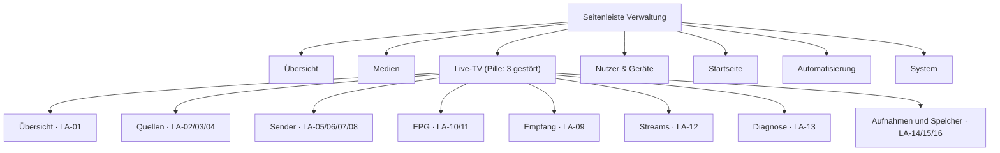
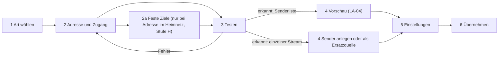

# Konzept 28 · Administration

Stand: 28. November 2026 · Fassung 2 · Status: Entwurf nach Konsolidierung 1, nicht freigegeben

Dieses Dokument beschreibt die Verwaltung von Live-TV in der Web-App (`/admin`). Die TV-App und die
Handy-App haben keine Verwaltung (Konzept 26 E-7, Konzept 27); wer verwaltet, nimmt den Browser. Es ist
die Bauvorlage für das klickbare Verwaltungs-Mockup (`docs/planning/mockups/28-live-tv/`, gebaut, siehe
`19-mockups.md`) und später für den Bau. Die Zuschauerseiten stehen in `14-oberflaeche.md`.

Alles hier ist **spezifiziert**, nichts gebaut. **Massgeblich** sind für jede Zahl `04-architektur.md`
Abschnitt 14 («Massgebliche Werte»), für fachliche Regeln `03-fachkonzept.md` (DR-nn), für Aufnahmen
`11-dvr.md`, für Timeshift `10-timeshift.md`, für das EPG `09-epg.md`, für Schema und Schnittstellen `07` und
`08`, für die Stufen `18-umsetzungsplan.md`. Nennt dieses Dokument eine Zahl, steht die Herkunft dabei; wo
keine steht, ist es ein Vorschlag der Oberfläche. Die Streaming-Engine legt dieses Dokument nicht fest: Zeigt
eine Seite einen technischen Wert (Bitrate, Codec, Belegung), heisst das nur, dass der Server ihn liefern
soll. Offene Weichen stehen als **F-13** bis **F-22** in Abschnitt 6 (Fortsetzung der Nummern aus
`14-oberflaeche.md`); `20-offene-entscheidungen.md` führt sie als «`15` F-n».

**Stufen:** Die Verwaltung gibt es nur in der Web-App. Jede Seite nennt ihre Stufe nach `18` 4.3 bis 4.13
(1a, 1b, 2, 3, H, 4, 5, 6, L, W, E).

Kurz erklärt: Eine **Quelle** ist eine Senderliste oder ein einzelner Stream, den der Administrator
einträgt (M3U-Liste, Xtream-Zugang, einzelne Adresse). Ein **Sender** ist das, was Zuschauer sehen;
er kann aus mehreren Quellen gespeist werden (Hauptquelle und **Ersatzquellen**). Ein **Eingang** ist
eine laufende Verbindung von Slouchcat zu einer Quelle; viele Zuschauer und Aufnahmen teilen sich einen
Eingang (LTV-004). **M3U** ist das übliche Dateiformat für Senderlisten, **Xtream Codes** eine
verbreitete Schnittstelle von IPTV-Anbietern, **XMLTV** das übliche Format für Programmdaten. **Feste
Ziele** sind Adressen im Heimnetz, die der Administrator für genau eine Quelle bestätigt (`04` T-5).

---

## 0. Grundsätze

1. **Bestehende Verwaltung, kein Sondersystem.** Seitenrahmen `AdminPage` (`web/src/ui/AdminPage.tsx`:
   h1, Hilfeknopf, Live-Anzeige, Hauptaktionen, `StatusStrip`, Abschnitte), Bereichsreiter `AreaTabs`,
   Seitenleiste `AdminSideNav` (aufklappbarer Baum), Einstellungen mit `SettingRow` + `SaveBar`,
   Tabellen `DataTable`, Formulare mit `Form`, Kennzahlen `StatTile`/`DashCard`/`StatusStrip`,
   Speicher `StorageMeter`, Aufklapper `BandPanel`/`DisclosureGroup`. Kompakte Dichte der Verwaltung
   (`web/src/ui/density.css`, `admin-look.css`). Alles **gebaut**.
2. **Marcos Regeln:** Klappbares zu mit Zusammenfassung in der Kopfzeile (Ausnahmen: Sprunglink öffnet
   sein Ziel, eben Angelegtes ist offen, Aufklapper mit Fehler öffnet sich); Rahmen ≥ 3:1, gedämpfter
   Text ≥ 8:1; **Anlegen und Ändern im selben Formular**.
3. **Kein Anbieterlimit.** Slouchcat zählt keine Verbindungen je Anbieter, kennt keine Abos und keine
   Laufzeiten (LTV-017). Der eine Schalter je Quelle «weitere gleichzeitige Verbindungen erlaubt» (`04`
   T-18) ist **keine Zahl und keine Limitverwaltung**: Er sagt nur, ob Slouchcat von sich aus mehr als das
   Nötige öffnen darf. Ob es eine Zahl je Quelle geben soll, ist allein `04` F-3 (ändert LTV-017, nur auf
   Marcos Wort). Die Seiten sagen das ausdrücklich (Abschnitt 5).
4. **Privatsphäre:** Der Administrator sieht nie Titel fremder Aufnahmen und nie, welches Konto gerade
   welchen Sender aufnimmt (Abschnitt 4; `03` DR-17; Review 2 RD-06).
5. **Geheimnisse gehen nie an den Browser** (`04` T-28, `07`, `08`): Jede Adresse einer Quelle und jede
   Stream-Adresse eines Senders ist ein Geheimnis. Die Oberfläche zeigt davon nur **Schema, Host und Port**
   (`https · iptv.example.net · 443`), nie den Pfad oder die Abfrage, auch nicht maskiert. Zugangsdaten und
   Werte von Kopfzeilen sind **nur schreibbar**: Die Oberfläche zeigt bei Zugangsdaten «gesetzt» oder «nicht
   gesetzt», bei Kopfzeilen nur deren **Namen** mit «gesetzt»; überschreiben und entfernen geht, lesen nie.
   Fehlermeldungen nennen höchstens Schema und Host (Muster `netguard.Clean`). «Technische Angaben
   kopieren» (LA-13) läuft über dieselbe Schwärzung im Server.
6. **Was ein Sender tut, wenn man ihn abschaltet** (`04` T-29): Deaktivieren macht ihn sofort für alles
   **Neue** unsichtbar und beendet nichts Laufendes; laufende Aufnahmen laufen bis zum Ende, laufende
   Wiedergaben, bis der Zuschauer geht. Laufendes beendet nur der eigene Befehl **«Sofort beenden»** mit
   Rückfrage.
7. **Texte** im Namensraum `live.admin` (`web/src/locales/*.json`), Farben aus Tokens (Regel 9).

### 0.1 Beispieldaten für das Mockup

Alle Adressen auf `example.*`-Domänen, keine echten Anbieter, keine Logos (Initialen). Uhrzeit im
Mockup: Samstag, 28. November 2026, 20:41.

**Quellen** (angezeigt wird nur Schema, Host, Port):

| Name | Art | Anzeige der Adresse | Sender (aktiv / gesamt) | Aktualisierung | Zustand | Weitere Verbindungen | Feste Ziele |
|---|---|---|---|---|---|---|---|
| Kabelanbieter Schweiz | M3U-URL | `https · iptv.example.net · 443` | 398 / 412 | alle 24 h, zuletzt heute 06:00 | in Ordnung | erlaubt | – |
| Xtream Beispielanbieter | Xtream | `http · xtream.example.com · 8080`; Benutzer und Passwort gesetzt | 120 / 9'874 | alle 12 h, zuletzt heute 05:00 **fehlgeschlagen** (Server antwortet 503), bisherige Liste aktiv | Warnung | nicht erlaubt | – |
| Senderliste Region | M3U-Datei | `senderliste-region.m3u` (1,2 MB, hochgeladen 20.11.) | 64 / 66 | nur von Hand | in Ordnung | erlaubt | – |
| Heimnetz Multicast | Einzelströme UDP | `udp · 239.10.0.1 · 5000`, `udp · 239.10.0.2 · 5000` | 2 / 2 | – | in Ordnung | – | **2** (Stufe H) |

**Sender:** 584 aktiv von 10'354 importierten; 571 verfügbar, 13 nicht verfügbar. Beispiele wie in
`14-oberflaeche.md` 0.1 (SRF 1, SRF zwei, SRF info, Das Erste, ZDF, ZDFinfo gestört, phoenix,
KiKA, TeleZüri ohne EPG, TV24 verschwunden).

**EPG-Quellen:** «XMLTV Schweiz und Deutschland» `https · epg.example.org · 443` (gepackt), alle 24 h,
zuletzt heute 04:10, 214 Kanäle, 48'312 Sendungen, reicht bis Sa 5.12.; «Programmdaten Xtream» (vom
Xtream-Zugang), alle 24 h, zuletzt gestern 05:05, Warnung «312 Sendungen ohne Zeitzone, als Ortszeit
gelesen».

**Zuordnungen:** 531 automatisch sicher, 22 automatisch unsicher, 19 von Hand, 12 fehlen.

**Aktive Eingänge** (jetzt; Obergrenze 8, `04` 14.1): SRF 1 (dauerhaft, 2 Zuschauer), SRF zwei (1 Zuschauer,
2 Aufnahmen), ZDF (1 Zuschauer), SRF info (vorgeladen), Das Erste (Zeitplan «Abends»), ZDFinfo
(wiederverbindet, Ersatzquelle 2 bereit); dazu ein **zurückgestellter** Sender: 3sat (dauerhaft, seit 20:31
zurückgestellt, weil ein Zuschauer den Platz brauchte).

**Konten:** `familie.keller@example.ch` (Kontingent 200 GB, belegt 142 GB, 31 Aufnahmen),
`grosseltern@example.ch` (100 GB, 12 GB, 4), `wg-langstrasse@example.ch` (100 GB, 97 GB, 22,
Warnung), `admin@example.ch` (Live-TV an, Kontingent 100 GB, nichts belegt).

**Speicherorte:** Startpuffer im **Arbeitsspeicher des Servers** (ab Werk, `04` T-25; Byte-Budget 512 MB,
belegt 96 MB); Timeshift `<cache>/live/timeshift` (SSD, 256 GB frei, belegt 18,4 GB; Deckel 50 GB);
Aufnahmen `/recordings` (Netzlaufwerk NFS, 4 TB, belegt 1,2 TB). Timeshift-Höchstdauer: Werksvorgabe
60 Minuten, **in der Beispielinstanz auf 2 Stunden gestellt** (so auch im Mockup).

---

## 1. Einordnung in die Verwaltung

### 1.1 Neuer Bereich «Live-TV»

Heute hat die Verwaltung fünf Bereiche (`web/src/features/admin/sections.ts`: `media`, `people`,
`home`, `automation`, `system`). Live-TV wird ein **sechster Bereich** `livetv` mit Symbol `tv`, in der
Seitenleiste nach «Medien». Begründung: zu viele Seiten für einen Reiter unter «Medien» (Radio hat vier
Reiter), und der Bereich ist für Server ohne Live-TV überflüssig (F-13).



**Bereichsreiter** (`AreaTabs`, je ein Eintrag in `adminSections` mit `area: 'livetv'`):

| Reiter | Pfad | Seiten (Reiter innerhalb mit `Tabs`, `?tab=`) | Stufe |
|---|---|---|---|
| Übersicht | `/admin/live` | LA-01 | 1a |
| Quellen | `/admin/live/sources` | LA-02; Formular LA-03 unter `/admin/live/sources/new` und `/admin/live/sources/$sourceId`; LA-04 unter `/admin/live/sources/$sourceId/import/$runId` | 1a |
| Sender | `/admin/live/channels` | `?tab=channels` LA-05 (Bearbeiten LA-06 als Dialog `?edit=$channelId`), `?tab=groups` LA-08, `?tab=duplicates` LA-07 | 1a; Gruppen und Duplikate 1b |
| EPG | `/admin/live/epg` | `?tab=sources` LA-10, `?tab=mapping` LA-11 | 2 |
| Empfang | `/admin/live/reception` | LA-09 mit `?tab=strategy`, `?tab=schedules`, `?tab=overrides` | 3 |
| Streams | `/admin/live/streams` | LA-12 | 1a |
| Diagnose | `/admin/live/diagnostics` | LA-13 (`?channel=$id` für einen Sender) | 1a (Grundteil), 3 (erweitert) |
| Aufnahmen und Speicher | `/admin/live/storage` | `?tab=dvr` LA-14, `?tab=timeshift` LA-15, `?tab=storage` LA-16 | 4 (Timeshift, Speicherort «Timeshift»), 5 (Aufnahmen, Speicherort «Aufnahmen») |

Ein Reiter, dessen Stufe noch nicht gebaut ist, fehlt (kein leerer Reiter).

**Seitenleiste:** Der Baum zeigt «Live-TV» mit Unterpunkten wie oben. Alarm-Pillen nach bestehendem
Muster (`AdminSideNav.tsx`): «3 gestört» am Bereich und an «Diagnose», «Fehler» an «Quellen» bei
fehlgeschlagenem Import, «Speicher knapp» an «Aufnahmen und Speicher». **Suchpalette** Strg+K
(`AdminFinder.tsx`) findet die Seiten und, ab drei Buchstaben, Sender und Quellen nach Namen
(«SRF 1 › Sender bearbeiten»).

**Handy-Breite:** Seitenleiste als Blatt `AdminSideNavMenu` (gebaut); Tabellen wechseln in die
Kartenansicht von `DataTable`; Formulare einspaltig; `EditorDialog` als Vollbild.

### 1.2 Bestehende Seiten, die sich ändern

| Kennung | Seite | Änderung | Stufe |
|---|---|---|---|
| LA-20 | Verwaltungsübersicht `/admin` (`AdminHomePage.tsx`) | neue `DashCard` «Live-TV»; Live-Zuschauer in «Aktive Wiedergaben»; Live-TV-Fälle in «Braucht Aufmerksamkeit» | 1a |
| LA-21 | Aktive Wiedergaben `/admin/streams` (`StreamsPage.tsx`) | neue Gruppe «Live-TV» in der `ToggleToolbar`; Kachel je Live-Zuschauer; Bandbreite enthält Live-TV; Kachel «Private Aufnahme» für die Wiedergabe einer Aufnahme | 1a; «Private Aufnahme» 5 |
| LA-22 | Konten `/admin/accounts` (`AccountsPage.tsx`, `AccountDetail.tsx`, `accounts/AccessForm.tsx`) und Einladungen | Block «Live-TV» mit drei Schaltern und Kontingent; Belegung in der Kontodetailseite; Spalte «Live-TV» in der Liste | 1a (Live-TV), 4 (Timeshift), 5 (Aufnahmen, Kontingent) |
| LA-23 | Hintergrundjobs `/admin/jobs` (`JobsPage.tsx`) | neue Gruppe «Live-TV» mit den Jobarten `livetv.*` | 1a, je Stufe ergänzt |
| LA-24 | Benachrichtigungen der Verwaltung `/admin/notifications` | neue Fehlerquellen für Live-TV (Import, Ausfall, EPG, Speicher) | 1a (Import), 2 (EPG), 3 (Ausfall), 4/5 (Speicher) |
| LA-25 | Seitenleiste und Suchpalette | Bereich und Pillen (1.1) | 1a |
| LA-26 | Meine Medien `/admin/my-media` (`features/admin/mymedia`) | Eintrag «Live-TV» (`livetv`) ordnen und ausblenden wie «Radio» | 1a |
| LA-27 | Server › Update (`ServerPage.tsx`, Update-Dialog) | Warnung vor dem Update, wenn Aufnahmen laufen oder in den nächsten **15 Minuten** beginnen (`04` 14.8, `04` F-6 (a)) | 5 |
| LA-28 | Sicherung `/admin/backup` | Hinweise, was Live-TV nicht sichert | 1a; Satz zu Programmdaten 2, zu Aufnahmen 5 |
| – | Ersteinrichtung | **keine Änderung** (Empfehlung): Live-TV ist freiwillig und wird später in der Verwaltung eingerichtet; die Übersicht LA-01 hat dafür einen eigenen Einstieg | – |
| – | Statistiken | keine neue Ansicht in Konzept 28; die Sehzeit zählt Live-TV mit, ohne Sender (`03` DR-12) | – |

---

## 2. Seiteninventar

| Kennung | Seite | Zweck | Route | Bestehende Bauteile | Neue Bauteile | LTV / Auftrag | Stufe |
|---|---|---|---|---|---|---|---|
| LA-01 | Live-TV-Übersicht | Zustand auf einen Blick, Fehler und Warnungen | `/admin/live` | `AdminPage`, `StatusStrip`, `StatTile`, `DashCard`, `StreamRow`, `Notice`, `ActivityFeed` | – | 9.1 | 1a (Kosten des vorsorglichen Empfangs 3, Zahl der festen Ziele H) |
| LA-02 | Quellen | alle Quellen, Zustand, Aktualisieren, Testen | `/admin/live/sources` | `DataTable`, `StatusDot`, `ConfirmDialog` | – | 9.2, 018 | 1a (Abzeichen Heimnetz H) |
| LA-03 | Quelle anlegen und ändern | ein Formular für M3U-Datei, M3U-URL, Xtream, Einzelstrom, mit Test | `/admin/live/sources/new`, `/admin/live/sources/$id` | `Form`, `TextField`, `SelectField`, `RadioGroup`, `Switch`, `SettingRow`, `SaveBar`, `BandPanel`, Schrittfolge wie im Einrichtungsassistenten | `HeaderNameList` (Kopfzeilen: nur Namen, Wert nur schreibbar), `NetTargetList` (feste Ziele) | 9.2, 003, 017, 018 | 1a (HTTP(S), HLS-TS, MPEG-TS, M3U, Xtream); H (feste Ziele, UDP, RTP, Multicast); L (RTSP, RTMP); W (DASH, HLS mit fMP4); Zeitplan der Aktualisierung 1b; Schalter «weitere Verbindungen» 3 |
| LA-04 | Import-Vorschau und -Ergebnis | was ein Import ändert und was er geändert hat | `/admin/live/sources/$id/import/$runId` | `DataTable`, `ToggleToolbar`, `Notice` | – | 018 | 1a («zurückgehaltene Liste» 1b) |
| LA-05 | Sender | Tabelle mit Filter, Suche, Massenbearbeitung | `/admin/live/channels?tab=channels` | `DataTable`, `VirtualList`, `SearchField`, `FacetSelect`, `ActiveFilters`, `Switch` | `BulkBar` (Leiste für ausgewählte Zeilen) | 9.3, 006 | 1a (Massenbearbeitung, Nummern 1b) |
| LA-06 | Sender bearbeiten | alle Angaben eines Senders, Quellen mit Rangfolge, Empfang, Technik | Dialog `?edit=$id` | `EditorDialog`, `Form`, `RankedChoiceList`, `BandPanel`, `FactList` | – | 9.3, 002, 006, 011 | 1a (Logo-Upload 1b, Programmdaten 2, Empfang 3) |
| LA-07 | Duplikate | Vorschläge prüfen, Sender zusammenführen | `/admin/live/channels?tab=duplicates` | `DataTable`, `Dialog`, `RadioGroup` | – | 006 | 1b |
| LA-08 | Sendergruppen | Gruppen aus Quellen und eigene Gruppen | `/admin/live/channels?tab=groups` | `DataTable`, `EditorDialog`, `RankSelect` | – | 006 | 1b (Gruppen aus Quellen 1a) |
| LA-09 | Empfang | globale Strategie, Zeitpläne, Ausnahmen je Sender, Schalter je Quelle | `/admin/live/reception` | `RadioGroup`, `SettingRow`, `SaveBar`, `DataTable` | `WeekdayPicker` (aus `14` 6.9) | 002, 9.3 | 3 |
| LA-10 | EPG-Quellen | Programmdaten-Quellen, Intervall, Status, Fehler, Vorschauzeitraum | `/admin/live/epg?tab=sources` | `DataTable`, `Form`, `SettingRow` | – | 005, 9.4 | 2 |
| LA-11 | EPG-Zuordnungen | Sender ↔ EPG-Kanal: automatisch, von Hand, fehlend | `/admin/live/epg?tab=mapping` | `DataTable`, Auswahlfeld mit Suche aus `SelectField`, `ToggleToolbar` | – | 005, 9.4 | 2 |
| LA-12 | Aktive Streams | laufende Eingänge mit Zuschauern, Aufnahmen (als Zahl), Technik | `/admin/live/streams` | `StreamTile`, `DataTable`, `StatusStrip`, `ConfirmDialog` | – | 9.5 | 1a (Quellwechsel, «zurückgestellt» 3) |
| LA-13 | Überwachung und Diagnose | Ausfälle, Wiederverbindungen, Quellwechsel, Protokoll, Prüfung | `/admin/live/diagnostics` | `DataTable`, `ActivityFeed`, `Notice`, `HeatGrid` (Ausfälle je Stunde) | – | 011, 9.7 | 1a (Grundteil), 3 (erweitert), E (stehendes Bild) |
| LA-14 | Aufnahmen (DVR) | Vor-/Nachlauf, Fristen, Planerregeln | `/admin/live/storage?tab=dvr` | `SettingRow`, `SaveBar`, `SelectField` | – | 008, 9.6 | 5 |
| LA-15 | Timeshift | Höchstdauer, Deckel | `/admin/live/storage?tab=timeshift` | `SettingRow`, `SaveBar` | – | 007, 019 | 4 |
| LA-16 | Speicher | drei Speicherorte, Grenzen, Reserven, Belegung je Konto, Warnungen, Wechsel | `/admin/live/storage?tab=storage` | `StorageMeter`, `DataTable`, `PathList`, `Dialog` | – | 019, 9.6 | 4 (Timeshift), 5 (Aufnahmen, Belegung je Konto) |

**Zustände, die jede Seite hat:** lädt (`Skeleton` in Endmass), leer (eigener Text mit nächstem
Schritt), Fehler (`Notice` danger mit «Erneut laden»), Teilfehler (Seite bleibt, `Notice` warning über
dem betroffenen Abschnitt). Live-Werte (LA-01, LA-12, LA-13) laden alle 5 s neu wie `StreamsPage`
(pausiert, solange ein Dialog offen ist); die Kopfzeile zeigt die Live-Anzeige von `AdminPage`
(«Aktualisiert vor 3 s»).

---

## 3. Die Seiten

### 3.1 LA-01 Live-TV-Übersicht

**Aufbau:**

1. Kopf «Live-TV» mit Hauptaktionen «Quelle hinzufügen», «Sender verwalten».
2. **Einrichtungsband**, nur solange keine Quelle besteht (Muster Einrichtungsband `AdminHomePage.tsx`):
   «Live-TV einrichten: 1. Quelle hinzufügen · 2. Sender prüfen · 3. Programmdaten hinzufügen ·
   4. Konten freischalten». Jeder Schritt ist ein Link; erledigte Schritte mit Haken.
3. `StatusStrip` (eine Zeile Kennzahlen, je Kachel ein Link):
   - **Zustand:** «Bereit», «Eingeschränkt (13 Sender nicht verfügbar)», «Keine Quelle», «Programmdaten
     veraltet» (berechnet; kein eigener Hauptschalter, F-13). Im Beispiel «Eingeschränkt» (so das Mockup).
   - **Sender:** 584 aktiv · 571 verfügbar · 13 nicht verfügbar.
   - **Eingänge:** 6 von 8 · davon 1 dauerhaft · 1 vorgeladen · 1 nach Zeitplan · 1 zurückgestellt.
   - **Zuschauer:** 4 · **Umwandlungen** (Transcodes): 2.
   - **Aufnahmen:** 2 laufen · 23 geplant (nächste 24 h).
   - **Bandbreite:** ein 38,4 Mbit/s · aus 22,1 Mbit/s.
   - Ab Stufe H: **Feste Ziele im Heimnetz:** 2 bei 1 Quelle; Hinweis, falls das Host-Netz vermutlich fehlt
     (`18` 4.6).
4. `DashCard` **«Braucht Aufmerksamkeit»** (Fehler zuerst, dann Warnungen; je Zeile Satz, Zeit, Link):
   - danger «ZDFinfo ist seit 20:12 nicht erreichbar.» → LA-13
   - warning «Import ‹Xtream Beispielanbieter› fehlgeschlagen (Server antwortet 503). Die bisherige
     Liste bleibt aktiv.» → LA-04
   - warning «3sat (dauerhaft) ist seit 20:31 zurückgestellt: Der Platz wurde für einen Zuschauer
     gebraucht. Slouchcat startet ihn wieder, sobald 60 Sekunden lang Platz frei ist.» → LA-12
   - warning «Konto wg-langstrasse@example.ch: 97 von 100 GB für Aufnahmen belegt.» → LA-16
   - warning «12 aktive Sender ohne Programmdaten.» → LA-11 gefiltert
   - info «TV24 ist aus ‹Kabelanbieter Schweiz› verschwunden und für Zuschauer ausgeblendet.» → LA-05
     gefiltert
5. `DashCard` **«Aktive Eingänge»**: die fünf mit den meisten Abnehmern (Sender, Grund, Zuschauer,
   Zahl der Aufnahmen, Bitrate) → LA-12. Keine Konten bei Aufnahmen.
6. `DashCard` **«Aufnahmen»**: «2 laufen · 23 geplant in 24 h · höchstens 4 gleichzeitig (heute 20:15)»;
   **keine Titel, keine Konten, keine Sender** (Abschnitt 4).
7. `DashCard` **«Ressourcen»**: CPU 31 % · GPU 12 % · RAM 2,1 GB von Slouchcat · Byte-Budget 96 von
   512 MB · Speicher je Speicherort als `StorageMeter` (Timeshift 18,4 GB von höchstens 50 GB, Aufnahmen
   1,2 von 4 TB). Werte, die der Server nicht lesen kann, zeigen «–» mit Hinweis «Nicht verfügbar auf diesem
   System» (F-22). Ab Stufe 3 zusätzlich «Vorsorglicher Empfang: 2 Eingänge ohne Zuschauer» (Kosten des
   Vorladens und Dauerempfangs).
8. `DashCard` **«Programmdaten»**: «Stand heute 04:10 · reicht bis Sa 5.12. · 2 Quellen · 1 Warnung».
9. Fusszeile: Verantwortungshinweis (Abschnitt 5, Text V-1).

**Leer:** Einrichtungsband statt Kennzahlen; Kennzahlen zeigen «–».

### 3.2 LA-02 Quellen

**Aufbau:** Kopf «Quellen», Hauptaktion «Quelle hinzufügen» (→ LA-03 neu). Hinweis V-2 (Abschnitt 5)
als `Notice` info, zuklappbar.

`DataTable` (Zeile aufklappbar):

| Spalte | Inhalt |
|---|---|
| Name | «Kabelanbieter Schweiz» |
| Art | M3U-URL · M3U-Datei · Xtream · Einzelstrom |
| Sender | «398 aktiv / 412» |
| Letzte Aktualisierung | «heute 06:00 · in Ordnung» bzw. «heute 05:00 · fehlgeschlagen» (`StatusDot`) |
| Nächste | «morgen 06:00» bzw. «nur von Hand» |
| Abzeichen | «weitere Verbindungen erlaubt» (ab Stufe 3), «2 feste Ziele im Heimnetz» (ab Stufe H) |
| Aktionen | «Jetzt aktualisieren» · «Testen» · Menü ⋯ («Bearbeiten», «Letzter Import», «Entfernen») |

Aufgeklappt: Schema, Host und Port der Adresse; Intervall; «Neue Sender sofort anbieten: an»; Gruppenzahl;
Zahl der verschwundenen Sender; Sammelzeile «n Sender zeigen auf Ziele im Heimnetz ausserhalb der
Freigabe» (Netze und Ports gezählt, `12` 4.5; ab Stufe H); die letzten fünf Läufe (Zeit, Ergebnis,
neu/geändert/verschwunden) mit Link auf LA-04.

**Jetzt aktualisieren:** startet den Job (LA-23); Zeile zeigt «läuft … 2'300 von 9'874 Einträgen»
(Fortschritt des Jobs); danach `toast` «Aktualisiert: 3 neu, 12 geändert, 1 verschwunden · Details».

**Entfernen** (`ConfirmDialog`, danger): «Quelle ‹Senderliste Region› entfernen? 64 Sender stammen aus
dieser Quelle; 41 davon haben keine andere Quelle.» Wahl: (•) «Diese 41 Sender behalten, ohne Quelle und
ausgeblendet» ( ) «Diese 41 Sender löschen». Sätze: «Laufende Wiedergaben und Aufnahmen dieser Quelle laufen
weiter, bis die Verbindung endet.» · «Favoriten, Zuordnungen und geplante Aufnahmen bleiben bei behaltenen
Sendern erhalten. Geplante Aufnahmen gelöschter Sender schlagen mit ‹Sender nicht verfügbar› fehl; die
Profile bekommen eine Warnung.» (`03` DR-16, `04` T-29) Knöpfe «Abbrechen» · «Entfernen».

**Leer:** «Noch keine Quelle. Füge eine Senderliste (M3U), einen Xtream-Zugang oder einen einzelnen
Stream hinzu.» + «Quelle hinzufügen».

### 3.3 LA-03 Quelle anlegen und ändern

Ein Formular für alle Arten. **Neu** führt es in Schritten durch (Schrittanzeige oben wie
Einrichtungsassistent); **Ändern** zeigt dieselben Felder als Aufklapper (zu, Zusammenfassung in der
Kopfzeile; ein Aufklapper mit Fehler öffnet sich), dazu `SaveBar`.

**Ablauf «Quelle hinzufügen»:**



**Schritt 1 · Art** (`RadioGroup` als grosse Karten; Arten späterer Stufen fehlen, bis sie gebaut sind):

| Art | Satz | Stufe |
|---|---|---|
| Senderliste als Adresse (M3U/M3U8-URL) | «Der Anbieter gibt dir eine Adresse zu einer Senderliste.» | 1a |
| Senderliste als Datei (M3U/M3U8) | «Du hast eine Datei mit Sendern.» | 1a |
| Xtream-Codes-Zugang | «Der Anbieter gibt dir Server, Benutzername und Passwort. Übernommen wird nur Live-TV, keine Filme und Serien.» | 1a |
| Einzelner Stream | «Eine Adresse für einen Sender.» Protokolle je Stufe: HTTP(S) mit MPEG-TS oder HLS-TS (1a); UDP, RTP, Multicast (H); RTSP, RTMP (L); MPEG-DASH ohne Kopierschutz und HLS mit fMP4 (W) | 1a, H, L, W |

**Schritt 2 · Adresse und Zugang** (Felder je Art, Vorgaben fett):

| Feld | Arten | Werte / Prüfung |
|---|---|---|
| Name | alle | frei, Pflicht, z. B. «Kabelanbieter Schweiz» |
| Adresse | URL, Einzelstrom | Pflicht; nur schreibbar. Nach dem Speichern zeigt das Feld «`https · iptv.example.net · 443` · Adresse gespeichert» und einen Knopf «Neue Adresse eingeben»; die gespeicherte Adresse kommt nie zurück in den Browser (`04` T-28) |
| Datei | Datei | Hochladen (`.m3u`, `.m3u8`), höchstens **200 MiB** (`04` 14.9); «Ersetzen» im Ändern-Modus |
| Server | Xtream | `http(s)://host:port`; Anzeige danach wie bei «Adresse» |
| Benutzername, Passwort | Xtream; optional bei URL/Einzelstrom (HTTP-Anmeldung) | nur schreibbar; Anzeige «gesetzt» oder «nicht gesetzt», Knöpfe «Ändern», «Entfernen» |
| Kopfzeilen | URL, Xtream, Einzelstrom | `HeaderNameList`: Zeilen mit **Name** (z. B. `Referer`, `X-Token`) und Wert. Gespeicherte Zeilen zeigen nur den Namen und «gesetzt»; der Wert lässt sich überschreiben oder die Zeile entfernen, nie lesen (`04` T-28, Review 1 RS-17). Kopfzeilen aus der Senderliste selbst übernimmt Slouchcat nur als `User-Agent` und `Referer`, je höchstens 256 Zeichen (`04` 14.9) |
| User-Agent | URL, Xtream, Einzelstrom | (•) **Standard von Slouchcat** ( ) eigener: [Text] (nur schreibbar wie eine Kopfzeile) |
| Ursprünge für Zugangsdaten und Kopfzeilen | URL, Xtream, Einzelstrom | Liste der Hosts, an die Zugangsdaten und Kopfzeilen gehen dürfen; ab Werk **nur der Host der eingetragenen Adresse**; «Host hinzufügen» für Anbieter, deren Ströme auf einem anderen Host liegen (`04` T-28) |

**Schritt 2a · Feste Ziele im Heimnetz** (ab Stufe H; erscheint, wenn die Adresse oder der Test auf eine
Adresse im Heimnetz zeigt, und im Ändern-Modus als Aufklapper «Ziele im Heimnetz · 2 bestätigt»):

Es gibt **keinen Ja-Nein-Schalter** für das ganze Heimnetz. Der Administrator bestätigt je Quelle eine
Liste fester Ziele (`04` T-5 und 10.9, `12` 4.5), Bauteil `NetTargetList`:

| Feld | Werte |
|---|---|
| Ziel | Adresse (`192.168.1.20`) oder kleines Netz (höchstens /24 bei IPv4, /64 bei IPv6) oder Hostname; ein Hostname wird beim Freigeben aufgelöst, die gefundenen Adressen werden angezeigt und als Adressen gespeichert |
| Port | ein Port oder ein kleiner Bereich (höchstens 64 Ports); bei UDP, RTP, Multicast die Lausch-Adresse mit Port und die Gruppe (`udp · 239.10.0.1 · 5000`) |
| Bestätigung | Kästchen mit Text V-3; ohne Bestätigung kein Speichern |

Höchstens 16 Einträge je Quelle (Annahme, `12` 4.5). **Nie freigebbar** und mit Fehlermeldung abgelehnt:
Loopback, `0.0.0.0/8`, Link-Local (darin die Metadaten-Adressen), die eigenen Adressen des Containers, im
Netzmodus «host» die des Hosts. Ändert sich die Auflösung eines Hostnamens später, fragt die Seite neu
(`!` am Ziel, «Neue Adresse bestätigen»); bis dahin gelten die gespeicherten Adressen. Jede Freigabe und
jede Änderung steht im Protokoll der Verwaltung. Für UDP und Multicast braucht der Container eine
Zusatzdatei (`04` 10.6, F-11 dort); fehlt sie vermutlich, zeigt der Schritt «Vermutlich fehlt das Netz des
Hosts. Siehe Installationsanleitung.»

**Schritt 3 · Testen** (Knopf «Testen», auch später in LA-02 und im Ändern-Modus): Slouchcat ruft die
Adresse einmal ab und zeigt das Ergebnis als `Notice` mit `FactList`:

- **Senderliste erkannt:** «M3U-Senderliste · 412 Einträge · 18 Gruppen · 397 mit Logo · 380 mit
  EPG-Kennung · Programmdaten-Adresse in der Liste gefunden (`https · epg.example.org`)» mit Angebot
  «Als EPG-Quelle hinzufügen» (Häkchen, Vorgabe an; ab Stufe 2).
- **Einzelner HLS-Stream erkannt** (obwohl als Senderliste eingetragen): «Das ist kein Senderverzeichnis,
  sondern ein einzelner Stream (HLS-Manifest). Als Einzelstrom anlegen?» [Als Einzelstrom anlegen]
  (LTV-003: M3U-Senderliste und HLS-Manifest unterscheiden).
- **Stream erkannt (Einzelstrom):** «Bild H.264 1920 × 1080, 25 Bilder/s, interlaced · Ton AAC Stereo,
  AC-3 5.1 · Untertitel: Videotext · Bitrate etwa 8 Mbit/s · erstes Bild nach 1,4 s».
- **Xtream:** «Zugang in Ordnung · 9'874 Live-Sender in 212 Kategorien». Angaben des Anbieters zu
  Verbindungszahl oder Ablaufdatum zeigt Slouchcat **nicht** (keine Abo- und Limitverwaltung, LTV-017).
- **Fehler** in Klartext, ohne Passwort und ohne Pfad: «Anmeldung abgelehnt (Benutzername oder Passwort
  falsch).» · «Server nicht erreichbar (Zeitüberschreitung).» · «Antwort ist keine Senderliste (Zeile 1:
  erwartet ‹#EXTM3U›).» · «Kopiergeschützter Stream (DRM). Slouchcat spielt solche Streams nicht ab.» ·
  «Weiterleitung von https auf http abgelehnt.» (immer, `04` T-28).
- **Ziele im Heimnetz ohne Orakel** (`12` 4.5 und O-10): Für eine Adresse, die der Administrator **selbst
  eingetippt** hat und die im Heimnetz liegt, nennt der Test die Adresse: «Die Adresse liegt im Heimnetz
  (192.168.1.20). Bestätige sie als festes Ziel dieser Quelle (Stufe H).» Slouchcat verbindet dabei
  **nicht**. Für Einträge **aus einer Liste**, die auf das Heimnetz zeigen, gibt es nur den einen Zustand
  «Ziel im Heimnetz nicht freigegeben», ohne Verbindungsversuch, ohne Unterschied zwischen «antwortet»,
  «abgelehnt» und «Zeitüberschreitung», und ohne einzelne Adressen (nur gezählte Netze und Ports).
  Verbindungszustände und Antwortzeiten zeigt der Test nur für öffentliche und für freigegebene Ziele.

**Schritt 4 · Vorschau:** bei Listen LA-04 im Vorschau-Modus. Beim Einzelstrom: (•) «Neuen Sender
anlegen» mit Name, Nummer, Gruppe ( ) «Als Ersatzquelle zu einem bestehenden Sender hinzufügen»
[Sender wählen ▾].

**Schritt 5 · Einstellungen:**

| Feld | Vorgabe | Werte | Stufe |
|---|---|---|---|
| Automatisch aktualisieren | **alle 24 Stunden** (Xtream: alle 12 Stunden; Vorschlag) | alle 6 · 12 · 24 Stunden · wöchentlich · nur von Hand; Uhrzeit «um 06:00» | 1b (in 1a nur von Hand) |
| Neue Sender sofort anbieten | **an** (`03` DR-16, `07` W-6) | aus: neue Sender kommen inaktiv in LA-05 mit Filter «Neu» | 1a |
| Gruppen der Quelle übernehmen | **an** | aus: keine Gruppen aus der Liste | 1a |
| Kanalnummern der Quelle übernehmen | **an** (nur für neue Sender) | aus | 1a |
| Weitere gleichzeitige Verbindungen erlaubt | **aus** (Werkszustand nach `04` F-9 (b); bis zur Antwort Vorschlag) | an: Slouchcat darf zu dieser Quelle vorsorglich zusätzliche Verbindungen öffnen (Vorladen, «automatisch», Prüfungen ruhender Sender). Text darunter: «Das ist kein Anbieterlimit. Slouchcat zählt keine Verbindungen. Schalte es nur ein, wenn dein Zugang mehrere gleichzeitige Verbindungen erlaubt.» Hängt an `04` F-3 und F-9 | 3 |

**Verschwundene Sender** sind sofort für Zuschauer unsichtbar; Favoriten, Nummer, Gruppen, Zuordnung und
Planungen bleiben gespeichert und wirken wieder, wenn der Sender zurückkommt; Slouchcat löscht einen Sender
nie von selbst (`03` DR-16, `07` W-7). Eine Wahl dafür gibt es nicht. **Schutz vor unvollständigen Listen**
ist immer an: Fehlt mehr als ein Drittel der bisherigen Sender (Annahme, `07` W-15), wird die Liste
zurückgehalten; nichts wird als verschwunden markiert, und LA-04 fragt (Stufe 1b).

**Schritt 6 · Übernehmen:** «Quelle speichern und Sender übernehmen». Ergebnis LA-04, die neue Quelle
steht in LA-02 offen aufgeklappt (eben Angelegtes ist offen).

**Ändern-Modus:** Aufklapper «Adresse und Zugang · Xtream, `http · xtream.example.com · 8080`, Benutzer
und Passwort gesetzt», «Kopfzeilen und User-Agent · 1 Kopfzeile gesetzt (Referer), Standard-User-Agent»,
«Ursprünge · 1 Host», «Aktualisierung · alle 12 Stunden um 05:00», «Übernahme · neue Sender sofort, Gruppen
an, Nummern an», «Verbindungen · weitere nicht erlaubt», «Ziele im Heimnetz · keine». Gefahr-Link «Quelle
entfernen» (LA-02).

**Tastatur:** Schritte sind Abschnitte mit Überschrift; «Weiter» und «Zurück» als Knöpfe; Enter im
letzten Feld eines Schritts = «Weiter»; Fokus nach Schrittwechsel auf der Überschrift.

### 3.4 LA-04 Import-Vorschau und -Ergebnis

Gleiche Seite für **Vorschau** (vor dem Übernehmen, beim Anlegen und bei «Testen» einer bestehenden
Quelle) und **Ergebnis** (nach einem Lauf).

**Aufbau:** Kopf «Import ‹Kabelanbieter Schweiz› · heute 06:00»; Zusammenfassung als `StatusStrip`:
**Neu 3 · Geändert 12 · Verschwunden 1 · Mögliche Duplikate 2 · Ziel im Heimnetz nicht freigegeben 0 ·
Fehlerhafte Einträge 4 · Unverändert 396**. `ToggleToolbar` mit diesen Gruppen, darunter `DataTable` der
gewählten Gruppe:

| Gruppe | Spalten | Aktionen |
|---|---|---|
| Neu | Name in der Liste, Gruppe, Nummer, Logo ja/nein, EPG-Kennung | Vorschau: «übernehmen» je Zeile (Vorgabe an) |
| Geändert | Sender, was sich geändert hat («Adresse geändert» ohne Adresse, «Name in der Quelle: ‹SRF1 HD› statt ‹SRF 1 HD›», «Logo der Quelle geändert») und ob es wirkt («Dein Name ‹SRF 1› bleibt», «Dein Logo bleibt») | – |
| Verschwunden | Sender, seit wann, betroffene Favoriten und geplante Aufnahmen (nur Zahl); Satz «für Zuschauer ausgeblendet, Angaben bleiben gespeichert» | «Sender löschen …» (mit Rückfrage, die Favoriten und Planungen nennt, `03` DR-16) |
| Mögliche Duplikate | Eintrag und vermuteter bestehender Sender, Grund («gleiche EPG-Kennung», «Name gleich nach Bereinigung») | «Zusammenführen» (LA-07), «Kein Duplikat» |
| Ziel im Heimnetz nicht freigegeben (Stufe H) | Zahl je Netz und Port, keine einzelnen Adressen | «Diese Ziele freigeben» → LA-03 Schritt 2a |
| Fehlerhafte Einträge | Zeile in der Datei, Grund («Adresse fehlt», «ungültige Angabe ‹tvg-chno=abc›», «Zeile länger als 64 KiB») | – |

**Fehlgeschlagener Import** (Ergebnis): `Notice` danger oben, nicht zuklappbar: «Die Liste konnte nicht
gelesen werden (Zeile 1'204: unvollständige Datei). **Die bisherigen 412 Sender bleiben unverändert.**
Nächster Versuch morgen 06:00.» [Jetzt erneut versuchen]. **Zurückgehaltene Liste** (Stufe 1b): `Notice`
warning «Die neue Liste hat 61 % weniger Sender als bisher. Slouchcat hat sie zurückgehalten und keine
Sender ausgeblendet.» [Liste trotzdem so übernehmen] [So lassen].

Erhalten bleiben immer (Text im Kopf der Seite, LTV-018): eigene Namen, eigene Logos, Gruppen,
Kanalnummern, Favoriten der Zuschauer, EPG-Zuordnungen, geplante Aufnahmen. Ändert ein Import die Adresse
eines laufenden Senders, bleibt die laufende Verbindung bestehen; die neue gilt ab der nächsten (`04` 9).

### 3.5 LA-05 Sender

**Aufbau:** Kopf «Sender · 584 aktiv von 10'354»; Hauptaktionen «Sender hinzufügen» (= Einzelstrom,
LA-03), «Nummern vergeben …» (1b). Reiter Sender · Gruppen · Duplikate (Zahl: «Duplikate 7»).

Werkzeugleiste: `SearchField` (Name, Nummer, Name in der Quelle), `FacetSelect` **Zustand** (Alle ·
Aktiv · Inaktiv · Neu · Gestört · Verschwunden · Ohne Quelle · Ziel nicht freigegeben), **Quelle**,
**Gruppe**, **Land**, **Sprache**, **Kategorie**, **EPG** (zugeordnet · unsicher · fehlt), **Empfang**
(Standard · dauerhaft · automatisch · bei Bedarf · Zeitplan; ab Stufe 3). `ActiveFilters`. Filter im URL.

`DataTable`, virtuell (10'000 Zeilen), Spalten:

| Spalte | Beispiel |
|---|---|
| Auswahl | Kontrollkästchen |
| Nr. | 1 |
| Logo | Logo klein bzw. Initialen (die Regel «Bilder ohne Rahmen» gilt für die Zuschauer-App; hier ist ein feiner Rahmen erlaubt) |
| Name, darunter Gruppen | «SRF 1», darunter klein «Schweiz, Vollprogramme» und, wenn anders, «Quelle: SRF1 HD CH» (Gruppen stehen unter dem Namen statt in einer eigenen Spalte; nachgezogen aus dem Mockup, `19` 6) |
| Land / Sprache | CH · Deutsch |
| Kategorie | Vollprogramm |
| Quellen | «2 (aktiv: Kabelanbieter Schweiz)» |
| EPG | «zugeordnet» / «unsicher» / «fehlt» |
| Empfang | «Dauerhaft» / «Standard (bei Bedarf)» (ab Stufe 3) |
| Zustand | `StatusDot` «Verfügbar» / «Gestört seit 20:12» / «Verschwunden seit 26.11.» / «Ziel im Heimnetz nicht freigegeben» |
| Aktiv | `Switch` |

Sortierung: Nummer (Vorgabe), Name, Zustand. Klick auf die Zeile = LA-06.

**Aktiv-Schalter aus** (`04` T-29): Der Sender ist sofort für alles Neue unsichtbar; laufende
Wiedergaben und Aufnahmen laufen weiter. Läuft gerade etwas, öffnet sich ein kleiner Dialog: «SRF zwei
ausblenden? 1 Zuschauer und 2 Aufnahmen laufen weiter bis zu ihrem Ende.» [Abbrechen] [Ausblenden]
[Ausblenden und sofort beenden …]. Der dritte Knopf ist der Befehl «Sofort beenden» (LA-06).

**Massenbearbeitung** (Stufe 1b): Mit Auswahl erscheint unten die `BulkBar` (neu, klebt wie `SaveBar`): «23
ausgewählt» · Aktivieren · Deaktivieren · Zu Gruppe hinzufügen … · Aus Gruppe entfernen … · Land …
· Sprache … · Kategorie … · Empfang … · Nummern vergeben … · Zusammenführen (ab 2) · Auswahl
aufheben. Jede Aktion öffnet einen kleinen Dialog mit einem Feld und dem Satz «Gilt für 23 Sender.»;
«Deaktivieren» nennt wie oben, was weiterläuft. «Alle 412 Treffer auswählen» als Link, wenn eine Seite voll
ausgewählt ist.

**Nummern vergeben** (Dialog): «Nummern ab [101] in der aktuellen Sortierung, Schritt [1]; bestehende
Nummern (•) überschreiben ( ) nur leere füllen». Doppelte Nummern verhindert das Formular mit
Fehlermeldung je Zeile («Nummer 12 hat schon 3sat»). **Manuelle Sortierung** heisst in Slouchcat:
Die Kanalnummer bestimmt die Reihenfolge; ohne Nummer folgen die Sender alphabetisch (F-15).

**Leer:** «Noch keine Sender. Füge zuerst eine Quelle hinzu.»; gefiltert leer «Kein Sender passt».

### 3.6 LA-06 Sender bearbeiten

`EditorDialog` (bis 1100 px, Handy Vollbild), Muster Radio `features/admin/radio/StationEditor.tsx`.
Kopf: Logo, Nummer, Name, `Switch` «Aktiv» (Wirkung wie in LA-05), Zustand. Aufklapper (zu,
Zusammenfassung; mit Fehler offen; über einen Sprunglink aus LA-13 öffnet sich das Ziel, z. B.
«Quellen»):

1. **Allgemein · «SRF 1 · Nr. 1 · CH · Deutsch · Vollprogramm»:** Name (Vorgabe aus der Quelle,
   «Zurück zum Namen der Quelle»), Nummer, Land (Liste), **eine** Sprache (Liste; `03` LTV-006.14, `07`
   W-16), Kategorie (feste Liste, F-16).
2. **Logo · «aus der Quelle»:** (•) aus der Quelle ( ) eigene Adresse [URL, nur öffentlich] ( ) Datei
   hochladen (1b); Vorschau auf dunklem und hellem Grund; «Zurücksetzen».
3. **Gruppen · «Schweiz, Vollprogramme»:** Mehrfachwahl aus Gruppen (eigene und aus Quellen).
4. **Programmdaten · «XMLTV Schweiz und Deutschland: SRF1.ch»** (Stufe 2): Zuordnung wie LA-11 für diesen
   Sender, Vorschau der nächsten drei Sendungen, «Dieser Sender hat keine Programmdaten» (bewusst ohne).
5. **Quellen · «2 Quellen, aktiv: Kabelanbieter Schweiz»:** `RankedChoiceList` in Rangfolge; je
   Eintrag: Quelle, **Schema, Host, Port** der Stream-Adresse (nie der Pfad), Zustand, zuletzt geprüft,
   «Testen», «Nach oben», «Nach unten», «Als eigenen Sender abtrennen». Satz: «Fällt die erste Quelle aus,
   wechselt Slouchcat zur nächsten.» (automatischer Wechsel ab Stufe 3) «Quelle hinzufügen» (bestehende
   Einzelströme oder andere Sender zusammenführen → LA-07).
6. **Empfang · «Standard (bei Bedarf)»** (Stufe 3): `RadioGroup` (•) Standard des Servers ( ) Dauerhaft
   ( ) Automatisch ( ) Bei Bedarf ( ) Nach Zeitplan [Zeitplan ▾]. Bei «Dauerhaft» und «Nach Zeitplan»
   Hinweis V-4. Ob dieser Sender vorgeladen wird, regelt der Schalter **der Quelle** (LA-03, LA-09); einen
   Schalter je Sender gibt es nicht (`04` T-18, `07` W-23).
7. **Technik · «H.264 1080i · AAC + AC-3 · 8,1 Mbit/s»** (nur lesen, letzte Messung): Bild-Codec,
   Auflösung, Bildrate, Zeilensprung, Bildgruppen länger als 15 s («kein schneller Start», `04` 5.1),
   Ton-Spuren mit Sprache und Codec, Untertitel-Spuren, Bitrate, Messzeit; `Switch` **«Sender hat keinen
   Ton»** (dann meldet die Überwachung fehlenden Ton nicht als Fehler, LTV-011) und **«Sender hat kein
   Bild»** (reiner Tonsender).
8. **Verfügbarkeit · «Verfügbar, 2 Ausfälle in 7 Tagen»:** letzte Ausfälle, Wiederverbindungen,
   Quellwechsel; Link «Diagnose öffnen» (LA-13 `?channel=`).
9. **Nutzung · «12 Favoriten · 3 geplante Aufnahmen»:** nur Zahlen, keine Profile, keine Konten.

Fuss: «Abbrechen», «Speichern»; Befehl **«Sofort beenden …»** (nur, wenn gerade etwas läuft;
`ConfirmDialog` danger: «Alles Laufende auf SRF zwei sofort beenden? 1 Zuschauer sieht ‹Sender nicht
verfügbar›, 2 Aufnahmen enden als ‹unvollständig, Sender deaktiviert›.» [Abbrechen] [Sofort beenden]; der
Sender wird dabei deaktiviert; `04` T-29); Gefahr-Link «Sender löschen» (nur bei Sendern ohne Quelle oder
verschwundenen; `ConfirmDialog` mit Favoriten und Planungen wie in LA-02).

### 3.7 LA-07 Duplikate und Zusammenführen

**Reiter Duplikate:** Liste der Vorschläge (automatische Erkennung), je Zeile zwei oder mehr Sender
mit Grund («gleiche EPG-Kennung ‹SRF1.ch›», «Name gleich nach Bereinigung», «gleiche Stream-Adresse»)
und Vorschlag, welcher bleibt. Aktionen «Zusammenführen …», «Kein Duplikat» (merkt sich das Paar).
Manuell: in LA-05 zwei oder mehr Sender wählen → «Zusammenführen».

**Ablauf «Sender zusammenführen»** (Dialog):

1. «Welcher Sender bleibt?» (`RadioGroup`, Vorgabe: der mit Nummer und meisten Favoriten).
2. «Was übernimmt der bleibende Sender?» je Angabe wählen: Name · Logo · Nummer · Gruppen (Vereinigung
   als Vorgabe) · Programmdaten-Zuordnung · Land/Sprache/Kategorie.
3. «Quellen in dieser Reihenfolge» (`RankedChoiceList` aller Quellen beider Sender).
4. Zusammenfassung: «SRF 1 bleibt. ‹SRF1 HD (Xtream)› wird zur Ersatzquelle 2. 4 Favoriten und 1
   geplante Aufnahme gehen auf SRF 1 über.» (`03` DR-14) [Abbrechen] [Zusammenführen].

Rückgängig: in LA-06 «Quellen» → «Als eigenen Sender abtrennen». Leer: «Keine möglichen Duplikate.»

### 3.8 LA-08 Sendergruppen

`DataTable`: Name · Herkunft («aus Quelle ‹Xtream› · Kategorie ‹CH | Allgemein›» oder «eigene») · Sender
(Zahl) · Für Zuschauer sichtbar (`Switch`) · Reihenfolge («Nach oben/unten», `RankSelect`) · Aktionen.
«Gruppe hinzufügen» und «Bearbeiten» im selben `EditorDialog`: Name, Sender (Suche und Mehrfachwahl,
Liste der gewählten), sichtbar. Gruppen aus Quellen lassen sich umbenennen (der eigene Name bleibt bei
Aktualisierungen) und ausblenden, nicht löschen, solange die Quelle sie liefert. Satz im Kopf:
«Gruppen ordnen Sender für die Zuschauer. Sie sind keine Rechte: Wer Live-TV darf, sieht alle aktiven
Sender.» (LTV-006, LTV-012). Leer: «Keine Gruppen.»

### 3.9 LA-09 Empfang: Strategien und Zeitpläne (Stufe 3)

Kurz erklärt (Text oben): **Dauerhaft** = Slouchcat empfängt den Sender rund um die Uhr, auch ohne
Zuschauer. **Automatisch** = «Solange jemand im Haushalt Live-TV schaut, hält der Server die
meistgenutzten Sender der letzten 14 Tage bereit, und noch 10 Minuten danach.» (Wortlaut `04` 6.2). **Bei
Bedarf** = Empfang erst, wenn jemand schaut oder eine Aufnahme ihn braucht. **Nach Zeitplan** = Empfang in
festen Zeiten. Dauerhafter Empfang heisst nicht Aufzeichnung (LTV-013).

**Reiter «Strategie»** (`SettingRow` + `SaveBar`; Bereiche und empfohlene Werte aus `04` 6.3 und 14.1/14.2;
was ab Werk an ist, ist `04` F-9, Empfehlung dort (b)):

| Einstellung | Wert im Beispiel | Bereich | Quelle |
|---|---|---|---|
| Standard für alle Sender | **Bei Bedarf** | Dauerhaft · Automatisch · Bei Bedarf · Nach Zeitplan | `04` 14.2, F-9 |
| Benachbarte Sender vorladen | **1 davor und 1 danach** | 0 · 1 · 2 je Richtung | `04` 14.2 |
| Vorgeladene Sender insgesamt | **4** | 0 bis 16 | `04` 14.2 |
| Bei «automatisch» bereitgehaltene Sender (N) | **3** | 0 bis 10 | `04` 14.2 |
| Lieblingssender der schauenden Profile zuerst | **an** | an/aus | `04` 6.2 (LTV-010.07) |
| Empfang nach dem Weggehen des letzten Zuschauers halten (Karenz) | **30 Sekunden** | 15 Sekunden bis 5 Minuten | `04` 14.1 |
| Eingangsströme insgesamt | **8** | 1 bis 200 | `04` 14.1 |
| Arbeitsspeicher für Startpuffer (Byte-Budget) | **ein Achtel des Arbeitsspeichers, höchstens 512 MB** | 64 MB bis 8 GB | `04` 14.3 |
| Empfang vor einer Aufnahme starten (Aufwärmzeit) | **30 Sekunden vor Beginn des Vorlaufs** | 10 bis 120 Sekunden | `04` 14.1, `11` 3.3 |

Sätze unter den Feldern:
- Karenz: «Gilt nur, wenn ein Zuschauer von sich aus geht (Stopp, App zu, 60 Sekunden ohne Lebenszeichen).
  Nach einem Senderwechsel, dem Ende einer Aufnahme oder eines Zeitfensters endet der Empfang sofort.»
  (`04` T-17)
- Vorladen und «automatisch»: «Wirkt nur bei Quellen, die weitere gleichzeitige Verbindungen erlauben
  (unten). Vorladen öffnet nur den Empfang. Eine Umwandlung für ein Gerät startet erst, wenn jemand schaut.»
  (LTV-010: keine vorsorglichen Umwandlungen)
- Schutz: «Laufende Wiedergaben und Aufnahmen beendet kein Einstellungswechsel.» · «Nach einem Neustart
  nimmt der Server dauerhaft und nach Zeitplan empfangene Sender von selbst wieder auf, höchstens zwei
  Starts je Sekunde.» (`04` 14.1)
- Hinweis V-4 als `Notice` info.

**Abschnitt «Quellen»** (im selben Reiter; nachgezogen aus dem Mockup, `19` 6): je Quelle der Schalter
**«weitere gleichzeitige Verbindungen erlaubt»** (dieselbe Einstellung wie LA-03 Schritt 5), beschriftet
mit «kein Anbieterlimit». Darunter, wenn eine Quelle eine Verbindung abgelehnt hat: «Xtream
Beispielanbieter hat um 19:58 eine weitere Verbindung abgelehnt. Vorsorglicher Empfang ruht bei dieser
Quelle 30 Minuten.» (`04` 5.3, 14.1). Der Schalter hängt an `04` F-3 (Zahl je Quelle ja oder nein) und F-9
(Werkszustand); bis zu Marcos Antwort gilt: ab Werk aus, keine Zahl.

**Reiter «Zeitpläne»:** `DataTable`: Name · Zeiten («Mo–Fr 18:00–23:30, Sa–So 10:00–24:00») · Sender
(Zahl) · Aktionen. Anlegen/Ändern im selben Dialog: Name, Zeilen «Wochentage (`WeekdayPicker`) · von ·
bis» (mehrere), Zeitzone des Servers (Anzeige). Beispiel «Abends» für Das Erste, ZDF, SRF 1. Zeitpläne
hängen nicht am Schalter der Quelle (ausdrücklicher Auftrag des Administrators, `04` 6.1). Löschen eines
verwendeten Zeitplans: «3 Sender nutzen ‹Abends›. Sie fallen auf den Standard zurück.»

**Reiter «Ausnahmen je Sender»:** alle Sender, deren Empfang nicht «Standard» ist: Sender · Strategie ·
Zeitplan · Zustand («läuft», «zurückgestellt seit 20:31», «gestört») · «Auf Standard zurück». Darüber
`StatTile`: «Dauerhaft: 2 Sender (belegen dauerhaft 2 von 8 Eingängen)» · «Nach Zeitplan: 3 Sender» ·
«Zurückgestellt: 1».

**Zurückgestellt** (`04` 5.1 und 5.3): Braucht ein Zuschauer oder eine Aufnahme den Platz, weicht ein
dauerhaft oder nach Zeitplan empfangener Sender ohne Abnehmer. Er bleibt eingetragen, belegt keinen Platz
und startet von selbst wieder, sobald 60 Sekunden Platz frei ist oder jemand ihn einstellt. Die Seiten
zeigen «zurückgestellt seit …» mit Grund; eine Meldung an den Administrator gibt es dafür nicht (es ist
gewolltes Verhalten), nur die Zeile in «Braucht Aufmerksamkeit» (LA-01).

### 3.10 LA-10 EPG-Quellen (Stufe 2)

`DataTable`: Name · Art (XMLTV-Adresse, XMLTV-Datei, gepackt `.gz`/`.xz`, von Xtream) · Intervall ·
Letzter Import (Zeit, Ergebnis) · Kanäle · Sendungen · Reicht bis · Aktionen («Jetzt laden», «Testen»,
«Bearbeiten», «Entfernen»). Aufgeklappt: Importverlauf (letzte zehn Läufe), Fehler und Warnungen in
Klartext: «312 Sendungen ohne Zeitzone, als Europe/Zurich gelesen», «41 Sendungen mit Ende vor Beginn
übersprungen», «Datei zu gross: Import abgebrochen, bisherige Daten bleiben».

Formular (anlegen und ändern): Name · Adresse oder Datei (Adresse nur schreibbar, Anzeige Schema, Host,
Port) · Aktualisieren **alle 24 Stunden** (6 · 12 · 24 · nur von Hand; `09` 2.5, `07` W-14) ·
Zeitkorrektur **keine** (−12 bis +12 Stunden, für Quellen mit falschen Zeiten; `09`). Kopfzeilen und
User-Agent gibt es für EPG-Quellen nicht (`09` 13.1, `08` W-27). Adressen im Heimnetz nur nach `09` F-4,
dann mit festen Zielen wie LA-03 (nie ein Ja-Nein-Schalter, `04` 15.2).

Abschnitt **Einstellungen** (`SettingRow`): **Vorschauzeitraum 7 Tage** (1–14; Vorschlag, `09`), Satz
«So weit in die Zukunft zeigt das Programm und plant Serienaufnahmen.» Vergangene Sendungen bleiben
24 Stunden (`03` DR-20). Ein EPG-Ausfall beeinträchtigt das Fernsehen nicht (Satz). Hinweis: «Die
Programmdaten liegen in einer eigenen Datei und sind nicht Teil der Sicherung; nach einer Wiederherstellung
lädt Slouchcat sie neu.» (`18` 4.4, `09` F-1)

**Leer:** «Noch keine Programmdaten. Ohne sie läuft Fernsehen trotzdem, aber Programm, Erinnerungen
und Serienaufnahmen fehlen.» + «EPG-Quelle hinzufügen».

### 3.11 LA-11 EPG-Zuordnungen (Stufe 2)

**Aufbau:** `ToggleToolbar` mit Zahlen: Alle 584 · Automatisch sicher 531 · **Unsicher 22** · Von Hand
19 · **Fehlt 12** · Bewusst ohne 0. Suche. `DataTable`:

| Spalte | Beispiel |
|---|---|
| Sender | 1 SRF 1 |
| Zuordnung | «XMLTV Schweiz und Deutschland › SRF1.ch» |
| Art | automatisch · von Hand · fehlt · bewusst ohne |
| Grund | «gleiche Kennung (tvg-id)» · «Name ähnlich (92 %)» |
| Vorschau | «20:10 Happy Day · 22:00 Tagesschau Nacht» |
| Aktionen | «Bestätigen» (macht «unsicher» zu «von Hand») · «Ändern …» · «Entfernen» · «Ohne Programmdaten» |

**Ablauf «Zuordnung korrigieren»:** «Ändern …» öffnet eine Auswahl mit Suche über alle Kanäle aller
EPG-Quellen («ZDFinfo» findet «ZDFinfo.de», «zdf.info.de»), je Treffer Quelle und die nächsten zwei
Sendungen zur Kontrolle; Auswahl speichert als «von Hand». Je Sender gilt **genau eine** Quelle; ein
Zusammenführen mehrerer EPG-Quellen für einen Sender gibt es nicht (`03` DR-19, Ausschluss in LTV-005).
Zuordnungen von Hand überstehen jede Aktualisierung von Quellen und EPG (LTV-018).

Knopf «Automatisch zuordnen» (oben): ordnet nur Sender ohne Zuordnung neu zu und zeigt das Ergebnis
als `toast` «9 Sender zugeordnet, 3 bleiben ohne».

### 3.12 LA-12 Aktive Streams

**Zweck:** jeder laufende **Eingang** mit allem Technischen (Auftrag 9.5). Die einzelnen Wiedergaben je
Gerät stehen wie bisher auf «Aktive Wiedergaben» (LA-21).

**Aufbau:** `StatusStrip`: Eingänge 6 von 8 · Zuschauer 4 · Aufnahmen 2 · Umwandlungen 2 · ein
38,4 Mbit/s · aus 22,1 Mbit/s. `ToggleToolbar` Grund: Alle · Zuschauer · Aufnahme · Dauerhaft ·
Vorgeladen · Automatisch · Zeitplan · Karenz · Zurückgestellt · Gestört. Kachelraster `StreamTile`
(Pfeiltasten im Raster wie `StreamsPage.tsx`) oder Tabelle (Umschalter):

| Feld | Beispiel SRF zwei |
|---|---|
| Sender | 2 SRF zwei |
| Aktive Quelle | «Kabelanbieter Schweiz» (Hauptquelle) bzw. «Ersatzquelle 2: Xtream» |
| Empfangsstatus | Verbindet · Läuft · Wartet (Wiederverbindung, nächster Versuch in 10 s) · Gestört · Karenz (endet in 22 s) · Zurückgestellt seit 20:31 (`04` 5.1, `08`) |
| Grund | Zuschauer · Aufnahme · Dauerhaft · Vorgeladen · Automatisch · Zeitplan «Abends» · Prüfung |
| Laufzeit | 1 Std. 41 Min. |
| Zuschauer | 1 |
| Aufnahmen | **2** (nur die Zahl) |
| Bitrate | 7,4 Mbit/s |
| Bild | H.264 · 1920 × 1080 · 50 Halbbilder/s |
| Ton | AAC Stereo (de), AC-3 5.1 (de) |
| Umwandlung | «1 direkt · 0 umgewandelt» bzw. «1 umgewandelt (Hardware QSV)» |
| Speicher | Startpuffer 12 MB · Timeshift 3,1 GB (1 Puffer) · Aufnahmen gesamt 2,9 GB |
| Fehler | «2 Bildaussetzer in 10 Min.» oder – |

Aufgeklappt: **Zuschauer** (Abschnitt 4) mit Konto, Profil, Gerät, Modus («direkt», «umgewandelt 720p»),
«Live» oder «zeitversetzt»; wie heute bei Videos. **Aufnahmen erscheinen nur als Zahl, ohne Konto, ohne
Profil, ohne Titel** (`03` DR-17, `07` 5.1, Review 2 RD-06): Ein Eingang ist ein Sender zu einer Zeit, und
mit dem Konto daneben verriete das öffentliche Programm den Titel.

**Aktionen** je Eingang: «Neu verbinden» · «Zur nächsten Quelle wechseln» (ab Stufe 3) · «Beenden». Beenden
(`ConfirmDialog` danger): «Empfang von SRF zwei beenden? 1 Zuschauer wird unterbrochen, 2 Aufnahmen
bekommen eine Lücke. Dauerhafte Sender startet Slouchcat danach wieder.» [Abbrechen] [Beenden]. Wer einen
Sender ganz aus dem Angebot nehmen will, deaktiviert ihn (LA-05, T-29).

**Leer:** «Gerade empfängt Slouchcat keinen Sender.»

### 3.13 LA-13 Überwachung und Diagnose

**Aufbau:**

1. **Jetzt** (`DataTable`, sortiert nach Schwere): nicht erreichbare Sender («ZDFinfo · seit 20:12 ·
   alle Quellen fehlgeschlagen · nächster Versuch 20:43»), fehlerhafte Streams («arte · kein Bild seit
   20:38», «3sat · kein Ton seit 20:30»; ein stehendes Bild in einem sonst laufenden Strom erst ab Stufe E,
   `18` 4.12), laufende Wiederverbindungen, «Quelle lehnt weitere Verbindung ab». Je Zeile «Prüfen»,
   «Sender bearbeiten» (Sprunglink, öffnet in LA-06 «Quellen»).
2. **Letzte 7 Tage** (Aufklapper, zu, Zusammenfassung «14 Ausfälle · 38 Wiederverbindungen · 6
   Quellwechsel»): `HeatGrid` Ausfälle je Stunde × Tag; Tabelle je Sender: Ausfälle, Dauer gesamt,
   Wiederverbindungen, Quellwechsel. Kein Qualitätsverlauf darüber hinaus (LTV-011: kein historisches
   Bewertungssystem).
3. **Protokoll** (`ActivityFeed`/`DataTable`, Filter Sender, Art, Zeitraum): «20:12:04 ZDFinfo · Quelle
   ‹Kabelanbieter Schweiz› liefert keine Daten (Stillstand 10 s) · Wiederverbindung nach 1 s», «20:13:30
   ZDFinfo · Wechsel auf Ersatzquelle 2 ‹Xtream›», «20:14:02 ZDFinfo · Ersatzquelle 2: Anmeldung abgelehnt
   (403), vermutlich Verbindungslimit des Anbieters». Texte ohne Zugangsdaten, Adressen nur als Host.
   Freigaben fester Ziele stehen hier ebenfalls (ab Stufe H).
4. **Regeln der Überwachung** (Aufklapper, zu, Zusammenfassung «Meldung nach 10 Min. · Prüfungen nur bei
   erlaubten Quellen»), nur lesen ausser den zwei Schaltern:

   | Regel | Wert | Quelle |
   |---|---|---|
   | Wiederverbindung | feste Leiter 1, 2, 5, 10, 20 Sekunden, danach «gestört»; bei dauerhaftem Haltegrund langsamer weiter (60 s, dann 300 s, ab einer Stunde 900 s); nicht einstellbar | `04` 14.1, `07` W-8 |
   | Stillstand | 10 Sekunden ohne Daten | `04` 14.1 |
   | Administrator benachrichtigen | wenn ein dauerhaft oder nach Zeitplan empfangener Sender oder der Sender einer laufenden oder in 30 Minuten beginnenden Aufnahme länger als **10 Minuten** gestört ist; einmal je Quelle und Stunde | `04` 10.2, 14.8; F-19 |
   | Prüfung ruhender Sender | nur bei Quellen mit «weitere gleichzeitige Verbindungen erlaubt»; nur Lieblingssender irgendeines Profils, Sender mit Aufnahme in 24 Stunden (und 30 Minuten vor Beginn), Sender mit Zeitplan vor dem Fenster; höchstens 10 Sekunden je Prüfung, eine zugleich, 5 Sekunden Pause; nie bei einer Quelle, von der gerade empfangen wird | `05` 9.5, `04` 14.2 |
   | Schalter je Quelle «auch übrige Sender prüfen» | **aus**; an: höchstens einmal je Tag und Sender in einem Nachtfenster | `05` 9.5 |

   Satz: «Eine Liste mit 10'000 Sendern wird nicht reihum geprüft.»

**Diagnose eines Senders** (`?channel=$id`): Kopf mit Sender und Zustand; Knopf **«Jetzt prüfen»**:
verbindet einmal mit jeder Quelle nacheinander (nicht, wenn von derselben Quelle gerade empfangen wird;
dann Hinweis), liest höchstens 10 Sekunden und zeigt je Quelle: erreichbar ja/nein, Antwortzeit, Zeit bis
zum ersten Bild, Bild-Codec und Auflösung, Ton-Spuren, Untertitel, Bitrate, kein Ton erkannt, Meldung des
Servers in Klartext. Für Ziele im Heimnetz ausserhalb der festen Ziele nur «Ziel im Heimnetz nicht
freigegeben» (kein Verbindungsversuch). Knopf **«Technische Angaben kopieren»**: Text aus dem Server, durch
die Schwärzung (nur Schema und Host, keine Kopfzeilen-Werte, keine Zugangsdaten). Darunter Verlauf dieses
Senders (Protokoll gefiltert).

### 3.14 LA-14 Aufnahmen (DVR-Einstellungen, Stufe 5)

`SettingRow` + `SaveBar`:

| Einstellung | Vorgabe (Vorschlag) | Werte | Quelle |
|---|---|---|---|
| Standard-Vorlauf | **2 Minuten** | 0 · 1 · 2 · 5 · 10 · 15 · 30 | `11` 1 |
| Standard-Nachlauf | **10 Minuten** | 0 · 5 · 10 · 15 · 30 · 60 | `11` 1 |
| Vorschlag für die Aufbewahrung | **bis das Profil löscht** | 7 · 14 · 30 · 90 Tage · bis das Profil löscht | `03` DR-18, F-10 (a); `11` 8.2 |
| Längste Sofortaufnahme «bis ich stoppe» | **4 Stunden** | 1–12 | `11` 1 |
| Geplante Aufnahmen an Programmänderungen anpassen | **an** | an/aus; Satz «Laufende Aufnahmen werden verlängert, nie gekürzt.» | `11` 2.3 |
| Termine im Voraus planen | Serien: so weit wie die Programmdaten; wiederkehrend: 14 Tage | nur Anzeige | `11` 2.1 |
| Höchstens gleichzeitige Aufnahmen auf dem Server | **keine Grenze** | Zahl oder keine (Schutz der Hardware, nicht des Anbieters) | F-21, `11` K-3 |

Sätze im Kopf: «Aufnahmen speichern das Signal in Originalqualität, ohne Neucodierung. Alle
empfangenen Ton- und Untertitelspuren bleiben erhalten.» (LTV-020) · «Die Aufbewahrung ist nur ein
Vorschlag, den der Planer vorfüllt. Gelöscht wird automatisch nur, was ein Profil selbst eingestellt hat:
Aufbewahrungsfrist und ‹behalte die letzten N Folgen›. Ist das Kontingent eines Kontos voll, nimmt Slouchcat
nicht auf und meldet es dem Profil und dem Hauptprofil.» (Marco, 28.11.2026; `03` F-10) · «Aufnahmen laufen
auch, wenn niemand angemeldet ist.» · «Der Empfang startet 30 Sekunden vor Beginn des Vorlaufs (LA-09).»

### 3.15 LA-15 Timeshift (Stufe 4)

| Einstellung | Werksvorgabe | Werte | Quelle |
|---|---|---|---|
| Höchstdauer je Zuschauer | **60 Minuten** (Beispielinstanz: 2 Stunden, so im Mockup: «Werksvorgabe 1 Stunde, eingestellt 2 Stunden») | 15 · 30 · 60 · 120 · 240 Minuten | `04` 14.6, `03` DR-07 |
| Deckel über alle Puffer | **der kleinere Wert aus 20 % des beim Einrichten freien Platzes und 50 GB** | Zahl in GB | `04` 14.6 |
| Wenn der Deckel erreicht ist | nur Anzeige: «Slouchcat kürzt zuerst den ältesten Teil des grössten Puffers, nie unter 5 Minuten. Die betroffenen Zuschauer sehen die kürzere Rückspulgrenze.» | – | `04` 14.6, `10` 10 |

Sätze: «Jeder Zuschauer hat seinen eigenen Puffer ab dem Einschalten. Beim Senderwechsel und am Ende
der Wiedergabe wird er gelöscht. Es gibt keinen gemeinsamen Puffer und kein Archiv.» (LTV-007) ·
«Der kurze Startpuffer für schnelles Umschalten (höchstens 15 Sekunden) ist davon getrennt und nicht
einstellbar.» (`04` T-7) · Rechenhilfe als `StatTile`: «Bei 8 Mbit/s braucht ein voller Puffer von 60
Minuten etwa 3,6 GB.» (`04` 15.1). Ob Profile Timeshift dürfen, steht in den Konten (LA-22) und Profilen.

### 3.16 LA-16 Speicher (Stufen 4 und 5)

**Aufbau:**

1. **Drei Speicherorte** als Karten (je eine `DashCard`), Kopfzeile mit Zustand (`04` T-25):

   | Speicherort | Feld | Beispiel | Stufe |
   |---|---|---|---|
   | Startpuffer | Ort, Byte-Budget | **Arbeitsspeicher des Servers** (ab Werk) · 96 von 512 MB. Ein Ordner (RAM-Disk empfohlen) ist nur wählbar, wenn Marco `04` F-2 (a) wählt (Empfehlung dort (b): nur Arbeitsspeicher); dann mit Warnung vor Schreiblast auf SSD | 1a (nur Arbeitsspeicher); Ordnerwahl 4 nach `04` F-2 |
   | Timeshift | Pfad, Art, frei/belegt, Deckel (LA-15) | `<cache>/live/timeshift` · SSD (ext4) · 18,4 GB belegt · 256 GB frei | 4 |
   | Aufnahmen | Pfad, Art, frei/belegt, globale Grenze | `/recordings` · Netzlaufwerk (NFS) · 1,2 TB von 4 TB | 5 |

   Je Karte: `StorageMeter`, Zustand (`StatusDot`): «Bereit» · «Nicht beschreibbar» · «Netzlaufwerk
   nicht eingehängt: Slouchcat schreibt nicht auf die lokale Platte darunter» · «Fast voll» · «Voll»;
   Knöpfe «Prüfen», «Ändern …». Slouchcat schreibt nie an einen Ort, den der Administrator nicht gewählt
   hat; einen stillen Ausweichordner gibt es nicht.
2. **Grenzen** (`SettingRow` + `SaveBar`):

   | Einstellung | Vorgabe | Quelle |
   |---|---|---|
   | Aufnahmen insgesamt höchstens | **ohne Grenze** (oder Zahl in GB/TB) | `11` 8.3 |
   | Mindestens frei lassen: Aufnahmen | **der grössere Wert aus 20 GB und 5 %** | `04` 14.6 |
   | Mindestens frei lassen: Timeshift | **der grössere Wert aus 5 GB und 5 %** | `04` 14.6 |
   | Mindestens frei lassen: Ordner des Startpuffers (nur nach `04` F-2 (a)) | **10 %** | `04` 14.6 |
   | Warnen, wenn frei weniger als | **Mindestreserve + 10 %** | `11` 8.3 |
   | Vorgabe-Kontingent für neue Konten | **100 GB** (etwa 27,8 Stunden HD bei 8 Mbit/s) | `03` F-2 (a), `13` H-6 |

3. **Belegung je Konto** (`DataTable`, Stufe 5): Konto (E-Mail) · Kontingent · belegt · Anteil
   (`ProgressBar`) · Anzahl Aufnahmen · geplant in 7 Tagen (Prognose in GB) · Fehlerzustände (Zahl) ·
   Zustand («≥ 90 %» warning, «voll» danger) · Link «Kontingent ändern» (LA-22). Keine Titel, keine
   Profile, keine Sender, keine Zeiten (`03` DR-17, `11` 4.3).
4. **Aufräumen** (Aufklapper, zu, Zusammenfassung «Verwaiste Dateien: 1,2 GB · zuletzt heute 03:00»):
   «Nach einem Absturz können Pufferdateien liegen bleiben. Slouchcat löscht Timeshift-Dateien beim Start
   und verwaiste nach 60 Sekunden ohne Sitzung; verwaiste Aufnahmedateien prüft die Aufräumarbeit.»
   [Jetzt aufräumen] (`04` 14.5, `08` `deleteLiveOrphanRecordingFiles`). Laufende Aufnahmen sind immer
   geschützt (Satz).

**Ablauf «Speicherort wechseln»** (Dialog in Schritten):

1. **Neuer Pfad:** Auswahl aus den als schreibbar eingebundenen Ordnern des Containers (Regel 4, Wurzeln
   wie ADR 0029; `PathList`), kein freies Tippen ausserhalb.
2. **Prüfungen** (automatisch, je Zeile ✓ oder ✗ mit Satz):
   - Ordner vorhanden und beschreibbar (Probedatei angelegt und gelöscht);
   - freier Platz «3,4 TB frei» gegen die Mindestreserve;
   - Art erkannt «Netzlaufwerk (SMB)»; bei Netzlaufwerk: eingehängt (Markerdatei und Gerät verschieden vom
     Elternordner);
   - nicht der Medienordner (der ist schreibgeschützt eingebunden) und nicht derselbe Ort wie ein anderer
     Speicherort (Warnung, kein Fehler).
3. **Bestehende Inhalte:** Timeshift: «Laufende Puffer bleiben am alten Ort, bis sie enden. Neue entstehen
   am neuen Ort.» Aufnahmen: Neue Aufnahmen gehen an den neuen Ort; eine laufende schreibt am alten zu Ende
   (`11` 10.5). Bestehende Aufnahmen nach F-17; bis zur Antwort gilt dort (A): Sie bleiben am alten Ort
   abspielbar, der alte Ort bleibt «nur lesen» eingetragen, bis er leer ist. Kein automatisches Verschieben
   (LTV-019).
4. **Bestätigen:** «Neue Aufnahmen ab jetzt in `/mnt/aufnahmen-neu`.»

Ein Fehlschlag (✗) sperrt «Weiter» und öffnet den Aufklapper mit der Erklärung.

### 3.17 Geänderte bestehende Seiten im Einzelnen

**LA-20 Verwaltungsübersicht:** neue `DashCard` «Live-TV» in der Reihe der Bereichskarten:
«Eingeschränkt · 4 Zuschauer · 2 Aufnahmen laufen · 13 Sender gestört» → LA-01. In «Aktive Wiedergaben»
erscheinen Live-Zuschauer als `StreamRow` («Anna · SRF zwei · Wohnzimmer-TV · Live»). «Braucht
Aufmerksamkeit» übernimmt die Fehler aus LA-01 (höchstens drei, Link «Alle in Live-TV»).

**LA-21 Aktive Wiedergaben:** `ToggleToolbar` bekommt «Live-TV» neben Video, Hörbuch, Podcast, Radio.
`StreamTile` für Live (`03` DR-17, wie heute Titel bei Videos): Senderlogo und Name, laufende Sendung
(öffentliche Programmangabe), Konto, Profil, Gerät, Modus (direkt/umgewandelt, Hardware), Auflösung,
Bitrate, «Live» oder «−12:30 zeitversetzt», seit; Aktion «Beenden» (bestehend). Für die **Wiedergabe einer
Aufnahme** (Stufe 5; sie ist ein Strom und zählt zu den Grenzen, `03` DR-12): Kachel «Private Aufnahme» mit
Konto, Profil, Gerät und Technik, **ohne Titel, ohne Sender, ohne Zeit** (Abschnitt 4). Laufende
Aufnahmeprozesse erscheinen hier nicht (sie sind keine Wiedergabe). `StatusStrip`-Bandbreite enthält
Live-TV.

**LA-22 Konten und Einladungen:** In `AccessForm` ein neuer Block (Aufklapper, zu) «Live-TV · an ·
Aufnahmen an (200 GB) · Timeshift an»:

```
[■] Live-TV          Das Konto darf Live-TV nutzen. Das Hauptprofil entscheidet für seine Profile.
[■] Aufnahmen        Kontingent [200] GB   (leer = Vorgabe 100 GB)   belegt 142 GB
[■] Timeshift        Anhalten und Zurückspulen bis zum eigenen Einschalten.
ⓘ Live-TV kennt keine Altersprüfung. Profile mit Altersgrenze sehen alle Sender, wenn das
  Hauptprofil sie freigibt.
```

- Werkseinstellung nach `03` F-1 (Empfehlung (a)): **neue Konten aus**; bei Einführung das Konto des
  Administrators an, alle anderen aus (`07` W-24). Profile mit Altersgrenze haben ab Werk alles aus
  (`03` DR-01); das stellt das Hauptprofil, nicht der Administrator.
- «Aufnahmen» und «Timeshift» nur wählbar mit «Live-TV» (`03` DR-22).
- Senkt der Administrator das Kontingent unter die Belegung: Hinweis «Belegt sind 142 GB. Neue
  Aufnahmen werden abgelehnt, bis das Konto Platz freigibt. Es wird nichts gelöscht.» (`11` 8.1)
- Schaltet er Live-TV oder Aufnahmen aus: Satz nach `03` F-7 (a) bis zu Marcos Antwort: «Laufende
  Wiedergaben enden. Laufende Aufnahmen enden als ‹abgebrochen›. Geplante Aufnahmen ruhen. Vorhandene
  Aufnahmen bleiben gespeichert und zählen zum Kontingent, sind für die Profile aber nicht sichtbar, bis das
  Recht zurückkommt.»
- Bestehende Grenzen (gleichzeitige Streams, Bitrate, Auflösung, Umwandlung) bleiben in `LimitFields`
  und gelten für Live-TV mit; kein eigenes Feld (`03` DR-12).
- **Kontenliste:** Spalte bzw. `Chip` «Live-TV» (an/aus), Filter «Mit Live-TV».
- **Kontodetail:** Zeile «Aufnahmen: 142 von 200 GB · 31 Aufnahmen» (keine Titel); im Mockup zeigt das
  Kontodetail nur das Neue (`19` 6).
- **Einladung:** derselbe Block im Einladungsformular (Rechte und Kontingent gehen auf das neue Konto über).
- Ob «Konto des Administrators» jedes Administratorkonto oder nur den Besitzer meint: `07` F-2.

**LA-23 Hintergrundjobs:** neue Gruppe «Live-TV» mit Zeitplänen und Fortschritt wie bestehende Jobs. Namen
mit Präfix `livetv.` (`07` W-18); wo `09`, `11` einen Namen festlegen, gilt er, sonst Vorschlag:

| Jobart | Anzeige | Zeitplan | Stufe |
|---|---|---|---|
| `livetv.sources.poll` / `livetv.sources.refresh` (Vorschlag, Muster `podcast.poll`/`podcast.fetch`) | Senderlisten aktualisieren (wählt fällige Quellen, je Quelle ein Lauf) | Planer alle 15 Min. | 1b (von Hand 1a) |
| `livetv.logo.fetch` (Vorschlag) | Logos holen | gedrosselt | 1a |
| `livetv.epg.poll`, `livetv.epg.import` | Programmdaten laden | je EPG-Quelle (LA-10) | 2 |
| `livetv.epg.reconcile` | Programmänderungen mit Planungen und Erinnerungen abgleichen | nach jedem EPG-Import | 2 |
| `livetv.reminder.fire` | Erinnerungen zustellen | je Erinnerung | 2 |
| `livetv.channels.check` (Vorschlag) | Verfügbarkeit ruhender Sender prüfen (LA-13) | nach den Regeln aus `05` 9.5 | 3 |
| `livetv.dvr.expand` | Termine aus Serien und wiederkehrenden Regeln berechnen | nach EPG-Import, täglich | 6 |
| `livetv.dvr.retention` | Aufbewahrungsfristen und «behalte N» anwenden | stündlich | 5 |
| `livetv.dvr.purge` | Dateien gelöschter Aufnahmen entfernen | nach Bedarf | 5 |
| Zusatzaufgaben von `jobs.prune` | alte Importberichte, Programmdaten nach 24 Stunden | wie heute | 1a, 2 |

Laufende Aufnahmen, der Aufnahmeplaner und der Empfang sind **keine** Jobs und erscheinen hier nicht (sie
laufen im Dienst `live`; LA-01, LA-12; `04` 8). Satz in der Jobgruppe: «Pausieren hält Importe und Prüfungen
an, nie Empfang oder Aufnahmen.»

**LA-24 Benachrichtigungen (Verwaltung):** In der Liste der Fehlerquellen neue Einträge, die über das
bestehende Ereignis «Fehler» an Administratoren gehen: «Live-TV: Sender länger ausgefallen» (Regel LA-13),
«Live-TV: Import einer Senderliste fehlgeschlagen», «Live-TV: Programmdaten veraltet», «Live-TV:
Speicherort voll oder nicht eingehängt». Nicht an den Administrator: abgelehnte Aufnahmen einzelner Konten
(gehen an Profil und Hauptprofil) und zurückgestellte Sender.

**LA-26 Meine Medien:** Eintrag «Live-TV» in der Liste zum Ordnen und Ausblenden. Satz: «Ausblenden
entfernt nur den Eintrag aus der Navigation. Wer Live-TV darf, regeln die Konten.»

**LA-27 Server › Update** (`04` F-6 (a), 14.8; `08` `getLiveUpdateImpact`): Vor der Bestätigung: `Notice`
warning «2 Aufnahmen laufen, 1 beginnt in den nächsten 15 Minuten. Ein Update unterbricht sie (Lücke von
etwa einer Minute).» [Trotzdem aktualisieren] [Später]. Nur Zahlen, keine Titel, keine Sender, keine Konten.

**LA-28 Sicherung:** Hinweise «Aufnahmen und Puffer sind nicht Teil der Sicherung. Gesichert werden Quellen,
Sender, Zuordnungen und Planungen.» · ab Stufe 2 «Programmdaten liegen in einer eigenen Datei und werden
nach einer Wiederherstellung neu geladen.» Ob verschlüsselte Zugangsdaten der Quellen in einer «Sicherung
ohne Geheimnisse» geleert werden, ist `12` F-4.

---

## 4. Privatsphäre

Grundlage: Aufnahmen gehören dem Profil (LTV-009); Marcos Auslegung vom 28.11.2026: Der Administrator
sieht nie Titel fremder Aufnahmen, nur Belegung je Konto und technische Zustände; `03` DR-17. Für laufende
Wiedergaben gilt die bestehende Regel der Verwaltung weiter (heute zeigt «Aktive Wiedergaben» Konto,
Profil und Titel, `server/internal/model/model.go` `AdminStream`). **Neu klargestellt** (Review 2 RD-06):
Nirgends steht ein Konto neben dem Sender einer laufenden Aufnahme, weil das öffentliche Programm daraus den
Titel verrät.

| Ort | Sichtbar | Nicht sichtbar |
|---|---|---|
| LA-21 Live-Zuschauer | Konto, Profil, Gerät, Sender, laufende Sendung (öffentliche Programmangabe), Modus, Technik | – (wie heute bei Videos) |
| LA-21 Wiedergabe einer Aufnahme | «Private Aufnahme», Konto, Profil, Gerät, Technik | Titel, Sender, Aufnahmezeit |
| LA-12 Eingang | Zuschauer wie LA-21; Aufnahmen als **Zahl** je Eingang | Konto, Profil und Titel einer Aufnahme |
| LA-01 Aufnahmen | Zahl laufend/geplant, Spitze gleichzeitiger Aufnahmen je Stunde | Titel, Konten, Profile, Sender |
| LA-16 Belegung | Konto, Kontingent, Belegung, Anzahl, Prognose, Zahl der Fehlerzustände | Titel, Profile, Sender, Zeiten |
| LA-22 Kontodetail | Belegung und Anzahl | Titel |
| LA-06 Nutzung | Zahl der Favoriten und geplanten Aufnahmen des Senders | Konten, Profile |
| LA-27 Update | Zahl laufender und bald beginnender Aufnahmen | alles andere |
| Protokolle (LA-13), Fehlerring | Sender, Quelle (Host), technische Meldung; bei Aufnahmen nur deren Kennung | Konto, Profil, Titel, Zugangsdaten |
| Statistiken | Sehzeit je Profil wie heute, ohne Sender | Aufnahmetitel |

Fehlersuche an einer einzelnen Aufnahme (z. B. «warum unvollständig?») geschieht über die Kennung der
Aufnahme in Protokollzeilen (nur Kennung, Sender, Zeit, Grund; ohne Konto und Profil), nicht über ihren
Titel. Der Administrator kann fremde Aufnahmen nicht abspielen und nicht löschen; er kann nur das
Kontingent ändern. Ob er in einer Notlage (Speicher voll) Aufnahmen eines Kontos löschen darf: F-18.

---

## 5. Hinweise zur Verantwortung (Texte auf den Seiten)

Als `Notice` info, zuklappbar mit Zusammenfassung «Verantwortung für Quellen»; Schlüssel
`live.admin.responsibility.*`.

| Text | Ort | Wortlaut (Vorschlag) |
|---|---|---|
| V-1 | LA-01 Fuss, LA-02 Kopf | «Du bist dafür verantwortlich, dass du die eingetragenen Quellen nutzen und im Haushalt verteilen darfst. Slouchcat prüft keine Nutzungsrechte.» |
| V-2 | LA-02, LA-03 Schritt 1 | «Slouchcat zählt keine Verbindungen je Anbieter und kennt keine Abos. Wie viele gleichzeitige Verbindungen dein Anbieter erlaubt, musst du selbst im Blick behalten.» |
| V-3 | LA-03 Schritt 2a, LA-10 | «Mit dieser Freigabe darf Slouchcat für diese Quelle genau diese Ziele in deinem Heimnetz aufrufen. Gib nur Geräte frei, die du kennst. Andere Quellen und andere Teile von Slouchcat bleiben vom Heimnetz getrennt.» |
| V-4 | LA-06 Empfang, LA-09 | «Jeder dauerhaft, vorgeladen oder nach Zeitplan empfangene Sender belegt eine Verbindung zur Quelle, auch ohne Zuschauer.» |
| V-5 | LA-03 Test bei DRM | «Kopiergeschützte Streams spielt Slouchcat nicht ab und umgeht keinen Schutz.» |
| V-6 | LA-03 Xtream | «Von Xtream-Zugängen übernimmt Slouchcat nur Live-TV. Filme und Serien des Anbieters werden nicht übernommen.» |
| V-7 | LA-03 Schritt 5, LA-09 «Quellen» | «‹Weitere gleichzeitige Verbindungen erlaubt› ist kein Anbieterlimit. Slouchcat zählt keine Verbindungen.» |

---

## 6. Offene Gestaltungsfragen

Erledigte oder in ein anderes Dokument gewanderte Fragen bleiben mit ihrer Nummer stehen.

**F-13 Eigener Bereich oder Seite unter «Medien».** (A) eigener Bereich «Live-TV» mit acht Reitern
(dieser Entwurf, so das Mockup); (B) eine Seite «Live-TV» unter «Medien» mit Reitern wie Radio; (C) eigener
Bereich, aber nur sichtbar, sobald eine Quelle besteht oder der Administrator «Live-TV einrichten» wählt.
**Empfehlung C:** genug Platz für die vielen Seiten, und Server ohne Live-TV sehen nur einen Eintrag
«Live-TV einrichten» in der Übersicht statt eines leeren Bereichs. Dazu: kein eigener Hauptschalter;
die Konto-Rechte genügen.

**F-14 Neue Sender aus einer Quelle sofort anbieten?** **Erledigt durch `03` DR-16:** ab Werk aktiv,
einstellbar je Quelle (`07` W-6). Die frühere Empfehlung «ab Werk aus» ist zurückgezogen; der Hinweis
bleibt, dass Xtream-Listen mit 10'000 Einträgen dann sofort für Zuschauer erscheinen. Wer das nicht will,
schaltet beim Anlegen «Neue Sender sofort anbieten» aus.

**F-15 Manuelle Sortierung.** (A) Reihenfolge = Kanalnummer, Sender ohne Nummer alphabetisch danach
(dieser Entwurf); (B) zusätzlich eine eigene Reihenfolge je Gruppe. **Empfehlung A** (eine Wahrheit,
Zifferneingabe und Zapping folgen ihr).

**F-16 Kategorien.** (A) feste Liste (Vollprogramm, Nachrichten, Sport, Film und Serie, Dokumentation,
Kinder, Musik, Kultur, Regional, Unterhaltung, Sonstiges), übersetzt; (B) frei vom Administrator
anlegbar. **Empfehlung A** (übersetzbar, gleich in allen Clients; frei benennbar sind schon die Gruppen).

**F-17 Bestehende Aufnahmen beim Wechsel des Speicherorts.** LTV-019 schliesst automatisches Verschieben
älterer Aufnahmen aus. (A) Bestehende Aufnahmen bleiben am alten Ort abspielbar; der alte Ort bleibt
lesend eingetragen, bis er leer ist; (B) der Wechsel geht nur, wenn der alte Ort leer ist (der
Administrator verschiebt von Hand); (C) einmaliges Verschieben auf ausdrücklichen Knopfdruck mit
Fortschritt. **Empfehlung A**; `11` 10.5 hat sie als Zwischenstand übernommen (jeder Teil speichert seinen
Speicherort).

**F-18 Notfall-Löschen durch den Administrator.** (A) Der Administrator kann nie fremde Aufnahmen löschen,
nur Kontingente senken und Profile benachrichtigen; (B) er kann je Konto «älteste Aufnahmen bis X GB
löschen», ohne Titel zu sehen, mit Meldung an das Konto. **Empfehlung A** (passt zu «privat» und zu
«nichts löscht automatisch»); der Server lehnt neue Aufnahmen ab, statt alte zu löschen.

**F-19 Welche Ausfälle der Administrator gemeldet bekommt.** `04` 10.2 legt als Vorgabe fest und verweist
für die Frage hierher: (A) nur dauerhaft oder nach Zeitplan empfangene Sender und Sender einer laufenden
oder in 30 Minuten beginnenden Aufnahme, nach 10 Minuten Störung (so LA-13); (B) zusätzlich Sender, die
gerade jemand schaut; (C) jeder aktive Sender, der bei einer Prüfung ausfällt. **Empfehlung A** (keine
Meldungsflut bei grossen Listen, LTV-011; Zuschauer sehen den Ausfall ohnehin selbst).

**F-20 Vorgabe-Kontingent.** **Siehe `03` F-2** (Empfehlung dort (a): 100 GB). Richtiggestellt: 100 GB
sind bei 8 Mbit/s etwa **27,8 Stunden** HD (3,6 GB je Stunde, `13` H-6), nicht 17 Stunden wie in Fassung 1.

**F-21 Höchstzahl gleichzeitiger Aufnahmen auf dem Server.** Eine Grenze schützt die Hardware, nicht den
Anbieter (kein Anbieterlimit, LTV-017). (A) keine Grenze (Aufnahmen kopieren nur und sind billig);
(B) einstellbare Grenze mit Vorgabe «keine». **Empfehlung B**; `11` K-3 rechnet damit (Konflikt «Server
ausgelastet»). Vorrang bei Mangel: `03` F-4, `04` F-5.

**F-22 CPU-, RAM- und GPU-Werte.** Der Server liest sie heute nicht. (A) auf LA-01 anzeigen, wo das
System sie hergibt, sonst «–»; (B) weglassen und auf «Server» verweisen. Auftrag 9.1 verlangt sie;
**Empfehlung A**. Ob GPU-Last auf allen Plattformen lesbar ist: zu messen (`13`).

---

## 7. Abdeckung des Auftrags

| Auftrag | Stelle |
|---|---|
| 9 Integration in bestehende Verwaltung und Navigation | 1.1, 1.2, Grundsatz 1 |
| 9.1 Status der Live-TV-Funktion | LA-01 Zustand |
| 9.1 Anzahl konfigurierter, verfügbarer, nicht verfügbarer Sender | LA-01 `StatusStrip` |
| 9.1 Aktive Eingangsstreams, permanent, vorgeladen | LA-01, LA-12 (mit «zurückgestellt») |
| 9.1 Aktive Zuschauer, Transcodes, laufende und geplante Aufnahmen | LA-01 |
| 9.1 Ein- und ausgehende Bandbreite | LA-01, LA-12 |
| 9.1 CPU, GPU, RAM, Speicherverbrauch | LA-01 «Ressourcen», F-22 |
| 9.1 Aktuelle Fehler und Warnungen | LA-01 «Braucht Aufmerksamkeit» |
| 9.2 Quellen hinzufügen, bearbeiten, entfernen | LA-02, LA-03 |
| 9.2 M3U-Dateien, M3U-URLs, authentifizierte Quellen, Xtream, einzelne Streams | LA-03 Schritte 1–2 |
| 9.2 Quellen testen | LA-03 Schritt 3, LA-02 |
| 9.2 Automatische Aktualisierung | LA-03 Schritt 5, LA-23 |
| 9.2 Importfehler anzeigen | LA-04, LA-02 aufgeklappt |
| 9.3 Sender bearbeiten, Gruppen, Nummern, Logos | LA-06, LA-08, LA-05 «Nummern vergeben» |
| 9.3 Ersatzquellen | LA-06 «Quellen» |
| 9.3 Empfangsstrategie, Empfangszeitpläne | LA-06 «Empfang», LA-09 |
| 9.3 Massenbearbeitung | LA-05 `BulkBar` |
| 9.3 Duplikaterkennung | LA-07, LA-04 |
| 9.3 Senderverfügbarkeit, technische Parameter | LA-06 «Technik», «Verfügbarkeit», LA-05 Zustand |
| 9.4 EPG-Quellen, Intervalle, Importstatus, Fehler, Vorschauzeitraum | LA-10 |
| 9.4 Senderzuordnungen, automatisch, fehlend | LA-11 |
| 9.5 Sender, Quelle, Status, Laufzeit, Zuschauer, Aufnahmen, Bitrate, Codecs, Auflösung, Fehler, Transcoding, Speicher | LA-12 |
| 9.5 Privatsphäre | Abschnitt 4 (RD-06) |
| 9.6 Globale Einstellungen, Vor-/Nachlauf, Fristen | LA-14 |
| 9.6 Speicherpfade, Limits, Kontingente, verfügbarer Platz, Verbrauch, Warnungen | LA-16, LA-22 |
| 9.6 Timeshift-Einstellungen | LA-15 |
| 9.7 Nicht erreichbare, fehlerhafte Sender, Wiederverbindungen, Ersatzquellen, Protokolle, Benachrichtigungen, Fehlerdiagnose | LA-13, LA-24 |
| 9 bestehende Komponenten, Seiten nur erweitern, wo nötig | Grundsatz 1, 1.2 |
| 13.2 Dashboard, Quellenverwaltung, M3U-Import, Xtream, manuelle Streams | LA-01, LA-02, LA-03, LA-04 |
| 13.2 Senderverwaltung, Gruppen, Senderbearbeitung, Ersatzquellen | LA-05, LA-08, LA-06 |
| 13.2 Empfangsstrategien, Empfangszeitpläne | LA-09 |
| 13.2 EPG-Verwaltung, EPG-Zuordnungen | LA-10, LA-11 |
| 13.2 Aktive Streams, Streamüberwachung, Fehlerdiagnose | LA-12, LA-13 |
| 13.2 DVR-, Timeshift-Einstellungen, Speicherverwaltung | LA-14, LA-15, LA-16 |
| 13.3 Benutzerberechtigungen, Serverübersicht, aktive Wiedergaben, weitere betroffene Seiten | LA-22, LA-20, LA-21, LA-23 bis LA-28 |
| 13 Abgleich mit den gebauten Mockups | Abschnitt 8 |
| LTV-002 Strategien, global und je Sender, Vorladen, Start für Aufnahmen, Freigabe, Schutz laufender Wiedergaben und Aufnahmen, Wiederherstellung nach Neustart | LA-09, LA-06, LA-05 (T-29) |
| LTV-003 Protokolle, Header, User-Agent, Authentifizierung, mehrere Quellen, Rangfolge, M3U vs. HLS-Manifest, UDP/RTP/Multicast mit festen Zielen; keine Tuner, kein DRM, kein Xtream-VOD | LA-03 (Stufen je Protokoll), LA-06, V-3, V-5, V-6 |
| LTV-006 Gruppen aus M3U, eigene, mehrfach, aktiv/inaktiv, umbenennen, Logos, Sortierung, Nummern, Zusammenführen, Rangfolge, Land, Sprache, Kategorie, Massenbearbeitung, Duplikate manuell und automatisch | LA-05 bis LA-08, F-15, F-16 |
| LTV-011 Prüfungen, Wiederverbindung, eingefroren, ohne Ton/Bild, Bitrate, Auflösung, Codecs, Ersatzquelle, Fehlermeldungen, Protokoll, Benachrichtigung, legitime Sender ohne Ton, keine Flut, keine übermässigen Prüfungen | LA-13 (Regeln nach `05` 9.5, `04` 10.2), LA-06 «Technik», LA-24, F-19 |
| LTV-012 Rechte je Konto, bestehende Grenzen | LA-22 |
| LTV-017 keine Anbieterlimits, sichere Zugangsdaten, Verantwortung | Grundsatz 3 und 5, V-1, V-2, V-7, LA-03 |
| LTV-018 automatisch, Intervall je Quelle, von Hand, neue Sender, verschwundene kennzeichnen, URLs aktualisieren, Erhalt von Namen, Logos, Gruppen, Nummern, Favoriten, Zuordnungen, Planungen, fehlerhafter Import zerstört nichts | LA-03 Schritt 5, LA-04 |
| LTV-019 drei Speicherorte, Speicherarten, globale und Konto-Grenzen, Timeshift-Dauer, Reserven, Fristen, Bereinigung, Warnungen, Übersicht, Schutz laufender Aufnahmen, verwaiste Dateien, Netzlaufwerk fehlt, Prüfungen | LA-15, LA-16, F-17 |
| LTV-020 Originalqualität | LA-14 Kopf |
| LTV-021 Stufen | Spalte «Stufe» in 1.1, 1.2, 2 |
| 16 Ausschlüsse (Anbieterlimits, Abos, Xtream-VOD, DRM, gemeinsame Puffer, Tuner) | Grundsatz 3, V-2, V-5, V-6, V-7, LA-15 |

---

## 8. Abweichungen der Mockups (Entscheid je Abweichung)

Grundlage: `19-mockups.md` Abschnitt 6, Zeilen «Verwaltung».

| Abweichung | Entscheid | Stelle |
|---|---|---|
| LA-05: Gruppen unter dem Sendernamen statt eigener Spalte | nachgezogen | 3.5 |
| LA-01: Zustand «Eingeschränkt» | entspricht diesem Dokument | 3.1 |
| LA-05, LA-11: Tabellen nur mit Beispielsendern, Köpfe zählen auf 584 | nur Mockup | – |
| LA-22, LA-26: nur das Neue gezeigt | entspricht diesem Dokument (der Rest bleibt unverändert) | 3.17 |
| LA-09: Schalter je Quelle «vorsorglich zusätzliche Verbindungen öffnen», beschriftet «kein Anbieterlimit» | nachgezogen: Abschnitt «Quellen» in LA-09, dieselbe Einstellung wie LA-03; Name nach `04` T-18 «weitere gleichzeitige Verbindungen erlaubt»; hängt an `04` F-3 und F-9 | 3.9, 3.3 |
| LA-15: «Werksvorgabe 1 Stunde, eingestellt 2 Stunden» | nachgezogen | 3.15, 0.1 |
| (nicht in `19` 6) LA-03 mit Schalter «Ziele im Heimnetz erlauben», falls das Mockup ihn noch zeigt | **im Mockup anders**, weil vor `04` Fassung 3 gebaut; massgeblich sind feste Ziele (Schritt 2a); Mockup nachzuziehen | 3.3 |
| (nicht in `19` 6) maskierte Adressen und Kopfzeilen-Werte, falls das Mockup sie zeigt | dito: nur Schema, Host, Port und Namen der Kopfzeilen | Grundsatz 5 |

---

## 9. Änderungen gegenüber der vorigen Fassung

Fassung 1 → 2 (Konsolidierung 1, 28. November 2026):

- **Zahlen nach `04` 14:** Timeshift-Werksvorgabe 60 Minuten statt 2 Stunden (Beispielinstanz 2 Stunden),
  Deckel «kleinerer Wert aus 20 % und 50 GB» statt 64 GB, Kürzung nie unter 5 Minuten, Rechenhilfe 3,6 GB;
  Mindestreserven (Aufnahmen 20 GB oder 5 %, Timeshift 5 GB oder 5 %, Startpuffer-Ordner 10 %); Karenz
  30 Sekunden statt 60 und nur nach Weggehen eines Zuschauers; Meldeschwelle 10 statt 15 Minuten;
  Update-Warnfenster 15 statt 30 Minuten; Upload M3U 200 MiB statt 20 MB; Eingangsströme 8, vorgeladene
  4, Byte-Budget, Aufwärmzeit vor dem Vorlauf; Wiederverbindungsleiter fest statt «5 Versuche» einstellbar;
  Prüfungen nach `05` 9.5 (eine zugleich). Quellen: `04` 15.1; `07` W-1, W-8, W-9, W-22; `08` W-28;
  `RUECKMELDUNGEN` (10/11 Nr. 1 und 5, 12 Nr. 5, 13, 17).
- **«100 GB ≈ 27,8 Stunden HD»** statt 17 Stunden (`13` H-6); F-20 verweist auf `03` F-2.
- **Heimnetz als feste Ziele** je Quelle (Adresse oder Netz und Port, bestätigt, protokolliert) statt
  Schalter (`04` T-5, 10.9; `12` 4.5; Review 1 RS-01; `07` W-4).
- **Geheimnisse:** Adressen nur als Schema, Host, Port; Zugangsdaten «gesetzt/nicht gesetzt»; Kopfzeilen nur
  mit Namen, Werte nur schreibbar; Ursprünge für Zugangsdaten; https → http immer abgelehnt (`04` T-28;
  Review 1 RS-17; `07` W-5).
- **Quellentest ohne Orakel:** Adresse im Heimnetz nur bei selbst eingetippter Adresse, sonst ein Zustand
  ohne Verbindungsversuch (`12` O-10, `RUECKMELDUNGEN` 12 Nr. 8).
- **Privatsphäre:** LA-12 und LA-01 zeigen bei laufenden Aufnahmen kein Konto und keinen Sender neben einem
  Konto, nur Zahlen (Review 2 RD-06, `03` DR-17); Abschnitt 4 nachgeführt.
- **Neue Sender ab Werk aktiv** (`03` DR-16, `07` W-6); F-14 erledigt. **Verschwundene Sender** sofort
  unsichtbar, Wahl «nach 7 Tagen abschalten» entfällt (`07` W-7).
- **T-29:** Deaktivieren beendet nichts Laufendes; eigener Befehl «Sofort beenden» mit Rückfrage (LA-05,
  LA-06; `04` T-29).
- **Schalter je Quelle «weitere gleichzeitige Verbindungen erlaubt»** in LA-03 und LA-09, ausdrücklich
  «kein Anbieterlimit», gebunden an `04` F-3 und F-9; Schalter «Darf vorgeladen werden» je Sender
  gestrichen (`04` T-18, `07` W-23; `04` 15.1).
- **Zustand «zurückgestellt»** in LA-01, LA-09, LA-12 (`04` T-17, 5.1).
- **Startpuffer** ab Werk im Arbeitsspeicher; Ordnerwahl nur nach `04` F-2 (`04` T-25, 15.1).
- **EPG-Quellen:** Intervall 24 Stunden, keine Kopfzeilen (`07` W-14, `08` W-27).
- **Sprache eines Senders:** eine (`07` W-16). **Jobnamen** `livetv.*` (`07` W-18).
- **LA-22:** Werkseinstellung nach `03` F-1 (a), Konto des Administrators bei Einführung an (`07` W-24);
  Folgen eines Rechteentzugs nach `03` F-7.
- **LA-28:** Hinweise zu `epg.db` und zu `12` F-4.
- **Stufen** je Seite und Feld nach `18` 4.3 bis 4.13.
- **F-19** an `04` 10.2 angeglichen; **F-17** mit Verweis auf `11` 10.5.
- **Mockups:** Abschnitt 8 mit einem Entscheid je Abweichung (`19` 6).
