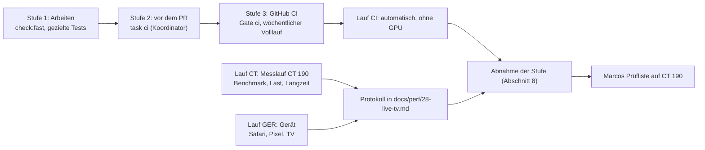

# Konzept 28 · Test- und Abnahmeplan

Stand: 28. November 2026 · Fassung 2 · Status: Entwurf nach Konsolidierung 1, nicht freigegeben

> **Kurz gesagt.** Dieses Dokument legt fest, womit und wie Live-TV geprüft wird, bevor eine Stufe als erfüllt
> gilt: die Testumgebung samt Quellen-Simulator, die zwölf Testarten des Auftrags (Abschnitt 15.2), je einen
> Pflichtfall für jede der 33 Prüfzeilen des Auftrags (15.1), weitere Abnahmekriterien je Bereich, den
> Benchmark für schnelles Umschalten, den Last- und Langzeitplan, die Abnahme je Baustufe und eine
> Abdeckungstabelle mit den Lücken. **Nichts davon ist gebaut oder gelaufen.** Jedes Kriterium ist eine zu
> prüfende Grösse, keine Zusage, dass sie erreicht wird.

Dieses Papier ändert keine Zeile Code, keinen Test und keine Regel des Repos. **Status jeder Anforderung in
Konzept 28: «spezifiziert».** Ein Requirement gilt erst als erfüllt, wenn alle seine Teilanforderungen gebaut
und durch einen Test oder eine Messung dieses Plans belegt sind (Auftrag 15.2, `03` LTV-Q-15.49). Die
Anforderungen kommen aus `03-fachkonzept.md` (`LTV-nnn.mm`, `LTV-Q-nn.mm`, `DR-nn`), die Technik aus `04` bis
`16`; die Rückverfolgung in der anderen Richtung steht in `22-anforderungsmatrix.md`.

## Lesart

**Kennungen.** `AK-L-nnn` ist ein Abnahmekriterium dieses Dokuments (fortlaufend, nie wiederverwendet).
`LTV-…`, `DR-nn`, `F-n` (Frage an Marco) stammen aus `03`; `T-n` (Entscheid) aus `04`; `M-n` (Messpunkt) aus
`05` Abschnitt 10.1, `13` Abschnitt 10 und `09` Abschnitt 14.1 (dort mit Präfix «09 M-n», «13 M-n»,
«10 M-n», «11 M-n»); `SM-nn` (Sicherheitsmassnahme) und `RS-nn`, `BD-nn` aus `12`; `LS-nn` (Seite der Zuschauer)
und `LA-nn` (Seite der Verwaltung) aus `14` und `15`; `O-n` ist ein offener Punkt dieses Dokuments (Abschnitt 10).

**Spalte «Lauf»** nennt, wo und wie das Kriterium geprüft wird:

| Kürzel | Bedeutung |
|---|---|
| **CI** | automatisch, in der GitHub-CI und damit in `task ci` (Teststufe 3 und 2); beim Arbeiten gezielt in Teststufe 1 (`task check:fast`, `go test ./internal/<paket> -run <Test>`, `task e2e:quick -- <spec>`) |
| **CI-wö** | automatisch im wöchentlichen Volllauf von `main` (`.github/workflows/ci.yml:25`, `cron`) oder von Hand über `workflow_dispatch` (`ci.yml:21`): Läufe, die für jeden PR zu lang wären, zum Beispiel ein Fuzz-Lauf von 60 Sekunden je Ziel |
| **CT** | Messlauf auf der Testinstanz CT 190 über ein `task`-Ziel; Protokoll in `docs/perf/28-live-tv.md`; **nicht** Teil des Gates `ci` (wie `task android:e2e`, `docs/dev/SETUP.md:119`) |
| **GER** | Lauf an einem echten Gerät (iPhone, Pixel, Android-TV-Gerät, Browser auf dem Arbeitsplatz) durch den Koordinator oder Marco, mit Protokoll |
| **DOK** | Prüfung am Dokument oder Mockup; bleibt auch im Bau eine Sichtprüfung |

**Spalte «Stufe»** nennt die Baustufe aus `18-umsetzungsplan.md` (sie geht `03` vor): **0** Regeln und Grundlagen, **1a**
Schauen, **1b** Senderverwaltung erweitert, **2** Programmzeitschrift, **3** Empfang und Umschalten, **H** Heimnetz, UDP,
RTP, Multicast, **4** Timeshift, **5** Aufnahmen, **6** Serien und wiederkehrende Aufnahmen, **L** RTSP und RTMP, **W**
DASH und HLS mit fMP4, **E** Ergänzungen nach Messung (WebVTT im Browser, Stichprobe stehendes Bild), **Apps** (Handy-App
und TV-App, Reihenfolge nach `03` F-6); **V** sind die Messversuche vor dem Bau (V-1 bis V-12), **K** die Konzeptphase.
Die **erste** Angabe einer Zelle ist die Stufe, in der das Kriterium zuerst grün sein muss; eine Angabe in Klammern nennt
die spätere Stufe, in der der genannte Teil dazukommt. Das Kriterium muss grün sein, bevor diese Stufe veröffentlicht
wird (Abschnitt 8).

**Spalte «Auto»** sagt, ob das Kriterium ohne Mensch läuft: **ja** (CI läuft von allein), **teilweise** (ein Teil
in CI, ein Teil als Messlauf oder am Gerät), **nein** (Messlauf oder Handprüfung).

**Messbar** heisst: Das Kriterium nennt eine Zahl, einen Zählerstand, eine Statusantwort oder einen Vergleich,
den ein Programm auswertet. Wo eine Schwelle (Sekunden, Prozent, Byte) in einer anderen Datei als **Annahme**
oder **Vorschlag** steht, übernimmt dieses Dokument sie als Prüfgrenze und trägt den Verweis; ändert sich die
Quelle, ändert sich die Prüfgrenze mit. Eine Prüfgrenze ist keine Zusage, dass der Bau sie einhält.

**Begriffe, einmal erklärt.** **Fuzz-Test**: Das Programm bekommt zufällige und absichtlich kaputte Eingaben und darf
nie abstürzen. **Goroutine**: ein nebenläufiger Teil des Servers; wächst ihre Zahl ohne Grund, ist das ein Leck.
**Deskriptor**: eine offene Datei oder Verbindung des Betriebssystems. **Median, p90, p95**: die mittlere
Messung, und der Wert, den 90 beziehungsweise 95 von 100 Messungen unterschreiten. **Ring**: der kurze Speicher je
empfangenem Sender (höchstens 15 Sekunden). **Haltegrund**: ein Eintrag «jemand braucht diesen Strom» (Zuschauer,
Aufnahme, Strategie, Vorladen). **Ziel-Sensor**: ein Zähler im Testbau, der jede versuchte Verbindung zu einem
verbotenen Ziel zählt, ohne sie aufzubauen. **Einstellen**: der Befehl «zeige diesen Sender» innerhalb einer
laufenden Sitzung. **Einschwingen**: die erste Stunde eines Langlaufs, in der Werte noch steigen dürfen.

---

## 1. Grundsätze

1. **Erfüllt ist, was belegt ist.** Eine Anforderung gilt erst als erfüllt, wenn jede ihrer Teilanforderungen
   gebaut ist und durch einen Test oder eine Messung dieses Plans nachgewiesen wurde (Auftrag 15.2). In der
   Konzeptphase heisst jede Anforderung «spezifiziert», nie «implementiert» (`03` LTV-Q-15.50). Die
   Spalte «Abn.» in `03` (T = Test, M = Messung, S = Sichtprüfung) ist die Vorgabe dafür, welche Art von Beleg
   zählt; Abschnitt 9 weist jeder T- und M-Anforderung mindestens ein `AK-L` zu und nennt die, die keines haben.
2. **Nur kontrollierte, reproduzierbare, rechtmässig nutzbare Ströme** (`03` LTV-Q-15.47). Alle Testströme
   erzeugt der Test selbst (FFmpeg-Quellen `lavfi`: Testbild, Sinuston, Uhr und Bildzähler im Bild; so schon
   `testdata/README.md` und `testdata/radio/generate.sh:2`). Es gibt **keine** fremden IPTV-Listen, **keine**
   Senderlogos und Sendungsbilder, **keine** echten Zugangsdaten, **keine** echten Anbieteradressen im Repo
   (`LEITPLANKEN` 5). Kein Test und kein Messlauf der CI hängt vom Internet ab.
3. **Echte Quellen des Administrators nur als Kennzahlen.** Der Inventar-Messpunkt `05` M-2 und die
   Datenqualitätsmessung `09` M-12 laufen lokal auf Marcos Quellen. Ins Repo kommen nur Kennzahlen, nie Inhalte,
   Adressen oder Senderlisten (`13` Abschnitt 10; `09` Abschnitt 14.1).
4. **Einordnung in die drei Teststufen des Repos** (`CLAUDE.md`, «Arbeitsweise»; `docs/dev/SETUP.md:234`):

| Teststufe des Repos | Was Live-TV dazu beiträgt |
|---|---|
| **1. Beim Arbeiten und je Planschritt** | `task check:fast` und nur die Tests, die der Schritt anfasst: `go test ./internal/live/<paket> -run <Test>`, `task e2e:quick -- e2e/live-<seite>.spec.ts`, bei neuen Bauteilen `task storybook:test`, für Apps `task android:check:fast`. Kein Messlauf, keine Last, kein Langzeitlauf. Belege (Befehl und Ausgabe) je Planschritt. |
| **2. Vor dem Pull Request** | `task ci` einmal auf dem fertigen Zweig durch den Koordinator. Live-TV fügt nur Tests hinzu, die in `ci:server`, `ci:web`, `ci:android` und `ci:e2e:parallel` bereits laufen; es gibt **keinen** zusätzlichen Pflichtlauf ausserhalb von `task ci`. |
| **3. GitHub CI** | Jeder PR läuft vollständig; gemergt wird nur mit grünem Gate `ci`. Messläufe (CT), Gerätläufe (GER) und Langzeitläufe sind **kein** Teil des Gates. Ihr Ergebnis steht als Beleg im PR und in `docs/perf/28-live-tv.md`; eine Stufe wird erst veröffentlicht, wenn die dafür genannten Belege vorliegen (Abschnitt 8). |

5. **Regeln des Repos gelten auch hier.** Keine `.skip`, `.only`, `t.Skip`, keine Stub-Tests, kein `TODO` ohne
   Umsetzung (`CLAUDE.md`, «Arbeitsweise»). Kein festes Warten (`sleep`, `waitForTimeout`): Tests warten auf
   einen Zustand (`expect.poll`, `waitFor`) und stellen Zeit vor (`page.clock`, eine injizierbare Uhr, wie sie
   das Radio schon hat: `server/internal/radio/radio.go:81`, `WithClock`), siehe `docs/dev/SETUP.md`, «Schnelle
   und verlässliche Tests». Flake-Suche mit `-count=N` oder `--repeat-each` nur für einen Test oder ein Paket.
   Schwere Läufe nur über die Task-Ziele (`task server:test`, `task e2e`, `task ci:e2e:parallel`,
   `task storybook:test`), die einen der zwei Plätze von `scripts/heavy-slot.sh` abwarten; parallele e2e-Läufe
   brauchen eigene Ports (`E2E_PORT`). Höchstens drei Korrekturversuche je roter Prüfung, dann anhalten. Ein Test
   wird nie grün durch mehr Wiederholungen, längere Fristen ohne Begründung oder gelockerte Grenzen.
6. **Zeitbudgets sind Messungen, keine Wanduhr-Grenzen in der CI.** «Umschalten unter 1 Sekunde» misst auf einem
   geteilten Runner den Runner (`docs/dev/SETUP.md`, «Zeitbudgets nicht als harte Wanduhr-Grenze»). Die
   Zielwerte der Umschaltzeit prüft deshalb nur der Benchmark (Abschnitt 6) auf Referenzhardware; die CI prüft
   an den Zeitpunkten **Zustände und Reihenfolgen** (zum Beispiel «Haltegrund gelöst», «Verbindung geschlossen»)
   mit eingestellter Uhr.
7. **Wo ein Kriterium von einer offenen Frage abhängt** (`03` F-n, `04` F-n, `06` O-n), steht der Verweis in der
   Zeile; das Kriterium gilt dann in der Fassung der Vorgabe (die wortlauttreue Variante, `04` Abschnitt 2.1)
   und wird nach Marcos Antwort angepasst. Die Zeile ist nicht «bestanden», solange die Frage offen ist und der
   Bau von der Vorgabe abweicht.

---

## 2. Testumgebung und Testquellen

### 2.1 Der Quellen-Simulator (Teil der Tests)

**Spezifiziert:** Ein kleiner Testserver im Testcode, der alles liefert, was Quellen in der Wirklichkeit liefern,
und auf Befehl stört. Er folgt dem gebauten Muster des Webradios: Dort liefert `server/internal/radio/radiotest`
(`station.go:1`) rohe Verbindungen im Stil von Icecast und Shoutcast und lässt Tests Einhängepunkte jederzeit
ändern oder abbrechen; `dialer_radiotest.go:1-17` (Build-Tag `radiotest`) erlaubt nur dem Test-Binary den Zugriff auf
die Loopback-Adresse; `server/Taskfile.yml:122-130` baut dafür `bin/slouchcat-e2e`; für Playwright startet
`web/e2e/radio-server.mjs` einen Ersatz des Radio-Browsers. Live-TV bekommt das Entsprechende (**Empfehlung**,
Namen und Ort sind nicht festgelegt, O-1):

| Teil | Zweck | Muster |
|---|---|---|
| Paket `server/internal/live/livetest` (nur `_test.go` und der e2e-Build importieren es) | Der Simulator als Go-Bibliothek: Tests starten ihn im Prozess, ändern ihn zur Laufzeit und lesen seine Zähler | `radiotest` (`station.go:1`) |
| Build-Tag `livetest` | schaltet im Test-Binary eine Dialer-Kontrolle ein, die Loopback erlaubt und jede andere lokale Adresse weiter ablehnt; **ohne** Tag nicht kompilierbar im Release; die CI scheitert, wenn das Release mit einem Test-Tag gebaut ist (`SM-26`) | `dialer_radiotest.go:1-17`, `server/Taskfile.yml:122` |
| Kleines Programm `livesim` (Build-Tag `livetest`) | startet denselben Simulator als eigener Prozess für Playwright, Gerätläufe und CT 190 (`task live:sim`); der Ersatz von `radio-server.mjs` für Live | `web/e2e/radio-server.mjs`, gestartet von `start-server.mjs` |
| `task testdata:live` | erzeugt die Teststrom-Dateien (Abschnitt 2.2) mit FFmpeg; schreibt nur nach `testdata/media/live/` (nicht eingecheckt) | `testdata/Taskfile.yml` (`media`), `generate-media.sh` |

**Was der Simulator kann** (jede Zeile ist eine Fähigkeit, die mindestens ein `AK-L` braucht):

| Fähigkeit | Befehl an den Simulator | Wofür |
|---|---|---|
| HTTP-TS | Endlosstrom aus einer Strom-Datei (Abschnitt 2.2); wahlweise **mit Schub ab Keyframe** beim Verbinden oder ohne (`05` 8.2) | Eingang, Fall 3, Zeitabschnitte |
| HLS mit TS-Segmenten, Segmentdauer 2 und 6 s, laufende Liste, Liste mit **eingefrorener** Folge | Eingang HLS, Stillstand der Liste (`05` 9.1) | Eingang, Überwachung |
| HLS mit fMP4, getrennter Ton, DASH-Live, AES-128 | nur Weg W | Stufe W, DRM-Abgrenzung |
| DRM-Kennzeichen als **Textdatei**: `EXT-X-KEY METHOD=SAMPLE-AES`, `KEYFORMAT="com.apple.streamingkeydelivery"`, `ContentProtection` im MPD | kein echter geschützter Inhalt nötig (R3 Abschnitt 8) | `SM-44`, LTV-003.X-08 |
| Xtream-Antworten (`player_api.php`, `get_live_categories`, `get_live_streams`, `get_short_epg`, `xmltv.php`), Varianten: Zahlen als Zeichenketten, `auth:0` mit HTTP 200, HTML-Fehlerseite, `server_info.url` auf einen fremden Host | Xtream-Quelle | `LTV-003.11`, `SM-20` |
| M3U-Listen: eingebaute Korpora (Abschnitt 2.4) | Listen und Fehlerlisten | Import |
| XMLTV (Abschnitt 2.3), roh, gzip, zip, auf Wunsch als Bombe | EPG-Quelle | EPG, `SM-28`, `SM-29` |
| UDP, RTP, Multicast (Absender schreibt in einen Port oder eine Gruppe) | Stufe 3; in CI nur Loopback-Unicast, Multicast nur CT und Heimnetz (O-6) | `LTV-003.14` bis `.16` |
| RTSP und RTMP | über MediaMTX im Testaufbau, nie im Produkt (`05` 8.2) | Stufe L |
| **Zähler** je Quelle: angenommene Verbindungen, gleichzeitig offene, geschlossene, Bytes, Anfragen mit Kopfzeilen | Aussagen wie «genau eine Verbindung» zählt der Simulator, nicht der Server | `AK-L-001` und viele mehr |
| Betriebsart **«nur eine Verbindung»**: weitere Verbindung → 403 (`05` 8.2; `04` 8.5) | Zugänge mit einem Platz | Umschalten, Vorladen, Ablehnung |
| **Störungen auf Befehl:** Abbruch der Verbindung (`close`), **Einfrieren** (Bytes laufen, Zeit schreitet nicht fort; oder Pakete bleiben aus), **kein Ton** (Ton-PID weg), **Parameterwechsel** mitten im Strom (Codec, Grösse, PID-Menge, Zeilensprung), Zeitsprung der Quelle, **Zeitüberlauf** der 33-Bit-Zeit (vorgestellter Zeitstempel, `05` M-22), **Paketverlust** und beschädigte Pakete, **langsam** (Bitrate gedrosselt), 401, 403, 429, 5xx, **Zeitüberschreitung** (kein Antwortkopf) | `kill -STOP` und `tc netem` auf CT 190, im Prozess sonst | Überwachung, Ersatzquelle, Aufnahmelücken |
| **Weiterleitung** auf eine Adresse im Heimnetz oder auf Loopback, Weiterleitungsketten, `https` auf `http`, Weiterleitung in einer Liste, Manifest mit Verweis auf ein verbotenes Ziel, ein Name mit wechselnder Auflösung (DNS-Rebinding, `SM-05`) | feindliche Testmenge (`05` 2.6) | Netzschutz, `AK-L-031` |
| **Ziel-Sensor:** Schnittstelle, die jede versuchte Verbindung zu einem verbotenen Ziel zählt (in der Dialer-Schicht des Testbaus, ohne die Verbindung aufzubauen) | belegt «null Verbindungen» auch für Adressen, die in der CI nicht bindbar sind | `SM-01` bis `SM-06` |

**Was der Simulator nicht ist:** kein Ersatz für ein Gerät, kein Anbieter und kein Produktivcode. Er hat keine
Anmeldung, keine Konten und keine echten Zugangsdaten; alle Namen und Werte in Tests sind erfunden und stehen
nur im Testcode. Er bekommt selbst Tests (ein Selbsttest je Fähigkeit), damit ein roter Lauf nie am Simulator
liegt.

### 2.2 Erzeugte Teststrom-Dateien

Alle Ströme sind Endlosströme aus einer kurzen, selbst erzeugten Schleifendatei (Muster `testdata/media`:
lavfi-Quellen, feste Dauer, feste Parameter). Jede Datei trägt **eingebrannt** eine laufende **Uhr** (Millisekunden)
und einen **Bildzähler** im Bild sowie im Ton einen kurzen Ton je Sekunde, dazu eine Kennung des Senders; so liest
ein Test aus einem Segment ab, **welche** Bilder und **wie weit hinter der Quelle** er liegt (`05` 8.5, «laufende
Uhr im Testbild»). Der Bildzähler läuft über die Schleife hinweg weiter (die Schleife schreibt Zeitstempel fort,
`-stream_loop` mit neu gesetzten Zeitstempeln). Die Gruppen aus `05` 8.2 gelten unverändert; dieses Dokument ergänzt
fünf Ströme für Fälle, die der Benchmark nicht braucht:

| Kennung | Bild | Ton | Bildgruppe | Bitrate | Zweck |
|---|---|---|---|---|---|
| Q-A | H.264, 1080p25, ohne Zeilensprung | AAC | 1 s | 8 Mbit/s | Direktweg, kurze Bildgruppe (`05` 8.2) |
| Q-B | H.264, 1080p25 | AAC | 2 s | 8 Mbit/s | Standardquelle für Verteilung, Zapping, Aufnahme |
| Q-C | H.264, 1080p25 | AAC | 4 s | 8 Mbit/s | Fall 3 ohne Schub: Zielwert «nicht erreichbar» zeigen |
| Q-D | H.264, 1080p25 | AAC | 10 s | 8 Mbit/s | lange Bildgruppe, `05` 5.1 Zeile 5, M-21 |
| Q-E | H.264, 1080i50 (Zeilensprung) | MP2 | 1 s | 10 Mbit/s | Bild-Umwandlung im Browser (`04` 7.6, T-15) |
| Q-F | MPEG-2, 576i50 | MP2 | 0,5 s | 4 Mbit/s | Bild-Umwandlung, alter Codec |
| Q-G | HEVC, 2160p50 | E-AC-3 | 2 s | 20 Mbit/s | hohe Bitrate, HEVC, Last |
| Q-H | H.264, 720p50 | AC-3 und zweite Tonspur AAC | 2 s | 5 Mbit/s | Ton-Umwandlung, zwei Tonspuren |
| **Q-I** | H.264, 720p25 | AAC, MP2 und AC-3 (drei Spuren, Sprachen `deu`, `eng`, `fra`) | 2 s | 6 Mbit/s | alle Tonspuren erhalten (`AK-L-015`) |
| **Q-J** | H.264, 576p25 | AAC (`deu`) | 2 s | 3 Mbit/s | **DVB-Untertitel** in zwei Sprachen als eigene PIDs (`make-pgs.py`-Muster: kleiner Erzeuger im Repo, nur Python-Standardbibliothek, Aufruf mit `python3 -I`) |
| **Q-K** | H.264, 720p25 | **keine Tonspur** | 2 s | 2 Mbit/s | Sender ohne Ton ist kein Fehler (`05` 9.3, `LTV-011.15`) |
| **Q-L** | wechselt auf Befehl zwischen H.264 720p25 und 1080p25 sowie MP2 und AAC | – | 2 s | 5 bis 8 Mbit/s | Parameterwechsel, neuer Zeitabschnitt (`04` T-6) |
| **Q-M** | Q-B, aber Zeitstempel **kurz vor dem 33-Bit-Überlauf** (26,5 h) | AAC | 2 s | 8 Mbit/s | `05` M-22, `AK-L-091` |

Alle Quellen werden über das jeweilige Eingangsprotokoll angeboten (Abschnitt 2.1). Die Bildgruppen-Länge ist je
Quelle **festgelegt** (Szenenwechsel-Erkennung aus, `-g` und `-keyint_min` gesetzt), sonst misst der Benchmark die
Quelle statt des Servers. Die Dateien sind nicht eingecheckt: eingecheckt sind nur das Skript, die Befehlszeilen
und eine Prüfliste der erwarteten Kennzahlen (`ffprobe`-Auszug je Strom), gegen die `task testdata:live` seine
Ausgabe prüft. Nichts Grosses kommt ins Repo (Vorbild: `testdata/README.md`, Medien unter `.gitignore`).

**Bewegtbild für Schleifen aus Fremdfilmen** (Blender Open Movies unter CC-BY, R3 Abschnitt 8) ist **keine
Bedingung** und **nie Teil der CI**. Wer für den Benchmark ein realistischeres Bewegungsmuster will (die Bitrate
der Bildgruppen schwankt dann stärker als beim Testbild), lädt den Film per Skript lokal, nennt die Quelle im
Protokoll und legt nichts ins Repo. Ob das nötig ist, ist O-2.

### 2.3 Testdaten für das Programm (EPG)

Erzeugt von einem Generator im Repo (kleines Skript, nur Standardbibliothek; keine echten Dateien, `09`
Abschnitt 14.1). Alle Sender, Titel und Sendungen sind erfunden («Testsender 001»); keine Bilder aus Sendungen.

| Satz | Inhalt | Zweck |
|---|---|---|
| **klein** | 5 Sender, 2 Tage, rund 200 Sendungen, jede Angabe vorhanden; in der Datei auch Beschreibung, Kategorie, Genre, `episode-num` (`xmltv_ns` und `onscreen`), `new`, ein Bild-Verweis auf den Simulator | Anzeige, Raster, Suche, Serienerkennung, Erinnerung |
| **gross** | 5'000 Kanäle, 7 Tage, rund 2,4 Mio. Sendungen, roh über 1 GB, gzip, zip | `09` M-1 bis M-5, Import unter Last |
| **fehlerhaft** | je eine Datei pro Regel aus `09` Abschnitt 4: ohne `title`, ohne `start`, ohne `stop`, `stop` vor `start`, über 24 h, Überlappung, Dublette, unbekannter Kanal, Steuerzeichen, `&nbsp;`, fehlerhafte Zeichensätze (UTF-8, UTF-16 mit BOM, ISO-8859-1, Windows-1252), überlange Felder, abgeschnittene Datei, leere Datei, Datei ohne Sendungen für zugeordnete Sender, auf unter 50 % geschrumpfte Datei | `AK-L-104` bis `AK-L-119` |
| **Zeitzonen** | Zeiten mit Versatz (`+0100`, `-0500`, `Z`), ohne Versatz (Zone der Quelle: UTC und `Europe/Zurich`), mit Verschiebung ±120 min, über die Umstellung am letzten Sonntag im März und im Oktober (die nicht existierende Stunde und die doppelte), Tagesgrenze, `tvg-shift` aus der M3U | `09` 2.4, `AK-L-107`, `AK-L-108` |
| **feindlich** | `<!DOCTYPE>` mit internen Entitäten und `&xxe;`, 2-GB-`<desc>`, gzip-Bombe 1:1000, zip mit zwei Einträgen, zip mit Methode bzip2, Suchbegriff `"a* OR b* NEAR(` | `SM-28` bis `SM-30` |

Die Uhr des Tests wird gesetzt; CT 190 läuft in **UTC** (`11` 3.5), Zeitumstellungs-Tests setzen deshalb die
Zone ausdrücklich (`TZ=Europe/Zurich` im Testprozess), und ein Test prüft zusätzlich unter `TZ=UTC`.

### 2.4 M3U-Testmengen

Erzeugt vom selben Generator (R3 Abschnitt 8): gültige Liste mit 100, 10'000 und 100'000 Einträgen (mit VOD- und
Serieneinträgen, die der Import überspringt); BOM, CRLF/LF/gemischt, Latin-1/Windows-1252, fehlende und einfache
Anführungszeichen, Komma im Namen innerhalb von Anführungszeichen, doppelte Attribute, `#EXTVLCOPT`,
`|User-Agent=`, `#EXTHTTP:{"Cookie":"x"}`, `#EXTM3U` fehlt, `#EXTINF` ohne URL, Dauer `0` und `-1`; **Fehlerlisten**:
HTML statt Liste (Anmeldeseite), leere Antwort 200, abgeschnitten, eine Zeile mit 10 MB, 300'000 Einträge, Liste
mit 90 % weniger Einträgen als der bisherige Stand, ein HLS-Manifest statt einer Senderliste (Erkennung am Inhalt,
`LTV-003.23`), 500 Sender auf `10.0.0.1–250:1–2` (`SM-06`).

### 2.5 Wo das im Repo läge (Vorschlag)

| Was | Ort | Eingecheckt? |
|---|---|---|
| Generator-Skripte, Befehlszeilen, Prüfliste der Kennzahlen | `testdata/live/` (`generate.sh`, `generate-epg.py`, `generate-m3u.py`, `expected.txt`, `README.md`) | ja |
| Erzeugte Ströme, EPG-Sätze, M3U-Korpora | `testdata/media/live/` | nein (`.gitignore`, Erzeugung per `task testdata:live`) |
| Eingefrorener Datenbankstand nach der Live-Migration (Konten mit Rechten, Quellen, Sender, Favoriten, Planungen) | `testdata/db/livetv.sql` (Muster: `testdata/db/radio-angebot.sql`; `CLAUDE.md` Regel 5: eingefrorene DB-Stände) | ja, vom Bau angelegt (Migration vergibt der Bau) |
| Simulator-Bibliothek, Programm, Selbsttests | `server/internal/live/livetest/` | ja |
| Go-Tests | `server/internal/live/<paket>/*_test.go`; Vertragstests in `server/internal/api/contract_live_*_test.go` | ja |
| Playwright-Tests | `web/e2e/live-<seite>.spec.ts` (Hilfen `web/e2e/live.ts`) | ja |
| Handy-App- und TV-App-Tests | `android/app-mobile/src/test/kotlin/com/slouchcat/app/mobile/live/…ScreenTest.kt`; `android/app-tv/src/test/kotlin/com/slouchcat/app/tv/live/…ScreenTest.kt` (mit `testing/Dpad.kt`) | ja |
| Messskripte, Rohdaten (CSV) | `docs/perf/28-live-tv/` (Muster `docs/perf/18-trickplay/`), Protokoll `docs/perf/28-live-tv.md` | ja (nur Kennzahlen) |
| `task`-Ziele | `task testdata:live`, `task live:sim`, `task live:bench`, `task live:soak`, `task live:chaos` | ja (Namen sind **Annahme**, O-1) |

### 2.6 Hardware

| Ort | Gerät | Wofür | Bemerkung |
|---|---|---|---|
| **Entwicklungsrechner** (lokal) | der Rechner des Entwicklers, Arbeitsbaum | Stufe 1: gezielte Go-, e2e- und App-Tests | dieselben Kommandos wie in der CI; schwere Läufe warten auf einen Platz (`scripts/heavy-slot.sh`) |
| **CI-Runner** | GitHub-Runner, 4 Kerne (`server/testgroups.txt`, «four-core model»), **keine GPU**, ein Container, kein Multicast | alle Kriterien mit Lauf **CI**; Software-Backend für Umwandlungen | Wanduhr-Messungen sind hier wertlos (Grundsatz 6); Umwandlungstests prüfen Prozessstart und Ausgabe, nicht Geschwindigkeit; FFmpeg ist wie für die bestehenden Tests vorhanden (`Taskfile.yml`, `ci:server`) |
| **Testinstanz CT 190** | 2 virtuelle Kerne, 4 GB, Intel UHD 630 mit QSV, Proxmox pve2, läuft in UTC (`docs/perf/M10.md`, `M1b.md`; `05` 8.1) | **Referenz** für alle Zielwerte, Langzeit, Last, Multicast, Netzspeicher | Zugang nur über das Terminal-Panel; Marco hebt Releases selbst auf CT 190; ohne `sqlite3` |
| **Rechner mit NVENC** | Entwicklungsrechner aus `docs/perf/M1b.md` («gross», 8 Kerne, 16 GB) | obere Grenze, viele Zuschauer, NVENC-Backend | |
| **Klein** | CT 190 mit `SLOUCHCAT_HW=software` (`05` 8.1) | Software-Backend, Zeilensprung | |
| **Geräte** | Chrome und Firefox (Desktop), Safari auf dem iPhone im Browser und als installierte App, Pixel (Gerät von K27), ein Android-TV-Gerät (Modell notieren); erwünscht, nicht Bedingung: Safari auf dem Mac, ein Tablet (`05` 8.3) | GER | |
| **Netzmodell** | N-1 bis N-4 aus `05` 8.4 (künstlich begrenzt mit `tc netem`) | Benchmark | |

---

## 3. Testarten (Auftrag 15.2)

Zwölf Testarten. Jede nennt Zweck, Werkzeug im Repo (mit Beleg, wo es gebaut ist), Ort, Teststufe und was in CI
läuft. **Gebaut** heisst: das Werkzeug gibt es; die Tests selbst gibt es nicht.

| Testart | Zweck | Werkzeug im Repo | Ort | Teststufe | In CI? |
|---|---|---|---|---|---|
| **Unit** | reine Logik ohne Netz und Prozess: Parser (M3U, Xtream, XMLTV, TS, HLS, MPD-Vorprüfung), Entscheid Original/Ton/Bild (`live.Decide`-Entsprechung, T-14), Haltegründe und Freigaberegeln, Planer (Termine, Zeitzone, Uhrsprung), Kontingentrechnung, Token, Namen und Pfade | `go test` mit Tabellentests; injizierbare Uhr (`radio.WithClock`, `radio.go:81`); Fuzz-Ziele (`func Fuzz…`, Vorbild `server/internal/mediaindex/mp4_test.go`) | `server/internal/live/<paket>/*_test.go` | 1, 2, 3 | ja; Fuzz-Seeds als gewöhnliche Tests in CI, der Fuzz-Lauf selbst **CI-wö** (60 s je Ziel, `SM-25`) |
| **Integration** | der Dienst `live` gegen den Quellen-Simulator, eine echte SQLite, Datenträger und FFmpeg: ein Eingangsstrom für viele Zuschauer, Lebenszyklus, Wiederverbindung, Ersatzquelle, Aufnahme-Planer ohne Anmeldung, Neustart | `go test` im Paket `live`, Muster `server/internal/radio/lifecycle_test.go:101` (Join und Sweep), `relay_test.go`, `hostile_test.go:26`; Zählen von Goroutinen (`server/internal/library/poller_test.go:114`, `transcode/download_test.go:489`) | `server/internal/live/…` mit `livetest` | 1, 2, 3 | ja (Software-Backend, kein GPU-Zugriff, `SLOUCHCAT_HW=software`) |
| **End-to-End** | die Oberfläche mit dem echten Server: Playwright-**Tastaturtest je Web-Seite** (`CLAUDE.md` Regel 8), Handy-App **`XScreenTest` je Seite** (Robolectric, zwei Breiten, 200 % Schrift, jedes Bedienelement beschriftet), TV-App **Dpad-Test** je Seite | Playwright (`web/e2e/*.spec.ts`, Titel mit `@keyboard`, `web/playwright.config.ts:49`; Beispiel `web/e2e/radio.spec.ts:69`); Robolectric (`DevicesScreenTest.kt:26-27, 71-80`, `assertEveryControlLabelledAndTappable`); `android/app-tv/src/test/kotlin/…/testing/Dpad.kt` | `web/e2e/live-*.spec.ts`; `android/app-mobile/src/test/…/live/`; `android/app-tv/src/test/…/live/` | 1 (eine Spec), 2, 3 | ja (`task e2e`, `ci:e2e:parallel`, `ci:android:debug`); Medienverhalten in Chromium und Firefox, je Seite ein Tastaturtest zusätzlich in Firefox (`SETUP.md`, «Medienverhalten in beiden Engines») |
| **API-Contract** | jede neue Operation steht im Vertrag mit `x-visibility` und (bei `account` und `scoped`) `x-clients`; ohne Recht antwortet jede Live-Operation mit 404 und gleichem Körper; kein Bruch gegenüber dem eingefrorenen Vertrag | `TestContractCoversEveryOperation` (`server/internal/api/contract_access_test.go:564`), `TestXClientsCompatibility` (`contract_compat_test.go:380`), Schema-Test, Frieren mit `task server:freeze:x-clients`; Muster `contract_radio_live_test.go`, `contract_wishes_test.go` | `server/internal/api/contract_live_*_test.go`; `api/openapi.yaml` | 1, 2, 3 | ja |
| **Last** | viele Zuschauer, viele Sender, viele Wechsel; Ressourcen bleiben im Rahmen von `13` | Skript über die API (`hlsbench`-Muster, `13` M-3), Messskripte nach Muster `docs/perf/ct-bench.sh`, `bench.py` | `docs/perf/28-live-tv/`; `task live:bench` | 2 (auf CT 190, vor der Abnahme) | **nein** (CT); ein **kleiner** Lastlauf (20 Sitzungen in 1 Sekunde, 100 Wechsel) als Integrationstest ja |
| **Sicherheit** | jede Massnahme `SM-01` bis `SM-44` hat einen Testfall; feindliche Testmengen, Fuzz, IDOR-Matrix, Schwärzung der Protokolle, Eindämmung von FFmpeg | `go test` mit Ziel-Sensor, feindlicher Menge; `govulncheck` (`server/Taskfile.yml:207`); Lint (`forbidigo`, `depguard`, Analyzer `itemsaccess`); Fuzz | `server/internal/live/…`, `server/internal/netguard`, `server/internal/api` | 1, 2, 3 | ja, ausser Landlock und Seccomp auf CT 190 (`M-25`) und `govulncheck` (braucht Netz, `server:vuln`, in der CI-Auswertung) |
| **Langzeit** | mehrtägiger Dauerempfang: Arbeitsspeicher, Deskriptoren, Goroutinen, Prozesse, Verbindungen, Wiederverbindungen | Messschleife alle 60 s über `/proc` und die Zähler der Verwaltung; `13` M-1 (72 h), `05` M-12 (7 Tage Go-Empfänger, 30 h FFmpeg-Empfänger); Vorbild eines Langlaufs: `docs/perf/M5-o6-langzeittest.md` | CT 190, `task live:soak` | 3 | **nein** (CT) |
| **Neustart** | sauberer Stopp, `SIGKILL`, Absturz während Aufnahme und Timeshift, Neustart des Containers | `go test` mit Prozess-Hülle (Muster `radio/lifecycle_test.go`); auf CT 190 `docker compose restart` und `kill -9` | `server/internal/live/…`; CT | 1, 2, 3; CT für den echten Container | ja (Prozess), CT (Container, Stoppfrist) |
| **Ausfall** | Quelle fällt aus, Datenträger voll oder verschwunden, Netzspeicher getrennt, Disk stockt, Zugang abgelehnt | Simulator-Störungen; kleine Datenträger (`tmpfs`, Loop-Dateisystem auf CT 190), Freiplatz-Schnittstelle im Testbau (**Annahme**, O-7) | `server/internal/live/…`; CT | 1, 2, 3; CT | ja (Simulator, simulierter Datenträger), CT (echter Einhängepunkt, `umount`) |
| **Performance-Benchmark** | Umschaltzeit nach `05` Abschnitt 8 und `LTV-010` | Skripte auf Playwright, Media3-Messhaken, Kamera; Protokoll `docs/perf/28-live-tv.md` | CT 190 und Geräte | 3 (Abnahme jeder Stufe mit Wiedergabe) | **nein** (CT, GER); ein Rauchtest (Aufruf und Auswertung der Messhaken, ohne Zielwert) ja |
| **Client-Kompatibilität** | jede Zelle der Matrizen A bis F in `16` (Eingangsprotokoll, Container, Codec, Ton, Untertitel, Funktion) je Client | Testquellen Q-A bis Q-M; `isTypeSupported`-Abfrage; Gerätematrix aus `16` Abschnitt 1 und 9 | Chrome, Firefox in e2e (**ja**); Safari, iPhone, Pixel, TV-Gerät als GER | 1 (Web), je Stufe der Apps | teilweise (Chromium und Firefox in CI; Rest GER) |
| **Regression** | bestehende Wiedergabe (Direct Play, Transcode, Download), Radio, Podcasts, Jugendschutz der Bibliothek, Vertrag, Sichtbarkeit bleiben unverändert | die bestehenden Suiten (`task server:test`, `task e2e`, `ci:android`, `storybook:test`); `TestXClientsCompatibility`; Vergleich der Argumentlisten von `transcode.Plan` und `ffmpegArgs` (T-13) | alle bestehenden Tests; dazu `AK-L-282` bis `AK-L-293` | 1 (betroffene Pakete), 2, 3 | ja |

**Was nur auf der Testinstanz oder von Hand läuft** (und warum): der Benchmark (Wanduhr), Last und Langzeit
(Dauer, Referenzhardware), GPU-Pfade (QSV, NVENC; die CI hat keine GPU), Multicast im Container (die CI hat kein
Multicast), Landlock und Seccomp (hängen am Kernel von CT 190), der echte Netzspeicher (SMB, NFS), Safari und
iPhone, die Decoder der Fernseher, die Kamera-Gegenprobe. Für jedes dieser Kriterien steht in Abschnitt 4 und 5
die Spalte «Lauf» mit **CT** oder **GER**.

**Wie ein Messlauf ins Repo kommt.** Jeder CT-Lauf schreibt eine Zeile in `docs/perf/28-live-tv.md` und die Rohdaten
(CSV) nach `docs/perf/28-live-tv/` (Format Abschnitt 6.6). Die Abnahme einer Stufe liest diese Zeilen
(Verifier und Reviewer wiederholen keinen Lauf auf derselben Commit-SHA, `CLAUDE.md`, «Agenten und Prüfungen»).
Einen Messlauf, der als Hilfe auf dem Runner gebraucht wird (Cache- und Laufzeitvarianten), kann ein
Wegwerf-Workflow über `workflow_dispatch` erledigen; er gehört nicht in das Gate.

---
## 4. Pflicht-Testfälle (Auftrag 15.1)

**Eine Zeile je Aufzählungszeile des Auftrags** (33 Zeilen, Z. 1698 bis 1730 in `anhang/auftrag-2026-11-28.md`),
in der Reihenfolge des Auftrags: `AK-L-001` ist die erste Zeile, `AK-L-033` die letzte. Die Anforderungen
`LTV-Q-15.02` bis `LTV-Q-15.34` in `03` sind genau diese Zeilen (`LTV-Q-15.nn` ist `AK-L-(nn−1)`, in drei Stellen
geschrieben: `LTV-Q-15.02` ist `AK-L-001`). «Schritte» sind die Handgriffe des Tests; «Erwartet» ist das, was ein
Programm prüft. Die Stufe ist die Baustufe, vor deren Veröffentlichung das Kriterium grün sein muss.
Alle Zahlen in «Erwartet» sind **Prüfgrenzen** (Grundsatz in der Lesart), abgeleitet aus den genannten Stellen;
sie sagen nichts darüber, ob der Bau sie einhält.

Die Spalte «Lauf (automatisiert)» nennt den Ort und in Klammern die Automatisierung (ja, teilweise, nein). Die Spalte «Testart» ist die erste Angabe der Testarten aus Abschnitt 3.

| Kennung | Wortlaut (Z.) | Bezug | Testart | Aufbau und Schritte | Erwartet (messbar) | Stufe | Lauf (automatisiert) |
|---|---|---|---|---|---|---|---|
| **AK-L-001** | Mehrere Benutzer schauen denselben Sender und verwenden tatsächlich denselben Eingangsstream. (1698) | LTV-004.01–.05, LTV-004.22–.23, LTV-Q-15.02, T-2, T-6, `05` 3, `06` 3.3 und 4.1 | Integration, Last | **Aufbau:** Simulator bietet Q-B als HTTP-TS; 20 Profile mit je eigener Anmeldung und Sitzung, Gerät «Browser», Direktweg. **Schritte:** (a) alle 20 rufen «einstellen» auf denselben Sender innerhalb von 50 ms (gleichzeitig, mit Sperre am Start, `04` 5.3); (b) 60 s Betrieb; (c) Wiederholung mit 20 Anfragen nacheinander. | Simulator: **genau 1** angenommene Verbindung über den ganzen Lauf (`accepted == 1`, `peak_open == 1`); Verzeichnis der Eingangsströme: **1** Strom, **20** Haltegründe «Zuschauer»; alle 20 Listen enthalten ≥ 1 Segment innert 10 s; der Bildzähler im ersten Segment liegt bei allen 20 innerhalb von ± 1 Bildgruppe (2 s) um denselben Wert (gleiche Bilder, nicht 20 Anläufe); Verhältnis Eingangsbytes zu Ausgangsbytes ≈ 1 : 20. | 1a | CI (ja); CT `13` M-3 mit 20 Browsern (nein) |
| **AK-L-002** | Unterschiedliche Benutzer erhalten bei Bedarf individuelle Transcoding-Prozesse. (1699) | LTV-004.07–.09, .12–.17, LTV-004.X-01, T-13, T-14, `04` 7.6, LTV-Q-15.03 | Integration | **Aufbau:** Q-E (1080i50, MP2), drei Sitzungen: A Browser (Bild-Umwandlung nötig), B Media3-Gerät (meldet Zeilensprung und MP2 darstellbar → Original), C Browser mit Grenze 720p. Zusätzlich D = zweiter Browser mit denselben Grenzen wie A. **Schritte:** alle vier stellen den Sender ein; je eine Tonspur- und Qualitätswahl in A. | Prozesstabelle: **je umwandelnder Sitzung genau 1 FFmpeg** (A, C, D: 3 verschiedene PIDs), **0** für B; A und D teilen **keinen** Prozess (kein gemeinsamer Ausgang, LTV-004.X-01); `ffprobe` der Segmente: A 1080 Zeilen, C 720 Zeilen; B: Segment-Bytes des Videos gleich den Paketen im Ring (SHA-256); Simulator: 1 Verbindung; Wahl in A ändert nichts an C, D. | 1a | CI (ja, Software-Backend) |
| **AK-L-003** | Senderwechsel beeinträchtigen andere Zuschauer nicht. (1700) | LTV-004.34, .36, T-8, T-17, `05` 3.5, N-12, LTV-Q-15.04 | Integration | **Aufbau:** A und B schauen Sender X (Q-B). C schaltet 50-mal zwischen X, Y, Z (je 1,2 s Abstand, Drosselung beachten). **Schritte:** Segmentabrufe von A und B laufen im Takt der Zieldauer. | A und B: `EXT-X-MEDIA-SEQUENCE` steigt ohne Sprung; **kein** Abstand zwischen zwei Segmentabrufen über 1,5 × Zieldauer; Bildzähler lückenlos; Simulator für X: `accepted == 1` während der ganzen Zeit; kein 4xx/5xx für A und B; Antwortzeit der Segmente von A und B im p95 nicht über das Doppelte des Wertes ohne C. | 1a | CI (ja) |
| **AK-L-004** | Ein Zuschauer beendet seine Wiedergabe, ohne andere Zuschauer zu unterbrechen. (1701) | LTV-004.27, .37, LTV-002.10, LTV-002.11, `06` 3.11, LTV-Q-15.05 | Integration | **Aufbau:** drei Zuschauer auf X und eine laufende Aufnahme auf X. **Schritte:** nacheinander (a) Zuschauer 1 sendet «Stopp»; (b) Zuschauer 2 bricht die Verbindung ab (kein Herzschlag mehr, 60 s mit eingestellter Uhr); (c) Zuschauer 3 schliesst. | nach (a) und (b): Haltegründe «Zuschauer» **3 → 2 → 1**, Strom bleibt «läuft», Simulator: Verbindung **bleibt offen** (kein `close`); der Zuschauer, der bleibt, und die Aufnahme zeigen **0 Lücken**; nach (c): Strom lebt weiter, weil die Aufnahme ihn hält (`04` 8.2: nie freigegeben). | 1a (Aufnahme-Teil 5) | CI (ja) |
| **AK-L-005** | Permanent konfigurierte Sender bleiben ohne Zuschauer aktiv. (1702) | LTV-002.01, .12, LTV-013.02, `04` 5.2, LTV-Q-15.06 | Integration, Langzeit | **Aufbau:** 3 Sender mit Strategie «permanent» (Q-B, Q-E, Q-K), **0** Sitzungen. **Schritte:** 60 s (CI), 72 h (CT, `13` M-1); Simulator trennt Sender 1 einmal (Abbruch). | Zustand «läuft», Alter des jüngsten Rings ≤ 15 s (T-7), Bytefluss ≥ 90 % der Quellbitrate, Simulator `accepted == 1` je Sender ausser 1 zusätzlicher nach dem Abbruch; Wiederverbindung nach Abbruch: erster Versuch nach 1 s (Leiter 1, 2, 5, 10, 20 s, `04` 5.3); **nichts** schreibt dauerhaft (Datenträger der Aufnahmen: 0 neue Dateien, `LTV-013.02`); im 72-h-Lauf: Abschnitt 7. | 3 | CI (ja, 60 s); CT 72 h (nein) |
| **AK-L-006** | Nicht mehr benötigte dynamische Streams werden zuverlässig beendet. (1703) | LTV-002.09, `04` 5.2 und 5.3, N-2, N-3, LTV-Q-15.07 | Integration, mit eingestellter Uhr | **Fälle:** (a) Umschalten von X nach Y; (b) Ende der Sitzung; (c) Karenz mit neuem Zuschauer; (d) Vorladen; (e) «automatisch» nach der letzten Sitzung; (f) Abbruch des Verbindens. | (a) X schliesst **sofort** (Simulator `close` innert 1 s), keine Karenz; (b) Sitzungsende **durch den Zuschauer** (Stopp, App zu, App im Hintergrund, 60 s ohne Herzschlag): Karenz **30 s** (Vorgabe, 15 s bis 5 min) ± 2 s, **jeder andere Anlass** (Umschalten, Rechteentzug, Abmelden, Stopp durch die Verwaltung, Ende einer Aufnahme oder eines Zeitfensters) **ohne Karenz** (`AK-L-315`); (c) Karenz endet, Strom bleibt; (d) nach **3 min** ohne Umschalten; (e) 10 min nach der letzten Live-Sitzung; (f) ohne Haltegrund sofort. Nach jedem Fall: **0** offene Simulator-Verbindungen, Zahl Eingangsströme 0, Goroutinen und offene Dateien gleich dem Ausgangswert ± 5, Byte-Budget auf 0 zurückgebucht. | 1a (a–c, f); 3 (d, e) | CI (ja) |
| **AK-L-007** | Zeitgesteuerter Empfang funktioniert. (1704) | LTV-002.04, `04` 5.2, `06` 3.12, LTV-Q-15.08 | Integration, eingestellte Uhr | **Aufbau:** Zeitplan «Sender X, täglich 08:00 bis 09:00, Zone `Europe/Zurich`». **Schritte:** Uhr auf 07:59:50; Lauf über 08:00 und 09:00; zweiter Lauf: Server startet um 08:30 (mitten im Fenster); dritter Lauf über die Zeitumstellung im März. | Strom startet **≤ 5 s** nach Fensterbeginn (Staffelung höchstens 2 Starts je Sekunde, `04` 5.3) und endet **≤ 5 s** nach Fensterende, sofern ihn niemand hält; beim Start um 08:30 läuft der Strom nach der Staffelung; am Umstellungstag beginnt das Fenster zur **lokalen** Zeit 08:00 (nicht eine Stunde versetzt); ausserhalb des Fensters 0 Verbindungen. | 3 | CI (ja) |
| **AK-L-008** | Preloading verursacht keine unkontrollierte Ressourcennutzung. (1705) | LTV-002.07, LTV-010.05–.08, LTV-010.X-01, `05` 6, `04` 8.5, `13` M-2, LTV-Q-15.09 | Integration, Last | **Aufbau:** Liste mit 30 Sendern (Q-B), Vorladen an (Vorgabe 0 bis 16, hier 4), Quelle mit «weitere Verbindungen erlaubt»; zweite Quelle im Modus «nur eine Verbindung». **Schritte:** (a) ruhig auf einem Sender 10 s; (b) in 10 s durch 20 Sender; (c) 1'000 Wechsel; (d) Sitzung endet. | (a) höchstens **1 + 4** gleichzeitige Eingangsströme (je Sitzung ≤ 2 je Richtung, insgesamt ≤ 4); Vorladen beginnt erst nach **2 s** Verweilen; (b) danach **höchstens 2** Eingangsströme (`04` 8.5), keine Vorladung für gestreifte Sender; (c) nach dem Lauf Goroutinen und Dateien ± 5, FFmpeg-Prozesse und Eingangsströme gleich vorher, Prozessspeicher ≤ + 10 %; (d) vorgeladene Ströme enden **3 min** nach dem letzten Umschalten; während des ganzen Tests **0 FFmpeg-Prozesse** für Sender ohne Zuschauer; Quelle «nur eine Verbindung»: **0** Vorladung, **0** gesperrte Quellen. | 3 | CI (ja, a, b, d); CT `13` M-2 (c, nein) |
| **AK-L-009** | Timeshift-Puffer bleiben strikt getrennt. (1706) | LTV-007.01–.03, T-10, `10` 2 und 3, SM-32, SM-34, LTV-Q-15.10 | Integration | **Aufbau:** zwei Sitzungen (Profile A und B) mit Recht «Timeshift» auf X, B steigt 10 s später ein; Stückdateien im Ordner «Timeshift». **Schritte:** A pausiert 30 s und spult 10 s zurück; B schaut live; A wechselt den Sender; B liest weiter. | zwei verschiedene Ordner `<sitzung>-<einstellnummer>`, nur Kennungen im Namen; **keine** Datei in beiden (verschiedene Inodes, keine harten Links); der Bildzähler im ersten Stück von B liegt **≥ 10 s später** als in A (jeder beginnt beim eigenen Einschalten); Pause und Sprung von A ändern in B nichts (Segmentfolge von B ohne Lücke); Löschen von A berührt B nicht (Dateizahl in B unverändert); Rechte 0700 und 0600. | 4 | CI (ja) |
| **AK-L-010** | Timeshift-Puffer werden beim Senderwechsel gelöscht. (1707) | LTV-007.08, .09, T-10, `10` 2, LTV-Q-15.11 | Integration | **Schritte:** Sitzung mit 2 min Puffer auf X; «einstellen» auf Y; weitere Fälle: Stopp, Abmelden, 60 s ohne Herzschlag, Entzug, Neustart des Servers. | nach «einstellen» **≤ 2 s**: alter Ordner und alle Stücke **0** Dateien (`find` zählt 0), belegte Bytes im Speicherort sinken um die Grösse des alten Puffers, neuer Ordner existiert; alle anderen Fälle: Ordner weg ≤ 2 s (Neustart: beim Start); das alte Token liefert **404**; Löschen geschieht Datei für Datei über `paths` (kein rekursives Löschen, Symlink im Ordner bleibt unberührt, `SM-32`). | 4 | CI (ja) |
| **AK-L-011** | Benutzer können nicht auf fremde Timeshift-Puffer zugreifen. (1708) | LTV-007.03, SM-34, SM-37, SM-38, `12` 9.3, LTV-Q-15.12 | Sicherheit, Integration | **Schritte:** A und B, zwei Konten, je mit Puffer; Matrix: Token von A auf Adressen von B (Liste und Segment), geratene Segmentnummern (0 bis 10'000), Segment einer beendeten Sitzung, Profil ohne Recht, Administrator, Segmentadresse ohne Token. | **jede verbotene Zelle: Status 404 mit byte-gleichem Körper und gleichen Kopfzeilen** (ausser `Date`); Antwortzeit ohne messbaren Unterschied zwischen «gibt es nicht» und «gehört dir nicht» (Mittelwert beider innerhalb 20 % in 1'000 Wiederholungen); jede erlaubte Zelle liefert genau die eigenen Daten; keine statische Auslieferung der Dateien (Pfad im Dateisystem nie als URL erreichbar). | 4 | CI (ja) |
| **AK-L-012** | Geplante Aufnahmen funktionieren ohne angemeldeten Benutzer. (1709) | LTV-008.15, .25, `11` 3.1 und 3.2, `06` 3.8, LTV-Q-15.13 | Integration, eingestellte Uhr | **Aufbau:** Aufnahme in 2 min (Vorlauf 1 min, Nachlauf 1 min) für Profil P; alle Anmeldungen von P werden vorher beendet, kein Client verbunden, kein Zuschauer. **Schritte:** Uhr vorstellen; Aufnahme läuft bis Ende. | Zustand `scheduled → recording → completed`; Haltegrund «Aufnahme» **30 s** vor dem Beginn des Vorlaufs (Aufwärmzeit, einstellbar 10 bis 120 s); erster geschriebener Keyframe **≤ 2 s** nach dem Beginn des Vorlaufs plus Gruppenlänge; Dauer der Datei = geplant + Vorlauf + Nachlauf ± 2 s; **0** HTTP-Anfragen mit Anmeldung des Profils im Zeitraum (Zugriffsprotokoll); Datei abspielbar (`ffprobe` ohne Fehler). | 5 | CI (ja) |
| **AK-L-013** | Aufnahmen verwenden möglichst bestehende Eingangsstreams. (1710) | LTV-004.06, LTV-008.23, .24, LTV-002.08, T-16, LTV-Q-15.14 | Integration | **Fälle:** (a) Sender X läuft (Zuschauer): Aufnahme startet; (b) X ruht: Aufnahme startet; zusätzlich zwei Zuschauer und eine zweite Aufnahme; (c) Aufnahme endet, Zuschauer bleiben. | (a) Simulator `accepted` **bleibt 1**; (b) **1** neue Verbindung für Aufnahme plus beide Zuschauer plus zweite Aufnahme zusammen; (c) Strom bleibt, solange ein Zuschauer da ist; nach dem Ende aller Abnehmer endet er nach der Karenz; jede Aufnahme hat **eigenen Leser, eigenen Rückstau und eigene Dateien** (`11` 3.4), aber **keinen** FFmpeg-Prozess. | 5 | CI (ja) |
| **AK-L-014** | Aufnahmen werden in Originalqualität gespeichert. (1711) | LTV-020.01–.04, .07, .09, T-16, `11` 5, LTV-Q-15.15 | Integration | **Aufbau:** Aufnahme von Q-A, Q-E, Q-G, Q-H je 60 s. **Schritte:** Simulator schreibt zu jedem Strom die Hashes der Elementarströme (Bild, Ton) für das Aufnahmefenster. | **0** FFmpeg-Prozesse während der Aufnahme (Prozesstabelle); `ffprobe` von Aufnahme und Quelle: Codec, Profil, Auflösung, Bildrate, Zeilensprung-Kennzeichen, Abtastrate, Kanäle **gleich**; SHA-256 des Videostroms der Aufnahme = SHA-256 des Videostroms der Quelle im Fenster (Bytevergleich, Quelle ist TS, Aufnahme TS in Stücken, `T-16`); Bildzähler **lückenlos**; Bitrate der Datei ± 2 % der Quellbitrate; keine nachträgliche Datei (kein Umpacken, `11` 5.8). | 5 | CI (ja, Q-A, Q-E, Q-H); CT (Q-G, grosse Datei) |
| **AK-L-015** | Audio- und Untertitelspuren bleiben erhalten. (1712) | LTV-020.05, .06, .15–.17, SM-21, LTV-Q-15.16 | Integration | **Aufbau:** Aufnahme von Q-I (drei Tonspuren `deu` AAC, `eng` MP2, `fra` AC-3) und Q-J (zwei DVB-Untertitel); danach Wiedergabe über die Aufnahme-Sitzung. | `ffprobe`: Zahl der Tonspuren **3**, Untertitelspuren **2**; Codec, Sprache und Kanalzahl je Spur gleich der Quelle; SHA-256 je Elementarstrom gleich der Quelle; Wiedergabe: Auswahl der zweiten Tonspur liefert Segmente, deren Ton `eng` ist (Sinuston-Frequenz der Spur im Segment); Untertitel erscheinen im Direktweg als Spur (Gerät mit Media3) oder fehlen **mit** Hinweis, nie still (`LTV-020.16`, `05` M-24). | 5 | CI (ja); GER (Untertitel am Pixel und TV, M-24) |
| **AK-L-016** | Private Aufnahmen sind für andere Profile unsichtbar. (1713) | LTV-009.01–.10, LTV-Q-15.17, DR-02, DR-03, SM-37, SM-42 | Sicherheit, End-to-End | **Aufbau:** Konto K1 mit Hauptprofil H, Profil P1 (ohne Altersgrenze), P2 (ohne Altersgrenze), Konto K2 mit Profil Q, Administrator. P1 nimmt «Testsendung Alpha» auf. **Schritte:** Zugriffsmatrix (Liste, Detail, Wiedergabe, Löschen, Fortschritt, Suche der Bibliothek, Startseite, Sammlungen) für H, P2, Q, Administrator, Gast. | alle Zellen ausser P1: **404** mit gleichem Körper (die Ausnahme E-3 für Profile mit Altersgrenze prüft `AK-L-163`); Suche der Bibliothek, Startseite, Sammlungen: **0** Treffer mit «Alpha»; Administrator-Antworten (Belegung, aktive Wiedergaben) enthalten den Text «Alpha» **nie** (Bytesuche in allen Antworten der Verwaltung); E-Mail für ein PIN-Profil nennt keinen Titel (DR-05). | 5 | CI (ja) |
| **AK-L-017** | Account-Speicherlimits werden eingehalten. (1714) | LTV-008.12, LTV-009.09, LTV-019.11, DR-06, `11` 8.1, LTV-Q-15.18 | Integration | **Aufbau:** Konto mit Kontingent 1 GiB, zwei Profile; Aufnahmen mit erwarteter Grösse 0,6 GiB (Bitrate × Dauer) und 0,6 GiB; eine dritte mit 0,1 GiB. **Schritte:** P1 plant 0,6; P2 plant 0,6; P1 plant 0,1; die erste läuft; Löschen der ersten durch P1. | zweite Planung: **Warnung beim Planen** («passt nicht»), beim Start **abgelehnt** mit Grund «Kontingent voll» und Meldung an P2 und das Hauptprofil; Summe der belegten Bytes aller Aufnahmen des Kontos **≤ 1 GiB zu jedem Messpunkt**; die dritte wird angenommen (0,6 + 0,1 ≤ 1); **nichts** wird automatisch gelöscht (0 Löschvorgänge ohne Frist); nach dem Löschen wird wieder angenommen. Verhalten bei laufender Aufnahme, die über das Kontingent wächst: **F-9, Kriterium bedingt**. | 5 | CI (ja) |
| **AK-L-018** | Kinderprofile ohne Live-TV-Freigabe erhalten keine Live-TV-Inhalte. (1715) | LTV-015.02, .09, LTV-012.12, .13, DR-01, SM-38, LTV-Q-15.19 | Vertrag, Integration, End-to-End | **Aufbau:** Profil mit Altersgrenze 12, Schalter «Live-TV» aus (Werkseinstellung, DR-01). **Schritte:** jede Operation mit Live-Bezug aus `api/openapi.yaml` (Liste aus dem Vertrag erzeugt), jede Segment-, Logo-, Bild- und Suchadresse, Navigation der Web-App, Handy-App, TV-App. | **404, nie 403**, mit gleichem Körper wie «gibt es nicht», für **100 %** der Operationen und Adressen; kein Eintrag «Live-TV» in der Navigation; in «Meine Medien» fehlt der Eintrag; kein Live-Treffer in der Suche. | 1a | CI (ja) |
| **AK-L-019** | Live-TV-Freigaben für Kinderprofile funktionieren ohne automatische Altersfilterung. (1716) | LTV-015.01–.08, DR-01, LTV-Q-15.20 | Integration | **Aufbau:** Profil mit Altersgrenze 6, Hauptprofil schaltet «Live-TV» ein. Konto hat 20 Sender, darunter einen mit Kategorie «Erwachsene», EPG-Sendungen mit `rating="18"`. **Schritte:** Sender, Programmzeitschrift, Suche, Wiedergabe. | Zahl sichtbarer Sender und Zahl der Sendungen im Raster **gleich** wie bei einem Profil ohne Altersgrenze (20; gleiche Zahl Sendungen); Wiedergabe jedes Senders gelingt; **0** Aufrufe der Altersprüfung der Bibliothek auf den Live-Pfaden (Zähler in der Sichtbarkeitsschicht); eine spätere Änderung der Altersgrenze schaltet nichts um (DR-01, A-5). | 1a (Programmdaten 2) | CI (ja) |
| **AK-L-020** | Bestehender Jugendschutz für andere Medienarten bleibt unverändert. (1717) | LTV-015.12, LTV-Q-15.21, `03` A-5 | Regression | **Aufbau:** dasselbe Profil (Altersgrenze 12) mit Freigabe «Live-TV». **Schritte:** Film mit Freigabe 16, Serie, Hörbuch, Podcast und Radio abrufen; Altersgrenze ändern; die bestehenden Suiten laufen unverändert. | Film mit Freigabe 16: **404** wie ohne Live-TV; alle bestehenden Jugendschutz-Tests (`TestContractRatingChange`, `contract_ratings_test.go`, Sichtbarkeitstests der Bibliothek, `itemsaccess`) laufen **ohne Änderung** grün; `git diff` der bestehenden `_test.go`-Dateien zeigt nur **Hinzufügungen** (Registry-Einträge), keine Erwartung geändert; Radio und Podcasts verhalten sich wie vorher. | 1a | CI (ja) |
| **AK-L-021** | Fehlerhafte M3U-Importe beschädigen keine vorhandenen Sender. (1718) | LTV-018.14, .15, .20–.22, LTV-Q-15.22, `09`, SM-27 | Integration | **Aufbau:** Quelle mit 100 Sendern, Favoriten, Gruppen, Planungen. **Schritte:** nacheinander aktualisieren mit: HTML-Seite, leerer Antwort 200, abgeschnittener Datei, Zeile von 10 MB, 300'000 Einträgen, Liste mit 90 % weniger Einträgen, Zeitüberschreitung. | nach jedem Versuch: Hash der Tabellen `Sender`, `Quellen`, `Gruppen`, `Zuordnungen` **gleich** dem Hash vorher (alles oder nichts); Fehleranzeige mit stabilem Code in der Verwaltung; keine Massenentfernung (Schwelle aus `09`); Speicher des Servers wächst um **≤ 64 MiB** (Annahme `SM-27`); eine anschliessende gültige Liste wird normal übernommen. | 1a | CI (ja) |
| **AK-L-022** | Senderaktualisierungen erhalten Favoriten und Aufnahmeplanungen. (1719) | LTV-018.04–.13, .16–.19, .23, DR-14, DR-16, LTV-Q-15.23 | Integration | **Aufbau:** Quelle mit 50 Sendern; Favoriten, handgepflegte Namen und Logos, Kanalnummern, Gruppen, EPG-Zuordnung und 3 Planungen. **Schritte:** zweite Fassung der Liste: geänderte Adressen, geänderte Namen (Gross und Klein), neue Reihenfolge, 5 Sender fehlen, 5 neue, 2 Dubletten. | Kennungen der 45 bleibenden Sender **unverändert**; Favoriten, Kanalnummern, Namen, Logos, Gruppen, EPG-Zuordnung und die 3 Planungen **identisch** (Vergleich der Zeilen); fehlende Sender: Zustand «nicht mehr vorhanden», **nicht gelöscht**; eine Planung auf einen fehlenden Sender schlägt erst **bei Fälligkeit** fehl mit Grund «Sender nicht verfügbar», sie wird nicht verschoben (DR-16); Dubletten innerhalb der Liste: nicht doppelt angelegt; ein aktiver Strom behält seine Verbindung, die neue Adresse gilt ab der nächsten. | 1a (Planungen 5) | CI (ja) |
| **AK-L-023** | EPG-Aktualisierungen funktionieren zuverlässig. (1720) | LTV-005.07, .22–.28, LTV-018.12, `09` 3, LTV-Q-15.24 | Integration | **Aufbau:** Satz «klein», 3 Läufe: normal; Zeit einer Sendung ändert; fehlerhaft (abgeschnitten, Abbruch mitten im Lesen, Neustart während des Sammelns). **Schritte:** während des Imports 1'000 Leseabfragen des Rasters. | jede Abfrage liefert den **alten oder den neuen Stand eines Senders, nie eine Mischung** (`09` 3.5); nach Fehler: alter Stand **vollständig** (Hash des Rasters gleich); Zeit geändert: neue Zeit sichtbar nach dem Lauf; eine geplante Aufnahme folgt der neuen Zeit (`LTV-005.26`); ein Lauf nach Absturz wiederholt sich und endet «erfolgreich»; ein Importbericht zählt jede verworfene Regel; Sender laufen während des Imports weiter (Antwortzeit von «einstellen» im p95 nicht > + 100 ms, `09` M-3). | 2 | CI (ja); CT `09` M-3 (nein) |
| **AK-L-024** | Ersatzquellen funktionieren bei Ausfällen. (1721) | LTV-003.20–.22, LTV-011.09, LTV-004.32, `04` 5.3, `06` 3.9 und 3.10, LTV-Q-15.25 | Integration | **Aufbau:** Sender mit Quellen A (Rang 1) und B (Rang 2), je ein Simulator-Eingang, ein Zuschauer, eine Aufnahme. **Fälle:** (a) A bricht ab (`close`); (b) A friert ein (Bytes laufen, Zeit steht); (c) A antwortet 403; (d) A kommt zurück. | (a) erstes Bild von B **≤ 3 s** nach dem Abbruch (erste Stufe der Leiter 1 s plus Verbinden plus erste Bildgruppe); (b) Stillstand wird nach **10 s** erkannt (`05` 9.2), erstes Bild von B **≤ 13 s** nach dem Einfrieren; (c) wie (a); Simulator A: **1** Verbindung geschlossen, Simulator B: **1** geöffnet, nie beide offen; Sitzung des Zuschauers bleibt (keine neue Anmeldung), Aufnahme beginnt einen neuen Teil mit Vermerk «Quellwechsel», bricht nicht ab; (d) mit Zuschauer **nie von selbst** zurück; ohne Zuschauer und Aufnahme frühestens nach **10 min**; Quarantäne von A: 30 s, 5 min, 30 min. | 3 | CI (ja, eingestellte Uhr) |
| **AK-L-025** | Speicherlimits werden eingehalten. (1722) | LTV-019.10, .13, .16, .20, `04` 8.3, SM-31, `13` 8.2, LTV-Q-15.26 | Integration, Ausfall | **Aufbau:** Speicherort «Timeshift» mit Deckel 200 MiB und Reserve 50 MiB (Test-Freiplatz-Schnittstelle, O-7); 30 Sitzungen; gleichzeitig Dateiwiedergabe eines Films. **Schritte:** Last bis der Deckel erreicht ist; Freiplatz auf die Reserve senken; Datenträger «voll» melden. | belegte Bytes **≤ Deckel + ein Stück** zu jedem Messpunkt; **kein neues Stück** unter der Reserve; zuerst wird der **älteste Teil des grössten** Puffers gekürzt, kein Puffer unter 5 min (Annahme `10` 9); neue Sitzungen laufen **ohne Zeitversatz** aus dem Ring mit Hinweis «Zeitversatz gerade nicht möglich»; Live läuft weiter; der **Filmstart** gelingt weiter (Antwort 200, erstes Segment ≤ 10 s); der Server stürzt nicht ab (0 Neustarts); Meldung an den Administrator **einmal**. | 4 | CI (ja); CT mit echtem Datenträger (`13` M-7, nein) |
| **AK-L-026** | Serverneustarts hinterlassen keine unkontrollierten Prozesse. (1723) | LTV-004.31, `04` 5.3 «Serverneustart», SM-24, LTV-Q-15.27 | Neustart | **Aufbau:** 3 Sitzungen (davon 2 mit FFmpeg), 1 laufende Aufnahme, 1 permanenter Sender. **Schritte:** (a) `SIGTERM`; (b) `SIGKILL` des Servers; (c) `docker compose restart` (CT). | nach (a) **und** (b): **0** FFmpeg-Prozesse des alten Servers **5 s** nach dem Ende (`PDEATHSIG`, `04` 10.8); kein Zombie; nach dem Neustart: Speicherort «Timeshift» **leer** (nur Dateien mit eigenem Namensmuster und unter dem eigenen Marker; fremde Datei bleibt, `SM-32`); offene Live-Sitzungen mit Grund «Neustart» beendet; die laufende Aufnahme setzt **sofort** mit neuem Teil und Lücke «Server lief nicht» fort (`11` 3.7); permanente Sender starten gestaffelt (≤ 2 je Sekunde, nie zwei gleichzeitig bei derselben Quelle); nach (c) dasselbe im Container, Prüfung per `ps`. | 1a (ohne Aufnahme), 5 (Aufnahme) | CI (ja, a und b); CT (c, nein) |
| **AK-L-027** | Aufnahmeunterbrechungen werden korrekt erkannt. (1724) | LTV-008.22, .26, LTV-020.11–.14, .20, `11` 3.6 und 5.4–5.7, LTV-Q-15.28 | Integration, Ausfall | **Fälle:** (a) Simulator unterbricht 12 s; (b) Datenträger voll für 20 s; (c) Neustart des Servers; (d) wenige beschädigte Pakete ohne Lücke; (e) Parameterwechsel (Q-L); (f) Ersatzquelle. | je Lücke: Marke mit **Grund** (`Quelle nicht erreichbar`, `Speicher voll`, `Server lief nicht`), **Beginn und Dauer** gleich dem Simulator- oder Teststeuerungs-Protokoll mit Abweichung **≤ 1 Bildgruppe + 1 s**; Zustand `incomplete`; (d) **keine** Lücke, Zähler am Teil; (e), (f) kein Abbruch, neuer Teil; die Aufnahme ist abspielbar und **spulbar** (Zeitstempel stimmig, `LTV-020.18`); die Verständliche Anzeige nennt die Lücken (LS-09). | 5 | CI (ja) |
| **AK-L-028** | Nicht autorisierte Streamzugriffe werden verhindert. (1725) | LTV-012.13, SM-35, SM-36, SM-37, SM-40, T-21, LTV-Q-15.29 | Sicherheit | **Schritte:** Liste und Segment mit: keinem Token, gefälschtem Token (falsche HMAC), abgelaufenem, fremdem (anderer Sitzung), nach dem Umschalten altem, nach dem Abmelden; ohne Anmeldung; schreibende Operation ohne CSRF-Kopf. | Lesen: **404 mit gleichem Körper** in allen Fällen; ein Client, der nur Segmente holt (kein Herzschlag), verliert die Sitzung **nach 60 s** (± 2 s, eingestellte Uhr); Schreiben ohne CSRF-Kopf: **403 des bestehenden CSRF-Schutzes** (kein Verstoss gegen «404 statt 403 für Unsichtbares», `04` 10.3), nichts geändert; `Cache-Control: no-store`, `Referrer-Policy: no-referrer` auf Listen. | 1a | CI (ja) |
| **AK-L-029** | Entzogene Berechtigungen werden serverseitig durchgesetzt. (1726) | LTV-012.11–.13, `04` 9 «Entzug», `06` 3.15, SM-36, DR (Abschnitt 2.4), LTV-Q-15.30 | Integration | **Fälle:** Entzug von «Live-TV» am Konto; am Profil; Abmelden; Passwortwechsel; Tageslimit; Entzug nur von «Timeshift»; Entzug von «Aufnahmen» bei laufender Aufnahme und bei Planung. | **Wiedergabe endet ≤ 10 s** nach dem Entzug (Zeit vom Schaltvorgang bis zur ersten 404-Antwort auf einen Segmentabruf; Haltegrund «Zuschauer» gelöst); ohne Haken (Sicherung): **≤ 30 s** (`04` T-21); ab dann jede Anfrage mit dem alten Token 404; nur «Timeshift»: Puffer **gelöscht ≤ 10 s**, Wiedergabe läuft ohne Zeitversatz weiter, Sprung an die Live-Kante; «Aufnahmen» entzogen: Folge für Planungen und laufende Aufnahmen **nach `03` F-7** (Kriterium bedingt, bis Marco entscheidet; bestehende Aufnahmen bleiben gespeichert und sind 404); Strom nach Entzug: **ohne Karenz** («ruht» sofort, `04` 5.3; `06` O-3 ist entschieden). | 1a (Timeshift 4, Aufnahmen 5) | CI (ja) |
| **AK-L-030** | FFmpeg-Prozesse werden zuverlässig beendet. (1727) | LTV-004.31, .33, SM-24, `04` 9 «Verwaiste Prozesse», LTV-Q-15.31 | Integration | **Schritte:** 1'000 Umschaltungen mit Umwandlung (Mischung Original, Ton, Bild); Stopp; Quelle weg; Entzug; Herunterfahren; Neustart; FFmpeg per `kill -9` von aussen. | nach jedem Fall: Zahl der `ffmpeg`-Prozesse = Ausgangswert; **0 Zombies**; kein Prozess älter als seine Sitzung; Abgleich je Minute beendet einen Prozess ohne Besitzer und **protokolliert** ihn; Reservierung der Umwandlungseinheiten wird zurückgebucht (Budget auf Ausgangswert); Neustarts je Sitzung ≤ 2 in 10 s. | 1a | CI (ja, 100 Wechsel); CT `13` M-2 (1'000, nein) |
| **AK-L-031** | Sicherheitsmechanismen können nicht durch verschachtelte Stream-URLs umgangen werden. (1728) | SM-01, SM-04–SM-08, SM-44, `05` 2.3 und 2.6, LTV-Q-15.32 | Sicherheit | **Aufbau:** feindliche Menge (`05` 2.6): M3U-Eintrag → HLS-Master → Variante → Segment → Schlüssel → Untermanifest, jede Stufe mit einem Ziel auf `169.254.169.254`, `127.0.0.1:8096`, eine Heimnetz-Adresse, IPv4-abgebildetes IPv6, `64:ff9b:1::/48`, einen Namen mit wechselnder Auflösung, Weiterleitungskette von 6 Sprüngen, `https` auf `http`, `file:`, `concat:`, `data:`, `subfile:`, `rtp://`. | **0** Verbindungsversuche zu verbotenen Zielen (Ziel-Sensor); stabiler Fehlercode «Ziel nicht erlaubt» (nicht der rohe Fehler); Kette A→B→A und Zieldauer 0 brechen ab, Nachladen höchstens **1 je Sekunde**; nur `http` und `https` zugelassen; Weg W: Mitschrift aller `connect()` und `sendto()` des FFmpeg zeigt **nur `127.0.0.1:<Port>`** (`M-10`); ohne diesen Beleg wird Weg W nicht gebaut. | 1a (Weg W: W) | CI (ja); CT `M-10` (nein) |
| **AK-L-032** | Ausgefallene Netzwerkspeicher verursachen keine unbeabsichtigten lokalen Schreibvorgänge. (1729) | LTV-019.21, .22, SM-33, T-25, `04` 9, `11` 10.3–10.4, LTV-Q-15.33 | Ausfall | **Aufbau:** Wurzel «Aufnahmen» mit Markerdatei; (CI) leerer Ordner ohne Marker als «ausgehängter Einhängepunkt», (CT) echter SMB- und NFS-Mount, `umount -l`, Netz getrennt. **Schritte:** Aufnahme läuft; Speicherort verschwindet; nach 5 min kehrt er zurück. | **0 neue Dateien** im leeren Einhängepunkt und **0** ausserhalb der gewählten Wurzel (Verzeichnisvergleich von `/config`, Cache-Volume und Wurzel vor und nach); Zustand des Speicherorts «fehlt» **≤ 10 s** nach dem Verlust (Prüfintervall, Annahme); Lücke «Speicher fehlt» in der Aufnahme; **nach der Rückkehr** neuer Teil **≤ 60 s** (Annahme); Zuschauer: Hinweis «Zeitversatz gerade nicht möglich» für Timeshift, Live läuft; der Server weicht **nie** auf einen anderen Ordner aus. Hängender Schreibaufruf verhindert das Herunterfahren nicht (`11` M-2). | 5 | CI (ja, ohne Marker); CT (echte Mounts, nein) |
| **AK-L-033** | Live-TV beeinträchtigt bestehende Medienfunktionen nicht unzulässig. (1730) | LTV-Q-15.34, LTV-004.20, LTV-012.06–.10, `13` 7, `13` M-6, T-19, T-20 | Regression, Last | **Aufbau:** CT 190, QSV; Referenz: Filmstart und Echtzeitfaktor einer Filmumwandlung ohne Live (Messung nach `docs/perf/wiedergabestart.md`, rund 0,87 s bis zum ersten Segment). **Schritte:** dieselbe Messung mit 10 Dauersendern, 2 Bild-Umwandlungen und 2 Aufnahmen; Radio und Direct Play laufen mit; Software-Backend einmal. | **Filmstart ≤ 2 × der Wert ohne Live** (`13` M-6, Abbruchkriterium) und **Echtzeitfaktor der Filmumwandlung ≥ 1,0**; Live belegt **höchstens seinen Anteil** der Umwandlungseinheiten (Vorgabe die Hälfte) und beendet nie eine laufende Filmumwandlung; Radio und Direct Play: 0 Stockungen, kein Fehler; die bestehenden Suiten bleiben grün. «Unzulässig» ist damit als Grenze festgelegt (Vorschlag, O-3). Bekannte Folge: P-7, P-8 (`13` 8.3) entscheiden Marco. | 1a | CT (nein); Regression CI (ja) |

---
## 5. Weitere Abnahmekriterien je Bereich

Fortlaufend ab `AK-L-034`. Spalten wie in Abschnitt 4, ohne den Wortlaut: **Bezug** nennt die Anforderungen,
die das Kriterium belegt; **Aufbau und Schritte** nennen den Testaufbau; **Erwartet** ist das prüfbare Ergebnis.
Zahlen sind Prüfgrenzen wie in Abschnitt 4. Wo eine Zeile an einer offenen Frage hängt, steht sie im Bezug.

### 5.1 Quellen und Import (LTV-003, LTV-018)

| Kennung | Bezug | Aufbau und Schritte | Erwartet (messbar) | Stufe | Lauf (Auto) |
|---|---|---|---|---|---|
| **AK-L-034** | LTV-003.01–.04 | Unit, Integration. M3U und M3U8 als Datei (Upload) und als Adresse: gültige Listen mit 100, 10'000 Einträgen aus Abschnitt 2.4. | Zahl importierter Sender = erwartete Zahl der Korpusdatei (Live-Einträge ohne VOD und Serien); Zeichen «ä», «é» im Namen unversehrt; Datei und Adresse liefern **gleiche** Ergebnisse (Zeilenvergleich). | 1a | CI (ja) |
| **AK-L-035** | LTV-003.23, LTV-003.01–.02 | Unit. Korpus «Abweichungen»: BOM, CRLF, gemischte Zeilenenden, Latin-1 und Windows-1252, fehlende und einfache Anführungszeichen, Komma im Namen, doppelte Attribute, `#EXTM3U` fehlt, `#EXTINF` ohne URL; dazu ein **HLS-Manifest unter dem Namen `liste.m3u`** und eine Senderliste unter `.m3u8`. | jede Datei ergibt die erwartete Zahl Sender und einen Zähler «verworfen» für unbrauchbare Einträge; Erkennung **am Inhalt** (Manifest wird als Einzelstrom erkannt, Liste als Liste), nicht an der Endung; Zeichensatz der Quelle wird gemerkt; **0** Abstürze, **0** Allokation über der Zeilengrenze von 64 KiB (Fuzz-Seeds in CI, 60 s Fuzz **CI-wö**). | 1a | CI (ja) |
| **AK-L-036** | LTV-003.05, LTV-Q-09.27, LTV-Q-09.28 | Integration. Einzelstrom von Hand anlegen; «Quelle testen, ohne sie zu speichern» (Q-B). | Test ohne Speichern: **0** neue Zeilen in der Datenbank, Antwort nennt Codec, Auflösung, Bildgruppe, Spuren (aus dem Strom); Simulator `accepted == 1`, danach geschlossen; angelegter Sender hat eine stabile Kennung unabhängig von der Adresse (`LTV-006.19`). | 1a | CI (ja) |
| **AK-L-037** | LTV-003.11, LTV-003.X-10, LTV-003.X-11, SM-20 | Integration. Xtream-Simulator mit Varianten: Zahlen als Zeichenketten, `auth:0` mit HTTP 200, HTML-Fehlerseite, `server_info.url` auf einen fremden Host, Einträge für VOD und Serien. | Live-Sender importiert; Simulator zählt **0** Anfragen an VOD- und Serienendpunkte und **0** Anfragen an den fremden Host aus `server_info`; Fehlerseite ergibt stabilen Fehlercode, keinen Absturz; Antwort der Verwaltung enthält nie Benutzer oder Passwort. | 1a | CI (ja) |
| **AK-L-038** | LTV-003.06–.09 | Integration. Q-B über HTTP-TS, HTTPS-TS (Zertifikat einer Test-Zertifizierungsstelle, **Annahme** O-4), HLS mit TS-Segmenten (2 s und 6 s). | je Protokoll: ein Eingangsstrom «läuft» (Programmtabellen und erster Keyframe im Ring), Segmente der Sitzung dekodierbar (`ffprobe`), Bildzähler lückenlos über 30 s; HLS-Quelle: Nachladen **nicht öfter als 1 je Sekunde** (SM-07); bei der 6-s-Liste liegt das erste Bild nach `05` 5.2 um das Quellsegment später (wird protokolliert). | 1a | CI (ja) |
| **AK-L-039** | LTV-003.17–.19, LTV-017.02, SM-14–SM-16 | Integration. Quelle mit Benutzer und Passwort, mit Token in der Adresse, mit eigener Kopfzeile `X-Token`, mit eigenem User-Agent. | Simulator sieht **genau** die eingestellten Kopfzeilen und den User-Agent; die Datenbank enthält **keinen** Testwert (Bytesuche über die Datei, Sicherung eingeschlossen); keine Antwort, kein Protokoll, kein Fehlertext enthält einen Testwert (Bytesuche); Kopfzeilen gehen nur an den festen Ursprung. | 1a | CI (ja) |
| **AK-L-040** | LTV-003.20, LTV-003.21, LTV-006.12, LTV-004.35, T-2 | Integration. Sender mit Quellen A, B, C; Rangfolge ändern (C, A, B); Sender starten; A und C sperren. | nächster Verbindungsaufbau nutzt **C** zuerst (Simulator C `accepted == 1`, A und B 0); bei Ausfall von C folgt A, dann B; die Rangfolge steht in der Verwaltung gleich wie im Server; ein laufender Strom bleibt beim Ändern der Rangfolge **ohne** zweite Verbindung; zwei Quellen **mit unterschiedlichen Zugangsdaten** für denselben Sender ergeben **einen** Eingangsstrom (die Identität ist der Sender, nicht die Adresse oder der Zugang, T-2): Simulator zählt `peak_open == 1` über beide Quellen zusammen. | 1a | CI (ja) |
| **AK-L-041** | LTV-003.10, LTV-003.X-08, SM-08, SM-44 | Integration. DASH-Live ohne und mit `ContentProtection`; HLS fMP4 mit getrenntem Ton; Weg W. | ohne DRM: spielt (erstes Bild, Bildzähler lückenlos); mit DRM: Zustand «DRM», verständliche Meldung, **0** Verbindungen zu Lizenz- oder Schlüsseladressen; Zustand bleibt bis der Administrator die Quelle ändert; nur wenn `M-10` und `M-25` belegt sind (sonst wird Weg W nicht gebaut). | W | CI (ja); CT `M-10`, `M-11` (nein) |
| **AK-L-042** | LTV-003.12, LTV-003.13, SM-12 | Integration. RTSP (nur TCP) und RTMP über MediaMTX; ein Dialer, der alles ablehnt. | mit normalem Dialer: erstes Bild, Bildzähler lückenlos; mit ablehnendem Dialer: **0** Verbindungen der Bibliothek (`M-23`); RTSP-Server verlangt UDP an `192.168.1.1`: abgelehnt. | L | CI (ja); CT `M-23` (nein) |
| **AK-L-043** | LTV-003.14, LTV-003.15, SM-10 | Integration. UDP- und RTP-Absender auf Loopback (CI); in CT auf einer Schnittstelle des Heimnetzes mit freigegebenem Ziel; gefälschter Absender. | Strom «läuft» ≤ 5 s nach dem ersten Paket; Zähler für Paketverlust (Continuity Counter) stimmt mit dem eingestreuten Verlust ± 1 % überein; Socket lauscht **nicht** auf `0.0.0.0`; der Empfänger sendet **kein** Paket; Pakete über der Bytegrenze werden gezählt und verworfen (Flutgrenze). | H | CI (ja, Loopback); CT (Heimnetz, nein) |
| **AK-L-044** | LTV-003.16, SM-10, SM-11, `04` F-11 | Ausfall, Messlauf. Multicast-Gruppe im Heimnetz, Container im Bridge-, Host- und Macvlan-Modus (`M-16`). | Paketverlust ohne Last **≤ 0,1 %** (Abbruchkriterium `13` M-16); im Netzmodus «host» meldet eine DASH-Quelle «im Netzmodus host nicht verfügbar»; Ergebnis je Modus im Protokoll. In der CI **nicht prüfbar** (kein Multicast, O-6). | H | CT (nein) |
| **AK-L-045** | LTV-003.14–.16, SM-01, SM-06, `04` T-5, LTV-Q-10.09 | Sicherheit, End-to-End. Freigabe einer Quelle im Heimnetz: als Administrator (Ziel `192.168.1.20:9981` bestätigen), als Konto, als Hauptprofil, als Profil. | Nur der Administrator kann freigeben; jeder andere Aufruf: **404**; ohne Freigabe: Sender «Ziel im Heimnetz, nicht freigegeben», **0** Verbindungsversuche (Ziel-Sensor); mit Freigabe erreicht die Quelle genau `192.168.1.20:9981`; Eintrag im Protokoll der Verwaltung (Administrator, Zeit, Adresse und Port, kein Passwort, SM-41). | H | CI (ja) |
| **AK-L-046** | LTV-018.01–.03, LTV-Q-12.13 | Integration. Quelle mit Intervall 6 h, eingestellte Uhr; zusätzlich «jetzt aktualisieren». | der Import läuft als Job im bestehenden Jobsystem (Jobart sichtbar auf `LA-23`), nicht in einer eigenen Schleife; Start **nicht früher** als das Intervall und höchstens 1 Minute später (Takt des Planers `scheduler.go:16`); der manuelle Aufruf startet **einen** Lauf; zwei gleichzeitige Aufrufe ergeben **einen** Lauf. | 1a (Zeitplan 1b) | CI (ja) |
| **AK-L-047** | LTV-018.04, .05, .18, .19, DR-16 | Integration. Zweite Fassung der Liste mit 5 neuen und 5 fehlenden Sendern, 2 Dubletten. | 5 neue Sender mit Zustand der Vorgabe der Quelle («aktiv nach Vorgabe», Werkseinstellung aktiv); 5 fehlende: «nicht mehr vorhanden», **nicht gelöscht**; Dubletten innerhalb der Liste: je **ein** Sender; kein Verbindungsversuch durch den Import (`SM-06`, `09` 5, «Ein Import probiert keine Adresse aus»). | 1a | CI (ja) |
| **AK-L-048** | LTV-018.15–.17, LTV-006.19, LTV-006.11 | Unit. Identität eines Senders über `tvg-id`, `tvg-name`, Name, Adresse (Schlüsselkandidaten, `R3` 2): Name wird gross und klein geändert, Adresse wechselt, `tvg-id` fehlt. | derselbe Sender behält seine Kennung in **allen** Fällen, in denen die Regeln es vorsehen, und bekommt in den ausdrücklich beschriebenen Fällen eine neue; Liste der Fälle mit erwartetem Ergebnis steht als Tabelle im Test; zwei Quellen mit demselben Sender: zusammengeführt erst nach Bestätigung (LTV-006.18). | 1a (Zusammenführen 1b) | CI (ja) |
| **AK-L-049** | LTV-018.14, .15, `09` 3, SM-27 | Integration, Last. Liste mit 10'000 und 100'000 Einträgen. | alles oder nichts in Stapeln zu höchstens 500 Zeilen; Haltezeit je Schreibtransaktion **≤ 50 ms** (`09` M-2); Speicher des Servers wächst nicht mit der Listengrösse (≤ + 64 MiB, Annahme); eine laufende Wiedergabe bleibt unberührt (Segmentabstand ≤ 1,5 × Zieldauer). | 1a | CI (ja, 10'000); CT (100'000, nein) |
| **AK-L-050** | LTV-018.06, .17, `04` 9 «Listen-Aktualisierung», N-15 | Integration. Import ändert die Adresse eines Senders, der gerade läuft; weiter: die neue Adresse liegt ausserhalb der festen Ziele; die Zeile verschwindet; der Administrator deaktiviert den Sender. | die laufende Verbindung bleibt **bestehen**, solange sie liefert; die neue Adresse gilt ab der nächsten Verbindung; liegt sie ausserhalb der Ziele oder Ursprünge: T-5 und T-28 gelten neu (kein Zugriff, Zustand «nicht freigegeben»); eine laufende Aufnahme bricht **nicht** ab; Deaktivieren beendet **nichts Laufendes** (T-29, `AK-L-313`). | 1a | CI (ja) |
| **AK-L-051** | LTV-003.01–.04, LTV-018.01 | Sicherheit, Integration. Liste mit Verweis auf Adressen im Heimnetz und mit Weiterleitung beim Abruf der Liste selbst (`SM-04`, `SM-05`). | der Abruf einer Liste folgt höchstens 5 Weiterleitungen, nur `http` und `https`, nie von `https` auf `http`; eine Weiterleitung der **Liste** auf ein verbotenes Ziel: **0** Verbindungen (Ziel-Sensor), stabiler Fehlercode, der bisherige Stand bleibt. | 1a | CI (ja) |

### 5.2 Sender (LTV-006)

| Kennung | Bezug | Aufbau und Schritte | Erwartet (messbar) | Stufe | Lauf (Auto) |
|---|---|---|---|---|---|
| **AK-L-052** | LTV-006.01 | Last, End-to-End. 10'000 Sender in der Senderverwaltung (`LA-05`); Suche, Filter, Sortierung, Bearbeiten, Mehrfachauswahl. | Seite zeigt die erste Zeile **≤ 1 s** nach dem Laden auf CT 190 (Annahme); Rendern über virtuelle Liste: **≤ 100** Zeilen im DOM; Suche liefert **≤ 300 ms** (p95); Tastaturbedienung ohne Fokusfalle (siehe `AK-L-205`). | 1a | CI (ja, Struktur und Tastatur); CT (Zeiten, nein) |
| **AK-L-053** | LTV-006.02–.04 | Integration. Gruppen aus der M3U übernehmen; eigene Gruppen anlegen, umbenennen, löschen; ein Sender in mehreren Gruppen. | Gruppen der Liste entstehen mit gleichen Namen; Löschen einer Gruppe löscht **keine** Sender; ein Sender erscheint in jeder seiner Gruppen **einmal**; Import ändert eine eigene Gruppe nicht. | 1a (eigene Gruppen 1b) | CI (ja) |
| **AK-L-054** | LTV-006.05, DR-16 | Integration. Sender deaktivieren; aktivieren; deaktivieren während Zuschauer und Aufnahme. | deaktiviert: Profil erhält **404** auf Sender, Logo, Segment, Programmdaten; Favoriten, Kanalnummer, Gruppen, EPG-Zuordnung und Planungen **bleiben gespeichert** (Zeilenvergleich); **laufende Wiedergaben und Aufnahmen laufen weiter** (T-29, `AK-L-313`); beim Aktivieren wirkt alles wieder. | 1a | CI (ja) |
| **AK-L-055** | LTV-006.06, .08–.10 | Integration. Umbenennen, eigenes Logo, Reihenfolge von Hand, Kanalnummer; danach ein Import. | alle Angaben bleiben nach dem Import erhalten (`LTV-018.07`, `.08`, `.10`, `.23`); Kanalnummern eindeutig (zwei gleiche → Fehlercode, kein stilles Überschreiben); Logo-Upload nur Bildformate bis zur Grösse der Grenze (SM-13). | 1a (Logo-Upload und Reihenfolge 1b) | CI (ja) |
| **AK-L-056** | LTV-006.07, SM-13 | Sicherheit. Logo-Adresse der Quelle: öffentlich, auf `192.168.1.1`, Weiterleitung auf Heimnetz, Bild mit gültigem Kopf und kaputtem Inhalt, 100 MB. | Logo kommt **nur** über den Server; **0** Verbindungen zu lokalen Zielen; kaputtes Bild erreicht **nie** FFmpeg; Grenzen für Grösse und Takt greifen (Abbruch mit Fehlercode); kein Logo im Repo (die Testbilder werden im Test erzeugt). | 1a | CI (ja) |
| **AK-L-057** | LTV-006.11, .17, .18 | Integration. Gleicher Sender aus zwei Quellen: Vorschlag; Bestätigung; manuelles Zusammenführen und Trennen. | Vorschlag ohne Bestätigung ändert **nichts**; nach Bestätigung **ein** Sender mit zwei Quellen und Rangfolge; Favorit geht auf den verbleibenden Sender über (DR-14); Planung folgt; Trennen stellt zwei Sender her; kein zweiter Eingangsstrom für denselben Sender (T-2). | 1b | CI (ja) |
| **AK-L-058** | LTV-006.13–.16 | Integration. Land, Sprache, Kategorie je Sender; Mehrfachbearbeitung von 500 Sendern (aktivieren, Gruppe, Land, Sprache, Kategorie). | Mehrfachbearbeitung wirkt auf genau die gewählten Sender (Zählung); Filter der Senderübersicht (`LS-02`) liefern genau die Menge mit dem Merkmal; Dauer der Mehrfachbearbeitung **≤ 5 s** für 500 Sender auf CT 190 (Annahme). | 1b | CI (ja) |
| **AK-L-059** | LTV-006.19, LTV-018.16 | Unit. Stabile interne Kennung (ULID, `T-9`): Adresse, Name, Quelle wechseln. | Kennung ändert sich nie durch Adresse oder Name; Favoriten, Verlauf, Planungen hängen an der Kennung; Kennung ist nicht erratbar (kein Zähler). | 1a | CI (ja) |
| **AK-L-060** | DR-16, LTV-Q-09.22 | End-to-End. Sender und Quelle löschen: der Dialog nennt Zahl der betroffenen Favoriten und Planungen; Abbrechen ändert nichts. | Zahl im Dialog = tatsächliche Zahl der Zeilen; Bestätigen löscht Sender und abhängige Zeilen, Aufnahmen **bleiben** (gehören dem Profil, abspielbar); Slouchcat löscht nie von selbst einen Sender. | 1a | CI (ja) |

### 5.3 Empfangsstrategie (LTV-002)

| Kennung | Bezug | Aufbau und Schritte | Erwartet (messbar) | Stufe | Lauf (Auto) |
|---|---|---|---|---|---|
| **AK-L-061** | LTV-002.05, LTV-002.06, LTV-Q-09.36 | Integration. Globale Standardstrategie «bei Bedarf»; ein Sender auf «permanent», einer auf «zeitgesteuert». | Sender ohne eigene Strategie folgt der globalen; der eigene Eintrag **geht vor**; Wechsel wirkt **≤ 5 s** (Strom startet oder endet, wenn kein anderer Haltegrund da ist). | 3 | CI (ja) |
| **AK-L-062** | LTV-002.02, LTV-002.13, `04` 6.2, `05` 6 | Integration, eingestellte Uhr. «automatisch»: Nutzungsrangliste aus den Sitzungszeilen; 10 Sender, 3 davon häufig genutzt; Mangel erzeugen. | die 3 häufigen Sender werden gehalten, **solange jemand Live-TV schaut**, und enden **10 min** nach der letzten Sitzung; die Nutzung wird aus den Sitzungszeilen gerechnet, nicht eigens gespeichert (T-22); bei Mangel weichen «automatisch» gehaltene Ströme **vor** Strömen mit Haltegrund (Rangfolge 2 vor 5). | 3 | CI (ja) |
| **AK-L-063** | LTV-002.03, LTV-002.09, LTV-002.10 | Integration. Strategie «bei Bedarf»; Abfolge Einschalten, Umschalten, Aufnahme. | vor dem ersten Haltegrund **0** Verbindungen; ein laufender Zuschauer-Strom wird **nie** zugunsten von Vorladen oder «automatisch» beendet (Prüfung unter Mangel: 100 Wiederholungen mit zufälliger Reihenfolge, 0 Treffer). | 1a | CI (ja) |
| **AK-L-064** | LTV-004.22–.24, N-1, N-2, N-3 | Integration, Nebenläufigkeit. 1'000 Runden: gleichzeitig starten, beitreten und verlassen auf einem Sender, mit zufälligen Verzögerungen (`-race`). | nie zwei Eingangsströme für denselben Sender (Simulator `peak_open ≤ 1` je Quelle und Runde); nie ein «verlorener» Beitritt (jeder Zuschauer, der beigetreten ist, hat Daten); der Beitrittszähler schützt vor dem Aufräumen; ein Beitritt zu einem endenden Strom **wartet** und startet neu (nicht Fehler); unter `go test -race` keine Datenwettlauf-Meldung. | 1a | CI (ja) |
| **AK-L-065** | LTV-002.12, LTV-002.08, `04` 5.3 «Serverneustart», `06` 3.12 | Neustart. 4 permanente Sender, 1 Zeitplan im Fenster, 1 laufende Aufnahme. | alle starten ohne Zutun; höchstens **2 Starts je Sekunde**, nie zwei gleichzeitig bei derselben Quelle; die Aufnahme setzt vor den permanenten Sendern fort (`11` 3.7); Simulator: je Sender **1** Verbindung. Laufende Aufnahmen verbinden **sofort und ohne Staffelung** (`04` 5.3; `06` O-12 ist entschieden). | 3 | CI (ja) |
| **AK-L-066** | LTV-Q-11.35–.37, `04` 8.2, `13` 8.1 | Integration, Überlast. Je Stufe der Rangfolge 0 bis 6 ein Fall, in dem genau diese Stufe zuerst weicht. | Reihenfolge der Freigabe = Rangfolge **0 Karenz, 1 Vorladen (jüngster zuerst), 2 «automatisch» (hinterster zuerst), 3 Prüfungen, 4 Downloads und rückstellbare Jobs, 5 dauerhaft und Zeitplan ohne Abnehmer (werden **zurückgestellt**, `AK-L-314`), 6 neue Anforderung ablehnen**; **nie** freigegeben: Strom mit Zuschauer oder Aufnahme, Umwandlung einer aktiven Sitzung (0 Treffer in 100 Läufen). Stufe 5 gilt in der Fassung der Vorgabe; Marcos Entscheid **`04` F-4** kann sie ändern. | 3 | CI (ja); CT `13` M-7 (nein) |
| **AK-L-067** | LTV-004.20, `04` 8.5, T-19 | Integration. Obergrenze der Eingangsströme (Vorgabe 8) und Live-Sitzungen (Vorgabe 20, einstellbar 1 bis 200) erreichen; weitere Anforderung. | die **neue** Anforderung wird abgelehnt mit «Der Server ist ausgelastet» (stabiler Code), bestehende laufen weiter; Serverdeckel gilt unabhängig von der leeren Stream-Grenze eines Kontos; die Anzeige in der Verwaltung zeigt belegt und frei. | 1a | CI (ja) |

### 5.4 Verteilung und Umwandlung (LTV-004)

| Kennung | Bezug | Aufbau und Schritte | Erwartet (messbar) | Stufe | Lauf (Auto) |
|---|---|---|---|---|---|
| **AK-L-068** | LTV-004.08, .10, T-12, `04` 7.6 | Integration. Q-B (H.264, AAC) an Gerät «Browser» und «Media3». | Direktweg: **0** FFmpeg-Prozesse; Videopakete der Segmente sind **bytegleich** mit denen im Ring (SHA-256); Segmente beginnen an Keyframes, PAT und PMT stehen vor jedem Segment; Antwort auf «einstellen» nennt den Weg «Original». | 1a | CI (ja) |
| **AK-L-069** | LTV-004.11, .13, `04` 7.3 | Integration. Q-H (H.264, AC-3 und AAC) im Browser; Q-B mit Container, der nicht zum Gerät passt. | **Ton-Umwandlung**: Bild unverändert (SHA-256 des Videostroms gleich), Ton AAC; Kostensatz **0,25** Einheiten gebucht (`plan.go`-Wert, `04` 7.6); Remux: Inhalt verlustfrei (alle Elementarströme gleich). | 1a | CI (ja, Software) |
| **AK-L-070** | LTV-004.12, .18, .19, LTV-Q-12.07, T-13, T-15 | Integration. Q-E (1080i50) und Q-F (MPEG-2 576i50) im Browser; Backend Software in CI, QSV auf CT 190, NVENC auf dem Entwicklungsrechner. | Ausgabe progressiv (`ffprobe`: kein Zeilensprung-Kennzeichen, **keine Kammartefakte** im Bild, gemessen an der Kanten-Differenz des Testbilds bei der Uhr); Hardware wird genutzt, wenn vorhanden (Log nennt das Backend); fällt auf Software zurück, wenn `SLOUCHCAT_HW=software` oder keine GPU (**dasselbe Verhalten wie heute**: Vergleich der Argumentlisten `transcode.Plan` und `ffmpegArgs` mit den bestehenden Tests, T-13). | 1a | CI (ja, Software); CT (QSV), Entwicklungsrechner (NVENC) (nein) |
| **AK-L-071** | LTV-004.14, .15, LTV-012.09, LTV-012.10 | Integration. Zwei Profile auf Q-G (2160p): Profil A Grenze 720p und 3 Mbit/s, Profil B Grenze 1080p und 8 Mbit/s. | Ausgabe A: Höhe **≤ 720**, mittlere Bitrate **≤ 3 Mbit/s · 1,1**; B: Höhe ≤ 1080, ≤ 8 Mbit/s · 1,1; Bitrate wird über 30 s gemittelt; die Grenzen kommen aus Konto und Profil (bestehende Regeln), nicht aus einem neuen Live-Satz. | 1a | CI (ja) |
| **AK-L-072** | LTV-004.16, .17, `04` 7.3–7.4 | Integration. Q-I (3 Tonspuren), Q-J (2 Untertitel); Zuschauer A wählt Tonspur 2, B Tonspur 3, C Untertitel. | Segmente von A haben Ton `eng` (Frequenz der Spur), von B `fra`; Wahl von A ändert **nichts** an B (Segmentfolge ohne Lücke); die Wahl durch Weglassen der anderen Ton-PIDs ist im Direktweg **ohne** FFmpeg; Untertitelwahl von C berührt A und B nicht; sie gilt für Clients, die DVB-Untertitel zeichnen (Media3), im Browser erst mit WebVTT in Stufe E (`AK-L-332`, `18` D-6). | 1a (Browser E) | CI (ja) |
| **AK-L-073** | LTV-004.28, .29, .36, T-8, `05` 3.5 | Integration. Ein Zuschauer holt Segmente mit 10 % der Bitrate; ein zweiter bricht mitten im Segment ab; ein dritter holt gar nichts; zwei gesunde Zuschauer als Referenz. | Eingangsstrom und gesunde Zuschauer: **0** Lücken, Antwortzeit p95 ≤ 2 × der Wert ohne die schwachen Zuschauer; der langsame fällt aus seinem Fenster und erhält **404** für alte Segmente (springt vor); der Schreiber des Rings **wartet nie** (Schreibdauer je Paket p99 ≤ 1 ms, Annahme); Rückstau je Abnehmer begrenzt; die Kopie eines Segments je Abruf geschieht **blockweise (256 KiB)**, höchstens **2** gleichzeitige Abrufe je Sitzung, ausserhalb des Byte-Budgets (`04` 8.1). | 1a | CI (ja) |
| **AK-L-074** | LTV-004.30, `04` 6.3, T-7, T-19 | Unit, Integration. Byte-Budget (Vorgabe 512 MB) für Ringe und Rückstau; Ring wächst nie an Ort; harte Grenze 15 s. | Reservierung je Ring = Bitrate × 15 s × 1,03; Summe der Reservierungen **≤ Budget**; jede Reservierung über dem Budget wird abgelehnt (kein Wachstum); Ring enthält **nie** mehr als 15 s (Test mit Q-D, Bildgruppe 10 s: Anlauf ohne vollständige Gruppe am neuesten Keyframe, Anzeige «kein schneller Start»); der Rückstau der Schreiber zählt **bei Gebrauch**, nicht reserviert (`04` 8.1). | 1a | CI (ja) |
| **AK-L-075** | LTV-004.25, .26, `04` 5.2 | Integration. Abnehmer hinzufügen, entfernen, zählen; ein Besitzer verschwindet ohne Abmeldung (Programmfehler im Test). | die Verwaltung zeigt **jederzeit** genau die Haltegründe (Zahl und Art); der Abgleich je Minute entfernt einen Eintrag ohne Besitzer und **protokolliert** ihn als Fehler; kein Strom bleibt ohne Haltegrund länger als Karenz plus 60 s. | 1a | CI (ja) |
| **AK-L-076** | LTV-004.20, LTV-012.06, LTV-012.09, LTV-012.10, DR-12, T-26 | Integration. Stream-Grenze des Profils 2, des Kontos 3; Bandbreitengrenze; Auflösungsgrenze; Schauzeit-Limit 30 min. | die 3. Live-Wiedergabe des Profils wird abgelehnt (stabiler Code), Live und Datei zählen **gemeinsam** (2 Filme + 1 Live: 3. Strom abgelehnt); Aufnahmen, Vorladen, permanenter Empfang zählen **nicht**; Schauzeit: nach 30 min Wiedergabe endet die Wiedergabe mit dem bestehenden Hinweis, eine **Pause zählt nicht** (der Herzschlag meldet «spielt» oder «Pause», die Schauzeit zählt **ausgelieferte Segmente**, `AK-L-318`), laufende Aufnahmen laufen weiter. | 1a | CI (ja) |
| **AK-L-077** | LTV-012.08, T-13, `04` 8.1 | Integration. Umwandlungsbudget je Backend (CT 190: 8 Einheiten, Live-Anteil Vorgabe 50 %); Reservieren, Umbuchen, Freigeben; Umschalten mit laufender Umwandlung; ein Film gleichzeitig. | Reservierung gehört der **Sitzung** und wird beim Umschalten **umgebucht**, nicht neu gebucht (Zähler der Reservierungen bleibt 1); Live belegt nie mehr als seinen Anteil; ein Film wird **nie** von Live verdrängt, nur Offline-Downloads (bestehende Regel, `download.go:207-246`); das Warten dauert **≤ 10 s**, dann «ausgelastet»; **ein eigenes Live-Umwandlungsregelwerk gibt es nicht** (nur die neue Schnittstelle). | 1a | CI (ja, Zähler); CT (Hardware, nein) |
| **AK-L-078** | T-15, M-6, `04` 7.6 | Integration, GER. Q-E und Q-F auf allen Clients; Einstellung «Zeilensprung durchreichen» nur falls `M-6` es belegt. | Vorgabe: Server entfernt den Zeilensprung, **ausser** das Gerät meldet, dass es ihn sauber darstellt; ein Browser meldet das nie (Test der Meldung); `M-6`: Kammartefakte je Client **ja oder nein** im Protokoll; die Vorgabe wird erst nach dem Messpunkt festgelegt (Baufreigabe der Bild-Umwandlung). | 1a | CI (ja, Meldung); GER (Sichtprüfung, nein) |
| **AK-L-079** | T-6, `05` 3.4, `04` 9 «Wechselnde Streamparameter», Q-L | Integration. Q-L wechselt Auflösung und Ton mitten im Strom; Sitzung mit Umwandlung, mit Direktweg; Aufnahme läuft mit. | **neuer Zeitabschnitt** nur bei geänderten Spuren, Codecs oder Bildparametern und bei Quellwechsel; ein blosser Zeitsprung der Quelle ist eine **Diskontinuität** ohne neuen Abschnitt (Marke in der Liste, **derselbe** Aufnahmeteil); Sitzungen berechnen den Entscheid neu, FFmpeg startet neu (≤ 2 in 10 s), gespeicherte Parameter erneuert; Aufnahme beginnt einen neuen Teil und bricht nicht ab; reicht das Byte-Budget für den neuen Ring nicht, gilt zuerst die Rangfolge, sonst **behält der Strom seinen bisherigen Ring**, und **nie** endet deswegen ein gehaltener Strom (`04` 5.3). | 1a (Aufnahme 5) | CI (ja) |
| **AK-L-080** | LTV-016.01, LTV-016.02, DR-24 | Integration. Ein Profil auf zwei Geräten: gleicher und verschiedener Sender. | zwei Sitzungen mit je **eigenem** Puffer, eigenen Haltegründen; Grenze gleichzeitiger Ströme gilt; ein Player gibt **genau einen** Sender wieder («einstellen» mit zwei Senderkennungen: abgewiesen, stabiler Code). | 1a | CI (ja) |
| **AK-L-081** | LTV-Q-08.25, LTV-Q-08.26, T-8, T-16 | Integration. Alle Sitzungen enden, die Aufnahme läuft; umgekehrt Aufnahme endet, Zuschauer bleiben. | Empfang läuft unabhängig von Sitzungen (Ring weiter gefüllt); Aufnahme hängt am Verteiler, **nie** an einem umgewandelten Zuschauerstrom (Prüfung: kein FFmpeg, Dateien enthalten den Quell-TS, SHA-256 gleich AK-L-014). | 5 | CI (ja) |

### 5.5 Schnelles Umschalten (LTV-010)

Die Zielwerte prüft nur der Benchmark nach Abschnitt 6; die ersten vier Zeilen sind seine Abnahmekriterien.
Die übrigen Zeilen prüfen die Mechanik, die der Benchmark voraussetzt.

| Kennung | Bezug | Aufbau und Schritte | Erwartet (messbar) | Stufe | Lauf (Auto) |
|---|---|---|---|---|---|
| **AK-L-082** | LTV-010.28, LTV-001.06, LTV-010.42 | Benchmark Fall 1 (Abschnitt 6): bereits empfangen, kompatibel (Original); dazu die Reihe «Ton-Umwandlung» (Q-H im Browser, Bild bleibt), die der Auftrag nicht nennt und die der Benchmark ausweist (`05` 5.2). | **Schwellen = Vorschlag bis zu Marcos Bestätigung (O-8).** Zielwert **unter 1 s** gilt als eingehalten, wenn in N-1 und N-2 der **Median < 1000 ms**, das **p95 ≤ 2000 ms** und die **Fehlerquote ≤ 2 %** ist; sonst «Zielwert nicht eingehalten, bei Bedingung X nicht erreichbar» mit der Bedingung (zum Beispiel Startpuffer des Players, Netz unter 16 Mbit/s). | 3 | CT, GER (nein) |
| **AK-L-083** | LTV-010.29, LTV-002.07 | Benchmark Fall 2: vorgeladen. | **Schwellen = Vorschlag bis zu Marcos Bestätigung (O-8).** wie AK-L-082 für den vorgeladenen Sender; Messung mit Vorladen **ein** und **aus** (Gewinn gegen Verbindungen und Bandbreite, `M-17`); gewinnt Vorladen im Median nichts, ist die Vorgabe «aus» (`13` M-17). | 3 | CT, GER (nein) |
| **AK-L-084** | LTV-010.30 | Benchmark Fall 3: noch nicht empfangen; Quellen Q-A bis Q-D, mit und ohne Schub. | **Schwellen = Vorschlag bis zu Marcos Bestätigung (O-8).** Zielwert **unter 3 s**: Median < 3000 ms, p95 ≤ 6000 ms, Fehlerquote ≤ 2 % **je Quelle**; erwartet wird, dass Q-C und Q-D ohne Schub den Zielwert **nicht** erreichen (`05` Abschnitt 7: ohne Vorladen nicht erreichbar); das Ergebnis lautet dann «bei Bildgruppe ≥ 4 s ohne Schub nicht erreichbar», **kein** Mangel des Servers. | 3 | CT, GER (nein) |
| **AK-L-085** | LTV-010.31 | Benchmark Fall 4: neue Umwandlung (Q-E auf Referenz mit QSV, auf «klein» mit Software); auf empfangenem und nicht empfangenem Sender. | **Schwellen = Vorschlag bis zu Marcos Bestätigung (O-8).** Zielwert **unter 5 s**: Median < 5000 ms, p95 ≤ 10000 ms, Fehlerquote ≤ 2 %; Software-Backend auf 2 Kernen mit Zeilensprung ausdrücklich ausweisen (erwartet über 5 s, `13` 9); bei vollem Budget ist das Ergebnis «ausgelastet» (zählt als Fehler, nicht als Zeit). | 3 | CT (nein) |
| **AK-L-086** | LTV-010.42, `05` 8.5 | Messmethode: t0 im Client (monotone Uhr), t1 das erste **dargestellte** Bild; Kamera-Gegenprobe. | Messhaken liefert je Umschaltung t0, t1 und die Teilzeiten aus dem Kopf `Server-Timing`; Abweichung Kamera gegen App-Messung ≤ 100 ms, sonst gilt die Kamera; ein Rauchtest in CI prüft, dass die Haken in e2e-Läufen Werte schreiben (ohne Zielwert). | 3 | CI (ja, Rauchtest); GER (Kamera, nein) |
| **AK-L-087** | LTV-010.04, LTV-010.09, LTV-007.13, T-7 | Integration. Startpuffer: Anlauf an der letzten **vollständigen** Bildgruppe; 15-s-Grenze; kein Rückspulen über den Startpuffer. | erstes Segment beginnt an einem Keyframe der **letzten vollständigen** Gruppe (Bildzähler im Segment = Zähler der Gruppe); ohne Timeshift-Recht: Liste nennt höchstens die drei neuesten Segmente, ältere → **404**; Länge des Anlaufs einstellbar nach unten, **nie über 15 s**; Grösse der Startpuffer misst `M-13` (Speicher je Sender, Rechenzeit ≤ 2 % eines Kerns je Sender). | 1a (Messung 3) | CI (ja); CT `M-13` (nein) |
| **AK-L-088** | LTV-010.03, LTV-010.10, `05` 5.3 | Unit, GER. Einstellungen der Player: hls.js (`liveSyncDurationCount` 2, `lowLatencyMode` aus, `maxLiveSyncPlaybackRate` 1, `maxBufferLength` 12 s, `backBufferLength` 30 s, `liveMaxLatencyDurationCount` 4 ohne und unbegrenzt mit Zeitversatz, `startPosition` aus der Antwort), Media3 (Standard von 1.11.1: Start 1000 ms, nach Stocken 2000 ms, Vorlauf 50 s, **kein eigener Ladepuffer**; Geschwindigkeit 1,0; ob ein kleinerer Wert nötig ist, misst `M-4`); Wiedergabeliste enthält `EXT-X-START`; Antwort auf «einstellen» nennt Weg, Startstelle, Codecs. | die Konfigurationswerte stehen im Code und werden im Test gelesen (Wert für Wert); Gerät ohne Unterstützung erhält denselben Weg ohne Fehler; **eine** Player-Instanz und ein Bildelement über alle Umschaltungen (Zähler der Instanzen nach 50 Wechseln = 1); `M-3`, `M-4`, `M-5` je Client im Protokoll. | 1a (Web), je Stufe der Apps | CI (ja, Konfiguration); GER (nein) |
| **AK-L-089** | LTV-010.05–.08, LTV-002.07, `05` 6 | Integration. Vorladen: Nachbarn nach Kanalnummer, Gruppe oder Favoriten in deren Reihenfolge, Richtung, zuvor gesehener Sender, Favoriten der aktiven Zuschauer. | gewählte Nachbarn = erwartete Liste (je Richtung ≤ 2, insgesamt ≤ 4); Beginn nach **2 s** Verweilen; Abbau bei Nichtnachbar **sofort**, nach 3 min, bei Sitzungsende, bei Mangel; bei Störung der Quelle **kein** Wiederholen; Android hält **keinen** zweiten Player bereit (nur Server, `05` 5.3); zwei Nachbarn derselben Quelle laufen nebeneinander (`AK-L-316`). | 3 | CI (ja) |
| **AK-L-090** | LTV-010.02, SM-39, `04` 8.5 | Integration. Umschalten auf einen laufenden Sender; Drosselung: 20 Wechsel in 10 s; ein zweites Profil gleichzeitig. | Wechsel auf laufenden Sender nutzt **denselben** Eingangsstrom (Simulator `accepted` unverändert); über 1 je Sekunde und Stoss 5: Antwort «zu schnell», der Client wiederholt; nach 20 Wechseln in 10 s **höchstens 2** Eingangsströme; das zweite Profil stellt **sofort** (≤ 1 s) einen anderen Sender ein. | 1a | CI (ja) |
| **AK-L-091** | `05` M-22, `04` 9 «Überlauf der Zeitstempel» | Integration, GER. Q-M (Zeitstempel vor dem 33-Bit-Überlauf, alle 26,5 h) im Direktweg und mit Umwandlung, auf allen drei Playern. | Überlauf wird vom Server zu 64 Bit entfaltet: Verzeichnis, Fenster und Aufnahmeschnitte unverändert; Player: kein Abbruch, **Sprung ≤ 1 s** (Abbruchkriterium `13` M-22); höchstens ein kurzer Sprung je Sender und Tag; ein FFmpeg-Lauf endet **spätestens nach 24 h** und läuft nie über einen Überlauf der Quellzeit (`AK-L-320`). | 1a | CI (ja, Server); GER (Player, nein) |

### 5.6 Überwachung und Ersatzquellen (LTV-011)

| Kennung | Bezug | Aufbau und Schritte | Erwartet (messbar) | Stufe | Lauf (Auto) |
|---|---|---|---|---|---|
| **AK-L-092** | LTV-011.01, .18, .19, `05` 9.5 | Integration, eingestellte Uhr. Prüfung ruhender Sender: Favoriten, Sender mit Aufnahme in 24 h, Sender mit Zeitplan; Quelle ohne den Schalter «weitere Verbindungen erlaubt»; Quelle, von der gerade empfangen wird. | höchstens **1 Prüfung gleichzeitig**, dazwischen ≥ 5 s, jede höchstens **10 s**; **0** Prüfverbindungen zu einer Quelle, von der gerade empfangen wird; **0** Prüfungen ohne den Schalter; eine Liste mit 10'000 Sendern wird **nicht** reihum geprüft (Zahl der Prüfungen in 24 h ≤ Zahl der berechtigten Sender); der Import selbst prüft nichts. | 3 | CI (ja) |
| **AK-L-093** | LTV-011.02, .03, .16, .17, `04` 5.3 | Integration, eingestellte Uhr. Simulator bricht ab (`close`), bleibt 90 s weg; ein Zuschauer. | Wiederverbindung nach der Leiter **1, 2, 5, 10, 20 s**; ohne dauerhaften Haltegrund endet der Strom nach der letzten Stufe mit Fehlercode; mit dauerhaftem Haltegrund Fortsetzung **60 s, 5 min, ab 1 h alle 15 min**; **nie** eine Schleife ohne Wartezeit (Zahl der Verbindungsversuche in 10 min ≤ 15); eine Verbindung, die liefert, setzt die Leiter zurück. | 1a | CI (ja) |
| **AK-L-094** | LTV-011.04, `05` 9.1, 9.2, 9.4 | Integration. Einfrieren: (a) keine Daten, (b) Bytes laufen, Uhr (PCR) und Zeitstempel schreiten nicht fort, (c) HLS-Liste rückt nicht vor, (d) stehendes Bild in gültigem Strom. | (a), (b), (c): erkannt nach **10 s** (± 1 s), Zustand «Stillstand», Wiederverbindung; (d): **Stufe 3: nur Verdacht** (Bildpakete unter 5 % der üblichen Grösse über 60 s), **kein Wechsel von selbst**; die sichere Erkennung kommt in **Stufe E** (`AK-L-331`, nach `04` F-14 (a), `M-20`); bis dahin gilt LTV-011.04 als **teilweise** erfüllt (Lücke G-1). | 3 (Standbild E) | CI (ja) |
| **AK-L-095** | LTV-011.05, .14, .15, `05` 9.3 | Integration. Q-K (kein Ton) und ein Strom, dessen PMT Ton ankündigt, aber nichts liefert; ein Strom, dessen Ton-PID später verschwindet. | Q-K: Zustand **gesund**, keine Warnung; angekündigter Ton ohne Daten: Warnung nach **15 s**, nach **60 s** wie Stillstand; Ton-PID verschwindet aus der PMT: Hinweis «Sender hat sich verändert», **kein** Ausfall; der Administrator kann «hat keinen Ton» setzen. | 3 | CI (ja) |
| **AK-L-096** | LTV-011.06–.08, `05` 9.1, 9.2 | Integration. Bitrate bricht auf 10 % für 30 s ein; Auflösung wechselt; Codec wechselt; Zählerfehler (Paketverlust 2 %). | Bitrateneinbruch: Warnung nach 30 s unter 20 % des Mittels; Parameterwechsel: **sofort** neue Probe und neuer Zeitabschnitt; Zählerfehler über 1 % der Pakete über 30 s: Warnung, **kein** Wechsel von selbst; Kennzahlen (Codec, Auflösung, Bitrate, Bildgruppe) stehen in der Verwaltung (`LA-12`). | 3 | CI (ja) |
| **AK-L-097** | LTV-011.11, SM-16, SM-19 | Sicherheit. Fehlerfälle erzeugen (Abbruch, 401, 403, DRM, ungültige Daten) und alle Texte lesen: Zuschauer-Meldung, Verwaltung, Protokoll, Antwort der API. | jeder Text hat einen **stabilen Code** und eine verständliche Meldung; **keine** Adresse, kein Pfad, kein Benutzer, kein Passwort, keine Kopfzeile (Bytesuche mit den Testwerten); Fehlerausgabe von FFmpeg erscheint **nie roh**. | 1a | CI (ja) |
| **AK-L-098** | LTV-011.12, LTV-Q-12.15, SM-17 | Unit. Protokoll über `slog` und den Schwärzungs-Handler: alle neuen Schlüssel in der Liste. | ein Protokoll mit allen Testwerten in Text, `slog.String`, `slog.Any` und Gruppe enthält keinen davon; `default=x` bleibt unverändert; **neue Schlüsselnamen** der Live-Geheimnisse stehen in der Redaktionsliste **und** im Test (Regel 10). | 0 | CI (ja) |
| **AK-L-099** | LTV-011.13, .20, .21, LTV-Q-12.12, `05` 9.2 | Integration, eingestellte Uhr. Sender mit dauerhaftem Haltegrund fällt 40 min aus; Wechsel zwischen Fehlschlägen. | Meldung an den Administrator **nach 10 min**, **höchstens eine je Quelle und Stunde**; läuft über das bestehende Benachrichtigungssystem (Ereignisart `errors`) mit den Kanälen des Kontos; kein Titel in der Meldung für PIN-Profile (DR-05); keine Flut: bei 100 Ausfällen derselben Quelle in 1 h **1** Meldung. | 3 | CI (ja) |
| **AK-L-100** | LTV-011.16, LTV-011.17, `04` 5.3 «Quarantäne» | Integration, eingestellte Uhr. Zwei Quellen, beide fallen aus; Quarantäne 30 s, 5 min, 30 min; Erfolg setzt zurück. | eine gescheiterte Quelle wird für 30 s, 5 min, 30 min übersprungen; Erfolg setzt die Quarantäne zurück; kein Wechsel zwischen A und B im Takt (höchstens ein Wechsel je Quarantäne-Frist, `05` 9.2); der Zustand «Leiter erschöpft» zeigt «Sender nicht verfügbar». | 3 | CI (ja) |
| **AK-L-101** | LTV-011.19, `04` 5.3 «Ablehnungen» | Integration. Simulator «nur eine Verbindung» (403 für die zweite); Fälle: Vorladen neben Zuschauer, Wechsel A nach B, 401 zweimal ohne andere Verbindung, 429. | Quelle **mit** Schalter «Vorladen für Sender dieser Quelle: an/aus»: Vorgeladenes läuft **nebeneinander** und weicht erst bei einer Ablehnung (dann enden die vorsorglichen Ströme, **einmal** sofort neu versuchen, **keine Sperre**); Quelle **ohne** Schalter: nichts Vorsorgliches, Ströme ohne Haltegrund enden vor jedem Aufbau (`AK-L-316`); «Vorsorglicher Empfang ruht 30 min» nach Abbruch eines gehaltenen Stroms innert 10 s; 401 oder 403 zweimal in Folge ≥ 10 s Abstand ohne andere Verbindung: «Zugang prüfen», Quelle übersprungen; 429 ohne andere Verbindung: Leiter, keine Sperre. **Zehn Umschaltungen in zehn Sekunden** auf dem Simulator: **alle gelingen**, **keine Quelle gesperrt** (`04` 8.5). | 1a (Vorladen 3) | CI (ja) |
| **AK-L-102** | LTV-011.09, LTV-011.10, LTV-003.22, `06` 3.9, 3.10 | Integration, GER. Zuschauer sieht Ausfall und Wechsel; Bildzähler vor und nach. | Zuschauer **bleibt verbunden** (keine neue Sitzung), Hinweis in Worten («Verbindung wird wiederhergestellt», «Ersatzquelle»); Unterbrechung des Bildes in Segmenten gemessen (Lücke im Bildzähler) ≤ Zeit aus AK-L-024 plus eine Bildgruppe; nach Wechsel weiter an der Live-Kante; Wirkung am Gerät: Sprung im Bild ≤ 1 s sichtbar (GER, Protokoll). | 3 | CI (ja); GER (nein) |
| **AK-L-103** | `13` M-15, LTV-011.04–.08 | Langzeit. Gesunde Quelle 24 h, dazu Störungen nach Plan (Simulator): 10 echte Störungen. | **0 Fehlalarme** in 24 h (Abbruchkriterium `13` M-15); alle 10 echten Störungen **gemeldet**; Schwellen aus `05` 9.2 werden gegebenenfalls nachgestellt (Protokoll). | 3 | CT (nein) |

---
### 5.7 Programmdaten (LTV-005)

| Kennung | Bezug | Aufbau und Schritte | Erwartet (messbar) | Stufe | Lauf (Auto) |
|---|---|---|---|---|---|
| **AK-L-104** | LTV-005.01–.03, LTV-Q-09.42, SM-29 | Integration. XMLTV als Upload und als Adresse: roh, gzip, zip (ein Eintrag); falsche Endung; Datei mit zwei Schichten Kompression. | roh, gzip und zip ergeben **dieselben** Sendungen (Zeilenvergleich); Erkennung an den Magic Bytes, nicht an der Endung; zip mit zwei Einträgen und zip mit Methode bzip2 und doppelt gepackt: Abbruch mit Fehlercode **vor** dem Überschreiten der Entpackgrenze (gzip-Bombe 1:1000 bricht ab, entpackte Bytes ≤ Grenze + 1 Puffer). | 2 | CI (ja) |
| **AK-L-105** | LTV-005.04, DR-19, LTV-005.X-01 | Integration. Zwei EPG-Quellen liefern den Kanal eines Senders; ein Sender hat Zuordnungen zu beiden. | ein Sender bezieht seine Programmdaten aus **genau einer** Quelle (zweite Zuordnung wird abgelehnt oder ersetzt mit Hinweis); eine **Zusammenführung** der Quellen je Sender gibt es nicht (kein Datenfeld, das beide mischt); beide Quellen laufen für andere Sender parallel. | 2 | CI (ja) |
| **AK-L-106** | LTV-005.05, .06, LTV-Q-09.44–.46, `09` 5 | Integration. Automatische Zuordnung (Kennung, Name), Vorschlag, eindeutige Treffer, manuelle Zuordnung, fehlende Zuordnungen; Re-Import. | eindeutig passende Sender werden zugeordnet, **mehrdeutige** nur vorgeschlagen (nicht stillschweigend); Handzuordnung bleibt nach Import und Senderaktualisierung (`09` 5.4); die Verwaltung listet fehlende Zuordnungen; die Zahl stimmt mit dem Satz «klein» (erwartete Zahl je Fall im Test). | 2 | CI (ja) |
| **AK-L-107** | LTV-005.20, `09` 2.4 | Unit. Satz «Zeitzonen»: Zeiten mit Versatz, ohne Versatz (Zone der Quelle: UTC, `Europe/Zurich`), Verschiebung ±120 min, `tvg-shift`; Anzeige in der Zeitzone des Geräts; `TZ=UTC` und `TZ=Europe/Zurich`. | gespeichert **UTC in Sekunden**; jede Sendung der Datei erscheint zur erwarteten Ortszeit (Tabelle erwarteter Zeiten im Test, 0 Abweichung); Verschiebung wirkt auf alle Zeiten der Quelle; Vorschau «Laut dieser Quelle läuft jetzt…» zeigt dieselbe Sendung wie die Verwaltung; Slouchcat errät nie eine Zone. | 2 | CI (ja) |
| **AK-L-108** | LTV-005.21, `09` 4, `11` 3.5 | Unit. Sendungen über die Umstellung (letzter Sonntag im März und im Oktober): Zeiten mit Versatz, Zeiten ohne Versatz in der nicht existierenden und der doppelten Stunde. | mit Versatz: eindeutig, keine Sonderbehandlung; ohne Versatz in der Lücke: auf die erste gültige Zeit verschoben, Kennzeichen `time_derived`; in der doppelten Stunde: erste Deutung, bei Widerspruch zur Reihenfolge die zweite (`time_ambiguous`); das Raster zeigt **keine** Sendung doppelt und **keine** verschwundene. | 2 | CI (ja) |
| **AK-L-109** | LTV-005.22, .23, .27, `09` 4 | Unit, Integration. Satz «fehlerhaft» (Abschnitt 2.3): je Regel eine Datei. | je Regel der Tabelle in `09` Abschnitt 4 das erwartete Ergebnis (verworfen, abgeleitet, behalten, gekappt) und der **Zähler im Importbericht**; ohne `stop`: Ende = Start der nächsten, Kennzeichen `end_derived`; letzte Sendung ohne `stop`: «Ende unbekannt»; **nichts wird erfunden** (Beschreibung, Bild, Folge, Genre bleiben leer); überlange Felder gekappt (Titel 500, Beschreibung 4'000 Zeichen). | 2 | CI (ja) |
| **AK-L-110** | LTV-005.08–.14, LTV-014.13–.15 | End-to-End. Satz «klein»: Raster, Jetzt und Danach, Titel, Beschreibung, Bild, Kategorie, Genre, Filter nach Genre. | zu jedem Sender zeigt die Übersicht die laufende und die nächste Sendung nach dem Satz; der **Fortschritt** der laufenden Sendung = (jetzt − Start) / Dauer ± 1 %; fehlt eine Angabe, ist das Feld **leer** (keine Platzhaltersendung); Bilder kommen **über den Server** (kein Abruf der Quelle durch den Client, 0 Anfragen des Browsers an einen fremden Host); Genre-Filter liefert genau die Menge des Satzes. | 2 | CI (ja) |
| **AK-L-111** | LTV-005.15, LTV-Q-12.11, SM-30, DR-13, `03` F-5 | Integration, Sicherheit. Programmsuche über alle sichtbaren Sender; Suchbegriffe `Tagesschau`, `ü`, `"a* OR b* NEAR(`, 5000 Zeichen; Profil ohne Recht. | Treffer = erwartete Menge aus dem Satz; der böse Begriff liefert eine **leere Trefferliste** statt Fehler 500; Profil ohne Recht: **404**; nie Aufnahmen in der Suche der Bibliothek; ob die allgemeine Suche einen Verweis zeigt, hängt an **F-5** (Vorgabe: nur der Verweis «Im TV-Programm suchen», nie Treffer). | 2 | CI (ja) |
| **AK-L-112** | LTV-005.16, LTV-Q-09.49, DR-20 | Integration, eingestellte Uhr. Vorschauzeitraum 3, 7, 14 Tage; Rückschau 24 h. | Programmdaten reichen **genau** so weit voraus, wie eingestellt (Zahl der Tage im Raster); Sendungen älter als 24 h werden entfernt, eine **Aufnahme behält** ihre Angaben (kopiert, `DR-20`); Änderung des Zeitraums wirkt beim nächsten Import. | 2 | CI (ja) |
| **AK-L-113** | LTV-005.24, LTV-005.28, DR-09, `09` 3.6 | Integration. Sender ohne Zuordnung; EPG-Quelle fällt aus; Daten älter als das Doppelte des Intervalls. | der Sender ist **voll nutzbar** (schauen, Favorit, Timeshift, Sofortaufnahme, manuelle Aufnahme); Anzeige «Keine Programmdaten», **keine** erfundene Sendung; Aufnahmen aus dem EPG und Erinnerungen **fehlen** für ihn; bei Ausfall bleiben die letzten Daten bis zu ihrem Ende sichtbar, ab dem Doppelten des Intervalls mit dem Vermerk «Programmdaten vom …»; Wiedergabe liest **keine** Programmdaten (Test: EPG-Datei unlesbar, Wiedergabe unberührt). | 2 | CI (ja) |
| **AK-L-114** | LTV-005.19, DR-08, `09` 10, LTV-Q-12.12 | Integration, eingestellte Uhr. Erinnerung 5 min vor Beginn; Wahl 0, 5, 15, 30 min; Sendung wird verschoben; Sendung fällt weg; Sender deaktiviert; Recht entzogen. | Erinnerung kommt **5 min** (Vorgabe) vor Beginn ± 30 s (Takt) in der Glocke des Profils; verschobene, eindeutig wiedererkannte Sendung: Erinnerung **folgt**; weggefallene Sendung: Hinweis «Sendung nicht mehr im Programm»; deaktivierter Sender oder entzogenes Recht: **keine** Erinnerung; PIN-Profil: kein Titel in externen Kanälen (DR-05); Laufzeit bis zum Gerät: `09` M-8 (Messung, GER). | 2 | CI (ja); GER `09` M-8 (nein) |
| **AK-L-115** | LTV-005.18, LTV-005.26, `09` 6, `11` 2.3 | Integration. Aufnahme aus der Programmzeitschrift; danach ändert ein Import die Zeit der Sendung; ändert die Kennung; Sendung verschwindet. | die Planung speichert **Rohmerkmale** (Sender, Zeit, Titel, Programmkennung); bei eindeutiger Wiedererkennung folgt die Planung der neuen Zeit **ohne** Zutun; sonst Zustand «nicht eindeutig» mit Hinweis an das Profil, keine stille Aufnahme der falschen Sendung; Aufnahme der Folge Y statt X wird nie angelegt (0 Treffer im Test mit 20 ähnlichen Titeln). | 5 | CI (ja) |
| **AK-L-116** | LTV-005.07, `09` 11, LTV-Q-09.43 | Integration, eingestellte Uhr. Intervall je Quelle (1 h, 12 h); Jobarten; Neustart während des Imports. | Import als Job im Jobsystem mit der gewählten Taktung; Neustart mitten im Sammeln: **alter Stand bleibt**, der Job läuft nach Ablauf der Lease neu und endet «erfolgreich»; Absturz während des Tauschs: jeder Sender stimmig (alt oder neu), Wiederholung ist **idempotent**. | 2 | CI (ja) |
| **AK-L-117** | `09` 6.3, DR-10 | Unit. Programm-Identität nach einem Import wiederfinden: gleiche Sendung mit geänderter Kennung, geänderter Zeit, geändertem Titel. | die Trefferquote der Wiedererkennung gegen die erwartete Tabelle des Tests (jeder Fall «eindeutig, mehrdeutig, nicht gefunden» wie vorgegeben); **keine** Falschzuordnung in den vorgegebenen 30 Fällen. | 2 | CI (ja) |
| **AK-L-118** | `09` M-1 bis M-5, LTV-Q-11 | Last. Satz «gross»: Import 100 MB und 1 GB, roh und gzip; Raster 50 Sender × 3 h bei 2,4 Mio. Zeilen; «läuft jetzt» für 50, 500, 5'000 Sender; Wiedergabe läuft mit. | Lesedurchsatz **≥ 20 MB/s** und Speicher unabhängig von der Dateigrösse; Haltezeit je Schreibtransaktion **< 50 ms**; Raster **< 50 ms**; p95 von Berührung und Fortschritt während des Imports **kein Anstieg über 100 ms**; Ergebnisse als «zu prüfende Grössen» im Protokoll, entscheiden `09` F-1 und den Zwischenspeicher. | 2 | CT (nein) |
| **AK-L-119** | `09` 9, SM-13, LTV-005.12 | Sicherheit. EPG-Bilder: Verweis auf `192.168.1.1`, Weiterleitung auf Heimnetz, falsches Format, 100 MB. | Bilder nur über den Server und nur öffentlich; **0** Verbindungen zu lokalen Zielen; Grössen- und Taktgrenzen greifen; ein Bild mit gültigem Kopf und kaputtem Inhalt erreicht FFmpeg **nie**. | 2 | CI (ja) |

### 5.8 Persönliches Timeshift (LTV-007)

| Kennung | Bezug | Aufbau und Schritte | Erwartet (messbar) | Stufe | Lauf (Auto) |
|---|---|---|---|---|---|
| **AK-L-120** | LTV-007.04, LTV-007.14, `10` 2, DR-12 | Integration. Pause von 30 s bei laufendem Strom, ein zweiter Zuschauer, eine Aufnahme; Pause länger als die Höchstdauer. | der Schreiber läuft weiter (Pufferdatei wächst um die Bitrate × 30 s ± 5 %); der Eingangsstrom wird **nicht angehalten** (Simulator liefert weiter, andere Zuschauer ohne Lücke); die Pause hält den Haltegrund «Zuschauer»; die Pause zählt **nicht** zur Schauzeit; eine Pause über die Höchstdauer endet am **Fensteranfang** mit Hinweis, die Sitzung endet nicht. | 4 | CI (ja) |
| **AK-L-121** | LTV-007.05, `10` 12 | Integration. Zurückspulen im Fenster um 10 s, 60 s, bis zum Fensteranfang: Direktweg und mit Umwandlung. | der **Bildzähler** nach dem Sprung = Bildzähler vor dem Sprung − Sprungweite ± 1 Bildgruppe; Direktweg: ein gewöhnlicher Sprung in der Liste (0 neue FFmpeg-Prozesse); mit Umwandlung: FFmpeg startet an der Pufferposition neu (höchstens 2 Neustarts in 10 s); Zeit bis zum Bild ist ein **Messwert** (`10` M-2, kein Zielwert). | 4 | CI (ja); CT `10` M-2 (nein) |
| **AK-L-122** | LTV-007.06, LTV-007.07 | Integration. Vorspulen bis Live; Sprung zu Live; Versuch über Live hinaus. | die Liste enthält **nichts hinter** der Live-Kante; ein Sprung darüber landet an der Live-Kante; «Live» bringt den Zuschauer an die Live-Kante (Bildzähler ≥ Live − 1 Bildgruppe − 2 s); bei hls.js über den Startpunkt des Servers. | 4 | CI (ja) |
| **AK-L-123** | LTV-007.11, LTV-007.02, LTV-007.13, T-7, `10` 4, `04` F-7 | Integration. Einschalten um t0; 5 min Wiedergabe; Zugriff auf Segmente vor t0 (Stück 0). | **kein** Zurückspulen vor den Zeitpunkt des Einschaltens: Segmente des Anlaufs (Stück 0) liefert der Server **nur bis das erste Segment von Stück 1 vollständig ist, höchstens 15 s**, danach **404** und Stück 0 gelöscht; die Zeitleiste beginnt beim Tastendruck; der Anlauf liegt nicht in der Liste nach Ablauf. Kriterium gilt in der **wortlauttreuen Fassung `04` F-7 (a)**; entscheidet Marco (b), ändert sich die Zeile. | 4 | CI (ja) |
| **AK-L-124** | LTV-007.10, DR-07, `10` 3.3, LA-15 | Integration, eingestellte Uhr. Höchstdauer 15 min (Test), Pufferung über 20 min; Änderung der Höchstdauer; Pause am gelöschten Stück. | das Fenster ist **nie länger** als die Höchstdauer; `EXT-X-MEDIA-SEQUENCE` steigt um die Zahl der entfallenen Segmente; Zuschauer an der gelöschten Stelle: **404** für das Segment und Fortsetzung am **Fensteranfang** mit Hinweis «Älteste Minute weggefallen»; kürzere Höchstdauer wirkt sofort, längere ab jetzt. Vorgabe **60 Minuten**, wählbar 15, 30, 60, 120, 240 (`04` 14.6). | 4 | CI (ja) |
| **AK-L-125** | LTV-012.05, DR-22, T-10 | Integration. Profil ohne Recht «Timeshift»; Recht kommt während der Sitzung dazu; Recht wird entzogen. | ohne Recht: **kein Ordner**, keine Datei, **kein** rückwärts lesbares Fenster: Liste nennt höchstens die **drei neuesten** Segmente aus dem Ring, ältere → **404**; kein Pause-Knopf in der Oberfläche (e2e); Recht neu: gilt ab dem **nächsten** Einstellen; Entzug: Puffer gelöscht ≤ 10 s, Sprung an die Live-Kante. | 4 | CI (ja) |
| **AK-L-126** | `10` 6, `04` 7.5, M-9 | Integration, GER. Qualitäts- und Tonspurwechsel während Timeshift; Spulen mit Umwandlung; nahtlose Segmente über FFmpeg-Läufe. | ein Wechsel ändert die Rückspulgrenze nicht; Segmente über mehrere FFmpeg-Läufe sind nahtlos (gleiche Zeitstempel, Keyframes im Raster) oder der Rückfall `05` 4.5 greift; **sichtbarer Sprung oder Fehler** in einem der drei Player = Abbruchkriterium `13` M-9. | 4 | CI (ja, Server); GER `M-9` (nein) |
| **AK-L-127** | `05` M-19, `16` 9 | Messlauf, GER. Wiedergabeliste mit 60 min und mehr auf einem schwachen TV-Gerät; Delta-Listen. | Zeit zum Einlesen **≤ 500 ms** (Abbruchkriterium `13` M-19); keine Ruckler; Ergebnis je Gerät im Protokoll. | 4 | GER (nein) |
| **AK-L-128** | `10` 9, `04` 8.3, SM-31 | Integration. Deckel für alle Sitzungspuffer; kleinster Puffer 5 min; Reserve. | siehe `AK-L-025`; zusätzlich: **kein** Puffer wird ganz gelöscht, keiner unter 5 min gekürzt (Annahme), und der **grösste** wird zuerst gekürzt; die gekürzte Sitzung meldet die neue Rückspulgrenze über den Herzschlag. | 4 | CI (ja) |
| **AK-L-129** | `10` O-3, `05` M-3, M-4 | GER. Segment unter der Abspielstelle wird mitten im Abspielen gelöscht (404). | hls.js und Media3 **springen selbst** an den Fensteranfang oder der Client hilft nach (Messwert, kein Absturz, kein Hängen > 5 s); Ergebnis je Player im Protokoll (`10` O-3). | 4 | GER (nein) |

### 5.9 Aufnahmen (LTV-008, LTV-009, LTV-020)

| Kennung | Bezug | Aufbau und Schritte | Erwartet (messbar) | Stufe | Lauf (Auto) |
|---|---|---|---|---|---|
| **AK-L-130** | LTV-008.01, LTV-014.50, `11` 1 | Integration. Sofortaufnahme im Player (live) und aus der Senderübersicht; Timeshift-Zuschauer 20 min zurück. | Sofortaufnahme beginnt an der **Live-Kante** (Vorgabe `10` F-1 (a)), Knopf sagt «Ab jetzt aufnehmen (live)»; Datei beginnt an der Bildgruppe vor dem Tastendruck (Anlauf), Dauer wächst; Stopp durch das Profil: Zustand **fertig** (Daten vorhanden). | 5 | CI (ja) |
| **AK-L-131** | LTV-008.02, LTV-008.03, LTV-014.27, LTV-014.38 | End-to-End. Einzelne künftige Sendung aus Raster und aus Sendungsdetails planen. | je ein Termin mit Sender, Zeit, Titel, Vorlauf, Nachlauf; Zustand `scheduled`; gleiche Sendung zweimal planen: Hinweis «schon geplant», **kein** zweiter Termin (je Profil). | 5 | CI (ja) |
| **AK-L-132** | LTV-008.04, DR-09 | Integration. Manuelle Aufnahme (Sender, Start, Ende) für einen Sender ohne Programmdaten. | geplant und ausgeführt wie `AK-L-012`; Titel «Manuelle Aufnahme …» (LS-Zustandstabelle); Dauer ≤ 24 h, darüber abgelehnt (Grenze Annahme); Zeit in der Zone des Servers beim Anlegen nach UTC. | 5 | CI (ja) |
| **AK-L-133** | LTV-008.05, LTV-008.09, LTV-009.04, DR-10, `09` 7, LTV-014.28, LTV-014.39 | Integration. Serienaufnahme mit Folgenkennung (`xmltv_ns`): 5 Folgen im EPG, zwei bereits aufgenommen, eine als Wiederholung, eine ohne Kennung; zwei Profile mit derselben Serie. | nur Folgen **mit zuverlässiger Kennung** (Staffel und Folge oder Programmkennung) plus Serientitel zählen als «schon aufgenommen»; die zwei bekannten werden **nicht** erneut geplant; die ohne Kennung folgt **`03` F-8** (Vorgabe: nicht automatisch); Vergleich nur mit den **eigenen** Aufnahmen des Profils, nie mit der Bibliothek; die beiden Profile haben **getrennte** Regeln und Dateien. | 6 | CI (ja) |
| **AK-L-134** | LTV-008.06, `11` 3.5, `11` M-7 | Integration, eingestellte Uhr. Wiederkehrend montags 20:15, 45 min, Zone `Europe/Zurich`; über die Umstellung im März und im Oktober; unter `TZ=UTC`. | der Termin beginnt immer um **20:15 Ortszeit**, Dauer bleibt 45 min (Dauer, nicht Endzeit, gespeichert); Frühlings-Lücke: Beginn um 03:00 mit Hinweis «wegen Zeitumstellung um 03:00»; Herbst: erste der zwei Stunden; unter `TZ=UTC` nur mit gesetzter Zone korrekt (Test setzt sie), sonst Fehlercode. | 6 | CI (ja) |
| **AK-L-135** | LTV-008.07, LTV-008.08, LTV-Q-09.65, .66, LTV-014.71 | Integration. Vorlauf 0, 2 min; Nachlauf 0, 10 min; Standard des Administrators; Änderung je Planung. | Datei beginnt **Vorlauf** vor und endet **Nachlauf** nach der Sendung (± 1 Bildgruppe + 1 s); ohne Angabe gilt der Standard des Administrators; Änderung einer laufenden Planung wirkt nur auf die Zukunft. | 5 | CI (ja) |
| **AK-L-136** | LTV-008.10, `04` 8.1, `13` 3.4 | Integration, Last. 5 und 10 gleichzeitige Aufnahmen verschiedener Sender; Byte-Budget voll. | alle laufen, **0 Lücken** ohne Ursache der Quelle; Aufnahmen brauchen **keine** Umwandlungseinheiten und keinen FFmpeg; ab Überschreiten von Obergrenze oder Byte-Budget: die **neue** Anforderung wird abgelehnt (nicht eine laufende beendet) mit Meldung. Der Rückstau einer Aufnahme zählt **bei Gebrauch** und teilt sich den Rest des Byte-Budgets (`04` 8.1): **keine Aufnahme scheitert daran** (zehn HD-Aufnahmen auf der Referenz werden nicht mit dem Grund «Budget» abgelehnt). | 5 | CI (ja, 5); CT `13` M-4 (10, nein) |
| **AK-L-137** | LTV-008.13, DR-11, LTV-014.70, `11` 4 | Integration. Konfliktfälle (a) Kontingent reicht nicht, (b) Platz unter der Reserve, (c) Sender deaktiviert, (d) Recht fehlt, (e) serverweite Grenze zur Zeit überschritten; zwei Aufnahmen zur selben Zeit. | je Fall die erwartete **Warnung beim Planen**, in Worten und mit Grund; zwei Aufnahmen zur selben Zeit sind **kein** Konflikt (0 Warnungen); die Prognose der Grösse = Bitrate × Dauer mit Abweichung ≤ 15 % gegen die wirkliche Grösse (`11` M-1, Annahme); wer bei (e) Vorrang hat: **`03` F-4** (bedingt). | 5 | CI (ja) |
| **AK-L-138** | LTV-008.14, LTV-005.26, `11` 2.3 | siehe `AK-L-115` (Planung folgt einer geänderten Sendezeit); zusätzlich: Verlängerung einer Sendung (Sport) um 30 min. | die laufende Aufnahme verlängert sich nach dem eingestellten Nachlauf **nicht** von selbst, ausser der Planer-Mechanismus der Verschiebung greift (Vorgabe aus `11` 2.3); das Verhalten ist eine **Tabelle im Test**; kein stilles Abbrechen. | 5 | CI (ja) |
| **AK-L-139** | LTV-008.16–.19, LTV-014.57–.60, LTV-014.65–.67 | End-to-End. Übersichten: laufend, geplant, abgeschlossen, fehlgeschlagen mit Grund; Serien und wiederkehrend. | jede Liste enthält **genau** die Aufnahmen des Profils im Zustand; fehlgeschlagene zeigen den **Grund** (Kontingent voll, Server ausgelastet, Sender nicht verfügbar, Quelle nicht erreichbar, Speicher voll oder fehlt, Server lief nicht); Sortierung und Zustand stimmen mit dem Zustandsautomaten aus `11` 3.6. | 5 | CI (ja) |
| **AK-L-140** | LTV-008.20, LTV-009.05, LTV-020.22, DR-21, `11` 6 | Integration, End-to-End. Abgeschlossene und **laufende** Aufnahme abspielen; Fortschritt je Profil; Hauptprofil spielt die Aufnahme eines Profils mit Altersgrenze. | Wiedergabe über die **Live-Sitzung** der Aufnahme (T-9), mit mehreren Teilen und Lücken ohne Absturz; Fortschritt gehört dem Profil, dem sie gehört; das Abspielen durch das Hauptprofil ändert den Fortschritt des anderen Profils **nicht** (DR-21); Umwandlung je Zuschauer auch beim Abspielen möglich (`LTV-020.22`). | 5 | CI (ja); GER `11` M-4 (nein) |
| **AK-L-141** | LTV-008.21, LTV-009.06, LTV-014.63 | End-to-End. Eigene Aufnahme und Planung löschen, mit Rückfrage. | Rückfrage nennt Titel und Grösse; nach «Löschen» sind Datei, Teile, Verzeichnis und Zeile **weg** (Zeile bleibt bis alle Dateien entfernt sind: Zustand `deleting` überlebt einen Absturz); freier Platz im Kontingent wächst um die Grösse. | 5 | CI (ja) |
| **AK-L-142** | LTV-008.22, `11` 3.6, LTV-014.73 | End-to-End. Unvollständige Aufnahme mit zwei Lücken. | die Anzeige nennt **jede Lücke** (Beginn, Dauer, Grund) in Worten; Zustand «unvollständig» (nicht «fehlgeschlagen»); abspielbar. | 5 | CI (ja) |
| **AK-L-143** | LTV-008.11, LTV-019.14, .15, .18, DR-18, LTV-Q-09.67, `03` F-10 | Integration, eingestellte Uhr. Aufbewahrungsfrist 7 Tage und «behalte die letzten 3 Folgen» einer Serie; eine laufende Aufnahme und eine, die gerade jemand ansieht; Frist ist fällig. | gelöscht wird **nur**, was das Profil selbst eingestellt hat; **ab Werk 0 Löschvorgänge** (unbegrenzt); die laufende und die angesehene Aufnahme werden **nie** automatisch gelöscht; «behalte N» löscht die älteste ausserhalb der N; die Anzeige nennt «bleibt bis …» und warum; ob eine Vorgabe des Administrators wirkt: **`03` F-10** (Vorgabe: nur als Vorgabewert beim Anlegen). | 5 | CI (ja) |
| **AK-L-144** | LTV-020.18, LTV-020.19, LTV-020.20, `11` 5.3, 5.7 | Integration. Aufnahme mit Teilen, Lücken, Überlauf; harter Abbruch (`SIGKILL`) mitten im Teil; Neustart. | Wiederherstellung am Start: Teil geschlossen, Verzeichnis neu aufgebaut; Zeit für den Neuaufbau je GB als Messwert (`11` M-5); die Aufnahme ist **abspielbar und spulbar** (Zeitstempel stimmig), Bild und Ton **synchron** (Ton-Bild-Versatz ≤ 40 ms über die Datei, aus Bildzähler und Ton je Sekunde); `fdatasync` nach dem Abschluss eines Teils. | 5 | CI (ja); CT `11` M-1, M-5 (nein) |
| **AK-L-145** | LTV-008.26, LTV-020.12, LTV-020.20, `11` 3.7, `06` 3.12 | Neustart. Vier Lagen aus `11` 3.7: läuft, Ende noch in der Zukunft; läuft, Ende vorbei; geplant, Beginn vorbei; geplant, Ende vorbei. | je Lage genau das beschriebene Verhalten: sofort fortsetzen mit Lücke «Server lief nicht»; als «unvollständig» abschliessen; **ab jetzt aufnehmen** mit Lücke; «fehlgeschlagen» mit Grund und **Meldung** an das Profil, **keine stille Löschung**. | 5 | CI (ja) |
| **AK-L-146** | DR-04, LTV-Q-12.03 | Integration. Profil und Konto löschen, die Aufnahmen, Planungen, Favoriten haben; Aufnahme läuft. | der Löschdialog nennt Zahl und Grösse der Aufnahmen; laufende Aufnahmen **enden vorher**; danach 0 Dateien, 0 Zeilen; Hauptprofil des Kontos bleibt unberührt; das Löschen **blockiert keine Schreibverbindung** (`AK-L-322`). | 5 | CI (ja) |
| **AK-L-147** | T-29, DR-16, LTV-002.11, `04` 5.3 | Integration. Sender deaktivieren, während eine Aufnahme läuft; danach «sofort beenden» für diesen Sender. | die Aufnahme **läuft bis zu ihrem Ende** (0 verlorene Teile, Zustand `fertig`); eine neue Planung auf den Sender wird abgelehnt (404); «sofort beenden» beendet sie mit Bestätigung und Zahl der betroffenen Aufnahmen: Zustand «unvollständig, Sender deaktiviert», alle geschriebenen Teile bleiben abspielbar (Einzelheiten `AK-L-313`). | 5 | CI (ja) |
| **AK-L-148** | LTV-008.X-05, LTV-Q-12.17, LTV-009.10 | Regression. Aufnahme abgeschlossen; Bibliotheks-Scan; Sicherung. | **0** neue Zeilen in `items`, `media_files`, `tracks`; die Aufnahmewurzel ist **nicht** als Bibliothekswurzel wählbar; Suche, Startseite, Sammlungen: **0** Treffer; Sicherung enthält Quellen, Sender, Zuordnungen, Planungen, **nicht** Aufnahmen und Puffer (`LA-28`). | 5 | CI (ja) |
| **AK-L-149** | `11` M-3, `11` 3.2, LTV-002.08 | Messlauf. Pünktlichkeit des Planers: Abstand zwischen geplantem und erstem geschriebenem Keyframe, mit ruhendem und laufendem Sender; Uhrsprung. | **erster Keyframe ≤ Beginn des Vorlaufs + Gruppenlänge + 2 s** (Messwert, Abnahme Stufe 5); Uhr um 5 min verstellt: der Planer baut die Liste **neu auf**, Termine bleiben richtig (Test mit eingestellter Uhr in CI). | 5 | CI (ja, Uhrsprung); CT `11` M-3 (nein) |

### 5.10 Speicher (LTV-019)

| Kennung | Bezug | Aufbau und Schritte | Erwartet (messbar) | Stufe | Lauf (Auto) |
|---|---|---|---|---|---|
| **AK-L-150** | LTV-019.01–.03, T-25, `04` 10.10, LA-16 | Integration. Drei Speicherorte einstellen (Startpuffer: Arbeitsspeicher oder Ordner; Timeshift: Ordner; Aufnahmen: eigene Wurzel); Marker; Einrichten und Wechsel. | jeder Ordner trägt eine **Markerdatei** und hat einen Zustand; der Server schreibt nur relativ zu einer geprüften, geöffneten Wurzel und **nie** an einen Ort, den der Administrator nicht gewählt hat (Verzeichnisvergleich vor und nach 1 h Betrieb: 0 fremde Dateien); Namen nur aus Kennungen; Rechte 0700 und 0600; Löschen Datei für Datei über `paths`. | 4 (Startpuffer nur bei `04` F-2 (a)), 5 | CI (ja) |
| **AK-L-151** | LTV-019.04–.09, `10` 10.1, `13` 5.3, `10` M-3, `11` M-1 | Messlauf. Speicherarten: RAM-Disk (`tmpfs`), SSD, NVMe, HDD, SMB, NFS, ein anderes Linux-Dateisystem. | je Art: Einrichten gelingt oder scheitert mit klarem Grund; Schreiblast bei 5 und 20 Sitzungen ohne Lücke; zählt `tmpfs` zur Speichergrenze des Containers, und was bei vollem `tmpfs` geschieht (`10` M-3): Ergebnis im Protokoll; eine Art, die der Administrator wählt und die nicht trägt, bekommt eine **Warnung**, keinen Absturz. | 4 | CT (nein) |
| **AK-L-152** | LTV-019.10, LTV-019.13, `04` 10.10, SM-31 | Integration. Limit je Speicherort; Mindestreserve (Vorgabe: «Timeshift» der grössere Wert aus 5 GB und 5 %, «Aufnahmen» aus 20 GB und 5 %, Ordner des Startpuffers 10 %, `04` 14.6). | belegte Bytes ≤ Limit; freier Platz ≥ Reserve **immer** (Test mit gespiegeltem Freiplatz); darunter entsteht **kein neues Stück**; Limit wird nachträglich gesenkt: der Server kürzt nach Regel, nicht abrupt. | 4 | CI (ja) |
| **AK-L-153** | LTV-019.11, LTV-009.11, DR-17, LTV-Q-09.70, LA-16 | Integration. Kontingent je Konto setzen; Belegung sehen. | Belegung der Verwaltung = Summe der Dateigrössen des Kontos ± 1 %; die Antwort enthält **keinen** Titel, Sender oder Zeitpunkt (Bytesuche); Änderung des Kontingents wirkt bei der nächsten Zulassung; Absenken unter die Belegung löscht **nichts**. | 5 | CI (ja) |
| **AK-L-154** | LTV-019.12, LTV-007.10, LTV-Q-09.71 | Integration. Timeshift-Dauer in der Verwaltung ändern. | wie `AK-L-124`; Wert wird gespeichert, gilt sofort für laufende Puffer. | 4 | CI (ja) |
| **AK-L-155** | LTV-019.16, LTV-Q-09.72–.74, `04` 10.2 | Integration. Freiplatz sinkt unter Warnschwelle und unter Reserve. | Warnung an den Administrator **einmal je Ereignis** (entprellt), über das bestehende Benachrichtigungssystem; Anzeige in `LA-01` und `LA-16`; die Warnung enthält Speicherort und Zahlen, keine Pfade mit Geheimnissen. | 4 | CI (ja) |
| **AK-L-156** | LTV-019.19, LTV-019.15, `04` 9 «Verwaiste Dateien», `11` 10.7 | Integration, Neustart. Verwaiste Stücke im Timeshift-Ordner (eigenes Namensmuster); eine fremde Datei; Aufnahmeteile ohne Datenbankzeile. | Start: Timeshift-Ordner nur unter dem eigenen Marker und nur Dateien mit eigenem Muster **leer**, die fremde Datei **bleibt**; im Betrieb: Ordner ohne aktive Sitzung länger als 60 s weg; **Aufnahmedateien werden nie von selbst gelöscht**, Teile ohne Zeile werden **gemeldet**. | 4 (Aufnahmen 5) | CI (ja) |
| **AK-L-157** | LTV-019.20, `04` 8.3 | Ausfall. Datenträger «Timeshift» voll; Datenträger «Aufnahmen» voll; Cache-Volume der Filme voll. | der Server läuft weiter (0 Neustarts, keine Panic im Protokoll); jeder Schreibfehler «kein Platz» ist ein **Zustand** des Speicherorts, kein Programmfehler; Timeshift: neue Sitzungen ohne Zeitversatz; Aufnahmen: laufender Teil geschlossen, Lücke «Speicher voll», **neue** Aufnahmen starten nicht, Wiederaufnahme mit neuem Teil, sobald Platz ist; Live-TV schreibt unter der Reserve nichts Neues; **Ausfall des Speicherorts «Timeshift»**: die Puffer enden, die zeitversetzte Wiedergabe springt an die Live-Kante, es gibt **kein Ausweichen** auf einen anderen Ordner, ein neuer Puffer entsteht **60 s** nach Rückkehr des Orts (`04` 9). | 4 | CI (ja) |
| **AK-L-158** | LTV-019.22, SM-33 | Integration. Einrichten: Platz, Schreibrecht, Verfügbarkeit; falscher Dateisystemtyp; fehlender Marker; Prüfung im Betrieb. | beim Einrichten und im Betrieb (Prüfintervall ≤ 60 s, Annahme) wird jeder Fehler erkannt und angezeigt («Speicherort fehlt», «nicht beschreibbar», «anderes Dateisystem als beim Einrichten»); der Server schreibt **nie** in einen leeren Einhängepunkt (vgl. `AK-L-032`). | 4 | CI (ja) |
| **AK-L-159** | LTV-019.X-01, LTV-019.X-03, LTV-Q-09.68, LTV-Q-09.69 | End-to-End. Verwaltung `LA-16`: Pfade und Limits. | **genau ein** Speicherort je Art; keine Auswahl mehrerer Aufnahme-Datenträger und kein «verschieben» (Formular-Felder exakt wie spezifiziert); Wechsel eines Speicherorts mit Hinweis auf vorhandene Aufnahmen (`11` 10.5). | 5 | CI (ja) |

### 5.11 Rechte, Kinderprofile, Datenschutz (LTV-012, LTV-015, LTV-009)

| Kennung | Bezug | Aufbau und Schritte | Erwartet (messbar) | Stufe | Lauf (Auto) |
|---|---|---|---|---|---|
| **AK-L-160** | LTV-012.02–.05, LTV-012.11, `03` 2.2, LTV-Q-12.01, LTV-Q-12.02 | Integration. Alle 2 × 2 Kombinationen (Konto an oder aus, Profil an oder aus) für «Live-TV», «Timeshift», «Aufnahmen»; «Timeshift» und «Aufnahmen» ohne wirksames «Live-TV». | wirksam **nur**, wenn Konto **und** Profil an (Wahrheitstabelle, 4 Zellen je Schalter); «Timeshift» und «Aufnahmen» brauchen wirksames «Live-TV» (Zellen dreier Schalter: 27 Zeilen, erwartet je Zeile); ein Profil hat nie mehr Rechte als sein Konto; die Verwaltung des Kontos setzt den **Deckel** (Administrator), das Hauptprofil die Rechte der Profile. | 1a (Timeshift 4, Aufnahmen 5) | CI (ja) |
| **AK-L-161** | LTV-015.10, LTV-015.02, LTV-015.03 | Integration. Hauptprofil versucht, ein Recht über den Deckel hinaus zu geben. | abgewiesen (stabiler Code) und **nichts geändert**; ein Profil mit Altersgrenze kann seine eigenen Rechte nicht ändern (**404** auf die Operation); freigeben und wieder sperren wirkt sofort (Wiedergabe endet nach `AK-L-029`). | 1a | CI (ja) |
| **AK-L-162** | DR-01, `03` F-1 | Integration. Neues Profil mit Altersgrenze; neues Profil ohne; Altersgrenze später gesetzt oder geändert. | Profil mit Altersgrenze: alle drei Schalter **aus** (Vorgabe, Empfehlung); die Änderung der Altersgrenze schaltet **nichts** um (A-5); Werkseinstellung für Konten und Profile ohne Altersgrenze und der Bestand bei Einführung folgen **F-1** (Kriterium bedingt, bis entschieden). | 1a | CI (ja) |
| **AK-L-163** | LTV-009.07, LTV-015.13, DR-02, DR-03, LTV-Q-12.04, LTV-X-04 | Sicherheit, End-to-End. Hauptprofil H, Profil K1 mit Altersgrenze, Profil P2 ohne. K1 nimmt auf. | H sieht, spielt, löscht die Aufnahmen von K1 in «Aufnahmen meiner Profile» (`LS-14`), **nicht vermischt** mit den eigenen; H sieht Aufnahmen von P2 **nicht** (404); P2 sieht die von K1 nicht; Löschen durch H geht auch bei **ausgeschaltetem** Recht «Aufnahmen» von K1; Abspielen durch H setzt «Live-TV» bei H voraus; Suche, Startseite, Sammlungen, Downloads zeigen sie nie; der Administrator sieht nur die Belegung. | 5 | CI (ja) |
| **AK-L-164** | LTV-009.08, LTV-009.01–.03, SM-37 | Sicherheit. Matrix 9.3 aus `12` für Aufnahmen, Planungen, Serienregeln, Favoriten, Erinnerungen, Fortschritt: Eigentümer, andere Profile, anderes Konto, Administrator, Gast. | jede nicht erlaubte Zelle **404** mit gleichem Körper; jede erlaubte liefert **genau die eigenen** Daten; Kennungen sind ULIDs (nicht erratbar: Zufallstest über 10'000 Kennungen, 0 Kollisionen und 0 Treffer fremder Objekte). | 5 | CI (ja) |
| **AK-L-165** | LTV-009.10, LTV-009.11, DR-17, SM-42 | Sicherheit. Alle Antworten und Seiten der Verwaltung mit laufenden und fertigen Aufnahmen. | **kein** Titel, Sender oder Zeitpunkt einer fremden Aufnahme in irgendeiner Antwort (Bytesuche mit Testtiteln über alle Verwaltungsoperationen); Aufnahmen erscheinen bei «Aktive Wiedergaben» als «Private Aufnahme», in `LA-12` nur als **Zahl je Eingang, ohne Konto und Profil** (RD-06, `AK-L-327`); Live-Wiedergaben erscheinen **mit Sender** (wie heute Titel, W-6). | 5 | CI (ja) |
| **AK-L-166** | LTV-012.06, LTV-012.09, LTV-012.10, LTV-017.01, T-26, N-14 | Integration, unter `-race`. Stream-Grenze, Bandbreitengrenze und Auflösungsgrenze gelten für Live **und** Datei gemeinsam; die allgemeinen Ressourcenlimits (Konto und Profil) wirken ohne neuen Live-Satz (`AK-L-076`, `AK-L-071`, `AK-L-283` prüfen die Einzelfälle). Hier: das Konto hat Limit 2, ein Profil schaut 1 Film und 1 Live-Sender, ein zweites Profil des Kontos startet einen Live-Sender. | der dritte Strom des **Kontos** wird abgelehnt (stabiler Code), unabhängig davon, ob er Film oder Live ist; die Ablehnung ändert **keinen** bestehenden Strom; im Vertrag und in der Konfiguration gibt es **kein** Live-eigenes Limit (Feldliste exakt). | 1a | CI (ja) |
| **AK-L-167** | LTV-012.07, LTV-012.08 | Regression. Zugriffsregeln innen und aussen (Zugriff von aussen mit Anmeldung, vom Heimnetz), Transcoding-Rechte. | es gibt **keine neue** Heimnetz-Beschränkung und kein eigenes Umwandlungsrecht für Live-TV (Vertrag und Konfiguration enthalten keine solchen Felder); bestehende Regeln wirken unverändert (bestehende Tests grün). | 1a | CI (ja) |
| **AK-L-168** | DR-12, LTV-Q-12.16, LTV-Q-12.08 | Integration. Tageslimit der Schauzeit; Statistik. | Wiedergabe endet bei Erreichen mit dem bestehenden Hinweis; die Statistik zählt Live-TV-Schauzeit **je Profil, ohne Sender**; laufende Aufnahmen laufen weiter; eine Live-Wiedergabe erscheint in den Sitzungen des Profils (Geräteverwaltung `LTV-Q-12.09`) und lässt sich von dort beenden (Ende ≤ 10 s). | 1a | CI (ja) |
| **AK-L-169** | LTV-012.12, LTV-012.13, `CLAUDE.md` Regel 12 | Sicherheit, Integration. Ein **eigener Client** (ohne die Oberfläche, nur Vertrag; `server/cmd/apicheck`-Muster) ruft jede Live-Operation mit Profilen verschiedener Rechte. | die Antworten sind **dieselben** wie für die Oberfläche; der Server prüft jede Operation selbst (kein Recht = 404 mit gleichem Körper); es gibt keine Regel, die nur im Client steht (Suche im Client-Code nach Alters- und Rechtsentscheiden: 0 Treffer ausserhalb der Anzeige). | 1a | CI (ja) |

### 5.12 Ausschlüsse: je ein Negativtest «gibt es nicht» (LTV-013, LTV-016, LTV-017 und Auftrag Abschnitt 16)

Jede Zeile beweist, dass etwas **nicht** vorhanden ist: weder im Vertrag, noch im Bedienfeld, noch im Verhalten.
Die Prüfung am Vertrag liest `api/openapi.yaml`; die am Bedienfeld ein e2e-Test, der die Elemente zählt; die am
Verhalten ein Integrationstest mit Zähler. Bei einer neuen Operation oder einem neuen Feld, das einen dieser
Begriffe trägt, wird der Test rot (Muster der Vertragstests, `contract_access_test.go:564`).

| Kennung | Bezug | Aufbau und Schritte | Erwartet (messbar) | Stufe | Lauf (Auto) |
|---|---|---|---|---|---|
| **AK-L-170** | LTV-X-01, LTV-013.X-01–.X-04 | Vertrag, Integration. Catch-up TV. | **keine** Operation und kein Parameter mit `catchup`, `archive`, `utc`, `lutc`, `timeshift` als Zeitangabe an den Anbieter; Segment- und Listenanfrage mit `?start=`, `?utc=` oder `?from=`: Parameter wird **ignoriert** oder ergibt **404**, nie ein Abruf zurückliegender Zeit; ein M3U-Eintrag mit `catchup="default"` erzeugt **keine** Adresse und keinen Knopf; Simulator zählt **0** Anfragen an Archiv- oder `timeshift`-Pfade von Xtream. | 1a | CI (ja) |
| **AK-L-171** | LTV-X-02, LTV-013.X-05, LTV-013.X-06, LTV-013.02, LTV-007.X-01 | Integration. 24 h permanenter Empfang mehrerer Sender ohne Zuschauer und ohne Aufnahme. | **0 Dateien** in allen drei Speicherorten (Zählung); Ring ≤ 15 s; **keine** Operation «Archiv» oder «rückwirkend aufnehmen»; Rückspulen vor das Einschalten gibt es nicht (`AK-L-123`). | 3 | CI (ja, verkürzt mit Uhr); CT (24 h, nein) |
| **AK-L-172** | LTV-X-03, LTV-007.X-01 | Vertrag, Sicherheit. Gemeinsame Timeshift-Puffer. | keine Operation, die einen Puffer **teilt**, einlädt oder per Kennung öffnet; ein Puffer gehört einem «Einstellen» (Sitzung und laufende Nummer); zwei Sitzungen desselben Profils teilen keinen (`DR-24`). | 4 | CI (ja) |
| **AK-L-173** | LTV-X-04, LTV-009.07 | Vertrag, Sicherheit. Gemeinsam sichtbare Aufnahmebibliotheken. | keine Operation «teilen», «freigeben», «zuweisen» für Aufnahmen; Einsicht des Hauptprofils **nur** für Profile mit Altersgrenze (`AK-L-163`); eine Aufnahme eines Profils ohne Altersgrenze ist für alle anderen **404**. | 5 | CI (ja) |
| **AK-L-174** | LTV-X-05, LTV-X-06, LTV-016.X-01–.X-03, LTV-016.01 | Vertrag, End-to-End. Multi-View, Bild-in-Bild, mehrere Sender im selben Player. | «einstellen» nimmt **genau eine** Senderkennung; zwei Kennungen: abgewiesen; in den Oberflächen von Web, Handy und TV **0** Bedienelemente «Multi-View», «Bild-in-Bild», «zweiter Player» (Elementzählung per Rolle und Beschriftung); ein zweites Gerät ist eine eigene Sitzung. | 1a | CI (ja) |
| **AK-L-175** | LTV-X-07–.X-11, LTV-003.X-01–.X-07 | Vertrag, End-to-End. Tuner, SAT>IP, DVB-C, DVB-S, DVB-T, HDHomeRun, TVHeadend. | die Quellenart-Auswahl in `LA-03` enthält **genau** die Arten aus LTV-003 (Optionsliste im e2e-Test); Adressen mit `hdhomerun://`, `satip://`, `dvb://` ergeben **«Protokoll nicht unterstützt»** und **0** Verbindungen; keine Operation und kein Bauteil, das Tuner, Frontends oder Gerätesuche nennt. | 1a | CI (ja) |
| **AK-L-176** | LTV-X-12, LTV-003.X-08, LTV-003.X-09, SM-44, `05` 2.5 | Sicherheit. DRM und Umgehung: HLS `SAMPLE-AES`, `KEYFORMAT` Apple, MPD `ContentProtection`, `EXT-X-SESSION-KEY`. | Zustand **«DRM»**, nie abgespielt, **0** Abrufe von Lizenz- und Schlüsseladressen (Simulator); **kein** Eingabefeld, keine Operation, keine Option für Schlüssel, Lizenzserver, Entschlüsselung (Vertrag und `LA-03`); AES-128 mit offenem Schlüssel (kein DRM) bleibt wie in `05` 2.5 beschrieben. | 1a (DASH W) | CI (ja) |
| **AK-L-177** | LTV-X-13, LTV-X-14, LTV-003.X-10, LTV-003.X-11 | Integration. Xtream-VOD und -Serien. | Simulator zählt **0** Anfragen an VOD- und Serienendpunkte; Einträge mit `/movie/` und `/series/` werden **ausgefiltert** und gezählt, nicht angezeigt; kein Bereich «Filme» oder «Serien» im Live-TV. | 1a | CI (ja) |
| **AK-L-178** | LTV-X-15, LTV-X-16, LTV-X-25, LTV-008.X-01–.X-04, LTV-005.X-02, LTV-Q-17 | Vertrag, Integration. Werbeerkennung, KI-Funktionen, suchwortbasierte Aufnahmen, Aufnahmen nach Schauspielern oder Mannschaften, Empfehlungen. | Vertrag enthält **keine** Felder `keyword`, `actor`, `team`, `ads`, `recommend`, `suggest`; eine Serienregel akzeptiert nur Serientitel plus Folgenkennung (Freitext-Regel: abgewiesen); keine Werbemarken in Aufnahmen; keine Reihe «Für dich» in `LS-01`. | 6 | CI (ja) |
| **AK-L-179** | LTV-X-17, LTV-015.04–.07, LTV-015.01 | Integration. Altersprüfung von Sendern und Sendungen. | EPG mit `rating="FSK 18"` und Sender mit Kategorie «Erwachsene»: Raster, Suche, Wiedergabe **unverändert** (Zahl gleich wie ohne Altersangabe, `AK-L-019`); das Paket `live` importiert **nichts** aus der Altersprüfung der Bibliothek (Import-Verbot per Lint, Annahme O-5); keine Spalte «Altersfreigabe» in den Antworten, die ein Filter wäre. | 1a (Programmdaten 2) | CI (ja) |
| **AK-L-180** | LTV-X-18, LTV-X-19, LTV-017.X-01–.X-06, LTV-017.01 | Vertrag, End-to-End. Anbieterlimits, Abonnement, Laufzeit, Verbrauch, Verteilung auf mehrere Zugänge. | im Vertrag und im Quellenformular **kein** Feld «Verbindungslimit», «Abonnement», «Ablauf», «Verbrauch»; die Fehlerdeutung nach `04` 5.3 speichert **keinen** Zustand «Limit» (Zustandsliste enthält ihn nicht); zwei Quellen eines Senders sind Rangfolge, nie **gleichzeitig** genutzt (Simulator `peak_open` je Sender = 1); die Verwaltungsseite der Quelle zeigt den Hinweis zur Mehrfachverteilung (`LTV-004.38`, Textprüfung). | 1a | CI (ja) |
| **AK-L-181** | LTV-X-20, LTV-X-21, LTV-004.X-01, LTV-010.X-01 | Integration. Gemeinsame Umwandlungsausgaben; vorsorgliche Umwandlung. | zwei Sitzungen mit gleichem Profil auf demselben Sender: **2** Prozesse (nicht 1); permanente, vorgeladene, «automatisch» gehaltene und aufgenommene Sender: **0 FFmpeg**-Prozesse über 10 min; Umwandlung entsteht **nur** mit Zuschauer. | 1a | CI (ja) |
| **AK-L-182** | LTV-X-22, LTV-X-23, LTV-019.X-01–.X-04, LTV-020.02, LTV-020.07 | Integration. Komprimierung, Konvertierung, Verschieben, Archivierung, Verteilung auf mehrere Datenträger. | SHA-256 einer Aufnahme **am Ende des Schreibens** = SHA-256 **24 h später** und nach einem Neustart; keine zweite Datei je Aufnahme; keine Operation «verschieben», «archivieren», «komprimieren»; kein Hintergrundjob dieser Art in `LA-23` (Liste der Jobarten exakt). | 5 | CI (ja) |
| **AK-L-183** | LTV-X-24, LTV-008.X-05, LTV-005.X-03 | Regression. Übernahme in Bibliotheken; Verknüpfung EPG und Bibliothek. | siehe `AK-L-148`; zusätzlich: keine Operation verknüpft eine Sendung mit einem `item`; die Programmzeitschrift zeigt **keinen** Verweis auf Filme oder Serien der Bibliothek. | 5 | CI (ja) |
| **AK-L-184** | LTV-X-26, LTV-006.X-01, LTV-012.X-01 | Vertrag. Benutzergruppenmodell; Rechte je Sender oder Sendergruppe. | die Rechte sind **genau drei** Schalter (je Konto und Profil); Sendergruppen sind **nur** Anzeige und Filter, Profil ohne Recht sieht auch sie nicht; kein Feld «erlaubte Sender», «erlaubte Gruppen» im Vertrag. | 1a | CI (ja) |
| **AK-L-185** | LTV-X-27–.X-29, LTV-Q-08.15, LTV-Q-12.20, LTV-014.X-01 | Struktur. Externe Umwandlungsknoten, Microservices, Pflicht-Middleware, zweiter Container, Fire TV. | `deploy/compose.yaml` bleibt bei **einem** Dienst für den Server (Zählung der Dienste vor und nach der Einführung gleich, der Updater-Begleiter ausgenommen); im Container laufen nur der Server und seine FFmpeg-Kinder (Prozessliste); keine neue Umgebungsvariable mit `NODE`, `BROKER`, `REDIS`, `POSTGRES` im Code und in der Compose-Datei; `task ci` baut **keine** `.deb`- oder Fire-TV-Ziele. | 1a | CI (ja) |
| **AK-L-333** | LTV-X-29, AB-1 | Struktur, Integration. Verpflichtende externe IPTV-Middleware. | Live-TV läuft im Testaufbau nur mit dem Server-Container und dem Quellen-Simulator: Quelle anlegen, Sender einstellen, umschalten gelingen ohne einen vorgeschalteten Dienst; **keine** Einstellung, Operation, Umgebungsvariable oder Compose-Zeile verlangt die Adresse eines solchen Dienstes (Suche im Vertrag, in `live_config` und in `deploy/`). | 1a | CI (ja) |

---
### 5.13 Oberfläche (LTV-014; Seiten `LS-nn` der Zuschauer und `LA-nn` der Verwaltung)

**Standardprüfung je Seite.** Sie gilt für jede Seite der folgenden Zeilen und steht deshalb nur hier. Jede Zeile
nennt nur, was für **diese** Seite dazukommt. Die Regel 8 von `CLAUDE.md` verlangt sie für jede neue Seite.

| Prüfung | Aufbau | Erwartet (messbar) |
|---|---|---|
| **Web: Tastaturtest** | eine Playwright-Spec je Seite (`web/e2e/live-<seite>.spec.ts`), Titel mit `@keyboard` (läuft in Chromium **und** Firefox, `web/playwright.config.ts:49`; Muster `web/e2e/radio.spec.ts:69`); Hilfen aus `web/e2e/live.ts`; Anmeldung mit Test-Konto, Testdaten aus dem Simulator | Pfeiltasten bewegen den Fokus in Leserichtung; **Tab erreicht jedes Bedienelement** (Zahl der Tab-Stopps = Zahl der bedienbaren Elemente aus der Seitenbeschreibung); **Enter** löst die Aktion aus; **Zurück** (Browser) und **Escape** führen aus Dialog und Seite hinaus, der Zustand der Adresse (Filter, Tag, Zeit) wird wiederhergestellt; **Fokus sichtbar** (berechneter Umriss nicht `none`, Kontrast zum Hintergrund ≥ 3 : 1 mit den Farben der Token); **keine Fokusfalle** (nach höchstens Zahl der Elemente + 2 Tab-Drücken ist der Fokus aus der Seite oder am Anfang zurück). Kein `waitForTimeout`. |
| **Handy-App: `XScreenTest`** | eine Robolectric-Klasse je Seite (`<Seite>ScreenTest`), Muster `DevicesScreenTest.kt:26-27, 71-80`: zwei Breiten (`PHONE` w412dp-h915dp, `TABLET` w1280dp-h800dp-land), je mit Schrift 100 % und 200 % | `assertEveryControlLabelledAndTappable` (**jedes Bedienelement erreichbar und beschriftet**); Zurück führt hinaus; alle Zustände der Seite (leer, lädt, Fehler, ohne Programmdaten, ohne Recht) zeigen den **Text aus den erzeugten Ressourcen** (Namensraum `live`), keinen festen Text und keine feste Farbe (Lint `SlouchcatHardcodedText`, `SlouchcatHardcodedColor`). |
| **TV-App: Dpad-Test** | eine Klasse je Seite mit `testing/Dpad.kt` (`TV` = w960dp-h540dp-land-television-xhdpi), Muster `app-tv/src/test/kotlin/…/profiles/ProfilesScreenTest.kt` | jede Richtungstaste, Enter und Zurück bewirken das Beschriebene; der Fokus geht **nie verloren** (nach jeder Taste liegt er auf einem bedienbaren Element); jedes Bedienelement ist mit der Fernbedienung erreichbar; Zurück führt hinaus. |
| **Zustände** | die Tabelle der Zustände je Seite aus `14` (Abschnitt «Zustände»): leer, lädt, Fehler, ohne Programmdaten, ohne Recht | je Zustand eine Prüfung mit dem erwarteten Text und dem erwarteten **Fehlen** der Bedienelemente (zum Beispiel kein Knopf «Aufnehmen» ohne das Recht); «ohne Recht» heisst: die Seite ist **404**, nicht eine leere Seite. |

Welche Seite wann auf Handy und TV kommt, entscheidet **`03` F-6**; der Handy- und der TV-Test einer Seite
gehören zur Stufe, in der die jeweilige App die Seite bekommt. Bis dahin ist die Zeile für diese App nicht
anwendbar, **nicht** übersprungen: Es gibt keinen Test mit `.skip`.

| Kennung | Bezug | Seite und was dazukommt | Stufe | Lauf (Auto) |
|---|---|---|---|---|
| **AK-L-186** | LS-01, LTV-014.02–.06, .08, .09, DR-15, DR-23 | Live-TV-Start: «Aktuell im Fernsehen», «Demnächst», zuletzt gesehen (20 Sender, DR-15), Favoriten, Genre; Einstiege «Meine Aufnahmen» und «Geplante Aufnahmen» **nur mit Recht «Aufnahmen»**. Prüft: Reihen fehlen ohne Programmdaten, die Sender bleiben; «zuletzt gesehen» zählt ab dem **ersten sichtbaren Bild** (Vorladen und Vorschau zählen nicht) und lässt sich leeren. | 2 (Einstiege «Meine» und «Geplante Aufnahmen» 5) | CI (ja) |
| **AK-L-187** | LS-02, LTV-014.10–.18, LTV-014.13–.15 | Senderübersicht: Logo (Platzhalter ohne Logo), Kanalnummer, Name, laufende und nächste Sendung, Fortschritt, Gruppen, Filter (Gruppe, Land, Sprache, Kategorie, Favoriten), Suche; Zustände «Keine Sender», «Kein Sender passt»; 10'000 Sender mit virtueller Liste. Adresse trägt die Filter (`?group=&q=&…`), **Zurück** stellt sie wieder her. | 1a | CI (ja) |
| **AK-L-188** | LS-03, LTV-001.12, LTV-014.19, DR-14 | Meine Sender: Favoriten setzen, entfernen, **ordnen** (mit der Tastatur: Verschieben ohne Maus); Favorit gilt dem Sender, nicht der Adresse; überlebt Import, Quellwechsel, Zusammenführen. | 1a | CI (ja) |
| **AK-L-189** | LS-04, LTV-014.23–.29, LTV-005.08, .09 | Programmzeitschrift: Raster Sender × Zeit (Handy als Liste), Linie der aktuellen Zeit, Sprung zwischen Tagen und Uhrzeiten (GUIDE-Taste am TV), Sendung öffnet Details; Aktionen «Aufnehmen», «Serie aufnehmen» **nur mit Recht**; Zelle «Keine Programmdaten»; Überlappungen gestaffelt; Raster 50 Sender × 3 h in **< 50 ms** Abfragezeit (`09` M-4). | 2 | CI (ja); CT `09` M-4 (nein) |
| **AK-L-190** | LS-05, LTV-005.15, LTV-014.06 | Programmsuche: senderübergreifend, «nach Genre»; Zustand «Nichts gefunden»; «Programmdaten fehlen für N Sender» (N stimmt mit dem Satz). | 2 | CI (ja) |
| **AK-L-191** | LS-06, LTV-014.30–.40 | Sendungsdetails: Titel, Beschreibung, Sender, Bilder, Start, Ende, Dauer, Genre; läuft die Sendung, startet sie den Sender; Aufnahme, Serienaufnahme, Erinnerung von hier; Zustand «Sendung nicht gefunden» (Sendung weg). | 2 | CI (ja) |
| **AK-L-192** | LS-07, LTV-014.41–.54, LTV-016.01, DR-22 | Live-Player: Wiedergabe, Anzeige «live» oder «n Minuten zurück», Senderwechsel (Liste, Nummer, vorheriger, nächster), aktuelle und kommende Sendung, Tonspur, Untertitel, Qualität innerhalb der Grenzen, Vollbild; **Pause, Spulen, Live-Sprung nur mit Recht «Timeshift»** (ohne: **0** solcher Elemente); Knopf ● nur mit «Aufnahmen»; Fehlerbilder aus `14` 4.8; **eine** Player-Instanz über 50 Wechsel; Tastenbelegung wie in `14` (Abschnitt Player), je Taste ein Schritt im Test. | 1a (Sendung 2, Timeshift 4, Aufnahmen 5) | CI (ja); GER (Player je Gerät, nein) |
| **AK-L-193** | LS-08, LTV-014.57–.64, LTV-008.18–.21 | Meine Aufnahmen: laufend, abgeschlossen, fehlgeschlagen mit Grund, Fortschritt je Aufnahme, abspielen, löschen mit Rückfrage, Aufbewahrung («bleibt bis … wegen …»), Sortierung und Zustand in der Adresse. | 5 | CI (ja) |
| **AK-L-194** | LS-09, LTV-008.22, LTV-014.73 | Aufnahme-Detail: Zustand, Lücken in Worten, Aufbewahrung. | 5 | CI (ja) |
| **AK-L-195** | LS-10, LTV-008.20, LTV-014.62 | Aufnahme-Player: laufende und fertige Aufnahme; Spulen; Tonspur, Untertitel. | 5 | CI (ja); GER (nein) |
| **AK-L-196** | LS-11, LTV-014.65–.69, LTV-014.71–.73 | Geplante Aufnahmen: Einzelaufnahmen, Serien, wiederkehrend; bearbeiten, abbrechen, Vor- und Nachlauf, Zeitpunkt, Zustand (geplant, läuft, Konflikt, nicht eindeutig, fehlgeschlagen). | 5 (Serien und wiederkehrend 6) | CI (ja) |
| **AK-L-197** | LS-12, LTV-014.70, DR-11 | Konflikte und Warnungen: erklärt, was einer Planung im Weg steht (fünf Fälle aus DR-11), **kein** Wort «Tuner» oder «Anbieterlimit». | 5 | CI (ja) |
| **AK-L-198** | LS-13, LTV-005.19, DR-08 | Erinnerungen: setzen, ändern (0, 5, 15, 30 min), löschen; Zustand «Keine Erinnerungen». | 2 | CI (ja) |
| **AK-L-199** | LS-14, DR-02, LTV-009.07 | Aufnahmen meiner Profile: **nur Hauptprofil**, nur Profile mit Altersgrenze, sehen, abspielen, löschen; jeder andere Aufrufer: **404**. | 5 | CI (ja) |
| **AK-L-200** | LS-15, LTV-014.25, LTV-005.09 | Senderprogramm: Tagesprogramm eines Senders als Liste, Tagwechsel, «Zeit aufnehmen» (fehlt ohne Recht), «Keine Programmdaten für diesen Tag». | 2 | CI (ja) |
| **AK-L-201** | LA-01, LTV-Q-09.02–.19, LTV-Q-09.07, .08, .11–.17 | Live-TV-Übersicht `/admin/live`: Status, Zahlen (Sender konfiguriert, verfügbar, nicht verfügbar, Eingangsströme, permanente, vorgeladene, Zuschauer, Umwandlungen, Aufnahmen laufend und geplant **ohne Titel**), Bandbreite ein und aus, CPU, GPU, RAM, Speicher der Orte, Fehler. Die Zahlen werden gegen den Simulator **gezählt** (zum Beispiel 3 Eingangsströme, 7 Zuschauer: Anzeige = 3 und 7). CPU, GPU, RAM sind neu zu messen (AB-13): Abweichung gegen `/proc` ≤ 10 Prozentpunkte (Annahme). | 1a (Teile 3, 4, 5) | CI (ja); CT (Messwerte, nein) |
| **AK-L-202** | LA-02, LTV-Q-09.20–.22, LTV-Q-09.28–.30 | Quellen: Liste, Zustand, Aktualisieren, Testen; Entfernen mit Rückfrage, **welche Sender betroffen sind** (Zahl = Zahl der Zeilen); Importfehler verständlich. | 1a | CI (ja) |
| **AK-L-203** | LA-03, LTV-Q-09.23–.29, LTV-003.01–.05, LTV-017.02 | Quelle anlegen und ändern: M3U-Datei, M3U-Adresse, Xtream, Einzelstrom, authentifiziert, Kopfzeilen, User-Agent, Intervall; **Geheimnisse nur schreibbar** (nach dem Speichern zeigt das Feld «gesetzt», nie den Wert); «Testen ohne Speichern»; Hinweis zur Mehrfachverteilung (`LTV-004.38`). | 1a | CI (ja) |
| **AK-L-204** | LA-04, LTV-Q-09.30, LTV-018.21 | Import-Vorschau und -Ergebnis: Zahl neuer, geänderter, entfernter, verworfener Sender; Fehler mit Code; Schwelle «auffällig unvollständig». | 1a | CI (ja) |
| **AK-L-205** | LA-05, LTV-Q-09.31, .33, .34, .38, .40, LTV-006.01, LTV-006.16 | Sender: Tabelle, Filter, Suche, Mehrfachauswahl mit `BulkBar`, Verfügbarkeit je Sender, Logo; Tastaturtest mit **10'000** Zeilen (virtuelle Liste). | 1a | CI (ja) |
| **AK-L-206** | LA-06, LTV-Q-09.35, .36, .41, LTV-006.12 | Sender bearbeiten: alle Angaben, Quellen mit Rangfolge (verschieben mit der Tastatur), Empfang, technische Parameter (Codec, Auflösung, Bitrate, Spuren, **gemessene Bildgruppen-Länge**). | 1a (Technik 3) | CI (ja) |
| **AK-L-207** | LA-07, LTV-Q-09.39, LTV-006.17, .18 | Duplikate: Vorschläge prüfen, zusammenführen, Rückfrage mit Folgen. | 1b | CI (ja) |
| **AK-L-208** | LA-08, LTV-Q-09.32, LTV-006.02–.04 | Sendergruppen: aus Quellen und eigene; Rangfolge. | 1b | CI (ja) |
| **AK-L-209** | LA-09, LTV-Q-09.36, .37, LTV-002.05, .06 | Empfang: globale Strategie, Zeitpläne (Wochentagswahl), Ausnahmen je Sender; **Kosten werden angezeigt** (Zahl Eingangsströme und Bitrate, `05` 7). | 3 | CI (ja) |
| **AK-L-210** | LA-10, LTV-Q-09.42, .43, .47–.49 | EPG-Quellen: Quelle, Intervall, Status, Fehler, Vorschauzeitraum, Zeitzone und Verschiebung mit Vorschau. | 2 | CI (ja) |
| **AK-L-211** | LA-11, LTV-Q-09.44–.46 | EPG-Zuordnungen: automatisch, von Hand, fehlend (Filter). | 2 | CI (ja) |
| **AK-L-212** | LA-12, LTV-Q-09.50–.63, LTV-009.11 | Aktive Streams: Sender, aktive Quelle (ohne Zugangsdaten), Zustand, Laufzeit, Zuschauer, Aufnahmeprozesse (Zahl), Bitrate, Codecs, Auflösung, Fehler, Umwandlung, Speicher der Puffer; Beenden mit Rückfrage; **Aufnahmen nur als Zahl, ohne Konto** (`AK-L-165`, `AK-L-327`). | 1a (Puffer 3, Aufnahmen 5) | CI (ja) |
| **AK-L-213** | LA-13, LTV-Q-09.75–.81, LTV-011.13 | Überwachung und Diagnose: nicht erreichbare Sender, fehlerhafte Ströme, Wiederverbindungen, Wechsel auf Ersatzquellen, Protokoll gefiltert (**ohne** Adressen und Zugangsdaten), Benachrichtigungen, Prüfung; Hinweis «Quelle lehnt eine weitere Verbindung ab» bei der Deutung aus `04` 5.3. | 1a (Ersatzquellen 3) | CI (ja) |
| **AK-L-214** | LA-14, LTV-Q-09.64–.67, LTV-008.07, .08 | Aufnahmen (DVR): Standard-Vorlauf, -Nachlauf, Aufbewahrung als Vorgabe (`03` F-10), Aufwärmzeit (10 bis 120 s); Anzeige der Zeitzone des Servers. | 5 | CI (ja) |
| **AK-L-215** | LA-15, LTV-Q-09.71, LTV-007.10 | Timeshift: Höchstdauer (15 min bis 4 h) und Gesamtgrenze. Vorgabe 60 Minuten, Wahl 15, 30, 60, 120, 240 (`04` 14.6; `15` ist nachzuführen). | 4 | CI (ja) |
| **AK-L-216** | LA-16, LTV-Q-09.68–.70, .72–.74, LTV-019.01–.03, .10, .11, .13 | Speicher: drei Speicherorte, Grenzen, Reserve, **Belegung je Konto ohne Titel**, Warnungen, Wechsel mit Hinweis. | 4 (Startpuffer nur bei `04` F-2 (a)), 5 | CI (ja) |
| **AK-L-217** | LS-20, LS-25, DR-23, LTV-014.01 | Hauptnavigation und «Meine Medien»: Eintrag «Live-TV» **nur mit Recht**; Ton-Vorrang: Einschalten von Live-TV beendet Radio und Hörbuch, Verlassen hinterlässt keinen Dauerton (Ton-Quelle drei); der Administrator ordnet und blendet den Eintrag in «Meine Medien» aus. | 1a | CI (ja) |
| **AK-L-218** | LS-21, LTV-Q-12.02, LTV-012.03 | Profilformular: Block «Live-TV» mit drei Schaltern; Deaktivierte Schalter zeigen den **Deckel** des Administrators; Profil mit Altersgrenze: ausdrückliche Freigabe. | 1a | CI (ja) |
| **AK-L-219** | LS-22, LS-23, LTV-Q-12.12 | Benachrichtigungen einstellen und Glocke: neue Ereignisse «Sendungserinnerung», «Aufnahme fertig», «Aufnahme fehlgeschlagen oder unvollständig», «Kontingent voll»; Symbole; Ziel (Details, Player, Aufnahme). | 2 (Aufnahmen 5) | CI (ja) |
| **AK-L-220** | LS-24, LS-26, DR-13, `03` F-2, F-5 | Suche der Bibliothek: nur der Verweis «Im TV-Programm suchen: ‹Begriff›» bei Recht, **nie** Aufnahmen; Startseite der Bibliothek: **keine Änderung** (keine Live-TV-Reihe, keine Aufnahmen). | 2 | CI (ja) |
| **AK-L-221** | LA-20, LTV-Q-09.02 | Verwaltungsübersicht: neue Karte «Live-TV»; Live-Zuschauer in «Aktive Wiedergaben»; Live-TV-Fälle in «Braucht Aufmerksamkeit». | 1a | CI (ja) |
| **AK-L-222** | LA-21, LTV-Q-12.09, DR-17 | Aktive Wiedergaben `/admin/streams`: Gruppe «Live-TV», Kachel je Live-Zuschauer **mit Sender**, Wiedergabe einer Aufnahme als «Private Aufnahme» (kein Titel, kein Sender); Bandbreite enthält Live-TV; Beenden. | 1a (Aufnahmen 5) | CI (ja) |
| **AK-L-223** | LA-22, LTV-Q-12.01, LTV-012.02, LTV-012.04, LTV-012.05 | Konten und Einladungen: Block «Live-TV» mit drei Schaltern und Kontingent; Belegung; neue Einladung trägt die Werkseinstellung (**F-1**). | 1a (Aufnahmen 5) | CI (ja) |
| **AK-L-224** | LA-23, LA-24, LTV-Q-12.13, LTV-Q-12.12 | Hintergrundjobs: Gruppe «Live-TV» mit fünf Jobarten; Pause einer Jobart **beendet keine Aufnahme**; Benachrichtigungen der Verwaltung: neue Fehlerquellen (Ausfall, Import, EPG, Speicher). | 1a (EPG 2, Speicher 4) | CI (ja) |
| **AK-L-225** | LA-25, LA-26 | Seitenleiste und Suchpalette: Bereich und Pillen; Meine Medien: Eintrag «Live-TV» ordnen und ausblenden wie «Radio». | 1a | CI (ja) |
| **AK-L-226** | LA-27, `04` 9 «Update», `03` F-6 | Server › Update: Warnung vor dem Update, wenn Aufnahmen **laufen oder bald beginnen**; Bestätigung nötig; **Warnfenster 15 Minuten** (`04` 14.8; `15` LA-27 ist von 30 Minuten nachzuführen): Aufnahme läuft oder beginnt in den nächsten 15 Minuten. | 5 | CI (ja) |
| **AK-L-227** | LA-28, LTV-Q-12.17 | Sicherung: Hinweis «Aufnahmen und Puffer sind nicht Teil der Sicherung. Gesichert werden Quellen, Sender, Zuordnungen und Planungen.» Wiederherstellung einer Sicherung ohne Aufnahmen: Planungen bleiben, Aufnahmen fehlen mit Hinweis. | 1a (Planungen 5) | CI (ja) |
| **AK-L-228** | LTV-Q-12.22, `CLAUDE.md` Regel 9, ADR 0033 | Texte: alle neuen Texte stehen in `web/src/locales/*.json` (Namensraum `live`), in `de`, `en`, `de-DE` (mit ss-Wörtern und «Guillemets»); `task i18n:check` grün; Lint `eslint-plugin-i18next`; Handy und TV: Ressourcen aus `android/strings-namespaces.txt`. | 1a | CI (ja) |
| **AK-L-229** | `CLAUDE.md` Regel 9, `web/src/ui` | Bauteile und Farben: neue Bauteile mit Storybook-Baseline (`task storybook:test`); keine feste Farbe (stylelint `color-no-hex`, `declaration-strict-value`); Admin und Zuschauer nutzen dieselben Bauteile aus `web/src/ui`; Handy und TV nur `SlouchcatTokens`. | 1a | CI (ja, `ci:storybook`, `ci:web`) |

### 5.14 Sicherheit (SM-01 bis SM-44)

**Jede Massnahme hat einen Sicherheitstestfall** (`12` Abschnitt 11, Spalte «Sicherheitstestfall»). Dieser
Abschnitt macht daraus je ein Abnahmekriterium; die Spalte «Erwartet» wiederholt den Testfall mit dem messbaren
Ergebnis. «Pflicht vor» aus `12` ist die Stufe. Die Parser-Fuzz-Ziele (`SM-25`) laufen als Seeds in CI und als
60-s-Lauf **CI-wö**. `AK-L-230` ist `SM-01`, `AK-L-273` ist `SM-44`: `AK-L-(229 + nn)`.

| Kennung | Bezug | Aufbau und Schritte | Erwartet (messbar) | Stufe | Lauf (Auto) |
|---|---|---|---|---|---|
| **AK-L-230** | SM-01, LTV-Q-10.02–.04, .09, .10, T-5 | Quelle mit festem Ziel `192.168.1.20:9981`; Versuche auf `192.168.1.20:22`, `192.168.1.1:80`, `127.0.0.1:8096`, `169.254.169.254:80`, als Sender, Weiterleitung, Unterliste, Segment, Schlüssel. | **0** Verbindungen zu den vier verbotenen Zielen (Ziel-Sensor); das feste Ziel erreicht nur sich; Lint: kein `Clients.For`, kein `LocalHost` im Paket `live`. | H (verbotene Hälfte 1a, EPG-Adressen 2) | CI (ja) |
| **AK-L-231** | SM-02, T-5 | Abruf einer freigegebenen Quelle von `192.168.1.20`; danach derselbe Abruf über eine Quelle ohne Freigabe, innerhalb der Leerlaufzeit der Verbindung. | der zweite Abruf scheitert mit «Ziel im Heimnetz» (ein HTTP-Transport je Quelle und Regelstand, geschlossen bei Änderung); **0** Wiederverwendung der Verbindung über Quellen. | H (verbotene Hälfte 1a) | CI (ja) |
| **AK-L-232** | SM-03, LTV-Q-10.07, .08 | `http://[64:ff9b:1::c0a8:101]/`, `http://[2001:0:4136:e378:8000:63bf:3fff:fdd2]/`, `::ffff:0:0:0/96`, `192.0.0.0/24`, `240.0.0.0/4`, eigene Adressen des Containers. | alle abgewiesen mit stabilem Code; **0** Verbindungen; die eigenen Adressen des Containers sind **nie** freigebbar (Freigabe wird abgewiesen). | 1a | CI (ja) |
| **AK-L-233** | SM-04, LTV-Q-10.05 | Weiterleitung `https://a.example` → `http://a.example`; `https://a.example` → `https://b.example` mit `Authorization`, `Cookie` und eigener Kopfzeile; Kette von 6 Sprüngen. | `https`→`http` bricht **immer** ab (auch wenn die Quelle es verlangt, T-28; die Frage `12` F-2 bleibt); `b.example` empfängt **keine** dieser Kopfzeilen (Simulator liest sie); höchstens 5 Sprünge, nur `http` und `https`. | 1a | CI (ja) |
| **AK-L-234** | SM-05, LTV-Q-10.06 | Ein Testname, der abwechselnd `203.0.113.5` und `192.168.1.1` liefert; 100 Verbindungen. | `192.168.1.1` wird bei **keiner von 100** erreicht (Prüfung an der angewählten Adresse nach der Namensauflösung, nicht davor); feste Ziele als Adressen, Rückfrage bei geänderter Auflösung. | 1a | CI (ja) |
| **AK-L-235** | SM-06, LTV-Q-10.09 | Liste mit 500 Sendern auf `10.0.0.1–250:1–2` importieren. | **0** Verbindungsversuche ins Heimnetz; für jede Adresse **derselbe Zustand** «nicht freigegeben», unabhängig davon, ob dort etwas lauscht (kein Orakel); Sammelhinweis nach Netzen. | 1a (Sammelhinweis H) | CI (ja) |
| **AK-L-236** | SM-07, LTV-Q-10.12–.15 | HLS-Liste mit Zieldauer 0; Kette A→B→A; Liste mit 100'000 Varianten; Segment mit 2 GB. | stabiler Fehlercode in jedem Fall; Nachladen höchstens **1 je Sekunde**; Tiefe, Kreise, Grössen begrenzt; Speicher wächst nicht über die Grenze. | 1a | CI (ja) |
| **AK-L-237** | SM-08, LTV-Q-10.36, M-10 | Weg W mit der feindlichen Testmenge (`05` 2.6); Mitschrift aller `connect()` und `sendto()` des FFmpeg-Prozesses; Weiterleiter ohne `CONNECT`. | Mitschrift zeigt **nur `127.0.0.1:<Port>`**; keine 3xx; MPD ohne `DOCTYPE`; gesperrt im Netzmodus «host»; **ohne diesen Beleg wird Weg W nicht gebaut**. | W | CT (nein) |
| **AK-L-238** | SM-09, M-25 | FFmpeg-Empfänger in der Sperre (Landlock, Seccomp). | `/config/secret.key` nicht zu öffnen, `/proc/1/cmdline` nicht zu lesen, kein UDP-Socket; Prüfreihe läuft mit `no-new-privileges`, entzogenen Fähigkeiten und Prozessgrenze auf CT 190 und Entwicklungsrechner; Sperre nicht verfügbar → Weg W nicht bauen; kann der Kernel die Sperre nicht vollständig setzen, **startet der Empfänger nicht** (`AK-L-321`). | W | CT (nein) |
| **AK-L-239** | SM-10, LTV-Q-10.11 | UDP, RTP, Multicast: gefälschter Absender; Bindung; Port; Gruppe; nur Administrator. | Pakete mit gefälschtem Absender werden gezählt und verworfen, sobald sie die Bytegrenze überschreiten; Socket lauscht nicht auf `0.0.0.0`; Port ≥ 1024; der Empfänger sendet **kein** Paket; Nicht-Administrator: 404. | H | CI (ja, Loopback) |
| **AK-L-240** | SM-11, `04` F-11 | Netzmodus «host»: Quelle `127.0.0.1:<Port>` eines Testdienstes auf dem Host; DASH-Quelle. | keine Quelle erreicht `127.0.0.1:<Port>`; DASH meldet «im Netzmodus host nicht verfügbar»; Adressen und IPv6-Präfixe des Hosts gesperrt; dauerhafter Hinweis in der Verwaltung. | H | CT (nein) |
| **AK-L-241** | SM-12, M-23 | RTSP-Server verlangt UDP an `192.168.1.1`; Dialer, der alles ablehnt. | abgelehnt; mit ablehnendem Dialer **0** Verbindungen der Bibliothek; nur TCP, kein `rtmpe`. | L | CI (ja) |
| **AK-L-242** | SM-13, LTV-Q-10.16, .17 | Logo auf `http://192.168.1.1/logo.png`; Bild mit gültigem Kopf und kaputtem Inhalt. | nie abgerufen; kaputtes Bild erreicht FFmpeg **nicht**; Grenzen für Grösse und Takt; Go-Decoder zuerst. | 1a (EPG-Bilder 2) | CI (ja) |
| **AK-L-243** | SM-14, LTV-Q-10.18, .19, T-28 | Quelle mit Testwerten für Benutzer, Passwort, Token, Pfad, Kopfzeile; Bytesuche über die Datenbankdatei; Wert in eine andere Zeile kopieren. | die Datenbank enthält **keinen** Testwert; ein in eine andere Zeile kopierter Wert lässt sich **nicht** entschlüsseln (AAD `v2:` mit Tabelle, Spalte, Zeile); im Klartext steht nur `site`. | 1a | CI (ja) |
| **AK-L-244** | SM-15, LTV-Q-10.20, .21, .26 | Sender einer Liste auf fremdem Host; Liste mit `#EXTHTTP:{"Cookie":"x"}`; Adresse `benutzer:passwort@host`. | der fremde Host empfängt **weder** `Authorization` noch `Cookie` noch eine eigene Kopfzeile; aus Listen nur `User-Agent` und `Referer`; `benutzer:passwort@` wird zerlegt und verschlüsselt; verbotene Kopfzeilen gesetzt: abgewiesen. | 1a | CI (ja) |
| **AK-L-245** | SM-16, LTV-Q-10.23, .24 | Alle Operationen mit Live-Bezug (auch Verwaltung): Antworten auf Testwerte durchsuchen; Kopfzeile `X-Token: abc`. | keine Antwort enthält einen Testwert von Adresse, Pfad, Passwort oder Kopfzeilen-Wert; für `X-Token: abc` liefert die API nur den **Namen**; Diagnose und Importergebnis ohne Adresse. | 1a | CI (ja) |
| **AK-L-246** | SM-17, LTV-Q-10.19, .22, `AK-L-098` | Protokoll mit allen Testwerten aus `12` 5.4 in `slog.String`, `slog.Any`, Gruppe. | enthält keinen davon; `default=x` unverändert; nur `netguard.Site` im Protokoll (Lint). | 0 | CI (ja) |
| **AK-L-247** | SM-18, LTV-Q-10.25 | Sicherung ohne Geheimnisse entpacken; Bytesuche nach Testwert und nach `v2:`. | weder Klartext noch Chiffrat einer Live-Adresse oder eines Passworts; Live-Spalten tragen den Platzhalter `v0:` («Zugang fehlt»), **nicht `NULL`** (`AK-L-329`); `secure_delete`. | 1a | CI (ja) |
| **AK-L-248** | SM-19 | Live-Umwandlung läuft; `/proc/<pid>/cmdline` und `/proc/<pid>/environ` lesen. | **kein** Testwert, **keine** `SLOUCHCAT_*`-Variable; im Arbeitsordner entsteht keine `ffmpeg.log`; Fehlerausgabe nie roh. | 1a | CI (ja) |
| **AK-L-249** | SM-20, LTV-Q-10.26 | Xtream-Antwort mit `server_info.url = sammler.example`. | **0** Anfragen an `sammler.example`; Adressen nur aus dem eingetragenen Host; Hinweis bei Abweichung. | 1a | CI (ja) |
| **AK-L-250** | SM-21, LTV-Q-10.27, .28 | Strom mit Sprachkennung `deu,movie=/etc/passwd` und Dienstname mit `;` und `[`. | Argumentlisten bestehen den Mustertest und enthalten **keinen** dieser Werte (nur Zahlen und Listenwerte); `-protocol_whitelist pipe` auch für `ffprobe`. | 1a | CI (ja) |
| **AK-L-251** | SM-22, LTV-Q-10.29, .35 | Live-FFmpeg starten; `/proc/<pid>/limits`, `/proc/<pid>/status`; mit Landlock Zugriff auf `/config/secret.key`. | gesetzte Grenzen sichtbar; `NoNewPrivs: 1`; mit Landlock scheitert das Öffnen; wo die Sperre nicht vollständig gesetzt werden kann: bei Pflicht (Weg W) **Start verweigert**, sonst Anzeige «Eindämmung nicht verfügbar»; **kein stiller Rückfall** (`AK-L-321`). | 1a | CI (ja, Grenzen); CT (Landlock, nein) |
| **AK-L-252** | SM-23, M-25 | Prüfreihe mit `no-new-privileges`, `cap_drop: [ALL]`, `pids_limit`; 600 Kindprozesse. | die ganze Reihe läuft grün; ein Prozess im Container kann keine 600 Kinder anlegen. | 0 | CT (nein) |
| **AK-L-253** | SM-24, LTV-Q-10.31–.35, `AK-L-030` | 1'000 Umschaltungen; harter Abbruch des Servers. | gleiche Zahl Goroutinen, offene Dateien, Prozesse wie vorher (± 5); nach dem harten Abbruch lebt **kein** FFmpeg. | 1a | CI (ja, 100); CT (1'000, nein) |
| **AK-L-254** | SM-25, LTV-Q-10.29, .30 | Pakete, die im Parser einen Indexfehler auslösen (TS, HLS, M3U, Xtream; später XMLTV, RTP, MPD); gleichzeitige Filmwiedergabe; Fuzz-Ziele. | nur der Empfang **dieses Senders** endet, mit Quarantäne und Fehler «liefert ungültige Daten» (Aufrufstapel ohne Inhalt); die Filmwiedergabe läuft weiter; jede Go-Routine des Dienstes fängt an ihrer Wurzel ab; Fuzz-Lauf 60 s je Ziel **0** Abstürze (CI-wö). | 1a (XMLTV 2, RTP H, MPD W) | CI (ja); CI-wö (Fuzz) |
| **AK-L-255** | SM-26 | Release-Binary mit Test-Tag bauen; `govulncheck`. | die CI **scheitert**, wenn das Release mit einem Test-Tag gebaut ist (`livetest`, `radiotest`) oder `govulncheck` eine **erreichbare** Lücke meldet; FFmpeg-Fassung wird bei jedem Release abgeglichen. | 1a | CI (ja); Release-Weg (nein) |
| **AK-L-256** | SM-27, LTV-Q-10.41–.45, `AK-L-021` | M3U mit einer 10-MB-Zeile, mit 300'000 Einträgen, Xtream-Antwort mit Tiefe 1'000. | alle brechen mit stabilem Fehlercode ab, Speicher wächst **≤ 64 MiB**, der bisherige Stand bleibt. | 1a | CI (ja) |
| **AK-L-257** | SM-28, LTV-Q-10.37, .38 | XMLTV mit 2-GB-`<desc>`; mit `<!DOCTYPE>`, internen Entitäten und `&xxe;`. | Abbruch nach **256 KiB** je Element; nichts nachgeladen, nichts expandiert. | 2 | CI (ja) |
| **AK-L-258** | SM-29, LTV-Q-10.39, .40 | gzip-Bombe 1:1000; zip mit zwei Einträgen; zip mit bzip2. | Abbruch, **bevor** mehr als die Grenze entpackt ist. | 2 | CI (ja) |
| **AK-L-259** | SM-30 | Suche `"a* OR b* NEAR(`. | leere Trefferliste, **kein** Fehler 500. | 2 | CI (ja) |
| **AK-L-260** | SM-31, LTV-Q-10.46 | 30 Sitzungen, Deckel voll. | kein neues Stück; das Volume hält die Reserve; eine Filmwiedergabe startet weiter. | 4 | CI (ja) |
| **AK-L-261** | SM-32, LTV-Q-10.47, .48, .52 | Symlink im Timeshift-Ordner auf `/media`; Sendungstitel `../../x`. | Symlink bleibt beim Aufräumen unberührt, das Ziel wird **nicht** gelöscht; der Titel ändert **keinen Pfad** (Namen nur aus Kennungen); Rechte 0700 und 0600. | 4 (Aufnahmen 5) | CI (ja) |
| **AK-L-262** | SM-33, LTV-Q-10.51 | Aufnahme-Volume ausgehängt. | keine Datei im leeren Einhängepunkt; Verwaltung zeigt «Speicherort fehlt» (vgl. `AK-L-032`). | 4 (Aufnahmen 5) | CI (ja) |
| **AK-L-263** | SM-34, LTV-Q-10.49, .50 | Segment eines fremden Sitzungspuffers mit eigenem Token und mit geratenen Nummern. | **404**; keine statische Auslieferung der Dateien. | 4 (Aufnahmen 5) | CI (ja) |
| **AK-L-264** | SM-35, LTV-Q-10.53, .54, .59, T-21 | gefälschtes, abgelaufenes, fremdes, nach dem Umschalten altes Token; Client holt nur Segmente. | alle vier: **dieselbe 404-Antwort**; der Client ohne Herzschlag verliert die Sitzung nach **60 s**; `no-store`, `no-referrer`; Laufzeit des Tokens **12 h**, neues Token über den Herzschlag ab 11 h. | 1a | CI (ja) |
| **AK-L-265** | SM-36, LTV-Q-10.55, .56 | Abmelden; Ablauf der Anmeldung ohne Haken. | nach dem Abmelden antwortet jede Adresse mit dem alten Token **innert 10 s** mit 404; nach Ablauf ohne Haken **innert 30 s**. | 1a | CI (ja) |
| **AK-L-266** | SM-37, LTV-Q-10.57, .58 | Zugriffsmatrix 9.3 (`12`) je Objektart; ULIDs. | jede nicht erlaubte Zelle **404** mit gleichem Körper; jede erlaubte liefert genau die eigenen Daten (vgl. `AK-L-164`). | 1a (Erinnerungen 2, Aufnahmen 5) | CI (ja) |
| **AK-L-267** | SM-38, LTV-Q-10.61, .62, LTV-Q-12.21, LTV-Q-14.46, LTV-012.13 | jede Operation und Route mit Live-Bezug aus `api/openapi.yaml` ohne wirksames Recht; Logo, Bild, Suche. | **404 mit identischem Körper**; `x-visibility` und `x-clients` gesetzt; Eintrag im Vertragstest (`TestContractCoversEveryOperation`); `TestXClientsCompatibility` grün (nur additive Änderung). | 1a | CI (ja) |
| **AK-L-268** | SM-39, LTV-Q-10.60, `AK-L-090` | 20 Sender in 10 s; ein zweites Profil. | höchstens zwei Eingangsströme danach; das zweite Profil stellt sofort ein; Drosselung 1 je Sekunde, Stoss 5. | 1a | CI (ja) |
| **AK-L-269** | SM-40, LTV-Q-10.59 | `POST` «Einstellen» und `DELETE` einer Aufnahme ohne CSRF-Kopf; Anfrage mit fremdem Ursprung. | beide abgewiesen (**403** des bestehenden CSRF-Schutzes; «404, nie 403» gilt nur für Unsichtbares, `04` 10.3), **nichts geändert**; keine CORS-Freigabe (Antwort ohne `Access-Control-Allow-Origin`). | 1a | CI (ja) |
| **AK-L-270** | SM-41 | Freigabe eines Ziels durch den Administrator. | Eintrag im Protokoll der Verwaltung mit Administrator, Zeit, Adresse und Port; **kein** Passwort, keine volle Adresse; Quellen, Ziele, Ursprünge, Speicherorte, Schalter sind alle protokolliert. | 1a (Ziele H) | CI (ja) |
| **AK-L-271** | SM-42, DR-05, DR-17 | Alle Antworten der Verwaltung; E-Mail und Push für ein PIN-Profil. | keine Antwort der Verwaltung enthält den Titel einer Testaufnahme; eine Meldung für ein PIN-Profil nennt **keinen Sender und keinen Titel**. | 1a (Aufnahmen 5) | CI (ja) |
| **AK-L-272** | SM-43, LTV-Q-10.63, .64 | Prüfung von Regeln, Spec und ADR auf die benannten Ausnahmen A-1 bis A-9. | jede Ausnahme aus `12` 1.1 steht in `CLAUDE.md`, Spec und ADR **mit ihrer Grenze**; keine Live-Regel weicht ohne Eintrag ab (Vorgabe: ADR 0046). | 0 | DOK (ja, Skript) |
| **AK-L-273** | SM-44, LTV-003.X-08 | HLS-Liste mit `METHOD=SAMPLE-AES`; mit `KEYFORMAT="com.apple.streamingkeydelivery"`. | Zustand «DRM», nie abgespielt; kein Eingabefeld für Schlüssel (vgl. `AK-L-176`). | 1a (DASH W) | CI (ja) |

### 5.15 Betrieb (Neustart, Update, Herunterfahren, verwaiste Prozesse und Dateien)

| Kennung | Bezug | Aufbau und Schritte | Erwartet (messbar) | Stufe | Lauf (Auto) |
|---|---|---|---|---|---|
| **AK-L-274** | `04` 5.3 «Herunterfahren», `06` 4.3, N-18 | Neustart. `SIGTERM` mit 3 Sitzungen, 1 Umwandlung, 1 Aufnahme; Zeit bis zum Ende des Prozesses. | der Abschluss von `live` beginnt **gleichzeitig** mit dem Warten auf offene Anfragen; neue Sitzungen werden abgelehnt; Aufnahmeteile geschlossen und Stand geschrieben **≤ 3 s** (Ziel), der **Prozess endet ≤ 10 s**; Datenbank und Umwandlungs-Manager schliessen erst danach; **kein** FFmpeg lebt danach. Compose-Stoppfrist: `10 s` (Vorgabe von Docker) bis Stufe 4, **`30 s` ab Stufe 5** (`04` 14.8). | 1a (Aufnahme 5) | CI (ja); CT (Container, nein) |
| **AK-L-275** | `04` 9 «Update», LA-27 | Update-Dialog mit laufender und mit in 10 min beginnender Aufnahme. | Warnung mit ausdrücklicher Bestätigung; ohne laufende und baldige Aufnahme: keine Warnung; das Fenster «bald» = **15 Minuten** (`04` 14.8): Beginn in 14 min warnt, Beginn in 16 min warnt nicht. | 5 | CI (ja) |
| **AK-L-276** | LTV-Q-12.17, LA-28, SM-18 | Sicherung und Wiederherstellung auf einem frischen Server. | Quellen, Sender, Zuordnungen, Favoriten, Planungen und Rechte kommen zurück; Aufnahmedateien und Puffer **nicht**; Planungen mit fehlender Aufnahme-Datei zeigen den Hinweis; Zugangsdaten nur mit dem gleichen Schlüssel entschlüsselbar. | 1a (Planungen 5) | CI (ja) |
| **AK-L-277** | `04` 9, `11` 10.7 | Verwaiste Dateien und Prozesse über 3 Tage Betrieb (verkürzt): `SIGKILL` des Servers 10-mal. | Zahl verwaister Dateien im Timeshift-Ordner nach jedem Start **0**; Zahl verwaister FFmpeg **0**; Aufnahmedateien **nie** gelöscht, nur gemeldet. | 1a (Aufnahmen 5) | CI (ja) |
| **AK-L-278** | `11` 3.2, `04` 5.3 | Uhr: Wanduhr springt um +5 min und −5 min; Sommerzeit; NTP nach Ausfall. | der Planer erkennt den Sprung innert **1 Minute** (Abweichung > 2 s von der monotonen Uhr) und baut die Liste neu; Termine liegen danach richtig; keine Doppel- und keine verpasste Aufnahme (Zähler). | 5 | CI (ja) |
| **AK-L-279** | `CLAUDE.md` Regel 5, `TEMPLATE.sql.txt` | Migration der Live-Tabellen (Nummer vergibt der Bau): Vorlage, nur vorwärts, `foreign_key_check`, eingefrorener Stand `testdata/db/livetv.sql`. | Migration läuft auf einer Kopie des eingefrorenen Standes der vorigen Version; `PRAGMA foreign_key_check` leer; **keine** Down-Migration; die Datenbank wird vorher mit `VACUUM INTO` gesichert; EPG liegt in **eigener Datei** `epg.db` mit Neuaufbau statt Migration (`09` F-1). | 1a | CI (ja) |
| **AK-L-280** | `04` 5.3 «Serverstart», LTV-002.12, N-19 | Container-Neustart mit 20 permanenten Sendern auf 2 Quellen. | die Sender starten gestaffelt (≤ 2 je Sekunde, nie zwei gleichzeitig bei derselben Quelle); der Server nimmt Anfragen an, **bevor** alle Sender laufen (Antwort von `/healthz` ≤ 5 s nach Start); Reihenfolge: Timeshift leeren, Sitzungen schliessen, Aufnahmen prüfen, dauerhafte Sender. | 3 | CT (nein); CI (Staffelung, ja) |
| **AK-L-281** | LTV-Q-12.20, `04` 10.6 | Compose-Datei: Grenze offener Dateien, `stop_grace_period`, `no-new-privileges`, `pids_limit`, UDP-Ports. | Werte stehen in `deploy/compose.yaml` und der gehärteten Variante; die ganze Prüfreihe läuft damit grün (vgl. `AK-L-252`); `nofile` ausreichend: ≥ 500 für 50 Zuschauer und 50 Sender (Rechenwert `13` O-6). | 0 (UDP-Ports H, Stoppfrist 5) | CT (nein) |

### 5.16 Schutz des Bestands (Regressionsliste)

Alle Zeilen gelten ab der **ersten** Stufe, die den betroffenen Bereich berührt, und danach bei jeder weiteren.
Die bestehenden Tests bleiben unverändert; neue Erwartungen für bestehendes Verhalten gibt es nicht.

| Kennung | Bezug | Aufbau und Schritte | Erwartet (messbar) | Stufe | Lauf (Auto) |
|---|---|---|---|---|---|
| **AK-L-282** | LTV-Q-12.27, T-13 | Dateiwiedergabe (Direct Play, Remux, Transcode): bestehende Tests von `playback.Decide`, `transcode.Plan`, `transcode.Session`, `ffmpegArgs` und des Managers. | **alle grün ohne Änderung**; der Vergleich ganzer Entscheide (`decide.go`-Tests) und der Argumentlisten ist identisch; `git diff` auf diese Testdateien zeigt nur Hinzufügungen. | 1a | CI (ja) |
| **AK-L-283** | T-26, N-14, LTV-Q-12.08 | Grenze gleichzeitiger Ströme (Konto 1): 50 gleichzeitige Starts, je zur Hälfte Film und Live, unter `-race`. | **genau 1** Start gelingt, 49 werden abgelehnt (Reservierung unter derselben Startsperre); 0 Datenwettlauf; Zählung geht in beide Richtungen (`playback` fragt `live`, `live` reserviert). | 1a | CI (ja) |
| **AK-L-284** | LTV-Q-12.10, LS-25 | Radio: Relay, Favoriten, Ton-Vorrang, Katalog; Radio spielt, während Live-TV schaltet. | bestehende Radio-Tests grün ohne Änderung; Radio ohne Stockung (Segmentabstand ≤ 1,5 × Zieldauer) während 20 Live-Sitzungen; Einschalten von Live-TV beendet das Radio (Ton-Vorrang). | 1a | CI (ja) |
| **AK-L-285** | LTV-015.12 | Podcasts, Hörbücher, Bibliothek: Sichtbarkeit und Jugendschutz. | bestehende Tests und `itemsaccess` grün ohne Änderung; das Paket `live` fasst `items`, `media_files`, `tracks` **nicht** an (`depguard`, `itemsaccess`, T-24). | 1a | CI (ja) |
| **AK-L-286** | `TestXClientsCompatibility`, `CLAUDE.md` «Verträglichkeit für die Apps» | Vertrag: `task server:freeze:x-clients`-Stand. | nur **additive** Änderungen (neue Operationen, neue optionale Felder); `TestXClientsCompatibility` und `TestXClientsCompatibilityAllowsAdditions` grün; keine bestehende Operation verliert ein Feld. | 1a | CI (ja) |
| **AK-L-287** | `LTV-Q-12.27`, Downloads | Offline-Downloads: verdrängt von Live-Umwandlungen; Aufnahmen nicht ladbar. | Downloads werden nur nach der **bestehenden** Regel verdrängt (`download.go:207-246`); es gibt **keinen** Download und kein Offline für Aufnahmen (Konzept 28 schliesst es aus, `LEITPLANKEN` 4); bestehende Download-Tests grün. | 1a | CI (ja) |
| **AK-L-288** | `11` 3.1, `jobs/worker.go:124-131` | Jobsystem: Pause einer Live-Jobart; Pause des Imports. | die Pause einer Live-Jobart **bricht keine laufende Aufnahme** ab (der Planer ist kein Job); bestehende Job-Tests grün; keine neue Art ausserhalb der fünf Live-Jobarten. | 1a (Aufnahmen 5) | CI (ja) |
| **AK-L-289** | LTV-Q-12.09 | Geräte- und Sitzungsverwaltung. | bestehende Tests grün; Live-Wiedergaben erscheinen in «Meine Geräte» und lassen sich beenden; beim Beenden endet der Strom nach der Karenzregel. | 1a | CI (ja) |
| **AK-L-290** | LTV-Q-12.12 | Benachrichtigungssystem (Kanäle, Entprellung, `TestServerTexts`). | bestehende Tests und `task i18n:check` grün; neue Ereignisarten in `de`, `en`, `de-DE`. | 2 | CI (ja) |
| **AK-L-291** | LTV-Q-12.27 | Web-App: alle bestehenden e2e-Specs und Storybook-Baselines. | **0** Änderungen an bestehenden Specs und Baselines ausser Hinzufügungen; `task e2e` und `task storybook:test` grün. | 1a | CI (ja) |
| **AK-L-292** | LTV-Q-12.27 | Handy-App und TV-App: alle bestehenden `…ScreenTest`, Lint (`SlouchcatHardcodedText`). | bestehende Tests grün ohne Änderung; kein neuer Lint-Verstoss. | je Stufe der Apps | CI (ja) |
| **AK-L-293** | `13` 7 | Plattenbelegung: Cache-Volume der Filme neben Timeshift. | Timeshift hält Deckel und Reserve; eine **Filmumwandlung** schreibt weiter in ihren Cache (Test mit knappem Volume): Live belegt nie mehr als den Deckel. | 4 | CI (ja); CT (nein) |

### 5.17 Client-Kompatibilität (Gerätematrix aus `16`)

Die Matrix hat sechs Teile (A Eingangsprotokoll, B Container und Auslieferung, C Videocodec, D Ton, E Untertitel,
F Funktionen). Jede Zeile hier prüft einen Teil an den Geräten von `16` Abschnitt 1 und 9; Zellen, die die CI
nicht prüfen kann (Safari, iPhone, Pixel, TV-Gerät), laufen als **GER** mit Protokoll in `docs/perf/28-live-tv.md`.

| Kennung | Bezug | Aufbau und Schritte | Erwartet (messbar) | Stufe | Lauf (Auto) |
|---|---|---|---|---|---|
| **AK-L-294** | LTV-014.75, LTV-Q-12.23, `05` M-3, T-11, `16` Matrix B | Web am Desktop: Chrome und Firefox, `hls.js` mit TS-Segmenten; Q-A (Original), Q-H (Ton-Umwandlung), Q-E (Bild-Umwandlung), Q-G (HEVC), Diskontinuitäten, Listen von drei Segmenten, `loadSource` gegen Neuaufbau, mit und ohne `startFragPrefetch`. | **kein Abspielfehler** einer Quelle, die als «Original» gilt (sonst «T-11 nicht bestätigt», `13` M-3); Bildzähler lückenlos über 60 s; Zeit bis zum Bild je Variante als Messwert; Umschalten ohne Neuaufbau des Bildelements. | 1a | CI (ja, Chromium und Firefox); GER (nein) |
| **AK-L-295** | LTV-014.76, LTV-014.77, `05` M-5, `05` 4.3, `16` Abschnitt 3 | iPhone (Browser und installierte App) und Safari am Mac: Listen mit 1, 2 und 3 Segmenten; Startpunkt aus der Liste; HEVC, AC-3, Diskontinuitäten; Umschalten; Herzschlag im Hintergrund und bei Bildübertragung; iPadOS offen. | **Zeit bis zum Bild** bei 1, 2, 3 Segmenten (Risiko eingetreten, wenn 1 und 2 nicht schneller sind als 3); Herzschlag reisst bei Hintergrund nicht länger als 60 s ab; Ergebnis je Gerät im Protokoll; ohne Gerät gilt das iPhone als **ungeprüft und nicht zugesagt** (`04` T-11, 12.1); mit Gerät gilt dieses Protokoll. | 1a (nur mit Gerät) | GER (nein) |
| **AK-L-296** | LTV-014.76, LTV-014.77, LTV-Q-12.24, `05` M-4, M-7, M-24, `16` | Handy-App (Pixel, Media3 1.11.1): Q-A bis Q-J; Start mit und ohne übergeordnete Liste; Wiederverwendung des Decoders; Verhalten hinter dem Fenster; Untertitel; Hintergrund und Bildschirm aus. | Startzeit, Stallrate, Decoder-Reuse ja oder nein je Quelle im Protokoll; jede Quelle spielt oder zeigt den **erwarteten** Weg (Original, Ton, Bild); DVB-Untertitel werden gezeichnet oder fehlen mit Hinweis (`M-24`). | Stufe der Handy-App (`03` F-6) | GER (nein); `XScreenTest` (ja) |
| **AK-L-297** | LTV-014.78, LTV-014.79, LTV-Q-12.25, `05` M-4, M-7, M-19, `16` | Android-TV-Gerät (Modell notieren): wie AK-L-296; lange Listen (60 min); Fernbedienung. | wie `AK-L-296`; Einlesen langer Listen ≤ 500 ms (`AK-L-127`); Dpad-Test je Seite grün; Decoder-Fähigkeiten stimmen mit der Antwort des Servers überein (**M-7**). | Stufe der TV-App (`03` F-6) | GER (nein); Dpad-Test (ja) |
| **AK-L-298** | `05` M-7, `16` Matrix C und D, `04` 7.6 | Entscheid je Zelle der Matrix Codec × Ton × Client: Q-A bis Q-I. | die Antwort auf «einstellen» nennt für jede Zelle den **Weg** aus der Tabelle in `04` 7.6 (Unit-Test über alle Zellen, 0 Abweichungen); das Gerät spielt ihn ab (GER); Fähigkeitsangaben der Geräte stammen aus der Abfrage, nicht aus einer festen Liste. | 1a | CI (ja, Entscheid); GER (nein) |
| **AK-L-299** | `16` Matrix A, B, F, `05` M-18 | Eingangsprotokoll × Auslieferung; Auslieferung hinter dem Reverse-Proxy (Nginx Proxy Manager, Caddy). | Segmentabruf über den Proxy **≤ 200 ms** langsamer als direkt (Abbruchkriterium `13` M-18); keine Zwischenpufferung, die Segmente verzögert; Umschaltzeit gegenüber direkt im Protokoll. | 1a | CT (nein) |

---
### 5.18 Testarten, Testströme und Statuspflege

| Kennung | Bezug | Aufbau und Schritte | Erwartet (messbar) | Stufe | Lauf (Auto) |
|---|---|---|---|---|---|
| **AK-L-309** | LTV-Q-15.35–.47, LTV-Q-15.37, LTV-Q-15.38 | Selbstprüfung des Testbestands (Skript im Repo, läuft in `task check:fast`): Tabelle der Testarten in Abschnitt 3 gegen die vorhandenen Tests; Suche nach `.skip`, `.only`, `t.Skip`, `test.fixme`, `TODO` ohne Umsetzung in Live-Tests; Test ohne Netz zum Internet. | für **jede der zwölf Testarten** mindestens ein benannter Test oder ein Messskript (12 von 12); **0** Treffer der Suche nach Überspringen und Platzhaltern; die Live-Tests laufen mit **abgeschaltetem Internet** (Netz nur Loopback) grün; jede Teststrom-Quelle steht in `testdata/live/expected.txt`; jede Seite `LS-nn` und `LA-nn` hat Tastaturtest (Zählung gegen die Liste in `14` und `15`), jede Seite der Handy-App einen `XScreenTest` (Regel 8). | 1a (Benchmark 3) | CI (ja) |
| **AK-L-310** | LTV-Q-15.49, LTV-Q-15.50, LTV-Q-15.01 | Statuspflege: `22-anforderungsmatrix.md` setzt eine Anforderung auf «erfüllt» nur, wenn **alle** zugehörigen `AK-L` grün sind und der Beleg (Befehl, Ausgabe, Commit-SHA oder Zeile in `docs/perf/28-live-tv.md`) verlinkt ist; sonst bleibt «spezifiziert». | in der Konzeptphase steht bei **jeder** Anforderung «spezifiziert», bei **keiner** «erfüllt» oder «implementiert»; im Bau ändert sich der Status nur mit Beleg (Prüfung durch den Verifier, nicht durch den Autor, `CLAUDE.md`). | K | DOK (nein, Sichtprüfung) |
| **AK-L-311** | LTV-021.01–.15, LTV-Q-15.01 | Konzeptphase: Dokumente und Mockups sind vorhanden und freigegeben, bevor Code entsteht. | Dateien nach `LEITPLANKEN` 6 vorhanden; vor Marcos ausdrücklicher Freigabe **0** Änderungen in `server/`, `web/`, `android/`, `relay/`, `api/`, `deploy/`, `packages/` auf dem Zweig (`git diff --stat` gegen `main`). | K | DOK (ja, `git diff`) |
| **AK-L-312** | LTV-001.02, .04, .07–.14, LTV-001.16 | Sammelanforderungen von LTV-001: jede Zeile verweist auf einen Detailentscheid (`03` Abschnitt 3, LTV-001). Prüfung am Dokument `22-anforderungsmatrix.md`: für jede Zeile die Liste der `AK-L` des Detailentscheids; im Bau: Bericht, der die Zeile erst auf «erfüllt» setzt, wenn alle `AK-L` des Detailentscheids grün sind. | jede der Zeilen LTV-001.02, .04, .07 bis .14 trägt in der Matrix mindestens ein `AK-L` des Detailentscheids (Zuordnung: .02 und .07 und .08 → LTV-004 und LTV-003; .04 → LTV-005; .09 → LTV-007; .10 und .11 → LTV-008; .12 → LTV-001.12 über `AK-L-188`; .13 → LTV-005.19 über `AK-L-114`; .14 → LTV-011); eine Zeile ohne Zuordnung ist ein Fehler der Matrix; ein Widerspruch zwischen LTV-001 und einem Detailentscheid wird zugunsten des Detailentscheids entschieden (`LTV-001.16`). | K | DOK (nein, Sichtprüfung der Matrix; im Bau Verifier) |

### 5.19 Regeln der Konsolidierung 1 und Befunde aus `review-2` (`AK-L-313` bis `AK-L-332`)

Nachträge nach dem Abgleich mit `04` Fassung 3, `18` und `review-2-datenmodell-api.md`. Jede Regel, die dort neu ist,
und jeder kritische oder hohe Befund (RD-01 bis RD-08) hat hier mindestens ein Kriterium. Die Nummern `AK-L-001` bis
`AK-L-312` bleiben unverändert.

| Kennung | Bezug | Aufbau und Schritte | Erwartet (messbar) | Stufe | Lauf (Auto) |
|---|---|---|---|---|---|
| **AK-L-313** | T-29, LTV-002.10, LTV-002.11, LTV-006.05, DR-16, `04` 5.3 | Integration. Sender deaktivieren, während 2 Zuschauer schauen und eine Aufnahme läuft; danach der eigene Befehl «sofort beenden» mit Bestätigung; zweiter Fall: Sender verschwindet aus der Liste (Import). | Deaktivieren: **für alles Neue sofort 404** (kein Einstellen, keine neue Aufnahme, kein Vorladen, keine Prüfung), **nichts Laufendes endet**: beide Zuschauer ohne Lücke, Aufnahme bis zu ihrem Ende; fällt danach der letzte Haltegrund weg, «ruht» der Strom sofort; «sofort beenden» nennt die **Zahl der betroffenen Zuschauer und Aufnahmen**, verlangt eine Bestätigung und endet **≤ 1 s** nach ihr; eine so beendete Aufnahme steht als «unvollständig, Sender deaktiviert» (abspielbar); Verschwinden aus der Liste: dasselbe wie Deaktivieren. | 1a (Aufnahmen 5) | CI (ja) |
| **AK-L-314** | LTV-002.01, LTV-002.04, `04` 5.3 «Zurückgestellt», 8.2 | Integration, eingestellte Uhr. Dauerhafter Sender ohne Abnehmer; Mangel an Eingangsströmen erzeugen, dann wieder Platz; zweiter Fall: ein Zuschauer verlangt den zurückgestellten Sender; dritter: Strategie wird geändert. | der Sender wechselt in **«zurückgestellt»** (Haltegrund bleibt, **keine** Verbindung, **kein** Ring, kein Platz belegt); er startet wieder, sobald die fehlende Grösse **60 s ununterbrochen frei** ist (geprüft bei jeder Freigabe und mindestens einmal je Minute), in der Reihenfolge der Kanalnummer, höchstens **2 Starts je Sekunde**; ein Zuschauer oder eine Aufnahme startet ihn **sofort** (gewöhnlicher Start); beim Durchschalten wird ein Dauersender **nicht im Sekundentakt** verdrängt und zurückgeholt (0 Wiederanläufe vor Ablauf von 60 s); Strategie geändert: Haltegrund entfällt, Strom «ruht»; «automatisch» gehaltene und vorgeladene Sender werden **nicht** zurückgestellt, sondern enden; die Verwaltung zeigt «zurückgestellt seit». | 3 | CI (ja) |
| **AK-L-315** | T-17, LTV-002.09, LTV-002.10, `04` 5.3 «Freigabe», `AK-L-006` | Integration, eingestellte Uhr. Je ein Fall der Tabelle «Anlass → Folge»: Umschalten; Stopp; App im Hintergrund; 60 s ohne Herzschlag; Entzug eines Rechts; Abmelden; Profil gelöscht; Tageslimit; Stopp durch die Verwaltung; Ende einer Aufnahme; Ende eines Zeitfensters; Strategie weg von «dauerhaft»; Ende einer Prüfung; die Quelle bricht **während** der Karenz ab. | **Karenz (30 s, einstellbar 15 bis 300 s) nur** bei Sitzungsende durch den Client oder durch ausbleibenden Herzschlag; in **allen anderen** Fällen «ruht» der Strom **sofort** (Karenz 0, Prüfung per Simulator: `close` innert 1 s); je Sitzung **höchstens 1** Strom in Karenz; ein Strom in Karenz endet vorzeitig, sobald etwas den Platz oder eine Verbindung derselben Quelle braucht; **bricht die Quelle in der Karenz ab, endet der Strom sofort**: keine Wiederverbindung, keine Leiter, keine Quarantäne, ein Protokolleintrag. | 1a (Zeitfenster und Strategie 3, Aufnahme 5) | CI (ja) |
| **AK-L-316** | T-17, T-18, LTV-002.07, LTV-010.05, `04` 5.3, `05` 6 | Integration. Zwei **Nachbarsender derselben Quelle** werden vorgeladen: Quelle mit dem Schalter «Vorladen für Sender dieser Quelle: an/aus» und Quelle ohne; dann Ablehnung der zweiten Verbindung (403). | **Schalter an:** beide Vorgeladenen laufen **nebeneinander** (Simulator `peak_open == 2` plus der gesehene Sender), das zweite Vorladen beendet das erste **nicht**; **Schalter aus:** **0** vorsorgliche Verbindungen; bei der Ablehnung enden die vorsorglichen Ströme, **einmal** sofort neu versuchen, vorsorglicher Empfang ruht **30 min**; **nie** endet ein gehaltener Strom (Zuschauer, Aufnahme) wegen Vorladens. | 3 | CI (ja) |
| **AK-L-317** | LTV-010.02, `04` 9 «Start dauert», `05` 4.4, `06` 3.1 | Integration, eingestellte Uhr. «Einstellen» auf einen Sender, dessen erstes Segment (a) nach 1 s, (b) nach 5 s, (c) nie kommt (Simulator verzögert den Schub). | (a) die Antwort enthält die Liste mit dem ersten Segment; (b) die Antwort kommt nach **≤ 3 s** mit dem Zustand **«startet»**, der Client wiederholt, das Bild folgt; (c) der Startversuch **endet nach 15 s** ohne Segment mit stabilem Fehlercode, Haltegrund gelöst; die Wartezeit **blockiert** kein anderes «Einstellen» (zweites Profil ≤ 1 s). | 1a | CI (ja) |
| **AK-L-318** | T-21, DR-12, `04` 10.3, LTV-012.06 | Integration, eingestellte Uhr. Herzschlag alle 10 s mit «spielt» oder «Pause» und Abspielstelle; Sitzung mit 10 min Wiedergabe und 5 min Pause; Tageslimit knapp davor. | der Herzschlag trägt den Zustand und die Stelle (Vertragstest); die **Schauzeit zählt ausgelieferte Segmente**: nach 10 min spielen und 5 min Pause stehen **10 min ± 1 Segmentdauer** in der Statistik (nicht 15); die Sitzung endet **60 s** ohne Herzschlag; **Segmentabrufe verlängern nichts**; Tageslimit endet die Wiedergabe mit dem bestehenden Hinweis, laufende Aufnahmen laufen weiter. | 1a | CI (ja) |
| **AK-L-319** | `04` 10.3, `16` Abschnitt 10, T-17 | Handy-App (Robolectric und Gerät): Live-Wiedergabe, App in den Hintergrund oder Bildschirm aus. | die **Sitzung endet** (Stopp-Meldung des Clients oder nach 60 s ohne Herzschlag), der Strom geht in **Karenz** (`AK-L-315`); die App bietet beim Zurückkehren «Weiter schauen» mit neuem «Einstellen»; Hintergrundwiedergabe gibt es für Live-TV **nicht**; für Browser und Bildübertragung gilt `04` O-25 (offen, kein Kriterium). | Apps | GER (nein); `XScreenTest` (ja) |
| **AK-L-320** | `04` 7.5, `05` 3.4, M-22, LTV-004.12 | Integration, eingestellte Uhr und Q-M. Eine Sitzung mit Bild-Umwandlung über 25 h; Quellzeit nahe dem 33-Bit-Überlauf. | ein FFmpeg-Lauf endet **spätestens nach 24 h** und wird mit gleicher Reservierung neu gestartet (Bildsprung ≤ 1 s); **kein Lauf über einen Überlauf der Quellzeit**: der Neustart liegt davor; die Neustarts je Sitzung bleiben ≤ 2 in 10 s. | 1a | CI (ja, Uhr); CT (nein) |
| **AK-L-321** | T-4, T-27, SM-09, SM-22, `04` 10.8 | Sicherheit. Kernel ohne vollständige Sperre simulieren (Test-Schalter) und Weg W starten; Umwandlung und Probe starten. | Weg W: der Empfänger **startet nicht**; Umwandlung und Probe: Verwaltung zeigt «Eindämmung nicht verfügbar»; es gibt **keine** Betriebsart «so gut es geht» (Prüfung: Landlock wird mit harter Anforderung gesetzt, ein Teilerfolg ist ein Fehler); Protokoll nennt den Zustand einmal; keine Anbieter-Adresse im Text. | 1a (Weg W: W) | CI (ja); CT (Kernel, nein) |
| **AK-L-322** | RD-01, DR-04, `07` 8.1, 10.1 | Integration unter `-race` mit Zeitgrenze. Profil und Konto löschen, während (a) eine Aufnahme läuft (Schreiber schliesst einen Teil), (b) 3 Live-Sitzungen laufen; gleichzeitig Anmeldungen, Fortschritt und Jobs. | das Löschen endet **innert 30 s** (Zeitgrenze), die Schreibverbindung wird **nie** gehalten, während auf einen Schreiber gewartet wird (**0** Verklemmungen in 100 Läufen); vor der Transaktion: Sitzungen beendet, neue Starts des Profils gesperrt, Haltegründe entfernt; **der Haken in der Transaktion führt nur SQL aus** und gibt einen Fehler zurück, wenn danach noch eine laufende Aufnahme übrig ist; alle anderen Schreibvorgänge des Servers gehen während des Löschens durch (Antwortzeit p95 ≤ 2 × der Wert ohne Löschen). | 5 (Sitzungen 1a) | CI (ja) |
| **AK-L-323** | RD-02, LTV-018.06, .11, .13, .16, DR-14 | Integration. Der Anbieter **nummeriert neu**: `stream_id` verschoben, `tvg-id` zwischen zwei Sendern getauscht, Namen unverändert; Favoriten, Kanalnummern, EPG-Zuordnung und 3 Planungen an den betroffenen Sendern. | **nichts wandert still**: jede Zuordnung, die die Gegenprobe (Name, Gruppe, Adressmuster) nicht trägt, wird **nicht** übernommen, sondern als «nicht eindeutig» zur Bestätigung vorgelegt; Favoriten, Nummern, EPG und Planungen bleiben beim **bisherigen** Sender, bis der Administrator bestätigt; kein Sender bekommt Planungen eines anderen (0 Verschiebungen im Test mit 20 vertauschten Sendern); Zahl der «nicht eindeutigen» steht im Importbericht. | 1a (Planungen 5) | CI (ja) |
| **AK-L-324** | RD-03, LTV-018.14, .15, .23, `07` 10.3 | Integration. Import wird mitten im Anwenden abgebrochen (Fehler, `SIGKILL`, Zeitgrenze); handgepflegte Sperren (Name, Logo, Nummer) am Sender. | der Anwendungsschritt ist **eine Transaktion**: Hash der Tabellen `Sender`, `Quellen`, `Gruppen`, `Zuordnungen` **gleich** vorher; **keine** Sperre wird überschrieben; ein Neustart wiederholt den Import vollständig (idempotent); Laufzeit der Schreibtransaktion **≤ 50 ms je Stapel**, die Schreibverbindung wird nicht länger gehalten (Wiedergabe-Fortschritt p95 ≤ + 100 ms). | 1a | CI (ja) |
| **AK-L-325** | RD-04, LTV-018.05, `07` Indizes | Integration, Last. Eine Quelle mit 10'000 Sendern und 1 Mio. Ereigniszeilen löschen; `EXPLAIN QUERY PLAN` der Löschabfragen. | **kein `SCAN`** einer Kindtabelle ohne Index (jede Löschabfrage nutzt einen Index); Schreibtransaktion **≤ 50 ms** je Stapel; das Löschen insgesamt belegt die Schreibverbindung nie länger als eine Stapelzeit am Stück; eine laufende Wiedergabe stockt nicht (Segmentabstand ≤ 1,5 × Zieldauer). | 1a | CI (ja, EXPLAIN und kleine Menge); CT (grosse Menge, nein) |
| **AK-L-326** | RD-05, DR-01, LTV-015.02, .09, LTV-012.11 | Integration. Konten mit `accounts.max_rating` 18 und 12; Profile mit `max_rating` 18 und 12; Administrator gibt dem Konto später «Live-TV». | **eine** Definition «Profil mit Altersgrenze» = `min(Profil, Konto) < 18`, dieselbe Funktion für Werkseinstellung, neue Profile und `owner_age_limited`; ein Profil mit Grenze 18 in einem **Konto mit Grenze 12** hat alle drei Schalter **aus**; nach dem Einschalten am Konto sieht es **nichts**, bis das Hauptprofil es freigibt (404 auf alle Live-Operationen). | 1a | CI (ja) |
| **AK-L-327** | RD-06, LTV-009.11, DR-17, SM-42, LTV-Q-09.55 | Sicherheit. Eingang mit 2 Zuschauern und 2 Aufnahmen verschiedener Konten; alle Antworten der Verwaltung (`LA-01`, `LA-12`, `LA-21`) und alle Beschriftungen; Bytesuche mit Kontoname und E-Mail der aufnehmenden Konten. | `consumers` enthält **nur Zuschauer**; Aufnahmen erscheinen als **Zahl je Eingang**, ohne Konto, Profil, Titel; keine Antwort enthält die Kombination «Konto + Sender» einer laufenden Aufnahme (Bytesuche **0** Treffer); Fehlersuche an einer Aufnahme läuft über ihre **Kennung** im Protokoll. | 5 | CI (ja) |
| **AK-L-328** | RD-07, DR-05, DR-06, LTV-009.07 | Sicherheit. «Kontingent voll» für (a) ein Profil **ohne** Altersgrenze, (b) ein Profil **mit** Altersgrenze; Meldung an das Hauptprofil im Posteingang und über externe Kanäle. | die Meldung an das Hauptprofil hat eine **eigene Art** und für (a) **keinen** Titel, Sender und keine Zeiten («Eine Aufnahme von <Profilname> wurde abgelehnt: Kontingent voll»); für (b) darf sie den Titel nennen; dasselbe für externe Kanäle; Bytesuche mit dem Testtitel: **0** Treffer bei (a); je Aufnahme **eine** Meldung (`dedupe_key`). | 5 | CI (ja) |
| **AK-L-329** | RD-08, SM-18, `07` 6.3, LTV-017.02 | Integration. «Sicherung ohne Geheimnisse» erzeugen; die Kopie öffnen, prüfen, wiederherstellen. | die Live-Spalten tragen den Platzhalter **`v0:`** («Zugang fehlt»), **nicht `NULL`**; **alle CHECK-Regeln** der Tabellen bleiben gültig (`PRAGMA integrity_check` und `foreign_key_check` leer); Bytesuche findet weder Klartext noch Chiffrat noch `v2:`; nach der Wiederherstellung zeigt die Verwaltung «Zugang neu eingeben» je Quelle; die Quelle wird nicht abgerufen, bis der Zugang neu ist. | 1a | CI (ja) |
| **AK-L-330** | RD-10, LTV-008.02, .03, LTV-016.02, LTV-004.07 | Integration. Doppelt gesendetes «Aufnahme planen» und «Serienregel anlegen»; wiederholtes «Sitzung anlegen» mit gleichem Gerät bei Konto-Limit 1. | die zweite Anfrage liefert **200 mit der bestehenden Zeile** (keine zweite Zeile: Zahl der Zeilen vorher und nachher gleich); zwei gleiche Serienregeln planen jede Folge **einmal**; die neue Sitzung desselben Geräts und Profils beendet die offene alte (`ended_by = client`) unter derselben Startsperre **bevor** die Grenze zählt, der Zuschauer ist **nicht** 60 s gesperrt. | 1a (Aufnahmen 5, Serien 6) | CI (ja) |
| **AK-L-331** | LTV-011.04, `04` F-14 (a), `05` 9.4, M-20, D-5 | Integration. Strom mit Standbild und Strom mit Schwarzbild und Stille bei gültigen Daten und fortschreitender Zeit (Q-Variante); Stichprobe mit Dekodieren aus dem Ring. | Stichprobe **nur** bei Verdacht oder höchstens alle **15 min** je dauerhaft empfangenem Sender, **nie mehr als eine gleichzeitig**, niedrigste Priorität, weicht bei Mangel früh; Standbild, Schwarzbild, Stille werden erkannt, in der Diagnose als **gestört** gezeigt; **keine** zweite Verbindung zum Anbieter; Kosten einer Stichprobe **≤ 10 % eines Kerns** (`13` M-20); ein gesunder Strom: **0** Fehlalarme in 24 h. Bis zu dieser Stufe gilt LTV-011.04 als **teilweise** erfüllt (`AK-L-094`). | E | CI (ja); CT `M-20` (nein) |
| **AK-L-332** | LTV-004.17, LTV-020.16, D-6, `04` O-5, `05` M-24 | End-to-End, GER. Q-J (zwei DVB-Untertitel) und ein Teletext-Testsender im Browser (Chromium, Firefox) und am iPhone, falls ein Gerät da ist. | die Untertitelspuren erscheinen im Browser als **wählbare WebVTT-Spuren**; Wahl wirkt nur für diese Sitzung (andere Zuschauer unberührt); Umsetzung von Teletext in WebVTT: Text der Testsendung gleich dem erwarteten Text (Zeichenvergleich); ohne diese Stufe fehlt die Wahl im Browser **mit Hinweis**, nie still. | E | CI (ja, Chromium und Firefox); GER (nein) |

---

## 6. Benchmark Fast Zapping (LTV-010)

Der Benchmark ist so vorgeschrieben, dass jemand anderes ihn wiederholen kann und dasselbe misst. Er bezieht sich
auf `05` Abschnitt 8 und übernimmt die dortigen Vorschläge **als Vorschlag**; die Schwellen werden erst mit Marcos Bestätigung verbindlich (O-8). Er prüft die vier Zielwerte
des Auftrags **als Grössen**: Er sagt nicht, dass sie erreicht werden. Ergebnis kann ebenso «eingehalten» wie
«nicht eingehalten» wie «bei Bedingung X nicht erreichbar» lauten. Die Abnahme einer Stufe mit Wiedergabe verlangt
nicht, dass jeder Zielwert eingehalten ist, sondern dass der Benchmark **gelaufen und protokolliert** ist und jedes
Nichteinhalten mit Ursache und Bedingung dasteht (Abschnitt 8).

### 6.1 Die Fälle und ihre Zielwerte

| Fall | Lage | Zielwert (zu prüfende Grösse) | AK |
|---|---|---|---|
| 1 | bereits empfangen, kompatibel (Original) | unter 1 s | `AK-L-082` |
| 2 | vorgeladen | unter 1 s | `AK-L-083` |
| 3 | noch nicht empfangen | unter 3 s | `AK-L-084` |
| 4 | neue Umwandlung nötig (Bild) | unter 5 s | `AK-L-085` |
| zusätzlich | Ton-Umwandlung (Bild bleibt) | kein Zielwert im Auftrag; wird ausgewiesen (`05` 5.2) | `AK-L-082` (Zeile «Ton») |

### 6.2 Referenzhardware, Quellen, Protokolle, Clients, Netz

| Teil | Festlegung |
|---|---|
| **Referenzhardware** | Testinstanz CT 190 (2 virtuelle Kerne, 4 GB, UHD 630 mit QSV) für die **Abnahme der Zielwerte**; «klein» (CT 190 mit `SLOUCHCAT_HW=software`) und «gross» (Entwicklungsrechner mit NVENC) zum Ausweisen (`05` 8.1). Je Lauf notiert: Prozessor, Arbeitsspeicher, GPU, Datenträger der Puffer, Server-Version, Commit, Backend. |
| **Testquellen** | Q-A bis Q-H aus Abschnitt 2.2 (selbst erzeugt, feste Bildgruppen-Länge). Die **Kernmatrix** der Abnahme: Fall 1 und 2 mit Q-B; Fall 3 mit Q-A, Q-B, Q-C, Q-D (zeigt, wie die Bildgruppe das Ergebnis bestimmt); Fall 4 mit Q-E; Ton-Umwandlung mit Q-H. Q-F, Q-G und Q-I als Erweiterung. |
| **Eingangsprotokolle** | je Stufe, was sie unterstützt: HTTP-TS und HLS mit TS-Segmenten (2 s und 6 s) ab Stufe 1a; UDP, RTP und Multicast ab Stufe H; RTSP und RTMP mit Stufe L; DASH und HLS fMP4 mit Stufe W (`05` 8.2). HTTP-TS wird mit **und** ohne Schub ab Keyframe angeboten (Betriebsart des Simulators). |
| **Client-Geräte** | Chrome und Firefox (Desktop), Safari auf dem iPhone im Browser und als installierte App, Pixel (Handy-App), ein Android-TV-Gerät (`05` 8.3). **Entscheid 2 (`docs/planning/04-entscheidungen.md:11`) hält fest, dass Marco kein iPhone, iPad und keinen Mac hat;** ohne Gerät gelten Safari, iPhone und iPad als **ungeprüft und nicht zugesagt** (`04` T-11, 12.1) und werden nicht stillschweigend durch einen anderen Client ersetzt. Als Näherung ist WebKit in Playwright (`SLOUCHCAT_E2E_WEBKIT=1`, `web/playwright.config.ts:4-6`) möglich; sie belegt die Engine, **nicht** das iPhone. |
| **Netzbedingungen** | N-1 Heimnetz Kabel (1 Gbit/s, Laufzeit < 2 ms), N-2 Heimnetz WLAN (5 GHz, gemessene Rate notieren), N-3 unterwegs gut (20 Mbit/s, 40 ms, 0,1 % Verlust), N-4 unterwegs knapp (8 Mbit/s, 80 ms, 0,5 % Verlust), künstlich mit `tc netem`. **Abnahme der Zielwerte gilt für N-1 und N-2;** N-3 und N-4 werden gemessen und ausgewiesen. Jeder Lauf einmal **direkt** an den Server und einmal **über den Reverse-Proxy** (`05` M-18). |

### 6.3 Messmethode: vom Befehl bis zum ersten dargestellten Bild

1. **Beginn t0** ist der Zeitpunkt, zu dem die App den Befehl erhält (Tastendruck, Klick, Taste der
   Fernbedienung), gemessen in der App mit ihrer **monotonen Uhr** (Web: `performance.now()`; Android:
   `SystemClock.elapsedRealtime()`).
2. **Ende t1** ist das erste **dargestellte** Bild des **neuen** Senders. Web: der erste Aufruf von
   `requestVideoFrameCallback` nach dem Wechsel, dessen Bild zur neuen Quelle gehört (Erkennung am Bildzähler und
   der Sender-Kennung im Testbild, nicht an einer Zeit). Android: `onRenderedFirstFrame` von Media3 nach dem
   Wechsel. Safari auf dem iPhone: `requestVideoFrameCallback`, wo vorhanden, sonst das Ereignis «spielt» zusammen
   mit der Gegenprobe.
3. **Messhaken im Client:** dieselbe Stelle schreibt t0, t1 und die Teilzeiten (Liste geladen, erstes Segment
   geladen) in ein Feld für den Messlauf. Sie ist nur in einer Messeinstellung des **Entwicklungsmodus** wirksam
   (Muster `SLOUCHCAT_TEST_…` in `docs/dev/SETUP.md`: «Test-Einstellung nur im Entwicklungsmodus») und in der
   Auslieferung nicht vorhanden (O-9).
4. **Zerlegung:** Der Server meldet in der Antwort auf «einstellen» im Kopf **`Server-Timing`** die Teilzeiten
   (Rechte und Grenzen, Empfang, Streamparameter, erstes Segment bereit). So lässt sich jede Summe den zehn
   Abschnitten von `05` 5.1 zuordnen. Der Server stellt keine Uhr für t0 und t1 und nimmt nicht an der Messung
   teil (kein NTP-Abgleich nötig).
5. **Kamera-Gegenprobe:** je Client und Fall mindestens **10 Umschaltungen** werden mit einer Kamera mit hoher
   Bildrate (mindestens 120 Bilder je Sekunde, O-10) gefilmt: Tastendruck und Bildschirm im selben Bild. Weicht
   die Kamera um mehr als **100 ms** von der App-Messung ab, **gilt die Kamera**. Die laufende Uhr im Testbild
   zeigt zugleich die **Verzögerung zur Quelle** und das **Alter des ersten Bildes**.
6. **Ablauf je Messreihe:** 5 Umschaltungen zum Aufwärmen (verworfen), dann **50 gewertete** im Wechsel zwischen
   zwei Sendern derselben Art, dazwischen 5 s Verweilen (so dass Vorladen frühestens nach 2 s beginnen kann).
   Fall 3: Der Zielsender ist vor jeder Umschaltung **sicher nicht empfangen** (Strategie «bei Bedarf», Karenz
   abgelaufen, im Zustand der Verwaltung «ruht» bestätigt). Fall 2: Der Zielsender ist **sicher vorgeladen**
   (Zustand «vorgeladen» bestätigt). Fall 1: **sicher im Ring** (`läuft`).
7. **Wiederholungen:** jede Reihe an zwei verschiedenen Tagen; weichen die Mediane um mehr als 15 % ab, ist die
   Messung unbrauchbar und wird wiederholt (Vorschlag, O-8).
8. **Umfang, Rechnung:** Kernmatrix = 8 Reihen je Client (Fall 1, Fall 2, Fall 3 mit vier Quellen, Fall 4, Ton) ×
   5 Clients × 2 Netze (N-1 und N-2) = **80 Reihen**; dazu N-3 und N-4 für Chrome und Pixel (2 × 2 × 8 = 32 Reihen):
   **112 Reihen** zu je 55 Umschaltungen. Bei rund 10 s je Umschaltung (5 s Verweilen, Wartezeiten, Auswertung)
   sind das rund 9 Minuten je Reihe und **rund 17 Stunden reine Messzeit** (Annahme); verteilt auf Wochentage und
   mit einem Skript (`task live:bench`), das jede Reihe selbst zählt, protokolliert und bei einem Fehler abbricht.

### 6.4 Auswertung und Bewertung

| Grösse | Festlegung |
|---|---|
| Kennzahlen je Reihe | **Median**, **90. Perzentil (p90)**, **95. Perzentil (p95)**, Höchstwert, in Millisekunden; **Fehlerquote** = Anteil der Umschaltungen ohne Bild innert **10 s** oder mit Fehlermeldung; **Stockungen** = Zahl der Unterbrüche des Bildes in den ersten 10 s nach dem ersten Bild |
| **Zielwert eingehalten** | in **N-1 und N-2** gilt zugleich: Median **unter** dem Zielwert, p95 **höchstens das Doppelte** des Zielwerts, Fehlerquote **höchstens 2 %**. **Diese drei Schwellen sind ein Vorschlag (`05` 8.5, `04` 14.11) und gelten verbindlich erst mit Marcos Bestätigung (O-8).** |
| **Zielwert nicht eingehalten** | sonst; das Protokoll nennt den **Abschnitt** aus `05` 5.1 mit dem grössten Anteil am Median (zum Beispiel Abschnitt 9 «Puffer des Players» oder Abschnitt 5 «Keyframe») und die **Bedingung**, unter der der Wert nicht erreichbar ist (zum Beispiel «Bildgruppe ≥ 4 s ohne Schub», «Client unter 16 Mbit/s», «Startpuffer des Players in der Vorgabe», «Software-Backend mit Zeilensprung») |
| **Stockungen** | ausgewiesen; mehr als 10 % der Umschaltungen mit einer Stockung gilt als Hinweis «Startpuffer zu klein» (Vorschlag), kein eigener Zielwert |
| **Zielkonflikte** (`LTV-010`, `05` 7) | je Reihe zusätzlich ausgewiesen: **Verzögerung zur Quelle** (Uhr im Testbild), **Alter des ersten Bildes**, **Bitrate und Auflösung** der Ausgabe (Qualität), **Ressourcen** (zusätzliche Eingangsverbindungen, Bandbreite, CPU-Anteil); Vorladen **mit und ohne** (`05` M-17): kein Gewinn im Median = Vorgabe «aus» |
| **Keine Zusage** | Kein Dokument, keine Benutzeroberfläche und kein Release sagt, ein Zielwert werde erreicht, bevor ein Protokoll ihn für das genannte Gerät und Netz belegt. |

### 6.5 Protokollformat und Ablage

Eine Zeile je Messreihe in `docs/perf/28-live-tv.md`, die Rohdaten (eine CSV je Reihe, eine Zeile je
Umschaltung mit t0, t1, Teilzeiten, Fehler) nach `docs/perf/28-live-tv/<datum>-<hardware>-<client>-<netz>-<fall>.csv`
(Muster `docs/perf/18-trickplay/`). Spalten der Zeile (`05` 8.6): Datum, Server-Version, Commit; Hardware-Klasse,
Backend; Quelle (Kennung Q-x, Eingangsprotokoll, mit oder ohne Schub); Client (Name, Version, Gerät,
Betriebssystem); Netz (N-1 bis N-4, direkt oder über Proxy); Fall (1, 2, 3, 4, Ton); Weg (Original,
Ton-Umwandlung, Bild-Umwandlung); Anzahl gewerteter Umschaltungen; Median, p90, p95, Höchstwert; Fehlerquote,
Stockungen; Teilzeiten (Mediane der Abschnitte); Verzögerung zur Quelle und Alter des ersten Bildes; Bemerkung
(Abweichungen, Kamera-Gegenprobe). **Echte Quellen und Programmdaten nur als Kennzahlen**, nie Inhalte, Adressen
oder Senderlisten (`LEITPLANKEN` 5). Das Skript prüft beim Schreiben, dass jede Spalte gefüllt ist.

**Rauchtest in CI** (ohne Zielwert): `AK-L-086` prüft in jedem Lauf, dass die Messhaken Werte schreiben, dass der
Kopf `Server-Timing` vorhanden ist und dass das Auswerteskript die Mediane und Perzentile aus einer festen
Beispieldatei richtig rechnet (Unit-Test des Skripts mit bekannten Zahlen). So bricht der Benchmark nicht
unbemerkt, ohne dass die CI Wanduhr messen muss (Grundsatz 6).

---

## 7. Last- und Langzeitplan

Die Szenarien kommen aus `13` Abschnitt 3 und 10.3 und aus Auftrag 11.1 (5, 20, 50, 100 permanent empfangene
Sender; 500, 5'000, 10'000 importierte Sender; 1, 5, 20, 50 gleichzeitige Zuschauer; mehrere Zuschauer
desselben und verschiedener Sender; gleichzeitige Aufnahmen; gleichzeitige Umwandlungen). Alle Läufe auf CT 190,
gestartet über `task live:bench`, `task live:soak` und `task live:chaos` (Namen **Annahme**, O-1), mit einem Platz
von `scripts/heavy-slot.sh`. Die Szenarien sind **Analysen, keine Kapazitätszusagen** (Auftrag 11.1). Wo ein
Szenario über die Vorgaben des Servers hinausgeht (acht Eingangsströme, zwanzig Sitzungen; Schutzwerte, keine Kapazitätsaussage, `04` 6.3), hebt der
Test die Obergrenzen an und sagt das im Protokoll.

| Kennung | Szenario | Aufbau | Abbruchkriterium (Prüfgrenze, `13` 10.3) | Bezug | Stufe | Lauf (Auto) |
|---|---|---|---|---|---|---|
| **AK-L-300** | 20 Zuschauer, ein Sender (Auftrag 11.1; `13` M-3) | 20 Clients (Headless-Browser und `hlsbench`-Muster), Q-B Original, 30 min; zweiter Lauf mit Recht «Timeshift» (Schreiblast); Messung von Ausgang, Rechenzeit, Prozessspeicher, p95 der Segmentantwort, Stockungen | p95 der Segmentantwort **> 500 ms**, **mehr als eine Stockung** je Client und 10 min, oder Prozessspeicher **über der Rechnung + 50 %** (`13` O-1 lösen) | LTV-004.03–.05, LTV-004.28, LTV-004.36 | 1a (Timeshift 4) | CT (nein) |
| **AK-L-301** | 20 und 50 Zuschauer auf verschiedenen Sendern; 5, 20, 50, 100 permanente Sender | Deckel angehoben; je Gruppe Direktweg; 5 / 20 / 50 / 100 Sender mit Strategie «permanent» (Q-B synthetisch vervielfacht); 1 h | Go-Rechenzeit je Sender **> 2 %** eines Kerns oder Ring **über** der Rechnung (1,03-fach): Werte in `04` 1.3 und 6.3 neu setzen (`13` M-13); Zahl Eingangsströme und Deskriptoren entspricht der Rechnung ± 10 % | LTV-002.01, LTV-004.20, LTV-Q-11.35–.37 | 3 | CT (nein) |
| **AK-L-302** | 1'000 Senderwechsel (`13` M-2) | Skript über die API: je 1 s ein Wechsel durch 20 Sender, Mischung aus Original, Ton- und Bild-Umwandlung; vorher und 60 s nachher zählen (Goroutinen, Deskriptoren, FFmpeg-Prozesse, Eingangsströme, Prozessspeicher); dazu der Simulator «nur eine Verbindung» | nach dem Lauf **mehr** FFmpeg-Prozesse oder Eingangsströme als vorher; Goroutinen oder Deskriptoren mehr als **± 5**; Prozessspeicher **über + 10 %**; **eine gesperrte Quelle** | LTV-010.02, LTV-004.33, LTV-004.31, LTV-011.19 | 1a (ohne Vorladen), 3 (mit) | CT (nein) |
| **AK-L-303** | Aufnahmen unter Last (`13` M-4) | 5, dann 10 Aufnahmen auf verschiedenen Sendern, dazu 5 Zuschauer, ein EPG-Import und eine Filmumwandlung, 2 h; auf SSD und auf NAS | **eine Lücke ohne Ursache der Quelle**; Ablehnung einer Aufnahme bei freiem Platz (`13` O-2) | LTV-008.10, LTV-004.06, LTV-Q-11.36 | 5 | CT (nein) |
| **AK-L-304** | EPG-Import während der Wiedergabe (`09` M-3) | Satz «gross», Import läuft, dazu 20 Zuschauer und 5 Wechsel je Minute | p95 von Berührung und Fortschritt-Schreiben **steigt um mehr als 100 ms** (entscheidet `09` F-1); Haltezeit je Schreibtransaktion **> 50 ms** | LTV-005.07, LTV-005.28 | 2 | CT (nein) |
| **AK-L-305** | Langzeit 72 h permanenter Empfang (`13` M-1; Auftrag 15.2) | 20 Testsender (Q-B, HTTP-TS) mit einem Haltegrund **nur im Testbau** (V-8, `18` D-8: gemessen wird der Empfänger der Stufe 1, nicht die Strategie «dauerhaft»), **keine** Zuschauer; alle 60 s: Prozessspeicher (RSS), Belegung des Byte-Budgets, Deskriptoren, Goroutinen, CPU je Kern, Zahl FFmpeg-Prozesse, Zahl Verbindungen am Simulator; zweimal am Tag ein Zuschauer, der schaltet (Probe) | nach 1 h Einschwingen: Prozessspeicher wächst **über 10 %**, Deskriptoren oder Goroutinen wachsen um **mehr als 5**, oder ein Strom bricht **ohne Ursache der Quelle** ab; Wiederverbindungen nach Plan (Störungen des Simulators) gelingen alle | LTV-002.01, LTV-Q-15.41, LTV-Q-15.48 | 3 (Tor zur Baufreigabe) | CT (nein) |
| **AK-L-306** | Langzeit 7 Tage (Go-Empfänger) und 30 Stunden (FFmpeg-Empfänger, Stufe W) (`05` M-12) | wie AK-L-305 über 7 Tage; Stufe W: 30 h FFmpeg-Empfänger mit und ohne planmässigen Ersatz; Zeitüberlauf der 33-Bit-Zeit (26,5 h) | wie AK-L-305; bei Stufe W zusätzlich: Speicherwachstum des FFmpeg-Prozesses **über 10 %** nach Einschwingen oder Abbruch am Zeitüberlauf (entscheidet `04` O-20) | LTV-Q-15.41, LTV-Q-15.48, LTV-002.01 | 3 (Abnahme), W | CT (nein) |
| **AK-L-307** | Überlast-Übung (`13` M-7) | jeden Engpass aus `13` 8.2 einmal auslösen: Speicherort voll bis zur Reserve, Netzlaufwerk getrennt, Byte-Budget voll, Einheiten voll, Obergrenze der Ströme, Quelle weg, Ablehnung 403, CPU mit Fremdlast gesättigt | **Abbruch des Servers**, Beenden einer laufenden Wiedergabe oder Aufnahme, oder eine **Reihenfolge der Freigabe anders** als `04` 8.2; Meldungen an Zuschauer und Administrator wie spezifiziert | LTV-Q-11.35–.37, LTV-019.20 | 3 (Teile 4, 5) | CT (nein) |
| **AK-L-308** | Arbeitsspeicher und Rechenzeit je Umwandlung und je Ring (`13` M-5, `05` M-13, M-8) | Spitzen-RSS je FFmpeg-Prozess (Ton, Bild HD, Bild mit Zeilensprung) je Backend (QSV, NVENC, Software), 10 min; Ring bei 8 und 20 Mbit/s mit 5, 20, 50, 100 Sendern | Abweichung **über 50 %** von den Werten in `13` 1.2: Rechnungen in `13` Abschnitt 3 und 4 neu; eine Umwandlung **unter 1,0-facher Echtzeit** innerhalb ihres Budgets: Kostensatz zu niedrig (`13` M-8) | LTV-004.12, LTV-004.13, LTV-004.18 | 1a | CT (nein) |

**Was als Leck gilt.** Ein Leck liegt vor, wenn nach dem Einschwingen (**1 Stunde**) eine dieser Grössen über die
Prüfgrenze hinaus wächst: Prozessspeicher (**> 10 %** über dem Wert nach dem Einschwingen), Zahl offener
Dateideskriptoren oder Goroutinen (**mehr als 5** über dem Wert nach dem Einschwingen), Zahl der FFmpeg-Prozesse
oder Eingangsströme über dem Soll (jede Abweichung), Zahl der Verbindungen am Simulator über dem Soll (jede
Abweichung), Zahl der offenen Dateien im Speicherort «Timeshift» ohne aktive Sitzung länger als 60 s. Die Auswertung
legt eine Gerade durch die Messreihe von Stunde 1 bis zum Ende: Steigung **grösser als 0** und Endwert über der
Grenze ergibt «Leck»; eine Steigung über 0 mit Endwert unter der Grenze ergibt «auffällig» und verlängert den Lauf
um 24 Stunden. Eine **Störung des Simulators nach Plan** (Abbruch, Einfrieren) ist erlaubt und kein Leck, wenn danach
die Werte wieder auf den Sollstand zurückkehren (**innert 60 s**).

**Wie Last- und Langzeitläufe in die Abnahme gehören.** Der 72-h-Lauf (`AK-L-305`) ist **Baufreigabe** der Stufe 3
(`13` M-1), der 7-Tage-Lauf (`AK-L-306`) die **Abnahme** der Stufe mit dauerhaftem Empfang (`05` M-12). Alle
Läufe schreiben nach `docs/perf/28-live-tv.md`; der Verifier liest die Zeilen.

---

## 8. Abnahme je Stufe

Eine Stufe wird erst veröffentlicht, wenn **drei Dinge** vorliegen: (1) die `AK-L` der Tabelle unten sind grün
(die CI-Läufe im Gate `ci`, die CT- und GER-Läufe als Zeile im Protokoll), (2) die Messungen **vor der
Baufreigabe** und **vor dem betroffenen Bauteil** liegen vor, (3) Marco hat auf der Testinstanz die Prüfliste der
Stufe durchgesehen. Die Verteilung der `AK-L` auf Stufen folgt der Spalte «Stufe» der Zeilen in Abschnitt 4 und 5
(die **erste** Angabe einer Zelle ist die Stufe, in der das Kriterium zuerst grün sein muss; eine Angabe in Klammern
ist die spätere Stufe, in der der genannte Teil dazukommt). Die Tabelle 8.1 ist aus diesen Zellen **gezählt** (Skript auf der Markdown-Datei wie bei 9.3); wer
eine Zelle ändert, zählt neu.

### 8.1 Abnahmekriterien je Stufe (kumulativ: jede Stufe schliesst die früheren ein)

| Stufe | Neu grün vor der Freigabe (Zahl) | `AK-L` | Teile, die in dieser Stufe dazukommen (Zahl) | `AK-L` | davon mit Lauf CI | davon mit CT, GER oder DOK |
|---|---|---|---|---|---|---|
| **0 Regeln und Grundlagen** | 5 | 098, 246, 252, 272, 281 | 0 | – | 2 | 3 |
| **1a Schauen** | 158 | 001–004, 006, 018–022, 026, 028–031, 033–040, 046–056, 059–060, 063–064, 067–080, 087–088, 090–091, 093, 097, 101, 160–162, 166–170, 174–177, 179–181, 184–185, 187–188, 192, 201–206, 212–213, 217–218, 221–225, 227–229, 232–236, 242–245, 247–251, 253–256, 264–271, 273–274, 276–277, 279, 282–289, 291, 294–295, 298–300, 302, 308–309, 313, 315, 317–318, 320–321, 323–326, 329–330, 333 | 3 | 230–231, 322 | 153 | 28 |
| **1b Senderverwaltung erweitert** | 4 | 057–058, 207–208 | 4 | 046, 048, 053, 055 | 4 | 0 |
| **2 Programmzeitschrift** | 31 | 023, 104–114, 116–119, 186, 189–191, 198, 200, 210–211, 219–220, 257–259, 290, 304 | 8 | 019, 179, 192, 224, 230, 242, 254, 266 | 29 | 5 |
| **3 Empfang und Umschalten** | 31 | 005, 007–008, 024, 061–062, 065–066, 082–086, 089, 092, 094–096, 099–100, 102–103, 171, 209, 280, 301, 305–307, 314, 316 | 10 | 006, 087, 101, 201, 206, 212, 213, 302, 309, 315 | 22 | 16 |
| **H Heimnetz, UDP, RTP, Multicast** | 7 | 043–045, 230–231, 239–240 | 4 | 235, 254, 270, 281 | 5 | 3 |
| **4 Timeshift** | 30 | 009–011, 025, 120–129, 150–152, 154–158, 172, 215–216, 260–263, 293 | 7 | 029, 160, 192, 201, 224, 300, 307 | 27 | 7 |
| **5 Aufnahmen** | 50 | 012–017, 027, 032, 081, 115, 130–132, 135–149, 153, 159, 163–165, 173, 182–183, 193–197, 199, 214, 226, 275, 278, 303, 322, 327–328 | 32 | 004, 022, 026, 029, 079, 150, 156, 160, 186, 192, 201, 212, 216, 219, 222–223, 227, 261–263, 266, 271, 274, 276–277, 281, 288, 307, 313, 315, 323, 330 | 49 | 9 |
| **6 Serien und wiederkehrende** | 3 | 133–134, 178 | 2 | 196, 330 | 3 | 0 |
| **L RTSP und RTMP** | 2 | 042, 241 | 0 | – | 2 | 1 |
| **W DASH, HLS fMP4** | 3 | 041, 237–238 | 6 | 031, 176, 254, 273, 306, 321 | 1 | 3 |
| **E Ergänzungen nach Messung** | 2 | 331–332 | 2 | 072, 094 | 2 | 2 |
| **Apps (Handy-App, TV-App)** | 4 | 292, 296–297, 319 | 0 | – | 1 | 3 |
| **K Konzeptphase** | 3 | 310–312 | 0 | – | 0 | 3 |
| **Summe** | 333 | | | | | |

### 8.2 Messungen vor der Baufreigabe, während des Baus und zur Abnahme

«Baufreigabe» heisst wie in `05` 10.1: **Ohne dieses Ergebnis wird die Stufe nicht zum Bau freigegeben, und der
genannte Entscheid gilt nicht als tragend bestätigt.** Die Messversuche vor dem Bau heissen in `18-umsetzungsplan.md`
Abschnitt 2.2 **V-1 bis V-12**; die Spalten unten nennen sie mit ihrem Messpunkt. «`05` M-n» steht in `05`
Abschnitt 10.1, «`13` M-n» in `13` Abschnitt 10, «`09` M-n» in `09` 14.1, «`10` M-n» in `10` 14.1, «`11` M-n» in
`11` 14.2.

| V | Messpunkt | Frage in Kürze | Baufreigabe für |
|---|---|---|---|
| V-1 | `05` M-2 | deine wirklichen Quellen (Codec, Zeilensprung, Bildgruppe, Bitrate, Schub, zweite Verbindung) | 1a |
| V-2 | `05` M-3 | hls.js mit TS-Segmenten | 1a |
| V-3 | `05` M-5 | Safari und iPhone, Listen mit 1, 3, 6 Segmenten | 1a, **nur mit Gerät** (sonst iPhone ungeprüft, `04` T-11) |
| V-4 | `05` M-25 | Sperre für FFmpeg (Landlock, `no-new-privileges`, Prozessgrenze) auf CT 190 | 1a, 0 (Härtung), W |
| V-5 | `05` M-4 | Media3 mit HLS-TS auf Pixel und Android-TV-Gerät | Apps (**bedingt**: nur wenn die Apps Live-TV bekommen) |
| V-6 | `05` M-16 | UDP und Multicast im Container | H |
| V-7 | `05` M-14, `10` M-1, `11` M-1, M-2 | Schreiblast, Netzspeicher 30 s weg, `fdatasync` | 4 und 5 |
| V-8 | `13` M-1 | **72 Stunden** Dauerempfang; gemessen am Empfänger der Stufe 1 mit einem Haltegrund nur im Testbau (`18` D-8) | **3 (Tor zur Baufreigabe)** |
| V-9 | `09` M-10 bis M-12 | deine echten Programmdaten, zwei Wochen | Bau 2 (läuft nebenher) |
| V-10 | `05` M-10, M-11, M-12 (30 h) | Weg W dicht, FFmpeg-Leser für DASH | W |
| V-11 | `05` M-23 | RTSP und RTMP nur über den Dialer | L |
| V-12 | `11` M-7 | Zonendaten im Image, `TZ` unter UTC | Bau 6 |

| Stufe | Vor der **Baufreigabe** (ohne Ergebnis kein Bau) | **Während des Baus**, vor dem betroffenen Bauteil | Zur **Abnahme** der Stufe |
|---|---|---|---|
| **0** Regeln und Grundlagen | V-4 für die Härtung der Compose-Datei: Stufe 0 härtet nur, was den Testlauf besteht (D-9) | – | `AK-L-098`, `-246`, `-272`, `-252`, `-281` |
| **1a** Schauen | V-1 (`05` M-2), V-2 (`05` M-3), V-4 (`05` M-25); V-3 (`05` M-5) **nur mit Gerät**: ohne Gerät gilt das iPhone als ungeprüft und nicht zugesagt (`04` T-11, 12.1) | `05` M-6 (Zeilensprung, vor T-15), M-7 (Fähigkeitsangaben), M-8 und `13` M-5 (vor dem Bau der Umwandlung), M-22 (Zeitüberlauf) | `05` M-1 (Fälle 1, 3, 4 und Ton, ohne Vorladen), `05` M-18 (Reverse-Proxy), `13` M-2 (1'000 Wechsel, ohne Vorladen), `13` M-3 (20 Zuschauer, ohne Timeshift), `13` M-6 (Wirkung auf Dateiwiedergabe), `AK-L-308` |
| **1b** Senderverwaltung erweitert | – | – | keine eigene Messung; Zeiten der Verwaltung mit 10'000 Sendern aus `AK-L-052` |
| **2** Programmzeitschrift | – (V-9 läuft nebenher) | `09` M-1 bis M-7, M-9 bis M-12; `09` M-3 entscheidet `09` F-1 | `09` M-3, M-4, M-8 (Erinnerung bis zum Gerät); `05` M-1 mit Programm; `AK-L-304` |
| **3** Empfang und Umschalten | **V-8 (`13` M-1, 72 h)** | `05` M-13 (Ring, Festlegung `04` 6.3), M-15 (Schwellen), M-17 (Vorladen, F-9); `05` M-20 nur, wenn die Stichprobe noch in Stufe 3 kommt (sonst E) | `05` M-12 (**7 Tage**, Go-Empfänger), `13` M-2 mit Vorladen, `13` M-7 (Überlast), `05` M-1 (Fall 2 und alle Quellen), `13` M-6 erneut, `AK-L-103`, `AK-L-305`, `AK-L-306` |
| **H** Heimnetz, UDP, RTP, Multicast | V-6 (`05` M-16) | – | Paketverlust unter Last (`AK-L-044`), `AK-L-043`, `-045`, `-239`, `-240`, der erlaubte Teil von `-230`, `-231`, `-270`, `-281` (UDP-Ports) |
| **4** Timeshift | V-7 (`05` M-14, `10` M-1) | `05` M-9 (nahtlose Segmente), M-19 (lange Listen), `10` M-2, M-3 (vor der Freigabe der RAM-Disk) | `13` M-3 mit Timeshift; `05` M-3, M-4, M-5 im Fenster (M-4 und M-5 nur, wo ein Gerät da ist); `AK-L-126`, `-129` |
| **5** Aufnahmen | V-7 (`11` M-1, M-2), `13` M-4 | `11` M-5 (Neuaufbau des Index) | `11` M-3 (Pünktlichkeit), M-4 (Wiedergabe mit Teilen und Lücken); `13` M-6, M-7; `AK-L-274` mit 30 s Stoppfrist, `AK-L-288` |
| **6** Serien und wiederkehrend | – | V-12 (`11` M-7) | `AK-L-133`, `-134`, `-178`, Teil von `-196` |
| **L** RTSP und RTMP | V-11 (`05` M-23), nach dem Entscheid zu `04` F-1 | – | `AK-L-042`, `-241` |
| **W** DASH, HLS fMP4 | V-4, V-10 (`05` M-10, M-11, M-12 mit 30 h) | – | `AK-L-041`, `-237`, `-238`, Teile von `-031`, `-176`, `-254`, `-273`, `AK-L-306` (30 Stunden) |
| **E** Ergänzungen nach Messung | `05` M-20 (Filter und Kosten der Stichprobe) | `05` M-24 (Untertitel DVB und Teletext) | `AK-L-331` (stehendes Bild), `AK-L-332` (WebVTT im Browser) |
| **Apps** (Handy, TV) | V-5 (`05` M-4), **bedingt**: ohne Gerät ungeprüft | `05` M-7, M-24 | `AK-L-292`, `-296`, `-297`, `-319` |

### 8.3 Abnahme durch Marco auf der Testinstanz (Prüfliste in Alltagssprache)

Marco prüft auf CT 190 mit den Teststrom-Sendern des Simulators (keine echten Sender nötig; mit echten Sendern
darf er zusätzlich schauen, sie sind aber nicht Teil der Abnahme). Die Listen sind die von `18` je Stufe; ein Haken
heisst «das war so, wie beschrieben», ein Fragezeichen geht als Befund zurück. Die Liste ersetzt die Tests nicht,
sie ergänzt sie um das, was ein Mensch am besten sieht.

| Stufe | Was du prüfst |
|---|---|
| **1a** Schauen | (1) Du legst eine Quelle an (Testliste), die Sender erscheinen. (2) Du schaust einen Sender; das Bild kommt, der Ton passt zum Bild. (3) Ein zweites Gerät schaut denselben Sender; in der Verwaltung steht bei diesem Sender **ein** Eingang und **zwei** Zuschauer. (4) Du schaltest schnell durch zehn Sender; nichts hängt, und danach laufen nur noch ein bis zwei Eingänge. (5) Du entziehst einem Profil «Live-TV»; die Wiedergabe endet, der Bereich ist weg (kein Fehlerbild mit «verboten»). (6) Ein Profil mit Altersgrenze sieht Live-TV nur, wenn du es freigibst. (7) Ein Film läuft ungestört weiter, während Live-TV läuft. |
| **1b** Senderverwaltung erweitert | (8) Du führst zwei Listen mit demselben Sender zusammen; die Favoriten bleiben nach einer Aktualisierung. (9) Eine fehlerhafte Liste lässt den alten Stand stehen und meldet den Fehler. |
| **2** Programmzeitschrift | (1) Du lädst die Test-Programmdatei; das Raster zeigt die Sendungen zur richtigen Uhrzeit. (2) Ein Sender ohne Daten zeigt «Keine Programmdaten» und lässt sich trotzdem schauen. (3) Du setzt eine Erinnerung; sie kommt rechtzeitig. (4) Die Suche findet eine Sendung; eine kaputte Datei lässt den alten Stand stehen. |
| **3** Empfang und Umschalten | (1) Ein «dauerhafter» Sender läuft ohne Zuschauer und kommt nach einem Neustart von selbst zurück. (2) Ein zeitgesteuerter Sender startet im Fenster und endet danach. (3) Du kappst die Hauptquelle; ein Zuschauer sieht kurz «Ersatzquelle» und schaut weiter. (4) Die Umschaltzeiten stehen im Protokoll mit Median und Streuung; du siehst, **welche Zielwerte eingehalten sind und welche nicht, mit Grund**. (5) Der 7-Tage-Lauf zeigt keine wachsenden Werte. |
| **H** Heimnetz | (1) Eine Quelle im Heimnetz geht erst, nachdem du ihr Ziel bestätigt hast; die Verwaltung zeigt die aufgelöste Adresse. (2) Ein Sender derselben Liste mit einem anderen Ziel im Heimnetz wird nie verbunden. (3) Ein Multicast-Sender läuft mit der gewählten Zusatzdatei; ohne sie erscheint der Hinweis. |
| **4** Timeshift | (1) Du pausierst 30 Sekunden, spulst zurück, springst zu «Live». (2) Du kannst nicht vor deinen Einschaltzeitpunkt zurückspulen. (3) Beim Senderwechsel ist dein alter Puffer weg (in der Verwaltung sinkt die Belegung). (4) Ein zweiter Zuschauer hat seinen eigenen Puffer. (5) Mit vollem Datenträger läuft Live weiter, nur das Zurückspulen fehlt mit einem Hinweis. |
| **5** Aufnahmen | (1) Du planst eine Aufnahme, meldest dich ab, und sie läuft trotzdem. (2) Die Aufnahme hat alle Tonspuren und Untertitel und dieselbe Qualität wie die Quelle. (3) Ein anderes Profil sieht sie nicht; das Hauptprofil sieht nur die Aufnahmen der Profile mit Altersgrenze. (4) Kontingent voll: die neue Aufnahme wird abgelehnt und gemeldet, nichts wird gelöscht. (5) Du hängst den Aufnahme-Datenträger aus: es entsteht keine Datei an einem falschen Ort, die Aufnahme zeigt eine Lücke. (6) Du startest den Server neu mitten in einer Aufnahme: sie macht weiter, mit einer Lücke. (7) Du deaktivierst einen Sender mit laufender Aufnahme: sie läuft zu Ende; «sofort beenden» beendet sie mit Bestätigung. |
| **6** Serien und wiederkehrend | (1) Eine Serienaufnahme plant nur Folgen mit sicherer Kennung und nimmt keine doppelt auf. (2) Eine wiederkehrende Aufnahme beginnt auch nach der Zeitumstellung zur gleichen Uhrzeit. |
| **L** RTSP und RTMP | (1) Ein RTSP-Testsender und ein RTMP-Testsender laufen wie jeder andere Sender. (2) Ein RTSP-Server, der UDP verlangt, wird mit verständlicher Meldung abgelehnt. |
| **W** DASH, HLS fMP4 | (1) Ein DASH-Testsender läuft. (2) Die Verwaltung zeigt «FFmpeg-Sperre aktiv»; ohne Sperre steht «DASH nicht verfügbar». (3) Ein DASH-Strom mit Kopierschutz wird abgelehnt. |
| **E** Ergänzungen | (1) Ein Testsender mit Teletext zeigt im Browser wählbare Untertitel. (2) Ein Testsender mit eingefrorenem Bild erscheint in der Diagnose als gestört. |

---

## 9. Abdeckung

Vier Tabellen und die Lücken. Die Zahlen in 9.3 sind **aus den Spalten «Bezug» dieses Dokuments gezählt** (Skript auf
der Markdown-Datei, nicht von Hand); wer eine Zeile ändert, zählt neu. «Belegt» heisst: Die Anforderung ist im
«Bezug» mindestens eines `AK-L` genannt. **Das ist Zuordnung, kein Nachweis**: Nachgewiesen ist eine Anforderung
erst, wenn die zugeordneten `AK-L` im Bau grün sind (Grundsatz 1). Wo ein `AK-L` eine Anforderung nur
**teilweise** oder **nur bedingt** prüft, steht das in 9.5.

### 9.1 Auftrag 15.1: Zeile für Zeile

| Z. | Prüfzeile des Auftrags | `AK-L` | `03` |
|---|---|---|---|
| 1698 | Mehrere Benutzer schauen denselben Sender und verwenden tatsächlich denselben Eingangsstream. | 001 | LTV-Q-15.02 |
| 1699 | Unterschiedliche Benutzer erhalten bei Bedarf individuelle Transcoding-Prozesse. | 002 | LTV-Q-15.03 |
| 1700 | Senderwechsel beeinträchtigen andere Zuschauer nicht. | 003 | LTV-Q-15.04 |
| 1701 | Ein Zuschauer beendet seine Wiedergabe, ohne andere Zuschauer zu unterbrechen. | 004 | LTV-Q-15.05 |
| 1702 | Permanent konfigurierte Sender bleiben ohne Zuschauer aktiv. | 005 | LTV-Q-15.06 |
| 1703 | Nicht mehr benötigte dynamische Streams werden zuverlässig beendet. | 006 | LTV-Q-15.07 |
| 1704 | Zeitgesteuerter Empfang funktioniert. | 007 | LTV-Q-15.08 |
| 1705 | Preloading verursacht keine unkontrollierte Ressourcennutzung. | 008 | LTV-Q-15.09 |
| 1706 | Timeshift-Puffer bleiben strikt getrennt. | 009 | LTV-Q-15.10 |
| 1707 | Timeshift-Puffer werden beim Senderwechsel gelöscht. | 010 | LTV-Q-15.11 |
| 1708 | Benutzer können nicht auf fremde Timeshift-Puffer zugreifen. | 011 | LTV-Q-15.12 |
| 1709 | Geplante Aufnahmen funktionieren ohne angemeldeten Benutzer. | 012 | LTV-Q-15.13 |
| 1710 | Aufnahmen verwenden möglichst bestehende Eingangsstreams. | 013 | LTV-Q-15.14 |
| 1711 | Aufnahmen werden in Originalqualität gespeichert. | 014 | LTV-Q-15.15 |
| 1712 | Audio- und Untertitelspuren bleiben erhalten. | 015 | LTV-Q-15.16 |
| 1713 | Private Aufnahmen sind für andere Profile unsichtbar. | 016 | LTV-Q-15.17 |
| 1714 | Account-Speicherlimits werden eingehalten. | 017 | LTV-Q-15.18 |
| 1715 | Kinderprofile ohne Live-TV-Freigabe erhalten keine Live-TV-Inhalte. | 018 | LTV-Q-15.19 |
| 1716 | Live-TV-Freigaben für Kinderprofile funktionieren ohne automatische Altersfilterung. | 019 | LTV-Q-15.20 |
| 1717 | Bestehender Jugendschutz für andere Medienarten bleibt unverändert. | 020 | LTV-Q-15.21 |
| 1718 | Fehlerhafte M3U-Importe beschädigen keine vorhandenen Sender. | 021 | LTV-Q-15.22 |
| 1719 | Senderaktualisierungen erhalten Favoriten und Aufnahmeplanungen. | 022 | LTV-Q-15.23 |
| 1720 | EPG-Aktualisierungen funktionieren zuverlässig. | 023 | LTV-Q-15.24 |
| 1721 | Ersatzquellen funktionieren bei Ausfällen. | 024 | LTV-Q-15.25 |
| 1722 | Speicherlimits werden eingehalten. | 025 | LTV-Q-15.26 |
| 1723 | Serverneustarts hinterlassen keine unkontrollierten Prozesse. | 026 | LTV-Q-15.27 |
| 1724 | Aufnahmeunterbrechungen werden korrekt erkannt. | 027 | LTV-Q-15.28 |
| 1725 | Nicht autorisierte Streamzugriffe werden verhindert. | 028 | LTV-Q-15.29 |
| 1726 | Entzogene Berechtigungen werden serverseitig durchgesetzt. | 029 | LTV-Q-15.30 |
| 1727 | FFmpeg-Prozesse werden zuverlässig beendet. | 030 | LTV-Q-15.31 |
| 1728 | Sicherheitsmechanismen können nicht durch verschachtelte Stream-URLs umgangen werden. | 031 | LTV-Q-15.32 |
| 1729 | Ausgefallene Netzwerkspeicher verursachen keine unbeabsichtigten lokalen Schreibvorgänge. | 032 | LTV-Q-15.33 |
| 1730 | Live-TV beeinträchtigt bestehende Medienfunktionen nicht unzulässig. | 033 | LTV-Q-15.34 |

33 Zeilen, 33 `AK-L`, eine zu eins. Jede Zeile hat eine zweite Absicherung durch Kriterien in Abschnitt 5
(zum Beispiel Zeile 1698 durch `AK-L-064` und `AK-L-300`).

### 9.2 Auftrag 15.2: Testart → Abschnitt

| Testart (Auftrag 15.2) | `03` | Abschnitt in diesem Dokument | `AK-L` (Beispiele, die Art zeigen) |
|---|---|---|---|
| Unit-Tests | LTV-Q-15.35 | 3 («Unit»), 5 | 035, 048, 107, 108, 109, 117 |
| Integrationstests | LTV-Q-15.36 | 3 («Integration»), 4, 5 | 001–008, 012–017 |
| End-to-End-Tests | LTV-Q-15.37 | 3 («End-to-End»), 5.13 | 186–229 |
| API-Contract-Tests | LTV-Q-15.38 | 3 («API-Contract»), 5.14 | 267, 286, 018 |
| Lasttests | LTV-Q-15.39 | 3, 7 | 300–304, 308 |
| Sicherheitstests | LTV-Q-15.40 | 3, 5.14 | 230–273 |
| Langzeittests | LTV-Q-15.41 | 3, 7 | 305, 306 |
| Neustarttests | LTV-Q-15.42 | 3, 5.15 | 026, 065, 145, 274, 277, 280 |
| Ausfalltests | LTV-Q-15.43 | 3, 5.10 | 024, 025, 032, 157 |
| Performance-Benchmarks | LTV-Q-15.44 | 3, 6 | 082–086 |
| Client-Kompatibilitätstests | LTV-Q-15.45 | 3, 5.17 | 294–299 |
| Regressionstests | LTV-Q-15.46 | 3, 5.16 | 020, 282–293 |

### 9.3 Anforderungen → Abnahmekriterien

**Spalten.** «Anforderungen und Ausschlüsse» zählt alle Zeilen des Entscheids in `03`; «davon T oder M» die mit Abnahme
**Test** oder **Messung**; «belegt» die davon, die in mindestens einem `AK-L` genannt sind; «Zahl `AK-L`» und
«`AK-L`» die Kriterien, die mindestens eine Anforderung des Entscheids nennen. Anforderungen mit Abnahme **S**
(Sichtprüfung am Dokument, Mockup oder Bau) bekommen kein eigenes `AK-L`; sie prüft `22-anforderungsmatrix.md`
(`AK-L-310`). Das sind bei **LTV-021**, **LTV-Q-13** (Mockups), **LTV-Q-17** (Recherche) und weiten Teilen von
**LTV-Q-08**, **LTV-Q-11** und **LTV-Q-14** (Dokumente) alle oder fast alle Zeilen, weil dort der Nachweis das Konzept selbst
ist (`03`, Lesart «Stufe K»).

| Entscheid | Anforderungen und Ausschlüsse | davon T oder M | davon belegt | Zahl `AK-L` | `AK-L` |
|---|---|---|---|---|---|
| LTV-001 | 16 | 11 | 11 | 3 | 082, 188, 312 |
| LTV-002 | 13 | 12 | 12 | 23 | 004–008, 013, 061–063, 065, 083, 089, 147, 149, 209, 280, 301, 305–306, 313–316 |
| LTV-003 | 36 | 26 | 26 | 20 | 024, 034–045, 051, 102, 175–177, 203, 273 |
| LTV-004 | 39 | 37 | 37 | 30 | 001–004, 013, 024, 026, 030, 033, 040, 064, 067–076, 181, 300–303, 308, 320, 330, 332 |
| LTV-005 | 31 | 27 | 27 | 23 | 023, 104–116, 119, 138, 178, 183, 189–190, 198, 200, 304 |
| LTV-006 | 21 | 19 | 19 | 16 | 040, 048, 052–059, 184, 205–208, 313 |
| LTV-007 | 15 | 14 | 14 | 13 | 009–011, 087, 120–124, 154, 171–172, 215 |
| LTV-008 | 31 | 27 | 27 | 28 | 012–013, 017, 027, 130–143, 145, 148, 178, 183, 193–195, 214, 303, 330 |
| LTV-009 | 12 | 11 | 11 | 15 | 016–017, 133, 140–141, 148, 153, 163–165, 173, 199, 212, 327–328 |
| LTV-010 | 44 | 15 | 15 | 14 | 008, 082–090, 181, 302, 316–317 |
| LTV-011 | 22 | 21 | 21 | 16 | 024, 092–103, 213, 302, 331 |
| LTV-012 | 14 | 12 | 12 | 18 | 018, 028–029, 033, 071, 076–077, 125, 160, 166–167, 169, 184, 218, 223, 267, 318, 326 |
| LTV-013 | 8 | 3 | 3 | 3 | 005, 170–171 |
| LTV-014 | 82 | 71 | 71 | 28 | 110, 130–131, 133, 135, 137, 139, 141–142, 185–197, 200, 217, 294–297 |
| LTV-015 | 14 | 12 | 12 | 8 | 018–020, 161, 163, 179, 285, 326 |
| LTV-016 | 5 | 2 | 2 | 4 | 080, 174, 192, 330 |
| LTV-017 | 9 | 2 | 2 | 5 | 039, 166, 180, 203, 329 |
| LTV-018 | 24 | 23 | 23 | 14 | 021–023, 046–051, 059, 204, 323–325 |
| LTV-019 | 26 | 21 | 21 | 17 | 017, 025, 032, 143, 150–159, 182, 216, 307 |
| LTV-020 | 22 | 19 | 19 | 8 | 014–015, 027, 140, 144–145, 182, 332 |
| LTV-021 | 15 | 0 | 0 | 1 | 311 |
| LTV-Q-08 | 47 | 2 | 2 | 2 | 081, 185 |
| LTV-Q-09 | 83 | 80 | 80 | 31 | 036, 060–061, 104, 106, 112, 116, 135, 143, 153–155, 159, 201–216, 221, 327 |
| LTV-Q-10 | 65 | 59 | 59 | 34 | 045, 230, 232–237, 239, 242–247, 249–251, 253–254, 256–258, 260–269, 272 |
| LTV-Q-11 | 46 | 3 | 3 | 4 | 066, 301, 303, 307 |
| LTV-Q-12 | 29 | 21 | 21 | 33 | 046, 070, 098–099, 111, 114, 146, 148, 160, 163, 168, 185, 218–219, 222–224, 227–228, 267, 276, 281–284, 287, 289–292, 294, 296–297 |
| LTV-Q-13 | 71 | 0 | 0 | 0 | – |
| LTV-Q-14 | 47 | 1 | 1 | 1 | 267 |
| LTV-Q-15 | 50 | 46 | 46 | 38 | 001–033, 305–306, 309–311 |
| LTV-Q-17 | 36 | 0 | 0 | 0 | – |
| LTV-X (Auftrag 16) | 29 Zeilen | – | – | 18 | 163, 170–185, 333 |

Summe: **597** Anforderungen mit Abnahme T oder M, **597** davon einem `AK-L` zugeordnet, **0 ohne Zuordnung**;
**376** mit Abnahme S (Sichtprüfung) und **29** Zeilen der Ausschlussliste ohne eigene Abnahmeart; von diesen 29
tragen `AK-L-170` bis `AK-L-185` und `AK-L-333` (LTV-X-29) je ein Negativtest. Gezählt aus `03`: 576 T, 21 M, 376 S, 29 Ausschlusszeilen.

### 9.4 Der Auftrag, Abschnitt für Abschnitt

| Auftrag | Abschnitt in diesem Dokument |
|---|---|
| 15.1 Zentrale Funktionsprüfungen | 4 (`AK-L-001` bis `AK-L-033`), Abdeckung 9.1 |
| 15.2 Testarten | 3, Abdeckung 9.2 |
| 15.2 «kontrollierte, reproduzierbare, rechtmässig verwendbare Teststreams» | 1 (Grundsatz 2), 2 |
| 15.2 «Langfristig prüfen, ob der permanente Empfang über mehrere Tage stabil» | 7 (`AK-L-305`, `AK-L-306`) |
| 15.2 «Requirement erst erfüllt, wenn alle Teilanforderungen umgesetzt und nachgewiesen» | 1 (Grundsatz 1), `AK-L-310` |
| 15.2 «Konzeptphase: spezifiziert, nicht implementiert» | Kopf, 1, `AK-L-310` |
| LTV-010 «reproduzierbarer Benchmark» | 6 |
| 16 Ausschlussliste | 5.12 (`AK-L-170` bis `AK-L-185`, `AK-L-333`) |

### 9.5 Lücken: Anforderungen und Fähigkeiten ohne vollständigen Test

Keine Anforderung mit Abnahme T oder M ist **ohne** Zuordnung. Die folgenden Punkte sind trotzdem **nicht oder nicht
vollständig prüfbar**, und das Konzept sagt es ausdrücklich:

| Nr. | Lücke | Betroffen | Warum, und was gilt bis dahin |
|---|---|---|---|
| G-1 | **Stehendes Bild, Schwarzbild, Stille in einem gültigen Strom** werden in Stufe 3 nicht sicher erkannt | LTV-011.04 («Daten ohne neues Bild»), `AK-L-094`, `AK-L-331` | Nach `04` F-14 (a) in **zwei Schritten**: Stufe 3 erkennt den Stillstand des Transports und zeigt für das Standbild nur einen Verdacht; die Stichprobe mit Dekodieren kommt in **Stufe E** (`05` 9.4, `M-20`). LTV-011 gilt nach Stufe 3 als **teilweise** erfüllt; ein Sender mit Standbild wechselt bis dahin nicht von selbst auf die Ersatzquelle. Die Antwort auf `04` F-14 steht aus. |
| G-2 | **Entzug des Rechts «Aufnahmen»** bei laufender und geplanter Aufnahme | `AK-L-029`, LTV-Q-15.30 | Folge hängt an **`03` F-7**; das Kriterium prüft bis zur Antwort nur, dass nichts abstürzt und bestehende Aufnahmen 404 und gespeichert bleiben. |
| G-3 | **Laufende Aufnahme wächst über das Kontingent** | `AK-L-017` | **`03` F-9** offen; bis dahin ist der Teil «wächst über das Kontingent» **ungetestet**. |
| G-4 | **Safari, iPhone, iPad** | `AK-L-295`, `AK-L-082` bis `AK-L-085` für diese Clients | Es gibt **kein Gerät** (Entscheid 2): Diese Clients sind **ungeprüft und nicht zugesagt** (`04` T-11, 12.1); WebKit in Playwright prüft die Engine, nicht das iPhone. Mit einem Gerät läuft `AK-L-295`. |
| G-5 | **Multicast** im Container | `AK-L-044`, LTV-003.16 | Die CI hat kein Multicast; nur **CT** und Heimnetz (`M-16`, V-6). |
| G-6 | **Landlock, Seccomp, `no-new-privileges` im Container** | `AK-L-238`, `AK-L-251`, `AK-L-252`, `AK-L-321` | hängt am Kernel von CT 190 (`M-25`, V-4); fällt die Sperre aus, wird Weg W nicht gebaut (`04` T-4); in den anderen Stufen zeigt die Verwaltung «Eindämmung nicht verfügbar». |
| G-7 | **Zeilensprung im Browser** | `AK-L-078` | `M-6` bestimmt die Vorgabe erst; das Kriterium prüft die Entscheidung und den Messwert, nicht ein Urteil über das Bild. |
| G-8 | **Zielwerte der Umschaltzeit** | `AK-L-082` bis `AK-L-085` | sind **Messungen**: Ob sie erreicht werden, ist offen und darf nicht behauptet werden. Fall 3 mit Bildgruppe ≥ 4 s ohne Schub ist nach `05` 7 **nicht erreichbar**. Die Schwellen der Abnahme sind ein **Vorschlag bis zu Marcos Bestätigung** (O-8). |
| G-9 | **Kapazitätsszenarien** (50 Zuschauer, 100 Sender) | `AK-L-301` | brauchen angehobene Obergrenzen (`04` 6.3 «Schutzwerte, keine Kapazitätsaussage»); sind **keine Garantien** (Auftrag 11.1). |
| G-10 | **Verwaltung: CPU, GPU, RAM** | `AK-L-201`, LTV-Q-09.15–.17 | gibt es heute nicht (AB-13); die Messmethode ist neu; die Prüfgrenze ± 10 Prozentpunkte ist eine **Annahme**. |
| G-11 | **Kriterien, die an offenen Fragen hängen** | siehe Spalte | **F-1** (`AK-L-162`, `AK-L-223`), **F-4** (`AK-L-066`, `AK-L-137`), **F-5** (`AK-L-111`, `AK-L-220`), **F-6** (alle Handy- und TV-Zeilen), **F-8** (`AK-L-133`), **F-10** (`AK-L-143`), `04` **F-7** (`AK-L-123`), `04` **F-8** (Form des Zeitversatz-Puffers: Vorgabe «eigene Kopie» in `AK-L-009`, `AK-L-300`), `04` **F-2** (Ort des Startpuffers, `AK-L-150`, `AK-L-216`), `04` **F-9** (Werkszustand von Vorladen und «automatisch»). Sie gelten in der **Vorgabe** der Spezifikation und werden nach Marcos Antwort angepasst. |
| G-12 | **Weg W (DASH, HLS fMP4) und RTSP, RTMP** | `AK-L-041`, `AK-L-042`, `AK-L-237`, `AK-L-238`, `AK-L-241` | gehören zu den späten Stufen W und L (`04` T-3, `18` D-1, D-2); die Kriterien sind **gebunden an** `M-10`, `M-11`, `M-23` und `M-25`. |
| G-13 | **Wirklichkeit der Anbieter** | alle Kriterien mit Simulator | Der Simulator bildet das Verhalten von Anbietern **nach den Rohberichten** nach (`R3`); wie sich echte Anbieter verhalten (zweite Verbindung, Schub, Bildgruppe), zeigt erst `05` **M-2** (V-1) auf Marcos Quellen. Ein grüner Simulatortest sagt nichts über einen bestimmten Anbieter. |
| G-14 | **Untertitel im Browser** | LTV-004.17, `AK-L-072`, `AK-L-332` | In Stufe 1a nur für Clients, die DVB-Untertitel zeichnen (Media3); im Browser erst mit WebVTT in **Stufe E** (`18` D-6). LTV-004.17 ist bis dahin im Browser **nicht erfüllt**. |
| G-15 | **Hintergrund und «Bildschirm aus» im Browser und bei Bildübertragung** | `AK-L-319` (nur Apps) | `04` O-25 offen; für Browser kein Kriterium. |

---

## 10. Risiken der Testbarkeit und offene Punkte

### 10.1 Risiken und Umgang damit

| Nr. | Risiko | Folge | Umgang |
|---|---|---|---|
| R-1 | **Keine GPU in der CI** (Runner mit 4 Kernen, ohne GPU) | QSV- und NVENC-Pfade, Geschwindigkeit der Umwandlung sind nicht prüfbar | CI prüft Prozessstart, Argumentlisten, Budget und Ausgabe mit **Software-Backend**; Geschwindigkeit und GPU-Pfade nur **CT** (`AK-L-070`, `AK-L-085`, `AK-L-308`); Vergleich der Argumentlisten mit den bestehenden Tests hält die Pfade zusammen (T-13). |
| R-2 | **Echte Geräte** (Pixel, TV, iPhone) sind nicht automatisierbar | Player, Decoder, Fokus, Untertitel, Hintergrund sind nur am Gerät sichtbar | Zeilen mit Lauf **GER** und Protokoll; Robolectric prüft Oberfläche, Bedienbarkeit und Beschriftung (`XScreenTest`, Dpad-Test); die Gerätematrix aus `16` wird als Liste abgehakt. |
| R-3 | **Safari, iPhone, iPad: kein Gerät** (Entscheid 2) | `05` M-5 ist nicht belegbar | Diese Clients sind **ungeprüft und nicht zugesagt** (`04` T-11, 12.1); die Zeilen mit diesen Clients laufen, sobald ein Gerät da ist (`AK-L-295`); WebKit in Playwright ist eine Näherung der Engine. |
| R-4 | **Mehrtägige Läufe** (72 h, 7 Tage) | blockieren CT 190, der auch Marcos Testinstanz ist; ein Release oder Update unterbricht sie | Läufe in einem **angekündigten Fenster**, Wiederaufnahme der Messreihe nach einem Neustart als neuer Lauf; Marco hebt Releases auf CT 190 selbst, also vorher abstimmen; ein Zwischenstand je 24 h im Protokoll. |
| R-5 | **Multicast in Docker** (Bridge leitet Multicast nicht) | UDP und Multicast sind in der CI nicht prüfbar; auf CT 190 hängen sie am Netzmodus | CI nur Loopback-Unicast; Multicast **CT** im Heimnetz mit Host-Netz und `macvlan` (`M-16`); Ausweg zur Prüfung in der CI: ein Netzwerk-Namensraum mit virtuellem Paar (**zu prüfen**, O-6). |
| R-6 | **Wanduhr in der CI** (geteilter Runner) | Zeitbudgets wären ein Würfelwurf | Grundsatz 6: Zustände und Reihenfolgen mit eingestellter Uhr; Zeitzielwerte nur im Benchmark. **Voraussetzung an den Bau:** jede zeitabhängige Komponente (Planer, Zeitplan, Karenz, Leiter, Erinnerung, Herzschlag) nimmt eine **injizierbare Uhr** (wie `radio.WithClock`, `radio.go:81`). |
| R-7 | **Simulator ≠ Anbieter** | grüne Tests, die bei einem echten Anbieter scheitern | `05` M-2 an Marcos Quellen vor der Baufreigabe der Stufe 1a (V-1); Betriebsarten «nur eine Verbindung», «ohne Schub», «Weiterleitung», «langsam» decken die bekannten Eigenheiten ab (`R3`); neue Eigenheit aus dem Betrieb wird zuerst als **Test mit dem Simulator** nachgestellt, dann behoben. |
| R-8 | **FFmpeg 7.1.4-Jellyfin: Verhalten nicht für diese Fassung geprüft** (`05` W-4) | Annahmen über Zeitüberlauf, Langlauf, Protokolle können falsch sein | `05` M-12, M-22, M-10 sind **Messungen am Image 1.41.3 und folgenden**; ein Treffer gegen die Annahme geht als Befund zurück, nicht als Anpassung der Prüfgrenze. |
| R-9 | **Codecs in den Test-Browsern** (H.264, AAC, MP2, AC-3, HEVC) | ein Test, dessen Browser den Codec nicht dekodiert, prüft das Bild nicht | Wiedergabetests laufen im Repo schon mit PulseAudio und FFmpeg auf dem Runner (`ci.yml:690`); welcher Codec in welchem Browser trägt, klärt `05` M-3 und `16` Matrix C; Zeilen, bei denen der Browser nicht dekodiert, prüfen nur den **Entscheid des Servers** (`AK-L-298`) und das **Segment** (`ffprobe`), nicht das Bild. |
| R-10 | **Kosten der CI** (zusätzliche Tests, Strom-Simulator, FFmpeg) | CI-Dauer steigt; ein Paket, das allein länger als ein Job dauert, wird geteilt, nicht übersprungen (`docs/dev/SETUP.md`) | Live-Pakete bekommen eigene Zeilen in `server/testgroups.txt`; e2e-Specs laufen in den bestehenden Shards (`ci:e2e:parallel`); lange Läufe (Fuzz, Langzeit) **CI-wö** oder **CT**; Zielwerte: Messen bei Stufe 1, wie viel Zeit der Gate-Lauf zunimmt (**O-12**). |
| R-11 | **Rechte für `tc netem`, `umount`, `kill -STOP` auf CT 190** | Netz- und Speicherausfälle nicht nachstellbar | Zugang nur über das Terminal-Panel; Skripte in `docs/perf/28-live-tv/` brauchen die Rechte ausdrücklich; wo sie fehlen, bleibt der Fall **CT (nein)** mit Hinweis, nicht stillschweigend ausgelassen. |
| R-12 | **Test-Zertifikate für HTTPS-Quellen** | HTTPS-Prüfung braucht eine Zertifizierungsstelle, der der Server im Test vertraut | im Testcode erzeugt, **nur** im Test-Binary (`livetest`) als vertrauenswürdig; im Release nicht vorhanden (`SM-26`); O-4. |
| R-13 | **Umfang des Plans** (333 Kriterien) | Aufwand und Verwechslungsgefahr | Die Stufentabelle (8.1) legt fest, **wann** welches Kriterium zählt; die Standardprüfung je Seite (5.13) steht einmal; Einzelheiten erzeugt der Bau aus Vertrag und Seitenliste (zum Beispiel die Matrix der 404-Prüfung aus `api/openapi.yaml`). |
| R-14 | **Flaky Tests durch Nebenläufigkeit** (1'000 Runden, `-race`) | rote Läufe ohne Fehler im Produkt | Tests warten auf Zustand statt Zeit; Flake-Suche mit `-count=N` nur für den einen Test (`CLAUDE.md`); eine Ursache wird **behoben**, nie mit Wiederholung überdeckt; höchstens drei Korrekturversuche, dann Befund. |

### 10.2 Offene Punkte

| Nr. | Punkt | Wer entscheidet |
|---|---|---|
| O-1 | Namen von Paket (`internal/live/livetest`), Build-Tag (`livetest`), Programm (`livesim`) und `task`-Zielen (`testdata:live`, `live:sim`, `live:bench`, `live:soak`, `live:chaos`) sind Vorschläge nach dem Muster des Radios. | Bau, mit Koordinator |
| O-2 | Sind Blender-Filme (CC-BY) für den Benchmark nötig? Hier **nein** (Testbild reicht); nötig nur, wenn die Streuung der Bitrate je Bildgruppe zeigen soll, was das Testbild nicht zeigt. Lizenz und Quellenangabe vor Gebrauch. | Marco |
| O-3 | Grenze für «nicht unzulässig» bei `AK-L-033`: Filmstart ≤ 2 × der Wert ohne Live und Echtzeitfaktor ≥ 1,0 (`13` M-6). Marco bestätigt oder ändert; hängt an `13` P-7 und P-8. | Marco |
| O-4 | HTTPS-Tests: Test-Zertifizierungsstelle im Testbinary (Aufbau, Ort). | Bau |
| O-5 | Lint-Verbot für den Import der Altersprüfung der Bibliothek im Paket `live` (`depguard`-Regel) als Beleg für `AK-L-179`. | Bau |
| O-6 | Multicast in der CI über einen Netzwerk-Namensraum prüfbar? Sonst bleibt `AK-L-044` ein Messlauf. | Bau (Versuch) |
| O-7 | Freiplatz-Schnittstelle (Bytes frei, Marker, Dateisystemtyp) in `paths` oder `live/spool`, damit Tests volle und fehlende Datenträger ohne `mount` nachstellen. | Bau |
| O-8 | Verbindliche Schwellen des Benchmarks: Median unter dem Zielwert, p95 höchstens das Doppelte, Fehlerquote höchstens 2 % (N-1 und N-2); Wiederholbarkeit ± 15 %; 50 gewertete Umschaltungen. | Marco |
| O-9 | Messhaken im Client (t0, t1, Teilzeiten) nur im Entwicklungsmodus, nicht in der Auslieferung. | Bau |
| O-10 | Kamera für die Gegenprobe (≥ 120 Bilder/s), wer filmt, welche Geräte. | Marco |
| O-11 | erledigt durch `04` T-11 und 12.1: Safari, iPhone und iPad sind ungeprüft und nicht zugesagt, bis ein Gerät da ist; ob Marco ein Gerät beschafft, bleibt seine Sache. | Marco |
| O-12 | Wie viel CI-Zeit darf der Live-Teil im Gate kosten, und welche Zeilen von `server/testgroups.txt` bekommen die Live-Pakete? Zu messen bei Stufe 1a. | Koordinator |
| O-13 | Abnahme der Stufen auf CT 190 ohne iPhone und ohne Safari-Mac: Wer führt die GER-Läufe am Pixel und TV-Gerät, mit welchem Protokoll? | Marco |

---

## 11. Hinweise an andere Dokumente (nicht stillschweigend korrigiert)

### 11.1 Erledigt durch die Konsolidierung 1 (gestrichen aus der Liste der offenen Hinweise)

`04` Fassung 3 (Abschnitte 13.4 und 14) hat die Hinweise der ersten Fassung dieses Plans aufgenommen; dieser Plan
folgt jetzt den dortigen Werten.

| Früher | Erledigt durch | Folge in diesem Plan |
|---|---|---|
| H-1 Byte-Budget und zehn HD-Aufnahmen | `04` 8.1: nur Ringe werden reserviert, der Rückstau zählt bei Gebrauch | `AK-L-074`, `AK-L-136` |
| H-2 Update-Warnfenster 30 gegen 15 Minuten | `04` 14.8: **15 Minuten**; `15` ist nachzuführen | `AK-L-226`, `AK-L-275` |
| H-3 403 bei fehlendem CSRF-Kopf | `04` 10.3: 403 ist richtig und gebaut; «404, nie 403» gilt für Unsichtbares | `AK-L-028`, `AK-L-269` |
| H-4 Höchstdauer und Deckel des Zeitversatzes | `04` 14.6: 60 Minuten; Deckel der kleinere Wert aus 20 % und 50 GB; `15` ist nachzuführen | `AK-L-124`, `AK-L-215` |
| H-5 Stoppfrist | `04` 14.8: 10 s (Docker) bis Stufe 4, 30 s ab Stufe 5 | `AK-L-274` |
| H-6 Bezugspunkt der Aufwärmzeit | `04` 5.2: vor dem Beginn des **Vorlaufs** | `AK-L-012` |
| H-8 iPhone als Gerät der Abnahme | `04` T-11, 12.1: ungeprüft und nicht zugesagt | `AK-L-295`, G-4 |
| H-10 Wie der Server von einer Pause erfährt | `04` T-21: Herzschlag meldet «spielt» oder «Pause» | `AK-L-318` |
| H-11 72 Stunden und 7 Tage | `05` M-12: 72 h Tor zur Baufreigabe der Stufe 3, 7 Tage Abnahme | Abschnitt 7, 8.2 |
| H-12 zwei Eingangsströme gegen vier Vorgeladene | `04` 5.3 und 14.2: Verweilen 2 s, Schalter je Quelle | `AK-L-008`, `AK-L-090`, `AK-L-316` |
| H-7 Schwellen des Benchmarks | **bleiben ein Vorschlag**: `05` 8.5 und `04` 14.11 verlangen Marcos Bestätigung | O-8; in Abschnitt 6.4 so gekennzeichnet |

### 11.2 Offene Hinweise

Unstimmigkeiten, die beim Abgleich mit `18`, `04` Fassung 3 und `review-2` aufgefallen sind. Dieses Dokument
entscheidet sie **nicht**; wo ein Kriterium davon abhängt, folgt es der in der Spalte genannten Fassung.

| Nr. | Stelle | Befund | Dieser Plan folgt |
|---|---|---|---|
| H-9 | `R3` Abschnitt 8 (Blender-Filme per Skript laden) gegen `05` 8.2 und Auftrag 15.2 («selbst erzeugt», «rechtmässig verwendbar») | Fremde Filme sind nur mit Lizenzprüfung zulässig | Testbild; Blender-Filme nur lokal und nie in CI (O-2) |
| H-13 | `03` Stufentabelle und Spalte «Stufe» (Stufe 1, 3 für RTSP, RTMP, DASH und Heimnetz) gegen `18` (1a, 1b, H, L, W, E) | `03` kennt die Stufen 1a, 1b, H, L, W, E nicht; `18` D-1, D-2, D-4, D-5, D-6 benennt es | `17` folgt `18` für **jede** Stufenangabe |
| H-14 | `18` D-5 («Stichprobe als letzter Planschritt der Stufe 3, wenn `M-20` trägt, sonst E») gegen `04` F-14 (a) («eigener, späterer Schritt nach Stufe 3») | zwei Zeitpunkte für dieselbe Stichprobe | `AK-L-331` steht in **Stufe E**; kommt sie in Stufe 3, wandert die Zeile dorthin |
| H-15 | `18` 4.3 Abnahme (152 `AK-L` in Stufe 1) und 4.5 (37 neue und 10 Teile in Stufe 3) | die Zahlen stammen aus Fassung 1 dieses Plans; die Zählung ist nach dem Stufenschnitt neu | Tabelle 8.1 dieser Fassung; `18` ist nachzuführen |
| H-16 | `18` 4.2 und `17` `AK-L-230`, `-231`: feste Ziele in Stufe 1 oder H | `18` D-4 teilt: verbotene Hälfte in 1a, erlaubte Hälfte in H | `AK-L-230`, `-231` stehen in **H** mit Teil in 1a |
| H-17 | `03` LTV-011.04 (Stufe 3) und LTV-004.17 (Stufe 1) | zur Hälfte erst in E erfüllbar (D-5, D-6) | G-1, G-14; `03` und `CURRENT_STATUS.md` nennen «teilweise» |
| H-18 | `review-2` RD-09 bis RD-20 (mittel) | dieser Plan führt nur RD-01 bis RD-08 und RD-10 als Kriterien | RD-09 und RD-11 bis RD-20 sind bei Bau und Review von `07` und `08` zu schliessen; ein Kriterium folgt dann |

---

## 12. Änderungen gegenüber der vorigen Fassung

Fassung 2 (Konsolidierung 1). Grundlage: `KONSOLIDIERUNG.md`, `18-umsetzungsplan.md`, `04` und `05` Fassung 3
(Abschnitte 13.4, 14, 15), `review-2-datenmodell-api.md`, `RUECKMELDUNGEN-AN-ARCH.md`.

- **Stufenschnitt von `18`** für jede Zeile: Stufen 0, 1a, 1b, 2, 3, H, 4, 5, 6, L, W, E und Apps statt 0 bis 6 mit W
  und L. Stufe 1 trug 152 von 312 `AK-L`; jetzt 157 in 1a und 4 in 1b. `AK-L-043` bis `-045`, `-239`, `-240`
  und der erlaubte Teil von `-230`, `-231` gehören zu **H** (`18` D-4); `AK-L-252` und `-281` zu **0** (D-9); stehendes
  Bild und WebVTT im Browser zu **E** (D-5, D-6). Quelle: Auftrag der Konsolidierung, `18` 4.1.
- **Abschnitt 8** neu: 8.1 gezählt nach dem neuen Schnitt; 8.2 mit den Messversuchen **V-1 bis V-12** von `18` und
  den Toren (72 h = Tor zur Baufreigabe der Stufe 3, 7 Tage = Abnahme; `05` M-4 und M-5 bedingt, kein Apple-Gerät);
  8.3 mit den Prüflisten von `18` je Stufe, jetzt auch 1b, H, L, W, E.
- **Werte von `04` Abschnitt 14** in die Kriterien übernommen: Update-Warnfenster 15 Minuten (`AK-L-226`, `-275`),
  Höchstdauer 60 Minuten und Deckel (`AK-L-124`, `-215`), Mindestreserven je Speicherort (`AK-L-152`), Stoppfrist
  (`AK-L-274`), Token-Laufzeit 12 Stunden (`AK-L-264`), Rückstau zählt bei Gebrauch (`AK-L-074`, `-136`),
  Player-Einstellungen (`AK-L-088`), Aufwärmzeit (`AK-L-012`). Erledigte Punkte aus Abschnitt 11 gestrichen (11.1).
- **Neue Regeln von `04` Fassung 3** mit Kriterien: T-29 (`AK-L-313`, `-050`, `-054`, `-147` angepasst); Zustand
  «zurückgestellt» (`AK-L-314`); Karenz nur wenn der Zuschauer selbst geht (`AK-L-315`, `-006`, `-029`); Vorladen
  zweier Nachbarsender derselben Quelle (`AK-L-316`, `-089`, `-101`); Einstellen wartet bis 3 s (`AK-L-317`);
  Herzschlag «spielt/Pause» und Schauzeit (`AK-L-318`, `-076`); Hintergrund in den Apps (`AK-L-319`); FFmpeg-Lauf
  höchstens 24 h (`AK-L-320`, `-091`); `https` nach `http` bricht immer ab (`AK-L-233`); Landlock hart (`AK-L-321`,
  `-238`, `-251`); Aufnahmen verbinden ohne Staffelung (`AK-L-065`); neuer Zeitabschnitt bei vollem Budget
  (`AK-L-079`); Ausfall des Speicherorts «Timeshift» (`AK-L-157`).
- **`review-2`**: `AK-L-322` (RD-01), `-323` (RD-02), `-324` (RD-03), `-325` (RD-04), `-326` (RD-05), `-327` (RD-06),
  `-328` (RD-07), `-329` (RD-08), `-330` (Idempotenz, RD-10); `AK-L-165`, `-212` und `-247` nachgeführt.
- **SM-40**: Das 403 des bestehenden CSRF-Schutzes ist kein Verstoss gegen «404 statt 403 für Unsichtbares»
  (`AK-L-028`, `-269`). Quelle: `04` 10.3, `17` H-3.
- **Benchmark-Schwellen** bleiben ein Vorschlag bis zu Marcos Bestätigung (O-8): so in Abschnitt 6.4, `AK-L-082`
  bis `-085` und G-8 gekennzeichnet.
- **Stehendes Bild** (LTV-011.04) nach `04` F-14 (a) in zwei Schritten: `AK-L-094` (Stufe 3, Stillstand und Verdacht),
  `AK-L-331` (Stufe E, Stichprobe). Neu: `AK-L-332` (WebVTT im Browser, Stufe E).
- **Lücken** (9.5) neu gefasst: G-4 bis G-6 und G-14, G-15 neu; die durch `04` 13.4 gelösten Punkte (Rechteentzug,
  Pause, deaktivierter Sender, Karenz) entfallen.
- **Zählungen** und **Abdeckung** (8.1, 9.3) neu aus den Spalten «Bezug» und «Stufe» gezählt:
  332 `AK-L`, 597 Anforderungen mit Abnahme T oder M, **0 ohne Zuordnung**.
- Kopf: Fassung 2, Status «Entwurf nach Konsolidierung 1, nicht freigegeben».
- Restebereinigung nach Konsolidierung 1: neuer Negativtest `AK-L-333` für LTV-X-29 (1a; 333 `AK-L`, 158 in 1a);
  Stufenzellen von `AK-L-019`, `-179`, `-186`, `-192`, `-212`, `-230`, `-309` um die Teilstufen aus `18` ergänzt
  (Programmdaten 2, Aufnahmen 5, Puffer und Benchmark 3) und 8.1 neu gezählt. Quelle: `22` Abschnitt 7. Hinweis in `AK-L-213` heisst
  «Quelle lehnt eine weitere Verbindung ab» (`20` U-18).

---

*Ende von `17-test-und-abnahme.md`. Nichts in diesem Dokument ist gebaut oder gelaufen; jede Zahl ist eine
Prüfgrenze oder Annahme, bis ein Protokoll sie ersetzt.*
