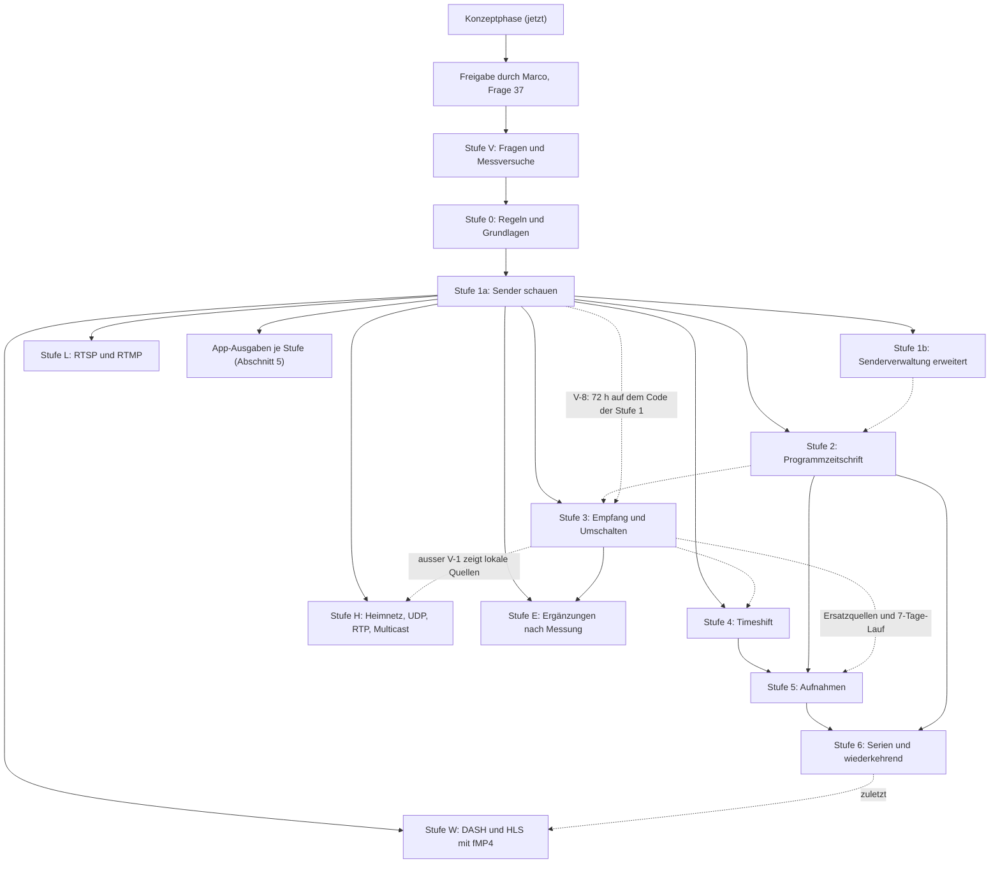

# Konzept 28 · Umsetzungsplan

Stand: 29. November 2026 · Fassung 3 · Status: Entwurf nach Gesamtreview, nicht freigegeben

> **Kurz gesagt.** Dieser Plan ist die Entwicklungsroadmap für Live-TV (Auftrag LTV-021, Abschnitt 18 Punkt 17).
> Er ist ein **Vorschlag an dich**; gebaut wird erst auf dein ausdrückliches Wort, und wann Live-TV im Projekt
> drankommt, entscheidest du. Vor dem Bau stehen eine **Stufe V** mit Fragen an dich und kleinen, wegwerfbaren
> Messversuchen und eine **Stufe 0** mit Regeln, Schutz der Zugangsdaten in den Protokollen, Härtung und einem
> Testsimulator für Quellen. Danach folgen sechs Stufen in der Reihenfolge der Fachpapiere: **1** Sender schauen
> (im Web), **2** Programmzeitschrift, **3** Empfang und Umschalten, **4** Timeshift, **5** Aufnahmen,
> **6** Serien und wiederkehrende Aufnahmen. Dazu kommen vier Stufen, die nur von Stufe 1 (oder 3) abhängen und
> an Messungen oder Entscheide gebunden sind: **H** Quellen im Heimnetz mit UDP, RTP und Multicast, **L** RTSP und
> RTMP, **W** DASH und HLS mit fMP4 (zuletzt), **E** Ergänzungen nach Messung (Untertitel im Browser, Erkennen
> eines stehenden Bildes). Wann die TV-App und die Handy-App folgen, ist eine Entscheidungsvorlage (Abschnitt 5).
> Jede Stufe ist für sich nutzbar, hat eine Abnahme und ist ein Release. Safari, iPhone und iPad sind als
> Web-Clients vorgesehen wie die übrigen Browser, aber ungeprüft, solange kein Gerät da ist; ob ein Gerät
> beschafft wird oder du auf die Zusage verzichtest, ist die Frage `20` E-28-12 (Vorschlag, nicht entschieden).
>
> Fassung 3 ist auf den Stand nach den Schlussreviews 4, 5 und 6 gezogen (`04`/`05` Fassung 4, `12` Fassung 3);
> dieser Stufenschnitt ist für alle Stufenangaben massgeblich. Was sich geändert hat, steht in Abschnitt 12.

Dieses Papier ändert keine Zeile Code und keine Regel. Alles hier ist **spezifiziert** oder **Empfehlung**; nichts
ist gebaut. Massgeblich bleiben Spec, Entscheidungsprotokoll und ADR; bei Widerspruch gilt
Entscheidungsprotokoll > Plan > Spec (`CLAUDE.md`). Migrations- und Vertragsnummern vergibt der Bau (Anker:
Server 1.44.1, Vertrag 1.44.0, letzte Migration 00086, letzte ADR 0045, letzte Frage 36). Dieses Papier nennt
**keine Termine und keinen Aufwand in Tagen** und sagt nichts zu Kapazität oder Leistung zu: Zielwerte sind zu
prüfende Grössen.

## Lesart

| Kennung | Bedeutung | Wo sie steht |
|---|---|---|
| `LTV-001` … `LTV-021` | Grundsatzentscheide des Auftrags | `02-grundsatzentscheide.md` |
| `LTV-nnn.mm`, `LTV-Q-nn.mm`, `LTV-X-nn` | Anforderungen, Querschnitt, Ausschlüsse | `03-fachkonzept.md` |
| `AK-L-nnn` | Abnahmekriterien | `17-test-und-abnahme.md` |
| `T-n`, `M-n` | tragende technische Entscheide, Messpunkte | `04-architektur.md`, `05-streaming-und-fast-zapping.md` Abschnitt 10 |
| «`13` M-n», «`09` M-n», «`10` M-n», «`11` M-n» | Messpunkte anderer Dateien | jeweilige Datei |
| «`03` F-n», «`04` F-n» … | Fragen an dich, je Datei gezählt | jeweilige Datei; Sammlung in `20-offene-entscheidungen.md` |
| `V-n` | Messversuch vor der Baufreigabe (dieses Dokument) | Abschnitt 2.2 |
| `D-n` | Widerspruch in den Stufenangaben (dieses Dokument) | Abschnitt 4.1 |
| `U-n` | Umplanungspunkt (dieses Dokument) | Abschnitt 8.2 |
| `RP-n` | Risiko des Vorhabens (dieses Dokument) | Abschnitt 8.1 |
| `O-n` | offene Punkte dieses Dokuments | Abschnitt 11 |

**Baufreigabe** heisst wie in `05` 10.1: Ohne das genannte Ergebnis wird die Stufe nicht zum Bau freigegeben, und
der davon abhängige Entscheid gilt nicht als tragend bestätigt. **Abnahme** heisst: Die `AK-L` der Stufe sind
grün, die Messungen der Stufe liegen vor, und du hast die Prüfliste auf der Testinstanz durchgesehen (`17` 8).

---

## 1. Grundsätze

### 1.1 Erst Konzept, dann Bau auf dein Wort

- **Heutiger Stand (wie `CLAUDE.md` Regel 11):** Live-TV ist kein Nicht-Ziel mehr, es ist konzipiert, und **der
  Bau jeder Stufe beginnt erst nach deiner ausdrücklichen Baufreigabe**. Frage 37 steht schon im
  Entscheidungsprotokoll (Status «Konzept liegt vor, nicht freigegeben»); Regel 11, Spec «Non-Goals», Plan, Vision,
  `HANDOVER.md` und `CURRENT_STATUS.md` sind auf dem Konzeptzweig darauf nachgeführt (`21` Abschnitt 1). ADR 0046
  steht auf «vorgeschlagen». Darüber hinaus entstehen in der Konzeptphase nur die Papiere in
  `docs/planning/28-live-tv/` und die Mockups; keine Migration, kein Code.
- **Zwei Begriffe, sauber getrennt:**
  - **«Konzept freigegeben»** heisst: Du nimmst das Konzept an. Das wird als Nachtrag zu Frage 37 eingetragen.
    Es erlaubt noch keine Zeile Code.
  - **«Baufreigabe einer Stufe»** heisst: Du beauftragst den Bau einer oder mehrerer bestimmter Stufen. Erst damit
    darf gebaut werden; zusätzlich müssen die Messungen «vor der Baufreigabe» dieser Stufe vorliegen (Abschnitt 2.2).
    Sagst du «100 % selbständig», heisst das alle genannten Stufen samt Merge und Tag in einem Zug. ADR 0046 wird
    mit Stufe 0 «angenommen».
- **Was ohne deine Antwort gilt:** Für jede Frage, die du nicht beantwortet hast, gilt die **Vorgabe** der Frage in
  `20`, nicht die Empfehlung. Die Vorgabe ist wortlauttreu zu deinem Auftrag; bei Sicherheitsfragen ist sie die
  sichere Variante (etwa `12` F-1: Live-Umwandlung nur mit wirksamer Sperre). Wo eine Vorgabe ausnahmsweise vom
  Wortlaut abweicht, trägt sie in `20` den Vermerk «weicht ab». **Eine Freigabe ohne Einzelantworten setzt die
  Vorgaben in Kraft, nicht die Empfehlungen.** Eine Empfehlung gilt erst mit deiner Antwort.

### 1.2 Stufen statt [MVP], [1.1], [1.x], [Later]

Die Marken des Auftrags gibt es in diesem Repo nicht (`02` AB-5). Umfang wird Stufen zugeordnet; jede Stufe ist
ein Release. Damit du deine Begriffe wiederfindest:

| Marke im Auftrag | Bedeutung im Auftrag | Hier | Warum so |
|---|---|---|---|
| **[MVP]** | kleinster nutzbarer Umfang | **Stufe 0 und Stufe 1** (Sender schauen im Web, mit Rechten, Verwaltung, zentralem Empfang, Umwandlung je Zuschauer) | Ab Stufe 1 kann ein Haushalt Fernsehen schauen; alles Weitere baut auf ihrem Eingangsstrom, ihren Sitzungen und ihren Rechten auf. |
| **[1.1]** | nächster Ausbau | **Stufe 2** (Programmzeitschrift, Erinnerungen) und **Stufe 3** (Empfangsstrategien, Vorladen, Ersatzquellen, erweiterte Überwachung) | Programm und schnelles, stabiles Umschalten sind deine Schwerpunkte 2, 3 und 7 (Auftrag Abschnitt 21). |
| **[1.x]** | spätere Ausbauten | **Stufen 4, 5, 6** (Timeshift, Aufnahmen, Serien), **H, L, W, E**, die **App-Ausgaben** | Jede ist ein eigenes Release; H, L, W und E hängen an Messungen oder an deinen Entscheiden. |
| **[Later]** | später, nicht jetzt | **nichts aus den 21 Grundsatzentscheiden.** «Später» heisst hier nur: ausdrücklich nicht in Konzept 28 und nicht vorbereitet (Abschnitt 10.3) | Alle 21 Entscheide sind verbindlich und bekommen eine Stufe (Abschnitt 10.1). |

### 1.3 Jede Stufe ist nutzbar, geprüft und ein Release

- **Nutzbar:** Nach jeder Stufe kann ein Zuschauer oder der Administrator etwas Neues tun, das ohne die
  nächste Stufe vollständig ist. Keine Stufe liefert halbe Seiten oder Knöpfe ohne Wirkung.
- **Abnahme:** `AK-L` nach `17` 8.1 (alle Zählungen in diesem Plan: Stand `17` Fassung 2; Operationen Stand `08` Fassung 2) (kumulativ: jede Stufe schliesst die früheren ein), Messungen nach `17` 8.2,
  deine Prüfliste nach `17` 8.3 (für H, L, W, E und die Apps in diesem Dokument ergänzt).
- **Release:** Jede Stufe ab 1 bringt eine neue Vertragsfassung mit eigenem Tag (Regel «Vertrag = Tag») und ist
  ein **Minor-Release** des Servers. Die erste Fassung ist frühestens 1.45.0; welche Nummer es wird, hängt davon
  ab, was bis dahin sonst veröffentlicht ist. Bekommt eine App in der Stufe Live-TV, ist das zusätzlich eine
  App-Ausgabe mit eigenem Tag. Stufe 0 ändert den Vertrag nicht (Abschnitt 3.4).
- **Bündeln:** Du kannst Stufen zu einem Release zusammenlegen (wie bei Konzept 21 und 25). Das ändert die
  Reihenfolge des Baus nicht, nur wie oft veröffentlicht wird.

### 1.4 Die Priorität des Projekts bleibt deine

Dieser Plan legt nur die Reihenfolge **innerhalb** von Live-TV fest. Er schiebt keine laufende oder geplante
Arbeit nach hinten (Auftrag Abschnitt 18: «ändere die bisherige Entwicklungspriorität nicht eigenmächtig»). Ob
Live-TV vor, nach oder zwischen anderen Vorhaben gebaut wird, sagst du mit dem Bauauftrag. Ein Hinweis zur
Planung: Die Messversuche der Stufe V brauchen keinen Produktcode und können auch dann laufen, wenn der Bau noch
nicht beauftragt ist, sofern du sie freigibst.

### 1.5 Was dieser Plan am Schnitt der Fachpapiere ändert

Die Fachpapiere (`03` Lesart, `04`, `07` 11.2, `08` 2, `17` 8) ordnen den Umfang den Stufen 0 bis 6 zu und
führen W (Weg W), L (RTSP und RTMP) und «Apps» als späte Stufen. Dieser Plan übernimmt das und ändert drei Dinge
(Begründung in Abschnitt 4.2):

1. **Neue Stufe H «Quellen im Heimnetz»:** UDP, RTP, Multicast, die festen Ziele im Heimnetz und der Netzmodus
   «host» werden aus Stufe 3 herausgelöst. Abweichung von `03` (LTV-003.14 bis .16), `07` 11.2 und `08` 2.8.
2. **Neue Stufe E «Ergänzungen nach Messung»:** Untertitel als WebVTT im Browser (`04` O-5) und die Stichprobe
   mit Dekodieren für stehende Bilder (`05` 9.4, Vorgabe `04` F-14 (a): eigener Schritt nach Stufe 3). Wählst du
   `04` F-14 (b), wandert die Stichprobe in Stufe 3.
3. **Stufe 1 in zwei Releases 1a und 1b** als Empfehlung, weil 1a fast die Hälfte aller Abnahmekriterien trägt
   (158 von 333 nach `17` 8.1, Fassung 2).

`03`, `06`, `09`, `10`, `11`, `13`, `16` und `17` sind in Fassung 2 auf diesen Schnitt gezogen; `07`, `08`, `12`,
`14` und `15` folgen. Den Stand je Widerspruch zeigt Abschnitt 4.1, offene Folgeänderungen O-1.

---

## 2. Vor dem Bau: Stufe V

Stufe V baut nichts ins Produkt. Sie klärt, was vor Stufe 0 und vor der Baufreigabe der einzelnen Stufen
feststehen muss: deine Antworten auf einige Fragen und eine Reihe kleiner Messungen.

### 2.1 Fragen an dich vor Stufe 0

Die vollständige Liste mit Varianten, Folgen, Vorgabe und Empfehlung steht in `20-offene-entscheidungen.md`. Hier
nur, **bis wann** eine Antwort nötig ist. Was nicht beantwortet ist, folgt der **Vorgabe** (Abschnitt 1.1); bei den
Fragen der ersten Gruppe würde eine spätere andere Antwort aber Regeln, ADR-Text oder schon gebauten Code ändern.

| Bis wann | Frage | Worum es geht | Warum so früh |
|---|---|---|---|
| **vor Stufe 0** | `03` F-6 | Welche Clients in welcher Stufe (Abschnitt 5) | bestimmt, ob Regel 8 in Stufe 0 einen TV-Tastentest bekommt und ob `05` M-4 vor Stufe 1 gemessen werden muss |
| vor Stufe 0 | `04` F-12 | Härtung der Standard-Compose-Datei für alle | wird in Stufe 0 gebaut (Abschnitt 3) |
| vor Stufe 0 | `12` F-1 (→ `20` E-28-04) | Darf FFmpeg Live-TV umwandeln, wenn der Kernel keine Sperre erlaubt? **Vorgabe (sicher):** nein, nur mit wirksamer Sperre (Landlock hart, Seccomp); ohne Sperre nur der Direktweg, Zustand «Eindämmung nicht verfügbar» sichtbar. Variante (c) «trotzdem erlauben» als ausdrückliche Wahl des Betreibers brächte die Ausnahme A-13 | steht in ADR 0046 und entscheidet, ob Stufe 1a auf einem Host ohne Sperre Sender mit Umwandlung zeigt |
| vor Stufe 0 | `12` F-2, `12` F-3 | `https` nach `http` immer abbrechen; Zertifikatsprüfung nie abschaltbar | Regel für jeden Abruf ab Stufe 1, gehört in ADR 0046 |
| vor Stufe 0 | `04` F-3 (→ `20` E-28-02 und E-28-29, zu **einer** Frage zusammengeführt) | Verbindungen je Quelle. **Vorgabe (wortlauttreu, LTV-017):** kein Schalter und keine Zahl je Quelle; Vorladen und «automatisch» nur global und je Sender. Varianten: (b) zusätzlich ein Schalter «Vorladen für Sender dieser Quelle»; (c) zusätzlich eine Verbindungszahl je Quelle | (b) und (c) berühren LTV-017; eine solche Wahl gehört ins Protokoll, bevor Regeln geschrieben werden |
| vor Stufe 0 | `04` F-10 | Sieht das Hauptprofil Aufnahmen aus der Zeit vor einer Altersgrenze? | Wortlaut der Ausnahme A-6 in ADR 0046 |
| vor Stufe 0 | Auslegungen des Koordinators (→ `20`, Frage «Bestätige die Auslegungen») | Fire TV «berücksichtigt» (Vorgabe: geprüft wird, ob die TV-App auf Fire OS läuft, kein eigener Client, keine Zusage); Plattform-Streams (YouTube, Twitch); kein Download und kein Offline von Aufnahmen (nicht verlangt, nicht geplant); «Kinderprofil» = Altersgrenze unter 18. Das sind **keine** Entscheide von dir | Wortlaut von Regel 11, Spec-Nachtrag und ADR 0046 |
| vor Stufe 1 | `03` F-1, `07` F-2 | Werkseinstellung der drei Rechte; wer bei der Einführung «Administrator» ist | Migration der Stufe 1 setzt die Werte für den Bestand |
| vor Stufe 1 | `04` F-2 | Startpuffer nur im Arbeitsspeicher (Abweichung von LTV-019.01, .04) oder wählbar | entscheidet D-3 und ob es zwei Bauformen des Rings gibt |
| vor Stufe 1 | `12` F-4 | Zugangsdaten der Quellen in einer «Sicherung ohne Geheimnisse» leeren | Sicherung ist ab Stufe 1 betroffen |
| vor Stufe 1 | `15` F-13, `15` F-14, `14` F-12 | eigener Verwaltungsbereich; neue Sender ab Werk aktiv (`07` W-6); Eintrag in der Navigation | Seiten der Stufe 1 |
| vor Stufe 1 | `17` O-8, O-3 | Schwellen des Benchmarks; Grenze «Filmstart nicht unzulässig verzögert» | Abnahme der Stufe 1 |
| vor Stufe 1 | `17` O-11 (→ `20` E-28-12) | Safari, iPhone, iPad gehören als Web-Clients zum Umfang (LTV-014: Smartphone, Tablet). **Vorgabe:** vorgesehen wie die übrigen Browser, ungeprüft, solange kein Gerät da ist. Frage: wird ein Gerät beschafft, oder verzichtest du für diese Clients auf die Zusage? | Abnahme der Stufe 1a (Abschnitt 4.3) |
| vor Stufe 1 | Untertitel (→ `20` E-28-56, erweitert) | LTV-004 verlangt die individuelle Untertitelauswahl ohne Stufe. In 1a: Apps wählen DVB-Untertitel über Media3, soweit das Format unterstützt ist; **Browser ohne wählbare Untertitel bis Stufe E; Teletext-Untertitel in keinem Client bis Stufe E.** Vorgabe (wortlauttreu): Untertitel gehören zum Umfang; Varianten: Stufe E vorziehen, voller Bau von hls.js, Einbrennen in einer Umwandlung | entscheidet, ob 1a im Browser Untertitel braucht |
| vor Stufe 1 | zwei Feinschliff-Fragen zu bestehendem Verhalten (→ `20`) | (1) `netguard` sperrt weitere nie öffentliche Präfixe, auch für Radio und Podcasts (Vorgabe: Verschärfung mit Hinweis im Release-Text); (2) Einschalten von Live-TV beendet Radio und Hörbuch (Vorgabe: Ton-Vorrang wie beim heutigen Wechsel Radio/Hörbuch) | ändert bestehende Funktionen in 1a (Abschnitt 9) |
| vor Stufe 1 | `13` P-7, P-8 | Anteil des Umwandlungsbudgets für Live; Vorrang des Empfangs gegen Filmumwandlungen auf dem Software-Backend | Zulassung in Stufe 1 |
| vor Stufe 2 | `03` F-3, F-5; `09` F-1 bis F-4; `14` F-2, F-3, F-6, F-8, F-11 | Meldewege der Erinnerungen, Programmsuche in der allgemeinen Suche, eigene Datei für Programmdaten, Namensgleiche zuordnen, EPG im Heimnetz, Bilder im Raster | |
| vor Stufe 3 | `04` F-4 (→ `20` E-28-30), F-9, F-14; `15` F-19; `13` P-1, P-3, P-5 | Dauerempfang gegen neuen Zuschauer (**Vorgabe wortlauttreu:** ein laufender Dauersender weicht niemandem, die neue Anfrage wird abgelehnt; «Zuschauer geht vor» ist nur eine Variante); Werkszustand des **globalen** Vorladens (Vorgabe: vorhanden und an, mit vorsichtigen Obergrenzen); ob die Stichprobe «stehendes Bild» in Stufe 3 oder E kommt; Ausfallmeldungen | |
| vor Stufe H | `04` F-11 | Multicast über Netzmodus «host» oder eigenes Netz des Containers | Zusatzdateien und Ausnahme A-9 |
| vor Stufe 4 | `04` F-7, F-8; `10` F-1; `14` F-9; `13` P-4 | Rückspulgrenze, Speicherform des Puffers, Sofortaufnahme im Zeitversatz | |
| vor Stufe 5 | `03` F-2, F-4, F-7, F-9, F-10; `04` F-5, F-6; `07` F-1; `08` F-1; `11` F-1, F-2; `14` F-4, F-5, F-10; `15` F-17, F-18, F-20, F-21; `13` P-2, P-6 (P-9 erledigt durch `04` 8.1); `12` F-5 (Hauptprofil kann jede PIN ersetzen: hinnehmen, Meldung ans Profil oder ausserhalb von Konzept 28 ändern; Vorgabe: hinnehmen, als Restrisiko benannt) | Kontingent, Vorrang der Aufnahmen, Entzug, Update, Spuren ausserhalb des TS, Notfall-Löschen, Höchstzahl gleichzeitiger Aufnahmen | |
| vor Stufe 6 | `03` F-8 | Serienaufnahme ohne zuverlässige Folgenkennung | |
| vor Stufe L | `04` F-1 | RTSP und RTMP über neue Go-Bibliotheken oder FFmpeg | |
| vor Stufe W | `04` F-13 | DASH und HLS mit fMP4, falls Weg W nicht dicht zu belegen ist | |
| vor den App-Ausgaben | `14` F-7, `14` F-1 | Bedienung des TV-Players mit dem Steuerkreuz; Vorgabe der Schalter | |

### 2.2 Messversuche vor der Baufreigabe

Jeder Versuch ist **klein, wegwerfbar und ausserhalb des Produkts**: ein kurzes Programm oder Skript auf einem
eigenen Zweig, der nie gemergt wird, oder im Arbeitsordner der Session. Er liest keine Datenbank des Servers,
ändert keine Installation und schreibt nur Kennzahlen nach `docs/perf/28-live-tv.md` (keine Senderliste, keine
Adresse, keine Zugangsdaten, keine Bilder). Versuche an deinen echten Quellen laufen nur mit deiner Zustimmung und
auf deinen Rechnern. **Laufzeit** ist die Messdauer des Versuchs, keine Schätzung des Aufwands.

| Nr. | Frage | Methode | Laufzeit | Abbruchkriterium | Was das Ergebnis am Entwurf ändern kann | Vor |
|---|---|---|---|---|---|---|
| **V-1** (`05` M-2) | Wie sehen deine wirklichen Quellen aus: Codec, Zeilensprung, Ton (AAC, MP2, AC-3), Länge der Bildgruppe **und ihre Verteilung je Sender** (für Ring und Startfristen nach T-7), Bitrate, Keyframe-Kennzeichen, Schub beim Verbinden, Verhalten bei einer zweiten Verbindung? | Wegwerf-Werkzeug in Go, das einen Strom 2 Minuten liest und nur die TS-Tabellen und Zeitstempel auswertet; Ausgabe als Zahlentabelle je Quelle ohne Namen | je Quelle wenige Minuten; dazu eine Stichprobe von bis zu 50 Sendern | Die Quellen sind nicht erreichbar oder das Lesen verlangt etwas, das der Auftrag ausschliesst (DRM) | Anteil des Direktwegs im Browser (T-12) und damit die Kapazität (`04` 7.6); Vorgabe der Zeilensprung-Entfernung (T-15); ob Ring und die drei Startfristen nach T-7 für lange Bildgruppen tragen; ob Stufe H früher kommen muss (lokale Quellen); ob `12` F-3 (b) nötig ist | Baufreigabe Stufe 1 |
| **V-2** (`05` M-3) | Spielt hls.js im schlanken Bau TS-Segmente mit H.264, HEVC, AAC, MP2, AC-3, Diskontinuitäten und einem gesetzten Startpunkt sauber ab? | statische Testseite mit hls.js und mit FFmpeg selbst erzeugten Testströmen (Testbild, Ton), Chrome und Firefox | ein Messlauf je Browser und Format | hls.js spielt TS mit Diskontinuität oder Startpunkt nicht verlässlich | T-11: bleibt TS, oder der Segmentierer liefert fMP4 (die eine vorgesehene Stelle, T-11); Tonregel. Fest steht schon (`04` T-12, 7.6, belegt durch die Nachprüfung Nr. 11, 13): Der schlanke Bau liest HEVC, AC-3, E-AC-3 und LATM in TS nicht, ein voller Bau ist nicht vorgesehen; diese Sender gehen im Browser in die Umwandlung | Baufreigabe Stufe 1a |
| **V-3** (`05` M-5, bedingt) | Safari, iPhone, iPad mit HLS-TS: Zeit bis zum Bild bei Listen mit **1, 3 und 6** Segmenten (Apple verlangt mindestens sechs, Nachprüfung Nr. 6 bis 8; kürzere Listen sind eine bewusste Abweichung) | nur mit Gerät; ohne Gerät WebKit in Playwright als Näherung, die nichts belegt | ein Messlauf | **kein Gerät vorhanden (Entscheid 2): der Versuch kann nicht laufen.** Safari, iPhone und iPad bleiben vorgesehen, aber ungeprüft (`04` T-11; Frage `20` E-28-12) | kurze Segmente in der Startphase, bis zu sechs Segmente für native Apple-Player (`05` O-28), hls.js auf dem iPad nach der bestehenden Weiche (`05` 4.3) | keine Baufreigabe hängt daran; nur, falls später ein Gerät da ist |
| **V-4** (`05` M-25) | Lässt CT 190 (Kernel und Docker-Profil) die Sperre für FFmpeg zu: welche Landlock-Fassung (Dateien, TCP nach Port, UDP), greift der **Seccomp-Filter** gegen UDP und rohe Sockets, scheitern Umgehungen (`io_uring`, 32-Bit-Aufrufe), bricht die Hülle ab, wenn ein Teil fehlt, und trägt bei 1000 Starts unter Last **jeder** FFmpeg-Prozess die Sperre (Bindung an den Betriebssystem-Faden)? Läuft die ganze Prüfreihe mit `no-new-privileges`, entzogenen Fähigkeiten und Prozessgrenze? Verträgt QSV eine Grenze des Adressraums? | Wegwerf-Programm im Container, das die Sperre setzt und FFmpeg auf einer Pipe startet; ein Testlauf der bestehenden Prüfreihe mit gehärteter Compose-Datei | ein Durchlauf je Einstellung | Sperre nicht verfügbar | Die Sperre wird nach `04` T-27, 10.8 **hart** gesetzt oder ihr Fehlen ausgewiesen, nie «so gut es geht»; ohne Sperre gibt es nach der Vorgabe von `12` F-1 keine Live-Umwandlung, nur den Direktweg; ohne Seccomp startet kein Live-FFmpeg (`12` 9); Weg W kann ohne Sperre nicht gebaut werden (`04` F-13 (a)); Stufe 0 härtet nur, was den Testlauf besteht | **Baufreigabe der Stufen 0 und 1a** |
| **V-5** (`05` M-4) | Media3 mit HLS-TS auf Pixel und Android-TV-Gerät: Ladepuffer, Start mit und ohne übergeordnete Liste, Decoder beim Umschalten | Wegwerf-App mit eigenem Paketnamen (Muster K27 Stufe 0), dieselben Testströme wie V-2 | ein Messlauf je Gerät | Media3 startet TS-Listen nicht verlässlich | Einstellungen des Players in der App; ob die Apps die übergeordnete Liste brauchen | Baufreigabe der Stufe, in der die Apps Live-TV bekommen (Abschnitt 5) |
| **V-6** (`05` M-16) | UDP und Multicast im Container auf CT 190: Bridge mit veröffentlichtem Port, Netzmodus «host», eigenes Netz (`macvlan`, `ipvlan`) | ein FFmpeg sendet Testbild an Port oder Gruppe, ein Wegwerf-Empfänger im Container zählt Pakete | je Netzart ein Lauf unter Last | Multicast kommt in keiner Netzart an | `04` F-11; ob Multicast nur über «host» geht (Ausnahme A-9); im schlimmsten Fall ein Abstrich an LTV-003.16, den nur du entscheiden kannst (U-8) | Baufreigabe Stufe H |
| **V-7** (`05` M-14, `10` M-1, `11` M-1, M-2) | Schreiblast je Zuschauer und Aufnahme auf SSD, HDD, RAM-Disk und NAS; was passiert, wenn das NAS 30 s weg ist oder abgehängt wird; `fdatasync` und `fallocate` im Container | Wegwerf-Skript schreibt Stückdateien mit 1 MB/s je Strom für 5 und 20 Ströme; trennt das NAS; prüft, ob je ins leere Verzeichnis geschrieben wird | je Speicherart ein Lauf von rund einer Stunde | Schreiben landet bei getrenntem NAS auf der lokalen Platte, oder ein hängender Aufruf hält das Herunterfahren auf | `04` F-8 (c) als Bremse; ob ein NAS als Speicherort «Aufnahmen» nur mit Warnung erlaubt ist; Grösse des Rückstaus (T-8; wie er gezählt wird, ist durch `04` 8.1 entschieden) | Baufreigabe Stufen 4 und 5 |
| **V-8** (`13` M-1, `05` M-12) | Läuft der Go-Empfänger 72 Stunden ohne wachsenden Speicher, Goroutinen und offene Dateien? | **kein Wegwerf-Code**, sondern der Empfänger aus Stufe 1, gehalten durch einen Haltegrund nur im Testbau, 20 Testsender des Simulators, keine Zuschauer, auf CT 190 | 72 Stunden; kann laufen, während Stufe 2 gebaut wird | Leck nach `17` 7 (Speicher > 10 %, Goroutinen oder Deskriptoren > 5 nach einer Stunde) | Stufe 3 wird nicht freigegeben, bis der Fehler in einem Patch von Stufe 1 behoben ist (U-4) | Baufreigabe Stufe 3 |
| **V-9** (`09` M-10 bis M-12) | Wie gut sind deine echten Programmdaten (fehlende Endzeiten, Folgenkennung, Zeitversatz) und wie stark schwankt die Menge von Tag zu Tag? | Wegwerf-Skript liest deine XMLTV-Dateien einmal täglich und schreibt nur Zählwerte | zwei Wochen | keine verwendbare Datei | Schwelle «Liste geschrumpft» (50 %); Vorgaben der Zuordnung; Grundlage für `03` F-8 (Serien ohne Folgenkennung) | Bau Stufe 2 (früh beginnen, läuft nebenher) |
| **V-10** (`05` M-10, M-11, M-12 FFmpeg) | Ist Weg W dicht: Öffnet FFmpeg mit umgeschriebenen Listen nur die Verbindung zum Weiterleiter? Hält ein FFmpeg-Leser für DASH 30 Stunden? | feindliche Testmenge (`05` 2.6) im Testaufbau, Mitschrift aller Verbindungsversuche des Prozesses | 30 Stunden für den Langlauf | eine einzige Verbindung an einem anderen Ziel | ohne Beleg kein Weg W (T-4); dann `04` F-13 | Baufreigabe Stufe W |
| **V-11** (`05` M-23) | Verbinden die Go-Bibliotheken für RTSP und RTMP nur über den übergebenen Dialer? | Test mit einem Dialer, der alles ablehnt, gegen einen Testserver | ein Lauf | eine Verbindung am Dialer vorbei | `04` F-1 (b) oder (c) | Baufreigabe Stufe L |
| **V-12** (`11` M-7) | Hat das Image Zonendaten, und rechnen wiederkehrende Aufnahmen unter `TZ` gleich UTC (CT 190) richtig? | Abfrage im Image mit gestellter Uhr über eine Zeitumstellung | ein Lauf | Zonendaten fehlen | Zonendaten ins Image oder in den Server einbetten | Bau Stufe 6 |
| **V-13** (`05` M-26) | Wie verhalten sich deine Anbieter bei einer zweiten Verbindung auf demselben Zugang: lehnen sie ab (mit welchem Code, Muster A), trennen sie die ältere (Muster B), oder geben sie einen Platz erst verzögert frei (nach wie vielen Sekunden)? | Wegwerf-Werkzeug öffnet je Zugang mit deinem Einverständnis eine zweite Verbindung; dazu am Testserver die drei Fälle gegen die Regeln aus `04` 5.3 (höchstens ein Wechsel, keine Schleife, keine Sperre). Nur Kennzahlen, keine Anbieter, keine Adressen | je Zugang wenige Minuten | ein Anbieter sperrt den Zugang nach dem Versuch (dann sofort aufhören und dir melden) | Regel für Zugänge mit einer Verbindung (T-17): Deutung von Muster A und B, Ein-Strom-Betrieb, Wartezeit vor dem Wiederversuch; ohne Messung ist sie nicht belegt | **Baufreigabe Stufe 1a** |

Was **nicht** in Stufe V gehört, sondern während des Baus vor dem betroffenen Bauteil gemessen wird (`17` 8.2):
`05` M-6, M-7, M-8, M-22, `13` M-5 (Stufe 1a); `09` M-1 bis M-7, M-9 (Stufe 2); `05` M-13, M-15, M-17
(Stufe 3); `05` M-9, M-19, `10` M-2, M-3 (Stufe 4); `11` M-5 (Stufe 5); `05` M-20 (vor der Baufreigabe der
Stufe E, bei `04` F-14 (b) in Stufe 3); `05` M-24 (Apps, Stufe E).

**Zum Langlauf (`05` M-12, `04` Fassung 3):** 72 Stunden sind das **Tor zur Baufreigabe der Stufe 3** (V-8),
7 Tage die **Abnahme der Stufe 3**.

---

## 3. Stufe 0: Regeln und Grundlagen

**Ziel in einem Satz für dich:** Bevor eine Zeile Live-TV entsteht, stehen die Ausnahmen mit ihren Grenzen in
Regeln, Spec und ADR, die Protokolle schwärzen Zugangsdaten von Fernsehquellen, und es gibt einen Testsimulator,
der Quellen und ihre Störungen nachstellt.

### 3.1 Planschritte (je ein Commit)

| Schritt | Commit-Titel (Vorschlag) | Inhalt | Dateien |
|---|---|---|---|
| 0.1 | `docs(planning): question 37 addendum, concept 28 approved and answers to the open questions` | Frage 37 steht schon im Protokoll (Status «Konzept liegt vor, nicht freigegeben», `02` Abschnitt 5, `21` D-13); Nachtrag mit der Freigabe und deinen Antworten aus Abschnitt 2.1 | `docs/planning/04-entscheidungen.md`, Konzept-README |
| 0.2 | `docs(rules): rules and spec criteria for building live TV` | Regel 11, Spec «Non-Goals», Plan, Vision, `docs/dev/HANDOVER.md` und `CURRENT_STATUS.md` sind schon auf dem Konzeptzweig nachgeführt («konzipiert, Bau erst nach Freigabe je Stufe», `21` Abschnitt 1). Hier nur, was `21` Abschnitt 3 nennt: neuer Kriterienblock **L-1 ff.** in der Spec (Empfehlung aus A1 3.2); `CLAUDE.md` **Regel 10** (neue Schlüssel und Muster aus `12` 5.4), **Regel 3** mit Zusatz A-11 (Hülle für die Sperre: Ersetzen des Prozesses mit `syscall.Exec`/`unix.Exec` nur im Paket `transcode`, `12` O-1, `04` O-26), **Regel 8** (TV-Tastentest mit Steuerkreuz, falls `03` F-6 die TV-App in Stufen 1 bis 6 nimmt; `01` RI-7), Regel 2 um `store/liveq` (nur im Paket `live`) | `docs/spec/`, `CLAUDE.md` |
| 0.3 | `docs(adr): 0046 live TV exceptions, rights and limits` | ADR 0046 von «vorgeschlagen» (schon auf dem Konzeptzweig, `21` D-14) auf «angenommen», mit allen benannten Ausnahmen **A-1 bis A-13** und ihren Grenzen (`02` Abschnitt 4, `12` 1.1; Beleg `AK-L-272`, SM-43): neu **A-10** Weg W (Sperre hart, erst nach M-10, nie im Netzmodus «host»), **A-11** Zusatz zu Regel 3 (`execve` nur in `internal/transcode` für die Hülle), **A-12** Hauptprofil verwaltet Aufnahmen seiner Profile mit Altersgrenze auch ohne eigenes wirksames «Live-TV», **A-13** nur, wenn du bei `12` F-1 Variante (c) wählst, dem Rechte-Modell (drei Schalter, Deckel, keine Altersprüfung), **einer** Definition «Profil mit Altersgrenze» (wirksame Grenze aus Profil und Konto unter 18, RD-05) und den Antworten auf `12` F-1 bis F-3, `04` F-3, `04` F-10. Nachträge: ADR 0025 (Regel «FFmpeg sieht keine Adresse» gilt für Live-TV; Weg W als einzige, noch nicht gebaute Ausnahme), ADR 0032 (A-4), ADR 0045 (A-5), ADR 0029 (eigene schreibbare Wurzeln, A-7) | `docs/adr/0046-…md`, Nachträge in `docs/adr/` |
| 0.4 | `feat(logging): redact live TV source secrets` | neue Abfrageparameter, Endungsregel, Pfadmuster (Benutzerteil, Xtream-Pfade; der Ersatzpfad des Wegs W ist kein Geheimnis, `05` 2.6), Schlüsselnamen und zusammengesetzte Werte nach `12` 5.4, mit Pflicht-Testfall und Gegentest | `server/internal/logging/` |
| 0.5 | `chore(lint): guard the live packages` | Paketgerüst `server/internal/live` (nur Paketkommentar, Zuschnitt nach `04` T-24); `depguard`-Riegel für `store/liveq` (Muster `wishq`), Riegel gegen `items`, `media_files`, `tracks` im Paket `live` (Analyzer `itemsaccess`), `forbidigo` für `syscall.Exec`/`unix.Exec` ausserhalb `transcode`; CI-Schritt, der das Release-Binary auf Test-Build-Tags prüft (`12` SM-26) | `server/.golangci.yml`, `server/internal/live/`, CI |
| 0.5a | `feat(transcode): contained launcher for live ffmpeg` | **Hülle vor FFmpeg** (`04` 10.8, `12` 9): ein Unterbefehl des Servers in `internal/transcode` setzt vor dem Start von FFmpeg `PR_SET_NO_NEW_PRIVS`, `PR_SET_PDEATHSIG`, Ressourcengrenzen, eine eigene kleine Umgebung ohne `SLOUCHCAT_*` und Proxy-Variablen, die **Landlock-Regeln** (hart oder Abbruch) und den **Seccomp-Filter** (kein `socket()`, kein `io_uring`, keine 32-Bit-Aufrufe; ohne Filter startet kein Live-FFmpeg), gebunden an den Betriebssystem-Faden; dann ersetzt sie sich durch FFmpeg. Dazu der Lint aus 0.5 für das Ersetzen des Prozesses (A-11) und ein Zustand «Eindämmung verfügbar / nicht verfügbar» für die Verwaltung. Noch ohne Live-Aufrufer; die Live-Umwandlung nutzt sie ab 1a. Tests: Sperre greift (`/config/secret.key` nicht lesbar, kein Socket), Abbruch bei fehlendem Teil | `server/internal/transcode/`, `server/cmd/slouchcat/` |
| 0.6 | `chore(deploy): harden the default compose file` | nach `04` F-12 (a) und dem Lauf aus V-4: `no-new-privileges`, `cap_drop: ALL`, `pids_limit`, höhere Grenze offener Dateien (`13` O-6) | `deploy/compose.yaml`, `docs/INSTALLATION.md`, `deploy/README.md` |
| 0.7 | `test(live): source simulator and generated test streams` | Simulator `internal/live/livetest` mit Build-Tag `livetest`, Programm `livesim`, `task testdata:live`, `task live:sim` (Namen Vorschlag, `17` O-1); Fähigkeiten nach `17` 2.1 für Stufe 1 (HTTP-TS, HLS-TS, Xtream, M3U-Korpora, Störungen, Zähler, «nur eine Verbindung», Weiterleitungen, Ziel-Sensor), je Fähigkeit ein Selbsttest; Teststrom-Dateien nur selbst erzeugt, nicht eingecheckt | `server/internal/live/livetest/`, `server/cmd/livesim/`, `testdata/Taskfile.yml`, `Taskfile.yml` |

Die Hülle gilt in Konzept 28 nur für Live-FFmpeg. Dass auch die FFmpeg-Aufrufe der Dateiwiedergabe eine eigene
kleine Umgebung bekommen sollten (`12` RT-18), ist eine Empfehlung an den Bestand und O-8 dieses Dokuments; Stufe 0
fasst die Nähte der Dateiwiedergabe nicht an.

Spätere Fähigkeiten des Simulators (UDP/RTP/Multicast, RTSP/RTMP über MediaMTX im Testaufbau, DASH und fMP4)
kommen mit der Stufe, die sie braucht (H, L, W), nicht hier: Regel 11 «nichts vorziehen».

### 3.2 Abnahme, Messungen, Doku

| Punkt | Inhalt |
|---|---|
| Abnahme | 5 `AK-L` nach `17` 8.1: `AK-L-098`, `-246` (Schwärzung), `-252`, `-272` (Ausnahmen in Regeln, Spec und ADR, Skript), `-281` (Compose-Datei); `task check:fast` grün; Selbsttests des Simulators grün |
| Prüfliste für dich | (1) Du liest Regel 11 und ADR 0046 und findest jede Ausnahme mit ihrer Grenze. (2) Nach dem Update auf eine Fassung mit gehärteter Compose-Datei läuft dein Server wie vorher (Filme, Radio, Apps). |
| Messungen | V-4 (`05` M-25) als Baufreigabe der Stufe 0: Härtung und Hülle bauen nur, was der Lauf auf CT 190 trägt |
| Doku | ADR 0046 und Nachträge; `docs/INSTALLATION.md` und `deploy/README.md` für die Compose-Härtung; `CURRENT_STATUS.md` (Abschnitt zu Konzept 28 steht schon, `21` D-15) mit dem Stand des Baus, sobald Stufe 0 Code ins Produkt bringt (Schwärzung, Compose) |
| Verträglichkeit | keine Vertragsänderung, keine App betroffen |

### 3.3 Abhängigkeiten und Risiken

Abhängig von der Baufreigabe der Stufe 0, V-4 und den Antworten «vor Stufe 0» (Abschnitt 2.1; ohne Antwort gelten die Vorgaben). Risiko: Die Härtung der
Compose-Datei betrifft jede bestehende Installation; deshalb erst nach dem Testlauf aus V-4 und mit einem Satz im
Release-Text. Die Schwärzung schwärzt eher zu viel (etwa Parameter `u` und `p`); das ist gewollt (`12` 5.4).

### 3.4 Release und Grösse

Stufe 0 bringt Code ins Produkt (Schwärzung, Lint, Compose), aber keine sichtbare Funktion und keinen neuen
Vertrag. **Empfehlung:** kein eigenes Minor-Release; die Änderungen reisen mit dem Release der Stufe 1. Soll die
Härtung früher bei allen ankommen, ist ein Patch-Release möglich (Weg «Versionscommit auf den Fix-Zweig»). Grösse:
**klein bis mittel** (der Simulator ist der grösste Teil; vergleichbar mit dem Testserver des Webradios).

---

## 4. Stufen 1 bis 6 und die späten Stufen H, L, W, E

### 4.1 Widersprüche in den Stufenangaben der Fachpapiere

Beim Abgleich von `03`, `04`, `05`, `07`, `08`, `12`, `16` und `17` fielen in Fassung 1 diese Unstimmigkeiten
auf. Dieser Plan entscheidet sie (Spalte «Dieser Plan»); die Spalte «Stand nach Konsolidierung 1» sagt, wo sie
nachgeführt sind und was offen bleibt.

| Nr. | Thema | Stellen (Fassung 1) | Dieser Plan | Stand nach Konsolidierung 1 |
|---|---|---|---|---|
| **D-1** | RTSP und RTMP | `03` LTV-003.12, .13: Stufe 3 · `04` T-3, F-1, `16` Matrix A, `17` 8.1: späte Stufe L | **Stufe L** | **erledigt** in `03` Fassung 2 (LTV-003.12, .13: L) und `17` Fassung 2 |
| **D-2** | DASH, HLS mit fMP4 | `03` LTV-003.10: Stufe 3 · `04` T-3, O-24, `12` SM-44, `16`, `17`: Stufe W | **Stufe W**, zuletzt | **erledigt** in `03` Fassung 2 (LTV-003.10: W), `16` und `17` Fassung 2; `04` Fassung 3 Abschnitt 15 bestätigt |
| **D-3** | Speicherort des Startpuffers | `03` Lesart: Stufe 4 · `03` LTV-019.01, .04: Stufe 3 · `07` 11.2: Startpuffer-Einstellungen Stufe 3, `live_storage` Stufe 4 · `08` 2.10: Speicherorte Stufe 4 | Mit `04` F-2 (b) (Empfehlung) nur die Grösse, Einstellung der Stufe 3. Mit `04` F-2 (a) die Ortswahl in **Stufe 4** mit `live_storage` | **erledigt** in `03` Fassung 2 (LTV-019.01, .04: 4; Lesart Stufe 4 «Ort des Startpuffers nur, falls `04` F-2 die Ortswahl behält»); `07` Fassung 2 führt in Stufe 3 nur noch die Einstellungen (Grösse); `08` folgt (noch Fassung 1). Die Weiche selbst bleibt `04` F-2 |
| **D-4** | Feste Ziele im Heimnetz | `07`, `08`, `12` SM-41, `03`: Stufe 3 · `17` 8.1: `AK-L-230`, `-231` in Stufe 1 | verbotene Hälfte in **1a**, erlaubte Hälfte in **Stufe H** | **erledigt** in `03` Fassung 2 (LTV-003.14 bis .16: H) und `17` Fassung 2 (`-230`, `-231` als Teil in 1a, neu grün in H). **Offen** in `07` Fassung 2 (11.2 führt `live_net_targets` und `listen_interface` noch in Stufe 3), `08` (2.8 `resolveLiveNetTarget` Stufe 3), `12` (SM-41) und `04` T-3 («UDP, RTP, Multicast (Stufe 3)»): siehe D-11. **Nachgeführt** in der Restebereinigung (`07`, `08`, `12` SM-41 und `04` T-3 nennen H) |
| **D-5** | Eingefrorener Strom («stehendes Bild») | `03` LTV-011.04: Stufe 3 · `04` 9, `05` 9.4: Stichprobe mit Dekodieren später, nach `05` M-20 | **Stufe E** nach der Vorgabe `04` F-14 (a); bei `04` F-14 (b) in Stufe 3. Bis zur Stichprobe ist LTV-011.04 «teilweise» erfüllt und so in `CURRENT_STATUS.md` zu nennen | **erledigt** in `03` Fassung 2 (LTV-011.04: «3; E»), `17` Fassung 2 (`AK-L-331` in E) und `04` Fassung 3 (F-14). Fassung 1 dieses Plans liess die Stichprobe noch wahlweise in Stufe 3; das ist korrigiert |
| **D-6** | Untertitel je Zuschauer im Browser | `03` LTV-004.17: Stufe 1 · `04` 7.4, `16` Matrix E: im Browser zunächst keine Untertitel, WebVTT ist `04` O-5 | Stufe 1a für Clients, die DVB-Untertitel zeichnen (Media3, nach `05` M-24); WebVTT für den Browser in **Stufe E** | **erledigt** in `03` Fassung 2 (LTV-004.17: «1a; E») und `16`, `17` Fassung 2. **Offen** in Stufe E: wie der Browser WebVTT zeigt, weil der schlanke Bau von hls.js Untertitel-Spuren weglässt (O-7) |
| **D-7** | Messungen vor Stufe 1 | `04` T-11, 12.1 ohne Bedingung · `05` 10.1, `16` 3.2, `17` 8.2 bedingt · kein Apple-Gerät | M-2 und M-3 immer; M-4 nach Abschnitt 5; M-5 kann nicht laufen | **teilweise erledigt:** M-5 ist in `04` bereinigt (Fassung 4: Apple-Clients vorgesehen, ungeprüft ohne Gerät, Frage `20` E-28-12). **Offen** in `04` Fassung 3 T-11: «M-2, M-3 und M-4 vor der Baufreigabe der Stufe 1» ohne Bedingung für M-4; `05` Fassung 3 (M-4) und `17` Fassung 2 binden M-4 an die Stufe, in der die Apps Live-TV bekommen. Dieser Plan folgt `05`/`17`. **Nachgeführt** in der Restebereinigung: `04` T-11 bindet M-4 an die Stufe der Apps |
| **D-8** | 72-Stunden-Lauf | `13` M-1, `17` 7: Baufreigabe Stufe 3, obwohl «dauerhaft» erst in Stufe 3 gebaut wird | V-8 misst den Empfänger der Stufe 1a mit einem Haltegrund nur im Testbau; 7 Tage sind Abnahme der Stufe 3 | **erledigt** in `04` Fassung 3 (14.8), `05` Fassung 3 (M-12), `13` und `17` Fassung 2 |
| **D-9** | Compose-Härtung | `04` 10.6, 10.8: Stufe 1 (vorbehaltlich `04` F-12) | **Stufe 0** | **teilweise:** `17` Fassung 2 prüft sie in Stufe 0 (`AK-L-281`), `03` Fassung 2 nennt sie in Stufe 0. **Nachgeführt** in der Restebereinigung: `04` 10.6 und 10.8 nennen Stufe 0 |
| **D-10** | Clients in jeder Stufe | `03` «zuerst Web» · `08` `x-clients: [app, tv]` ab Stufe 1 · `17` Zeile «Apps» | so übernommen; Reihenfolge der Apps nach Abschnitt 5 | **kein Widerspruch**; `03` Fassung 2 sagt es ausdrücklich (Lesart) |
| **D-11** (neu) | Stufe H in Architektur und Schema | `04` Fassung 3 T-3: «UDP, RTP, Multicast (Stufe 3)» · `07` Fassung 2 11.2: `live_net_targets`, `live_sources.listen_interface` in Stufe 3 · `08` 2.8: `resolveLiveNetTarget` Stufe 3 | **Stufe H** | **erledigt**: `03`, `04`, `07`, `08`, `16`, `17` nennen H (Restebereinigung nach Konsolidierung 1) |
| **D-12** (neu) | LTV-018 zwischen 1a und 1b | Fassung 1 dieses Plans nannte in 4.3 «LTV-018 ausser .12, .13» für 1a und «automatisch nach Zeitplan» für 1b | 1a: LTV-018.03 bis .11, .14 bis .21, .23 (von Hand, Erhalt der Pflege); **1b: LTV-018.01, .02, .22** (automatisch nach Zeitplan, Intervall je Quelle, Bestätigung bei auffällig unvollständiger Liste); .12 in Stufe 2, .13 in Stufe 5 | **erledigt**: gleich wie `03` Fassung 2 |
| **D-13** (Gesamtreview, RG-03) | Schalter «Vorladen für Sender dieser Quelle» | `04` Fassung 3 5.3, `07` 3.2 (`preload_enabled`), `08` 3.7 (`preloadEnabled`), `15` LA-03/LA-09, Fassung 2 dieses Plans (4.5) | **kein Schalter und keine Zahl je Quelle** (Vorgabe E-28-02/E-28-29); Ruhen nach Muster A/B ohne Einstellung; Spalte und Feld nur bei Variante (b) | **erledigt** in `04`/`05` Fassung 4 und in diesem Plan (4.5). **Offen** in `07` und `08` (Fassung 2 führen die Spalte und das Feld noch ohne Bedingung) und `15` (Fassung 2) |
| **D-14** (Gesamtreview, RG-05, RB-06) | Untertitel im Browser in 1a | `04` Fassung 3 7.4 und `16` Fassung 2: «eingebrannt, erfüllt» · `20` E-28-56: «nicht erfüllt bis E» | im Browser keine wählbaren Untertitel und Teletext in keinem Client bis Stufe E; Frage `20` E-28-56 | **erledigt** in `04` Fassung 4 (7.4) und `16` Fassung 3 |

Kein Widerspruch, aber erwähnenswert: `07` 11.2 legt in Stufe 2 die neuen Meldungsarten aller Stufen in
`notifications` und `deliveries` an (geschlossene Wertelisten), während `08` 1.3 den Vertrag Werte erst mit ihrem
Erzeuger beschreiben lässt (ADR 0009). Das ist bewusst so und keine Vorbereitung ausgeschlossener Funktionen.

### 4.2 Der Schnitt und seine Begründung

**Geprüfter Vorschlag aus dem Auftrag an dieses Dokument** (1 Quellen bis Player, 2 EPG mit Favoriten, 3
Timeshift, 4 DVR, 5 Serien, 6 Strategien und Überwachung, 7 Apps, 8 weitere Protokolle): Er bringt Aufnahmen
früher, verlangt aber, dass Aufnahmen über Stunden laufen, bevor es Ersatzquellen, erweiterte Überwachung und den
7-Tage-Lauf des Empfängers gibt. Ausserdem müssten `03`, `07`, `08` und `17` umnummeriert werden. Favoriten stehen
in `03`, `07` und `08` schon in Stufe 1 und brauchen keine Programmdaten.

**Empfohlen ist die Reihenfolge der Fachpapiere mit drei Änderungen** (Abschnitt 1.5). Gründe:

1. **Deine Schwerpunkte zuerst** (Auftrag Abschnitt 21): ein Eingang für viele (1), schnelles Umschalten (1 und 3),
   stabiler Dauerempfang (3), Umwandlung je Zuschauer (1), automatische Wiederherstellung (3), keine Lecks
   (1 und 3). Timeshift und Aufnahmen (5, 6 der Liste) bauen darauf auf.
2. **Risiko früh prüfen:** Die teuersten Annahmen (Direktweg, hls.js mit TS, Eindämmung von FFmpeg, Lecks beim
   Umschalten) zeigt Stufe 1; Dauerbetrieb und Ersatzquellen Stufe 3, bevor Daten auf Platte geschrieben werden.
3. **Aufnahmen brauchen Zuverlässigkeit:** Eine Aufnahme ohne Ersatzquelle und ohne geprüften Dauerbetrieb verliert
   bei der ersten Störung die Sendung. Deshalb 3 vor 5.
4. **4 vor 5 aus Technik:** Timeshift bringt Speicherorte (`live_storage`), Marker, Stückdateien mit Verzeichnis,
   Rückstau und das Löschen über `paths`. Aufnahmen nutzen dieselben Bausteine (`04` T-8, T-16, T-25).
5. **2 vor 3 aus Planung:** Der 72-Stunden-Lauf (V-8) auf dem Code der Stufe 1 kann auf CT 190 laufen, während
   Stufe 2 gebaut wird. Stufe 2 bringt sichtbaren Nutzen ohne neue Netzrisiken.
6. **Stufe H herausgelöst:** UDP, RTP, Multicast und Quellen im Heimnetz sind eine eigene Sicherheitsklasse (Ausnahmen
   A-3 und A-9, Netzmodus «host» mit vier benannten Folgen, `04` 10.6), lassen sich in der CI kaum prüfen (`17`
   R-5) und hängen nur an Stufe 1. Getrennt bleibt Stufe 3 kleiner, und du bekommst schnelles Umschalten ohne
   Lockerung des Netzschutzes. **Wenn V-1 zeigt, dass deine Quellen im Heimnetz liegen** (zum Beispiel ein
   eigener Zuspieler), kommt H direkt nach Stufe 1, sonst nach Stufe 3 oder später.
7. **L und W hinter Messungen:** RTSP/RTMP brauchen deinen Entscheid `04` F-1 und V-11; DASH und fMP4 brauchen
   die Sperre und V-10. Beide sind seltene Quellarten (Annahme, V-1 prüft es) und kommen zuletzt.
8. **Stufe 1 in zwei Releases (Empfehlung):** 1a «Schauen» und 1b «Senderverwaltung erweitert». Beide sind für
   sich nutzbar; der Schnitt halbiert den grössten Pull Request des Vorhabens.

### 4.3 Stufe 1: Sender schauen

**Ziel in einem Satz für dich:** Du legst eine Senderliste an, und jedes freigegebene Profil kann im Browser
fernsehen; jeder Sender wird nur einmal empfangen, und wer ein anderes Format braucht, bekommt seine eigene
Umwandlung.

| Punkt | Inhalt |
|---|---|
| **Umfang 1a «Schauen»** | Quellen: M3U/M3U8 als Datei und Adresse, Einzel-URL, Xtream-Live (LTV-003.01 bis .09, .11, .17 bis .21, .23); Zugangsdaten, Kopfzeilen, User-Agent verschlüsselt und nur an feste Ursprünge (T-28); nur öffentliche Ziele (D-4). Empfang **bei Bedarf** (LTV-002.03, .09, .10), ein Eingang je Sender, Verteiler mit Ring und Startpuffer von höchstens 15 s, Lebenszyklus über Haltegründe, Zulassung mit Serverdeckeln (LTV-004 ausser .06 und .32; T-1 bis T-3, T-6 bis T-9, T-11 bis T-14, T-17, T-19, T-21 bis T-24). Original, Umpacken, Ton- und Bild-Umwandlung je Zuschauer mit bestehender Hardware (LTV-004.08 bis .19), Zeilensprung-Entfernung (T-15), Eindämmung von FFmpeg über die Hülle aus 0.5a und Fuzz-Ziele (T-27); **jede Live-Umwandlung nur mit wirksamer Sperre**, ohne Sperre nur der Direktweg mit sichtbarem Zustand «Eindämmung nicht verfügbar» (Vorgabe `12` F-1); kein FFmpeg-Lauf länger als 24 Stunden (`04` 7.5). Ring und Startfristen nach T-7 (Ring 15 s, bei langen Segmenten das Vierfache der Segmentdauer, höchstens 30 s; drei getrennte Fristen bis zum ersten Byte, bis «läuft», bis zum ersten Segment; Werte in `04` Abschnitt 14). **Im Browser nur der schlanke Bau von hls.js:** HEVC, AC-3, E-AC-3 und AAC-LATM gehen dort in die Umwandlung (`04` T-12, 7.6; belegt, Nachprüfung Nr. 11, 13). Grundüberwachung (LTV-011.02, .03, .11, .12, .16, .17). Rechte: Schalter «Live-TV» auf Konto und Profil, 404 ohne Recht (LTV-012 ausser .04, .05; LTV-015 ausser Aufnahmen), Zählung zu Strömen, Bitrate, Höhe und Schauzeit (T-26); die **Schauzeit zählt, was der Server ausliefert** (Segmentabrufe), nicht die Angabe «Pause» des Clients; eine Sitzung ohne Segmentabruf endet nach 15 Minuten (`12` 10.3). Deutung von Ablehnungen und Verdrängung durch die Quelle (Muster A und B, Ein-Strom-Betrieb nach `04` 5.3; belegt durch V-13). Import mit stabiler Identität (Treffer nur mit zweitem Merkmal, RD-02), in **einer** Schreibtransaktion je Quelle (RD-03), Erhalt der Pflege, Aktualisierung von Hand: LTV-018.03 bis .11, .14 bis .21, .23 (D-12). T-29 mit seinen Grenzen: Deaktivieren oder Verschwinden eines **Senders** beendet nichts Laufendes, kein neuer Zuschauer kommt dazu, eine laufende Wiedergabe endet spätestens mit dem Token nach 12 Stunden, «sofort beenden» ist ein eigener Befehl; **Entfernen oder Ändern einer Quelle** (Adresse, Zugangsdaten, Ursprünge) beendet ihre Empfänger innert 5 Sekunden nach der Bestätigung (`12` gilt hier vor `04`). **Untertitel in 1a:** Apps wählen DVB-Untertitel über Media3, soweit das Format unterstützt ist; im Browser keine wählbaren Untertitel, Teletext-Untertitel in keinem Client, beides bis Stufe E (Frage `20` E-28-56). Favoriten und «zuletzt gesehen» (LTV-001.12). |
| **Umfang 1b «Senderverwaltung erweitert»** | Zusammenführen und Duplikate (LA-07), eigene Gruppen (LA-08), Massenbearbeitung und Nummern, Logo-Upload, automatische Aktualisierung nach Zeitplan mit Intervall je Quelle (Jobart), Importbericht mit «zurückgehaltener Liste» bei auffällig unvollständiger Liste: LTV-018.01, .02, .22 (D-12); dazu die erweiterten Teile von LTV-006 |
| **Tabellen** (`07` 11.2) | 1a: `live_config` (Spalten Stufe 1), `live_sources` (ohne Spalten der Stufen 3 und H), `live_source_headers`, `live_source_origins`, `live_source_imports`, `live_source_import_items`, `live_channels` (ohne `strategy`, `schedule_id`), `live_channel_locks`, `live_channel_categories`, `live_channel_streams`, `live_favorites`, `live_recent_channels`, `live_sessions` (ohne `recording_id`), `live_session_tunes`, `live_watch_time`, `live_stream_events`, Sicht `live_visible_channels`; Erweiterung `accounts`, `profiles`, `invitations` (Schalter «Live-TV», Werkseinstellung nach `03` F-1); Neubau `my_media` (Schlüssel `livetv`). 1b: `live_groups`, `live_group_channels`, `live_duplicate_dismissals`. Ein eingefrorener DB-Stand je Release in `testdata/db/` (Regel 5) |
| **Operationen** (`08` 2) | 58 neue (1a 45, 1b 13; `08` 2.13): Sender und Favoriten (11), Sitzung und Wiedergabe ohne `seekLiveSession` (8, davon 3 Binärrouten), Übersicht, Ströme, Diagnose ohne `switchLiveIngestSource` (6), Quellen und Importe ohne `resolveLiveNetTarget` (12), Sender, Gruppen, Duplikate (19; die Gruppen- und Zusammenführ-Operationen in 1b), `getLiveConfig`/`updateLiveConfig` (2). Erweitert: `getSession`, Profile, Konten, Einladungen, `listMyMedia`, `listStreams`, `getDashboard`, `listJobRuns`, `getWatchReport`, `PlaybackCapabilities` |
| **Seiten** (`14`, `15`) | Zuschauer: LS-01 (ohne Programmteile), LS-02, LS-03, LS-07 (ohne Timeshift und Aufnahme), LS-20, LS-21, LS-25 (Ton-Vorrang mit Radio). Verwaltung: LA-01 bis LA-06, LA-12, LA-13 (Grundteil), in 1b LA-07, LA-08; geänderte Seiten LA-20 bis LA-23, LA-24 (Importfehler), LA-25, LA-26. Jede neue Seite mit Playwright-Tastaturtest (Regel 8) |
| **Clients** | Web-App (Desktop, Handy-Breite, Tablet). Apps nach Abschnitt 5 |
| **Abhängigkeiten** | Stufe 0; **Baufreigabe der Stufe 1a** durch dich; V-1, V-2, V-4, V-13 (V-3 nur mit Gerät, V-5 nur bei Variante (b) oder (c) aus Abschnitt 5); Antworten «vor Stufe 1», sonst die Vorgaben |
| **Risiken** | Direktweg greift selten, im Browser zusätzlich wegen des schlanken Baus (RP-1); hls.js mit TS (RP-2); Grösse der Stufe (RP-3); FFmpeg ohne Sperre (RP-4); Wirkung auf Filme (RP-9); Arbeitspunkte aus Review 2: RD-01 bis RD-05, RD-08 (Abschnitt 4.14) |
| **Was das für die Kapazität heisst** | Weil der Browser HEVC, AC-3, E-AC-3 und LATM nicht selbst liest, braucht dort jeder solche Sender eine Ton- oder Bild-Umwandlung. Auf CT 190 sind ab Werk nach `04` 7.6 höchstens zwei Browser-Zuschauer mit Bild-Umwandlung gleichzeitig möglich (Rechnung, Annahme); wie viele deiner Sender das trifft, zeigt erst V-1. Auf einem Host ohne wirksame Sperre gibt es nach der Vorgabe gar keine Live-Umwandlung: Solche Sender sind dort im Browser nicht schaubar, bis die Sperre verfügbar ist oder du `12` F-1 anders beantwortest. Das ist eine Rechnung, keine Zusage |
| **Abnahme** | nach `17` 8.1 (Fassung 2): **1a** 158 neue `AK-L` und 3 Teile (`-230`, `-231` verbotene Hälfte, `-322`); **1b** 4 neue und 4 Teile. Darin Pflichtfälle, Verteilung, Umwandlung, Rechte, Sicherheit SM-01 bis SM-07, SM-13 bis SM-27, SM-35 bis SM-42 soweit Stufe 1, SM-44 für HLS, Schutz des Bestands `AK-L-282` bis `-291`. **Apple-Clients (Vorschlag, Frage `20` E-28-12):** Safari, iPhone und iPad sind vorgesehen wie die übrigen Browser; ohne Gerät steht `AK-L-295` als «ungeprüft», nicht als bestanden. Ob 1a so abgenommen wird oder erst mit einem beschafften Gerät, entscheidest du mit E-28-12; bis zu deiner Antwort gilt die Vorgabe dort. Der Release-Text nennt den Prüfstand. Zählung: Stand `17` Fassung 2 |
| **Prüfliste für dich** (`17` 8.3) | (1) Testliste anlegen, Sender erscheinen. (2) Ein Sender: Bild kommt, Ton passt. (3) Zweites Gerät, derselbe Sender: in der Verwaltung **ein** Eingang, **zwei** Zuschauer. (4) Schnell durch zehn Sender: nichts hängt, danach ein bis zwei Eingänge. (5) «Live-TV» einem Profil entziehen: Wiedergabe endet, Bereich weg, kein «verboten». (6) Ein Profil mit Altersgrenze sieht Live-TV nur nach deiner Freigabe. (7) Ein Film läuft ungestört, während Live-TV läuft. (8) Du deaktivierst einen Sender, den jemand schaut: Die Wiedergabe läuft weiter, neu einstellen geht nicht (T-29); änderst du dagegen die Zugangsdaten der Quelle, endet die Wiedergabe nach Rückfrage gleich. (9) Auf einem Host ohne Sperre zeigt die Verwaltung «Eindämmung nicht verfügbar», Sender mit Umwandlung sind dann nicht schaubar. Zusätzlich in 1b: (10) eine Quelle aktualisiert sich nach ihrem Intervall von selbst; (11) zwei Listen mit demselben Sender zusammenführen; Favoriten bleiben nach einer Aktualisierung. |
| **Messungen** (`docs/perf/28-live-tv.md`) | während des Baus `05` M-6, M-7, M-8, M-22, `13` M-5; zur Abnahme `05` M-1 (Fälle 1, 3, 4 ohne Vorladen), `05` M-18 (hinter deinem Reverse-Proxy), `13` M-2 (1'000 Wechsel), `13` M-3 (20 Zuschauer), `13` M-6 (Wirkung auf Filme), `AK-L-308` |
| **Doku** | ADR 0047 (Empfang, Verteilung, Sitzungen, Auslieferung, Umwandlung: T-1 bis T-3, T-6 bis T-9, T-11 bis T-15, T-17, T-19 bis T-24, T-26), ADR 0048 (Geheimnisse der Quellen, Netzschutz nur öffentlich, Eindämmung von FFmpeg: T-27, T-28, T-5 Teil «öffentlich»); `CURRENT_STATUS.md`; `docs/INSTALLATION.md` (Live-TV einrichten, Sicherheitshinweise V-1 bis V-5 aus `12`); Texte im Namensraum `live` in `de`, `en`, `de-DE`, übrige Sprachen nach dem Übersetzungsweg von Konzept 22 |
| **Verträglichkeit** | neue Vertragsfassung (Minor) je Release 1a und 1b; alle Zuschauer-Operationen `scoped` mit `x-clients: [app, tv]`, Verwaltung `admin` ohne `x-clients`; nur additive Änderungen (`AK-L-286`); `livetv` in `listMyMedia` und Live-Einträge an alle Clients, kein Filter nach App-Fassung; ältere Apps lesen unbekannte Werte als «unbekannt» (`08` 7.2, RD-27; Schema-Test auf Ausweichwerte, `08` O-1); Stand neu einfrieren (`task server:freeze:x-clients`) |
| **Grösse** | **sehr gross**: grösser als jede bisherige Stufe eines Konzepts, etwa so viel wie ein ganzes früheres Konzept (Annahme der Redaktion); deshalb der Schnitt 1a/1b |

**Planschritte (Vorschlag, je ein Commit; Reihenfolge innerhalb 1a):**

| Schritt | Commit-Titel | Kern |
|---|---|---|
| 1.1 | `feat(store): live tables, rights and the visible channels view` | Migrationen, `server/queries/live/` → `store/liveq`, Werkseinstellung der Rechte |
| 1.2 | `feat(live): MPEG-TS reader, ring and keyframe index` | `live/mpegts`, `live/hub`, Fuzz-Ziele |
| 1.3 | `feat(live): HTTP-TS, HLS-TS and Xtream receivers behind the guarded dialer` | `live/ingest`, Verschärfung des Adressfilters in `netguard` (`04` 10.9), Weitergabe nur an feste Ursprünge |
| 1.4 | `feat(live): stream manager with hold reasons and admission` | T-17, T-19, Kopplung an die Grenzen (T-26), Abfangen von Programmfehlern an der Wurzel |
| 1.5 | `feat(transcode): live budget interface and contained ffmpeg` | reservieren, umbuchen, freigeben; jede Live-Umwandlung startet über die Hülle aus 0.5a, ohne wirksame Sperre keine Umwandlung; Prüfung jeder Argumentliste |
| 1.6 | `feat(live): live sessions, segmenter and the lt token` | Sitzungen, Einstellen, Herzschlag, Binärrouten |
| 1.7 | `feat(live): import with stable identity` | Erkennung Liste oder Manifest, alles oder nichts, Erhalt manueller Angaben |
| 1.8 | `feat(api): contract for live TV stage 1` | `api/openapi.yaml`, `task gen`, Vertragstest, `binaryRoutes` |
| 1.9 | `feat(admin): live TV administration` | LA-01 bis LA-06, LA-12, LA-13, Änderungen an LA-20 bis LA-26 |
| 1.10 | `feat(web): live TV area, channel list, favourites and player` | LS-01 bis LS-03, LS-07, LS-20, LS-21, LS-25, Tastaturtests, Storybook für neue Bauteile |
| 1.11 | `test(live): regression, leak and limit tests` | `AK-L-282` bis `-291`, `AK-L-302` |
| 1.12 | `docs: live TV stage 1 status, measurements and installation` | `CURRENT_STATUS.md`, `docs/perf/28-live-tv.md`, Installationsanleitung, eingefrorener DB-Stand |

### 4.4 Stufe 2: Programmzeitschrift

**Ziel in einem Satz für dich:** Zu jedem Sender siehst du, was läuft und was kommt, kannst im Programm blättern
und suchen und dich an eine Sendung erinnern lassen.

| Punkt | Inhalt |
|---|---|
| **Umfang** | LTV-005 ausser .18 und .26 (XMLTV als Datei und Adresse, komprimiert, mehrere Quellen, eine Zuordnung je Sender `03` DR-19, Zeitzonen, Sommerzeit, fehlerhafte Daten, nichts erfinden); LTV-001.04, .05, .13; Programmteile von LTV-014 (Startseite, Programmzeitschrift, Sendungsdetails, Senderprogramm); LTV-018.12 (Zuordnung bleibt bei Aktualisierung); LTV-015 (Programmdaten ohne Altersfilter) |
| **Tabellen** | `live_epg_sources`, `live_epg_imports`, `live_channel_epg`, `live_reminders`; eigene Datei `epg.db` (vom Server angelegt, nach `09` F-1); `live_config` EPG-Spalten; Neubau `notifications`, `deliveries` (`07` 11.2) |
| **Operationen** | 24 neue: Programm (5, davon 1 Binärroute), Erinnerungen (4), EPG-Verwaltung (15); `uploadLiveFile` für XMLTV; erweitert `listNotifications`, `getMyChannels`, `updateMyChannel`; `getLiveHome` mit Programmteilen |
| **Seiten** | LS-04, LS-05, LS-06, LS-13, LS-15, LS-01 (Programmteile), LS-22, LS-23, LS-24 (nur nach `03` F-5 / `14` F-3); LA-10, LA-11; Banner und Programm im Player (LS-07) |
| **Abhängigkeiten** | Stufe 1; V-9 läuft nebenher; Antworten «vor Stufe 2» |
| **Risiken** | Import blockiert die eine Schreibverbindung (RP-8); Pünktlichkeit der Erinnerung über Push (`09` M-8) |
| **Abnahme** | 31 neue `AK-L` und 4 Teile (`17` 8.1, Fassung 2); `AK-L-290` (Benachrichtigungen) |
| **Prüfliste für dich** | (1) Test-Programmdatei laden: Raster zur richtigen Uhrzeit. (2) Sender ohne Daten: «Keine Programmdaten», trotzdem schaubar. (3) Erinnerung kommt rechtzeitig. (4) Suche findet eine Sendung; eine kaputte Datei lässt den alten Stand stehen. |
| **Messungen** | während des Baus `09` M-1 bis M-7, M-9 (M-3 entscheidet `09` F-1 endgültig); zur Abnahme `09` M-3, M-4, M-8, `05` M-1 mit Programm, `AK-L-304` |
| **Doku** | ADR 0049 (Programmdaten in eigener Datei `epg.db`, nicht in der Sicherung, streamender Parser, eine Zuordnung je Sender); `CURRENT_STATUS.md`; Sicherung und Wiederherstellung in der Installationsanleitung (was `epg.db` ist und warum sie fehlt); Servertexte der neuen Meldungen in allen Sprachen der Kanäle |
| **Verträglichkeit** | neue Vertragsfassung; neue `NotificationKind`-Werte an alle Clients, kein Filter nach App-Fassung (`08` 7.2, RD-27) |
| **Grösse** | **gross** (Parser, eigene Datenbankdatei, Zuordnung, Raster) |

### 4.5 Stufe 3: Empfang und Umschalten

**Ziel in einem Satz für dich:** Wichtige Sender laufen dauernd oder nach Zeitplan, Nachbarsender sind
vorgeladen, und fällt eine Quelle aus, wechselt Slouchcat selbst auf die nächste und sagt dir Bescheid.

| Punkt | Inhalt |
|---|---|
| **Umfang** | LTV-002.01, .02, .04 bis .07, .12 (dauerhaft, automatisch, zeitgesteuert, Vorgabe und Ausnahme je Sender, Vorladen, Wiederanlauf nach Neustart); LTV-003.22, LTV-004.32, LTV-011.09 (Ersatzquellen); LTV-010 (Startpuffer, Vorladen, Benchmark; LTV-001.06); LTV-011 Rest (Takt der Prüfungen, Bitrate, Auflösung, Codecs, kein Ton, Meldungen entprellt über das Benachrichtigungssystem); LTV-007.12, .13 und LTV-013.02 (Startpuffer getrennt, kein Archiv); **ein laufender Dauersender (und ein Zeitplan-Sender in seinem Fenster) weicht niemandem**: reicht die Kapazität nicht, wird die neue Anfrage abgelehnt («ausgelastet»), zuerst weichen Vorgeladenes, «automatisch» Gehaltenes und Ströme in Karenz; der Zustand «zurückgestellt» gilt nur für einen Dauersender, der **nicht starten kann** (etwa beim Hochfahren mehr Dauersender als Kapazität) oder bei Speichernot des Betriebssystems, und wird dem Administrator gemeldet (Vorgabe `20` E-28-30); **Vorladen und «automatisch» nur global und je Sender** über die Empfangsstrategie, kein Schalter und keine Zahl je Quelle (Vorgabe `20` E-28-02/E-28-29); lehnt eine Quelle eine weitere Verbindung ab (Muster A) oder trennt sie die ältere (Muster B), **ruht der vorsorgliche Empfang dieser Quelle von selbst** für 30 Minuten, beim nächsten Mal 6, dann 24 Stunden, bei Muster B zusätzlich Ein-Strom-Betrieb; Anzeige in der Diagnose, Hinweis «Zugang mit nur einer Verbindung: Vorladen global ausschalten» (`04` 5.3, Abschnitt 14); LTV-011.04 nur für den Stillstand des Transports, das stehende Bild in Stufe E (D-5, `04` F-14 (a)) |
| **Tabellen** | `live_reception_schedules`, `live_reception_windows`; `live_channels.strategy`, `.schedule_id`; `live_config` Empfang (globales Vorladen, Obergrenzen), Startpuffer (Grösse), Überwachung; eine Spalte für einen Vorlade-Schalter je Quelle nur bei Variante (b) von E-28-29 (`07` und `08` ziehen das nach); Sicht `live_visible_channels` neu anlegen (`07` O-6) |
| **Operationen** | 5 neue: `switchLiveIngestSource`, Zeitpläne (4); `updateLiveChannel` mit Empfang; `getLiveDiagnostics` mit den Teilen der Stufe 3 |
| **Seiten** | LA-09 (globales Vorladen, Strategien, Zeitpläne; kein Schalter je Quelle); LA-13 (erweitert, mit dem Ruhezustand je Quelle «seit, bis»); LA-24 (Ausfallmeldungen); LA-01 (Kosten des vorsorglichen Empfangs, Meldung «Dauersender zurückgestellt»); LS-07 (Hinweis «Ersatzquelle», «Server ausgelastet») |
| **Abhängigkeiten** | Stufe 1 (technisch), Stufe 2 (Reihenfolge); **V-8 als Baufreigabe**; Antworten «vor Stufe 3» |
| **Risiken** | Anbieter mit einer erlaubten Verbindung stören Vorladen und Dauerempfang, bis das Ruhen greift (RP-5); Dauersender belegen Kapazität, die neuen Zuschauern fehlt (Vorgabe E-28-30); Lecks über Tage (RP-6); Fehlalarme der Überwachung (`05` M-15) |
| **Abnahme** | 31 neue `AK-L` und 8 Teile (`17` 8.1, Fassung 2); darin `AK-L-103` (24-Stunden-Lauf ohne Fehlalarm), `-305`, `-306` (7 Tage) |
| **Prüfliste für dich** | (1) Ein «dauerhafter» Sender läuft ohne Zuschauer und kommt nach einem Neustart von selbst; ist der Server voll, wird ein neuer Zuschauer abgewiesen, der Dauersender läuft weiter. (1b) Eine Testquelle mit nur einer Verbindung: Vorladen ruht für diese Quelle von selbst, die Diagnose zeigt bis wann. (2) Ein zeitgesteuerter Sender startet im Fenster und endet danach. (3) Hauptquelle kappen: Zuschauer sieht kurz «Ersatzquelle» und schaut weiter. (4) Umschaltzeiten im Protokoll mit Median und Streuung: welche Zielwerte gehalten sind und welche nicht, mit Grund. (5) Der 7-Tage-Lauf zeigt keine wachsenden Werte. |
| **Messungen** | vor der Baufreigabe V-8 (72 h, Tor); während des Baus `05` M-13, M-15, M-17 (M-20 nur bei `04` F-14 (b)); zur Abnahme `05` M-12 (7 Tage), `13` M-2 mit Vorladen, `13` M-7 (Überlast), `05` M-1 (Fall 2 und alle Quellarten), `13` M-6 erneut |
| **Doku** | ADR 0050 (Empfangsstrategien, Dauerempfang weicht nicht, globales Vorladen ohne Einstellung je Quelle, Ruhen nach Muster A/B, Ersatzquellen, Überwachung, Werkszustand nach `04` F-9); `CURRENT_STATUS.md` mit dem Benchmark-Protokoll; Hinweis zu Anbieterzugängen mit einer Verbindung in der Installationsanleitung |
| **Verträglichkeit** | neue Vertragsfassung; additiv |
| **Grösse** | **gross** (vier Strategien, Vorladen, Überwachung, lange Messläufe auf CT 190) |

### 4.6 Stufe H: Quellen im Heimnetz, UDP, RTP und Multicast

**Ziel in einem Satz für dich:** Quellen in deinem Heimnetz und Ströme über UDP, RTP und Multicast lassen sich
nutzen, aber nur für Ziele, die du je Quelle ausdrücklich bestätigst.

| Punkt | Inhalt |
|---|---|
| **Umfang** | LTV-003.14 bis .16; feste Ziele je Quelle (A-3 präzisiert, T-5, `04` 10.9, `12` §14.9 gilt vor `04`): **Einzeladresse mit Port** als Regel; ein Netz höchstens /28 (16 Adressen), nur mit zweiter Bestätigung und Warnung, nie mit dem Gateway; auch für HTTP-, HLS- und Xtream-Quellen und für EPG-Adressen, falls `09` F-4 es erlaubt; Netzmodus «host» oder eigenes Netz nach `04` F-11 (A-9); Hinweis «vermutlich fehlt das Host-Netz» |
| **Tabellen** | `live_net_targets`; `live_sources.listen_interface` (aus Stufe 3 von `07` 11.2 hierher) |
| **Operationen** | 1 neue: `resolveLiveNetTarget`; `createLiveSource`/`updateLiveSource` mit Zielen |
| **Seiten** | LA-03 (Abschnitt «Ziele im Heimnetz»), LA-02 (Abzeichen), LA-01 (Zahl der Freigaben, Hinweis Netzmodus), Protokoll der Verwaltung |
| **Compose** | freiwillige Zusatzdateien `compose.live-udp.yaml` und `compose.live-hostnet.yaml` (Arbeitsnamen, `04` 10.6); keine Änderung an `compose.yaml` |
| **Abhängigkeiten** | Stufe 1; V-6 als Baufreigabe; `04` F-11, `09` F-4 |
| **Risiken** | Lockerung des Netzschutzes (RP-11); gefälschte UDP-Absender (`12` R-2); im Netzmodus «host» liegt das Loopback des Hosts offen (`12` R-5) |
| **Abnahme** | 7 neue `AK-L` (`-043` bis `-045`, `-230`, `-231`, `-239`, `-240`) und 4 Teile (`-235`, `-254`, `-270`, `-281` UDP-Ports) nach `17` 8.1, Fassung 2 |
| **Prüfliste für dich** | (1) Eine Quelle im Heimnetz geht erst, nachdem du ihr Ziel (Adresse und Port) bestätigt hast; die Verwaltung zeigt die aufgelöste Adresse; ein Netz grösser als /28 lässt sich nicht freigeben. (2) Ein Sender derselben Liste mit einem anderen Ziel im Heimnetz wird nie verbunden. (3) Ein Multicast-Sender läuft mit der gewählten Zusatzdatei; ohne sie erscheint der Hinweis. |
| **Messungen** | V-6; zur Abnahme Paketverlust unter Last (`AK-L-044`) |
| **Doku** | ADR 0051 (Quellen im Heimnetz mit festen Zielen, Netzmodus «host» mit seinen vier Folgen); Installationsanleitung mit den Folgen im Wortlaut; `CURRENT_STATUS.md` |
| **Verträglichkeit** | neue Vertragsfassung; nur Verwaltung betroffen, kein `x-clients` |
| **Grösse** | **mittel** |

### 4.7 Stufe 4: Persönliches Timeshift

**Ziel in einem Satz für dich:** Wer das Recht «Timeshift» hat, kann anhalten, zurückspulen bis zu seinem eigenen
Einschalten und wieder zu «Live» springen; der Puffer gehört nur ihm und verschwindet beim Umschalten.

| Punkt | Inhalt |
|---|---|
| **Umfang** | LTV-007 (eigener Puffer je Sitzung, Rückspulgrenze nach `04` F-7, Speicherform nach `04` F-8, Höchstdauer, Löschen beim Umschalten, Beenden und Serverstart); LTV-012.05 (Schalter «Timeshift»); LTV-019 für den Speicherort «Timeshift» (Deckel, Reserve, kein stilles Ausweichen, Bereinigung); bei `04` F-2 (a) auch die Ortswahl des Startpuffers (D-3); Timeshift im Player (LTV-014) |
| **Tabellen** | `live_storage`; `live_config` Timeshift; Schalter «Timeshift» auf Konto, Profil, Einladung |
| **Operationen** | 7 neue: `seekLiveSession`, Speicher (6); erweitert Profile (`canLiveTimeshift`) |
| **Seiten** | LS-07 (Zeitleiste, Pause, Spulen, Rückfrage beim Umschalten nach `14` F-9), LS-21 (Schalter); LA-15, LA-16 (Speicherort «Timeshift»), LA-22 (Schalter) |
| **Abhängigkeiten** | Stufe 1 (technisch), Stufe 3 (Reihenfolge); V-7 als Baufreigabe; `04` F-7, F-8, `10` F-1 |
| **Risiken** | Schreiblast bei vielen Zuschauern desselben Senders (`13` P-4, RP-7); Platz neben dem Cache der Filme (`AK-L-293`) |
| **Abnahme** | 30 neue `AK-L` und 7 Teile (`17` 8.1, Fassung 2); darin `AK-L-126`, `-129` |
| **Prüfliste für dich** | (1) 30 s pausieren, zurückspulen, zu «Live» springen. (2) Nicht vor das eigene Einschalten zurück. (3) Beim Umschalten ist der alte Puffer weg (Belegung sinkt). (4) Ein zweiter Zuschauer hat seinen eigenen Puffer. (5) Datenträger voll: Live läuft weiter, nur Zurückspulen fehlt, mit Hinweis. |
| **Messungen** | vor der Baufreigabe V-7 (`05` M-14, `10` M-1); während des Baus `05` M-9, M-19, `10` M-2, M-3; zur Abnahme `13` M-3 mit Timeshift, `05` M-3 im Fenster, M-4 nur, wo die Apps Live-TV haben; M-5 entfällt (kein Gerät) |
| **Doku** | ADR 0052 (Sitzungspuffer vor der Umwandlung, eigene Kopie oder Antwort auf `04` F-8, Speicherorte und Marker); `CURRENT_STATUS.md`; Speicherplanung in der Installationsanleitung (`13` 5) |
| **Verträglichkeit** | neue Vertragsfassung; `Profile.canLiveTimeshift` additiv |
| **Grösse** | **mittel** |

### 4.8 Stufe 5: Aufnahmen

**Ziel in einem Satz für dich:** Jedes Profil mit dem Recht «Aufnahmen» kann sofort, einmalig oder von Hand
aufnehmen, auch ohne angemeldet zu sein; die Aufnahmen sind privat, in Originalqualität und zählen zum
Kontingent des Kontos.

| Punkt | Inhalt |
|---|---|
| **Umfang** | LTV-008 ausser Serien und Wiederholungen (sofort, aus dem Programm, manuell, Vor- und Nachlauf, Konflikte, parallele Aufnahmen, Anpassung bei geänderten Zeiten, unvollständige Aufnahmen); LTV-005.18, .26; LTV-002.08, .11; LTV-004.06; LTV-009 (privat je Profil, Einsicht des Hauptprofils nach E-3 und A-6); LTV-012.04; LTV-018.13; LTV-019 für den Speicherort «Aufnahmen», Kontingent je Konto, Reserve, Ablehnung bei vollem Kontingent (E-4), automatisches Löschen nur nach Frist des Profils (A-4); LTV-020 (Originalqualität, alle Spuren); Seiten «Meine Aufnahmen» und «Geplante Aufnahmen» (LTV-014) |
| **Tabellen** | `live_recordings` (ohne Regelspalten), `live_recording_parts`, `live_recording_gaps`; `accounts.live_quota_bytes`, `invitations.live_quota_bytes`; `live_sessions.recording_id`; `live_config` Aufnahmen; Schalter «Aufnahmen» |
| **Operationen** | 13 neue: Aufnahmen (11), `deleteLiveOrphanRecordingFiles`, `getProfileLiveUsage`; erweitert `getLiveOverview` (`updateImpact` statt der gestrichenen `getLiveUpdateImpact`, `08` S-7), `installUpdate` (`confirmLiveRecordings`), Konten (Kontingent), Profile (`canLiveRecord`), `createLiveSession` für Aufnahmen |
| **Seiten** | LS-08 bis LS-12, LS-14, Löschdialog in LS-21; Aufnahme aus LS-04, LS-06, LS-07; LA-14, LA-16 (Speicherort «Aufnahmen», Belegung je Konto ohne Titel), LA-21 (Kachel «Private Aufnahme»), LA-22 (Kontingent), LA-27 (Warnung vor dem Update) |
| **Compose** | `stop_grace_period: 30s` in `compose.yaml`; Zusatzdatei `compose.live.yaml` mit schreibbarem Volume für Aufnahmen (Muster `compose.podcasts.yaml`) |
| **Abhängigkeiten** | Stufen 2 und 4 (technisch), Stufe 3 (Reihenfolge, Ersatzquellen); V-7 (`11` M-1, M-2) und `13` M-4 als Baufreigabe; Antworten «vor Stufe 5» |
| **Risiken** | Lücken bei Netzspeicher (RP-7); Planer nicht pünktlich (`11` M-3); Anbieter lehnt die zusätzliche Verbindung einer Aufnahme ab (RP-5); Arbeitspunkte aus Review 2: RD-01 (Löschen eines Profils mit laufender Aufnahme), RD-06, RD-07 (Abschnitt 4.14). Erledigt: «zehn HD-Aufnahmen passen nicht ins Byte-Budget» (`13` H-1), weil nach `04` 8.1 nur Ringe reserviert werden und der Rückstau bei Gebrauch zählt |
| **Abnahme** | 50 neue `AK-L` und 31 Teile (`17` 8.1, Fassung 2); darin `AK-L-274` mit 30 s Stoppfrist, `AK-L-288` (Pause eines Jobs bricht keine Aufnahme ab) |
| **Prüfliste für dich** | (1) Aufnahme planen, abmelden: sie läuft trotzdem. (2) Alle Tonspuren und Untertitel, dieselbe Qualität wie die Quelle. (3) Ein anderes Profil sieht sie nicht; das Hauptprofil sieht nur die Aufnahmen der Profile mit Altersgrenze. (4) Kontingent voll: neue Aufnahme abgelehnt und gemeldet, nichts gelöscht. (5) Aufnahme-Datenträger aushängen: keine Datei am falschen Ort, Aufnahme zeigt eine Lücke. (6) Neustart mitten in einer Aufnahme: sie macht weiter, mit Lücke. |
| **Messungen** | vor der Baufreigabe V-7, `13` M-4; während des Baus `11` M-5; zur Abnahme `11` M-3, M-4, `13` M-6, M-7 |
| **Doku** | ADR 0053 (Aufnahmen: Abzweig am Verteiler, Originalqualität, Speicherort, Kontingent, Ablehnung bei vollem Kontingent, Löschen nur nach Frist des Profils, Einsicht des Hauptprofils); `CURRENT_STATUS.md`; Installationsanleitung (Volume, Stoppfrist, Sicherung: Aufnahmen sind nicht in der Sicherung, nur ihre Angaben); Servertexte «Aufnahme fertig», «fehlgeschlagen», «abgelehnt» in allen Sprachen der Kanäle |
| **Verträglichkeit** | neue Vertragsfassung; `getProfileLiveUsage` ist `account` mit `x-clients: [app, tv]`; `installUpdate` nur additiv |
| **Grösse** | **gross** (Planer, Schreiber, Teile und Lücken, Kontingent, Rechte des Hauptprofils, sechs Zuschauerseiten) |

### 4.9 Stufe 6: Serien und wiederkehrende Aufnahmen

**Ziel in einem Satz für dich:** Ein Profil kann eine ganze Serie oder einen festen Sendeplatz aufnehmen lassen,
ohne Doppel, und auf Wunsch nur die letzten N Folgen behalten.

| Punkt | Inhalt |
|---|---|
| **Umfang** | LTV-008 Serien und Wiederholungen, Folgenerkennung nur bei zuverlässiger Kennung (`03` F-8), «behalte die letzten N» (A-4); LTV-009 für Regeln; Seiten «Serien» und «Wiederkehrend» (LTV-014) |
| **Tabellen** | `live_recording_rules`, `live_rule_episodes`; `live_recordings.rule_id`, `.rule_key` mit Index |
| **Operationen** | 7 neue (Regeln) |
| **Seiten** | LS-11 (Reiter «Serien», «Wiederkehrend»), Dialoge LD-02, LD-03 |
| **Abhängigkeiten** | Stufen 2 und 5; V-12 |
| **Risiken** | Programmdaten ohne Folgenkennung (V-9); Zeitumstellung (`11` M-7) |
| **Abnahme** | 3 neue `AK-L` (`-133`, `-134`, `-178`) und 2 Teile (`-196`, `-330`) |
| **Prüfliste für dich** | (1) Eine Serienaufnahme plant nur Folgen mit sicherer Kennung und nimmt keine doppelt auf. (2) Eine wiederkehrende Aufnahme beginnt auch nach der Zeitumstellung zur gleichen Uhrzeit. |
| **Messungen** | während des Baus V-12 / `11` M-7 |
| **Doku** | Nachtrag zu ADR 0053; `CURRENT_STATUS.md` |
| **Verträglichkeit** | neue Vertragsfassung; additiv |
| **Grösse** | **mittel** |

### 4.10 Stufe L: RTSP und RTMP

**Ziel in einem Satz für dich:** Quellen, die nur RTSP oder RTMP sprechen, lassen sich nutzen, ohne dass FFmpeg
je eine Adresse oder ein Passwort sieht.

| Punkt | Inhalt |
|---|---|
| **Umfang** | LTV-003.12, .13 nach `04` F-1 (Empfehlung (a): Go-Bibliotheken, RTSP nur über TCP, `rtmpe` abgelehnt) |
| **Tabellen, Operationen, Seiten** | keine neuen Tabellen und Operationen (Quellart als neuer Wert); LA-03 mit den neuen Quellarten |
| **Abhängigkeiten** | Stufe 1; `04` F-1; V-11 als Baufreigabe; im Heimnetz zusätzlich Stufe H |
| **Risiken** | drei neue Abhängigkeiten samt ihren eigenen (`04` F-1 (a)); Bibliothek verbindet am Dialer vorbei (V-11) |
| **Abnahme** | `AK-L-042`, `-241` |
| **Prüfliste für dich** | (1) Ein RTSP-Testsender und ein RTMP-Testsender laufen wie jeder andere Sender. (2) Ein RTSP-Server, der UDP verlangt, wird mit verständlicher Meldung abgelehnt. |
| **Doku** | ADR 0054 (RTSP und RTMP, Entscheid zu `04` F-1); `CURRENT_STATUS.md` |
| **Verträglichkeit** | neue Vertragsfassung (neuer Aufzählungswert der Quellart, nur Verwaltung) |
| **Grösse** | **mittel** |

### 4.11 Stufe W: DASH und HLS mit fMP4 (zuletzt)

**Ziel in einem Satz für dich:** Auch Quellen im Format DASH oder HLS mit fMP4-Segmenten laufen, über einen
eng eingesperrten FFmpeg, der nur mit dem Weiterleiter des Servers sprechen kann.

| Punkt | Inhalt |
|---|---|
| **Umfang** | LTV-003.10 (DASH ohne DRM, DASH mit Kopierschutz abgelehnt); HLS mit fMP4 oder getrennter Tonspur; Weg W nach T-4 und `05` 2.6 (Weiterleiter, Umschreiben aller Adressen, TLS nur in Go, kein Tunnel, Sperre Pflicht, gesperrt im Netzmodus «host»); Prozessklasse «Empfang» (T-20) |
| **Abhängigkeiten** | Stufe 1 (technisch), zuletzt in der Reihenfolge; V-4 (Sperre verfügbar), V-10 als Baufreigabe; `04` F-13 |
| **Risiken** | Weg W nicht dicht (RP-12); Landlock engt nur auf einen Port ein, nicht auf den Weiterleiter (`12` R-3, `04` T-4). Der FFmpeg-Empfänger belegt 0,5 Einheiten **innerhalb** des Live-Anteils mit eigener Obergrenze (`04` 8.1, 8.5); der Schutz der Filme bleibt also erhalten (`13` H-5 erledigt). Jeder FFmpeg-Lauf endet nach höchstens 24 Stunden und startet an der nächsten Segmentgrenze neu (`04` 7.5) |
| **Abnahme** | 3 neue `AK-L` (`-041`, `-237`, `-238`) und 6 Teile (`-031`, `-176`, `-254`, `-273`, `-306` mit 30 Stunden, `-321`) nach `17` 8.1, Fassung 2 |
| **Prüfliste für dich** | (1) Ein DASH-Testsender läuft. (2) Die Verwaltung zeigt «FFmpeg-Sperre aktiv»; ohne Sperre steht «DASH nicht verfügbar». (3) Ein DASH-Strom mit Kopierschutz wird abgelehnt. |
| **Doku** | Nachtrag zu ADR 0025 (die benannte Ausnahme Weg W wird gebaut); ADR 0055 nur, wenn `04` F-13 (b) gewählt wird; `CURRENT_STATUS.md` |
| **Verträglichkeit** | neue Vertragsfassung (nur Verwaltung) |
| **Grösse** | **mittel bis gross** (Weiterleiter, Umschreiben, Sperre, feindliche Testmenge) |

### 4.12 Stufe E: Ergänzungen nach Messung

**Ziel in einem Satz für dich:** Untertitel erscheinen auch im Browser, und Slouchcat erkennt ein stehendes oder
schwarzes Bild in einem sonst laufenden Strom.

| Punkt | Inhalt |
|---|---|
| **Umfang** | Teletext- und DVB-Untertitel als WebVTT für Browser und iPhone sowie Teletext-Untertitel in den Apps, die heute in keinem Client gezeichnet werden (`04` O-5, D-6; rundet LTV-004.17 und LTV-014 «Untertitelauswahl» ab); Stichprobe mit Dekodieren aus dem Ring (`05` 9.4, D-5; rundet LTV-011.04 ab), nach `04` F-14 (a); bei (b) in Stufe 3 |
| **Offener Punkt** | **Wie der Browser WebVTT zeigt, ist nicht festgelegt** (O-7): Der schlanke Bau von hls.js lässt Untertitel-Spuren weg (belegt, Nachprüfung Nr. 11), und ein voller Bau ist nicht vorgesehen (`04` 7.4, `16` Abschnitt 10 Nr. 16). Varianten zur Entscheidung vor der Baufreigabe der Stufe E: eigene Textspur im Player neben hls.js, voller Bau nur für Sitzungen mit Untertiteln, oder Untertitel im Browser nur eingebrannt in einer Bild-Umwandlung |
| **Abhängigkeiten** | Stufe 1a (Untertitel), Stufe 3 (Stichprobe); `05` M-20, M-24; Antwort auf `20` E-28-56: bis Stufe E ist LTV-004.17 im Browser und für Teletext in allen Clients **nicht erfüllt** (Abweichung in der Zeit, wortlauttreue Vorgabe dort). Wählst du «Stufe E vorziehen», kommt der Untertitelteil direkt nach 1a; wählst du den vollen Bau von hls.js oder das Einbrennen, wandert er als Planschritt in 1a |
| **Abnahme** | 2 neue `AK-L` (`-331` stehendes Bild, `-332` WebVTT) und 2 Teile (`-072`, `-094`) nach `17` 8.1, Fassung 2; vor der Baufreigabe `05` M-20; Prüfliste: (1) Ein Testsender mit Teletext zeigt im Browser wählbare Untertitel. (2) Ein Testsender mit eingefrorenem Bild erscheint in der Diagnose als gestört. |
| **Doku** | Nachtrag zu ADR 0047 und ADR 0050; `CURRENT_STATUS.md` |
| **Verträglichkeit** | additive Felder (Untertitelspuren) |
| **Grösse** | **klein bis mittel** |

### 4.13 Stufenübersicht

| Stufe | LTV-Entscheide (Schwerpunkt) | Dokumente | Clients | Risiko | Grösse |
|---|---|---|---|---|---|
| V | LTV-021 | `05` 10, `13` 10, `17` 8.2, `20` | – | niedrig (ausserhalb des Produkts) | – |
| 0 | LTV-015 (Ausnahme dokumentiert), LTV-Q-10 | `02` 4, `12` 1.1, 5.4, `04` 10.6 | – | niedrig | klein bis mittel |
| 1 (1a, 1b) | 001, 002, 003, 004, 006, 010, 011, 012, 015, 016, 017, 018 | `04`, `05`, `07`, `08`, `12`, `13`, `14`, `15`, `16` | Web (Apps nach Abschnitt 5) | **hoch** (Grundannahmen) | sehr gross |
| 2 | 005, 014, 018 | `09`, `14`, `15` | Web | mittel | gross |
| 3 | 002, 003, 004, 007, 010, 011, 013, 019 | `04` 5, 6, 9, `05` 6, 8, 9, `06` | Web | mittel bis hoch (Langlauf) | gross |
| H | 003 | `04` 10.6, 10.9, `12` 1.1, `16` | Web (Verwaltung) | **hoch** (Netzschutz) | mittel |
| 4 | 007, 012, 014, 019 | `10`, `13` 5 | Web | mittel | mittel |
| 5 | 002, 004, 005, 008, 009, 012, 014, 015, 018, 019, 020 | `11`, `13` 5, `14`, `15` | Web | hoch (Datenverlust) | gross |
| 6 | 008, 009, 014 | `09` 7, `11` 8 | Web | mittel | mittel |
| L | 003 | `04` F-1, `05` 2.2 | Web (Verwaltung) | mittel | mittel |
| W | 003 | `04` T-4, `05` 2.6, `12` | Web (Verwaltung) | **hoch** (Ausnahme ADR 0025) | mittel bis gross |
| E | 004, 011 | `04` 7.4, `05` 9.4, `16` 6 | Web, iPhone | niedrig | klein bis mittel |
| Apps | 014 | `14`, `16`, `08` 7 | TV-App, Handy-App | mittel | je App gross |

### 4.14 Arbeitspunkte aus Review 2 (Datenmodell und API)

`anhang/reviews/review-2-datenmodell-api.md` nennt einen kritischen und sieben hohe Befunde. Die Lösung gehört in
`07` und `08`; dieser Plan legt fest, in welcher Stufe sie gebaut und geprüft werden müssen. Ohne sie wird die
genannte Stufe nicht abgenommen.

| Befund | Kern | Stufe | Arbeitspunkt im Bau |
|---|---|---|---|
| **RD-01** (kritisch) | Löschhaken für Profil und Konto stoppt Aufnahmen **in** der Schreibtransaktion: Verklemmung der einzigen Schreibverbindung | **1a** (Live-Sitzungen beim Löschen), **5** (laufende Aufnahmen) | zweistufig: vor der Löschtransaktion Sitzungen beenden, neue Starts sperren, Aufnahmen schliessen; in der Transaktion nur Zeilen. Test: Profil löschen, während eine Aufnahme schreibt, ohne Hänger |
| **RD-02** | Wiedererkennung über `stream_id` oder `tvg-id` allein verschiebt Favoriten, Nummern, EPG und Planungen still auf andere Sender | **1a** | Treffer nur mit zweitem Merkmal; Widerspruch → `identity_conflict`, nicht anwenden; zweite Schutzschwelle «viele Umbenennungen zugleich» → Lauf zurückhalten (Wert in `07`); Test mit vertauschten Kennungen |
| **RD-03** | Anwenden in Stapeln zu 500 ist nicht transaktional; Teilzustand, überschriebene Sperren | **1a** | Anwenden in **einer** Schreibtransaktion je Quelle, alles Rechnen vorher; Dauer auf HDD messen (Teil von `13` M-2-Umfeld, in `docs/perf/28-live-tv.md`) |
| **RD-04** | Kindspalten von Fremdschlüsseln ohne Index: Löschen einer Quelle wird zum Vollscan auf der Schreibverbindung | **1a** (Quellen, Ereignisse, Importe, Sitzungen), **2** (`live_epg_sources`), **5** (`live_recording_parts`) | Indizes mit der jeweiligen Migration; Test «Quelle mit 11'000 Senderquellen löschen» mit Zeitgrenze |
| **RD-05** | Werkseinstellung schaltet Live-TV für Profile in Konten mit Altersgrenze ein | **0** (eine Definition «Profil mit Altersgrenze» = `min(Profil, Konto) < 18` in ADR 0046), **1a** (Migration) | eine Funktion für Werkseinstellung, neue Profile und `owner_age_limited`; Test mit einem Konto mit Altersgrenze 12 |
| **RD-06** | Die Verwaltung sieht, welches Konto gerade welchen Sender aufnimmt | **5** | `LiveIngest.recordings` nur als Zahl, `consumers` nur Zuschauer (LA-12); Test: keine Antwort der Verwaltung verbindet Konto und Sender einer Aufnahme (`AK-L-271`) |
| **RD-07** | Meldung «Kontingent voll» an das Hauptprofil fehlt; nach Muster gebaut, verriete sie Titel erwachsener Profile | **5** | eigene Meldungsart für das Hauptprofil ohne Titel, Sender und Zeiten (Titel nur bei Profilen mit Altersgrenze); Bytesuche im Test |
| **RD-08** | «Sicherung ohne Geheimnisse» (`12` F-4) verletzt die CHECK-Regeln aus `07` | **1a** (Quellen), **2** (EPG-Quellen) | Form der geleerten Werte in `07` festlegen (etwa Platzhalter statt `NULL`, oder Quelle «Zugang fehlt»); Test: Sicherung ohne Geheimnisse lässt sich erstellen und wiederherstellen und enthält kein Testgeheimnis |

---

## 5. Reihenfolge der Clients (Entscheidungsvorlage zu `03` F-6)

Der Vertrag nennt `x-clients: [app, tv]` für alle Zuschauer-Operationen ab Stufe 1 (`08` 7.1); die Frage ist nur,
wann die Apps die Seiten bekommen. Die Verwaltung bleibt in jeder Variante nur in der Web-App.

| Variante | Ablauf | Folgen | Was es vor Stufe 1 braucht |
|---|---|---|---|
| **(a) Web zuerst** | Stufen 1 bis 6 nur in der Web-App; danach eine gesammelte App-Stufe je App (TV, Handy) | jede Stufe am kleinsten und am schnellsten abnehmbar; der Fernseher bleibt lange ohne Live-TV (auf dem Fernseher nur über den Browser, falls vorhanden); der Vertrag wird ohne Rückmeldung aus den Apps entworfen, und ein späterer Bruch kostet nach `docs/dev/VERTRAEGLICHKEIT.md` mindestens 90 Tage Übergang, sobald eine App öffentlich ist | nichts zusätzlich |
| **(b) Web und TV zusammen** | jede Stufe in Web-App und TV-App; die Handy-App gesammelt danach | Fernsehen kommt früh dorthin, wo es meist geschaut wird; jede Stufe wird um die TV-Seiten grösser (Steuerkreuz, Fokus, Tastentest); der Vertrag wird in jeder Stufe von zwei Clients geprüft; M-4 und der TV-Tastentest in Regel 8 werden Pflicht | V-5 (Media3) als Baufreigabe der Stufe 1; Regel 8 in Stufe 0; `14` F-7 |
| **(c) alle drei zusammen** | jede Stufe in Web, TV und Handy | volle Abdeckung, aber jede Stufe am grössten; drei Oberflächen je Stufe abzunehmen | wie (b), dazu V-5 auf dem Pixel |

**Empfehlung: (b)**, wie in `03` F-6, mit einer Lockerung: Die TV-App-Ausgabe einer Stufe darf nach dem
Server-Release derselben Stufe folgen, mit eigenem Tag und **ohne** neuen Vertrag, weil der Vertrag die TV-Seiten
schon trägt. So hält die TV-App den Server nicht auf. Die Handy-App folgt gesammelt nach Stufe 5 oder 6; bis dahin
geht Live-TV auf dem Handy über die Web-App im Browser. Begründung: Live-TV gehört auf den Fernseher; die TV-App
ist gebaut und hat ein Steuerkreuz-Muster; die Verträglichkeitsregel ist bis zur ersten öffentlichen App-Version
nur Übung (`docs/dev/VERTRAEGLICHKEIT.md` «Ab wann sie gilt»), sodass Fehler im Vertrag jetzt noch billig sind.

App-Ausgaben in jeder Variante: Prüfung `AK-L-292` (bestehende App-Tests unverändert), `AK-L-296`, `-297`
(Geräte), Oberflächentest je Seite (Regel 8), Texte aus `web/src/locales` mit dem Namensraum `live` (in
`android/strings-namespaces.txt` aufnehmen), Protokolle nur über `com.slouchcat.core.api.log.Log` mit den
neuen Schlüsselendungen. Prüfliste je App-Ausgabe: (1) dieselbe Prüfliste wie die Stufe, am Gerät; (2) jede
Seite mit Fernbedienung oder Touch erreichbar, Zurück führt hinaus; (3) eine App ohne Live-TV-Fassung zeigt keinen
leeren Eintrag «Live-TV» (`08` 7.2).

---

## 6. Abhängigkeiten der Stufen

Durchgezogene Pfeile sind technische Abhängigkeiten, gestrichelte die empfohlene Reihenfolge oder eine
Messvorbedingung.

Die Übersichtstabelle Stufe × LTV-Entscheide, Dokumente, Clients und Risiko steht in Abschnitt 4.13.

---

## 7. Arbeitsschritte innerhalb einer Stufe

So läuft jede Stufe nach der Arbeitsweise dieses Repos (`CLAUDE.md` «Arbeitsweise», «Agenten und Prüfungen»;
`docs/dev/SETUP.md` «Teststufen»):

| Schritt | Was geschieht | Regel |
|---|---|---|
| 1. Auftrag | Du beauftragst eine oder mehrere Stufen; die Hauptsession prüft Zweig, Arbeitsbaum und Stand (`git status`, `.omc/state/`) | dein Wort |
| 2. Zweig | eigener Zweig nach Thema, etwa `claude/live-tv-sender`, `claude/live-tv-programm`, in einem eigenen Arbeitsbaum, ab dem aktuellen `main` | Zweige nach Thema benennen |
| 3. Planschritte | jeder Planschritt ein Commit, Titel englisch mit Bereich (`feat(live): …`, `feat(store): …`, `feat(web): …`, `docs(adr): …`); generierter Code nur über `task gen` | `CLAUDE.md` Regel 1, «Arbeitsweise» |
| 4. Teststufe 1 je Schritt | `task check:fast` und nur die betroffenen Tests (`go test ./internal/live -run …`, `task e2e:quick -- <spec>`, `task storybook:test` bei geänderten Bauteilen); schwere Läufe nur über die Task-Ziele mit Platz aus `scripts/heavy-slot.sh`; Belege (Befehl, Ausgabe, SHA) je Schritt | Teststufe 1 |
| 5. Agenten | höchstens drei Executor gleichzeitig; Verifier und Reviewer lesen die Belege und wiederholen keinen Lauf auf derselben SHA; höchstens drei Korrekturversuche je roter Prüfung, nie `.skip`, `.only`, `t.Skip` | «Agenten und Prüfungen» |
| 6. Messungen | Messläufe der Stufe auf CT 190 in einem angekündigten Fenster (lange Läufe blockieren die Testinstanz, `17` R-4); Ergebnisse nach `docs/perf/28-live-tv.md` | «Messwerte nach `docs/perf/`» |
| 7. Teststufe 2 vor dem PR | einmal auf dem fertigen Zweig `task ci` grün, Belege in den PR; `docs/dev/CURRENT_STATUS.md` nachgeführt (Abschnitt mit «Stand je Stufe», eigenen Entscheiden des Baus, «nur gegen Simulator geprüft», «offen»); eingefrorener DB-Stand in `testdata/db/` | Teststufe 2, Regel 5 |
| 8. Pull Request | ein PR je Release; Text mit Zusammenfassung, Belegen, Abweichungen vom Konzept («so gebaut»), offenen Punkten | – |
| 9. Teststufe 3 | GitHub CI prüft vollständig; gemergt wird nur mit grünem Gate `ci` | Teststufe 3 |
| 10. Merge | **nur auf dein Wort** (oder wenn dein Bauauftrag Merge und Tag ausdrücklich einschliesst) | Rolle der Hauptsession |
| 11. Release | Versionscommit (Server, Updater, `deploy/`, `docs/INSTALLATION.md`, `docs/dev/HANDOVER.md`), Tag `v<Version>`, Release-Lauf grün; bei App-Ausgaben eigener Tag nach dem bestehenden Muster; neuer Vertragsstand für die Apps (`task server:freeze:x-clients`) | «Vertrag = Tag» |
| 12. Testinstanz | Du hebst CT 190 selbst per Updater auf die neue Version; danach prüfst du die Prüfliste der Stufe | Abnahme |
| 13. Abschluss | Befunde aus deiner Prüfliste als Patch auf einem Fix-Zweig (Versionscommit dort); Konzeptpapiere auf «so gebaut» nachgeführt; Zweig und Arbeitsbaum aufgeräumt | Muster K24, K25 |

---

## 8. Risiken des Vorhabens und Umplanungspunkte

### 8.1 Risiken

| Nr. | Risiko | Wahrscheinlichkeit / Wirkung | Gegenmassnahme | Zeigt sich in |
|---|---|---|---|---|
| RP-1 | Der Direktweg ohne FFmpeg greift bei deinen Sendern selten (Zeilensprung, MP2, MPEG-2; im Browser wegen des schlanken Baus auch HEVC, AC-3, E-AC-3, LATM) | eher wahrscheinlich / hoch: wenige gleichzeitige Zuschauer im Browser | V-1 vor der Baufreigabe; Ton-Umwandlung als billiger Weg; Kapazität in `04` 7.6 neu rechnen | V, 1 |
| RP-2 | hls.js oder Safari kommen mit TS-Segmenten, Diskontinuitäten oder der Startregel schlecht zurecht | möglich / hoch: langsames Umschalten, Abbrüche | V-2, V-3; Segmentierer kann auf fMP4 wechseln (T-11) | V, 1 |
| RP-3 | Stufe 1 ist so gross, dass Prüfung und Review leiden | wahrscheinlich / mittel | Schnitt 1a/1b; Planschritte klein; Review je Planschritt | 1 |
| RP-4 | Der Kernel oder Docker erlaubt keine Sperre für FFmpeg | möglich / hoch: ohne Sperre könnte Schadcode in FFmpeg `secret.key` lesen und die Datenbank überschreiben (`12` R-1); nach der Vorgabe gibt es darum ohne Sperre keine Live-Umwandlung, also im Browser weniger schaubare Sender | V-4 vor der Baufreigabe von 0 und 1a; Hülle mit Landlock hart und Seccomp (0.5a); Zustand «Eindämmung nicht verfügbar»; `12` F-1; Weg W ohne Sperre nicht gebaut | V, 0, 1a, W |
| RP-5 | Anbieter erlaubt nur eine oder wenige Verbindungen (Slouchcat kennt und verwaltet kein Limit, LTV-017) | wahrscheinlich bei IPTV-Zugängen / mittel: Störungen beim Vorladen, gescheiterte Aufnahmen, abgewiesene Zuschauer | V-13 (`05` M-26); erst freigeben, dann verbinden; Deutung nach Muster A und B mit selbsttätigem Ruhen des vorsorglichen Empfangs (30 min, 6 h, 24 h) und Ein-Strom-Betrieb (`04` 5.3); Hinweis, das Vorladen global auszuschalten; kein Schalter und keine Zahl je Quelle (Vorgabe `20` E-28-02/E-28-29) | 1a, 3, 5 |
| RP-6 | Speicher, Goroutinen oder offene Dateien wachsen über Tage | möglich / hoch: Absturz nach Tagen | V-8 (72 h), `05` M-12 (7 Tage), `13` M-2 (1'000 Wechsel), Leck-Definition in `17` 7 | 1, 3 |
| RP-7 | Netzspeicher stockt oder fällt weg; Schreiblast vieler Puffer | möglich / hoch für Aufnahmen: Lücken, im schlimmsten Fall Schreiben am falschen Ort | V-7; kein stilles Ausweichen (T-25); Rückstau je Leser (T-8); `04` F-8 (c) als Bremse | 4, 5 |
| RP-8 | Der EPG-Import blockiert die eine Schreibverbindung von SQLite | möglich / mittel: stockende Wiedergabe und Verwaltung | eigene Datei `epg.db` (`09` F-1), Stapel, `09` M-2, M-3 | 2 |
| RP-9 | Live-TV verdrängt Filme (Budget, Rechenzeit, Platte) | möglich / mittel | Live-Anteil am Budget, Deckel und Reserve; `13` M-6; `13` P-7, P-8 | 1, 3, 4 |
| RP-10 | Zugangsdaten gelangen in Protokolle, Antworten, Sicherungen oder an fremde Hosts | möglich / hoch | Stufe 0 (Schwärzung), T-28 (ganze Adresse verschlüsselt, feste Ursprünge), `12` F-4; Sicherheitstests SM-14 bis SM-20 | 0, 1 |
| RP-11 | Heimnetz-Quellen und Netzmodus «host» öffnen den Server nach innen | möglich / hoch | eigene Stufe H, feste Ziele je Quelle, nie Loopback und Link-Local, Zusatzdateien statt Standard | H |
| RP-12 | Weg W lässt sich nicht als dicht belegen | möglich / mittel: DASH und fMP4 fehlen | V-10; `04` F-13; Stufe W ganz am Schluss | W |
| RP-13 | Lange Messläufe belegen CT 190, auf dem du selbst testest und Updates einspielst | wahrscheinlich / niedrig bis mittel | angekündigte Fenster, Zwischenstand je 24 h, Wiederaufnahme als neuer Lauf (`17` R-4) | 1, 3, W |
| RP-14 | Kein iPhone, iPad, Mac (Entscheid 2) | sicher / mittel: Safari, iPhone, iPad vorgesehen, aber ungeprüft | Frage `20` E-28-12 (Gerät beschaffen oder auf die Zusage verzichten); bis dahin `AK-L-295` «ungeprüft», Prüfstand im Release-Text; WebKit in Playwright nur als Näherung | 1a bis 5 |
| RP-15 | Die CI wird spürbar länger | wahrscheinlich / niedrig | eigene Zeilen in `server/testgroups.txt`, Fuzz und Langläufe wöchentlich oder auf CT 190; Messen bei Stufe 1 (`17` O-12) | 1 |
| RP-16 | Ältere Apps vertragen neue Aufzählungswerte nicht | möglich / mittel: leere Einträge | kein Filter nach App-Fassung; die erzeugten Kotlin-Clients lesen unbekannte Werte als «unbekannt» (`08` 7.2, RD-27); Prüfung der erzeugten Kotlin-Clients (`08` O-1) | 1, 2, Apps |
| RP-17 | Ein Bauteil rutscht in Richtung der Ausschlussliste (Archiv, gemeinsamer Puffer, gemeinsame Umwandlung, vorsorgliche Umwandlung) | möglich / hoch für den Auftrag | Negativtests «gibt es nicht» in jeder Stufe (`17` 5.12); Review prüft Abschnitt 16 des Auftrags | alle |
| RP-18 | Andere Arbeit nimmt Frage 37 oder ADR 0046 zuerst | möglich / niedrig | Nummern erst beim Bau vergeben, Verweise im Konzept nachführen | 0 |
| RP-19 | Die Zeitumstellung verschiebt wiederkehrende Aufnahmen | möglich / mittel | V-12, Tests mit gestellter Uhr | 6 |
| RP-21 | Schema-Befunde aus Review 2: Verklemmung der Schreibverbindung beim Löschen, still vertauschte Sender beim Import, nicht transaktionaler Import, Vollscans ohne Index, Live-TV für Kinder in Konten mit Altersgrenze, zwei Lecks der Privatsphäre, Sicherung ohne Geheimnisse nicht baubar (RD-01 bis RD-08) | ohne Korrektur sicher / hoch | Arbeitspunkte je Stufe (Abschnitt 4.14), Lösung in `07`/`08` | 0, 1a, 2, 5 |
| RP-20 | Der Betreiber verletzt die Bedingungen seiner Anbieter (Mehrfachverteilung) | Sache des Betreibers / rechtlich | Hinweis in der Verwaltung (LTV-004.38) und in der Installationsanleitung | 1 |

### 8.2 Abbruch- und Umplanungspunkte

Kein Messergebnis führt dazu, dass eine verbindliche Anforderung still wegfällt. Muss etwas wegfallen oder anders
werden als beschlossen, geht es als Frage an dich, mit Varianten.

| Nr. | Auslöser | Was dann geschieht |
|---|---|---|
| **U-1** | V-1 zeigt, dass die meisten Sender eine Bild-Umwandlung brauchen | Stufe 1 bleibt; die Kapazitätsrechnung (`04` 7.6, `13` 3.3) wird mit den gemessenen Anteilen neu gesetzt, die Serverdeckel ab Werk angepasst; du bekommst die Zahl der gleichzeitigen Browser-Zuschauer auf deiner Hardware als Ergebnis, nicht als Zusage |
| **U-2** | V-2 zeigt, dass hls.js TS nicht verlässlich spielt | Auslieferung auf fMP4 umstellen (der Segmentierer ist die vorgesehene Stelle, T-11); `05` 4, `16` Matrix B und `08` 4 werden vor der Baufreigabe der Stufe 1 überarbeitet; Stufe 1 wird erst danach freigegeben |
| **U-3** | V-4 zeigt, dass es keine Sperre gibt | Nach der Vorgabe von `12` F-1 gibt es dann keine Live-Umwandlung; der Direktweg bleibt, die Verwaltung zeigt «Eindämmung nicht verfügbar». Ob du «trotzdem erlauben» (Variante (c), Ausnahme A-13) als Wahl des Betreibers willst, entscheidest du. Weg W fällt nach `04` F-13 (a) weg; ob (b) «Go liest selbst» oder (d) «gar nicht» gilt, entscheidest du, weil (d) ein Abstrich an LTV-003 wäre. Fehlt nur Seccomp, startet kein Live-FFmpeg |
| **U-4** | V-8 oder `05` M-12 zeigt ein Leck | Stufe 3 wird nicht freigegeben oder nicht abgenommen; der Fehler wird als Patch der betroffenen Stufe behoben, der Lauf wiederholt; nie die Prüfgrenze lockern |
| **U-5** | V-7 zeigt unhaltbare Schreiblast oder Lücken auf dem NAS | `04` F-8 (c) als Bremse für Timeshift; Netzspeicher als Speicherort «Aufnahmen» nur mit Warnung oder gar nicht (Frage an dich); Rückstau grösser, wenn das Byte-Budget es trägt (`13` O-2) |
| **U-6** | V-10 zeigt, dass Weg W nicht dicht ist | Stufe W entfällt in dieser Form; `04` F-13 an dich: (b) eigener Leser in Go, (c) mit Restrisiko oder (d) Abstrich an LTV-003.10 |
| **U-7** | V-11 zeigt, dass eine Bibliothek am Dialer vorbei verbindet | andere Bibliothek, eigene Umsetzung oder `04` F-1 (b) oder (c); Frage an dich |
| **U-8** | V-6 zeigt, dass Multicast auf deinem Aufbau nur mit Netzmodus «host» oder gar nicht geht | `04` F-11 (a) mit den benannten Folgen; geht es gar nicht, ist LTV-003.16 auf deinem Aufbau nicht erfüllbar, und du entscheidest, ob Stufe H ohne Multicast kommt |
| **U-9** | `13` M-6 zeigt, dass Live-TV Filme spürbar verzögert | Live-Anteil am Budget senken, Vorrang nach `13` P-7, P-8 neu entscheiden; Stufe wird erst nach der Korrektur abgenommen |
| **U-10** | Der Benchmark verfehlt Zielwerte | kein Abbruch: Zielwerte sind zu prüfende Grössen. Das Protokoll nennt jede Abweichung mit Grund; du entscheidest, ob die Stufe so abgenommen wird (`17` O-8) |
| **U-11** | V-5 zeigt Probleme mit Media3 | App-Ausgaben verschieben sich; die Web-Stufen laufen weiter (Variante (a) aus Abschnitt 5 als Rückfall) |
| **U-14** | `04` F-14 (b) gewählt | Stichprobe «stehendes Bild» wandert von E in Stufe 3; `05` M-20 wird Bauvoraussetzung der Stufe 3 |
| **U-12** | Stufe 1a zeigt beim Bau, dass der Schnitt 1a/1b nicht trägt | 1a und 1b werden zu einem Release; die Abnahme bleibt dieselbe |
| **U-13** | `09` M-3 zeigt, dass auch die eigene Datei den Server stört | Import drosseln oder in die Nacht legen; Frage an dich, falls das die Aktualität der Programmdaten mindert |

---

## 9. Betroffene bestehende Funktionen

Alle bestehenden Tests bleiben unverändert grün (`17` 5.16). **Zwei bestehende Verhaltensweisen ändern sich aber
sichtbar** und stehen als Feinschliff-Fragen in `20` (Vorgabe in Klammern): die Verschärfung von `netguard` für
Radio und Podcasts (mit Hinweis im Release-Text) und der Ton-Vorrang, mit dem Live-TV Radio und Hörbuch beendet
(wie der heutige Wechsel Radio/Hörbuch). Für sie gibt es neue Tests, die das neue Verhalten belegen. Die Regressionszeilen gelten ab der ersten Stufe, die einen Bereich berührt, und in jeder späteren.

| Bereich | Was sich ändert (Stufe) | Wie der Schutz geprüft wird |
|---|---|---|
| **Dateiwiedergabe und Umwandlung** | neue Budget-Schnittstelle «reservieren, umbuchen, freigeben» und Live-Anteil am Budget (1); Kopplung der Grenzen in beide Richtungen zwischen `playback` und `live` (1); `PlaybackCapabilities` additiv (1); abschaltbarer Baustein gegen Zeilensprung, nur von Live genutzt (1); FFmpeg-Empfänger des Wegs W mit 0,5 Einheiten **innerhalb** des Live-Anteils und eigener Obergrenze (W, `04` 8.1, 8.5) | `AK-L-282` (Entscheide und Argumentlisten identisch), `AK-L-283` (50 gleichzeitige Starts, genau einer gelingt), `13` M-6 mit Filmstart gegen den gemessenen Wert aus `docs/perf/wiedergabestart.md`, `AK-L-033` |
| **Radio und Podcasts** | Live-TV als dritte Tonquelle mit Ton-Vorrang (1); `netguard` bekommt weitere nie öffentliche Präfixe, wirkt auch für Radio und Podcasts (1, Verschärfung) | `AK-L-284` (Radio ohne Stockung während 20 Live-Sitzungen, bestehende Radio-Tests), bestehende Tests von `netguard`, Podcasts und Radio |
| **Konten, Profile, Einladungen** | Schalter «Live-TV» (1), «Timeshift» (4), «Aufnahmen» und Kontingent (5) auf Konto, Profil, Einladung; keine Kopplung an die Altersgrenze, also kein Auslöser aus ADR 0045 auf diesen Spalten (A-5); Löschdialog eines Profils mit Zahl und Grösse seiner Aufnahmen (5); Löschen von Profil und Konto in zwei Schritten ausserhalb der Schreibtransaktion (1a, 5; RD-01) | Migrationstests mit eingefrorenem Stand; Tests der Deckelregel (Profil nie mehr als Konto); Werkseinstellung mit Konto mit Altersgrenze (RD-05); Löschen eines Profils während einer Aufnahme ohne Hänger (RD-01); bestehende Tests des Wunschrechts unverändert; `AK-L-285` (Jugendschutz der Bibliothek unverändert) |
| **Sichtbarkeit und Jugendschutz der Bibliothek** | keine Änderung; Live-Antworten tragen keine `ItemRef` (A-8); das Paket `live` fasst `items`, `media_files`, `tracks` nicht an | `itemsaccess`, `depguard`, Kinderprofil-Vertragstest unverändert (`AK-L-285`) |
| **Verwaltung** | Übersicht, Aktive Wiedergaben, Konten, Hintergrundjobs, Meine Medien, Seitenleiste (1); Benachrichtigungen der Verwaltung (1 Import, 3 Ausfälle); Update-Dialog (5); Speicherseite (4, 5) | Tastaturtests der geänderten Seiten; bestehende e2e-Specs und Storybook-Baselines nur mit Hinzufügungen (`AK-L-291`) |
| **Benachrichtigungen** | neue Arten und Ereignisse: Erinnerung (2), Ausfall eines Senders (3), Aufnahme fertig, fehlgeschlagen, abgelehnt (5); Neubau von `notifications` und `deliveries` (2) | `AK-L-290` (`TestServerTexts`, `task i18n:check`); Migration gegen eingefrorene Stände; PIN-Profile ohne Titel (`AK-L-271`) |
| **Sicherung und Wiederherstellung** | Zugangsdaten der Quellen in der Sicherung ohne Geheimnisse geleert (1, `12` F-4); `epg.db` nicht in der Sicherung (2, `09` F-1); Aufnahmedateien nicht in der Sicherung, nur ihre Angaben (5) | bestehende Tests der Sicherung; geleerte Geheimnisse verträglich mit den CHECK-Regeln (RD-08); neue Tests «Sicherung enthält kein Testgeheimnis», Wiederherstellung ohne `epg.db` und ohne Aufnahmedateien |
| **Updater** | Warnung und Bestätigung bei laufenden oder bald beginnenden Aufnahmen über `installUpdate` (5, `04` F-6); der Updater-Begleiter selbst bleibt unverändert (ADR 0024) | `AK-L-226`, `AK-L-275`; bestehende Updater-Tests |
| **Compose und Installation** | Härtung von `compose.yaml` (0); Grenze offener Dateien (0); Zusatzdateien für UDP und Netzmodus «host» (H); `stop_grace_period: 30s` und Zusatzdatei mit Aufnahme-Volume (5) | `AK-L-281`; Testlauf der ganzen Prüfreihe mit gehärteter Datei (V-4); `AK-L-274` (Herunterfahren 10 s bis Stufe 4, 30 s ab Stufe 5) |
| **Hintergrundjobs** | neue Gruppe mit fünf Jobarten `livetv.*` (1, 2, 4, 5); der Aufnahme-Planer ist kein Job | `AK-L-288` (Pause einer Jobart bricht keine Aufnahme ab), bestehende Job-Tests |
| **Geräte und Sitzungen** | Live-Wiedergaben erscheinen in «Meine Geräte» und lassen sich beenden (1) | `AK-L-289` |
| **Downloads und Offline** | keine Aufnahmen offline; Live-Umwandlungen verdrängen Offline-Vorbereitungen nur nach der bestehenden Regel (1) | `AK-L-287` |
| **Protokolle** | Schwärzung erweitert, wirkt auf alle Protokolle; Überschwärzung harmlos (0) | `AK-L-098`, `AK-L-246` mit Gegentest |
| **Suche und Startseite** | Startseite unverändert (LS-26); allgemeine Suche höchstens ein Verweis ins Programm nach `03` F-5 / `14` F-3 (2) | bestehende Tests der Suche und der Startseite unverändert |
| **Statistik und Schauzeit** | Live-TV zählt zur Schauzeit, ohne Sender (1) | Tests von `getWatchReport` mit Hinzufügung |
| **Service Worker der Web-App** | darf Live-Listen und Segmente nicht zwischenspeichern (`08` 4.4) (1) | e2e-Prüfung, dass keine Live-Antwort im Cache landet |
| **TV-App und Handy-App** | neue Seiten je App-Ausgabe (Abschnitt 5); ohne Live-TV-Fassung keine Änderung | `AK-L-292` (bestehende Oberflächentests und Lint unverändert) |

---

## 10. Abdeckung

### 10.1 Grundsatzentscheide → Stufen

| Entscheid | Stufe(n) | Bemerkung |
|---|---|---|
| LTV-001 Funktionsumfang | 1, 2, 3, 4, 5, 6 | Sammelentscheid; erfüllt, wenn alle Detailentscheide erfüllt sind |
| LTV-002 Hybride Empfangsstrategie | 1 (bei Bedarf, Freigabe, Schutz laufender Wiedergaben), 3 (dauerhaft, automatisch, zeitgesteuert, Vorgaben, Vorladen, Wiederanlauf), 5 (Start für Aufnahmen, Schutz laufender Aufnahmen), W (FFmpeg-Empfänger des Wegs W in der Klasse «Empfang», T-20) | |
| LTV-003 Empfangsquellen | 1 (M3U, Einzel-URL, HTTP(S), HLS-TS, MPEG-TS, Xtream-Live, Zugangsdaten, Kopfzeilen, Rangfolge), 3 (automatischer Wechsel), H (UDP, RTP, Multicast, Heimnetz), L (RTSP, RTMP), W (DASH, HLS mit fMP4) | D-1, D-2 |
| LTV-004 Zentraler Empfang, individuelles Transcoding | 1, 3 (Ersatzquelle), 5 (Aufnahme ohne zweite Verbindung), E (Untertitel im Browser) | D-6 |
| LTV-005 EPG | 2, 5 (Aufnahme aus dem Programm, Anpassung geplanter Aufnahmen), 6 (Serien aus den Programmdaten, `09` 7) | |
| LTV-006 Senderverwaltung | 1 (1a Grundteil, 1b erweitert), 3 (Empfang je Sender in LA-06), 5 (laufende Aufnahmen beim Deaktivieren, T-29) | |
| LTV-007 Timeshift | 4; 1 (Ring von höchstens 15 s, Rückspulgrenze am Einschalten, T-7); 3 (Startpuffer getrennt) | D-3 |
| LTV-008 DVR | 5, 6 | |
| LTV-009 Aufnahmeeigentum | 5, 6 | E-3, A-6 |
| LTV-010 Fast Zapping | 1 (bestehende Ströme sofort nutzen), 3 (Startpuffer, Vorladen, Benchmark), Apps (Einstellungen von Media3, `05` 5.3); `05` M-1 bei jeder Stufe mit Wiedergabe | |
| LTV-011 Streamüberwachung | 0 (Schwärzung der Protokolle, Schritt 0.4), 1a (Neuverbinden, Abbruch, Meldungen, Leiter), 3 (Rest, Stillstand des Transports), E (stehendes Bild nach `04` F-14 (a)) | D-5 |
| LTV-012 Benutzerrechte | 1 (Live-TV, Grenzen, 404), 4 (Timeshift), 5 (Aufnahmen) | |
| LTV-013 Kein Catch-up | in jeder Stufe als Negativtest (`17` 5.12); 3 (Dauerempfang schreibt nichts auf) | Ausschluss |
| LTV-014 Oberfläche | 1 (Start, Senderübersicht, Player), 2 (Programm, Details), 4 (Timeshift im Player), 5 (Meine und Geplante Aufnahmen), 6 (Serien), E (Untertitelwahl im Browser, LTV-014.52); Apps (App-Ausgaben) | |
| LTV-015 Jugendschutz | 0 (Ausnahme dokumentiert), 1 (Freigabe durch das Hauptprofil), 2 (Programmdaten ohne Altersfilter), 5 (Aufnahmen der Profile mit Altersgrenze) | A-2, A-5 |
| LTV-016 Kein Multi-View, kein PiP | 1 (ein Sender je Player) und Negativtests in jeder Stufe | Ausschluss |
| LTV-017 Keine Anbieterlimits | 1 (Zugangsdaten sicher, kein Limit) und Negativtests | `04` F-3 |
| LTV-018 Automatische Senderaktualisierung | 1a (.03 bis .11, .14 bis .21, .23: von Hand, Erhalt der Pflege), 1b (.01, .02, .22: automatisch, Intervall, Bestätigung bei unvollständiger Liste), 2 (.12), 5 (.13) | D-12 |
| LTV-019 Speicherverwaltung | 3 (Grösse des Startpuffers), 4 (Speicherort Timeshift, Grenzen, Reserve; Ort des Startpuffers nach `04` F-2), 5 (Speicherort Aufnahmen, Kontingent) | D-3 |
| LTV-020 Originalqualität | 5, E (alle Untertitelspuren auch im Browser, 4.12) | |
| LTV-021 Konzept vor Bau | Konzeptphase, V | dieses Dokument ist die verlangte Roadmap |

Keine der 21 Grundsatzentscheidungen bleibt ohne Stufe.

### 10.2 Ausschlüsse bleiben draussen

Keine Stufe plant oder bereitet etwas aus der Ausschlussliste vor (Auftrag Abschnitt 16; `03` 7.1, LTV-X-01 bis
LTV-X-29): kein Catch-up, kein serverweites Archiv, kein gemeinsamer Timeshift-Puffer (Speicherform nur nach
deinem ausdrücklichen Entscheid `04` F-8), keine gemeinsam sichtbare Aufnahmebibliothek, kein Multi-View, kein
Bild-in-Bild, keine Tuner, kein SAT>IP, DVB, HDHomeRun, TVHeadend, keine DRM-Umgehung, keine Xtream-VOD- oder
-Serienbibliotheken, keine Werbeerkennung, keine KI-Funktionen, keine automatische Altersprüfung, keine
Abonnementverwaltung, keine Anbieterlimits, keine gemeinsam genutzten oder vorsorglich gestarteten Umwandlungen,
keine automatische Komprimierung oder Konvertierung von Aufnahmen, keine Übernahme in die Bibliothek, keine
suchwortbasierten Aufnahmen, keine neuen Benutzergruppen, keine externen Umwandlungsknoten, keine
Live-TV-Microservices, keine verpflichtende IPTV-Middleware. Bestehende Nicht-Ziele bleiben (`03` 7.2): `.deb`,
Aufnahmen von Webradio, Freigabe-Anfragen von Kinderprofilen, Mandanten. **Fire TV und Plattform-Streams**
(YouTube, Twitch) sind keine Entscheide von dir, sondern Auslegungen des Koordinators und stehen als Frage in `20`
(Vorgabe für Fire TV: «berücksichtigt», also geprüft, ob die TV-App auf Fire OS läuft, ohne eigenen Client und ohne
Zusage).

Jede Stufe hat dafür die Negativtests aus `17` 5.12, und der Review jeder Stufe prüft Abschnitt 16 des Auftrags
ausdrücklich (RP-17).

### 10.3 Ausdrücklich nicht in Konzept 28

Nicht vorbereitet und nicht eingeplant, aber kein Ausschluss des Auftrags: Download und Offline-Abspielen von
Aufnahmen (vom Auftrag nicht verlangt, darum nicht geplant; das ist eine Auslegung des Koordinators, kein Entscheid
von dir, und steht als Frage in `20`), LL-HLS (`16` 3.2), ein Push-Kanal für Zustände (T-23),
eine Deduplizierung gleicher Aufnahmen über Profile hinweg (`11` F-2, nur auf deine Antwort). Sie bekommen keine
Stufe und keinen Code.

---

## 11. Offene Punkte dieses Dokuments

| Nr. | Punkt | Gehört zu |
|---|---|---|
| O-1 | erledigt in der Restebereinigung nach Konsolidierung 1: Stufe H in `04` T-3, `07` 11.2, `08` 2.8, `12` SM-41 (D-4, D-11); D-3 in `08` 2.10; M-4 in `04` T-11 (D-7); Härtung in `04` 10.6, 10.8 in Stufe 0 (D-9) | – |
| O-2 | erledigt durch `17` Fassung 2 (Aufteilung auf 1a, 1b, 3, H; `AK-L-331`, `-332` für E) | – |
| O-3 | Zuschnitt der ADR 0047 bis 0055 ist ein Vorschlag; die Nummern vergibt der Bau, Zahl und Grenzen entscheidet die jeweilige Stufe | Bau |
| O-4 | Ob Stufe 0 ein eigenes Patch-Release bekommt (Abschnitt 3.4) | du, beim Bauauftrag |
| O-5 | Wo das Wegwerf-Werkzeug von V-1 liegt, damit es nie ins Produkt gelangt (eigener, nie gemergter Zweig oder Arbeitsordner der Session) | Bau, vor V-1 |
| O-7 | Stufe E: wie der Browser WebVTT-Untertitel zeigt, obwohl der schlanke Bau von hls.js Untertitel-Spuren weglässt (Varianten in 4.12; `16` Abschnitt 10 Nr. 16) | Entscheid vor der Baufreigabe der Stufe E, Frage an dich |
| O-8 | FFmpeg-Aufrufe der Dateiwiedergabe ohne Hülle (`12` RT-18): erben weiter die ganze Umgebung und können `secret.key` lesen, der nun auch die Anbieter-Zugänge schützt. Empfehlung an den Bestand, ausserhalb von Konzept 28; die Hülle aus Stufe 0 wäre wiederverwendbar | du, ausserhalb dieses Konzepts |
| O-6 | Ob die TV-App-Ausgabe einer Stufe dieselbe Abnahme wie die Web-Stufe braucht oder eine verkürzte Prüfliste reicht | du, mit `03` F-6 |

## 12. Änderungen gegenüber der vorigen Fassung

Fassung 1 → 2 (Konsolidierung 1):

- **Kopf und Kurzfassung:** Fassung 2; Safari, iPhone und iPad als ungeprüft und nicht zugesagt (`04` T-11).
- **LTV-018 zwischen 1a und 1b** an einer Stelle eindeutig (D-12, 4.3, 10.1): 1b trägt .01, .02, .22, wie `03` Fassung 2 (Rückmeldung `03`).
- **Stichprobe «stehendes Bild»** fest in Stufe E nach `04` F-14 (a); Stufe 3 nur noch bei (b) (D-5, 1.5, 4.5, 4.12, U-14; Rückmeldung `17`).
- **Zählungen der `AK-L`** in 3.2 und in 4.3 bis 4.12 nach `17` Fassung 2 (332 statt 312; Rückmeldung `17`).
- **Weg W** zählt 0,5 Einheiten im Live-Anteil (4.11, Abschnitt 9); Risiko «zehn Aufnahmen passen nicht ins Byte-Budget» als erledigt markiert (4.8); P-9 und `13` O-2 als erledigt (2.1, V-7) (Rückmeldung `13`, `04` 8.1).
- **V-3** misst 1, 3 und 6 Segmente und kann ohne Gerät nicht laufen; keine Baufreigabe hängt daran (Rückmeldung `13`, Nachprüfung Nr. 6 bis 8, `04` T-11).
- **`04` Fassung 3 eingearbeitet:** T-29 (Deaktivieren beendet nichts Laufendes) in 1a; Zustand «zurückgestellt» in Stufe 3; 72 h als Tor und 7 Tage als Abnahme der Stufe 3 (2.2, D-8); schlanker Bau von hls.js mit Folge für Umfang und Kapazität von 1a (4.3, V-2, RP-1); harte Sperre (V-4, 1a); FFmpeg-Lauf höchstens 24 Stunden (1a, W); Abnahme von 1a ohne Apple-Clients (4.3, 2.1).
- **Stufe E:** offener Punkt zur Anzeige von WebVTT im Browser trotz schlankem Bau (4.12, O-7; Rückmeldung `16`).
- **Review 2:** neuer Abschnitt 4.14 mit RD-01 bis RD-08 je Stufe; RP-21; Einträge in Stufe 0, 1a, 5 und Abschnitt 9 (Rückmeldung Review 2).
- **Widersprüche D-1 bis D-10** mit Stand nach der Konsolidierung; neu D-11 (Stufe H in `04`, `07`, `08`) und D-12 (LTV-018).
- **O-1, O-2** nachgeführt; O-7 neu.

- Restebereinigung nach Konsolidierung 1: Schritt 0.1 bis 0.4 und 3.2 auf die schon nachgeführten Dokumente
  (`21`); Zählung der Operationen nach `08` 2.13 (58, 24, 13); kein Filter nach App-Fassung (W-33); «Eindämmung nicht
  verfügbar» (RP-4); D-4, D-7, D-9, D-11 und O-1 erledigt; 10.1 um die Stufen der `AK-L` ergänzt, die der Plan sonst
  nennt; 158 von 333 `AK-L` in 1a. Quelle: `20` Teil E, `RUECKMELDUNGEN-AN-ARCH.md`, `22` Abschnitt 7.

Fassung 2 → 3 (Schlussbereinigung nach den Reviews 4, 5, 6):

- **Kopf:** Fassung 3, Stand 29. November 2026; Safari, iPhone, iPad als «vorgesehen, ungeprüft ohne Gerät», Frage `20` E-28-12, nicht als entschieden (RG-04, RG-08).
- **1.1 neu gefasst:** Stand nach Regel 11 (kein Nicht-Ziel mehr, Bau je Stufe erst nach Baufreigabe; Frage 37, Regeln und Spec schon nachgeführt); «Konzept freigegeben» und «Baufreigabe einer Stufe» getrennt (RG-06); ohne Antwort gilt die wortlauttreue Vorgabe, bei Sicherheitsfragen die sichere; eine Freigabe ohne Einzelantworten setzt die Vorgaben in Kraft (RG-01).
- **2.1:** Einleitung auf «Vorgabe»; `12` F-1 mit sicherer Vorgabe (RT-01); Verbindungen je Quelle als eine Frage E-28-02/E-28-29 mit Vorgabe «kein Schalter, keine Zahl» (RG-03); Auslegungen des Koordinators (Fire TV, Plattform-Streams, Download von Aufnahmen, Kinderprofil) als Frage (RG-08); Apple als Frage E-28-12; Untertitel E-28-56 erweitert (RG-05); zwei Feinschliff-Fragen zu bestehendem Verhalten (RG-09); Dauerempfang E-28-30 mit wortlauttreuer Vorgabe (RG-02); `12` F-5 (PIN-Ersatz, RT-07).
- **Stufe V:** V-1 mit der Verteilung der Bildgruppen; V-4 (`05` M-25) mit Seccomp, Umgehungen und Bindung an den Betriebssystem-Faden, Baufreigabe der Stufen 0 und 1a; neu **V-13** (`05` M-26, zweite Verbindung beim Anbieter) als Baufreigabe von 1a (`04` 15.3).
- **Stufe 0:** neuer Schritt 0.5a Hülle vor FFmpeg mit Landlock hart, Seccomp-Filter und Lint (A-11); ADR 0046 mit A-1 bis A-13 (A-10 Weg W, A-11 Regel 3, A-12 Hauptprofil ohne eigenes Recht, A-13 nur bei `12` F-1 (c)); FFmpeg der Dateiwiedergabe als O-8 (RT-18).
- **Stufe 1a:** Live-Umwandlung nur mit wirksamer Sperre, sonst Direktweg (RT-01); Schauzeit nach Segmentabrufen, Sitzungsende nach 15 min (RT-04); Ring und drei Startfristen nach T-7; Muster A/B und Ein-Strom-Betrieb; T-29-Grenzen (12 h; Quelle ändern oder entfernen beendet Empfänger innert 5 s, RT-06, RB-05); Untertitel je Client (RG-05); Kapazitätsaussage ohne Sperre; Abnahme der Apple-Clients als Frage.
- **Stufe 3:** kein Schalter je Quelle, Vorladen und «automatisch» nur global und je Sender; Ruhen nach Muster A/B (30 min, 6 h, 24 h); Dauerempfang weicht nicht, «zurückgestellt» nur, wenn ein Dauersender nicht starten kann (RG-02, RG-03, `04` 15.3).
- **Stufe H:** feste Ziele als Einzeladresse mit Port, Netz höchstens /28 mit zweiter Bestätigung, nie mit Gateway (RT-05, `12` §14.9).
- **Stufe E:** Teletext in den Apps ergänzt; Bindung an E-28-56 mit Varianten «vorziehen» oder Planschritt in 1a (RG-05, RB-06).
- **Abschnitt 9:** Satz «keine neuen Erwartungen an bestehendes Verhalten» berichtigt (RG-09). **10.2, 10.3:** Fire TV, Plattform-Streams und Download von Aufnahmen als Auslegungen mit Frage (RG-08).
- **Risiken und Umplanung:** RP-4, RP-5, RP-14, U-3 auf die Vorgaben gezogen. **D-13, D-14** neu.
- **Zählungen** als «Stand `17` Fassung 2, `08` Fassung 2» gekennzeichnet; neue Zahlen aus 17 lagen nicht vor.

*Ende von `18-umsetzungsplan.md`. Nichts in diesem Dokument ist gebaut oder gemessen; jede Stufe beginnt erst auf
Marcos ausdrückliches Wort.*
